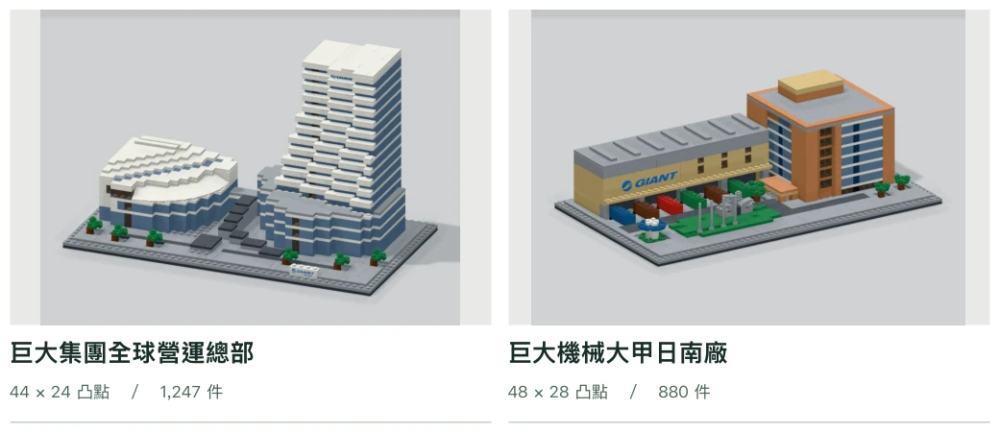

# FABFORM · 產業建築積木圖鑑

網站橫欄可切換十款建築，拖曳旋轉或進入開盒組裝。

## 台中產業建築規劃

台中五款合計 **4,269 件積木、23 袋、612 步**，另附 7 枚標誌貼紙。中科總部與大甲日南廠各有獨立的模型、採購表和手冊。表內件數按模型實際使用的零件統計。

| 3D 展示與組裝 | 主要造型 | 件數 | 袋／步 | 手冊 |
| --- | --- | ---: | --- | --- |
| [Fab 15A](https://pc007ya.github.io/TSMC_LEGO/?set=fab15a) | 高玻璃棟的紅色豎線、低翼與挑高遮棚 | 847 | 5／123 | [PDF](downloads/fab15a/manual.pdf) |
| [Fab 15B](https://pc007ya.github.io/TSMC_LEGO/?set=fab15b) | 金綠色遮陽屏、白灰廠房與圓角 L 形辦公棟 | 845 | 5／117 | [PDF](downloads/fab15b/manual.pdf) |
| [Fab 25 P1](https://pc007ya.github.io/TSMC_LEGO/?set=fab25) | 2026 年 8 月 31 日施工紀錄中的鋼構樓層及吊裝景象 | 450 | 4／71 | [PDF](downloads/fab25/manual.pdf) |
| [巨大集團全球營運總部](https://pc007ya.github.io/TSMC_LEGO/?set=giant) | 十五層塔樓、三層自行車文化探索館與二樓短橋 | 1,247 | 5／176 | [PDF](downloads/giant/manual.pdf) |
| [巨大大甲日南廠](https://pc007ya.github.io/TSMC_LEGO/?set=dajia) | 淡黃色招牌長廠房、暖磚色玻璃廠辦與前庭 | 880 | 4／125 | [PDF](downloads/dajia/manual.pdf) |

[圖解設計提案](downloads/taichung-plan.pdf) · [設計依據與各袋件數](downloads/taichung-plan.md) · [台中系列採購 BOM](downloads/taichung-bom.csv) · [台中系列原尺寸貼紙](downloads/taichung-stickers.pdf)

## 晶圓建築系列 · 五款原盒重建

依五張參考照片、TShop 商品三視圖及建築實景重建。五款原盒標示合計 **3,423 件**。本版採用 8 mm 凸點間距，共 **5,698 件積木、22 袋、812 個組裝步驟**，另附 9 枚原尺寸標誌貼紙。

[進入 3D 展示與組裝](https://pc007ya.github.io/TSMC_LEGO/) · [五款照片與件數對照](downloads/reference-guide.md) · [五款採購 BOM](downloads/collection-bom.csv) · [原尺寸貼紙 PDF](downloads/collection-stickers.pdf) · [貼紙清單](downloads/collection-decals.csv)

| 模型 | 原盒 | 本版件數 | 本版底座（凸點） | 袋 | 步驟 | 貼紙 | 手冊與設計檔 |
| --- | ---: | ---: | --- | ---: | ---: | ---: | --- |
| [張忠謀大樓](https://pc007ya.github.io/TSMC_LEGO/?set=twin) | [483](https://www.tshop.life/zh-hant/products/micro-brick-series-corporate-headquarters-fab-12a-pre-order) | 660 | 24 × 24 | 4 | 108 | 4 | [圖解](downloads/twin/manual.html) · [PDF](downloads/twin/manual.pdf) · [MD](downloads/twin/manual.md) · [BOM](downloads/twin/bom.csv) · [LDraw](downloads/twin/model.ldr) · [貼紙](downloads/twin/stickers.pdf) |
| [全球研發中心](https://pc007ya.github.io/TSMC_LEGO/?set=fins) | [748](https://www.tshop.life/zh-hant/products/micro-brick-series-global-rd-center-pre-order) | 1,928 | 60 × 46 | 5 | 264 | 1 | [圖解](downloads/fins/manual.html) · [PDF](downloads/fins/manual.pdf) · [MD](downloads/fins/manual.md) · [BOM](downloads/fins/bom.csv) · [LDraw](downloads/fins/model.ldr) · [貼紙](downloads/fins/stickers.pdf) |
| [JASM 熊本廠](https://pc007ya.github.io/TSMC_LEGO/?set=ribbon) | [738](https://www.tshop.life/zh-hant/products/micro-brick-series-japan-advanced-semiconductor-manufacturing-inc-pre-order) | 1,216 | 56 × 32 | 5 | 164 | 2 | [圖解](downloads/ribbon/manual.html) · [PDF](downloads/ribbon/manual.pdf) · [MD](downloads/ribbon/manual.md) · [BOM](downloads/ribbon/bom.csv) · [LDraw](downloads/ribbon/model.ldr) · [貼紙](downloads/ribbon/stickers.pdf) |
| [亞利桑那晶圓廠](https://pc007ya.github.io/TSMC_LEGO/?set=graphite) | [795](https://www.tshop.life/zh-hant/products/micro-brick-series-tsmc-arizona-corporation-pre-order) | 992 | 48 × 30 | 4 | 140 | 1 | [圖解](downloads/graphite/manual.html) · [PDF](downloads/graphite/manual.pdf) · [MD](downloads/graphite/manual.md) · [BOM](downloads/graphite/bom.csv) · [LDraw](downloads/graphite/model.ldr) · [貼紙](downloads/graphite/stickers.pdf) |
| [台積電南京園區](https://pc007ya.github.io/TSMC_LEGO/?set=arc) | [659](https://www.tshop.life/zh-hant/products/micro-brick-series-tsmc-nanjing-company-limited-pre-order) | 902 | 48 × 32 | 4 | 136 | 1 | [圖解](downloads/arc/manual.html) · [PDF](downloads/arc/manual.pdf) · [MD](downloads/arc/manual.md) · [BOM](downloads/arc/bom.csv) · [LDraw](downloads/arc/model.ldr) · [貼紙](downloads/arc/stickers.pdf) |

## 建築與貼紙

| 建築 | 依照片重建的特徵 | 貼紙位置 |
| --- | --- | --- |
| 張忠謀大樓 | 以入口廣場為正面，白棟在左，灰棟橫列後方。依指定的接合方向，右側藍色空橋沿前後方向垂直接入灰棟長牆，兩道藍框的末端都貼住灰牆。 | 白棟內側長牆、轉角藍窗旁的晶圓徽章、中庭入口、紅色底座上方的中英文大樓銘牌、中庭入口深灰牆上的晶圓徽章、綠帶前端、靠近水景的張忠謀大樓名牌 |
| 全球研發中心 | 白色直窗展廳在前，玻璃翼樓相鄰。俯視可分辨左後方的設備與右後方的淺色平台，兩列風道和風機分開排列。 西側環紋圓廳對應實景的圓柱迎賓大廳。 | 展廳正面左側白色門柱 |
| JASM 熊本廠 | 窄深的五層辦公棟位於右前，空橋通往白色生產棟。停車列在辦公棟後方，建築左側另有低矮後勤房。 | 生產棟最左白色面板上方、連廊正面上方白色銘板 |
| 亞利桑那晶圓廠 | 主廠右前側是露天冷卻翼樓，右後側另有白頂長棟。中央長棟、跨棟橫廊與兩者間的留隙可在俯視圖辨認。 | 主廠房正面右上晶圓圓徽 |
| 台積電南京園區 | 白色管形研發棟懸在支架上，後端伸出底座。橢圓廠房包住斜置機房，圓盤管制中心與蓮池在長廊另一側。 | 架空研發棟面向水池的圓角端面 |

在模型上方點「貼紙特寫」，選一枚貼紙的「看位置」，鏡頭會移到對應牆面。按右下方的重設視角圖示即可回到全景。在支援 3D 的瀏覽器可直接拖曳旋轉、滾動或雙指縮放。支援俯視圖的備用模式也可查看貼紙圖稿和位置說明。

[張忠謀大樓・灰棟與空橋接點特寫](https://pc007ya.github.io/TSMC_LEGO/?set=twin&view=junction)可從屋頂看到兩道平行藍框直接抵住灰牆。第三袋的接梁步驟可查看埋入灰牆的兩片薄板。

南京園區的「支撐側視」可看見白色 3224 斜撐框將樓板重量傳到左右兩列支腳。「橢圓俯視」可檢查中央機房四周一整圈的白弧。白色研發棟的截面以 1750 倒圓弧和 15068 上弧拼合，兩側內緣用薄板補齊。[支撐側視圖](assets/previews/arc-supports.webp) · [橢圓俯視圖](assets/previews/arc-oval.webp)

## 開盒、分袋與實體備料

點「開始組裝」並打開盒蓋，按袋號取出零件。每步顯示取件數、料號和橘色安裝框。遇到有標誌的積木，先點「貼上貼紙」，再點「裝上這一件」。也可點「完成本步」裝上該步剩餘零件。各款獨立保存目前的袋、步驟、零件與貼紙進度。張忠謀大樓更新了第三袋的接合步序，新版組裝進度從第 1 袋開始。

要實體搭建，從該款 BOM 依料號、顏色和各袋數量備料，使用 PDF 或離線 HTML 手冊上的取件圖、編號俯視圖、立體圖與定位表。全系列採購表將相同料號與顏色加總。列印貼紙請選 A4、實際大小或 100%，以尺核對頁底的 50 mm 刻度。每枚貼紙以單一零件面為承貼面，裁切後可在裝上該件前貼好。

底座由左後角起算，X 往右、Z 往前，首格為 1。底高以薄板層數計，桌面為 0，一塊標準磚高三層。張忠謀大樓空橋的兩片 3710 沙藍薄板橫跨屋面與灰牆，灰磚從上方壓住接點。南京斜廊、中央機房與弧牆另附支點及旋轉角度。照片未呈現的內部承重與扣位依積木接合需求設計。模型已檢查數位空間佔用、插入路徑、凸點承接、完工連通性、分袋及配色，實體扣合力與搬運強度仍待試拼。

## 檔案與重建

- `data/models.json` 保存所有積木、承貼面、貼紙尺寸、旋轉支點、分袋及步序。`data/catalog.json` 保存零件尺寸與 LDraw 色碼。每款的 `downloads` 目錄含六種檔案，LDraw 內嵌標誌圖案與組裝步序。
- 模型由 `tools/design.py`、`tools/campus_models.py`、`tools/industrial_models.py` 和各款 `tools/taichung_*.py` 模組 產生。工具使用 Python 3、NumPy、OpenCV、Pillow、PyMuPDF、Playwright 與 Chrome。
- 依序執行 `python3 tools/design.py`、`python3 tools/previews.py`、`python3 tools/manuals.py`、`python3 tools/manuals.py --pdf-only`、`python3 tools/collection.py`，可產生模型、封面、取件圖、手冊、BOM 與整套貼紙。台中設計提案另執行 `python3 tools/taichung_brief.py`。若要重新轉換零件幾何，另將 LDraw 官方 complete.zip 交給 `python3 tools/build_parts.py /path/to/complete.zip`，再重建預覽與手冊。更新單一模型時，可對預覽及手冊指令加上 `--model arc` 一類的模型代號。
- 在根目錄執行 `python3 -m http.server 8000` 可預覽。GitHub Pages 從 main 分支根目錄發布，3D 模型及所有執行時資源均由同站提供。下載的單款 HTML 手冊可離線閱讀。

## 參考與授權

分袋目錄、逐步取件數與定位圖參考 LEGO Architecture 說明書的閱讀方式。模型、分袋與步驟由本專案設計。南京園區建築配置另參照設計團隊公開的專案資料。[LEGO Architecture 21028 組裝說明](https://www.lego.com/cdn/product-assets/product.bi.core.pdf/6172680.pdf) · [姚仁喜｜大元建築工場・台積電南京園區](https://www.krisyaoartech.com/zh-tw/projects/corporate/TSMC-Nanjing-Campus)

台積電、JASM 與巨大集團的標誌用於識別照片中對應的建築，圖稿作者、使用方式及各自的授權記於來源表。3D 零件使用 LDraw 圖庫，3224 斜撐框另隨 LDraw 檔嵌入 Gerald Lasser 的 CC BY 4.0 圖稿，配色依 Rebrickable 的盒組記錄核對，展示使用 Three.js r180。[標誌與字牌](assets/decals/CREDITS.md) · [LDraw 圖庫與授權](assets/parts/CREDITS.md) · [配色核對](tools/stock.md) · [Three.js MIT 授權](assets/vendor/THREE-LICENSE.txt)
