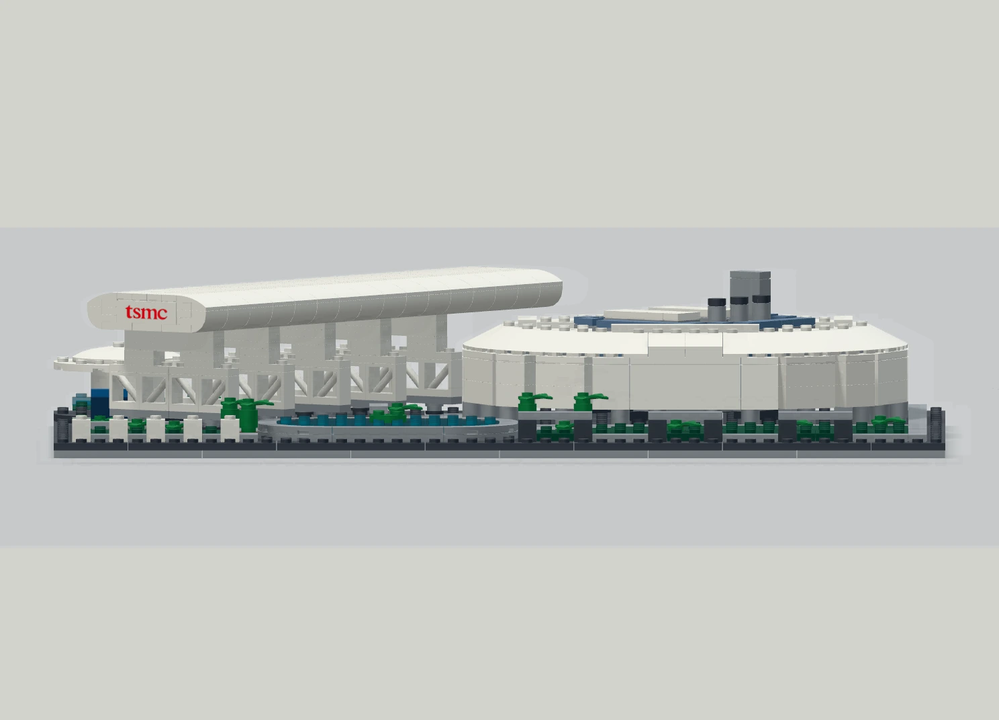
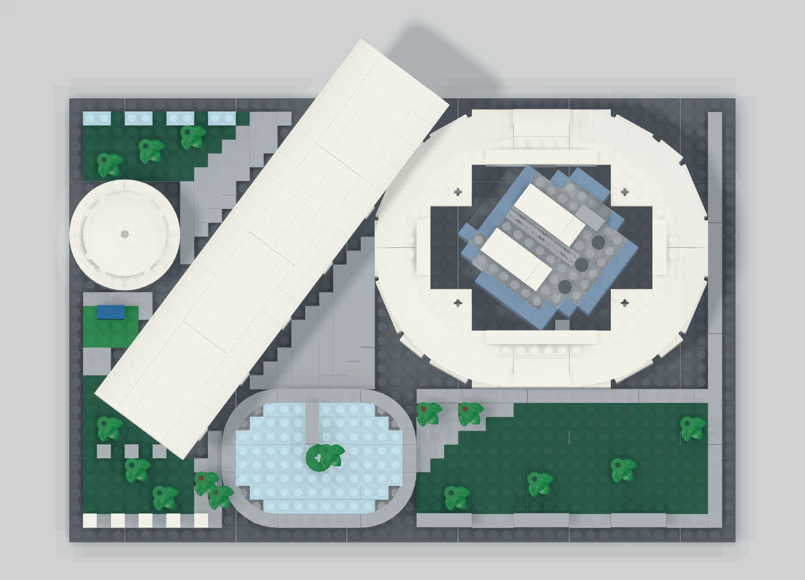
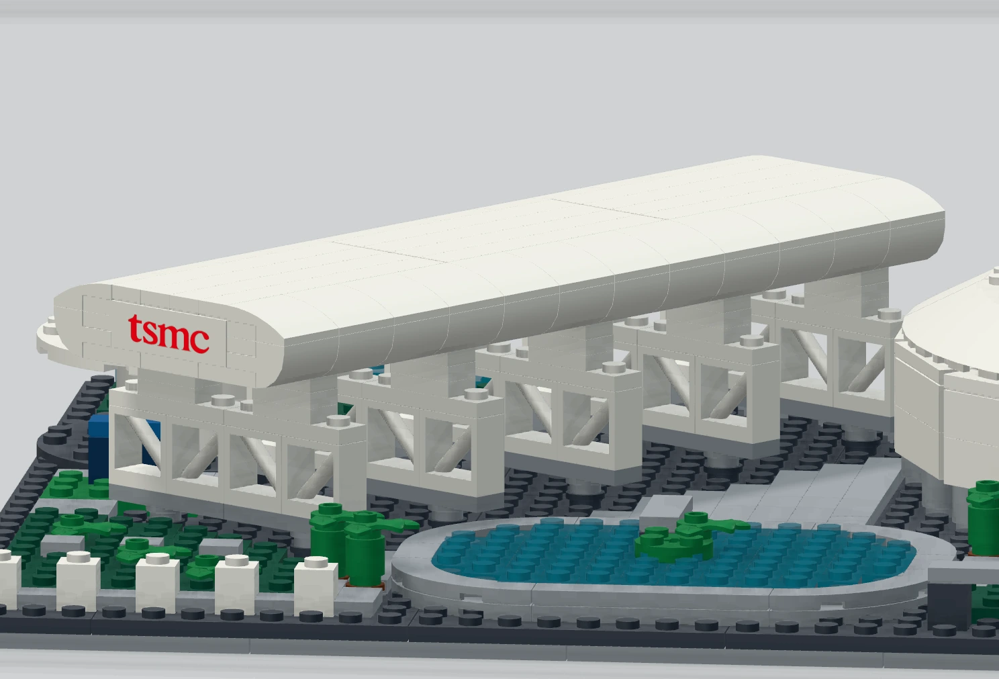
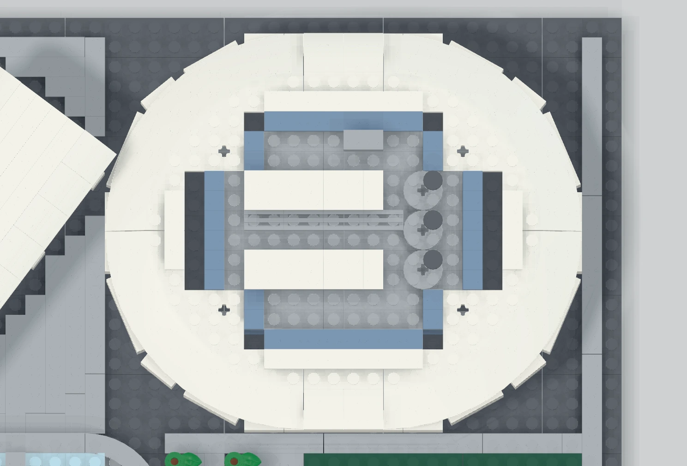

# 台積電南京園區｜組裝說明書

FAB 05 · TSMC Nanjing Campus

池畔的白色研發棟橫跨五座鏤空 V 形支架，上下兩側的曲面在紅色 tsmc 端牌旁收圓。右側廠房以完整白色橢圓外環圍住斜置的沙藍機房，環下的灰色支墩之間可看見通廊。

902 件 · 4 袋 · 136 步

底座 48 × 32 凸點。

將底座較後的一側朝上，從左上角第 1 顆凸點開始數。X 由左向右，Z 由後向前。底高以薄板為單位，桌面是 0，一塊標準磚高 3 層薄板。每個位置均取零件佔地最左、最後的凸點。

圖號依每一步的安裝順序編列，回到下一個步驟時從 1 重新起算。[圖解說明書](manual.html) · [分袋 BOM](bom.csv) · [分步 LDraw 模型](model.ldr)

## 原盒資料與本版用量

白色管形研發棟懸在支架上，後端伸出底座。橢圓廠房包住斜置機房，圓盤管制中心與蓮池在長廊另一側。

TShop 原盒 F010040101 標示 659 件，商品尺寸 25.0 × 27.7 × 5.6 公分。本版使用 902 件標準積木，另有 1 枚貼紙。採購請依本版分袋 BOM。

[原盒與尺寸](https://www.tshop.life/zh-hant/products/micro-brick-series-tsmc-nanjing-company-limited-pre-order) · [商品三視圖](https://shoplineimg.com/64c760de75653b004eb51fc9/6ae46089e8d42af8aa4cf5ba/original.jpg) · [姚仁喜｜大元建築工場・南京園區](https://www.krisyaoartech.com/zh-tw/projects/corporate/TSMC-Nanjing-Campus)

## 園區方位、支撐與外環

**池畔正面**　從池畔看向園區，研發棟的紅色端牌與圓盤管制中心在左，右側橢圓白牆圍住機房。

**園區俯視**　白色管形研發棟斜跨園區，後端懸出底座，前端朝向蓮池。圓盤管制中心與橢圓廠房分居兩側。

**支撐側視**　五座支架各有兩個獨立落地支腳。成對的白色斜桿支撐上方縱梁，兩側倒圓弧磚包住樓板。

**橢圓俯視**　沿白色外牆繞一圈，可見四道大半徑屋緣連成封閉外環，中央機房與成排冷卻箱相對底座斜放，與正面圓弧形成明顯的方向差。

## 原寸貼紙

本款有 1 張貼紙。請以 100% 列印原寸貼紙 PDF，依步驟中的 S 編號貼在指定磚面，再把該件扣入。

[下載 A4 可列印貼紙](stickers.pdf)

- S01　架空研發棟面向水池的圓角端面 · 袋 03／步驟 102 · 24 × 6 mm · 正面（朝前）（長廊轉向前），面中央。

## 斜廊安裝

先把灰色支腳扣在底座凸點 (17, 5)、(14, 9)、(11, 13)、(8, 17)、(5, 21)、(21, 8)、(18, 12)、(15, 16)、(12, 20)、(9, 24)。每座斜撐的左右底板由上方看順時針轉 36.87°，對準同一橫排的兩個支腳，再按順序加上斜撐與樓板。轉向前的座標均以長廊自身格線表示。

## 第 01 袋　底座與定位

111 件，共 14 步。

| 顏色 | 零件 | 設計／庫號 | 數量 |
| --- | --- | --- | ---: |
| 淺藍灰 | 薄板 4×8 | 3035 | 48 |
| 深藍灰 | 薄板 2×4 | 3020 | 4 |
| 深藍灰 | 薄板 4×4 | 3031 | 14 |
| 深藍灰 | 薄板 2×8 | 3034 | 10 |
| 深藍灰 | 薄板 4×8 | 3035 | 35 |

### 步驟 01　併排底板（1/6）

將底板凸點朝上、長邊對齊排在平桌。下一層會跨接板縫。

**本步取件**

| 顏色 | 零件 | 設計／庫號 | 數量 |
| --- | --- | --- | ---: |
| 淺藍灰 | 薄板 4×8 | 3035 | 8 |

**安裝位置**

| 圖號 | 零件與顏色 | X | Z | 底高（薄板） | 方向 |
| ---: | --- | ---: | ---: | ---: | --- |
| 1 | 淺藍灰 薄板 4×8（3035） | 1 | 1 | 0 | 沿 X |
| 2 | 淺藍灰 薄板 4×8（3035） | 9 | 1 | 0 | 沿 X |
| 3 | 淺藍灰 薄板 4×8（3035） | 17 | 1 | 0 | 沿 X |
| 4 | 淺藍灰 薄板 4×8（3035） | 25 | 1 | 0 | 沿 X |
| 5 | 淺藍灰 薄板 4×8（3035） | 33 | 1 | 0 | 沿 X |
| 6 | 淺藍灰 薄板 4×8（3035） | 41 | 1 | 0 | 沿 X |
| 7 | 淺藍灰 薄板 4×8（3035） | 1 | 5 | 0 | 沿 X |
| 8 | 淺藍灰 薄板 4×8（3035） | 9 | 5 | 0 | 沿 X |

### 步驟 02　併排底板（2/6）

將底板凸點朝上、長邊對齊排在平桌。下一層會跨接板縫。

**本步取件**

| 顏色 | 零件 | 設計／庫號 | 數量 |
| --- | --- | --- | ---: |
| 淺藍灰 | 薄板 4×8 | 3035 | 8 |

**安裝位置**

| 圖號 | 零件與顏色 | X | Z | 底高（薄板） | 方向 |
| ---: | --- | ---: | ---: | ---: | --- |
| 1 | 淺藍灰 薄板 4×8（3035） | 17 | 5 | 0 | 沿 X |
| 2 | 淺藍灰 薄板 4×8（3035） | 25 | 5 | 0 | 沿 X |
| 3 | 淺藍灰 薄板 4×8（3035） | 33 | 5 | 0 | 沿 X |
| 4 | 淺藍灰 薄板 4×8（3035） | 41 | 5 | 0 | 沿 X |
| 5 | 淺藍灰 薄板 4×8（3035） | 1 | 9 | 0 | 沿 X |
| 6 | 淺藍灰 薄板 4×8（3035） | 9 | 9 | 0 | 沿 X |
| 7 | 淺藍灰 薄板 4×8（3035） | 17 | 9 | 0 | 沿 X |
| 8 | 淺藍灰 薄板 4×8（3035） | 25 | 9 | 0 | 沿 X |

### 步驟 03　併排底板（3/6）

將底板凸點朝上、長邊對齊排在平桌。下一層會跨接板縫。

**本步取件**

| 顏色 | 零件 | 設計／庫號 | 數量 |
| --- | --- | --- | ---: |
| 淺藍灰 | 薄板 4×8 | 3035 | 8 |

**安裝位置**

| 圖號 | 零件與顏色 | X | Z | 底高（薄板） | 方向 |
| ---: | --- | ---: | ---: | ---: | --- |
| 1 | 淺藍灰 薄板 4×8（3035） | 33 | 9 | 0 | 沿 X |
| 2 | 淺藍灰 薄板 4×8（3035） | 41 | 9 | 0 | 沿 X |
| 3 | 淺藍灰 薄板 4×8（3035） | 1 | 13 | 0 | 沿 X |
| 4 | 淺藍灰 薄板 4×8（3035） | 9 | 13 | 0 | 沿 X |
| 5 | 淺藍灰 薄板 4×8（3035） | 17 | 13 | 0 | 沿 X |
| 6 | 淺藍灰 薄板 4×8（3035） | 25 | 13 | 0 | 沿 X |
| 7 | 淺藍灰 薄板 4×8（3035） | 33 | 13 | 0 | 沿 X |
| 8 | 淺藍灰 薄板 4×8（3035） | 41 | 13 | 0 | 沿 X |

### 步驟 04　併排底板（4/6）

將底板凸點朝上、長邊對齊排在平桌。下一層會跨接板縫。

**本步取件**

| 顏色 | 零件 | 設計／庫號 | 數量 |
| --- | --- | --- | ---: |
| 淺藍灰 | 薄板 4×8 | 3035 | 8 |

**安裝位置**

| 圖號 | 零件與顏色 | X | Z | 底高（薄板） | 方向 |
| ---: | --- | ---: | ---: | ---: | --- |
| 1 | 淺藍灰 薄板 4×8（3035） | 1 | 17 | 0 | 沿 X |
| 2 | 淺藍灰 薄板 4×8（3035） | 9 | 17 | 0 | 沿 X |
| 3 | 淺藍灰 薄板 4×8（3035） | 17 | 17 | 0 | 沿 X |
| 4 | 淺藍灰 薄板 4×8（3035） | 25 | 17 | 0 | 沿 X |
| 5 | 淺藍灰 薄板 4×8（3035） | 33 | 17 | 0 | 沿 X |
| 6 | 淺藍灰 薄板 4×8（3035） | 41 | 17 | 0 | 沿 X |
| 7 | 淺藍灰 薄板 4×8（3035） | 1 | 21 | 0 | 沿 X |
| 8 | 淺藍灰 薄板 4×8（3035） | 9 | 21 | 0 | 沿 X |

### 步驟 05　併排底板（5/6）

將底板凸點朝上、長邊對齊排在平桌。下一層會跨接板縫。

**本步取件**

| 顏色 | 零件 | 設計／庫號 | 數量 |
| --- | --- | --- | ---: |
| 淺藍灰 | 薄板 4×8 | 3035 | 8 |

**安裝位置**

| 圖號 | 零件與顏色 | X | Z | 底高（薄板） | 方向 |
| ---: | --- | ---: | ---: | ---: | --- |
| 1 | 淺藍灰 薄板 4×8（3035） | 17 | 21 | 0 | 沿 X |
| 2 | 淺藍灰 薄板 4×8（3035） | 25 | 21 | 0 | 沿 X |
| 3 | 淺藍灰 薄板 4×8（3035） | 33 | 21 | 0 | 沿 X |
| 4 | 淺藍灰 薄板 4×8（3035） | 41 | 21 | 0 | 沿 X |
| 5 | 淺藍灰 薄板 4×8（3035） | 1 | 25 | 0 | 沿 X |
| 6 | 淺藍灰 薄板 4×8（3035） | 9 | 25 | 0 | 沿 X |
| 7 | 淺藍灰 薄板 4×8（3035） | 17 | 25 | 0 | 沿 X |
| 8 | 淺藍灰 薄板 4×8（3035） | 25 | 25 | 0 | 沿 X |

### 步驟 06　併排底板（6/6）

將底板凸點朝上、長邊對齊排在平桌。下一層會跨接板縫。

**本步取件**

| 顏色 | 零件 | 設計／庫號 | 數量 |
| --- | --- | --- | ---: |
| 淺藍灰 | 薄板 4×8 | 3035 | 8 |

**安裝位置**

| 圖號 | 零件與顏色 | X | Z | 底高（薄板） | 方向 |
| ---: | --- | ---: | ---: | ---: | --- |
| 1 | 淺藍灰 薄板 4×8（3035） | 33 | 25 | 0 | 沿 X |
| 2 | 淺藍灰 薄板 4×8（3035） | 41 | 25 | 0 | 沿 X |
| 3 | 淺藍灰 薄板 4×8（3035） | 1 | 29 | 0 | 沿 X |
| 4 | 淺藍灰 薄板 4×8（3035） | 9 | 29 | 0 | 沿 X |
| 5 | 淺藍灰 薄板 4×8（3035） | 17 | 29 | 0 | 沿 X |
| 6 | 淺藍灰 薄板 4×8（3035） | 25 | 29 | 0 | 沿 X |
| 7 | 淺藍灰 薄板 4×8（3035） | 33 | 29 | 0 | 沿 X |
| 8 | 淺藍灰 薄板 4×8（3035） | 41 | 29 | 0 | 沿 X |

### 步驟 07　錯縫鎖底（1/8）

上層相對底板橫移四格、縱移兩格。逐排按緊後，底座可整片拿起。

**本步取件**

| 顏色 | 零件 | 設計／庫號 | 數量 |
| --- | --- | --- | ---: |
| 深藍灰 | 薄板 2×4 | 3020 | 2 |
| 深藍灰 | 薄板 4×4 | 3031 | 1 |
| 深藍灰 | 薄板 2×8 | 3034 | 5 |

**安裝位置**

| 圖號 | 零件與顏色 | X | Z | 底高（薄板） | 方向 |
| ---: | --- | ---: | ---: | ---: | --- |
| 1 | 深藍灰 薄板 2×4（3020） | 1 | 1 | 1 | 沿 X |
| 2 | 深藍灰 薄板 2×8（3034） | 5 | 1 | 1 | 沿 X |
| 3 | 深藍灰 薄板 2×8（3034） | 13 | 1 | 1 | 沿 X |
| 4 | 深藍灰 薄板 2×8（3034） | 21 | 1 | 1 | 沿 X |
| 5 | 深藍灰 薄板 2×8（3034） | 29 | 1 | 1 | 沿 X |
| 6 | 深藍灰 薄板 2×8（3034） | 37 | 1 | 1 | 沿 X |
| 7 | 深藍灰 薄板 2×4（3020） | 45 | 1 | 1 | 沿 X |
| 8 | 深藍灰 薄板 4×4（3031） | 1 | 3 | 1 | — |

### 步驟 08　錯縫鎖底（2/8）

上層相對底板橫移四格、縱移兩格。逐排按緊後，底座可整片拿起。

**本步取件**

| 顏色 | 零件 | 設計／庫號 | 數量 |
| --- | --- | --- | ---: |
| 深藍灰 | 薄板 4×4 | 3031 | 2 |
| 深藍灰 | 薄板 4×8 | 3035 | 6 |

**安裝位置**

| 圖號 | 零件與顏色 | X | Z | 底高（薄板） | 方向 |
| ---: | --- | ---: | ---: | ---: | --- |
| 1 | 深藍灰 薄板 4×8（3035） | 5 | 3 | 1 | 沿 X |
| 2 | 深藍灰 薄板 4×8（3035） | 13 | 3 | 1 | 沿 X |
| 3 | 深藍灰 薄板 4×8（3035） | 21 | 3 | 1 | 沿 X |
| 4 | 深藍灰 薄板 4×8（3035） | 29 | 3 | 1 | 沿 X |
| 5 | 深藍灰 薄板 4×8（3035） | 37 | 3 | 1 | 沿 X |
| 6 | 深藍灰 薄板 4×4（3031） | 45 | 3 | 1 | — |
| 7 | 深藍灰 薄板 4×4（3031） | 1 | 7 | 1 | — |
| 8 | 深藍灰 薄板 4×8（3035） | 5 | 7 | 1 | 沿 X |

### 步驟 09　錯縫鎖底（3/8）

上層相對底板橫移四格、縱移兩格。逐排按緊後，底座可整片拿起。

**本步取件**

| 顏色 | 零件 | 設計／庫號 | 數量 |
| --- | --- | --- | ---: |
| 深藍灰 | 薄板 4×4 | 3031 | 2 |
| 深藍灰 | 薄板 4×8 | 3035 | 6 |

**安裝位置**

| 圖號 | 零件與顏色 | X | Z | 底高（薄板） | 方向 |
| ---: | --- | ---: | ---: | ---: | --- |
| 1 | 深藍灰 薄板 4×8（3035） | 13 | 7 | 1 | 沿 X |
| 2 | 深藍灰 薄板 4×8（3035） | 21 | 7 | 1 | 沿 X |
| 3 | 深藍灰 薄板 4×8（3035） | 29 | 7 | 1 | 沿 X |
| 4 | 深藍灰 薄板 4×8（3035） | 37 | 7 | 1 | 沿 X |
| 5 | 深藍灰 薄板 4×4（3031） | 45 | 7 | 1 | — |
| 6 | 深藍灰 薄板 4×4（3031） | 1 | 11 | 1 | — |
| 7 | 深藍灰 薄板 4×8（3035） | 5 | 11 | 1 | 沿 X |
| 8 | 深藍灰 薄板 4×8（3035） | 13 | 11 | 1 | 沿 X |

### 步驟 10　錯縫鎖底（4/8）

上層相對底板橫移四格、縱移兩格。逐排按緊後，底座可整片拿起。

**本步取件**

| 顏色 | 零件 | 設計／庫號 | 數量 |
| --- | --- | --- | ---: |
| 深藍灰 | 薄板 4×4 | 3031 | 2 |
| 深藍灰 | 薄板 4×8 | 3035 | 6 |

**安裝位置**

| 圖號 | 零件與顏色 | X | Z | 底高（薄板） | 方向 |
| ---: | --- | ---: | ---: | ---: | --- |
| 1 | 深藍灰 薄板 4×8（3035） | 21 | 11 | 1 | 沿 X |
| 2 | 深藍灰 薄板 4×8（3035） | 29 | 11 | 1 | 沿 X |
| 3 | 深藍灰 薄板 4×8（3035） | 37 | 11 | 1 | 沿 X |
| 4 | 深藍灰 薄板 4×4（3031） | 45 | 11 | 1 | — |
| 5 | 深藍灰 薄板 4×4（3031） | 1 | 15 | 1 | — |
| 6 | 深藍灰 薄板 4×8（3035） | 5 | 15 | 1 | 沿 X |
| 7 | 深藍灰 薄板 4×8（3035） | 13 | 15 | 1 | 沿 X |
| 8 | 深藍灰 薄板 4×8（3035） | 21 | 15 | 1 | 沿 X |

### 步驟 11　錯縫鎖底（5/8）

上層相對底板橫移四格、縱移兩格。逐排按緊後，底座可整片拿起。

**本步取件**

| 顏色 | 零件 | 設計／庫號 | 數量 |
| --- | --- | --- | ---: |
| 深藍灰 | 薄板 4×4 | 3031 | 2 |
| 深藍灰 | 薄板 4×8 | 3035 | 6 |

**安裝位置**

| 圖號 | 零件與顏色 | X | Z | 底高（薄板） | 方向 |
| ---: | --- | ---: | ---: | ---: | --- |
| 1 | 深藍灰 薄板 4×8（3035） | 29 | 15 | 1 | 沿 X |
| 2 | 深藍灰 薄板 4×8（3035） | 37 | 15 | 1 | 沿 X |
| 3 | 深藍灰 薄板 4×4（3031） | 45 | 15 | 1 | — |
| 4 | 深藍灰 薄板 4×4（3031） | 1 | 19 | 1 | — |
| 5 | 深藍灰 薄板 4×8（3035） | 5 | 19 | 1 | 沿 X |
| 6 | 深藍灰 薄板 4×8（3035） | 13 | 19 | 1 | 沿 X |
| 7 | 深藍灰 薄板 4×8（3035） | 21 | 19 | 1 | 沿 X |
| 8 | 深藍灰 薄板 4×8（3035） | 29 | 19 | 1 | 沿 X |

### 步驟 12　錯縫鎖底（6/8）

上層相對底板橫移四格、縱移兩格。逐排按緊後，底座可整片拿起。

**本步取件**

| 顏色 | 零件 | 設計／庫號 | 數量 |
| --- | --- | --- | ---: |
| 深藍灰 | 薄板 4×4 | 3031 | 2 |
| 深藍灰 | 薄板 4×8 | 3035 | 6 |

**安裝位置**

| 圖號 | 零件與顏色 | X | Z | 底高（薄板） | 方向 |
| ---: | --- | ---: | ---: | ---: | --- |
| 1 | 深藍灰 薄板 4×8（3035） | 37 | 19 | 1 | 沿 X |
| 2 | 深藍灰 薄板 4×4（3031） | 45 | 19 | 1 | — |
| 3 | 深藍灰 薄板 4×4（3031） | 1 | 23 | 1 | — |
| 4 | 深藍灰 薄板 4×8（3035） | 5 | 23 | 1 | 沿 X |
| 5 | 深藍灰 薄板 4×8（3035） | 13 | 23 | 1 | 沿 X |
| 6 | 深藍灰 薄板 4×8（3035） | 21 | 23 | 1 | 沿 X |
| 7 | 深藍灰 薄板 4×8（3035） | 29 | 23 | 1 | 沿 X |
| 8 | 深藍灰 薄板 4×8（3035） | 37 | 23 | 1 | 沿 X |

### 步驟 13　錯縫鎖底（7/8）

上層相對底板橫移四格、縱移兩格。逐排按緊後，底座可整片拿起。

**本步取件**

| 顏色 | 零件 | 設計／庫號 | 數量 |
| --- | --- | --- | ---: |
| 深藍灰 | 薄板 4×4 | 3031 | 3 |
| 深藍灰 | 薄板 4×8 | 3035 | 5 |

**安裝位置**

| 圖號 | 零件與顏色 | X | Z | 底高（薄板） | 方向 |
| ---: | --- | ---: | ---: | ---: | --- |
| 1 | 深藍灰 薄板 4×4（3031） | 45 | 23 | 1 | — |
| 2 | 深藍灰 薄板 4×4（3031） | 1 | 27 | 1 | — |
| 3 | 深藍灰 薄板 4×8（3035） | 5 | 27 | 1 | 沿 X |
| 4 | 深藍灰 薄板 4×8（3035） | 13 | 27 | 1 | 沿 X |
| 5 | 深藍灰 薄板 4×8（3035） | 21 | 27 | 1 | 沿 X |
| 6 | 深藍灰 薄板 4×8（3035） | 29 | 27 | 1 | 沿 X |
| 7 | 深藍灰 薄板 4×8（3035） | 37 | 27 | 1 | 沿 X |
| 8 | 深藍灰 薄板 4×4（3031） | 45 | 27 | 1 | — |

### 步驟 14　錯縫鎖底（8/8）

上層相對底板橫移四格、縱移兩格。逐排按緊後，底座可整片拿起。

**本步取件**

| 顏色 | 零件 | 設計／庫號 | 數量 |
| --- | --- | --- | ---: |
| 深藍灰 | 薄板 2×4 | 3020 | 2 |
| 深藍灰 | 薄板 2×8 | 3034 | 5 |

**安裝位置**

| 圖號 | 零件與顏色 | X | Z | 底高（薄板） | 方向 |
| ---: | --- | ---: | ---: | ---: | --- |
| 1 | 深藍灰 薄板 2×4（3020） | 1 | 31 | 1 | 沿 X |
| 2 | 深藍灰 薄板 2×8（3034） | 5 | 31 | 1 | 沿 X |
| 3 | 深藍灰 薄板 2×8（3034） | 13 | 31 | 1 | 沿 X |
| 4 | 深藍灰 薄板 2×8（3034） | 21 | 31 | 1 | 沿 X |
| 5 | 深藍灰 薄板 2×8（3034） | 29 | 31 | 1 | 沿 X |
| 6 | 深藍灰 薄板 2×8（3034） | 37 | 31 | 1 | 沿 X |
| 7 | 深藍灰 薄板 2×4（3020） | 45 | 31 | 1 | 沿 X |

## 第 02 袋　架空支墩、橢圓廠房與中央機房

322 件，共 57 步。

| 顏色 | 零件 | 設計／庫號 | 數量 |
| --- | --- | --- | ---: |
| 白色 | 弧面斜磚 2×2 | 15068 | 4 |
| 白色 | 光面板 1×4 | 2431 | 6 |
| 白色 | 磚 1×2 | 3004 | 24 |
| 白色 | 磚 1×6 | 3009 | 4 |
| 白色 | 磚 1×4 | 3010 | 8 |
| 白色 | 薄板 2×4 | 3020 | 8 |
| 白色 | 光面板 1×2 | 3069b | 14 |
| 白色 | 磚 1×3 | 3622 | 8 |
| 白色 | 薄板 1×4 | 3710 | 2 |
| 白色 | 光面板 1×8 | 4162 | 2 |
| 白色 | 弧形牆磚 10×10 | 58846 | 4 |
| 白色 | 光面板 1×3 | 63864 | 4 |
| 白色 | 光面板 1×6 | 6636 | 2 |
| 白色 | 光面板 2×4 | 87079 | 2 |
| 淺藍灰 | 格柵板 1×2 | 2412b | 3 |
| 淺藍灰 | 磚 2×2 | 3003 | 30 |
| 淺藍灰 | 磚 1×2 | 3004 | 29 |
| 淺藍灰 | 薄板 2×4 | 3020 | 2 |
| 淺藍灰 | 薄板 1×2 | 3023 | 2 |
| 淺藍灰 | 薄板 2×8 | 3034 | 2 |
| 淺藍灰 | 圓磚 1×1 | 3062b | 27 |
| 淺藍灰 | 光面板 1×2 | 3069b | 1 |
| 淺藍灰 | 薄板 1×8 | 3460 | 2 |
| 淺藍灰 | 薄板 1×3 | 3623 | 2 |
| 淺藍灰 | 薄板 1×6 | 3666 | 18 |
| 淺藍灰 | 薄板 1×4 | 3710 | 14 |
| 深藍灰 | 薄板 2×4 | 3020 | 2 |
| 深藍灰 | 薄板 2×2 | 3022 | 4 |
| 深藍灰 | 薄板 1×6 | 3666 | 4 |
| 深藍灰 | 圓薄板 1×1 | 4073 | 5 |
| 深藍灰 | 圓形光面板 1×1 | 98138 | 3 |
| 沙藍 | 磚 1×1 | 3005 | 54 |
| 沙藍 | 磚 1×6 | 3009 | 3 |
| 沙藍 | 光面板 1×1 | 3070b | 18 |
| 沙藍 | 磚 1×3 | 3622 | 3 |
| 沙藍 | 光面板 1×3 | 63864 | 1 |
| 沙藍 | 光面板 1×6 | 6636 | 1 |

### 步驟 15　環廊內縮的承重墩（1/2）

在四道弧下面各立兩座灰色支墩。留出墩間通道，兩側草地可從廊下看見。

**本步取件**

| 顏色 | 零件 | 設計／庫號 | 數量 |
| --- | --- | --- | ---: |
| 淺藍灰 | 磚 2×2 | 3003 | 8 |

**安裝位置**

| 圖號 | 零件與顏色 | X | Z | 底高（薄板） | 方向 |
| ---: | --- | ---: | ---: | ---: | --- |
| 1 | 淺藍灰 磚 2×2（3003） | 28 | 6 | 2 | — |
| 2 | 淺藍灰 磚 2×2（3003） | 25 | 10 | 2 | — |
| 3 | 淺藍灰 磚 2×2（3003） | 40 | 6 | 2 | — |
| 4 | 淺藍灰 磚 2×2（3003） | 43 | 10 | 2 | — |
| 5 | 淺藍灰 磚 2×2（3003） | 28 | 16 | 2 | — |
| 6 | 淺藍灰 磚 2×2（3003） | 25 | 12 | 2 | — |
| 7 | 淺藍灰 磚 2×2（3003） | 40 | 16 | 2 | — |
| 8 | 淺藍灰 磚 2×2（3003） | 43 | 12 | 2 | — |

### 步驟 16　環廊內縮的承重墩（2/2）

在四道弧下面各立兩座灰色支墩。留出墩間通道，兩側草地可從廊下看見。

**本步取件**

| 顏色 | 零件 | 設計／庫號 | 數量 |
| --- | --- | --- | ---: |
| 淺藍灰 | 磚 2×2 | 3003 | 2 |

**安裝位置**

| 圖號 | 零件與顏色 | X | Z | 底高（薄板） | 方向 |
| ---: | --- | ---: | ---: | ---: | --- |
| 1 | 淺藍灰 磚 2×2（3003） | 34 | 4 | 2 | — |
| 2 | 淺藍灰 磚 2×2（3003） | 34 | 18 | 2 | — |

### 步驟 17　支墩頂板與四道跨縫梁

加寬各墩頂，左右端的長板連起前後支墩。前後端的橫梁從內側連到兩道弧。

**本步取件**

| 顏色 | 零件 | 設計／庫號 | 數量 |
| --- | --- | --- | ---: |
| 淺藍灰 | 薄板 2×8 | 3034 | 2 |
| 深藍灰 | 薄板 2×4 | 3020 | 2 |
| 深藍灰 | 薄板 2×2 | 3022 | 4 |

**安裝位置**

| 圖號 | 零件與顏色 | X | Z | 底高（薄板） | 方向 |
| ---: | --- | ---: | ---: | ---: | --- |
| 1 | 深藍灰 薄板 2×2（3022） | 28 | 6 | 5 | — |
| 2 | 深藍灰 薄板 2×2（3022） | 40 | 6 | 5 | — |
| 3 | 深藍灰 薄板 2×2（3022） | 28 | 16 | 5 | — |
| 4 | 深藍灰 薄板 2×2（3022） | 40 | 16 | 5 | — |
| 5 | 深藍灰 薄板 2×4（3020） | 25 | 10 | 5 | 沿 Z |
| 6 | 深藍灰 薄板 2×4（3020） | 43 | 10 | 5 | 沿 Z |
| 7 | 淺藍灰 薄板 2×8（3034） | 31 | 4 | 5 | 沿 X |
| 8 | 淺藍灰 薄板 2×8（3034） | 31 | 18 | 5 | 沿 X |

### 步驟 18　環廊內緣的承重骨架（1/3）

沿既有灰墩再砌兩層。這圈內縮的支柱承托完整的弧形屋頂，外緣留給白色直立面板。

**本步取件**

| 顏色 | 零件 | 設計／庫號 | 數量 |
| --- | --- | --- | ---: |
| 淺藍灰 | 磚 2×2 | 3003 | 8 |

**安裝位置**

| 圖號 | 零件與顏色 | X | Z | 底高（薄板） | 方向 |
| ---: | --- | ---: | ---: | ---: | --- |
| 1 | 淺藍灰 磚 2×2（3003） | 28 | 6 | 6 | — |
| 2 | 淺藍灰 磚 2×2（3003） | 25 | 10 | 6 | — |
| 3 | 淺藍灰 磚 2×2（3003） | 40 | 6 | 6 | — |
| 4 | 淺藍灰 磚 2×2（3003） | 43 | 10 | 6 | — |
| 5 | 淺藍灰 磚 2×2（3003） | 28 | 16 | 6 | — |
| 6 | 淺藍灰 磚 2×2（3003） | 25 | 12 | 6 | — |
| 7 | 淺藍灰 磚 2×2（3003） | 40 | 16 | 6 | — |
| 8 | 淺藍灰 磚 2×2（3003） | 43 | 12 | 6 | — |

### 步驟 19　環廊內緣的承重骨架（2/3）

沿既有灰墩再砌兩層。這圈內縮的支柱承托完整的弧形屋頂，外緣留給白色直立面板。

**本步取件**

| 顏色 | 零件 | 設計／庫號 | 數量 |
| --- | --- | --- | ---: |
| 淺藍灰 | 磚 2×2 | 3003 | 8 |

**安裝位置**

| 圖號 | 零件與顏色 | X | Z | 底高（薄板） | 方向 |
| ---: | --- | ---: | ---: | ---: | --- |
| 1 | 淺藍灰 磚 2×2（3003） | 34 | 4 | 6 | — |
| 2 | 淺藍灰 磚 2×2（3003） | 34 | 18 | 6 | — |
| 3 | 淺藍灰 磚 2×2（3003） | 28 | 6 | 9 | — |
| 4 | 淺藍灰 磚 2×2（3003） | 25 | 10 | 9 | — |
| 5 | 淺藍灰 磚 2×2（3003） | 40 | 6 | 9 | — |
| 6 | 淺藍灰 磚 2×2（3003） | 43 | 10 | 9 | — |
| 7 | 淺藍灰 磚 2×2（3003） | 28 | 16 | 9 | — |
| 8 | 淺藍灰 磚 2×2（3003） | 25 | 12 | 9 | — |

### 步驟 20　環廊內緣的承重骨架（3/3）

沿既有灰墩再砌兩層。這圈內縮的支柱承托完整的弧形屋頂，外緣留給白色直立面板。

**本步取件**

| 顏色 | 零件 | 設計／庫號 | 數量 |
| --- | --- | --- | ---: |
| 淺藍灰 | 磚 2×2 | 3003 | 4 |

**安裝位置**

| 圖號 | 零件與顏色 | X | Z | 底高（薄板） | 方向 |
| ---: | --- | ---: | ---: | ---: | --- |
| 1 | 淺藍灰 磚 2×2（3003） | 40 | 16 | 9 | — |
| 2 | 淺藍灰 磚 2×2（3003） | 43 | 12 | 9 | — |
| 3 | 淺藍灰 磚 2×2（3003） | 34 | 4 | 9 | — |
| 4 | 淺藍灰 磚 2×2（3003） | 34 | 18 | 9 | — |

### 步驟 21　東南弧面 1 · 立柱與白牆

將細圓柱扣在第 46 欄、第 12 列。在圓柱上疊兩層白牆及一片光面頂板，俯視由向右的長軸轉 +90°，面板與兩側接出圓弧。

**本步取件**

| 顏色 | 零件 | 設計／庫號 | 數量 |
| --- | --- | --- | ---: |
| 白色 | 磚 1×2 | 3004 | 2 |
| 白色 | 光面板 1×2 | 3069b | 1 |
| 淺藍灰 | 圓磚 1×1 | 3062b | 1 |

**安裝位置**

| 圖號 | 零件與顏色 | X | Z | 底高（薄板） | 方向 |
| ---: | --- | ---: | ---: | ---: | --- |
| 1 | 淺藍灰 圓磚 1×1（3062b） | 46 | 12 | 2 | — |
| 2 | 白色 磚 1×2（3004） | 46 | 12 | 5 | 沿 X，旋 +90.00° |
| 3 | 白色 磚 1×2（3004） | 46 | 12 | 8 | 沿 X，旋 +90.00° |
| 4 | 白色 光面板 1×2（3069b） | 46 | 12 | 11 | 沿 X，旋 +90.00° |

本步為轉向前座標。從上方看，正數順時針。

- 東南弧面 1的定位支點 (46, 12)，轉 +90.00°

### 步驟 22　東南弧面 2 · 立柱與白牆

將細圓柱扣在第 45 欄、第 16 列。在圓柱上疊兩層白牆及一片光面頂板，俯視由向右的長軸轉 +113°，面板與兩側接出圓弧。

**本步取件**

| 顏色 | 零件 | 設計／庫號 | 數量 |
| --- | --- | --- | ---: |
| 白色 | 光面板 1×4 | 2431 | 1 |
| 白色 | 磚 1×4 | 3010 | 2 |
| 淺藍灰 | 圓磚 1×1 | 3062b | 1 |

**安裝位置**

| 圖號 | 零件與顏色 | X | Z | 底高（薄板） | 方向 |
| ---: | --- | ---: | ---: | ---: | --- |
| 1 | 淺藍灰 圓磚 1×1（3062b） | 45 | 16 | 2 | — |
| 2 | 白色 磚 1×4（3010） | 43 | 16 | 5 | 沿 X，旋 +113.00° |
| 3 | 白色 磚 1×4（3010） | 43 | 16 | 8 | 沿 X，旋 +113.00° |
| 4 | 白色 光面板 1×4（2431） | 43 | 16 | 11 | 沿 X，旋 +113.00° |

本步為轉向前座標。從上方看，正數順時針。

- 東南弧面 2的定位支點 (45, 16)，轉 +113.00°

### 步驟 23　東南弧面 3 · 立柱與白牆

將細圓柱扣在第 44 欄、第 18 列。在圓柱上疊兩層白牆及一片光面頂板，俯視由向右的長軸轉 +141°，面板與兩側接出圓弧。

**本步取件**

| 顏色 | 零件 | 設計／庫號 | 數量 |
| --- | --- | --- | ---: |
| 白色 | 磚 1×2 | 3004 | 2 |
| 白色 | 光面板 1×2 | 3069b | 1 |
| 淺藍灰 | 圓磚 1×1 | 3062b | 1 |

**安裝位置**

| 圖號 | 零件與顏色 | X | Z | 底高（薄板） | 方向 |
| ---: | --- | ---: | ---: | ---: | --- |
| 1 | 淺藍灰 圓磚 1×1（3062b） | 44 | 18 | 2 | — |
| 2 | 白色 磚 1×2（3004） | 44 | 18 | 5 | 沿 X，旋 +141.00° |
| 3 | 白色 磚 1×2（3004） | 44 | 18 | 8 | 沿 X，旋 +141.00° |
| 4 | 白色 光面板 1×2（3069b） | 44 | 18 | 11 | 沿 X，旋 +141.00° |

本步為轉向前座標。從上方看，正數順時針。

- 東南弧面 3的定位支點 (44, 18)，轉 +141.00°

### 步驟 24　東南弧面 4 · 立柱與白牆

將細圓柱扣在第 41 欄、第 20 列。在圓柱上疊兩層白牆及一片光面頂板，俯視由向右的長軸轉 +151°，面板與兩側接出圓弧。

**本步取件**

| 顏色 | 零件 | 設計／庫號 | 數量 |
| --- | --- | --- | ---: |
| 白色 | 磚 1×3 | 3622 | 2 |
| 白色 | 光面板 1×3 | 63864 | 1 |
| 淺藍灰 | 圓磚 1×1 | 3062b | 1 |

**安裝位置**

| 圖號 | 零件與顏色 | X | Z | 底高（薄板） | 方向 |
| ---: | --- | ---: | ---: | ---: | --- |
| 1 | 淺藍灰 圓磚 1×1（3062b） | 41 | 20 | 2 | — |
| 2 | 白色 磚 1×3（3622） | 40 | 20 | 5 | 沿 X，旋 +151.00° |
| 3 | 白色 磚 1×3（3622） | 40 | 20 | 8 | 沿 X，旋 +151.00° |
| 4 | 白色 光面板 1×3（63864） | 40 | 20 | 11 | 沿 X，旋 +151.00° |

本步為轉向前座標。從上方看，正數順時針。

- 東南弧面 4的定位支點 (41, 20)，轉 +151.00°

### 步驟 25　東南弧面 5 · 立柱與白牆

將細圓柱扣在第 38 欄、第 21 列。在圓柱上疊兩層白牆及一片光面頂板，俯視由向右的長軸轉 +180°，面板與兩側接出圓弧。

**本步取件**

| 顏色 | 零件 | 設計／庫號 | 數量 |
| --- | --- | --- | ---: |
| 白色 | 磚 1×2 | 3004 | 2 |
| 白色 | 光面板 1×2 | 3069b | 1 |
| 淺藍灰 | 圓磚 1×1 | 3062b | 1 |

**安裝位置**

| 圖號 | 零件與顏色 | X | Z | 底高（薄板） | 方向 |
| ---: | --- | ---: | ---: | ---: | --- |
| 1 | 淺藍灰 圓磚 1×1（3062b） | 38 | 21 | 2 | — |
| 2 | 白色 磚 1×2（3004） | 37 | 21 | 5 | 沿 X，旋 +180.00° |
| 3 | 白色 磚 1×2（3004） | 37 | 21 | 8 | 沿 X，旋 +180.00° |
| 4 | 白色 光面板 1×2（3069b） | 37 | 21 | 11 | 沿 X，旋 +180.00° |

本步為轉向前座標。從上方看，正數順時針。

- 東南弧面 5的定位支點 (38, 21)，轉 +180.00°

### 步驟 26　西南弧面 1 · 立柱與白牆

將細圓柱扣在第 23 欄、第 12 列。在圓柱上疊兩層白牆及一片光面頂板，俯視由向右的長軸轉 +90°，面板與兩側接出圓弧。

**本步取件**

| 顏色 | 零件 | 設計／庫號 | 數量 |
| --- | --- | --- | ---: |
| 白色 | 磚 1×2 | 3004 | 2 |
| 白色 | 光面板 1×2 | 3069b | 1 |
| 淺藍灰 | 圓磚 1×1 | 3062b | 1 |

**安裝位置**

| 圖號 | 零件與顏色 | X | Z | 底高（薄板） | 方向 |
| ---: | --- | ---: | ---: | ---: | --- |
| 1 | 淺藍灰 圓磚 1×1（3062b） | 23 | 12 | 2 | — |
| 2 | 白色 磚 1×2（3004） | 23 | 12 | 5 | 沿 X，旋 +90.00° |
| 3 | 白色 磚 1×2（3004） | 23 | 12 | 8 | 沿 X，旋 +90.00° |
| 4 | 白色 光面板 1×2（3069b） | 23 | 12 | 11 | 沿 X，旋 +90.00° |

本步為轉向前座標。從上方看，正數順時針。

- 西南弧面 1的定位支點 (23, 12)，轉 +90.00°

### 步驟 27　西南弧面 2 · 立柱與白牆

將細圓柱扣在第 24 欄、第 16 列。在圓柱上疊兩層白牆及一片光面頂板，俯視由向右的長軸轉 +67°，面板與兩側接出圓弧。

**本步取件**

| 顏色 | 零件 | 設計／庫號 | 數量 |
| --- | --- | --- | ---: |
| 白色 | 光面板 1×4 | 2431 | 1 |
| 白色 | 磚 1×4 | 3010 | 2 |
| 淺藍灰 | 圓磚 1×1 | 3062b | 1 |

**安裝位置**

| 圖號 | 零件與顏色 | X | Z | 底高（薄板） | 方向 |
| ---: | --- | ---: | ---: | ---: | --- |
| 1 | 淺藍灰 圓磚 1×1（3062b） | 24 | 16 | 2 | — |
| 2 | 白色 磚 1×4（3010） | 22 | 16 | 5 | 沿 X，旋 +67.00° |
| 3 | 白色 磚 1×4（3010） | 22 | 16 | 8 | 沿 X，旋 +67.00° |
| 4 | 白色 光面板 1×4（2431） | 22 | 16 | 11 | 沿 X，旋 +67.00° |

本步為轉向前座標。從上方看，正數順時針。

- 西南弧面 2的定位支點 (24, 16)，轉 +67.00°

### 步驟 28　西南弧面 3 · 立柱與白牆

將細圓柱扣在第 25 欄、第 18 列。在圓柱上疊兩層白牆及一片光面頂板，俯視由向右的長軸轉 +39°，面板與兩側接出圓弧。

**本步取件**

| 顏色 | 零件 | 設計／庫號 | 數量 |
| --- | --- | --- | ---: |
| 白色 | 磚 1×2 | 3004 | 2 |
| 白色 | 光面板 1×2 | 3069b | 1 |
| 淺藍灰 | 圓磚 1×1 | 3062b | 1 |

**安裝位置**

| 圖號 | 零件與顏色 | X | Z | 底高（薄板） | 方向 |
| ---: | --- | ---: | ---: | ---: | --- |
| 1 | 淺藍灰 圓磚 1×1（3062b） | 25 | 18 | 2 | — |
| 2 | 白色 磚 1×2（3004） | 25 | 18 | 5 | 沿 X，旋 +39.00° |
| 3 | 白色 磚 1×2（3004） | 25 | 18 | 8 | 沿 X，旋 +39.00° |
| 4 | 白色 光面板 1×2（3069b） | 25 | 18 | 11 | 沿 X，旋 +39.00° |

本步為轉向前座標。從上方看，正數順時針。

- 西南弧面 3的定位支點 (25, 18)，轉 +39.00°

### 步驟 29　西南弧面 4 · 立柱與白牆

將細圓柱扣在第 28 欄、第 20 列。在圓柱上疊兩層白牆及一片光面頂板，俯視由向右的長軸轉 +29°，面板與兩側接出圓弧。

**本步取件**

| 顏色 | 零件 | 設計／庫號 | 數量 |
| --- | --- | --- | ---: |
| 白色 | 磚 1×3 | 3622 | 2 |
| 白色 | 光面板 1×3 | 63864 | 1 |
| 淺藍灰 | 圓磚 1×1 | 3062b | 1 |

**安裝位置**

| 圖號 | 零件與顏色 | X | Z | 底高（薄板） | 方向 |
| ---: | --- | ---: | ---: | ---: | --- |
| 1 | 淺藍灰 圓磚 1×1（3062b） | 28 | 20 | 2 | — |
| 2 | 白色 磚 1×3（3622） | 27 | 20 | 5 | 沿 X，旋 +29.00° |
| 3 | 白色 磚 1×3（3622） | 27 | 20 | 8 | 沿 X，旋 +29.00° |
| 4 | 白色 光面板 1×3（63864） | 27 | 20 | 11 | 沿 X，旋 +29.00° |

本步為轉向前座標。從上方看，正數順時針。

- 西南弧面 4的定位支點 (28, 20)，轉 +29.00°

### 步驟 30　西南弧面 5 · 立柱與白牆

將細圓柱扣在第 31 欄、第 21 列。在圓柱上疊兩層白牆及一片光面頂板，俯視由向右的長軸轉 +0°，面板與兩側接出圓弧。

**本步取件**

| 顏色 | 零件 | 設計／庫號 | 數量 |
| --- | --- | --- | ---: |
| 白色 | 磚 1×2 | 3004 | 2 |
| 白色 | 光面板 1×2 | 3069b | 1 |
| 淺藍灰 | 圓磚 1×1 | 3062b | 1 |

**安裝位置**

| 圖號 | 零件與顏色 | X | Z | 底高（薄板） | 方向 |
| ---: | --- | ---: | ---: | ---: | --- |
| 1 | 淺藍灰 圓磚 1×1（3062b） | 31 | 21 | 2 | — |
| 2 | 白色 磚 1×2（3004） | 30 | 21 | 5 | 沿 X，旋 +0.00° |
| 3 | 白色 磚 1×2（3004） | 30 | 21 | 8 | 沿 X，旋 +0.00° |
| 4 | 白色 光面板 1×2（3069b） | 30 | 21 | 11 | 沿 X，旋 +0.00° |

本步為轉向前座標。從上方看，正數順時針。

- 西南弧面 5的定位支點 (31, 21)，轉 +0.00°

### 步驟 31　西北弧面 1 · 立柱與白牆

將細圓柱扣在第 23 欄、第 11 列。在圓柱上疊兩層白牆及一片光面頂板，俯視由向右的長軸轉 -90°，面板與兩側接出圓弧。

**本步取件**

| 顏色 | 零件 | 設計／庫號 | 數量 |
| --- | --- | --- | ---: |
| 白色 | 磚 1×2 | 3004 | 2 |
| 白色 | 光面板 1×2 | 3069b | 1 |
| 淺藍灰 | 圓磚 1×1 | 3062b | 1 |

**安裝位置**

| 圖號 | 零件與顏色 | X | Z | 底高（薄板） | 方向 |
| ---: | --- | ---: | ---: | ---: | --- |
| 1 | 淺藍灰 圓磚 1×1（3062b） | 23 | 11 | 2 | — |
| 2 | 白色 磚 1×2（3004） | 23 | 11 | 5 | 沿 X，旋 -90.00° |
| 3 | 白色 磚 1×2（3004） | 23 | 11 | 8 | 沿 X，旋 -90.00° |
| 4 | 白色 光面板 1×2（3069b） | 23 | 11 | 11 | 沿 X，旋 -90.00° |

本步為轉向前座標。從上方看，正數順時針。

- 西北弧面 1的定位支點 (23, 11)，轉 -90.00°

### 步驟 32　西北弧面 2 · 立柱與白牆

將細圓柱扣在第 24 欄、第 7 列。在圓柱上疊兩層白牆及一片光面頂板，俯視由向右的長軸轉 -67°，面板與兩側接出圓弧。

**本步取件**

| 顏色 | 零件 | 設計／庫號 | 數量 |
| --- | --- | --- | ---: |
| 白色 | 光面板 1×4 | 2431 | 1 |
| 白色 | 磚 1×4 | 3010 | 2 |
| 淺藍灰 | 圓磚 1×1 | 3062b | 1 |

**安裝位置**

| 圖號 | 零件與顏色 | X | Z | 底高（薄板） | 方向 |
| ---: | --- | ---: | ---: | ---: | --- |
| 1 | 淺藍灰 圓磚 1×1（3062b） | 24 | 7 | 2 | — |
| 2 | 白色 磚 1×4（3010） | 22 | 7 | 5 | 沿 X，旋 -67.00° |
| 3 | 白色 磚 1×4（3010） | 22 | 7 | 8 | 沿 X，旋 -67.00° |
| 4 | 白色 光面板 1×4（2431） | 22 | 7 | 11 | 沿 X，旋 -67.00° |

本步為轉向前座標。從上方看，正數順時針。

- 西北弧面 2的定位支點 (24, 7)，轉 -67.00°

### 步驟 33　西北弧面 3 · 立柱與白牆

將細圓柱扣在第 25 欄、第 5 列。在圓柱上疊兩層白牆及一片光面頂板，俯視由向右的長軸轉 -39°，面板與兩側接出圓弧。

**本步取件**

| 顏色 | 零件 | 設計／庫號 | 數量 |
| --- | --- | --- | ---: |
| 白色 | 磚 1×2 | 3004 | 2 |
| 白色 | 光面板 1×2 | 3069b | 1 |
| 淺藍灰 | 圓磚 1×1 | 3062b | 1 |

**安裝位置**

| 圖號 | 零件與顏色 | X | Z | 底高（薄板） | 方向 |
| ---: | --- | ---: | ---: | ---: | --- |
| 1 | 淺藍灰 圓磚 1×1（3062b） | 25 | 5 | 2 | — |
| 2 | 白色 磚 1×2（3004） | 25 | 5 | 5 | 沿 X，旋 -39.00° |
| 3 | 白色 磚 1×2（3004） | 25 | 5 | 8 | 沿 X，旋 -39.00° |
| 4 | 白色 光面板 1×2（3069b） | 25 | 5 | 11 | 沿 X，旋 -39.00° |

本步為轉向前座標。從上方看，正數順時針。

- 西北弧面 3的定位支點 (25, 5)，轉 -39.00°

### 步驟 34　西北弧面 4 · 立柱與白牆

將細圓柱扣在第 28 欄、第 3 列。在圓柱上疊兩層白牆及一片光面頂板，俯視由向右的長軸轉 -29°，面板與兩側接出圓弧。

**本步取件**

| 顏色 | 零件 | 設計／庫號 | 數量 |
| --- | --- | --- | ---: |
| 白色 | 磚 1×3 | 3622 | 2 |
| 白色 | 光面板 1×3 | 63864 | 1 |
| 淺藍灰 | 圓磚 1×1 | 3062b | 1 |

**安裝位置**

| 圖號 | 零件與顏色 | X | Z | 底高（薄板） | 方向 |
| ---: | --- | ---: | ---: | ---: | --- |
| 1 | 淺藍灰 圓磚 1×1（3062b） | 28 | 3 | 2 | — |
| 2 | 白色 磚 1×3（3622） | 27 | 3 | 5 | 沿 X，旋 -29.00° |
| 3 | 白色 磚 1×3（3622） | 27 | 3 | 8 | 沿 X，旋 -29.00° |
| 4 | 白色 光面板 1×3（63864） | 27 | 3 | 11 | 沿 X，旋 -29.00° |

本步為轉向前座標。從上方看，正數順時針。

- 西北弧面 4的定位支點 (28, 3)，轉 -29.00°

### 步驟 35　西北弧面 5 · 立柱與白牆

將細圓柱扣在第 31 欄、第 2 列。在圓柱上疊兩層白牆及一片光面頂板，俯視由向右的長軸轉 +0°，面板與兩側接出圓弧。

**本步取件**

| 顏色 | 零件 | 設計／庫號 | 數量 |
| --- | --- | --- | ---: |
| 白色 | 磚 1×2 | 3004 | 2 |
| 白色 | 光面板 1×2 | 3069b | 1 |
| 淺藍灰 | 圓磚 1×1 | 3062b | 1 |

**安裝位置**

| 圖號 | 零件與顏色 | X | Z | 底高（薄板） | 方向 |
| ---: | --- | ---: | ---: | ---: | --- |
| 1 | 淺藍灰 圓磚 1×1（3062b） | 31 | 2 | 2 | — |
| 2 | 白色 磚 1×2（3004） | 30 | 2 | 5 | 沿 X，旋 +0.00° |
| 3 | 白色 磚 1×2（3004） | 30 | 2 | 8 | 沿 X，旋 +0.00° |
| 4 | 白色 光面板 1×2（3069b） | 30 | 2 | 11 | 沿 X，旋 +0.00° |

本步為轉向前座標。從上方看，正數順時針。

- 西北弧面 5的定位支點 (31, 2)，轉 +0.00°

### 步驟 36　東北弧面 1 · 立柱與白牆

將細圓柱扣在第 46 欄、第 11 列。在圓柱上疊兩層白牆及一片光面頂板，俯視由向右的長軸轉 -90°，面板與兩側接出圓弧。

**本步取件**

| 顏色 | 零件 | 設計／庫號 | 數量 |
| --- | --- | --- | ---: |
| 白色 | 磚 1×2 | 3004 | 2 |
| 白色 | 光面板 1×2 | 3069b | 1 |
| 淺藍灰 | 圓磚 1×1 | 3062b | 1 |

**安裝位置**

| 圖號 | 零件與顏色 | X | Z | 底高（薄板） | 方向 |
| ---: | --- | ---: | ---: | ---: | --- |
| 1 | 淺藍灰 圓磚 1×1（3062b） | 46 | 11 | 2 | — |
| 2 | 白色 磚 1×2（3004） | 46 | 11 | 5 | 沿 X，旋 -90.00° |
| 3 | 白色 磚 1×2（3004） | 46 | 11 | 8 | 沿 X，旋 -90.00° |
| 4 | 白色 光面板 1×2（3069b） | 46 | 11 | 11 | 沿 X，旋 -90.00° |

本步為轉向前座標。從上方看，正數順時針。

- 東北弧面 1的定位支點 (46, 11)，轉 -90.00°

### 步驟 37　東北弧面 2 · 立柱與白牆

將細圓柱扣在第 45 欄、第 7 列。在圓柱上疊兩層白牆及一片光面頂板，俯視由向右的長軸轉 -113°，面板與兩側接出圓弧。

**本步取件**

| 顏色 | 零件 | 設計／庫號 | 數量 |
| --- | --- | --- | ---: |
| 白色 | 光面板 1×4 | 2431 | 1 |
| 白色 | 磚 1×4 | 3010 | 2 |
| 淺藍灰 | 圓磚 1×1 | 3062b | 1 |

**安裝位置**

| 圖號 | 零件與顏色 | X | Z | 底高（薄板） | 方向 |
| ---: | --- | ---: | ---: | ---: | --- |
| 1 | 淺藍灰 圓磚 1×1（3062b） | 45 | 7 | 2 | — |
| 2 | 白色 磚 1×4（3010） | 43 | 7 | 5 | 沿 X，旋 -113.00° |
| 3 | 白色 磚 1×4（3010） | 43 | 7 | 8 | 沿 X，旋 -113.00° |
| 4 | 白色 光面板 1×4（2431） | 43 | 7 | 11 | 沿 X，旋 -113.00° |

本步為轉向前座標。從上方看，正數順時針。

- 東北弧面 2的定位支點 (45, 7)，轉 -113.00°

### 步驟 38　東北弧面 3 · 立柱與白牆

將細圓柱扣在第 44 欄、第 5 列。在圓柱上疊兩層白牆及一片光面頂板，俯視由向右的長軸轉 -141°，面板與兩側接出圓弧。

**本步取件**

| 顏色 | 零件 | 設計／庫號 | 數量 |
| --- | --- | --- | ---: |
| 白色 | 磚 1×2 | 3004 | 2 |
| 白色 | 光面板 1×2 | 3069b | 1 |
| 淺藍灰 | 圓磚 1×1 | 3062b | 1 |

**安裝位置**

| 圖號 | 零件與顏色 | X | Z | 底高（薄板） | 方向 |
| ---: | --- | ---: | ---: | ---: | --- |
| 1 | 淺藍灰 圓磚 1×1（3062b） | 44 | 5 | 2 | — |
| 2 | 白色 磚 1×2（3004） | 44 | 5 | 5 | 沿 X，旋 -141.00° |
| 3 | 白色 磚 1×2（3004） | 44 | 5 | 8 | 沿 X，旋 -141.00° |
| 4 | 白色 光面板 1×2（3069b） | 44 | 5 | 11 | 沿 X，旋 -141.00° |

本步為轉向前座標。從上方看，正數順時針。

- 東北弧面 3的定位支點 (44, 5)，轉 -141.00°

### 步驟 39　東北弧面 4 · 立柱與白牆

將細圓柱扣在第 41 欄、第 3 列。在圓柱上疊兩層白牆及一片光面頂板，俯視由向右的長軸轉 -151°，面板與兩側接出圓弧。

**本步取件**

| 顏色 | 零件 | 設計／庫號 | 數量 |
| --- | --- | --- | ---: |
| 白色 | 磚 1×3 | 3622 | 2 |
| 白色 | 光面板 1×3 | 63864 | 1 |
| 淺藍灰 | 圓磚 1×1 | 3062b | 1 |

**安裝位置**

| 圖號 | 零件與顏色 | X | Z | 底高（薄板） | 方向 |
| ---: | --- | ---: | ---: | ---: | --- |
| 1 | 淺藍灰 圓磚 1×1（3062b） | 41 | 3 | 2 | — |
| 2 | 白色 磚 1×3（3622） | 40 | 3 | 5 | 沿 X，旋 -151.00° |
| 3 | 白色 磚 1×3（3622） | 40 | 3 | 8 | 沿 X，旋 -151.00° |
| 4 | 白色 光面板 1×3（63864） | 40 | 3 | 11 | 沿 X，旋 -151.00° |

本步為轉向前座標。從上方看，正數順時針。

- 東北弧面 4的定位支點 (41, 3)，轉 -151.00°

### 步驟 40　東北弧面 5 · 立柱與白牆

將細圓柱扣在第 38 欄、第 2 列。在圓柱上疊兩層白牆及一片光面頂板，俯視由向右的長軸轉 -180°，面板與兩側接出圓弧。

**本步取件**

| 顏色 | 零件 | 設計／庫號 | 數量 |
| --- | --- | --- | ---: |
| 白色 | 磚 1×2 | 3004 | 2 |
| 白色 | 光面板 1×2 | 3069b | 1 |
| 淺藍灰 | 圓磚 1×1 | 3062b | 1 |

**安裝位置**

| 圖號 | 零件與顏色 | X | Z | 底高（薄板） | 方向 |
| ---: | --- | ---: | ---: | ---: | --- |
| 1 | 淺藍灰 圓磚 1×1（3062b） | 38 | 2 | 2 | — |
| 2 | 白色 磚 1×2（3004） | 37 | 2 | 5 | 沿 X，旋 -180.00° |
| 3 | 白色 磚 1×2（3004） | 37 | 2 | 8 | 沿 X，旋 -180.00° |
| 4 | 白色 光面板 1×2（3069b） | 37 | 2 | 11 | 沿 X，旋 -180.00° |

本步為轉向前座標。從上方看，正數順時針。

- 東北弧面 5的定位支點 (38, 2)，轉 -180.00°

### 步驟 41　前後弧面的直線接縫（1/2）

在兩道白弧之間用六格長磚接起前後兩段立面。下方的圓柱與兩側弧牆一樣，柱間保持透空。

**本步取件**

| 顏色 | 零件 | 設計／庫號 | 數量 |
| --- | --- | --- | ---: |
| 白色 | 磚 1×6 | 3009 | 3 |
| 白色 | 光面板 1×6 | 6636 | 1 |
| 淺藍灰 | 圓磚 1×1 | 3062b | 4 |

**安裝位置**

| 圖號 | 零件與顏色 | X | Z | 底高（薄板） | 方向 |
| ---: | --- | ---: | ---: | ---: | --- |
| 1 | 淺藍灰 圓磚 1×1（3062b） | 33 | 2 | 2 | — |
| 2 | 淺藍灰 圓磚 1×1（3062b） | 36 | 2 | 2 | — |
| 3 | 白色 磚 1×6（3009） | 32 | 2 | 5 | 沿 X |
| 4 | 白色 磚 1×6（3009） | 32 | 2 | 8 | 沿 X |
| 5 | 白色 光面板 1×6（6636） | 32 | 2 | 11 | 沿 X |
| 6 | 淺藍灰 圓磚 1×1（3062b） | 33 | 21 | 2 | — |
| 7 | 淺藍灰 圓磚 1×1（3062b） | 36 | 21 | 2 | — |
| 8 | 白色 磚 1×6（3009） | 32 | 21 | 5 | 沿 X |

### 步驟 42　前後弧面的直線接縫（2/2）

在兩道白弧之間用六格長磚接起前後兩段立面。下方的圓柱與兩側弧牆一樣，柱間保持透空。

**本步取件**

| 顏色 | 零件 | 設計／庫號 | 數量 |
| --- | --- | --- | ---: |
| 白色 | 磚 1×6 | 3009 | 1 |
| 白色 | 光面板 1×6 | 6636 | 1 |

**安裝位置**

| 圖號 | 零件與顏色 | X | Z | 底高（薄板） | 方向 |
| ---: | --- | ---: | ---: | ---: | --- |
| 1 | 白色 磚 1×6（3009） | 32 | 21 | 8 | 沿 X |
| 2 | 白色 光面板 1×6（6636） | 32 | 21 | 11 | 沿 X |

### 步驟 43　閉合的大半徑弧形屋緣（1/3）

四個十格半徑白弧坐在內側灰墩上，跨過下方白牆分縫。每個外弧朝園區外側，左右兩道半環在前後短邊連接。

**本步取件**

| 顏色 | 零件 | 設計／庫號 | 數量 |
| --- | --- | --- | ---: |
| 白色 | 弧面斜磚 2×2 | 15068 | 1 |
| 白色 | 薄板 2×4 | 3020 | 2 |
| 白色 | 薄板 1×4 | 3710 | 1 |
| 白色 | 弧形牆磚 10×10 | 58846 | 4 |

**安裝位置**

| 圖號 | 零件與顏色 | X | Z | 底高（薄板） | 方向 |
| ---: | --- | ---: | ---: | ---: | --- |
| 1 | 白色 弧形牆磚 10×10（58846） | 23 | 2 | 12 | 圓心右前 |
| 2 | 白色 弧形牆磚 10×10（58846） | 37 | 2 | 12 | 圓心左前 |
| 3 | 白色 弧形牆磚 10×10（58846） | 23 | 12 | 12 | 圓心右後 |
| 4 | 白色 弧形牆磚 10×10（58846） | 37 | 12 | 12 | 圓心左後 |
| 5 | 白色 薄板 2×4（3020） | 33 | 2 | 12 | 沿 Z |
| 6 | 白色 薄板 2×4（3020） | 35 | 2 | 12 | 沿 Z |
| 7 | 白色 薄板 1×4（3710） | 33 | 3 | 13 | 沿 X |
| 8 | 白色 弧面斜磚 2×2（15068） | 33 | 2 | 13 | 高肩朝前 |

### 步驟 44　閉合的大半徑弧形屋緣（2/3）

四個十格半徑白弧坐在內側灰墩上，跨過下方白牆分縫。每個外弧朝園區外側，左右兩道半環在前後短邊連接。

**本步取件**

| 顏色 | 零件 | 設計／庫號 | 數量 |
| --- | --- | --- | ---: |
| 白色 | 弧面斜磚 2×2 | 15068 | 3 |
| 白色 | 薄板 2×4 | 3020 | 4 |
| 白色 | 薄板 1×4 | 3710 | 1 |

**安裝位置**

| 圖號 | 零件與顏色 | X | Z | 底高（薄板） | 方向 |
| ---: | --- | ---: | ---: | ---: | --- |
| 1 | 白色 弧面斜磚 2×2（15068） | 35 | 2 | 13 | 高肩朝前 |
| 2 | 白色 薄板 2×4（3020） | 33 | 4 | 13 | 沿 X |
| 3 | 白色 薄板 2×4（3020） | 33 | 4 | 14 | 沿 X |
| 4 | 白色 薄板 2×4（3020） | 33 | 18 | 12 | 沿 Z |
| 5 | 白色 薄板 2×4（3020） | 35 | 18 | 12 | 沿 Z |
| 6 | 白色 薄板 1×4（3710） | 33 | 20 | 13 | 沿 X |
| 7 | 白色 弧面斜磚 2×2（15068） | 33 | 20 | 13 | 高肩朝後 |
| 8 | 白色 弧面斜磚 2×2（15068） | 35 | 20 | 13 | 高肩朝後 |

### 步驟 45　閉合的大半徑弧形屋緣（3/3）

四個十格半徑白弧坐在內側灰墩上，跨過下方白牆分縫。每個外弧朝園區外側，左右兩道半環在前後短邊連接。

**本步取件**

| 顏色 | 零件 | 設計／庫號 | 數量 |
| --- | --- | --- | ---: |
| 白色 | 薄板 2×4 | 3020 | 2 |

**安裝位置**

| 圖號 | 零件與顏色 | X | Z | 底高（薄板） | 方向 |
| ---: | --- | ---: | ---: | ---: | --- |
| 1 | 白色 薄板 2×4（3020） | 33 | 18 | 13 | 沿 X |
| 2 | 白色 薄板 2×4（3020） | 33 | 18 | 14 | 沿 X |

### 步驟 46　前後檐口壓條

在前後中央的橫梁上鎖住弧磚，將兩個白色轉角與中央連接段綁在一起。

**本步取件**

| 顏色 | 零件 | 設計／庫號 | 數量 |
| --- | --- | --- | ---: |
| 白色 | 光面板 1×4 | 2431 | 2 |
| 白色 | 光面板 1×8 | 4162 | 2 |

**安裝位置**

| 圖號 | 零件與顏色 | X | Z | 底高（薄板） | 方向 |
| ---: | --- | ---: | ---: | ---: | --- |
| 1 | 白色 光面板 1×8（4162） | 31 | 5 | 15 | 沿 X |
| 2 | 白色 光面板 1×8（4162） | 31 | 18 | 15 | 沿 X |
| 3 | 白色 光面板 1×4（2431） | 26 | 10 | 15 | 沿 Z |
| 4 | 白色 光面板 1×4（2431） | 43 | 10 | 15 | 沿 Z |

### 步驟 47　中央機房的五個定位點

在環內放好五顆深灰圓板，中央一顆、四周各一顆。後面的藍色機房會以這五點斜放，留出外圈檢修道。

**本步取件**

| 顏色 | 零件 | 設計／庫號 | 數量 |
| --- | --- | --- | ---: |
| 深藍灰 | 圓薄板 1×1 | 4073 | 5 |

**安裝位置**

| 圖號 | 零件與顏色 | X | Z | 底高（薄板） | 方向 |
| ---: | --- | ---: | ---: | ---: | --- |
| 1 | 深藍灰 圓薄板 1×1（4073） | 35 | 11 | 2 | — |
| 2 | 深藍灰 圓薄板 1×1（4073） | 31 | 8 | 2 | — |
| 3 | 深藍灰 圓薄板 1×1（4073） | 39 | 14 | 2 | — |
| 4 | 深藍灰 圓薄板 1×1（4073） | 38 | 7 | 2 | — |
| 5 | 深藍灰 圓薄板 1×1（4073） | 32 | 15 | 2 | — |

### 步驟 48　機房旋轉底梁

依圖將三列底梁轉向約 36.87°，兩側長梁的扣點分別對準左、右圓座，中梁扣在前後圓座上。

**本步取件**

| 顏色 | 零件 | 設計／庫號 | 數量 |
| --- | --- | --- | ---: |
| 深藍灰 | 薄板 1×6 | 3666 | 4 |

**安裝位置**

| 圖號 | 零件與顏色 | X | Z | 底高（薄板） | 方向 |
| ---: | --- | ---: | ---: | ---: | --- |
| 1 | 深藍灰 薄板 1×6（3666） | 30 | 9 | 3 | 沿 Z，旋 +36.87° |
| 2 | 深藍灰 薄板 1×6（3666） | 40 | 8 | 3 | 沿 Z，旋 +36.87° |
| 3 | 深藍灰 薄板 1×6（3666） | 35 | 6 | 3 | 沿 Z，旋 +36.87° |
| 4 | 深藍灰 薄板 1×6（3666） | 35 | 12 | 3 | 沿 Z，旋 +36.87° |

本步為轉向前座標。從上方看，正數順時針。

- 斜置中央機房的定位支點 (35, 11)，轉 +36.87°

### 步驟 49　沿斜軸跨接機房底板（1/3）

外側底板由左右兩端向中線壓住底梁，前後兩排向內縮，收出檢修平台的四個角。

**本步取件**

| 顏色 | 零件 | 設計／庫號 | 數量 |
| --- | --- | --- | ---: |
| 淺藍灰 | 薄板 1×3 | 3623 | 1 |
| 淺藍灰 | 薄板 1×6 | 3666 | 4 |
| 淺藍灰 | 薄板 1×4 | 3710 | 3 |

**安裝位置**

| 圖號 | 零件與顏色 | X | Z | 底高（薄板） | 方向 |
| ---: | --- | ---: | ---: | ---: | --- |
| 1 | 淺藍灰 薄板 1×3（3623） | 34 | 6 | 4 | 沿 X，旋 +36.87° |
| 2 | 淺藍灰 薄板 1×6（3666） | 33 | 7 | 4 | 沿 X，旋 +36.87° |
| 3 | 淺藍灰 薄板 1×6（3666） | 31 | 8 | 4 | 沿 X，旋 +36.87° |
| 4 | 淺藍灰 薄板 1×4（3710） | 37 | 8 | 4 | 沿 X，旋 +36.87° |
| 5 | 淺藍灰 薄板 1×6（3666） | 31 | 9 | 4 | 沿 X，旋 +36.87° |
| 6 | 淺藍灰 薄板 1×4（3710） | 37 | 9 | 4 | 沿 X，旋 +36.87° |
| 7 | 淺藍灰 薄板 1×6（3666） | 31 | 10 | 4 | 沿 X，旋 +36.87° |
| 8 | 淺藍灰 薄板 1×4（3710） | 37 | 10 | 4 | 沿 X，旋 +36.87° |

本步為轉向前座標。從上方看，正數順時針。

- 斜置中央機房的定位支點 (35, 11)，轉 +36.87°

### 步驟 50　沿斜軸跨接機房底板（2/3）

外側底板由左右兩端向中線壓住底梁，前後兩排向內縮，收出檢修平台的四個角。

**本步取件**

| 顏色 | 零件 | 設計／庫號 | 數量 |
| --- | --- | --- | ---: |
| 淺藍灰 | 薄板 1×6 | 3666 | 4 |
| 淺藍灰 | 薄板 1×4 | 3710 | 4 |

**安裝位置**

| 圖號 | 零件與顏色 | X | Z | 底高（薄板） | 方向 |
| ---: | --- | ---: | ---: | ---: | --- |
| 1 | 淺藍灰 薄板 1×6（3666） | 31 | 11 | 4 | 沿 X，旋 +36.87° |
| 2 | 淺藍灰 薄板 1×4（3710） | 37 | 11 | 4 | 沿 X，旋 +36.87° |
| 3 | 淺藍灰 薄板 1×6（3666） | 31 | 12 | 4 | 沿 X，旋 +36.87° |
| 4 | 淺藍灰 薄板 1×4（3710） | 37 | 12 | 4 | 沿 X，旋 +36.87° |
| 5 | 淺藍灰 薄板 1×6（3666） | 31 | 13 | 4 | 沿 X，旋 +36.87° |
| 6 | 淺藍灰 薄板 1×4（3710） | 37 | 13 | 4 | 沿 X，旋 +36.87° |
| 7 | 淺藍灰 薄板 1×4（3710） | 30 | 14 | 4 | 沿 X，旋 +36.87° |
| 8 | 淺藍灰 薄板 1×6（3666） | 34 | 14 | 4 | 沿 X，旋 +36.87° |

本步為轉向前座標。從上方看，正數順時針。

- 斜置中央機房的定位支點 (35, 11)，轉 +36.87°

### 步驟 51　沿斜軸跨接機房底板（3/3）

外側底板由左右兩端向中線壓住底梁，前後兩排向內縮，收出檢修平台的四個角。

**本步取件**

| 顏色 | 零件 | 設計／庫號 | 數量 |
| --- | --- | --- | ---: |
| 淺藍灰 | 薄板 1×8 | 3460 | 1 |
| 淺藍灰 | 薄板 1×6 | 3666 | 1 |

**安裝位置**

| 圖號 | 零件與顏色 | X | Z | 底高（薄板） | 方向 |
| ---: | --- | ---: | ---: | ---: | --- |
| 1 | 淺藍灰 薄板 1×8（3460） | 31 | 15 | 4 | 沿 X，旋 +36.87° |
| 2 | 淺藍灰 薄板 1×6（3666） | 33 | 16 | 4 | 沿 X，旋 +36.87° |

本步為轉向前座標。從上方看，正數順時針。

- 斜置中央機房的定位支點 (35, 11)，轉 +36.87°

### 步驟 52　斜置機房牆與承板肋 · 1（1/4）

沿底板砌沙藍色外牆，用中央承板肋托住屋頂。機房的兩組平行邊斜跨底座方格。

**本步取件**

| 顏色 | 零件 | 設計／庫號 | 數量 |
| --- | --- | --- | ---: |
| 淺藍灰 | 磚 1×2 | 3004 | 2 |
| 沙藍 | 磚 1×1 | 3005 | 5 |
| 沙藍 | 磚 1×3 | 3622 | 1 |

**安裝位置**

| 圖號 | 零件與顏色 | X | Z | 底高（薄板） | 方向 |
| ---: | --- | ---: | ---: | ---: | --- |
| 1 | 沙藍 磚 1×3（3622） | 34 | 6 | 5 | 沿 X，旋 +36.87° |
| 2 | 沙藍 磚 1×1（3005） | 33 | 7 | 5 | 沿 X，旋 +36.87° |
| 3 | 沙藍 磚 1×1（3005） | 38 | 7 | 5 | 沿 X，旋 +36.87° |
| 4 | 淺藍灰 磚 1×2（3004） | 35 | 7 | 5 | 沿 X，旋 +36.87° |
| 5 | 沙藍 磚 1×1（3005） | 31 | 8 | 5 | 沿 X，旋 +36.87° |
| 6 | 沙藍 磚 1×1（3005） | 40 | 8 | 5 | 沿 X，旋 +36.87° |
| 7 | 淺藍灰 磚 1×2（3004） | 35 | 8 | 5 | 沿 X，旋 +36.87° |
| 8 | 沙藍 磚 1×1（3005） | 31 | 9 | 5 | 沿 X，旋 +36.87° |

本步為轉向前座標。從上方看，正數順時針。

- 斜置中央機房的定位支點 (35, 11)，轉 +36.87°

### 步驟 53　斜置機房牆與承板肋 · 1（2/4）

沿底板砌沙藍色外牆，用中央承板肋托住屋頂。機房的兩組平行邊斜跨底座方格。

**本步取件**

| 顏色 | 零件 | 設計／庫號 | 數量 |
| --- | --- | --- | ---: |
| 淺藍灰 | 磚 1×2 | 3004 | 3 |
| 沙藍 | 磚 1×1 | 3005 | 5 |

**安裝位置**

| 圖號 | 零件與顏色 | X | Z | 底高（薄板） | 方向 |
| ---: | --- | ---: | ---: | ---: | --- |
| 1 | 沙藍 磚 1×1（3005） | 40 | 9 | 5 | 沿 X，旋 +36.87° |
| 2 | 淺藍灰 磚 1×2（3004） | 35 | 9 | 5 | 沿 X，旋 +36.87° |
| 3 | 沙藍 磚 1×1（3005） | 31 | 10 | 5 | 沿 X，旋 +36.87° |
| 4 | 沙藍 磚 1×1（3005） | 40 | 10 | 5 | 沿 X，旋 +36.87° |
| 5 | 淺藍灰 磚 1×2（3004） | 35 | 10 | 5 | 沿 X，旋 +36.87° |
| 6 | 沙藍 磚 1×1（3005） | 31 | 11 | 5 | 沿 X，旋 +36.87° |
| 7 | 沙藍 磚 1×1（3005） | 40 | 11 | 5 | 沿 X，旋 +36.87° |
| 8 | 淺藍灰 磚 1×2（3004） | 35 | 11 | 5 | 沿 X，旋 +36.87° |

本步為轉向前座標。從上方看，正數順時針。

- 斜置中央機房的定位支點 (35, 11)，轉 +36.87°

### 步驟 54　斜置機房牆與承板肋 · 1（3/4）

沿底板砌沙藍色外牆，用中央承板肋托住屋頂。機房的兩組平行邊斜跨底座方格。

**本步取件**

| 顏色 | 零件 | 設計／庫號 | 數量 |
| --- | --- | --- | ---: |
| 淺藍灰 | 磚 1×2 | 3004 | 2 |
| 沙藍 | 磚 1×1 | 3005 | 6 |

**安裝位置**

| 圖號 | 零件與顏色 | X | Z | 底高（薄板） | 方向 |
| ---: | --- | ---: | ---: | ---: | --- |
| 1 | 沙藍 磚 1×1（3005） | 31 | 12 | 5 | 沿 X，旋 +36.87° |
| 2 | 沙藍 磚 1×1（3005） | 40 | 12 | 5 | 沿 X，旋 +36.87° |
| 3 | 淺藍灰 磚 1×2（3004） | 35 | 12 | 5 | 沿 X，旋 +36.87° |
| 4 | 沙藍 磚 1×1（3005） | 31 | 13 | 5 | 沿 X，旋 +36.87° |
| 5 | 沙藍 磚 1×1（3005） | 40 | 13 | 5 | 沿 X，旋 +36.87° |
| 6 | 淺藍灰 磚 1×2（3004） | 35 | 13 | 5 | 沿 X，旋 +36.87° |
| 7 | 沙藍 磚 1×1（3005） | 30 | 14 | 5 | 沿 X，旋 +36.87° |
| 8 | 沙藍 磚 1×1（3005） | 39 | 14 | 5 | 沿 X，旋 +36.87° |

本步為轉向前座標。從上方看，正數順時針。

- 斜置中央機房的定位支點 (35, 11)，轉 +36.87°

### 步驟 55　斜置機房牆與承板肋 · 1（4/4）

沿底板砌沙藍色外牆，用中央承板肋托住屋頂。機房的兩組平行邊斜跨底座方格。

**本步取件**

| 顏色 | 零件 | 設計／庫號 | 數量 |
| --- | --- | --- | ---: |
| 淺藍灰 | 磚 1×2 | 3004 | 2 |
| 沙藍 | 磚 1×1 | 3005 | 2 |
| 沙藍 | 磚 1×6 | 3009 | 1 |

**安裝位置**

| 圖號 | 零件與顏色 | X | Z | 底高（薄板） | 方向 |
| ---: | --- | ---: | ---: | ---: | --- |
| 1 | 淺藍灰 磚 1×2（3004） | 35 | 14 | 5 | 沿 X，旋 +36.87° |
| 2 | 沙藍 磚 1×1（3005） | 31 | 15 | 5 | 沿 X，旋 +36.87° |
| 3 | 沙藍 磚 1×1（3005） | 38 | 15 | 5 | 沿 X，旋 +36.87° |
| 4 | 淺藍灰 磚 1×2（3004） | 35 | 15 | 5 | 沿 X，旋 +36.87° |
| 5 | 沙藍 磚 1×6（3009） | 33 | 16 | 5 | 沿 X，旋 +36.87° |

本步為轉向前座標。從上方看，正數順時針。

- 斜置中央機房的定位支點 (35, 11)，轉 +36.87°

### 步驟 56　斜置機房牆與承板肋 · 2（1/4）

沿底板砌沙藍色外牆，用中央承板肋托住屋頂。機房的兩組平行邊斜跨底座方格。

**本步取件**

| 顏色 | 零件 | 設計／庫號 | 數量 |
| --- | --- | --- | ---: |
| 淺藍灰 | 磚 1×2 | 3004 | 2 |
| 沙藍 | 磚 1×1 | 3005 | 5 |
| 沙藍 | 磚 1×3 | 3622 | 1 |

**安裝位置**

| 圖號 | 零件與顏色 | X | Z | 底高（薄板） | 方向 |
| ---: | --- | ---: | ---: | ---: | --- |
| 1 | 沙藍 磚 1×3（3622） | 34 | 6 | 8 | 沿 X，旋 +36.87° |
| 2 | 沙藍 磚 1×1（3005） | 33 | 7 | 8 | 沿 X，旋 +36.87° |
| 3 | 沙藍 磚 1×1（3005） | 38 | 7 | 8 | 沿 X，旋 +36.87° |
| 4 | 淺藍灰 磚 1×2（3004） | 35 | 7 | 8 | 沿 X，旋 +36.87° |
| 5 | 沙藍 磚 1×1（3005） | 31 | 8 | 8 | 沿 X，旋 +36.87° |
| 6 | 沙藍 磚 1×1（3005） | 40 | 8 | 8 | 沿 X，旋 +36.87° |
| 7 | 淺藍灰 磚 1×2（3004） | 35 | 8 | 8 | 沿 X，旋 +36.87° |
| 8 | 沙藍 磚 1×1（3005） | 31 | 9 | 8 | 沿 X，旋 +36.87° |

本步為轉向前座標。從上方看，正數順時針。

- 斜置中央機房的定位支點 (35, 11)，轉 +36.87°

### 步驟 57　斜置機房牆與承板肋 · 2（2/4）

沿底板砌沙藍色外牆，用中央承板肋托住屋頂。機房的兩組平行邊斜跨底座方格。

**本步取件**

| 顏色 | 零件 | 設計／庫號 | 數量 |
| --- | --- | --- | ---: |
| 淺藍灰 | 磚 1×2 | 3004 | 3 |
| 沙藍 | 磚 1×1 | 3005 | 5 |

**安裝位置**

| 圖號 | 零件與顏色 | X | Z | 底高（薄板） | 方向 |
| ---: | --- | ---: | ---: | ---: | --- |
| 1 | 沙藍 磚 1×1（3005） | 40 | 9 | 8 | 沿 X，旋 +36.87° |
| 2 | 淺藍灰 磚 1×2（3004） | 35 | 9 | 8 | 沿 X，旋 +36.87° |
| 3 | 沙藍 磚 1×1（3005） | 31 | 10 | 8 | 沿 X，旋 +36.87° |
| 4 | 沙藍 磚 1×1（3005） | 40 | 10 | 8 | 沿 X，旋 +36.87° |
| 5 | 淺藍灰 磚 1×2（3004） | 35 | 10 | 8 | 沿 X，旋 +36.87° |
| 6 | 沙藍 磚 1×1（3005） | 31 | 11 | 8 | 沿 X，旋 +36.87° |
| 7 | 沙藍 磚 1×1（3005） | 40 | 11 | 8 | 沿 X，旋 +36.87° |
| 8 | 淺藍灰 磚 1×2（3004） | 35 | 11 | 8 | 沿 X，旋 +36.87° |

本步為轉向前座標。從上方看，正數順時針。

- 斜置中央機房的定位支點 (35, 11)，轉 +36.87°

### 步驟 58　斜置機房牆與承板肋 · 2（3/4）

沿底板砌沙藍色外牆，用中央承板肋托住屋頂。機房的兩組平行邊斜跨底座方格。

**本步取件**

| 顏色 | 零件 | 設計／庫號 | 數量 |
| --- | --- | --- | ---: |
| 淺藍灰 | 磚 1×2 | 3004 | 2 |
| 沙藍 | 磚 1×1 | 3005 | 6 |

**安裝位置**

| 圖號 | 零件與顏色 | X | Z | 底高（薄板） | 方向 |
| ---: | --- | ---: | ---: | ---: | --- |
| 1 | 沙藍 磚 1×1（3005） | 31 | 12 | 8 | 沿 X，旋 +36.87° |
| 2 | 沙藍 磚 1×1（3005） | 40 | 12 | 8 | 沿 X，旋 +36.87° |
| 3 | 淺藍灰 磚 1×2（3004） | 35 | 12 | 8 | 沿 X，旋 +36.87° |
| 4 | 沙藍 磚 1×1（3005） | 31 | 13 | 8 | 沿 X，旋 +36.87° |
| 5 | 沙藍 磚 1×1（3005） | 40 | 13 | 8 | 沿 X，旋 +36.87° |
| 6 | 淺藍灰 磚 1×2（3004） | 35 | 13 | 8 | 沿 X，旋 +36.87° |
| 7 | 沙藍 磚 1×1（3005） | 30 | 14 | 8 | 沿 X，旋 +36.87° |
| 8 | 沙藍 磚 1×1（3005） | 39 | 14 | 8 | 沿 X，旋 +36.87° |

本步為轉向前座標。從上方看，正數順時針。

- 斜置中央機房的定位支點 (35, 11)，轉 +36.87°

### 步驟 59　斜置機房牆與承板肋 · 2（4/4）

沿底板砌沙藍色外牆，用中央承板肋托住屋頂。機房的兩組平行邊斜跨底座方格。

**本步取件**

| 顏色 | 零件 | 設計／庫號 | 數量 |
| --- | --- | --- | ---: |
| 淺藍灰 | 磚 1×2 | 3004 | 2 |
| 沙藍 | 磚 1×1 | 3005 | 2 |
| 沙藍 | 磚 1×6 | 3009 | 1 |

**安裝位置**

| 圖號 | 零件與顏色 | X | Z | 底高（薄板） | 方向 |
| ---: | --- | ---: | ---: | ---: | --- |
| 1 | 淺藍灰 磚 1×2（3004） | 35 | 14 | 8 | 沿 X，旋 +36.87° |
| 2 | 沙藍 磚 1×1（3005） | 31 | 15 | 8 | 沿 X，旋 +36.87° |
| 3 | 沙藍 磚 1×1（3005） | 38 | 15 | 8 | 沿 X，旋 +36.87° |
| 4 | 淺藍灰 磚 1×2（3004） | 35 | 15 | 8 | 沿 X，旋 +36.87° |
| 5 | 沙藍 磚 1×6（3009） | 33 | 16 | 8 | 沿 X，旋 +36.87° |

本步為轉向前座標。從上方看，正數順時針。

- 斜置中央機房的定位支點 (35, 11)，轉 +36.87°

### 步驟 60　斜置機房牆與承板肋 · 3（1/4）

沿底板砌沙藍色外牆，用中央承板肋托住屋頂。機房的兩組平行邊斜跨底座方格。

**本步取件**

| 顏色 | 零件 | 設計／庫號 | 數量 |
| --- | --- | --- | ---: |
| 淺藍灰 | 磚 1×2 | 3004 | 2 |
| 沙藍 | 磚 1×1 | 3005 | 5 |
| 沙藍 | 磚 1×3 | 3622 | 1 |

**安裝位置**

| 圖號 | 零件與顏色 | X | Z | 底高（薄板） | 方向 |
| ---: | --- | ---: | ---: | ---: | --- |
| 1 | 沙藍 磚 1×3（3622） | 34 | 6 | 11 | 沿 X，旋 +36.87° |
| 2 | 沙藍 磚 1×1（3005） | 33 | 7 | 11 | 沿 X，旋 +36.87° |
| 3 | 沙藍 磚 1×1（3005） | 38 | 7 | 11 | 沿 X，旋 +36.87° |
| 4 | 淺藍灰 磚 1×2（3004） | 35 | 7 | 11 | 沿 X，旋 +36.87° |
| 5 | 沙藍 磚 1×1（3005） | 31 | 8 | 11 | 沿 X，旋 +36.87° |
| 6 | 沙藍 磚 1×1（3005） | 40 | 8 | 11 | 沿 X，旋 +36.87° |
| 7 | 淺藍灰 磚 1×2（3004） | 35 | 8 | 11 | 沿 X，旋 +36.87° |
| 8 | 沙藍 磚 1×1（3005） | 31 | 9 | 11 | 沿 X，旋 +36.87° |

本步為轉向前座標。從上方看，正數順時針。

- 斜置中央機房的定位支點 (35, 11)，轉 +36.87°

### 步驟 61　斜置機房牆與承板肋 · 3（2/4）

沿底板砌沙藍色外牆，用中央承板肋托住屋頂。機房的兩組平行邊斜跨底座方格。

**本步取件**

| 顏色 | 零件 | 設計／庫號 | 數量 |
| --- | --- | --- | ---: |
| 淺藍灰 | 磚 1×2 | 3004 | 3 |
| 沙藍 | 磚 1×1 | 3005 | 5 |

**安裝位置**

| 圖號 | 零件與顏色 | X | Z | 底高（薄板） | 方向 |
| ---: | --- | ---: | ---: | ---: | --- |
| 1 | 沙藍 磚 1×1（3005） | 40 | 9 | 11 | 沿 X，旋 +36.87° |
| 2 | 淺藍灰 磚 1×2（3004） | 35 | 9 | 11 | 沿 X，旋 +36.87° |
| 3 | 沙藍 磚 1×1（3005） | 31 | 10 | 11 | 沿 X，旋 +36.87° |
| 4 | 沙藍 磚 1×1（3005） | 40 | 10 | 11 | 沿 X，旋 +36.87° |
| 5 | 淺藍灰 磚 1×2（3004） | 35 | 10 | 11 | 沿 X，旋 +36.87° |
| 6 | 沙藍 磚 1×1（3005） | 31 | 11 | 11 | 沿 X，旋 +36.87° |
| 7 | 沙藍 磚 1×1（3005） | 40 | 11 | 11 | 沿 X，旋 +36.87° |
| 8 | 淺藍灰 磚 1×2（3004） | 35 | 11 | 11 | 沿 X，旋 +36.87° |

本步為轉向前座標。從上方看，正數順時針。

- 斜置中央機房的定位支點 (35, 11)，轉 +36.87°

### 步驟 62　斜置機房牆與承板肋 · 3（3/4）

沿底板砌沙藍色外牆，用中央承板肋托住屋頂。機房的兩組平行邊斜跨底座方格。

**本步取件**

| 顏色 | 零件 | 設計／庫號 | 數量 |
| --- | --- | --- | ---: |
| 淺藍灰 | 磚 1×2 | 3004 | 2 |
| 沙藍 | 磚 1×1 | 3005 | 6 |

**安裝位置**

| 圖號 | 零件與顏色 | X | Z | 底高（薄板） | 方向 |
| ---: | --- | ---: | ---: | ---: | --- |
| 1 | 沙藍 磚 1×1（3005） | 31 | 12 | 11 | 沿 X，旋 +36.87° |
| 2 | 沙藍 磚 1×1（3005） | 40 | 12 | 11 | 沿 X，旋 +36.87° |
| 3 | 淺藍灰 磚 1×2（3004） | 35 | 12 | 11 | 沿 X，旋 +36.87° |
| 4 | 沙藍 磚 1×1（3005） | 31 | 13 | 11 | 沿 X，旋 +36.87° |
| 5 | 沙藍 磚 1×1（3005） | 40 | 13 | 11 | 沿 X，旋 +36.87° |
| 6 | 淺藍灰 磚 1×2（3004） | 35 | 13 | 11 | 沿 X，旋 +36.87° |
| 7 | 沙藍 磚 1×1（3005） | 30 | 14 | 11 | 沿 X，旋 +36.87° |
| 8 | 沙藍 磚 1×1（3005） | 39 | 14 | 11 | 沿 X，旋 +36.87° |

本步為轉向前座標。從上方看，正數順時針。

- 斜置中央機房的定位支點 (35, 11)，轉 +36.87°

### 步驟 63　斜置機房牆與承板肋 · 3（4/4）

沿底板砌沙藍色外牆，用中央承板肋托住屋頂。機房的兩組平行邊斜跨底座方格。

**本步取件**

| 顏色 | 零件 | 設計／庫號 | 數量 |
| --- | --- | --- | ---: |
| 淺藍灰 | 磚 1×2 | 3004 | 2 |
| 沙藍 | 磚 1×1 | 3005 | 2 |
| 沙藍 | 磚 1×6 | 3009 | 1 |

**安裝位置**

| 圖號 | 零件與顏色 | X | Z | 底高（薄板） | 方向 |
| ---: | --- | ---: | ---: | ---: | --- |
| 1 | 淺藍灰 磚 1×2（3004） | 35 | 14 | 11 | 沿 X，旋 +36.87° |
| 2 | 沙藍 磚 1×1（3005） | 31 | 15 | 11 | 沿 X，旋 +36.87° |
| 3 | 沙藍 磚 1×1（3005） | 38 | 15 | 11 | 沿 X，旋 +36.87° |
| 4 | 淺藍灰 磚 1×2（3004） | 35 | 15 | 11 | 沿 X，旋 +36.87° |
| 5 | 沙藍 磚 1×6（3009） | 33 | 16 | 11 | 沿 X，旋 +36.87° |

本步為轉向前座標。從上方看，正數順時針。

- 斜置中央機房的定位支點 (35, 11)，轉 +36.87°

### 步驟 64　斜置屋頂與藍色簷口（1/5）

由兩側向中央承板肋鋪設屋面，四周收沙藍平邊。

**本步取件**

| 顏色 | 零件 | 設計／庫號 | 數量 |
| --- | --- | --- | ---: |
| 淺藍灰 | 薄板 1×3 | 3623 | 1 |
| 淺藍灰 | 薄板 1×6 | 3666 | 2 |
| 淺藍灰 | 薄板 1×4 | 3710 | 1 |
| 沙藍 | 光面板 1×1 | 3070b | 3 |
| 沙藍 | 光面板 1×3 | 63864 | 1 |

**安裝位置**

| 圖號 | 零件與顏色 | X | Z | 底高（薄板） | 方向 |
| ---: | --- | ---: | ---: | ---: | --- |
| 1 | 淺藍灰 薄板 1×3（3623） | 34 | 6 | 14 | 沿 X，旋 +36.87° |
| 2 | 沙藍 光面板 1×3（63864） | 34 | 6 | 15 | 沿 X，旋 +36.87° |
| 3 | 淺藍灰 薄板 1×6（3666） | 33 | 7 | 14 | 沿 X，旋 +36.87° |
| 4 | 沙藍 光面板 1×1（3070b） | 33 | 7 | 15 | 沿 X，旋 +36.87° |
| 5 | 沙藍 光面板 1×1（3070b） | 38 | 7 | 15 | 沿 X，旋 +36.87° |
| 6 | 淺藍灰 薄板 1×6（3666） | 31 | 8 | 14 | 沿 X，旋 +36.87° |
| 7 | 淺藍灰 薄板 1×4（3710） | 37 | 8 | 14 | 沿 X，旋 +36.87° |
| 8 | 沙藍 光面板 1×1（3070b） | 31 | 8 | 15 | 沿 X，旋 +36.87° |

本步為轉向前座標。從上方看，正數順時針。

- 斜置中央機房的定位支點 (35, 11)，轉 +36.87°

### 步驟 65　斜置屋頂與藍色簷口（2/5）

由兩側向中央承板肋鋪設屋面，四周收沙藍平邊。

**本步取件**

| 顏色 | 零件 | 設計／庫號 | 數量 |
| --- | --- | --- | ---: |
| 淺藍灰 | 薄板 1×6 | 3666 | 2 |
| 淺藍灰 | 薄板 1×4 | 3710 | 2 |
| 沙藍 | 光面板 1×1 | 3070b | 4 |

**安裝位置**

| 圖號 | 零件與顏色 | X | Z | 底高（薄板） | 方向 |
| ---: | --- | ---: | ---: | ---: | --- |
| 1 | 沙藍 光面板 1×1（3070b） | 40 | 8 | 15 | 沿 X，旋 +36.87° |
| 2 | 淺藍灰 薄板 1×6（3666） | 31 | 9 | 14 | 沿 X，旋 +36.87° |
| 3 | 淺藍灰 薄板 1×4（3710） | 37 | 9 | 14 | 沿 X，旋 +36.87° |
| 4 | 沙藍 光面板 1×1（3070b） | 31 | 9 | 15 | 沿 X，旋 +36.87° |
| 5 | 沙藍 光面板 1×1（3070b） | 40 | 9 | 15 | 沿 X，旋 +36.87° |
| 6 | 淺藍灰 薄板 1×6（3666） | 31 | 10 | 14 | 沿 X，旋 +36.87° |
| 7 | 淺藍灰 薄板 1×4（3710） | 37 | 10 | 14 | 沿 X，旋 +36.87° |
| 8 | 沙藍 光面板 1×1（3070b） | 31 | 10 | 15 | 沿 X，旋 +36.87° |

本步為轉向前座標。從上方看，正數順時針。

- 斜置中央機房的定位支點 (35, 11)，轉 +36.87°

### 步驟 66　斜置屋頂與藍色簷口（3/5）

由兩側向中央承板肋鋪設屋面，四周收沙藍平邊。

**本步取件**

| 顏色 | 零件 | 設計／庫號 | 數量 |
| --- | --- | --- | ---: |
| 淺藍灰 | 薄板 1×6 | 3666 | 2 |
| 淺藍灰 | 薄板 1×4 | 3710 | 2 |
| 沙藍 | 光面板 1×1 | 3070b | 4 |

**安裝位置**

| 圖號 | 零件與顏色 | X | Z | 底高（薄板） | 方向 |
| ---: | --- | ---: | ---: | ---: | --- |
| 1 | 沙藍 光面板 1×1（3070b） | 40 | 10 | 15 | 沿 X，旋 +36.87° |
| 2 | 淺藍灰 薄板 1×6（3666） | 31 | 11 | 14 | 沿 X，旋 +36.87° |
| 3 | 淺藍灰 薄板 1×4（3710） | 37 | 11 | 14 | 沿 X，旋 +36.87° |
| 4 | 沙藍 光面板 1×1（3070b） | 31 | 11 | 15 | 沿 X，旋 +36.87° |
| 5 | 沙藍 光面板 1×1（3070b） | 40 | 11 | 15 | 沿 X，旋 +36.87° |
| 6 | 淺藍灰 薄板 1×6（3666） | 31 | 12 | 14 | 沿 X，旋 +36.87° |
| 7 | 淺藍灰 薄板 1×4（3710） | 37 | 12 | 14 | 沿 X，旋 +36.87° |
| 8 | 沙藍 光面板 1×1（3070b） | 31 | 12 | 15 | 沿 X，旋 +36.87° |

本步為轉向前座標。從上方看，正數順時針。

- 斜置中央機房的定位支點 (35, 11)，轉 +36.87°

### 步驟 67　斜置屋頂與藍色簷口（4/5）

由兩側向中央承板肋鋪設屋面，四周收沙藍平邊。

**本步取件**

| 顏色 | 零件 | 設計／庫號 | 數量 |
| --- | --- | --- | ---: |
| 淺藍灰 | 薄板 1×6 | 3666 | 2 |
| 淺藍灰 | 薄板 1×4 | 3710 | 2 |
| 沙藍 | 光面板 1×1 | 3070b | 4 |

**安裝位置**

| 圖號 | 零件與顏色 | X | Z | 底高（薄板） | 方向 |
| ---: | --- | ---: | ---: | ---: | --- |
| 1 | 沙藍 光面板 1×1（3070b） | 40 | 12 | 15 | 沿 X，旋 +36.87° |
| 2 | 淺藍灰 薄板 1×6（3666） | 31 | 13 | 14 | 沿 X，旋 +36.87° |
| 3 | 淺藍灰 薄板 1×4（3710） | 37 | 13 | 14 | 沿 X，旋 +36.87° |
| 4 | 沙藍 光面板 1×1（3070b） | 31 | 13 | 15 | 沿 X，旋 +36.87° |
| 5 | 沙藍 光面板 1×1（3070b） | 40 | 13 | 15 | 沿 X，旋 +36.87° |
| 6 | 淺藍灰 薄板 1×4（3710） | 30 | 14 | 14 | 沿 X，旋 +36.87° |
| 7 | 淺藍灰 薄板 1×6（3666） | 34 | 14 | 14 | 沿 X，旋 +36.87° |
| 8 | 沙藍 光面板 1×1（3070b） | 30 | 14 | 15 | 沿 X，旋 +36.87° |

本步為轉向前座標。從上方看，正數順時針。

- 斜置中央機房的定位支點 (35, 11)，轉 +36.87°

### 步驟 68　斜置屋頂與藍色簷口（5/5）

由兩側向中央承板肋鋪設屋面，四周收沙藍平邊。

**本步取件**

| 顏色 | 零件 | 設計／庫號 | 數量 |
| --- | --- | --- | ---: |
| 淺藍灰 | 薄板 1×8 | 3460 | 1 |
| 淺藍灰 | 薄板 1×6 | 3666 | 1 |
| 沙藍 | 光面板 1×1 | 3070b | 3 |
| 沙藍 | 光面板 1×6 | 6636 | 1 |

**安裝位置**

| 圖號 | 零件與顏色 | X | Z | 底高（薄板） | 方向 |
| ---: | --- | ---: | ---: | ---: | --- |
| 1 | 沙藍 光面板 1×1（3070b） | 39 | 14 | 15 | 沿 X，旋 +36.87° |
| 2 | 淺藍灰 薄板 1×8（3460） | 31 | 15 | 14 | 沿 X，旋 +36.87° |
| 3 | 沙藍 光面板 1×1（3070b） | 31 | 15 | 15 | 沿 X，旋 +36.87° |
| 4 | 沙藍 光面板 1×1（3070b） | 38 | 15 | 15 | 沿 X，旋 +36.87° |
| 5 | 淺藍灰 薄板 1×6（3666） | 33 | 16 | 14 | 沿 X，旋 +36.87° |
| 6 | 沙藍 光面板 1×6（6636） | 33 | 16 | 15 | 沿 X，旋 +36.87° |

本步為轉向前座標。從上方看，正數順時針。

- 斜置中央機房的定位支點 (35, 11)，轉 +36.87°

### 步驟 69　平行冷卻箱、管道與設備井（1/3）

白色長箱分成兩列，夾住中間管組。風機和較高的設備井安放在屋頂另一側，整組設備與機房同向。

**本步取件**

| 顏色 | 零件 | 設計／庫號 | 數量 |
| --- | --- | --- | ---: |
| 白色 | 光面板 1×2 | 3069b | 2 |
| 白色 | 光面板 2×4 | 87079 | 2 |
| 淺藍灰 | 薄板 2×4 | 3020 | 2 |
| 淺藍灰 | 薄板 1×2 | 3023 | 2 |

**安裝位置**

| 圖號 | 零件與顏色 | X | Z | 底高（薄板） | 方向 |
| ---: | --- | ---: | ---: | ---: | --- |
| 1 | 淺藍灰 薄板 2×4（3020） | 32 | 9 | 15 | 沿 X，旋 +36.87° |
| 2 | 淺藍灰 薄板 1×2（3023） | 36 | 9 | 15 | 沿 Z，旋 +36.87° |
| 3 | 白色 光面板 2×4（87079） | 32 | 9 | 16 | 沿 X，旋 +36.87° |
| 4 | 白色 光面板 1×2（3069b） | 36 | 9 | 16 | 沿 Z，旋 +36.87° |
| 5 | 淺藍灰 薄板 2×4（3020） | 32 | 13 | 15 | 沿 X，旋 +36.87° |
| 6 | 淺藍灰 薄板 1×2（3023） | 36 | 13 | 15 | 沿 Z，旋 +36.87° |
| 7 | 白色 光面板 2×4（87079） | 32 | 13 | 16 | 沿 X，旋 +36.87° |
| 8 | 白色 光面板 1×2（3069b） | 36 | 13 | 16 | 沿 Z，旋 +36.87° |

本步為轉向前座標。從上方看，正數順時針。

- 斜置中央機房的定位支點 (35, 11)，轉 +36.87°

### 步驟 70　平行冷卻箱、管道與設備井（2/3）

白色長箱分成兩列，夾住中間管組。風機和較高的設備井安放在屋頂另一側，整組設備與機房同向。

**本步取件**

| 顏色 | 零件 | 設計／庫號 | 數量 |
| --- | --- | --- | ---: |
| 淺藍灰 | 格柵板 1×2 | 2412b | 3 |
| 淺藍灰 | 圓磚 1×1 | 3062b | 3 |
| 深藍灰 | 圓形光面板 1×1 | 98138 | 2 |

**安裝位置**

| 圖號 | 零件與顏色 | X | Z | 底高（薄板） | 方向 |
| ---: | --- | ---: | ---: | ---: | --- |
| 1 | 淺藍灰 格柵板 1×2（2412b） | 32 | 11 | 15 | 沿 X，旋 +36.87° |
| 2 | 淺藍灰 格柵板 1×2（2412b） | 34 | 11 | 15 | 沿 X，旋 +36.87° |
| 3 | 淺藍灰 格柵板 1×2（2412b） | 36 | 11 | 15 | 沿 X，旋 +36.87° |
| 4 | 淺藍灰 圓磚 1×1（3062b） | 38 | 9 | 15 | 沿 X，旋 +36.87° |
| 5 | 深藍灰 圓形光面板 1×1（98138） | 38 | 9 | 18 | 沿 X，旋 +36.87° |
| 6 | 淺藍灰 圓磚 1×1（3062b） | 38 | 11 | 15 | 沿 X，旋 +36.87° |
| 7 | 深藍灰 圓形光面板 1×1（98138） | 38 | 11 | 18 | 沿 X，旋 +36.87° |
| 8 | 淺藍灰 圓磚 1×1（3062b） | 38 | 13 | 15 | 沿 X，旋 +36.87° |

本步為轉向前座標。從上方看，正數順時針。

- 斜置中央機房的定位支點 (35, 11)，轉 +36.87°

### 步驟 71　平行冷卻箱、管道與設備井（3/3）

白色長箱分成兩列，夾住中間管組。風機和較高的設備井安放在屋頂另一側，整組設備與機房同向。

**本步取件**

| 顏色 | 零件 | 設計／庫號 | 數量 |
| --- | --- | --- | ---: |
| 淺藍灰 | 磚 1×2 | 3004 | 2 |
| 淺藍灰 | 光面板 1×2 | 3069b | 1 |
| 深藍灰 | 圓形光面板 1×1 | 98138 | 1 |

**安裝位置**

| 圖號 | 零件與顏色 | X | Z | 底高（薄板） | 方向 |
| ---: | --- | ---: | ---: | ---: | --- |
| 1 | 深藍灰 圓形光面板 1×1（98138） | 38 | 13 | 18 | 沿 X，旋 +36.87° |
| 2 | 淺藍灰 磚 1×2（3004） | 36 | 8 | 15 | 沿 X，旋 +36.87° |
| 3 | 淺藍灰 磚 1×2（3004） | 36 | 8 | 18 | 沿 X，旋 +36.87° |
| 4 | 淺藍灰 光面板 1×2（3069b） | 36 | 8 | 21 | 沿 X，旋 +36.87° |

本步為轉向前座標。從上方看，正數順時針。

- 斜置中央機房的定位支點 (35, 11)，轉 +36.87°

## 第 03 袋　圓盤管制中心與管形研發棟

283 件，共 39 步。

| 顏色 | 零件 | 設計／庫號 | 數量 |
| --- | --- | --- | ---: |
| 藍色 | 光面板 1×2 | 3069b | 1 |
| 綠色 | 薄板 2×4 | 3020 | 1 |
| 綠色 | 三葉枝 1×1 | 32607 | 3 |
| 綠色 | 薄板 1×4 | 3710 | 1 |
| 白色 | 弧面斜磚 2×2 | 15068 | 32 |
| 白色 | 倒圓弧磚 2×2 | 1750 | 32 |
| 白色 | 磚 1×4 | 3010 | 1 |
| 白色 | 薄板 2×4 | 3020 | 45 |
| 白色 | 薄板 1×2 | 3023 | 20 |
| 白色 | 薄板 2×8 | 3034 | 6 |
| 白色 | 四分之一圓薄板 4×4 | 30565 | 4 |
| 白色 | 鏤空斜撐框 1×2 | 3224 | 20 |
| 白色 | 薄板 1×8 | 3460 | 16 |
| 白色 | 薄板 1×6 | 3666 | 15 |
| 白色 | 薄板 1×4 | 3710 | 13 |
| 白色 | 光面板 1×8 | 4162 | 16 |
| 白色 | 長薄板 2×16 | 4282 | 3 |
| 白色 | 圓頂碟 6×6 | 44375b | 1 |
| 白色 | 圓磚 4×4 | 87081 | 2 |
| 淺藍灰 | 光面板 1×1 | 3070b | 3 |
| 淺藍灰 | 薄板 1×4 | 3710 | 10 |
| 淺藍灰 | 圓薄板 1×1 | 4073 | 10 |
| 深藍灰 | 四分之一圓薄板 4×4 | 30565 | 4 |
| 深藍灰 | 圓薄板 1×1 | 4073 | 10 |
| 深藍 | 磚 1×2 | 3004 | 1 |
| 深綠 | 薄板 1×2 | 3023 | 1 |
| 深綠 | 薄板 1×1 | 3024 | 3 |
| 深綠 | 薄板 1×8 | 3460 | 4 |
| 深綠 | 薄板 1×6 | 3666 | 3 |
| 深綠 | 薄板 1×4 | 3710 | 2 |

### 步驟 72　廊下草帶與西側小徑（1/3）

先鋪好架空研發棟下方的草地、灌木與步道小景，再將支架和樓板扣上。

**本步取件**

| 顏色 | 零件 | 設計／庫號 | 數量 |
| --- | --- | --- | ---: |
| 深綠 | 薄板 1×2 | 3023 | 1 |
| 深綠 | 薄板 1×1 | 3024 | 2 |
| 深綠 | 薄板 1×6 | 3666 | 3 |
| 深綠 | 薄板 1×4 | 3710 | 2 |

**安裝位置**

| 圖號 | 零件與顏色 | X | Z | 底高（薄板） | 方向 |
| ---: | --- | ---: | ---: | ---: | --- |
| 1 | 深綠 薄板 1×2（3023） | 2 | 21 | 2 | 沿 X |
| 2 | 深綠 薄板 1×4（3710） | 2 | 22 | 2 | 沿 X |
| 3 | 深綠 薄板 1×4（3710） | 2 | 23 | 2 | 沿 X |
| 4 | 深綠 薄板 1×1（3024） | 6 | 23 | 2 | — |
| 5 | 深綠 薄板 1×6（3666） | 2 | 24 | 2 | 沿 X |
| 6 | 深綠 薄板 1×6（3666） | 2 | 25 | 2 | 沿 X |
| 7 | 深綠 薄板 1×1（3024） | 8 | 25 | 2 | — |
| 8 | 深綠 薄板 1×6（3666） | 2 | 26 | 2 | 沿 X |

### 步驟 73　廊下草帶與西側小徑（2/3）

先鋪好架空研發棟下方的草地、灌木與步道小景，再將支架和樓板扣上。

**本步取件**

| 顏色 | 零件 | 設計／庫號 | 數量 |
| --- | --- | --- | ---: |
| 綠色 | 三葉枝 1×1 | 32607 | 3 |
| 深綠 | 薄板 1×1 | 3024 | 1 |
| 深綠 | 薄板 1×8 | 3460 | 4 |

**安裝位置**

| 圖號 | 零件與顏色 | X | Z | 底高（薄板） | 方向 |
| ---: | --- | ---: | ---: | ---: | --- |
| 1 | 深綠 薄板 1×1（3024） | 8 | 26 | 2 | — |
| 2 | 深綠 薄板 1×8（3460） | 2 | 27 | 2 | 沿 X |
| 3 | 深綠 薄板 1×8（3460） | 2 | 28 | 2 | 沿 X |
| 4 | 深綠 薄板 1×8（3460） | 2 | 29 | 2 | 沿 X |
| 5 | 深綠 薄板 1×8（3460） | 2 | 30 | 2 | 沿 X |
| 6 | 綠色 三葉枝 1×1（32607） | 3 | 24 | 3 | 依圖 0° |
| 7 | 綠色 三葉枝 1×1（32607） | 5 | 27 | 3 | 依圖 0° |
| 8 | 綠色 三葉枝 1×1（32607） | 7 | 29 | 3 | 依圖 0° |

### 步驟 74　廊下草帶與西側小徑（3/3）

先鋪好架空研發棟下方的草地、灌木與步道小景，再將支架和樓板扣上。

**本步取件**

| 顏色 | 零件 | 設計／庫號 | 數量 |
| --- | --- | --- | ---: |
| 藍色 | 光面板 1×2 | 3069b | 1 |
| 綠色 | 薄板 2×4 | 3020 | 1 |
| 綠色 | 薄板 1×4 | 3710 | 1 |
| 淺藍灰 | 光面板 1×1 | 3070b | 3 |
| 深藍 | 磚 1×2 | 3004 | 1 |

**安裝位置**

| 圖號 | 零件與顏色 | X | Z | 底高（薄板） | 方向 |
| ---: | --- | ---: | ---: | ---: | --- |
| 1 | 淺藍灰 光面板 1×1（3070b） | 3 | 26 | 3 | — |
| 2 | 淺藍灰 光面板 1×1（3070b） | 5 | 26 | 3 | — |
| 3 | 淺藍灰 光面板 1×1（3070b） | 7 | 26 | 3 | — |
| 4 | 綠色 薄板 2×4（3020） | 2 | 16 | 2 | 沿 X |
| 5 | 綠色 薄板 1×4（3710） | 2 | 18 | 2 | 沿 X |
| 6 | 深藍 磚 1×2（3004） | 3 | 16 | 3 | 沿 X |
| 7 | 藍色 光面板 1×2（3069b） | 3 | 16 | 6 | 沿 X |

### 步驟 75　管制中心圓形平台

四片扇形板扣成八格寬的深色圓盤，圓柱置於正中。

**本步取件**

| 顏色 | 零件 | 設計／庫號 | 數量 |
| --- | --- | --- | ---: |
| 白色 | 圓磚 4×4 | 87081 | 2 |
| 深藍灰 | 四分之一圓薄板 4×4 | 30565 | 4 |

**安裝位置**

| 圖號 | 零件與顏色 | X | Z | 底高（薄板） | 方向 |
| ---: | --- | ---: | ---: | ---: | --- |
| 1 | 深藍灰 四分之一圓薄板 4×4（30565） | 1 | 7 | 2 | 圓心右前 |
| 2 | 深藍灰 四分之一圓薄板 4×4（30565） | 5 | 7 | 2 | 圓心左前 |
| 3 | 深藍灰 四分之一圓薄板 4×4（30565） | 1 | 11 | 2 | 圓心右後 |
| 4 | 深藍灰 四分之一圓薄板 4×4（30565） | 5 | 11 | 2 | 圓心左後 |
| 5 | 白色 圓磚 4×4（87081） | 3 | 9 | 3 | — |
| 6 | 白色 圓磚 4×4（87081） | 3 | 9 | 6 | — |

### 步驟 76　管制中心白色碟形屋頂

先以四片扇形板伸出直徑八格的白色簷口，再將六格白碟居中扣在簷面，形成高起的圓頂。

**本步取件**

| 顏色 | 零件 | 設計／庫號 | 數量 |
| --- | --- | --- | ---: |
| 白色 | 四分之一圓薄板 4×4 | 30565 | 4 |
| 白色 | 圓頂碟 6×6 | 44375b | 1 |

**安裝位置**

| 圖號 | 零件與顏色 | X | Z | 底高（薄板） | 方向 |
| ---: | --- | ---: | ---: | ---: | --- |
| 1 | 白色 四分之一圓薄板 4×4（30565） | 1 | 7 | 9 | 圓心右前 |
| 2 | 白色 四分之一圓薄板 4×4（30565） | 5 | 7 | 9 | 圓心左前 |
| 3 | 白色 四分之一圓薄板 4×4（30565） | 1 | 11 | 9 | 圓心右後 |
| 4 | 白色 四分之一圓薄板 4×4（30565） | 5 | 11 | 9 | 圓心左後 |
| 5 | 白色 圓頂碟 6×6（44375b） | 2 | 8 | 10 | — |

### 步驟 77　兩列獨立支腳（1/3）

沿底座放好十個獨立支腳，每座斜撐左右各落在一腳上。左、右兩列各有五個支點，同列向前四格、向左三格，左右腳相隔五格斜距。

**本步取件**

| 顏色 | 零件 | 設計／庫號 | 數量 |
| --- | --- | --- | ---: |
| 淺藍灰 | 圓薄板 1×1 | 4073 | 4 |
| 深藍灰 | 圓薄板 1×1 | 4073 | 4 |

**安裝位置**

| 圖號 | 零件與顏色 | X | Z | 底高（薄板） | 方向 |
| ---: | --- | ---: | ---: | ---: | --- |
| 1 | 深藍灰 圓薄板 1×1（4073） | 17 | 5 | 2 | — |
| 2 | 淺藍灰 圓薄板 1×1（4073） | 17 | 5 | 3 | — |
| 3 | 深藍灰 圓薄板 1×1（4073） | 14 | 9 | 2 | — |
| 4 | 淺藍灰 圓薄板 1×1（4073） | 14 | 9 | 3 | — |
| 5 | 深藍灰 圓薄板 1×1（4073） | 11 | 13 | 2 | — |
| 6 | 淺藍灰 圓薄板 1×1（4073） | 11 | 13 | 3 | — |
| 7 | 深藍灰 圓薄板 1×1（4073） | 8 | 17 | 2 | — |
| 8 | 淺藍灰 圓薄板 1×1（4073） | 8 | 17 | 3 | — |

### 步驟 78　兩列獨立支腳（2/3）

沿底座放好十個獨立支腳，每座斜撐左右各落在一腳上。左、右兩列各有五個支點，同列向前四格、向左三格，左右腳相隔五格斜距。

**本步取件**

| 顏色 | 零件 | 設計／庫號 | 數量 |
| --- | --- | --- | ---: |
| 淺藍灰 | 圓薄板 1×1 | 4073 | 4 |
| 深藍灰 | 圓薄板 1×1 | 4073 | 4 |

**安裝位置**

| 圖號 | 零件與顏色 | X | Z | 底高（薄板） | 方向 |
| ---: | --- | ---: | ---: | ---: | --- |
| 1 | 深藍灰 圓薄板 1×1（4073） | 5 | 21 | 2 | — |
| 2 | 淺藍灰 圓薄板 1×1（4073） | 5 | 21 | 3 | — |
| 3 | 深藍灰 圓薄板 1×1（4073） | 21 | 8 | 2 | — |
| 4 | 淺藍灰 圓薄板 1×1（4073） | 21 | 8 | 3 | — |
| 5 | 深藍灰 圓薄板 1×1（4073） | 18 | 12 | 2 | — |
| 6 | 淺藍灰 圓薄板 1×1（4073） | 18 | 12 | 3 | — |
| 7 | 深藍灰 圓薄板 1×1（4073） | 15 | 16 | 2 | — |
| 8 | 淺藍灰 圓薄板 1×1（4073） | 15 | 16 | 3 | — |

### 步驟 79　兩列獨立支腳（3/3）

沿底座放好十個獨立支腳，每座斜撐左右各落在一腳上。左、右兩列各有五個支點，同列向前四格、向左三格，左右腳相隔五格斜距。

**本步取件**

| 顏色 | 零件 | 設計／庫號 | 數量 |
| --- | --- | --- | ---: |
| 淺藍灰 | 圓薄板 1×1 | 4073 | 2 |
| 深藍灰 | 圓薄板 1×1 | 4073 | 2 |

**安裝位置**

| 圖號 | 零件與顏色 | X | Z | 底高（薄板） | 方向 |
| ---: | --- | ---: | ---: | ---: | --- |
| 1 | 深藍灰 圓薄板 1×1（4073） | 12 | 20 | 2 | — |
| 2 | 淺藍灰 圓薄板 1×1（4073） | 12 | 20 | 3 | — |
| 3 | 深藍灰 圓薄板 1×1（4073） | 9 | 24 | 2 | — |
| 4 | 淺藍灰 圓薄板 1×1（4073） | 9 | 24 | 3 | — |

### 步驟 80　第 1 座雙 V 斜撐（1/2）

左、右兩片底板分別固定在自己的支腳上，轉到研發棟方向。每片底板上的兩個白框左右相反，斜桿在中間下端會合。壓上頂梁與墊柱，形成兩組透空支撐。

**本步取件**

| 顏色 | 零件 | 設計／庫號 | 數量 |
| --- | --- | --- | ---: |
| 白色 | 鏤空斜撐框 1×2 | 3224 | 4 |
| 白色 | 薄板 1×4 | 3710 | 2 |
| 淺藍灰 | 薄板 1×4 | 3710 | 2 |

**安裝位置**

| 圖號 | 零件與顏色 | X | Z | 底高（薄板） | 方向 |
| ---: | --- | ---: | ---: | ---: | --- |
| 1 | 淺藍灰 薄板 1×4（3710） | 16 | 5 | 4 | 沿 X |
| 2 | 淺藍灰 薄板 1×4（3710） | 20 | 5 | 4 | 沿 X |
| 3 | 白色 鏤空斜撐框 1×2（3224） | 16 | 5 | 5 | 斜桿左高右低 |
| 4 | 白色 鏤空斜撐框 1×2（3224） | 18 | 5 | 5 | 斜桿右高左低 |
| 5 | 白色 鏤空斜撐框 1×2（3224） | 20 | 5 | 5 | 斜桿左高右低 |
| 6 | 白色 鏤空斜撐框 1×2（3224） | 22 | 5 | 5 | 斜桿右高左低 |
| 7 | 白色 薄板 1×4（3710） | 16 | 5 | 10 | 沿 X |
| 8 | 白色 薄板 1×4（3710） | 20 | 5 | 10 | 沿 X |

本步的座標為斜廊轉向前的格線。Z 為 0 代表第一排後方一格，Z 為 −1 代表後方兩格。

### 步驟 81　第 1 座雙 V 斜撐（2/2）

左、右兩片底板分別固定在自己的支腳上，轉到研發棟方向。每片底板上的兩個白框左右相反，斜桿在中間下端會合。壓上頂梁與墊柱，形成兩組透空支撐。

**本步取件**

| 顏色 | 零件 | 設計／庫號 | 數量 |
| --- | --- | --- | ---: |
| 白色 | 薄板 1×2 | 3023 | 4 |
| 白色 | 薄板 1×6 | 3666 | 3 |

**安裝位置**

| 圖號 | 零件與顏色 | X | Z | 底高（薄板） | 方向 |
| ---: | --- | ---: | ---: | ---: | --- |
| 1 | 白色 薄板 1×2（3023） | 17 | 5 | 11 | 沿 X |
| 2 | 白色 薄板 1×2（3023） | 21 | 5 | 11 | 沿 X |
| 3 | 白色 薄板 1×2（3023） | 17 | 5 | 12 | 沿 X |
| 4 | 白色 薄板 1×2（3023） | 21 | 5 | 12 | 沿 X |
| 5 | 白色 薄板 1×6（3666） | 17 | 5 | 13 | 沿 X |
| 6 | 白色 薄板 1×6（3666） | 17 | 5 | 14 | 沿 X |
| 7 | 白色 薄板 1×6（3666） | 17 | 5 | 15 | 沿 X |

本步的座標為斜廊轉向前的格線。Z 為 0 代表第一排後方一格，Z 為 −1 代表後方兩格。

### 步驟 82　第 2 座雙 V 斜撐（1/2）

左、右兩片底板分別固定在自己的支腳上，轉到研發棟方向。每片底板上的兩個白框左右相反，斜桿在中間下端會合。壓上頂梁與墊柱，形成兩組透空支撐。

**本步取件**

| 顏色 | 零件 | 設計／庫號 | 數量 |
| --- | --- | --- | ---: |
| 白色 | 鏤空斜撐框 1×2 | 3224 | 4 |
| 白色 | 薄板 1×4 | 3710 | 2 |
| 淺藍灰 | 薄板 1×4 | 3710 | 2 |

**安裝位置**

| 圖號 | 零件與顏色 | X | Z | 底高（薄板） | 方向 |
| ---: | --- | ---: | ---: | ---: | --- |
| 1 | 淺藍灰 薄板 1×4（3710） | 16 | 10 | 4 | 沿 X |
| 2 | 淺藍灰 薄板 1×4（3710） | 20 | 10 | 4 | 沿 X |
| 3 | 白色 鏤空斜撐框 1×2（3224） | 16 | 10 | 5 | 斜桿左高右低 |
| 4 | 白色 鏤空斜撐框 1×2（3224） | 18 | 10 | 5 | 斜桿右高左低 |
| 5 | 白色 鏤空斜撐框 1×2（3224） | 20 | 10 | 5 | 斜桿左高右低 |
| 6 | 白色 鏤空斜撐框 1×2（3224） | 22 | 10 | 5 | 斜桿右高左低 |
| 7 | 白色 薄板 1×4（3710） | 16 | 10 | 10 | 沿 X |
| 8 | 白色 薄板 1×4（3710） | 20 | 10 | 10 | 沿 X |

本步的座標為斜廊轉向前的格線。Z 為 0 代表第一排後方一格，Z 為 −1 代表後方兩格。

### 步驟 83　第 2 座雙 V 斜撐（2/2）

左、右兩片底板分別固定在自己的支腳上，轉到研發棟方向。每片底板上的兩個白框左右相反，斜桿在中間下端會合。壓上頂梁與墊柱，形成兩組透空支撐。

**本步取件**

| 顏色 | 零件 | 設計／庫號 | 數量 |
| --- | --- | --- | ---: |
| 白色 | 薄板 1×2 | 3023 | 4 |
| 白色 | 薄板 1×6 | 3666 | 3 |

**安裝位置**

| 圖號 | 零件與顏色 | X | Z | 底高（薄板） | 方向 |
| ---: | --- | ---: | ---: | ---: | --- |
| 1 | 白色 薄板 1×2（3023） | 17 | 10 | 11 | 沿 X |
| 2 | 白色 薄板 1×2（3023） | 21 | 10 | 11 | 沿 X |
| 3 | 白色 薄板 1×2（3023） | 17 | 10 | 12 | 沿 X |
| 4 | 白色 薄板 1×2（3023） | 21 | 10 | 12 | 沿 X |
| 5 | 白色 薄板 1×6（3666） | 17 | 10 | 13 | 沿 X |
| 6 | 白色 薄板 1×6（3666） | 17 | 10 | 14 | 沿 X |
| 7 | 白色 薄板 1×6（3666） | 17 | 10 | 15 | 沿 X |

本步的座標為斜廊轉向前的格線。Z 為 0 代表第一排後方一格，Z 為 −1 代表後方兩格。

### 步驟 84　第 3 座雙 V 斜撐（1/2）

左、右兩片底板分別固定在自己的支腳上，轉到研發棟方向。每片底板上的兩個白框左右相反，斜桿在中間下端會合。壓上頂梁與墊柱，形成兩組透空支撐。

**本步取件**

| 顏色 | 零件 | 設計／庫號 | 數量 |
| --- | --- | --- | ---: |
| 白色 | 鏤空斜撐框 1×2 | 3224 | 4 |
| 白色 | 薄板 1×4 | 3710 | 2 |
| 淺藍灰 | 薄板 1×4 | 3710 | 2 |

**安裝位置**

| 圖號 | 零件與顏色 | X | Z | 底高（薄板） | 方向 |
| ---: | --- | ---: | ---: | ---: | --- |
| 1 | 淺藍灰 薄板 1×4（3710） | 16 | 15 | 4 | 沿 X |
| 2 | 淺藍灰 薄板 1×4（3710） | 20 | 15 | 4 | 沿 X |
| 3 | 白色 鏤空斜撐框 1×2（3224） | 16 | 15 | 5 | 斜桿左高右低 |
| 4 | 白色 鏤空斜撐框 1×2（3224） | 18 | 15 | 5 | 斜桿右高左低 |
| 5 | 白色 鏤空斜撐框 1×2（3224） | 20 | 15 | 5 | 斜桿左高右低 |
| 6 | 白色 鏤空斜撐框 1×2（3224） | 22 | 15 | 5 | 斜桿右高左低 |
| 7 | 白色 薄板 1×4（3710） | 16 | 15 | 10 | 沿 X |
| 8 | 白色 薄板 1×4（3710） | 20 | 15 | 10 | 沿 X |

本步的座標為斜廊轉向前的格線。Z 為 0 代表第一排後方一格，Z 為 −1 代表後方兩格。

### 步驟 85　第 3 座雙 V 斜撐（2/2）

左、右兩片底板分別固定在自己的支腳上，轉到研發棟方向。每片底板上的兩個白框左右相反，斜桿在中間下端會合。壓上頂梁與墊柱，形成兩組透空支撐。

**本步取件**

| 顏色 | 零件 | 設計／庫號 | 數量 |
| --- | --- | --- | ---: |
| 白色 | 薄板 1×2 | 3023 | 4 |
| 白色 | 薄板 1×6 | 3666 | 3 |

**安裝位置**

| 圖號 | 零件與顏色 | X | Z | 底高（薄板） | 方向 |
| ---: | --- | ---: | ---: | ---: | --- |
| 1 | 白色 薄板 1×2（3023） | 17 | 15 | 11 | 沿 X |
| 2 | 白色 薄板 1×2（3023） | 21 | 15 | 11 | 沿 X |
| 3 | 白色 薄板 1×2（3023） | 17 | 15 | 12 | 沿 X |
| 4 | 白色 薄板 1×2（3023） | 21 | 15 | 12 | 沿 X |
| 5 | 白色 薄板 1×6（3666） | 17 | 15 | 13 | 沿 X |
| 6 | 白色 薄板 1×6（3666） | 17 | 15 | 14 | 沿 X |
| 7 | 白色 薄板 1×6（3666） | 17 | 15 | 15 | 沿 X |

本步的座標為斜廊轉向前的格線。Z 為 0 代表第一排後方一格，Z 為 −1 代表後方兩格。

### 步驟 86　第 4 座雙 V 斜撐（1/2）

左、右兩片底板分別固定在自己的支腳上，轉到研發棟方向。每片底板上的兩個白框左右相反，斜桿在中間下端會合。壓上頂梁與墊柱，形成兩組透空支撐。

**本步取件**

| 顏色 | 零件 | 設計／庫號 | 數量 |
| --- | --- | --- | ---: |
| 白色 | 鏤空斜撐框 1×2 | 3224 | 4 |
| 白色 | 薄板 1×4 | 3710 | 2 |
| 淺藍灰 | 薄板 1×4 | 3710 | 2 |

**安裝位置**

| 圖號 | 零件與顏色 | X | Z | 底高（薄板） | 方向 |
| ---: | --- | ---: | ---: | ---: | --- |
| 1 | 淺藍灰 薄板 1×4（3710） | 16 | 20 | 4 | 沿 X |
| 2 | 淺藍灰 薄板 1×4（3710） | 20 | 20 | 4 | 沿 X |
| 3 | 白色 鏤空斜撐框 1×2（3224） | 16 | 20 | 5 | 斜桿左高右低 |
| 4 | 白色 鏤空斜撐框 1×2（3224） | 18 | 20 | 5 | 斜桿右高左低 |
| 5 | 白色 鏤空斜撐框 1×2（3224） | 20 | 20 | 5 | 斜桿左高右低 |
| 6 | 白色 鏤空斜撐框 1×2（3224） | 22 | 20 | 5 | 斜桿右高左低 |
| 7 | 白色 薄板 1×4（3710） | 16 | 20 | 10 | 沿 X |
| 8 | 白色 薄板 1×4（3710） | 20 | 20 | 10 | 沿 X |

本步的座標為斜廊轉向前的格線。Z 為 0 代表第一排後方一格，Z 為 −1 代表後方兩格。

### 步驟 87　第 4 座雙 V 斜撐（2/2）

左、右兩片底板分別固定在自己的支腳上，轉到研發棟方向。每片底板上的兩個白框左右相反，斜桿在中間下端會合。壓上頂梁與墊柱，形成兩組透空支撐。

**本步取件**

| 顏色 | 零件 | 設計／庫號 | 數量 |
| --- | --- | --- | ---: |
| 白色 | 薄板 1×2 | 3023 | 4 |
| 白色 | 薄板 1×6 | 3666 | 3 |

**安裝位置**

| 圖號 | 零件與顏色 | X | Z | 底高（薄板） | 方向 |
| ---: | --- | ---: | ---: | ---: | --- |
| 1 | 白色 薄板 1×2（3023） | 17 | 20 | 11 | 沿 X |
| 2 | 白色 薄板 1×2（3023） | 21 | 20 | 11 | 沿 X |
| 3 | 白色 薄板 1×2（3023） | 17 | 20 | 12 | 沿 X |
| 4 | 白色 薄板 1×2（3023） | 21 | 20 | 12 | 沿 X |
| 5 | 白色 薄板 1×6（3666） | 17 | 20 | 13 | 沿 X |
| 6 | 白色 薄板 1×6（3666） | 17 | 20 | 14 | 沿 X |
| 7 | 白色 薄板 1×6（3666） | 17 | 20 | 15 | 沿 X |

本步的座標為斜廊轉向前的格線。Z 為 0 代表第一排後方一格，Z 為 −1 代表後方兩格。

### 步驟 88　第 5 座雙 V 斜撐（1/2）

左、右兩片底板分別固定在自己的支腳上，轉到研發棟方向。每片底板上的兩個白框左右相反，斜桿在中間下端會合。壓上頂梁與墊柱，形成兩組透空支撐。

**本步取件**

| 顏色 | 零件 | 設計／庫號 | 數量 |
| --- | --- | --- | ---: |
| 白色 | 鏤空斜撐框 1×2 | 3224 | 4 |
| 白色 | 薄板 1×4 | 3710 | 2 |
| 淺藍灰 | 薄板 1×4 | 3710 | 2 |

**安裝位置**

| 圖號 | 零件與顏色 | X | Z | 底高（薄板） | 方向 |
| ---: | --- | ---: | ---: | ---: | --- |
| 1 | 淺藍灰 薄板 1×4（3710） | 16 | 25 | 4 | 沿 X |
| 2 | 淺藍灰 薄板 1×4（3710） | 20 | 25 | 4 | 沿 X |
| 3 | 白色 鏤空斜撐框 1×2（3224） | 16 | 25 | 5 | 斜桿左高右低 |
| 4 | 白色 鏤空斜撐框 1×2（3224） | 18 | 25 | 5 | 斜桿右高左低 |
| 5 | 白色 鏤空斜撐框 1×2（3224） | 20 | 25 | 5 | 斜桿左高右低 |
| 6 | 白色 鏤空斜撐框 1×2（3224） | 22 | 25 | 5 | 斜桿右高左低 |
| 7 | 白色 薄板 1×4（3710） | 16 | 25 | 10 | 沿 X |
| 8 | 白色 薄板 1×4（3710） | 20 | 25 | 10 | 沿 X |

本步的座標為斜廊轉向前的格線。Z 為 0 代表第一排後方一格，Z 為 −1 代表後方兩格。

### 步驟 89　第 5 座雙 V 斜撐（2/2）

左、右兩片底板分別固定在自己的支腳上，轉到研發棟方向。每片底板上的兩個白框左右相反，斜桿在中間下端會合。壓上頂梁與墊柱，形成兩組透空支撐。

**本步取件**

| 顏色 | 零件 | 設計／庫號 | 數量 |
| --- | --- | --- | ---: |
| 白色 | 薄板 1×2 | 3023 | 4 |
| 白色 | 薄板 1×6 | 3666 | 3 |

**安裝位置**

| 圖號 | 零件與顏色 | X | Z | 底高（薄板） | 方向 |
| ---: | --- | ---: | ---: | ---: | --- |
| 1 | 白色 薄板 1×2（3023） | 17 | 25 | 11 | 沿 X |
| 2 | 白色 薄板 1×2（3023） | 21 | 25 | 11 | 沿 X |
| 3 | 白色 薄板 1×2（3023） | 17 | 25 | 12 | 沿 X |
| 4 | 白色 薄板 1×2（3023） | 21 | 25 | 12 | 沿 X |
| 5 | 白色 薄板 1×6（3666） | 17 | 25 | 13 | 沿 X |
| 6 | 白色 薄板 1×6（3666） | 17 | 25 | 14 | 沿 X |
| 7 | 白色 薄板 1×6（3666） | 17 | 25 | 15 | 沿 X |

本步的座標為斜廊轉向前的格線。Z 為 0 代表第一排後方一格，Z 為 −1 代表後方兩格。

### 步驟 90　跨過五座支架的縱梁（1/2）

從後端並排扣上三片 2 × 16 白色長板，每片跨在第一、第二座支架上。往池畔各接兩片 2 × 8，下一層交錯鎖縫。後端屋角伸出底座約四格。

**本步取件**

| 顏色 | 零件 | 設計／庫號 | 數量 |
| --- | --- | --- | ---: |
| 白色 | 薄板 2×8 | 3034 | 5 |
| 白色 | 長薄板 2×16 | 4282 | 3 |

**安裝位置**

| 圖號 | 零件與顏色 | X | Z | 底高（薄板） | 方向 |
| ---: | --- | ---: | ---: | ---: | --- |
| 1 | 白色 長薄板 2×16（4282） | 17 | -4 | 16 | 沿 Z |
| 2 | 白色 薄板 2×8（3034） | 17 | 12 | 16 | 沿 Z |
| 3 | 白色 薄板 2×8（3034） | 17 | 20 | 16 | 沿 Z |
| 4 | 白色 長薄板 2×16（4282） | 19 | -4 | 16 | 沿 Z |
| 5 | 白色 薄板 2×8（3034） | 19 | 12 | 16 | 沿 Z |
| 6 | 白色 薄板 2×8（3034） | 19 | 20 | 16 | 沿 Z |
| 7 | 白色 長薄板 2×16（4282） | 21 | -4 | 16 | 沿 Z |
| 8 | 白色 薄板 2×8（3034） | 21 | 12 | 16 | 沿 Z |

本步的座標為斜廊轉向前的格線。Z 為 0 代表第一排後方一格，Z 為 −1 代表後方兩格。

### 步驟 91　跨過五座支架的縱梁（2/2）

從後端並排扣上三片 2 × 16 白色長板，每片跨在第一、第二座支架上。往池畔各接兩片 2 × 8，下一層交錯鎖縫。後端屋角伸出底座約四格。

**本步取件**

| 顏色 | 零件 | 設計／庫號 | 數量 |
| --- | --- | --- | ---: |
| 白色 | 薄板 2×8 | 3034 | 1 |

**安裝位置**

| 圖號 | 零件與顏色 | X | Z | 底高（薄板） | 方向 |
| ---: | --- | ---: | ---: | ---: | --- |
| 1 | 白色 薄板 2×8（3034） | 21 | 20 | 16 | 沿 Z |

本步的座標為斜廊轉向前的格線。Z 為 0 代表第一排後方一格，Z 為 −1 代表後方兩格。

### 步驟 92　兩側倒圓弧底殼（1/4）

將白色 1750 的內側兩個扣位從上方扣在縱梁外排凸點。外側圓邊垂在樓板旁，兩邊鏡像；兩格一組，沿整條長廊排到池畔端。

**本步取件**

| 顏色 | 零件 | 設計／庫號 | 數量 |
| --- | --- | --- | ---: |
| 白色 | 倒圓弧磚 2×2 | 1750 | 8 |

**安裝位置**

| 圖號 | 零件與顏色 | X | Z | 底高（薄板） | 方向 |
| ---: | --- | ---: | ---: | ---: | --- |
| 1 | 白色 倒圓弧磚 2×2（1750） | 16 | -4 | 16 | 扣位朝右 |
| 2 | 白色 倒圓弧磚 2×2（1750） | 22 | -4 | 16 | 扣位朝左 |
| 3 | 白色 倒圓弧磚 2×2（1750） | 16 | -2 | 16 | 扣位朝右 |
| 4 | 白色 倒圓弧磚 2×2（1750） | 22 | -2 | 16 | 扣位朝左 |
| 5 | 白色 倒圓弧磚 2×2（1750） | 16 | 0 | 16 | 扣位朝右 |
| 6 | 白色 倒圓弧磚 2×2（1750） | 22 | 0 | 16 | 扣位朝左 |
| 7 | 白色 倒圓弧磚 2×2（1750） | 16 | 2 | 16 | 扣位朝右 |
| 8 | 白色 倒圓弧磚 2×2（1750） | 22 | 2 | 16 | 扣位朝左 |

本步的座標為斜廊轉向前的格線。Z 為 0 代表第一排後方一格，Z 為 −1 代表後方兩格。

### 步驟 93　兩側倒圓弧底殼（2/4）

將白色 1750 的內側兩個扣位從上方扣在縱梁外排凸點。外側圓邊垂在樓板旁，兩邊鏡像；兩格一組，沿整條長廊排到池畔端。

**本步取件**

| 顏色 | 零件 | 設計／庫號 | 數量 |
| --- | --- | --- | ---: |
| 白色 | 倒圓弧磚 2×2 | 1750 | 8 |

**安裝位置**

| 圖號 | 零件與顏色 | X | Z | 底高（薄板） | 方向 |
| ---: | --- | ---: | ---: | ---: | --- |
| 1 | 白色 倒圓弧磚 2×2（1750） | 16 | 4 | 16 | 扣位朝右 |
| 2 | 白色 倒圓弧磚 2×2（1750） | 22 | 4 | 16 | 扣位朝左 |
| 3 | 白色 倒圓弧磚 2×2（1750） | 16 | 6 | 16 | 扣位朝右 |
| 4 | 白色 倒圓弧磚 2×2（1750） | 22 | 6 | 16 | 扣位朝左 |
| 5 | 白色 倒圓弧磚 2×2（1750） | 16 | 8 | 16 | 扣位朝右 |
| 6 | 白色 倒圓弧磚 2×2（1750） | 22 | 8 | 16 | 扣位朝左 |
| 7 | 白色 倒圓弧磚 2×2（1750） | 16 | 10 | 16 | 扣位朝右 |
| 8 | 白色 倒圓弧磚 2×2（1750） | 22 | 10 | 16 | 扣位朝左 |

本步的座標為斜廊轉向前的格線。Z 為 0 代表第一排後方一格，Z 為 −1 代表後方兩格。

### 步驟 94　兩側倒圓弧底殼（3/4）

將白色 1750 的內側兩個扣位從上方扣在縱梁外排凸點。外側圓邊垂在樓板旁，兩邊鏡像；兩格一組，沿整條長廊排到池畔端。

**本步取件**

| 顏色 | 零件 | 設計／庫號 | 數量 |
| --- | --- | --- | ---: |
| 白色 | 倒圓弧磚 2×2 | 1750 | 8 |

**安裝位置**

| 圖號 | 零件與顏色 | X | Z | 底高（薄板） | 方向 |
| ---: | --- | ---: | ---: | ---: | --- |
| 1 | 白色 倒圓弧磚 2×2（1750） | 16 | 12 | 16 | 扣位朝右 |
| 2 | 白色 倒圓弧磚 2×2（1750） | 22 | 12 | 16 | 扣位朝左 |
| 3 | 白色 倒圓弧磚 2×2（1750） | 16 | 14 | 16 | 扣位朝右 |
| 4 | 白色 倒圓弧磚 2×2（1750） | 22 | 14 | 16 | 扣位朝左 |
| 5 | 白色 倒圓弧磚 2×2（1750） | 16 | 16 | 16 | 扣位朝右 |
| 6 | 白色 倒圓弧磚 2×2（1750） | 22 | 16 | 16 | 扣位朝左 |
| 7 | 白色 倒圓弧磚 2×2（1750） | 16 | 18 | 16 | 扣位朝右 |
| 8 | 白色 倒圓弧磚 2×2（1750） | 22 | 18 | 16 | 扣位朝左 |

本步的座標為斜廊轉向前的格線。Z 為 0 代表第一排後方一格，Z 為 −1 代表後方兩格。

### 步驟 95　兩側倒圓弧底殼（4/4）

將白色 1750 的內側兩個扣位從上方扣在縱梁外排凸點。外側圓邊垂在樓板旁，兩邊鏡像；兩格一組，沿整條長廊排到池畔端。

**本步取件**

| 顏色 | 零件 | 設計／庫號 | 數量 |
| --- | --- | --- | ---: |
| 白色 | 倒圓弧磚 2×2 | 1750 | 8 |

**安裝位置**

| 圖號 | 零件與顏色 | X | Z | 底高（薄板） | 方向 |
| ---: | --- | ---: | ---: | ---: | --- |
| 1 | 白色 倒圓弧磚 2×2（1750） | 16 | 20 | 16 | 扣位朝右 |
| 2 | 白色 倒圓弧磚 2×2（1750） | 22 | 20 | 16 | 扣位朝左 |
| 3 | 白色 倒圓弧磚 2×2（1750） | 16 | 22 | 16 | 扣位朝右 |
| 4 | 白色 倒圓弧磚 2×2（1750） | 22 | 22 | 16 | 扣位朝左 |
| 5 | 白色 倒圓弧磚 2×2（1750） | 16 | 24 | 16 | 扣位朝右 |
| 6 | 白色 倒圓弧磚 2×2（1750） | 22 | 24 | 16 | 扣位朝左 |
| 7 | 白色 倒圓弧磚 2×2（1750） | 16 | 26 | 16 | 扣位朝右 |
| 8 | 白色 倒圓弧磚 2×2（1750） | 22 | 26 | 16 | 扣位朝左 |

本步的座標為斜廊轉向前的格線。Z 為 0 代表第一排後方一格，Z 為 −1 代表後方兩格。

### 步驟 96　底殼內緣找平（1/6）

兩側內緣各疊兩層白薄板：第一層補倒弧的落差，第二層扣入上弧高肩的凹口。這樣從池畔看端面會完整封閉。中間樓板交錯壓緊。

**本步取件**

| 顏色 | 零件 | 設計／庫號 | 數量 |
| --- | --- | --- | ---: |
| 白色 | 薄板 1×8 | 3460 | 8 |

**安裝位置**

| 圖號 | 零件與顏色 | X | Z | 底高（薄板） | 方向 |
| ---: | --- | ---: | ---: | ---: | --- |
| 1 | 白色 薄板 1×8（3460） | 17 | -4 | 18 | 沿 Z |
| 2 | 白色 薄板 1×8（3460） | 17 | 4 | 18 | 沿 Z |
| 3 | 白色 薄板 1×8（3460） | 17 | 12 | 18 | 沿 Z |
| 4 | 白色 薄板 1×8（3460） | 17 | 20 | 18 | 沿 Z |
| 5 | 白色 薄板 1×8（3460） | 22 | -4 | 18 | 沿 Z |
| 6 | 白色 薄板 1×8（3460） | 22 | 4 | 18 | 沿 Z |
| 7 | 白色 薄板 1×8（3460） | 22 | 12 | 18 | 沿 Z |
| 8 | 白色 薄板 1×8（3460） | 22 | 20 | 18 | 沿 Z |

本步的座標為斜廊轉向前的格線。Z 為 0 代表第一排後方一格，Z 為 −1 代表後方兩格。

### 步驟 97　底殼內緣找平（2/6）

兩側內緣各疊兩層白薄板：第一層補倒弧的落差，第二層扣入上弧高肩的凹口。這樣從池畔看端面會完整封閉。中間樓板交錯壓緊。

**本步取件**

| 顏色 | 零件 | 設計／庫號 | 數量 |
| --- | --- | --- | ---: |
| 白色 | 薄板 1×8 | 3460 | 8 |

**安裝位置**

| 圖號 | 零件與顏色 | X | Z | 底高（薄板） | 方向 |
| ---: | --- | ---: | ---: | ---: | --- |
| 1 | 白色 薄板 1×8（3460） | 17 | -4 | 19 | 沿 Z |
| 2 | 白色 薄板 1×8（3460） | 17 | 4 | 19 | 沿 Z |
| 3 | 白色 薄板 1×8（3460） | 17 | 12 | 19 | 沿 Z |
| 4 | 白色 薄板 1×8（3460） | 17 | 20 | 19 | 沿 Z |
| 5 | 白色 薄板 1×8（3460） | 22 | -4 | 19 | 沿 Z |
| 6 | 白色 薄板 1×8（3460） | 22 | 4 | 19 | 沿 Z |
| 7 | 白色 薄板 1×8（3460） | 22 | 12 | 19 | 沿 Z |
| 8 | 白色 薄板 1×8（3460） | 22 | 20 | 19 | 沿 Z |

本步的座標為斜廊轉向前的格線。Z 為 0 代表第一排後方一格，Z 為 −1 代表後方兩格。

### 步驟 98　底殼內緣找平（3/6）

兩側內緣各疊兩層白薄板：第一層補倒弧的落差，第二層扣入上弧高肩的凹口。這樣從池畔看端面會完整封閉。中間樓板交錯壓緊。

**本步取件**

| 顏色 | 零件 | 設計／庫號 | 數量 |
| --- | --- | --- | ---: |
| 白色 | 薄板 2×4 | 3020 | 8 |

**安裝位置**

| 圖號 | 零件與顏色 | X | Z | 底高（薄板） | 方向 |
| ---: | --- | ---: | ---: | ---: | --- |
| 1 | 白色 薄板 2×4（3020） | 18 | -4 | 17 | 沿 X |
| 2 | 白色 薄板 2×4（3020） | 18 | -2 | 17 | 沿 X |
| 3 | 白色 薄板 2×4（3020） | 18 | 0 | 17 | 沿 X |
| 4 | 白色 薄板 2×4（3020） | 18 | 2 | 17 | 沿 X |
| 5 | 白色 薄板 2×4（3020） | 18 | 4 | 17 | 沿 X |
| 6 | 白色 薄板 2×4（3020） | 18 | 6 | 17 | 沿 X |
| 7 | 白色 薄板 2×4（3020） | 18 | 8 | 17 | 沿 X |
| 8 | 白色 薄板 2×4（3020） | 18 | 10 | 17 | 沿 X |

本步的座標為斜廊轉向前的格線。Z 為 0 代表第一排後方一格，Z 為 −1 代表後方兩格。

### 步驟 99　底殼內緣找平（4/6）

兩側內緣各疊兩層白薄板：第一層補倒弧的落差，第二層扣入上弧高肩的凹口。這樣從池畔看端面會完整封閉。中間樓板交錯壓緊。

**本步取件**

| 顏色 | 零件 | 設計／庫號 | 數量 |
| --- | --- | --- | ---: |
| 白色 | 薄板 2×4 | 3020 | 7 |
| 白色 | 薄板 1×4 | 3710 | 1 |

**安裝位置**

| 圖號 | 零件與顏色 | X | Z | 底高（薄板） | 方向 |
| ---: | --- | ---: | ---: | ---: | --- |
| 1 | 白色 薄板 2×4（3020） | 18 | 12 | 17 | 沿 X |
| 2 | 白色 薄板 2×4（3020） | 18 | 14 | 17 | 沿 X |
| 3 | 白色 薄板 2×4（3020） | 18 | 16 | 17 | 沿 X |
| 4 | 白色 薄板 2×4（3020） | 18 | 18 | 17 | 沿 X |
| 5 | 白色 薄板 2×4（3020） | 18 | 20 | 17 | 沿 X |
| 6 | 白色 薄板 2×4（3020） | 18 | 22 | 17 | 沿 X |
| 7 | 白色 薄板 2×4（3020） | 18 | 24 | 17 | 沿 X |
| 8 | 白色 薄板 1×4（3710） | 18 | 26 | 17 | 沿 X |

本步的座標為斜廊轉向前的格線。Z 為 0 代表第一排後方一格，Z 為 −1 代表後方兩格。

### 步驟 100　底殼內緣找平（5/6）

兩側內緣各疊兩層白薄板：第一層補倒弧的落差，第二層扣入上弧高肩的凹口。這樣從池畔看端面會完整封閉。中間樓板交錯壓緊。

**本步取件**

| 顏色 | 零件 | 設計／庫號 | 數量 |
| --- | --- | --- | ---: |
| 白色 | 薄板 2×4 | 3020 | 8 |

**安裝位置**

| 圖號 | 零件與顏色 | X | Z | 底高（薄板） | 方向 |
| ---: | --- | ---: | ---: | ---: | --- |
| 1 | 白色 薄板 2×4（3020） | 18 | -4 | 18 | 沿 X |
| 2 | 白色 薄板 2×4（3020） | 18 | -2 | 18 | 沿 X |
| 3 | 白色 薄板 2×4（3020） | 18 | 0 | 18 | 沿 X |
| 4 | 白色 薄板 2×4（3020） | 18 | 2 | 18 | 沿 X |
| 5 | 白色 薄板 2×4（3020） | 18 | 4 | 18 | 沿 X |
| 6 | 白色 薄板 2×4（3020） | 18 | 6 | 18 | 沿 X |
| 7 | 白色 薄板 2×4（3020） | 18 | 8 | 18 | 沿 X |
| 8 | 白色 薄板 2×4（3020） | 18 | 10 | 18 | 沿 X |

本步的座標為斜廊轉向前的格線。Z 為 0 代表第一排後方一格，Z 為 −1 代表後方兩格。

### 步驟 101　底殼內緣找平（6/6）

兩側內緣各疊兩層白薄板：第一層補倒弧的落差，第二層扣入上弧高肩的凹口。這樣從池畔看端面會完整封閉。中間樓板交錯壓緊。

**本步取件**

| 顏色 | 零件 | 設計／庫號 | 數量 |
| --- | --- | --- | ---: |
| 白色 | 薄板 2×4 | 3020 | 7 |
| 白色 | 薄板 1×4 | 3710 | 1 |

**安裝位置**

| 圖號 | 零件與顏色 | X | Z | 底高（薄板） | 方向 |
| ---: | --- | ---: | ---: | ---: | --- |
| 1 | 白色 薄板 2×4（3020） | 18 | 12 | 18 | 沿 X |
| 2 | 白色 薄板 2×4（3020） | 18 | 14 | 18 | 沿 X |
| 3 | 白色 薄板 2×4（3020） | 18 | 16 | 18 | 沿 X |
| 4 | 白色 薄板 2×4（3020） | 18 | 18 | 18 | 沿 X |
| 5 | 白色 薄板 2×4（3020） | 18 | 20 | 18 | 沿 X |
| 6 | 白色 薄板 2×4（3020） | 18 | 22 | 18 | 沿 X |
| 7 | 白色 薄板 2×4（3020） | 18 | 24 | 18 | 沿 X |
| 8 | 白色 薄板 1×4（3710） | 18 | 26 | 18 | 沿 X |

本步的座標為斜廊轉向前的格線。Z 為 0 代表第一排後方一格，Z 為 −1 代表後方兩格。

### 步驟 102　池畔端板與紅色字標

在最後一排中央裝四格白色端板，紅色 tsmc 朝向水池，兩旁留給上下相接的弧形端角。

**本步取件**

| 顏色 | 零件 | 設計／庫號 | 數量 |
| --- | --- | --- | ---: |
| 白色 | 磚 1×4 | 3010 | 1 |

**安裝位置**

| 圖號 | 零件與顏色 | X | Z | 底高（薄板） | 方向 |
| ---: | --- | ---: | ---: | ---: | --- |
| 1 | 白色 磚 1×4（3010） | 18 | 27 | 17 | 沿 X |

**貼紙 S01**　架空研發棟面向水池的圓角端面。圖號 1，正面（朝前）（長廊轉向前），面中央。貼好再扣入。尺寸 24 × 6 mm。

本步的座標為斜廊轉向前的格線。Z 為 0 代表第一排後方一格，Z 為 −1 代表後方兩格。

### 步驟 103　配對上弧與下弧（1/4）

把兩排 15068 的高肩朝向建築中央，靠在倒圓弧上方。沿兩側檢查外殼，池畔端可見上下收圓的長橢圓剖面。

**本步取件**

| 顏色 | 零件 | 設計／庫號 | 數量 |
| --- | --- | --- | ---: |
| 白色 | 弧面斜磚 2×2 | 15068 | 8 |

**安裝位置**

| 圖號 | 零件與顏色 | X | Z | 底高（薄板） | 方向 |
| ---: | --- | ---: | ---: | ---: | --- |
| 1 | 白色 弧面斜磚 2×2（15068） | 16 | -4 | 19 | 高肩朝右 |
| 2 | 白色 弧面斜磚 2×2（15068） | 22 | -4 | 19 | 高肩朝左 |
| 3 | 白色 弧面斜磚 2×2（15068） | 16 | -2 | 19 | 高肩朝右 |
| 4 | 白色 弧面斜磚 2×2（15068） | 22 | -2 | 19 | 高肩朝左 |
| 5 | 白色 弧面斜磚 2×2（15068） | 16 | 0 | 19 | 高肩朝右 |
| 6 | 白色 弧面斜磚 2×2（15068） | 22 | 0 | 19 | 高肩朝左 |
| 7 | 白色 弧面斜磚 2×2（15068） | 16 | 2 | 19 | 高肩朝右 |
| 8 | 白色 弧面斜磚 2×2（15068） | 22 | 2 | 19 | 高肩朝左 |

本步的座標為斜廊轉向前的格線。Z 為 0 代表第一排後方一格，Z 為 −1 代表後方兩格。

### 步驟 104　配對上弧與下弧（2/4）

把兩排 15068 的高肩朝向建築中央，靠在倒圓弧上方。沿兩側檢查外殼，池畔端可見上下收圓的長橢圓剖面。

**本步取件**

| 顏色 | 零件 | 設計／庫號 | 數量 |
| --- | --- | --- | ---: |
| 白色 | 弧面斜磚 2×2 | 15068 | 8 |

**安裝位置**

| 圖號 | 零件與顏色 | X | Z | 底高（薄板） | 方向 |
| ---: | --- | ---: | ---: | ---: | --- |
| 1 | 白色 弧面斜磚 2×2（15068） | 16 | 4 | 19 | 高肩朝右 |
| 2 | 白色 弧面斜磚 2×2（15068） | 22 | 4 | 19 | 高肩朝左 |
| 3 | 白色 弧面斜磚 2×2（15068） | 16 | 6 | 19 | 高肩朝右 |
| 4 | 白色 弧面斜磚 2×2（15068） | 22 | 6 | 19 | 高肩朝左 |
| 5 | 白色 弧面斜磚 2×2（15068） | 16 | 8 | 19 | 高肩朝右 |
| 6 | 白色 弧面斜磚 2×2（15068） | 22 | 8 | 19 | 高肩朝左 |
| 7 | 白色 弧面斜磚 2×2（15068） | 16 | 10 | 19 | 高肩朝右 |
| 8 | 白色 弧面斜磚 2×2（15068） | 22 | 10 | 19 | 高肩朝左 |

本步的座標為斜廊轉向前的格線。Z 為 0 代表第一排後方一格，Z 為 −1 代表後方兩格。

### 步驟 105　配對上弧與下弧（3/4）

把兩排 15068 的高肩朝向建築中央，靠在倒圓弧上方。沿兩側檢查外殼，池畔端可見上下收圓的長橢圓剖面。

**本步取件**

| 顏色 | 零件 | 設計／庫號 | 數量 |
| --- | --- | --- | ---: |
| 白色 | 弧面斜磚 2×2 | 15068 | 8 |

**安裝位置**

| 圖號 | 零件與顏色 | X | Z | 底高（薄板） | 方向 |
| ---: | --- | ---: | ---: | ---: | --- |
| 1 | 白色 弧面斜磚 2×2（15068） | 16 | 12 | 19 | 高肩朝右 |
| 2 | 白色 弧面斜磚 2×2（15068） | 22 | 12 | 19 | 高肩朝左 |
| 3 | 白色 弧面斜磚 2×2（15068） | 16 | 14 | 19 | 高肩朝右 |
| 4 | 白色 弧面斜磚 2×2（15068） | 22 | 14 | 19 | 高肩朝左 |
| 5 | 白色 弧面斜磚 2×2（15068） | 16 | 16 | 19 | 高肩朝右 |
| 6 | 白色 弧面斜磚 2×2（15068） | 22 | 16 | 19 | 高肩朝左 |
| 7 | 白色 弧面斜磚 2×2（15068） | 16 | 18 | 19 | 高肩朝右 |
| 8 | 白色 弧面斜磚 2×2（15068） | 22 | 18 | 19 | 高肩朝左 |

本步的座標為斜廊轉向前的格線。Z 為 0 代表第一排後方一格，Z 為 −1 代表後方兩格。

### 步驟 106　配對上弧與下弧（4/4）

把兩排 15068 的高肩朝向建築中央，靠在倒圓弧上方。沿兩側檢查外殼，池畔端可見上下收圓的長橢圓剖面。

**本步取件**

| 顏色 | 零件 | 設計／庫號 | 數量 |
| --- | --- | --- | ---: |
| 白色 | 弧面斜磚 2×2 | 15068 | 8 |

**安裝位置**

| 圖號 | 零件與顏色 | X | Z | 底高（薄板） | 方向 |
| ---: | --- | ---: | ---: | ---: | --- |
| 1 | 白色 弧面斜磚 2×2（15068） | 16 | 20 | 19 | 高肩朝右 |
| 2 | 白色 弧面斜磚 2×2（15068） | 22 | 20 | 19 | 高肩朝左 |
| 3 | 白色 弧面斜磚 2×2（15068） | 16 | 22 | 19 | 高肩朝右 |
| 4 | 白色 弧面斜磚 2×2（15068） | 22 | 22 | 19 | 高肩朝左 |
| 5 | 白色 弧面斜磚 2×2（15068） | 16 | 24 | 19 | 高肩朝右 |
| 6 | 白色 弧面斜磚 2×2（15068） | 22 | 24 | 19 | 高肩朝左 |
| 7 | 白色 弧面斜磚 2×2（15068） | 16 | 26 | 19 | 高肩朝右 |
| 8 | 白色 弧面斜磚 2×2（15068） | 22 | 26 | 19 | 高肩朝左 |

本步的座標為斜廊轉向前的格線。Z 為 0 代表第一排後方一格，Z 為 −1 代表後方兩格。

### 步驟 107　縱向屋面接縫（1/4）

在中間四列鋪板至與端牌齊高，再沿長軸用細長白色平板壓住板縫。

**本步取件**

| 顏色 | 零件 | 設計／庫號 | 數量 |
| --- | --- | --- | ---: |
| 白色 | 薄板 2×4 | 3020 | 8 |

**安裝位置**

| 圖號 | 零件與顏色 | X | Z | 底高（薄板） | 方向 |
| ---: | --- | ---: | ---: | ---: | --- |
| 1 | 白色 薄板 2×4（3020） | 18 | -4 | 19 | 沿 X |
| 2 | 白色 薄板 2×4（3020） | 18 | -2 | 19 | 沿 X |
| 3 | 白色 薄板 2×4（3020） | 18 | 0 | 19 | 沿 X |
| 4 | 白色 薄板 2×4（3020） | 18 | 2 | 19 | 沿 X |
| 5 | 白色 薄板 2×4（3020） | 18 | 4 | 19 | 沿 X |
| 6 | 白色 薄板 2×4（3020） | 18 | 6 | 19 | 沿 X |
| 7 | 白色 薄板 2×4（3020） | 18 | 8 | 19 | 沿 X |
| 8 | 白色 薄板 2×4（3020） | 18 | 10 | 19 | 沿 X |

本步的座標為斜廊轉向前的格線。Z 為 0 代表第一排後方一格，Z 為 −1 代表後方兩格。

### 步驟 108　縱向屋面接縫（2/4）

在中間四列鋪板至與端牌齊高，再沿長軸用細長白色平板壓住板縫。

**本步取件**

| 顏色 | 零件 | 設計／庫號 | 數量 |
| --- | --- | --- | ---: |
| 白色 | 薄板 2×4 | 3020 | 7 |
| 白色 | 薄板 1×4 | 3710 | 1 |

**安裝位置**

| 圖號 | 零件與顏色 | X | Z | 底高（薄板） | 方向 |
| ---: | --- | ---: | ---: | ---: | --- |
| 1 | 白色 薄板 2×4（3020） | 18 | 12 | 19 | 沿 X |
| 2 | 白色 薄板 2×4（3020） | 18 | 14 | 19 | 沿 X |
| 3 | 白色 薄板 2×4（3020） | 18 | 16 | 19 | 沿 X |
| 4 | 白色 薄板 2×4（3020） | 18 | 18 | 19 | 沿 X |
| 5 | 白色 薄板 2×4（3020） | 18 | 20 | 19 | 沿 X |
| 6 | 白色 薄板 2×4（3020） | 18 | 22 | 19 | 沿 X |
| 7 | 白色 薄板 2×4（3020） | 18 | 24 | 19 | 沿 X |
| 8 | 白色 薄板 1×4（3710） | 18 | 26 | 19 | 沿 X |

本步的座標為斜廊轉向前的格線。Z 為 0 代表第一排後方一格，Z 為 −1 代表後方兩格。

### 步驟 109　縱向屋面接縫（3/4）

在中間四列鋪板至與端牌齊高，再沿長軸用細長白色平板壓住板縫。

**本步取件**

| 顏色 | 零件 | 設計／庫號 | 數量 |
| --- | --- | --- | ---: |
| 白色 | 光面板 1×8 | 4162 | 8 |

**安裝位置**

| 圖號 | 零件與顏色 | X | Z | 底高（薄板） | 方向 |
| ---: | --- | ---: | ---: | ---: | --- |
| 1 | 白色 光面板 1×8（4162） | 18 | -4 | 20 | 沿 Z |
| 2 | 白色 光面板 1×8（4162） | 18 | 4 | 20 | 沿 Z |
| 3 | 白色 光面板 1×8（4162） | 18 | 12 | 20 | 沿 Z |
| 4 | 白色 光面板 1×8（4162） | 18 | 20 | 20 | 沿 Z |
| 5 | 白色 光面板 1×8（4162） | 19 | -4 | 20 | 沿 Z |
| 6 | 白色 光面板 1×8（4162） | 19 | 4 | 20 | 沿 Z |
| 7 | 白色 光面板 1×8（4162） | 19 | 12 | 20 | 沿 Z |
| 8 | 白色 光面板 1×8（4162） | 19 | 20 | 20 | 沿 Z |

本步的座標為斜廊轉向前的格線。Z 為 0 代表第一排後方一格，Z 為 −1 代表後方兩格。

### 步驟 110　縱向屋面接縫（4/4）

在中間四列鋪板至與端牌齊高，再沿長軸用細長白色平板壓住板縫。

**本步取件**

| 顏色 | 零件 | 設計／庫號 | 數量 |
| --- | --- | --- | ---: |
| 白色 | 光面板 1×8 | 4162 | 8 |

**安裝位置**

| 圖號 | 零件與顏色 | X | Z | 底高（薄板） | 方向 |
| ---: | --- | ---: | ---: | ---: | --- |
| 1 | 白色 光面板 1×8（4162） | 20 | -4 | 20 | 沿 Z |
| 2 | 白色 光面板 1×8（4162） | 20 | 4 | 20 | 沿 Z |
| 3 | 白色 光面板 1×8（4162） | 20 | 12 | 20 | 沿 Z |
| 4 | 白色 光面板 1×8（4162） | 20 | 20 | 20 | 沿 Z |
| 5 | 白色 光面板 1×8（4162） | 21 | -4 | 20 | 沿 Z |
| 6 | 白色 光面板 1×8（4162） | 21 | 4 | 20 | 沿 Z |
| 7 | 白色 光面板 1×8（4162） | 21 | 12 | 20 | 沿 Z |
| 8 | 白色 光面板 1×8（4162） | 21 | 20 | 20 | 沿 Z |

本步的座標為斜廊轉向前的格線。Z 為 0 代表第一排後方一格，Z 為 −1 代表後方兩格。

## 第 04 袋　蓮池、短橋與周邊綠帶

186 件，共 26 步。

| 顏色 | 零件 | 設計／庫號 | 數量 |
| --- | --- | --- | ---: |
| 綠色 | 圓磚 1×1 | 3062b | 4 |
| 綠色 | 三葉枝 1×1 | 32607 | 12 |
| 綠色 | 圓薄板 2×2 | 4032a | 1 |
| 白色 | 磚 1×1 | 3005 | 5 |
| 透明淺藍 | 薄板 1×2 | 3023 | 46 |
| 紅棕 | 圓薄板 1×1 | 4073 | 4 |
| 淺藍灰 | 光面板 1×4 | 2431 | 14 |
| 淺藍灰 | 弧形光面板 4×4 | 27507 | 4 |
| 淺藍灰 | 薄板 2×4 | 3020 | 2 |
| 淺藍灰 | 薄板 6×8 | 3036 | 1 |
| 淺藍灰 | 四分之一圓薄板 4×4 | 30565 | 4 |
| 淺藍灰 | 光面板 2×2 | 3068b | 1 |
| 淺藍灰 | 光面板 1×2 | 3069b | 9 |
| 淺藍灰 | 光面板 1×1 | 3070b | 13 |
| 淺藍灰 | 薄板 2×6 | 3795 | 1 |
| 淺藍灰 | 光面板 1×8 | 4162 | 8 |
| 淺藍灰 | 光面板 1×3 | 63864 | 9 |
| 淺藍灰 | 光面板 1×6 | 6636 | 6 |
| 深藍灰 | 磚 1×1 | 3005 | 6 |
| 深藍灰 | 薄板 1×1 | 3024 | 2 |
| 深綠 | 薄板 1×2 | 3023 | 2 |
| 深綠 | 薄板 1×1 | 3024 | 4 |
| 深綠 | 薄板 1×8 | 3460 | 20 |
| 深綠 | 薄板 1×3 | 3623 | 2 |
| 深綠 | 薄板 1×6 | 3666 | 1 |
| 深綠 | 薄板 1×4 | 3710 | 5 |

### 步驟 111　蓮池圓弧底板

兩端各用兩片扇形板接出圓弧，中間插入六格寬的直段，池岸形成圓角長形。

**本步取件**

| 顏色 | 零件 | 設計／庫號 | 數量 |
| --- | --- | --- | ---: |
| 淺藍灰 | 薄板 2×4 | 3020 | 2 |
| 淺藍灰 | 薄板 6×8 | 3036 | 1 |
| 淺藍灰 | 四分之一圓薄板 4×4 | 30565 | 4 |
| 淺藍灰 | 薄板 2×6 | 3795 | 1 |

**安裝位置**

| 圖號 | 零件與顏色 | X | Z | 底高（薄板） | 方向 |
| ---: | --- | ---: | ---: | ---: | --- |
| 1 | 淺藍灰 四分之一圓薄板 4×4（30565） | 12 | 22 | 2 | 圓心右前 |
| 2 | 淺藍灰 四分之一圓薄板 4×4（30565） | 22 | 22 | 2 | 圓心左前 |
| 3 | 淺藍灰 四分之一圓薄板 4×4（30565） | 12 | 28 | 2 | 圓心右後 |
| 4 | 淺藍灰 四分之一圓薄板 4×4（30565） | 22 | 28 | 2 | 圓心左後 |
| 5 | 淺藍灰 薄板 6×8（3036） | 16 | 22 | 2 | 沿 Z |
| 6 | 淺藍灰 薄板 2×6（3795） | 16 | 30 | 2 | 沿 X |
| 7 | 淺藍灰 薄板 2×4（3020） | 12 | 26 | 2 | 沿 X |
| 8 | 淺藍灰 薄板 2×4（3020） | 22 | 26 | 2 | 沿 X |

### 步驟 112　池岸環形平板

將四塊灰色四分之一環扣在弧岸，首尾以直線平板閉合。

**本步取件**

| 顏色 | 零件 | 設計／庫號 | 數量 |
| --- | --- | --- | ---: |
| 淺藍灰 | 弧形光面板 4×4 | 27507 | 4 |
| 淺藍灰 | 光面板 1×2 | 3069b | 2 |
| 淺藍灰 | 光面板 1×6 | 6636 | 2 |

**安裝位置**

| 圖號 | 零件與顏色 | X | Z | 底高（薄板） | 方向 |
| ---: | --- | ---: | ---: | ---: | --- |
| 1 | 淺藍灰 弧形光面板 4×4（27507） | 12 | 22 | 3 | 依圖 180° |
| 2 | 淺藍灰 弧形光面板 4×4（27507） | 22 | 22 | 3 | 依圖 270° |
| 3 | 淺藍灰 弧形光面板 4×4（27507） | 12 | 28 | 3 | 依圖 90° |
| 4 | 淺藍灰 弧形光面板 4×4（27507） | 22 | 28 | 3 | 依圖 0° |
| 5 | 淺藍灰 光面板 1×6（6636） | 16 | 22 | 3 | 沿 X |
| 6 | 淺藍灰 光面板 1×6（6636） | 16 | 31 | 3 | 沿 X |
| 7 | 淺藍灰 光面板 1×2（3069b） | 12 | 26 | 3 | 沿 Z |
| 8 | 淺藍灰 光面板 1×2（3069b） | 25 | 26 | 3 | 沿 Z |

### 步驟 113　透明水面與池心植物（1/6）

透明淺藍薄板鋪在弧岸內緣；向兩端縮短水面圓弧，水心覆蓋小片綠葉。

**本步取件**

| 顏色 | 零件 | 設計／庫號 | 數量 |
| --- | --- | --- | ---: |
| 透明淺藍 | 薄板 1×2 | 3023 | 8 |

**安裝位置**

| 圖號 | 零件與顏色 | X | Z | 底高（薄板） | 方向 |
| ---: | --- | ---: | ---: | ---: | --- |
| 1 | 透明淺藍 薄板 1×2（3023） | 15 | 23 | 3 | 沿 X |
| 2 | 透明淺藍 薄板 1×2（3023） | 17 | 23 | 3 | 沿 X |
| 3 | 透明淺藍 薄板 1×2（3023） | 19 | 23 | 3 | 沿 X |
| 4 | 透明淺藍 薄板 1×2（3023） | 21 | 23 | 3 | 沿 X |
| 5 | 透明淺藍 薄板 1×2（3023） | 14 | 24 | 3 | 沿 X |
| 6 | 透明淺藍 薄板 1×2（3023） | 16 | 24 | 3 | 沿 X |
| 7 | 透明淺藍 薄板 1×2（3023） | 18 | 24 | 3 | 沿 X |
| 8 | 透明淺藍 薄板 1×2（3023） | 20 | 24 | 3 | 沿 X |

### 步驟 114　透明水面與池心植物（2/6）

透明淺藍薄板鋪在弧岸內緣；向兩端縮短水面圓弧，水心覆蓋小片綠葉。

**本步取件**

| 顏色 | 零件 | 設計／庫號 | 數量 |
| --- | --- | --- | ---: |
| 透明淺藍 | 薄板 1×2 | 3023 | 8 |

**安裝位置**

| 圖號 | 零件與顏色 | X | Z | 底高（薄板） | 方向 |
| ---: | --- | ---: | ---: | ---: | --- |
| 1 | 透明淺藍 薄板 1×2（3023） | 22 | 24 | 3 | 沿 X |
| 2 | 透明淺藍 薄板 1×2（3023） | 13 | 25 | 3 | 沿 X |
| 3 | 透明淺藍 薄板 1×2（3023） | 15 | 25 | 3 | 沿 X |
| 4 | 透明淺藍 薄板 1×2（3023） | 17 | 25 | 3 | 沿 X |
| 5 | 透明淺藍 薄板 1×2（3023） | 19 | 25 | 3 | 沿 X |
| 6 | 透明淺藍 薄板 1×2（3023） | 21 | 25 | 3 | 沿 X |
| 7 | 透明淺藍 薄板 1×2（3023） | 23 | 25 | 3 | 沿 X |
| 8 | 透明淺藍 薄板 1×2（3023） | 13 | 26 | 3 | 沿 X |

### 步驟 115　透明水面與池心植物（3/6）

透明淺藍薄板鋪在弧岸內緣；向兩端縮短水面圓弧，水心覆蓋小片綠葉。

**本步取件**

| 顏色 | 零件 | 設計／庫號 | 數量 |
| --- | --- | --- | ---: |
| 透明淺藍 | 薄板 1×2 | 3023 | 8 |

**安裝位置**

| 圖號 | 零件與顏色 | X | Z | 底高（薄板） | 方向 |
| ---: | --- | ---: | ---: | ---: | --- |
| 1 | 透明淺藍 薄板 1×2（3023） | 15 | 26 | 3 | 沿 X |
| 2 | 透明淺藍 薄板 1×2（3023） | 17 | 26 | 3 | 沿 X |
| 3 | 透明淺藍 薄板 1×2（3023） | 19 | 26 | 3 | 沿 X |
| 4 | 透明淺藍 薄板 1×2（3023） | 21 | 26 | 3 | 沿 X |
| 5 | 透明淺藍 薄板 1×2（3023） | 23 | 26 | 3 | 沿 X |
| 6 | 透明淺藍 薄板 1×2（3023） | 13 | 27 | 3 | 沿 X |
| 7 | 透明淺藍 薄板 1×2（3023） | 15 | 27 | 3 | 沿 X |
| 8 | 透明淺藍 薄板 1×2（3023） | 17 | 27 | 3 | 沿 X |

### 步驟 116　透明水面與池心植物（4/6）

透明淺藍薄板鋪在弧岸內緣；向兩端縮短水面圓弧，水心覆蓋小片綠葉。

**本步取件**

| 顏色 | 零件 | 設計／庫號 | 數量 |
| --- | --- | --- | ---: |
| 透明淺藍 | 薄板 1×2 | 3023 | 8 |

**安裝位置**

| 圖號 | 零件與顏色 | X | Z | 底高（薄板） | 方向 |
| ---: | --- | ---: | ---: | ---: | --- |
| 1 | 透明淺藍 薄板 1×2（3023） | 19 | 27 | 3 | 沿 X |
| 2 | 透明淺藍 薄板 1×2（3023） | 21 | 27 | 3 | 沿 X |
| 3 | 透明淺藍 薄板 1×2（3023） | 23 | 27 | 3 | 沿 X |
| 4 | 透明淺藍 薄板 1×2（3023） | 13 | 28 | 3 | 沿 X |
| 5 | 透明淺藍 薄板 1×2（3023） | 15 | 28 | 3 | 沿 X |
| 6 | 透明淺藍 薄板 1×2（3023） | 17 | 28 | 3 | 沿 X |
| 7 | 透明淺藍 薄板 1×2（3023） | 19 | 28 | 3 | 沿 X |
| 8 | 透明淺藍 薄板 1×2（3023） | 21 | 28 | 3 | 沿 X |

### 步驟 117　透明水面與池心植物（5/6）

透明淺藍薄板鋪在弧岸內緣；向兩端縮短水面圓弧，水心覆蓋小片綠葉。

**本步取件**

| 顏色 | 零件 | 設計／庫號 | 數量 |
| --- | --- | --- | ---: |
| 透明淺藍 | 薄板 1×2 | 3023 | 8 |

**安裝位置**

| 圖號 | 零件與顏色 | X | Z | 底高（薄板） | 方向 |
| ---: | --- | ---: | ---: | ---: | --- |
| 1 | 透明淺藍 薄板 1×2（3023） | 23 | 28 | 3 | 沿 X |
| 2 | 透明淺藍 薄板 1×2（3023） | 14 | 29 | 3 | 沿 X |
| 3 | 透明淺藍 薄板 1×2（3023） | 16 | 29 | 3 | 沿 X |
| 4 | 透明淺藍 薄板 1×2（3023） | 18 | 29 | 3 | 沿 X |
| 5 | 透明淺藍 薄板 1×2（3023） | 20 | 29 | 3 | 沿 X |
| 6 | 透明淺藍 薄板 1×2（3023） | 22 | 29 | 3 | 沿 X |
| 7 | 透明淺藍 薄板 1×2（3023） | 15 | 30 | 3 | 沿 X |
| 8 | 透明淺藍 薄板 1×2（3023） | 17 | 30 | 3 | 沿 X |

### 步驟 118　透明水面與池心植物（6/6）

透明淺藍薄板鋪在弧岸內緣；向兩端縮短水面圓弧，水心覆蓋小片綠葉。

**本步取件**

| 顏色 | 零件 | 設計／庫號 | 數量 |
| --- | --- | --- | ---: |
| 綠色 | 三葉枝 1×1 | 32607 | 1 |
| 綠色 | 圓薄板 2×2 | 4032a | 1 |
| 透明淺藍 | 薄板 1×2 | 3023 | 2 |

**安裝位置**

| 圖號 | 零件與顏色 | X | Z | 底高（薄板） | 方向 |
| ---: | --- | ---: | ---: | ---: | --- |
| 1 | 透明淺藍 薄板 1×2（3023） | 19 | 30 | 3 | 沿 X |
| 2 | 透明淺藍 薄板 1×2（3023） | 21 | 30 | 3 | 沿 X |
| 3 | 綠色 圓薄板 2×2（4032a） | 18 | 26 | 4 | — |
| 4 | 綠色 三葉枝 1×1（32607） | 19 | 26 | 5 | 依圖 0° |

### 步驟 119　跨水步橋

將窄橋兩端墊高一層，由後岸向池心的葉島前方延伸。

**本步取件**

| 顏色 | 零件 | 設計／庫號 | 數量 |
| --- | --- | --- | ---: |
| 淺藍灰 | 光面板 1×3 | 63864 | 1 |
| 深藍灰 | 薄板 1×1 | 3024 | 2 |

**安裝位置**

| 圖號 | 零件與顏色 | X | Z | 底高（薄板） | 方向 |
| ---: | --- | ---: | ---: | ---: | --- |
| 1 | 深藍灰 薄板 1×1（3024） | 18 | 23 | 4 | — |
| 2 | 深藍灰 薄板 1×1（3024） | 18 | 25 | 4 | — |
| 3 | 淺藍灰 光面板 1×3（63864） | 18 | 23 | 5 | 沿 Z |

### 步驟 120　側院草坡與矮灌木（1/4）

東南側的深綠植栽帶向後收窄，西側小草帶與管制中心步道連接。

**本步取件**

| 顏色 | 零件 | 設計／庫號 | 數量 |
| --- | --- | --- | ---: |
| 深綠 | 薄板 1×2 | 3023 | 1 |
| 深綠 | 薄板 1×8 | 3460 | 6 |
| 深綠 | 薄板 1×6 | 3666 | 1 |

**安裝位置**

| 圖號 | 零件與顏色 | X | Z | 底高（薄板） | 方向 |
| ---: | --- | ---: | ---: | ---: | --- |
| 1 | 深綠 薄板 1×8（3460） | 33 | 23 | 2 | 沿 X |
| 2 | 深綠 薄板 1×6（3666） | 41 | 23 | 2 | 沿 X |
| 3 | 深綠 薄板 1×8（3460） | 31 | 24 | 2 | 沿 X |
| 4 | 深綠 薄板 1×8（3460） | 39 | 24 | 2 | 沿 X |
| 5 | 深綠 薄板 1×8（3460） | 29 | 25 | 2 | 沿 X |
| 6 | 深綠 薄板 1×8（3460） | 37 | 25 | 2 | 沿 X |
| 7 | 深綠 薄板 1×2（3023） | 45 | 25 | 2 | 沿 X |
| 8 | 深綠 薄板 1×8（3460） | 28 | 26 | 2 | 沿 X |

### 步驟 121　側院草坡與矮灌木（2/4）

東南側的深綠植栽帶向後收窄，西側小草帶與管制中心步道連接。

**本步取件**

| 顏色 | 零件 | 設計／庫號 | 數量 |
| --- | --- | --- | ---: |
| 深綠 | 薄板 1×8 | 3460 | 5 |
| 深綠 | 薄板 1×3 | 3623 | 1 |
| 深綠 | 薄板 1×4 | 3710 | 2 |

**安裝位置**

| 圖號 | 零件與顏色 | X | Z | 底高（薄板） | 方向 |
| ---: | --- | ---: | ---: | ---: | --- |
| 1 | 深綠 薄板 1×8（3460） | 36 | 26 | 2 | 沿 X |
| 2 | 深綠 薄板 1×3（3623） | 44 | 26 | 2 | 沿 X |
| 3 | 深綠 薄板 1×8（3460） | 27 | 27 | 2 | 沿 X |
| 4 | 深綠 薄板 1×8（3460） | 35 | 27 | 2 | 沿 X |
| 5 | 深綠 薄板 1×4（3710） | 43 | 27 | 2 | 沿 X |
| 6 | 深綠 薄板 1×8（3460） | 26 | 28 | 2 | 沿 X |
| 7 | 深綠 薄板 1×8（3460） | 34 | 28 | 2 | 沿 X |
| 8 | 深綠 薄板 1×4（3710） | 42 | 28 | 2 | 沿 X |

### 步驟 122　側院草坡與矮灌木（3/4）

東南側的深綠植栽帶向後收窄，西側小草帶與管制中心步道連接。

**本步取件**

| 顏色 | 零件 | 設計／庫號 | 數量 |
| --- | --- | --- | ---: |
| 深綠 | 薄板 1×1 | 3024 | 2 |
| 深綠 | 薄板 1×8 | 3460 | 4 |
| 深綠 | 薄板 1×4 | 3710 | 2 |

**安裝位置**

| 圖號 | 零件與顏色 | X | Z | 底高（薄板） | 方向 |
| ---: | --- | ---: | ---: | ---: | --- |
| 1 | 深綠 薄板 1×1（3024） | 46 | 28 | 2 | — |
| 2 | 深綠 薄板 1×8（3460） | 26 | 29 | 2 | 沿 X |
| 3 | 深綠 薄板 1×8（3460） | 34 | 29 | 2 | 沿 X |
| 4 | 深綠 薄板 1×4（3710） | 42 | 29 | 2 | 沿 X |
| 5 | 深綠 薄板 1×1（3024） | 46 | 29 | 2 | — |
| 6 | 深綠 薄板 1×8（3460） | 26 | 30 | 2 | 沿 X |
| 7 | 深綠 薄板 1×8（3460） | 34 | 30 | 2 | 沿 X |
| 8 | 深綠 薄板 1×4（3710） | 42 | 30 | 2 | 沿 X |

### 步驟 123　側院草坡與矮灌木（4/4）

東南側的深綠植栽帶向後收窄，西側小草帶與管制中心步道連接。

**本步取件**

| 顏色 | 零件 | 設計／庫號 | 數量 |
| --- | --- | --- | ---: |
| 綠色 | 三葉枝 1×1 | 32607 | 4 |
| 深綠 | 薄板 1×1 | 3024 | 1 |

**安裝位置**

| 圖號 | 零件與顏色 | X | Z | 底高（薄板） | 方向 |
| ---: | --- | ---: | ---: | ---: | --- |
| 1 | 深綠 薄板 1×1（3024） | 46 | 30 | 2 | — |
| 2 | 綠色 三葉枝 1×1（32607） | 28 | 29 | 3 | 依圖 0° |
| 3 | 綠色 三葉枝 1×1（32607） | 34 | 28 | 3 | 依圖 0° |
| 4 | 綠色 三葉枝 1×1（32607） | 40 | 27 | 3 | 依圖 0° |
| 5 | 綠色 三葉枝 1×1（32607） | 45 | 24 | 3 | 依圖 0° |

### 步驟 124　西側植栽與管制中心步道（1/2）

以深綠板沿西側框出狹長花圃，管制中心後方用透明淺藍組成一段矮欄。

**本步取件**

| 顏色 | 零件 | 設計／庫號 | 數量 |
| --- | --- | --- | ---: |
| 深綠 | 薄板 1×2 | 3023 | 1 |
| 深綠 | 薄板 1×1 | 3024 | 1 |
| 深綠 | 薄板 1×8 | 3460 | 4 |
| 深綠 | 薄板 1×3 | 3623 | 1 |
| 深綠 | 薄板 1×4 | 3710 | 1 |

**安裝位置**

| 圖號 | 零件與顏色 | X | Z | 底高（薄板） | 方向 |
| ---: | --- | ---: | ---: | ---: | --- |
| 1 | 深綠 薄板 1×8（3460） | 2 | 2 | 2 | 沿 X |
| 2 | 深綠 薄板 1×4（3710） | 10 | 2 | 2 | 沿 X |
| 3 | 深綠 薄板 1×8（3460） | 2 | 3 | 2 | 沿 X |
| 4 | 深綠 薄板 1×3（3623） | 10 | 3 | 2 | 沿 X |
| 5 | 深綠 薄板 1×8（3460） | 2 | 4 | 2 | 沿 X |
| 6 | 深綠 薄板 1×2（3023） | 10 | 4 | 2 | 沿 X |
| 7 | 深綠 薄板 1×8（3460） | 2 | 5 | 2 | 沿 X |
| 8 | 深綠 薄板 1×1（3024） | 10 | 5 | 2 | — |

### 步驟 125　西側植栽與管制中心步道（2/2）

以深綠板沿西側框出狹長花圃，管制中心後方用透明淺藍組成一段矮欄。

**本步取件**

| 顏色 | 零件 | 設計／庫號 | 數量 |
| --- | --- | --- | ---: |
| 綠色 | 三葉枝 1×1 | 32607 | 3 |
| 透明淺藍 | 薄板 1×2 | 3023 | 4 |
| 深綠 | 薄板 1×8 | 3460 | 1 |

**安裝位置**

| 圖號 | 零件與顏色 | X | Z | 底高（薄板） | 方向 |
| ---: | --- | ---: | ---: | ---: | --- |
| 1 | 深綠 薄板 1×8（3460） | 2 | 6 | 2 | 沿 X |
| 2 | 透明淺藍 薄板 1×2（3023） | 2 | 2 | 3 | 沿 X |
| 3 | 透明淺藍 薄板 1×2（3023） | 5 | 2 | 3 | 沿 X |
| 4 | 透明淺藍 薄板 1×2（3023） | 8 | 2 | 3 | 沿 X |
| 5 | 透明淺藍 薄板 1×2（3023） | 11 | 2 | 3 | 沿 X |
| 6 | 綠色 三葉枝 1×1（32607） | 3 | 5 | 3 | 依圖 0° |
| 7 | 綠色 三葉枝 1×1（32607） | 6 | 4 | 3 | 依圖 0° |
| 8 | 綠色 三葉枝 1×1（32607） | 9 | 3 | 3 | 依圖 0° |

### 步驟 126　園區路樹與欄柱（1/4）

在池畔保留修長的樹形，沿西南側外圍依序安裝白色短柱與淺灰扶手。

**本步取件**

| 顏色 | 零件 | 設計／庫號 | 數量 |
| --- | --- | --- | ---: |
| 綠色 | 圓磚 1×1 | 3062b | 3 |
| 綠色 | 三葉枝 1×1 | 32607 | 2 |
| 紅棕 | 圓薄板 1×1 | 4073 | 3 |

**安裝位置**

| 圖號 | 零件與顏色 | X | Z | 底高（薄板） | 方向 |
| ---: | --- | ---: | ---: | ---: | --- |
| 1 | 紅棕 圓薄板 1×1（4073） | 10 | 28 | 2 | — |
| 2 | 綠色 圓磚 1×1（3062b） | 10 | 28 | 3 | — |
| 3 | 綠色 三葉枝 1×1（32607） | 10 | 28 | 6 | 依圖 0° |
| 4 | 紅棕 圓薄板 1×1（4073） | 11 | 29 | 2 | — |
| 5 | 綠色 圓磚 1×1（3062b） | 11 | 29 | 3 | — |
| 6 | 綠色 三葉枝 1×1（32607） | 11 | 29 | 6 | 依圖 0° |
| 7 | 紅棕 圓薄板 1×1（4073） | 26 | 23 | 2 | — |
| 8 | 綠色 圓磚 1×1（3062b） | 26 | 23 | 3 | — |

### 步驟 127　園區路樹與欄柱（2/4）

在池畔保留修長的樹形，沿西南側外圍依序安裝白色短柱與淺灰扶手。

**本步取件**

| 顏色 | 零件 | 設計／庫號 | 數量 |
| --- | --- | --- | ---: |
| 綠色 | 圓磚 1×1 | 3062b | 1 |
| 綠色 | 三葉枝 1×1 | 32607 | 2 |
| 白色 | 磚 1×1 | 3005 | 4 |
| 紅棕 | 圓薄板 1×1 | 4073 | 1 |

**安裝位置**

| 圖號 | 零件與顏色 | X | Z | 底高（薄板） | 方向 |
| ---: | --- | ---: | ---: | ---: | --- |
| 1 | 綠色 三葉枝 1×1（32607） | 26 | 23 | 6 | 依圖 0° |
| 2 | 紅棕 圓薄板 1×1（4073） | 29 | 23 | 2 | — |
| 3 | 綠色 圓磚 1×1（3062b） | 29 | 23 | 3 | — |
| 4 | 綠色 三葉枝 1×1（32607） | 29 | 23 | 6 | 依圖 0° |
| 5 | 白色 磚 1×1（3005） | 2 | 31 | 2 | — |
| 6 | 白色 磚 1×1（3005） | 4 | 31 | 2 | — |
| 7 | 白色 磚 1×1（3005） | 6 | 31 | 2 | — |
| 8 | 白色 磚 1×1（3005） | 8 | 31 | 2 | — |

### 步驟 128　園區路樹與欄柱（3/4）

在池畔保留修長的樹形，沿西南側外圍依序安裝白色短柱與淺灰扶手。

**本步取件**

| 顏色 | 零件 | 設計／庫號 | 數量 |
| --- | --- | --- | ---: |
| 白色 | 磚 1×1 | 3005 | 1 |
| 淺藍灰 | 光面板 1×4 | 2431 | 1 |
| 深藍灰 | 磚 1×1 | 3005 | 6 |

**安裝位置**

| 圖號 | 零件與顏色 | X | Z | 底高（薄板） | 方向 |
| ---: | --- | ---: | ---: | ---: | --- |
| 1 | 白色 磚 1×1（3005） | 10 | 31 | 2 | — |
| 2 | 深藍灰 磚 1×1（3005） | 26 | 31 | 2 | — |
| 3 | 深藍灰 磚 1×1（3005） | 29 | 31 | 2 | — |
| 4 | 深藍灰 磚 1×1（3005） | 33 | 31 | 2 | — |
| 5 | 深藍灰 磚 1×1（3005） | 36 | 31 | 2 | — |
| 6 | 深藍灰 磚 1×1（3005） | 40 | 31 | 2 | — |
| 7 | 深藍灰 磚 1×1（3005） | 43 | 31 | 2 | — |
| 8 | 淺藍灰 光面板 1×4（2431） | 26 | 31 | 5 | 沿 X |

### 步驟 129　園區路樹與欄柱（4/4）

在池畔保留修長的樹形，沿西南側外圍依序安裝白色短柱與淺灰扶手。

**本步取件**

| 顏色 | 零件 | 設計／庫號 | 數量 |
| --- | --- | --- | ---: |
| 淺藍灰 | 光面板 1×4 | 2431 | 2 |

**安裝位置**

| 圖號 | 零件與顏色 | X | Z | 底高（薄板） | 方向 |
| ---: | --- | ---: | ---: | ---: | --- |
| 1 | 淺藍灰 光面板 1×4（2431） | 33 | 31 | 5 | 沿 X |
| 2 | 淺藍灰 光面板 1×4（2431） | 40 | 31 | 5 | 沿 X |

### 步驟 130　廣場鋪面收尾（1/7）

沿建築外圍鋪設光面板，由後向前填滿步道，底座邊緣保留一格凸點。

**本步取件**

| 顏色 | 零件 | 設計／庫號 | 數量 |
| --- | --- | --- | ---: |
| 淺藍灰 | 光面板 1×4 | 2431 | 5 |
| 淺藍灰 | 光面板 1×1 | 3070b | 1 |
| 淺藍灰 | 光面板 1×8 | 4162 | 1 |
| 淺藍灰 | 光面板 1×3 | 63864 | 1 |

**安裝位置**

| 圖號 | 零件與顏色 | X | Z | 底高（薄板） | 方向 |
| ---: | --- | ---: | ---: | ---: | --- |
| 1 | 淺藍灰 光面板 1×4（2431） | 14 | 2 | 2 | 沿 Z |
| 2 | 淺藍灰 光面板 1×3（63864） | 15 | 2 | 2 | 沿 Z |
| 3 | 淺藍灰 光面板 1×1（3070b） | 16 | 2 | 2 | — |
| 4 | 淺藍灰 光面板 1×8（4162） | 47 | 2 | 2 | 沿 Z |
| 5 | 淺藍灰 光面板 1×4（2431） | 13 | 3 | 2 | 沿 Z |
| 6 | 淺藍灰 光面板 1×4（2431） | 12 | 4 | 2 | 沿 Z |
| 7 | 淺藍灰 光面板 1×4（2431） | 11 | 5 | 2 | 沿 Z |
| 8 | 淺藍灰 光面板 1×4（2431） | 10 | 6 | 2 | 沿 Z |

### 步驟 131　廣場鋪面收尾（2/7）

沿建築外圍鋪設光面板，由後向前填滿步道，底座邊緣保留一格凸點。

**本步取件**

| 顏色 | 零件 | 設計／庫號 | 數量 |
| --- | --- | --- | ---: |
| 淺藍灰 | 光面板 1×1 | 3070b | 3 |
| 淺藍灰 | 光面板 1×8 | 4162 | 4 |
| 淺藍灰 | 光面板 1×6 | 6636 | 1 |

**安裝位置**

| 圖號 | 零件與顏色 | X | Z | 底高（薄板） | 方向 |
| ---: | --- | ---: | ---: | ---: | --- |
| 1 | 淺藍灰 光面板 1×6（6636） | 9 | 7 | 2 | 沿 Z |
| 2 | 淺藍灰 光面板 1×1（3070b） | 12 | 8 | 2 | — |
| 3 | 淺藍灰 光面板 1×1（3070b） | 11 | 9 | 2 | — |
| 4 | 淺藍灰 光面板 1×1（3070b） | 10 | 10 | 2 | — |
| 5 | 淺藍灰 光面板 1×8（4162） | 47 | 10 | 2 | 沿 Z |
| 6 | 淺藍灰 光面板 1×8（4162） | 22 | 11 | 2 | 沿 Z |
| 7 | 淺藍灰 光面板 1×8（4162） | 21 | 12 | 2 | 沿 Z |
| 8 | 淺藍灰 光面板 1×8（4162） | 20 | 13 | 2 | 沿 Z |

### 步驟 132　廣場鋪面收尾（3/7）

沿建築外圍鋪設光面板，由後向前填滿步道，底座邊緣保留一格凸點。

**本步取件**

| 顏色 | 零件 | 設計／庫號 | 數量 |
| --- | --- | --- | ---: |
| 淺藍灰 | 光面板 1×4 | 2431 | 2 |
| 淺藍灰 | 光面板 2×2 | 3068b | 1 |
| 淺藍灰 | 光面板 1×2 | 3069b | 1 |
| 淺藍灰 | 光面板 1×1 | 3070b | 1 |
| 淺藍灰 | 光面板 1×8 | 4162 | 1 |
| 淺藍灰 | 光面板 1×6 | 6636 | 2 |

**安裝位置**

| 圖號 | 零件與顏色 | X | Z | 底高（薄板） | 方向 |
| ---: | --- | ---: | ---: | ---: | --- |
| 1 | 淺藍灰 光面板 1×4（2431） | 2 | 15 | 2 | 沿 X |
| 2 | 淺藍灰 光面板 1×2（3069b） | 6 | 15 | 2 | 沿 Z |
| 3 | 淺藍灰 光面板 1×6（6636） | 19 | 15 | 2 | 沿 Z |
| 4 | 淺藍灰 光面板 1×6（6636） | 18 | 16 | 2 | 沿 Z |
| 5 | 淺藍灰 光面板 1×4（2431） | 17 | 17 | 2 | 沿 Z |
| 6 | 淺藍灰 光面板 1×1（3070b） | 36 | 17 | 2 | — |
| 7 | 淺藍灰 光面板 1×8（4162） | 47 | 18 | 2 | 沿 Z |
| 8 | 淺藍灰 光面板 2×2（3068b） | 2 | 19 | 2 | — |

### 步驟 133　廣場鋪面收尾（4/7）

沿建築外圍鋪設光面板，由後向前填滿步道，底座邊緣保留一格凸點。

**本步取件**

| 顏色 | 零件 | 設計／庫號 | 數量 |
| --- | --- | --- | ---: |
| 淺藍灰 | 光面板 1×2 | 3069b | 3 |
| 淺藍灰 | 光面板 1×1 | 3070b | 2 |
| 淺藍灰 | 光面板 1×8 | 4162 | 1 |
| 淺藍灰 | 光面板 1×3 | 63864 | 2 |

**安裝位置**

| 圖號 | 零件與顏色 | X | Z | 底高（薄板） | 方向 |
| ---: | --- | ---: | ---: | ---: | --- |
| 1 | 淺藍灰 光面板 1×3（63864） | 16 | 19 | 2 | 沿 Z |
| 2 | 淺藍灰 光面板 1×3（63864） | 22 | 19 | 2 | 沿 Z |
| 3 | 淺藍灰 光面板 1×2（3069b） | 15 | 20 | 2 | 沿 Z |
| 4 | 淺藍灰 光面板 1×2（3069b） | 21 | 20 | 2 | 沿 Z |
| 5 | 淺藍灰 光面板 1×1（3070b） | 14 | 21 | 2 | — |
| 6 | 淺藍灰 光面板 1×1（3070b） | 17 | 21 | 2 | — |
| 7 | 淺藍灰 光面板 1×2（3069b） | 19 | 21 | 2 | 沿 X |
| 8 | 淺藍灰 光面板 1×8（4162） | 26 | 22 | 2 | 沿 X |

### 步驟 134　廣場鋪面收尾（5/7）

沿建築外圍鋪設光面板，由後向前填滿步道，底座邊緣保留一格凸點。

**本步取件**

| 顏色 | 零件 | 設計／庫號 | 數量 |
| --- | --- | --- | ---: |
| 淺藍灰 | 光面板 1×4 | 2431 | 3 |
| 淺藍灰 | 光面板 1×2 | 3069b | 1 |
| 淺藍灰 | 光面板 1×1 | 3070b | 1 |
| 淺藍灰 | 光面板 1×8 | 4162 | 1 |
| 淺藍灰 | 光面板 1×3 | 63864 | 2 |

**安裝位置**

| 圖號 | 零件與顏色 | X | Z | 底高（薄板） | 方向 |
| ---: | --- | ---: | ---: | ---: | --- |
| 1 | 淺藍灰 光面板 1×8（4162） | 34 | 22 | 2 | 沿 X |
| 2 | 淺藍灰 光面板 1×4（2431） | 42 | 22 | 2 | 沿 X |
| 3 | 淺藍灰 光面板 1×1（3070b） | 46 | 22 | 2 | — |
| 4 | 淺藍灰 光面板 1×4（2431） | 27 | 23 | 2 | 沿 Z |
| 5 | 淺藍灰 光面板 1×3（63864） | 28 | 23 | 2 | 沿 Z |
| 6 | 淺藍灰 光面板 1×3（63864） | 30 | 23 | 2 | 沿 X |
| 7 | 淺藍灰 光面板 1×4（2431） | 26 | 24 | 2 | 沿 Z |
| 8 | 淺藍灰 光面板 1×2（3069b） | 29 | 24 | 2 | 沿 X |

### 步驟 135　廣場鋪面收尾（6/7）

沿建築外圍鋪設光面板，由後向前填滿步道，底座邊緣保留一格凸點。

**本步取件**

| 顏色 | 零件 | 設計／庫號 | 數量 |
| --- | --- | --- | ---: |
| 淺藍灰 | 光面板 1×4 | 2431 | 1 |
| 淺藍灰 | 光面板 1×2 | 3069b | 2 |
| 淺藍灰 | 光面板 1×1 | 3070b | 4 |
| 淺藍灰 | 光面板 1×6 | 6636 | 1 |

**安裝位置**

| 圖號 | 零件與顏色 | X | Z | 底高（薄板） | 方向 |
| ---: | --- | ---: | ---: | ---: | --- |
| 1 | 淺藍灰 光面板 1×4（2431） | 11 | 25 | 2 | 沿 Z |
| 2 | 淺藍灰 光面板 1×6（6636） | 47 | 26 | 2 | 沿 Z |
| 3 | 淺藍灰 光面板 1×1（3070b） | 10 | 27 | 2 | — |
| 4 | 淺藍灰 光面板 1×2（3069b） | 10 | 29 | 2 | 沿 Z |
| 5 | 淺藍灰 光面板 1×2（3069b） | 11 | 30 | 2 | 沿 Z |
| 6 | 淺藍灰 光面板 1×1（3070b） | 3 | 31 | 2 | — |
| 7 | 淺藍灰 光面板 1×1（3070b） | 5 | 31 | 2 | — |
| 8 | 淺藍灰 光面板 1×1（3070b） | 7 | 31 | 2 | — |

### 步驟 136　廣場鋪面收尾（7/7）

沿建築外圍鋪設光面板，由後向前填滿步道，底座邊緣保留一格凸點。

**本步取件**

| 顏色 | 零件 | 設計／庫號 | 數量 |
| --- | --- | --- | ---: |
| 淺藍灰 | 光面板 1×1 | 3070b | 1 |
| 淺藍灰 | 光面板 1×3 | 63864 | 3 |

**安裝位置**

| 圖號 | 零件與顏色 | X | Z | 底高（薄板） | 方向 |
| ---: | --- | ---: | ---: | ---: | --- |
| 1 | 淺藍灰 光面板 1×1（3070b） | 9 | 31 | 2 | — |
| 2 | 淺藍灰 光面板 1×3（63864） | 30 | 31 | 2 | 沿 X |
| 3 | 淺藍灰 光面板 1×3（63864） | 37 | 31 | 2 | 沿 X |
| 4 | 淺藍灰 光面板 1×3（63864） | 44 | 31 | 2 | 沿 X |

## 全套零件表

| 顏色 | 零件 | 設計／庫號 | 數量 |
| --- | --- | --- | ---: |
| 藍色 | 光面板 1×2 | 3069b | 1 |
| 綠色 | 薄板 2×4 | 3020 | 1 |
| 綠色 | 圓磚 1×1 | 3062b | 4 |
| 綠色 | 三葉枝 1×1 | 32607 | 15 |
| 綠色 | 薄板 1×4 | 3710 | 1 |
| 綠色 | 圓薄板 2×2 | 4032a | 1 |
| 白色 | 弧面斜磚 2×2 | 15068 | 36 |
| 白色 | 倒圓弧磚 2×2 | 1750 | 32 |
| 白色 | 光面板 1×4 | 2431 | 6 |
| 白色 | 磚 1×2 | 3004 | 24 |
| 白色 | 磚 1×1 | 3005 | 5 |
| 白色 | 磚 1×6 | 3009 | 4 |
| 白色 | 磚 1×4 | 3010 | 9 |
| 白色 | 薄板 2×4 | 3020 | 53 |
| 白色 | 薄板 1×2 | 3023 | 20 |
| 白色 | 薄板 2×8 | 3034 | 6 |
| 白色 | 四分之一圓薄板 4×4 | 30565 | 4 |
| 白色 | 光面板 1×2 | 3069b | 14 |
| 白色 | 鏤空斜撐框 1×2 | 3224 | 20 |
| 白色 | 薄板 1×8 | 3460 | 16 |
| 白色 | 磚 1×3 | 3622 | 8 |
| 白色 | 薄板 1×6 | 3666 | 15 |
| 白色 | 薄板 1×4 | 3710 | 15 |
| 白色 | 光面板 1×8 | 4162 | 18 |
| 白色 | 長薄板 2×16 | 4282 | 3 |
| 白色 | 圓頂碟 6×6 | 44375b | 1 |
| 白色 | 弧形牆磚 10×10 | 58846 | 4 |
| 白色 | 光面板 1×3 | 63864 | 4 |
| 白色 | 光面板 1×6 | 6636 | 2 |
| 白色 | 光面板 2×4 | 87079 | 2 |
| 白色 | 圓磚 4×4 | 87081 | 2 |
| 透明淺藍 | 薄板 1×2 | 3023 | 46 |
| 紅棕 | 圓薄板 1×1 | 4073 | 4 |
| 淺藍灰 | 格柵板 1×2 | 2412b | 3 |
| 淺藍灰 | 光面板 1×4 | 2431 | 14 |
| 淺藍灰 | 弧形光面板 4×4 | 27507 | 4 |
| 淺藍灰 | 磚 2×2 | 3003 | 30 |
| 淺藍灰 | 磚 1×2 | 3004 | 29 |
| 淺藍灰 | 薄板 2×4 | 3020 | 4 |
| 淺藍灰 | 薄板 1×2 | 3023 | 2 |
| 淺藍灰 | 薄板 2×8 | 3034 | 2 |
| 淺藍灰 | 薄板 4×8 | 3035 | 48 |
| 淺藍灰 | 薄板 6×8 | 3036 | 1 |
| 淺藍灰 | 四分之一圓薄板 4×4 | 30565 | 4 |
| 淺藍灰 | 圓磚 1×1 | 3062b | 27 |
| 淺藍灰 | 光面板 2×2 | 3068b | 1 |
| 淺藍灰 | 光面板 1×2 | 3069b | 10 |
| 淺藍灰 | 光面板 1×1 | 3070b | 16 |
| 淺藍灰 | 薄板 1×8 | 3460 | 2 |
| 淺藍灰 | 薄板 1×3 | 3623 | 2 |
| 淺藍灰 | 薄板 1×6 | 3666 | 18 |
| 淺藍灰 | 薄板 1×4 | 3710 | 24 |
| 淺藍灰 | 薄板 2×6 | 3795 | 1 |
| 淺藍灰 | 圓薄板 1×1 | 4073 | 10 |
| 淺藍灰 | 光面板 1×8 | 4162 | 8 |
| 淺藍灰 | 光面板 1×3 | 63864 | 9 |
| 淺藍灰 | 光面板 1×6 | 6636 | 6 |
| 深藍灰 | 磚 1×1 | 3005 | 6 |
| 深藍灰 | 薄板 2×4 | 3020 | 6 |
| 深藍灰 | 薄板 2×2 | 3022 | 4 |
| 深藍灰 | 薄板 1×1 | 3024 | 2 |
| 深藍灰 | 薄板 4×4 | 3031 | 14 |
| 深藍灰 | 薄板 2×8 | 3034 | 10 |
| 深藍灰 | 薄板 4×8 | 3035 | 35 |
| 深藍灰 | 四分之一圓薄板 4×4 | 30565 | 4 |
| 深藍灰 | 薄板 1×6 | 3666 | 4 |
| 深藍灰 | 圓薄板 1×1 | 4073 | 15 |
| 深藍灰 | 圓形光面板 1×1 | 98138 | 3 |
| 深藍 | 磚 1×2 | 3004 | 1 |
| 深綠 | 薄板 1×2 | 3023 | 3 |
| 深綠 | 薄板 1×1 | 3024 | 7 |
| 深綠 | 薄板 1×8 | 3460 | 24 |
| 深綠 | 薄板 1×3 | 3623 | 2 |
| 深綠 | 薄板 1×6 | 3666 | 4 |
| 深綠 | 薄板 1×4 | 3710 | 7 |
| 沙藍 | 磚 1×1 | 3005 | 54 |
| 沙藍 | 磚 1×6 | 3009 | 3 |
| 沙藍 | 光面板 1×1 | 3070b | 18 |
| 沙藍 | 磚 1×3 | 3622 | 3 |
| 沙藍 | 光面板 1×3 | 63864 | 1 |
| 沙藍 | 光面板 1×6 | 6636 | 1 |
