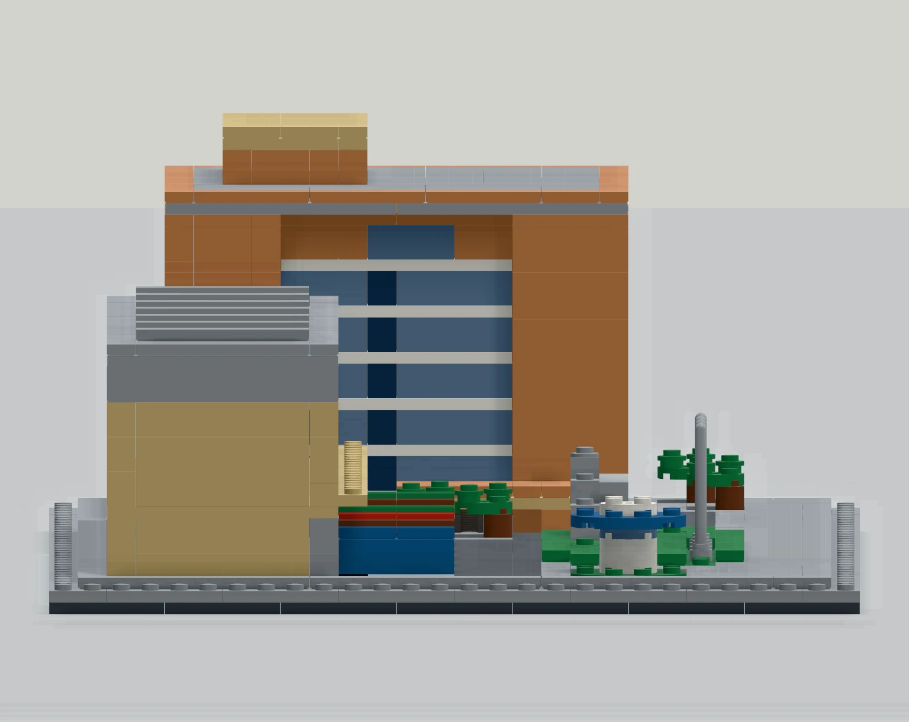
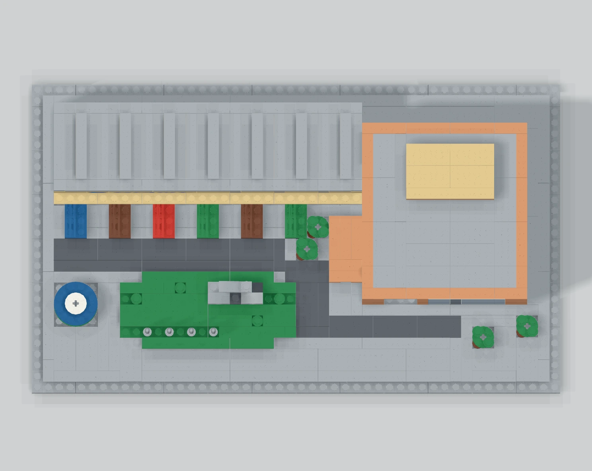

# 巨大機械大甲日南廠｜組裝說明書

TC 05 · Giant Manufacturing · Dajia Rinan Plant

從順帆路一側的前庭看，左後方淡黃廠房以大幅藍色 GIANT 標誌面向彩色貨櫃，右側暖磚色廠辦有兩面白帶玻璃窗。草坪上保留旗桿、圓亭與石雕騎士的輪廓。

880 件 · 4 袋 · 125 步

底座 48 × 28 凸點。

將底座較後的一側朝上，從左上角第 1 顆凸點開始數。X 由左向右，Z 由後向前。底高以薄板為單位，桌面是 0，一塊標準磚高 3 層薄板。每個位置均取零件佔地最左、最後的凸點。

圖號依每一步的安裝順序編列，回到下一個步驟時從 1 重新起算。[圖解說明書](manual.html) · [分袋 BOM](bom.csv) · [分步 LDraw 模型](model.ldr)

## 大甲日南廠・順帆路廠房與廠辦

巨大集團將台灣製造據點列在臺中市大甲區順帆路 19 號。從公開外觀照片可辨認淡黃色的長廠房、上方藍色 GIANT 招牌，以及相鄰的金磚色廠辦。廠辦轉角有兩面深色玻璃窗帶與白色水平帶。 2015 年地面照片記錄了裝卸月台的彩色貨櫃，以及廠辦前庭的自行車騎士石雕。 模型將廠辦立面整理成七層窗帶，窗格、屋頂與棟距依底板比例縮編。暖磚色積木表現廠辦外牆，左側長廠房由兩枚透明底藍色貼紙合成 GIANT 招牌，圓標與字標各貼一顆磚。兩塊單孔磚朝向街面，表現石雕的車輪。

本版 880 件，另附 2 枚貼紙。

[巨大集團・台灣廠地址](https://www.giantgroup-cycling.com/factory) · [節能標竿獎・日南廠外觀近照（第 1 頁）](https://top.energypark.org.tw/topfirm/Files/TopCompanyAlbum/7417ac52-fe24-42b2-8.pdf#page=1) · [Steve Thomas・2015 年前庭與招牌實拍](https://cyclingmagazine.ca/sections/news/a-look-inside-giant-bicycles-headquarters-in-taiwan/) · [經濟部・日南一廠登記](https://findbiz.nat.gov.tw/fts/factory/17/09010006600171)

## 建築方位與配置

**正面**　廠房淡黃長牆上的 GIANT 藍色招牌位於貨櫃上方，右側廠辦以方正磚柱框住玻璃。

**側面**　從草坪望向入口雨棚，可見另一面內縮玻璃和分段白帶，七層廠辦高出銀邊廠房。

**俯視**　遠側是長形廠房；貨櫃從貨台伸向車道。辦公棟在右，中央的旗桿綠地和圓亭沿路口配置。

## 原寸貼紙

本款有 2 張貼紙。請以 100% 列印原寸貼紙 PDF，依步驟中的 S 編號貼在指定磚面，再把該件扣入。

[下載 A4 可列印貼紙](stickers.pdf)

- S01　廠房大招牌左側圓標，與右方 GIANT 藍字對齊 · 袋 02／步驟 27 · 13.7 × 13.2 mm · 正面（朝前），由中央向下 1.6 mm。
- S02　廠房大招牌右側 GIANT 藍字，與左方圓標對齊 · 袋 02／步驟 30 · 58 × 9.2 mm · 正面（朝前），面中央。

## 第 01 袋　底座與定位

98 件，共 13 步。

| 顏色 | 零件 | 設計／庫號 | 數量 |
| --- | --- | --- | ---: |
| 淺藍灰 | 薄板 2×4 | 3020 | 4 |
| 淺藍灰 | 薄板 4×4 | 3031 | 12 |
| 淺藍灰 | 薄板 2×8 | 3034 | 10 |
| 淺藍灰 | 薄板 4×8 | 3035 | 30 |
| 深藍灰 | 薄板 4×8 | 3035 | 42 |

### 步驟 01　併排底板（1/6）

將底板凸點朝上、長邊對齊排在平桌。下一層會跨接板縫。

**本步取件**

| 顏色 | 零件 | 設計／庫號 | 數量 |
| --- | --- | --- | ---: |
| 深藍灰 | 薄板 4×8 | 3035 | 8 |

**安裝位置**

| 圖號 | 零件與顏色 | X | Z | 底高（薄板） | 方向 |
| ---: | --- | ---: | ---: | ---: | --- |
| 1 | 深藍灰 薄板 4×8（3035） | 1 | 1 | 0 | 沿 X |
| 2 | 深藍灰 薄板 4×8（3035） | 9 | 1 | 0 | 沿 X |
| 3 | 深藍灰 薄板 4×8（3035） | 17 | 1 | 0 | 沿 X |
| 4 | 深藍灰 薄板 4×8（3035） | 25 | 1 | 0 | 沿 X |
| 5 | 深藍灰 薄板 4×8（3035） | 33 | 1 | 0 | 沿 X |
| 6 | 深藍灰 薄板 4×8（3035） | 41 | 1 | 0 | 沿 X |
| 7 | 深藍灰 薄板 4×8（3035） | 1 | 5 | 0 | 沿 X |
| 8 | 深藍灰 薄板 4×8（3035） | 9 | 5 | 0 | 沿 X |

### 步驟 02　併排底板（2/6）

將底板凸點朝上、長邊對齊排在平桌。下一層會跨接板縫。

**本步取件**

| 顏色 | 零件 | 設計／庫號 | 數量 |
| --- | --- | --- | ---: |
| 深藍灰 | 薄板 4×8 | 3035 | 8 |

**安裝位置**

| 圖號 | 零件與顏色 | X | Z | 底高（薄板） | 方向 |
| ---: | --- | ---: | ---: | ---: | --- |
| 1 | 深藍灰 薄板 4×8（3035） | 17 | 5 | 0 | 沿 X |
| 2 | 深藍灰 薄板 4×8（3035） | 25 | 5 | 0 | 沿 X |
| 3 | 深藍灰 薄板 4×8（3035） | 33 | 5 | 0 | 沿 X |
| 4 | 深藍灰 薄板 4×8（3035） | 41 | 5 | 0 | 沿 X |
| 5 | 深藍灰 薄板 4×8（3035） | 1 | 9 | 0 | 沿 X |
| 6 | 深藍灰 薄板 4×8（3035） | 9 | 9 | 0 | 沿 X |
| 7 | 深藍灰 薄板 4×8（3035） | 17 | 9 | 0 | 沿 X |
| 8 | 深藍灰 薄板 4×8（3035） | 25 | 9 | 0 | 沿 X |

### 步驟 03　併排底板（3/6）

將底板凸點朝上、長邊對齊排在平桌。下一層會跨接板縫。

**本步取件**

| 顏色 | 零件 | 設計／庫號 | 數量 |
| --- | --- | --- | ---: |
| 深藍灰 | 薄板 4×8 | 3035 | 8 |

**安裝位置**

| 圖號 | 零件與顏色 | X | Z | 底高（薄板） | 方向 |
| ---: | --- | ---: | ---: | ---: | --- |
| 1 | 深藍灰 薄板 4×8（3035） | 33 | 9 | 0 | 沿 X |
| 2 | 深藍灰 薄板 4×8（3035） | 41 | 9 | 0 | 沿 X |
| 3 | 深藍灰 薄板 4×8（3035） | 1 | 13 | 0 | 沿 X |
| 4 | 深藍灰 薄板 4×8（3035） | 9 | 13 | 0 | 沿 X |
| 5 | 深藍灰 薄板 4×8（3035） | 17 | 13 | 0 | 沿 X |
| 6 | 深藍灰 薄板 4×8（3035） | 25 | 13 | 0 | 沿 X |
| 7 | 深藍灰 薄板 4×8（3035） | 33 | 13 | 0 | 沿 X |
| 8 | 深藍灰 薄板 4×8（3035） | 41 | 13 | 0 | 沿 X |

### 步驟 04　併排底板（4/6）

將底板凸點朝上、長邊對齊排在平桌。下一層會跨接板縫。

**本步取件**

| 顏色 | 零件 | 設計／庫號 | 數量 |
| --- | --- | --- | ---: |
| 深藍灰 | 薄板 4×8 | 3035 | 8 |

**安裝位置**

| 圖號 | 零件與顏色 | X | Z | 底高（薄板） | 方向 |
| ---: | --- | ---: | ---: | ---: | --- |
| 1 | 深藍灰 薄板 4×8（3035） | 1 | 17 | 0 | 沿 X |
| 2 | 深藍灰 薄板 4×8（3035） | 9 | 17 | 0 | 沿 X |
| 3 | 深藍灰 薄板 4×8（3035） | 17 | 17 | 0 | 沿 X |
| 4 | 深藍灰 薄板 4×8（3035） | 25 | 17 | 0 | 沿 X |
| 5 | 深藍灰 薄板 4×8（3035） | 33 | 17 | 0 | 沿 X |
| 6 | 深藍灰 薄板 4×8（3035） | 41 | 17 | 0 | 沿 X |
| 7 | 深藍灰 薄板 4×8（3035） | 1 | 21 | 0 | 沿 X |
| 8 | 深藍灰 薄板 4×8（3035） | 9 | 21 | 0 | 沿 X |

### 步驟 05　併排底板（5/6）

將底板凸點朝上、長邊對齊排在平桌。下一層會跨接板縫。

**本步取件**

| 顏色 | 零件 | 設計／庫號 | 數量 |
| --- | --- | --- | ---: |
| 深藍灰 | 薄板 4×8 | 3035 | 8 |

**安裝位置**

| 圖號 | 零件與顏色 | X | Z | 底高（薄板） | 方向 |
| ---: | --- | ---: | ---: | ---: | --- |
| 1 | 深藍灰 薄板 4×8（3035） | 17 | 21 | 0 | 沿 X |
| 2 | 深藍灰 薄板 4×8（3035） | 25 | 21 | 0 | 沿 X |
| 3 | 深藍灰 薄板 4×8（3035） | 33 | 21 | 0 | 沿 X |
| 4 | 深藍灰 薄板 4×8（3035） | 41 | 21 | 0 | 沿 X |
| 5 | 深藍灰 薄板 4×8（3035） | 1 | 25 | 0 | 沿 X |
| 6 | 深藍灰 薄板 4×8（3035） | 9 | 25 | 0 | 沿 X |
| 7 | 深藍灰 薄板 4×8（3035） | 17 | 25 | 0 | 沿 X |
| 8 | 深藍灰 薄板 4×8（3035） | 25 | 25 | 0 | 沿 X |

### 步驟 06　併排底板（6/6）

將底板凸點朝上、長邊對齊排在平桌。下一層會跨接板縫。

**本步取件**

| 顏色 | 零件 | 設計／庫號 | 數量 |
| --- | --- | --- | ---: |
| 深藍灰 | 薄板 4×8 | 3035 | 2 |

**安裝位置**

| 圖號 | 零件與顏色 | X | Z | 底高（薄板） | 方向 |
| ---: | --- | ---: | ---: | ---: | --- |
| 1 | 深藍灰 薄板 4×8（3035） | 33 | 25 | 0 | 沿 X |
| 2 | 深藍灰 薄板 4×8（3035） | 41 | 25 | 0 | 沿 X |

### 步驟 07　錯縫鎖底（1/7）

上層相對底板橫移四格、縱移兩格。逐排按緊後，底座可整片拿起。

**本步取件**

| 顏色 | 零件 | 設計／庫號 | 數量 |
| --- | --- | --- | ---: |
| 淺藍灰 | 薄板 2×4 | 3020 | 2 |
| 淺藍灰 | 薄板 4×4 | 3031 | 1 |
| 淺藍灰 | 薄板 2×8 | 3034 | 5 |

**安裝位置**

| 圖號 | 零件與顏色 | X | Z | 底高（薄板） | 方向 |
| ---: | --- | ---: | ---: | ---: | --- |
| 1 | 淺藍灰 薄板 2×4（3020） | 1 | 1 | 1 | 沿 X |
| 2 | 淺藍灰 薄板 2×8（3034） | 5 | 1 | 1 | 沿 X |
| 3 | 淺藍灰 薄板 2×8（3034） | 13 | 1 | 1 | 沿 X |
| 4 | 淺藍灰 薄板 2×8（3034） | 21 | 1 | 1 | 沿 X |
| 5 | 淺藍灰 薄板 2×8（3034） | 29 | 1 | 1 | 沿 X |
| 6 | 淺藍灰 薄板 2×8（3034） | 37 | 1 | 1 | 沿 X |
| 7 | 淺藍灰 薄板 2×4（3020） | 45 | 1 | 1 | 沿 X |
| 8 | 淺藍灰 薄板 4×4（3031） | 1 | 3 | 1 | — |

### 步驟 08　錯縫鎖底（2/7）

上層相對底板橫移四格、縱移兩格。逐排按緊後，底座可整片拿起。

**本步取件**

| 顏色 | 零件 | 設計／庫號 | 數量 |
| --- | --- | --- | ---: |
| 淺藍灰 | 薄板 4×4 | 3031 | 2 |
| 淺藍灰 | 薄板 4×8 | 3035 | 6 |

**安裝位置**

| 圖號 | 零件與顏色 | X | Z | 底高（薄板） | 方向 |
| ---: | --- | ---: | ---: | ---: | --- |
| 1 | 淺藍灰 薄板 4×8（3035） | 5 | 3 | 1 | 沿 X |
| 2 | 淺藍灰 薄板 4×8（3035） | 13 | 3 | 1 | 沿 X |
| 3 | 淺藍灰 薄板 4×8（3035） | 21 | 3 | 1 | 沿 X |
| 4 | 淺藍灰 薄板 4×8（3035） | 29 | 3 | 1 | 沿 X |
| 5 | 淺藍灰 薄板 4×8（3035） | 37 | 3 | 1 | 沿 X |
| 6 | 淺藍灰 薄板 4×4（3031） | 45 | 3 | 1 | — |
| 7 | 淺藍灰 薄板 4×4（3031） | 1 | 7 | 1 | — |
| 8 | 淺藍灰 薄板 4×8（3035） | 5 | 7 | 1 | 沿 X |

### 步驟 09　錯縫鎖底（3/7）

上層相對底板橫移四格、縱移兩格。逐排按緊後，底座可整片拿起。

**本步取件**

| 顏色 | 零件 | 設計／庫號 | 數量 |
| --- | --- | --- | ---: |
| 淺藍灰 | 薄板 4×4 | 3031 | 2 |
| 淺藍灰 | 薄板 4×8 | 3035 | 6 |

**安裝位置**

| 圖號 | 零件與顏色 | X | Z | 底高（薄板） | 方向 |
| ---: | --- | ---: | ---: | ---: | --- |
| 1 | 淺藍灰 薄板 4×8（3035） | 13 | 7 | 1 | 沿 X |
| 2 | 淺藍灰 薄板 4×8（3035） | 21 | 7 | 1 | 沿 X |
| 3 | 淺藍灰 薄板 4×8（3035） | 29 | 7 | 1 | 沿 X |
| 4 | 淺藍灰 薄板 4×8（3035） | 37 | 7 | 1 | 沿 X |
| 5 | 淺藍灰 薄板 4×4（3031） | 45 | 7 | 1 | — |
| 6 | 淺藍灰 薄板 4×4（3031） | 1 | 11 | 1 | — |
| 7 | 淺藍灰 薄板 4×8（3035） | 5 | 11 | 1 | 沿 X |
| 8 | 淺藍灰 薄板 4×8（3035） | 13 | 11 | 1 | 沿 X |

### 步驟 10　錯縫鎖底（4/7）

上層相對底板橫移四格、縱移兩格。逐排按緊後，底座可整片拿起。

**本步取件**

| 顏色 | 零件 | 設計／庫號 | 數量 |
| --- | --- | --- | ---: |
| 淺藍灰 | 薄板 4×4 | 3031 | 2 |
| 淺藍灰 | 薄板 4×8 | 3035 | 6 |

**安裝位置**

| 圖號 | 零件與顏色 | X | Z | 底高（薄板） | 方向 |
| ---: | --- | ---: | ---: | ---: | --- |
| 1 | 淺藍灰 薄板 4×8（3035） | 21 | 11 | 1 | 沿 X |
| 2 | 淺藍灰 薄板 4×8（3035） | 29 | 11 | 1 | 沿 X |
| 3 | 淺藍灰 薄板 4×8（3035） | 37 | 11 | 1 | 沿 X |
| 4 | 淺藍灰 薄板 4×4（3031） | 45 | 11 | 1 | — |
| 5 | 淺藍灰 薄板 4×4（3031） | 1 | 15 | 1 | — |
| 6 | 淺藍灰 薄板 4×8（3035） | 5 | 15 | 1 | 沿 X |
| 7 | 淺藍灰 薄板 4×8（3035） | 13 | 15 | 1 | 沿 X |
| 8 | 淺藍灰 薄板 4×8（3035） | 21 | 15 | 1 | 沿 X |

### 步驟 11　錯縫鎖底（5/7）

上層相對底板橫移四格、縱移兩格。逐排按緊後，底座可整片拿起。

**本步取件**

| 顏色 | 零件 | 設計／庫號 | 數量 |
| --- | --- | --- | ---: |
| 淺藍灰 | 薄板 4×4 | 3031 | 2 |
| 淺藍灰 | 薄板 4×8 | 3035 | 6 |

**安裝位置**

| 圖號 | 零件與顏色 | X | Z | 底高（薄板） | 方向 |
| ---: | --- | ---: | ---: | ---: | --- |
| 1 | 淺藍灰 薄板 4×8（3035） | 29 | 15 | 1 | 沿 X |
| 2 | 淺藍灰 薄板 4×8（3035） | 37 | 15 | 1 | 沿 X |
| 3 | 淺藍灰 薄板 4×4（3031） | 45 | 15 | 1 | — |
| 4 | 淺藍灰 薄板 4×4（3031） | 1 | 19 | 1 | — |
| 5 | 淺藍灰 薄板 4×8（3035） | 5 | 19 | 1 | 沿 X |
| 6 | 淺藍灰 薄板 4×8（3035） | 13 | 19 | 1 | 沿 X |
| 7 | 淺藍灰 薄板 4×8（3035） | 21 | 19 | 1 | 沿 X |
| 8 | 淺藍灰 薄板 4×8（3035） | 29 | 19 | 1 | 沿 X |

### 步驟 12　錯縫鎖底（6/7）

上層相對底板橫移四格、縱移兩格。逐排按緊後，底座可整片拿起。

**本步取件**

| 顏色 | 零件 | 設計／庫號 | 數量 |
| --- | --- | --- | ---: |
| 淺藍灰 | 薄板 4×4 | 3031 | 2 |
| 淺藍灰 | 薄板 4×8 | 3035 | 6 |

**安裝位置**

| 圖號 | 零件與顏色 | X | Z | 底高（薄板） | 方向 |
| ---: | --- | ---: | ---: | ---: | --- |
| 1 | 淺藍灰 薄板 4×8（3035） | 37 | 19 | 1 | 沿 X |
| 2 | 淺藍灰 薄板 4×4（3031） | 45 | 19 | 1 | — |
| 3 | 淺藍灰 薄板 4×4（3031） | 1 | 23 | 1 | — |
| 4 | 淺藍灰 薄板 4×8（3035） | 5 | 23 | 1 | 沿 X |
| 5 | 淺藍灰 薄板 4×8（3035） | 13 | 23 | 1 | 沿 X |
| 6 | 淺藍灰 薄板 4×8（3035） | 21 | 23 | 1 | 沿 X |
| 7 | 淺藍灰 薄板 4×8（3035） | 29 | 23 | 1 | 沿 X |
| 8 | 淺藍灰 薄板 4×8（3035） | 37 | 23 | 1 | 沿 X |

### 步驟 13　錯縫鎖底（7/7）

上層相對底板橫移四格、縱移兩格。逐排按緊後，底座可整片拿起。

**本步取件**

| 顏色 | 零件 | 設計／庫號 | 數量 |
| --- | --- | --- | ---: |
| 淺藍灰 | 薄板 2×4 | 3020 | 2 |
| 淺藍灰 | 薄板 4×4 | 3031 | 1 |
| 淺藍灰 | 薄板 2×8 | 3034 | 5 |

**安裝位置**

| 圖號 | 零件與顏色 | X | Z | 底高（薄板） | 方向 |
| ---: | --- | ---: | ---: | ---: | --- |
| 1 | 淺藍灰 薄板 4×4（3031） | 45 | 23 | 1 | — |
| 2 | 淺藍灰 薄板 2×4（3020） | 1 | 27 | 1 | 沿 X |
| 3 | 淺藍灰 薄板 2×8（3034） | 5 | 27 | 1 | 沿 X |
| 4 | 淺藍灰 薄板 2×8（3034） | 13 | 27 | 1 | 沿 X |
| 5 | 淺藍灰 薄板 2×8（3034） | 21 | 27 | 1 | 沿 X |
| 6 | 淺藍灰 薄板 2×8（3034） | 29 | 27 | 1 | 沿 X |
| 7 | 淺藍灰 薄板 2×8（3034） | 37 | 27 | 1 | 沿 X |
| 8 | 淺藍灰 薄板 2×4（3020） | 45 | 27 | 1 | 沿 X |

## 第 02 袋　淡黃廠房、貨台與藍色 GIANT 招牌

209 件，共 30 步。

| 顏色 | 零件 | 設計／庫號 | 數量 |
| --- | --- | --- | ---: |
| 黑色 | 薄板 2×4 | 3020 | 6 |
| 藍色 | 格柵板 1×2 | 2412b | 2 |
| 藍色 | 磚 2×4 | 3001 | 1 |
| 綠色 | 格柵板 1×2 | 2412b | 4 |
| 綠色 | 磚 2×4 | 3001 | 2 |
| 紅色 | 格柵板 1×2 | 2412b | 2 |
| 紅色 | 磚 2×4 | 3001 | 1 |
| 沙色 | 磚 1×2 | 3004 | 5 |
| 沙色 | 磚 1×8 | 3008 | 32 |
| 沙色 | 磚 1×6 | 3009 | 10 |
| 沙色 | 磚 1×4 | 3010 | 5 |
| 沙色 | 薄板 2×4 | 3020 | 7 |
| 沙色 | 薄板 1×2 | 3023 | 1 |
| 沙色 | 薄板 1×1 | 3024 | 4 |
| 沙色 | 薄板 4×8 | 3035 | 1 |
| 沙色 | 雙層磚 1×2 | 3245c | 1 |
| 沙色 | 薄板 1×8 | 3460 | 5 |
| 沙色 | 磚 1×3 | 3622 | 10 |
| 沙色 | 薄板 1×3 | 3623 | 1 |
| 沙色 | 薄板 1×6 | 3666 | 1 |
| 沙色 | 薄板 1×4 | 3710 | 1 |
| 沙色 | 薄板 8×8 | 41539 | 3 |
| 透明煙棕 | 磚 1×1 | 3005 | 3 |
| 透明煙棕 | 薄板 1×1 | 3024 | 6 |
| 紅棕 | 格柵板 1×2 | 2412b | 4 |
| 紅棕 | 磚 2×4 | 3001 | 2 |
| 淺藍灰 | 光面板 1×4 | 2431 | 2 |
| 淺藍灰 | 磚 1×2 | 3004 | 3 |
| 淺藍灰 | 磚 1×1 | 3005 | 10 |
| 淺藍灰 | 磚 1×8 | 3008 | 11 |
| 淺藍灰 | 薄板 2×8 | 3034 | 14 |
| 淺藍灰 | 薄板 1×6 | 3666 | 7 |
| 淺藍灰 | 光面板 1×8 | 4162 | 6 |
| 淺藍灰 | 光面板 1×6 | 6636 | 28 |
| 深藍灰 | 磚 1×2 | 3004 | 2 |
| 深藍灰 | 磚 1×8 | 3008 | 6 |

### 步驟 14　彩色貨櫃列（1/3）

依序排入貨台前方的貨櫃，長邊伸向車道。深色薄板墊出車架，頂部格柵表現貨櫃的直肋。

**本步取件**

| 顏色 | 零件 | 設計／庫號 | 數量 |
| --- | --- | --- | ---: |
| 黑色 | 薄板 2×4 | 3020 | 2 |
| 藍色 | 格柵板 1×2 | 2412b | 2 |
| 藍色 | 磚 2×4 | 3001 | 1 |
| 紅棕 | 格柵板 1×2 | 2412b | 2 |
| 紅棕 | 磚 2×4 | 3001 | 1 |

**安裝位置**

| 圖號 | 零件與顏色 | X | Z | 底高（薄板） | 方向 |
| ---: | --- | ---: | ---: | ---: | --- |
| 1 | 黑色 薄板 2×4（3020） | 4 | 11 | 2 | 沿 Z |
| 2 | 藍色 磚 2×4（3001） | 4 | 11 | 3 | 沿 Z |
| 3 | 藍色 格柵板 1×2（2412b） | 4 | 11 | 6 | 沿 Z |
| 4 | 藍色 格柵板 1×2（2412b） | 4 | 13 | 6 | 沿 Z |
| 5 | 黑色 薄板 2×4（3020） | 8 | 11 | 2 | 沿 Z |
| 6 | 紅棕 磚 2×4（3001） | 8 | 11 | 3 | 沿 Z |
| 7 | 紅棕 格柵板 1×2（2412b） | 8 | 11 | 6 | 沿 Z |
| 8 | 紅棕 格柵板 1×2（2412b） | 8 | 13 | 6 | 沿 Z |

### 步驟 15　彩色貨櫃列（2/3）

依序排入貨台前方的貨櫃，長邊伸向車道。深色薄板墊出車架，頂部格柵表現貨櫃的直肋。

**本步取件**

| 顏色 | 零件 | 設計／庫號 | 數量 |
| --- | --- | --- | ---: |
| 黑色 | 薄板 2×4 | 3020 | 2 |
| 綠色 | 格柵板 1×2 | 2412b | 2 |
| 綠色 | 磚 2×4 | 3001 | 1 |
| 紅色 | 格柵板 1×2 | 2412b | 2 |
| 紅色 | 磚 2×4 | 3001 | 1 |

**安裝位置**

| 圖號 | 零件與顏色 | X | Z | 底高（薄板） | 方向 |
| ---: | --- | ---: | ---: | ---: | --- |
| 1 | 黑色 薄板 2×4（3020） | 12 | 11 | 2 | 沿 Z |
| 2 | 紅色 磚 2×4（3001） | 12 | 11 | 3 | 沿 Z |
| 3 | 紅色 格柵板 1×2（2412b） | 12 | 11 | 6 | 沿 Z |
| 4 | 紅色 格柵板 1×2（2412b） | 12 | 13 | 6 | 沿 Z |
| 5 | 黑色 薄板 2×4（3020） | 16 | 11 | 2 | 沿 Z |
| 6 | 綠色 磚 2×4（3001） | 16 | 11 | 3 | 沿 Z |
| 7 | 綠色 格柵板 1×2（2412b） | 16 | 11 | 6 | 沿 Z |
| 8 | 綠色 格柵板 1×2（2412b） | 16 | 13 | 6 | 沿 Z |

### 步驟 16　彩色貨櫃列（3/3）

依序排入貨台前方的貨櫃，長邊伸向車道。深色薄板墊出車架，頂部格柵表現貨櫃的直肋。

**本步取件**

| 顏色 | 零件 | 設計／庫號 | 數量 |
| --- | --- | --- | ---: |
| 黑色 | 薄板 2×4 | 3020 | 2 |
| 綠色 | 格柵板 1×2 | 2412b | 2 |
| 綠色 | 磚 2×4 | 3001 | 1 |
| 紅棕 | 格柵板 1×2 | 2412b | 2 |
| 紅棕 | 磚 2×4 | 3001 | 1 |

**安裝位置**

| 圖號 | 零件與顏色 | X | Z | 底高（薄板） | 方向 |
| ---: | --- | ---: | ---: | ---: | --- |
| 1 | 黑色 薄板 2×4（3020） | 20 | 11 | 2 | 沿 Z |
| 2 | 紅棕 磚 2×4（3001） | 20 | 11 | 3 | 沿 Z |
| 3 | 紅棕 格柵板 1×2（2412b） | 20 | 11 | 6 | 沿 Z |
| 4 | 紅棕 格柵板 1×2（2412b） | 20 | 13 | 6 | 沿 Z |
| 5 | 黑色 薄板 2×4（3020） | 24 | 11 | 2 | 沿 Z |
| 6 | 綠色 磚 2×4（3001） | 24 | 11 | 3 | 沿 Z |
| 7 | 綠色 格柵板 1×2（2412b） | 24 | 11 | 6 | 沿 Z |
| 8 | 綠色 格柵板 1×2（2412b） | 24 | 13 | 6 | 沿 Z |

### 步驟 17　貨台內牆與柱列 · 第 1 層（1/3）

先砌後牆、兩端牆和內部承板肋。街面深灰牆往內縮兩格，前緣柱頭用於承接上層。

**本步取件**

| 顏色 | 零件 | 設計／庫號 | 數量 |
| --- | --- | --- | ---: |
| 沙色 | 磚 1×8 | 3008 | 3 |
| 沙色 | 磚 1×6 | 3009 | 2 |
| 沙色 | 磚 1×4 | 3010 | 1 |
| 深藍灰 | 磚 1×8 | 3008 | 2 |

**安裝位置**

| 圖號 | 零件與顏色 | X | Z | 底高（薄板） | 方向 |
| ---: | --- | ---: | ---: | ---: | --- |
| 1 | 沙色 磚 1×8（3008） | 3 | 3 | 2 | 沿 X |
| 2 | 沙色 磚 1×8（3008） | 11 | 3 | 2 | 沿 X |
| 3 | 沙色 磚 1×8（3008） | 19 | 3 | 2 | 沿 X |
| 4 | 沙色 磚 1×4（3010） | 27 | 3 | 2 | 沿 X |
| 5 | 沙色 磚 1×6（3009） | 3 | 4 | 2 | 沿 Z |
| 6 | 沙色 磚 1×6（3009） | 30 | 4 | 2 | 沿 Z |
| 7 | 深藍灰 磚 1×8（3008） | 4 | 8 | 2 | 沿 X |
| 8 | 深藍灰 磚 1×8（3008） | 12 | 8 | 2 | 沿 X |

### 步驟 18　貨台內牆與柱列 · 第 1 層（2/3）

先砌後牆、兩端牆和內部承板肋。街面深灰牆往內縮兩格，前緣柱頭用於承接上層。

**本步取件**

| 顏色 | 零件 | 設計／庫號 | 數量 |
| --- | --- | --- | ---: |
| 沙色 | 磚 1×8 | 3008 | 1 |
| 淺藍灰 | 磚 1×1 | 3005 | 5 |
| 深藍灰 | 磚 1×2 | 3004 | 1 |
| 深藍灰 | 磚 1×8 | 3008 | 1 |

**安裝位置**

| 圖號 | 零件與顏色 | X | Z | 底高（薄板） | 方向 |
| ---: | --- | ---: | ---: | ---: | --- |
| 1 | 深藍灰 磚 1×8（3008） | 20 | 8 | 2 | 沿 X |
| 2 | 深藍灰 磚 1×2（3004） | 28 | 8 | 2 | 沿 X |
| 3 | 淺藍灰 磚 1×1（3005） | 3 | 10 | 2 | — |
| 4 | 淺藍灰 磚 1×1（3005） | 9 | 10 | 2 | — |
| 5 | 淺藍灰 磚 1×1（3005） | 16 | 10 | 2 | — |
| 6 | 淺藍灰 磚 1×1（3005） | 23 | 10 | 2 | — |
| 7 | 淺藍灰 磚 1×1（3005） | 30 | 10 | 2 | — |
| 8 | 沙色 磚 1×8（3008） | 4 | 6 | 2 | 沿 X |

### 步驟 19　貨台內牆與柱列 · 第 1 層（3/3）

先砌後牆、兩端牆和內部承板肋。街面深灰牆往內縮兩格，前緣柱頭用於承接上層。

**本步取件**

| 顏色 | 零件 | 設計／庫號 | 數量 |
| --- | --- | --- | ---: |
| 沙色 | 磚 1×2 | 3004 | 1 |
| 沙色 | 磚 1×8 | 3008 | 2 |

**安裝位置**

| 圖號 | 零件與顏色 | X | Z | 底高（薄板） | 方向 |
| ---: | --- | ---: | ---: | ---: | --- |
| 1 | 沙色 磚 1×8（3008） | 12 | 6 | 2 | 沿 X |
| 2 | 沙色 磚 1×8（3008） | 20 | 6 | 2 | 沿 X |
| 3 | 沙色 磚 1×2（3004） | 28 | 6 | 2 | 沿 X |

### 步驟 20　貨台內牆與柱列 · 第 2 層（1/3）

先砌後牆、兩端牆和內部承板肋。街面深灰牆往內縮兩格，前緣柱頭用於承接上層。

**本步取件**

| 顏色 | 零件 | 設計／庫號 | 數量 |
| --- | --- | --- | ---: |
| 沙色 | 磚 1×8 | 3008 | 3 |
| 沙色 | 磚 1×6 | 3009 | 2 |
| 沙色 | 磚 1×4 | 3010 | 1 |
| 深藍灰 | 磚 1×8 | 3008 | 2 |

**安裝位置**

| 圖號 | 零件與顏色 | X | Z | 底高（薄板） | 方向 |
| ---: | --- | ---: | ---: | ---: | --- |
| 1 | 沙色 磚 1×8（3008） | 3 | 3 | 5 | 沿 X |
| 2 | 沙色 磚 1×8（3008） | 11 | 3 | 5 | 沿 X |
| 3 | 沙色 磚 1×8（3008） | 19 | 3 | 5 | 沿 X |
| 4 | 沙色 磚 1×4（3010） | 27 | 3 | 5 | 沿 X |
| 5 | 沙色 磚 1×6（3009） | 3 | 4 | 5 | 沿 Z |
| 6 | 沙色 磚 1×6（3009） | 30 | 4 | 5 | 沿 Z |
| 7 | 深藍灰 磚 1×8（3008） | 4 | 8 | 5 | 沿 X |
| 8 | 深藍灰 磚 1×8（3008） | 12 | 8 | 5 | 沿 X |

### 步驟 21　貨台內牆與柱列 · 第 2 層（2/3）

先砌後牆、兩端牆和內部承板肋。街面深灰牆往內縮兩格，前緣柱頭用於承接上層。

**本步取件**

| 顏色 | 零件 | 設計／庫號 | 數量 |
| --- | --- | --- | ---: |
| 沙色 | 磚 1×8 | 3008 | 1 |
| 淺藍灰 | 磚 1×1 | 3005 | 5 |
| 深藍灰 | 磚 1×2 | 3004 | 1 |
| 深藍灰 | 磚 1×8 | 3008 | 1 |

**安裝位置**

| 圖號 | 零件與顏色 | X | Z | 底高（薄板） | 方向 |
| ---: | --- | ---: | ---: | ---: | --- |
| 1 | 深藍灰 磚 1×8（3008） | 20 | 8 | 5 | 沿 X |
| 2 | 深藍灰 磚 1×2（3004） | 28 | 8 | 5 | 沿 X |
| 3 | 淺藍灰 磚 1×1（3005） | 3 | 10 | 5 | — |
| 4 | 淺藍灰 磚 1×1（3005） | 9 | 10 | 5 | — |
| 5 | 淺藍灰 磚 1×1（3005） | 16 | 10 | 5 | — |
| 6 | 淺藍灰 磚 1×1（3005） | 23 | 10 | 5 | — |
| 7 | 淺藍灰 磚 1×1（3005） | 30 | 10 | 5 | — |
| 8 | 沙色 磚 1×8（3008） | 4 | 6 | 5 | 沿 X |

### 步驟 22　貨台內牆與柱列 · 第 2 層（3/3）

先砌後牆、兩端牆和內部承板肋。街面深灰牆往內縮兩格，前緣柱頭用於承接上層。

**本步取件**

| 顏色 | 零件 | 設計／庫號 | 數量 |
| --- | --- | --- | ---: |
| 沙色 | 磚 1×2 | 3004 | 1 |
| 沙色 | 磚 1×8 | 3008 | 2 |

**安裝位置**

| 圖號 | 零件與顏色 | X | Z | 底高（薄板） | 方向 |
| ---: | --- | ---: | ---: | ---: | --- |
| 1 | 沙色 磚 1×8（3008） | 12 | 6 | 5 | 沿 X |
| 2 | 沙色 磚 1×8（3008） | 20 | 6 | 5 | 沿 X |
| 3 | 沙色 磚 1×2（3004） | 28 | 6 | 5 | 沿 X |

### 步驟 23　貨台上方的前挑樓板（1/2）

先架承板，再跨過柱列逐段接起前挑簷；貨櫃由下方向前伸出。

**本步取件**

| 顏色 | 零件 | 設計／庫號 | 數量 |
| --- | --- | --- | ---: |
| 沙色 | 薄板 2×4 | 3020 | 4 |
| 沙色 | 薄板 4×8 | 3035 | 1 |
| 沙色 | 薄板 8×8 | 41539 | 3 |

**安裝位置**

| 圖號 | 零件與顏色 | X | Z | 底高（薄板） | 方向 |
| ---: | --- | ---: | ---: | ---: | --- |
| 1 | 沙色 薄板 8×8（41539） | 3 | 3 | 8 | — |
| 2 | 沙色 薄板 8×8（41539） | 11 | 3 | 8 | — |
| 3 | 沙色 薄板 8×8（41539） | 19 | 3 | 8 | — |
| 4 | 沙色 薄板 4×8（3035） | 27 | 3 | 8 | 沿 Z |
| 5 | 沙色 薄板 2×4（3020） | 3 | 10 | 9 | 沿 X |
| 6 | 沙色 薄板 2×4（3020） | 7 | 10 | 9 | 沿 X |
| 7 | 沙色 薄板 2×4（3020） | 11 | 10 | 9 | 沿 X |
| 8 | 沙色 薄板 2×4（3020） | 15 | 10 | 9 | 沿 X |

### 步驟 24　貨台上方的前挑樓板（2/2）

先架承板，再跨過柱列逐段接起前挑簷；貨櫃由下方向前伸出。

**本步取件**

| 顏色 | 零件 | 設計／庫號 | 數量 |
| --- | --- | --- | ---: |
| 沙色 | 薄板 2×4 | 3020 | 3 |

**安裝位置**

| 圖號 | 零件與顏色 | X | Z | 底高（薄板） | 方向 |
| ---: | --- | ---: | ---: | ---: | --- |
| 1 | 沙色 薄板 2×4（3020） | 19 | 10 | 9 | 沿 X |
| 2 | 沙色 薄板 2×4（3020） | 23 | 10 | 9 | 沿 X |
| 3 | 沙色 薄板 2×4（3020） | 27 | 10 | 9 | 沿 X |

### 步驟 25　長廠房與直條採光縫 · 第 1 層（1/3）

兩端先接上米色山牆。正面中段保留整片米色外皮，右側的深色窄縫自下而上對齊。

**本步取件**

| 顏色 | 零件 | 設計／庫號 | 數量 |
| --- | --- | --- | ---: |
| 沙色 | 磚 1×8 | 3008 | 5 |
| 沙色 | 磚 1×6 | 3009 | 2 |
| 沙色 | 磚 1×4 | 3010 | 1 |

**安裝位置**

| 圖號 | 零件與顏色 | X | Z | 底高（薄板） | 方向 |
| ---: | --- | ---: | ---: | ---: | --- |
| 1 | 沙色 磚 1×8（3008） | 3 | 3 | 9 | 沿 X |
| 2 | 沙色 磚 1×8（3008） | 11 | 3 | 9 | 沿 X |
| 3 | 沙色 磚 1×8（3008） | 19 | 3 | 9 | 沿 X |
| 4 | 沙色 磚 1×4（3010） | 27 | 3 | 9 | 沿 X |
| 5 | 沙色 磚 1×6（3009） | 3 | 4 | 9 | 沿 Z |
| 6 | 沙色 磚 1×6（3009） | 30 | 4 | 9 | 沿 Z |
| 7 | 沙色 磚 1×8（3008） | 4 | 6 | 9 | 沿 X |
| 8 | 沙色 磚 1×8（3008） | 12 | 6 | 9 | 沿 X |

### 步驟 26　長廠房與直條採光縫 · 第 1 層（2/3）

兩端先接上米色山牆。正面中段保留整片米色外皮，右側的深色窄縫自下而上對齊。

**本步取件**

| 顏色 | 零件 | 設計／庫號 | 數量 |
| --- | --- | --- | ---: |
| 沙色 | 磚 1×2 | 3004 | 1 |
| 沙色 | 磚 1×8 | 3008 | 1 |
| 沙色 | 薄板 1×8 | 3460 | 4 |
| 沙色 | 薄板 1×3 | 3623 | 1 |
| 沙色 | 薄板 1×4 | 3710 | 1 |

**安裝位置**

| 圖號 | 零件與顏色 | X | Z | 底高（薄板） | 方向 |
| ---: | --- | ---: | ---: | ---: | --- |
| 1 | 沙色 磚 1×8（3008） | 20 | 6 | 9 | 沿 X |
| 2 | 沙色 磚 1×2（3004） | 28 | 6 | 9 | 沿 X |
| 3 | 沙色 薄板 1×8（3460） | 3 | 10 | 10 | 沿 X |
| 4 | 沙色 薄板 1×8（3460） | 11 | 10 | 10 | 沿 X |
| 5 | 沙色 薄板 1×8（3460） | 19 | 10 | 10 | 沿 X |
| 6 | 沙色 薄板 1×4（3710） | 27 | 10 | 10 | 沿 X |
| 7 | 沙色 薄板 1×3（3623） | 3 | 10 | 11 | 沿 X |
| 8 | 沙色 薄板 1×8（3460） | 8 | 10 | 11 | 沿 X |

### 步驟 27　長廠房與直條採光縫 · 第 1 層（3/3）

兩端先接上米色山牆。正面中段保留整片米色外皮，右側的深色窄縫自下而上對齊。

**本步取件**

| 顏色 | 零件 | 設計／庫號 | 數量 |
| --- | --- | --- | ---: |
| 沙色 | 薄板 1×1 | 3024 | 1 |
| 沙色 | 雙層磚 1×2 | 3245c | 1 |
| 沙色 | 薄板 1×8 | 3460 | 1 |
| 沙色 | 薄板 1×6 | 3666 | 1 |

**安裝位置**

| 圖號 | 零件與顏色 | X | Z | 底高（薄板） | 方向 |
| ---: | --- | ---: | ---: | ---: | --- |
| 1 | 沙色 薄板 1×8（3460） | 16 | 10 | 11 | 沿 X |
| 2 | 沙色 薄板 1×6（3666） | 24 | 10 | 11 | 沿 X |
| 3 | 沙色 薄板 1×1（3024） | 30 | 10 | 11 | — |
| 4 | 沙色 雙層磚 1×2（3245c） | 6 | 10 | 11 | 沿 X |

**貼紙 S01**　廠房大招牌左側圓標，與右方 GIANT 藍字對齊。圖號 4，正面（朝前），由中央向下 1.6 mm。貼好再扣入。尺寸 13.7 × 13.2 mm。

### 步驟 28　長廠房與直條採光縫 · 第 2 層（1/3）

兩端先接上米色山牆。正面中段保留整片米色外皮，右側的深色窄縫自下而上對齊。

**本步取件**

| 顏色 | 零件 | 設計／庫號 | 數量 |
| --- | --- | --- | ---: |
| 沙色 | 磚 1×8 | 3008 | 5 |
| 沙色 | 磚 1×6 | 3009 | 2 |
| 沙色 | 磚 1×4 | 3010 | 1 |

**安裝位置**

| 圖號 | 零件與顏色 | X | Z | 底高（薄板） | 方向 |
| ---: | --- | ---: | ---: | ---: | --- |
| 1 | 沙色 磚 1×8（3008） | 3 | 3 | 12 | 沿 X |
| 2 | 沙色 磚 1×8（3008） | 11 | 3 | 12 | 沿 X |
| 3 | 沙色 磚 1×8（3008） | 19 | 3 | 12 | 沿 X |
| 4 | 沙色 磚 1×4（3010） | 27 | 3 | 12 | 沿 X |
| 5 | 沙色 磚 1×6（3009） | 3 | 4 | 12 | 沿 Z |
| 6 | 沙色 磚 1×6（3009） | 30 | 4 | 12 | 沿 Z |
| 7 | 沙色 磚 1×8（3008） | 4 | 6 | 12 | 沿 X |
| 8 | 沙色 磚 1×8（3008） | 12 | 6 | 12 | 沿 X |

### 步驟 29　長廠房與直條採光縫 · 第 2 層（2/3）

兩端先接上米色山牆。正面中段保留整片米色外皮，右側的深色窄縫自下而上對齊。

**本步取件**

| 顏色 | 零件 | 設計／庫號 | 數量 |
| --- | --- | --- | ---: |
| 沙色 | 磚 1×2 | 3004 | 1 |
| 沙色 | 磚 1×8 | 3008 | 1 |
| 沙色 | 磚 1×3 | 3622 | 5 |
| 透明煙棕 | 磚 1×1 | 3005 | 1 |

**安裝位置**

| 圖號 | 零件與顏色 | X | Z | 底高（薄板） | 方向 |
| ---: | --- | ---: | ---: | ---: | --- |
| 1 | 沙色 磚 1×8（3008） | 20 | 6 | 12 | 沿 X |
| 2 | 沙色 磚 1×2（3004） | 28 | 6 | 12 | 沿 X |
| 3 | 沙色 磚 1×3（3622） | 3 | 10 | 12 | 沿 X |
| 4 | 沙色 磚 1×3（3622） | 16 | 10 | 12 | 沿 X |
| 5 | 沙色 磚 1×3（3622） | 20 | 10 | 12 | 沿 X |
| 6 | 沙色 磚 1×3（3622） | 24 | 10 | 12 | 沿 X |
| 7 | 沙色 磚 1×3（3622） | 28 | 10 | 12 | 沿 X |
| 8 | 透明煙棕 磚 1×1（3005） | 19 | 10 | 12 | — |

### 步驟 30　長廠房與直條採光縫 · 第 2 層（3/3）

兩端先接上米色山牆。正面中段保留整片米色外皮，右側的深色窄縫自下而上對齊。

**本步取件**

| 顏色 | 零件 | 設計／庫號 | 數量 |
| --- | --- | --- | ---: |
| 沙色 | 磚 1×8 | 3008 | 1 |
| 透明煙棕 | 磚 1×1 | 3005 | 2 |

**安裝位置**

| 圖號 | 零件與顏色 | X | Z | 底高（薄板） | 方向 |
| ---: | --- | ---: | ---: | ---: | --- |
| 1 | 透明煙棕 磚 1×1（3005） | 23 | 10 | 12 | — |
| 2 | 透明煙棕 磚 1×1（3005） | 27 | 10 | 12 | — |
| 3 | 沙色 磚 1×8（3008） | 8 | 10 | 12 | 沿 X |

**貼紙 S02**　廠房大招牌右側 GIANT 藍字，與左方圓標對齊。圖號 3，正面（朝前），面中央。貼好再扣入。尺寸 58 × 9.2 mm。

### 步驟 31　長廠房與直條採光縫 · 第 3 層（1/4）

兩端先接上米色山牆。正面中段保留整片米色外皮，右側的深色窄縫自下而上對齊。

**本步取件**

| 顏色 | 零件 | 設計／庫號 | 數量 |
| --- | --- | --- | ---: |
| 沙色 | 磚 1×8 | 3008 | 5 |
| 沙色 | 磚 1×6 | 3009 | 2 |
| 沙色 | 磚 1×4 | 3010 | 1 |

**安裝位置**

| 圖號 | 零件與顏色 | X | Z | 底高（薄板） | 方向 |
| ---: | --- | ---: | ---: | ---: | --- |
| 1 | 沙色 磚 1×8（3008） | 3 | 3 | 15 | 沿 X |
| 2 | 沙色 磚 1×8（3008） | 11 | 3 | 15 | 沿 X |
| 3 | 沙色 磚 1×8（3008） | 19 | 3 | 15 | 沿 X |
| 4 | 沙色 磚 1×4（3010） | 27 | 3 | 15 | 沿 X |
| 5 | 沙色 磚 1×6（3009） | 3 | 4 | 15 | 沿 Z |
| 6 | 沙色 磚 1×6（3009） | 30 | 4 | 15 | 沿 Z |
| 7 | 沙色 磚 1×8（3008） | 4 | 6 | 15 | 沿 X |
| 8 | 沙色 磚 1×8（3008） | 12 | 6 | 15 | 沿 X |

### 步驟 32　長廠房與直條採光縫 · 第 3 層（2/4）

兩端先接上米色山牆。正面中段保留整片米色外皮，右側的深色窄縫自下而上對齊。

**本步取件**

| 顏色 | 零件 | 設計／庫號 | 數量 |
| --- | --- | --- | ---: |
| 沙色 | 磚 1×2 | 3004 | 1 |
| 沙色 | 磚 1×8 | 3008 | 1 |
| 沙色 | 薄板 1×1 | 3024 | 1 |
| 沙色 | 磚 1×3 | 3622 | 5 |

**安裝位置**

| 圖號 | 零件與顏色 | X | Z | 底高（薄板） | 方向 |
| ---: | --- | ---: | ---: | ---: | --- |
| 1 | 沙色 磚 1×8（3008） | 20 | 6 | 15 | 沿 X |
| 2 | 沙色 磚 1×2（3004） | 28 | 6 | 15 | 沿 X |
| 3 | 沙色 磚 1×3（3622） | 3 | 10 | 15 | 沿 X |
| 4 | 沙色 磚 1×3（3622） | 16 | 10 | 15 | 沿 X |
| 5 | 沙色 磚 1×3（3622） | 20 | 10 | 15 | 沿 X |
| 6 | 沙色 磚 1×3（3622） | 24 | 10 | 15 | 沿 X |
| 7 | 沙色 磚 1×3（3622） | 28 | 10 | 15 | 沿 X |
| 8 | 沙色 薄板 1×1（3024） | 19 | 10 | 15 | — |

### 步驟 33　長廠房與直條採光縫 · 第 3 層（3/4）

兩端先接上米色山牆。正面中段保留整片米色外皮，右側的深色窄縫自下而上對齊。

**本步取件**

| 顏色 | 零件 | 設計／庫號 | 數量 |
| --- | --- | --- | ---: |
| 沙色 | 薄板 1×1 | 3024 | 2 |
| 透明煙棕 | 薄板 1×1 | 3024 | 6 |

**安裝位置**

| 圖號 | 零件與顏色 | X | Z | 底高（薄板） | 方向 |
| ---: | --- | ---: | ---: | ---: | --- |
| 1 | 透明煙棕 薄板 1×1（3024） | 19 | 10 | 16 | — |
| 2 | 透明煙棕 薄板 1×1（3024） | 19 | 10 | 17 | — |
| 3 | 沙色 薄板 1×1（3024） | 23 | 10 | 15 | — |
| 4 | 透明煙棕 薄板 1×1（3024） | 23 | 10 | 16 | — |
| 5 | 透明煙棕 薄板 1×1（3024） | 23 | 10 | 17 | — |
| 6 | 沙色 薄板 1×1（3024） | 27 | 10 | 15 | — |
| 7 | 透明煙棕 薄板 1×1（3024） | 27 | 10 | 16 | — |
| 8 | 透明煙棕 薄板 1×1（3024） | 27 | 10 | 17 | — |

### 步驟 34　長廠房與直條採光縫 · 第 3 層（4/4）

兩端先接上米色山牆。正面中段保留整片米色外皮，右側的深色窄縫自下而上對齊。

**本步取件**

| 顏色 | 零件 | 設計／庫號 | 數量 |
| --- | --- | --- | ---: |
| 沙色 | 磚 1×8 | 3008 | 1 |
| 沙色 | 薄板 1×2 | 3023 | 1 |

**安裝位置**

| 圖號 | 零件與顏色 | X | Z | 底高（薄板） | 方向 |
| ---: | --- | ---: | ---: | ---: | --- |
| 1 | 沙色 磚 1×8（3008） | 8 | 10 | 15 | 沿 X |
| 2 | 沙色 薄板 1×2（3023） | 6 | 10 | 17 | 沿 X |

### 步驟 35　銀灰封簷與金屬板屋頂（1/9）

灰色帽簷繞住廠房頂部。銀灰屋板跨接後牆與中間的肋條，屋面接縫順著短向排列。

**本步取件**

| 顏色 | 零件 | 設計／庫號 | 數量 |
| --- | --- | --- | ---: |
| 淺藍灰 | 磚 1×2 | 3004 | 1 |
| 淺藍灰 | 磚 1×8 | 3008 | 7 |

**安裝位置**

| 圖號 | 零件與顏色 | X | Z | 底高（薄板） | 方向 |
| ---: | --- | ---: | ---: | ---: | --- |
| 1 | 淺藍灰 磚 1×8（3008） | 3 | 3 | 18 | 沿 Z |
| 2 | 淺藍灰 磚 1×8（3008） | 30 | 3 | 18 | 沿 Z |
| 3 | 淺藍灰 磚 1×8（3008） | 4 | 3 | 18 | 沿 X |
| 4 | 淺藍灰 磚 1×8（3008） | 12 | 3 | 18 | 沿 X |
| 5 | 淺藍灰 磚 1×8（3008） | 20 | 3 | 18 | 沿 X |
| 6 | 淺藍灰 磚 1×2（3004） | 28 | 3 | 18 | 沿 X |
| 7 | 淺藍灰 磚 1×8（3008） | 4 | 10 | 18 | 沿 X |
| 8 | 淺藍灰 磚 1×8（3008） | 12 | 10 | 18 | 沿 X |

### 步驟 36　銀灰封簷與金屬板屋頂（2/9）

灰色帽簷繞住廠房頂部。銀灰屋板跨接後牆與中間的肋條，屋面接縫順著短向排列。

**本步取件**

| 顏色 | 零件 | 設計／庫號 | 數量 |
| --- | --- | --- | ---: |
| 淺藍灰 | 磚 1×2 | 3004 | 2 |
| 淺藍灰 | 磚 1×8 | 3008 | 4 |
| 淺藍灰 | 薄板 2×8 | 3034 | 2 |

**安裝位置**

| 圖號 | 零件與顏色 | X | Z | 底高（薄板） | 方向 |
| ---: | --- | ---: | ---: | ---: | --- |
| 1 | 淺藍灰 磚 1×8（3008） | 20 | 10 | 18 | 沿 X |
| 2 | 淺藍灰 磚 1×2（3004） | 28 | 10 | 18 | 沿 X |
| 3 | 淺藍灰 磚 1×8（3008） | 4 | 6 | 18 | 沿 X |
| 4 | 淺藍灰 磚 1×8（3008） | 12 | 6 | 18 | 沿 X |
| 5 | 淺藍灰 磚 1×8（3008） | 20 | 6 | 18 | 沿 X |
| 6 | 淺藍灰 磚 1×2（3004） | 28 | 6 | 18 | 沿 X |
| 7 | 淺藍灰 薄板 2×8（3034） | 3 | 3 | 21 | 沿 Z |
| 8 | 淺藍灰 薄板 2×8（3034） | 5 | 3 | 21 | 沿 Z |

### 步驟 37　銀灰封簷與金屬板屋頂（3/9）

灰色帽簷繞住廠房頂部。銀灰屋板跨接後牆與中間的肋條，屋面接縫順著短向排列。

**本步取件**

| 顏色 | 零件 | 設計／庫號 | 數量 |
| --- | --- | --- | ---: |
| 淺藍灰 | 薄板 2×8 | 3034 | 8 |

**安裝位置**

| 圖號 | 零件與顏色 | X | Z | 底高（薄板） | 方向 |
| ---: | --- | ---: | ---: | ---: | --- |
| 1 | 淺藍灰 薄板 2×8（3034） | 7 | 3 | 21 | 沿 Z |
| 2 | 淺藍灰 薄板 2×8（3034） | 9 | 3 | 21 | 沿 Z |
| 3 | 淺藍灰 薄板 2×8（3034） | 11 | 3 | 21 | 沿 Z |
| 4 | 淺藍灰 薄板 2×8（3034） | 13 | 3 | 21 | 沿 Z |
| 5 | 淺藍灰 薄板 2×8（3034） | 15 | 3 | 21 | 沿 Z |
| 6 | 淺藍灰 薄板 2×8（3034） | 17 | 3 | 21 | 沿 Z |
| 7 | 淺藍灰 薄板 2×8（3034） | 19 | 3 | 21 | 沿 Z |
| 8 | 淺藍灰 薄板 2×8（3034） | 21 | 3 | 21 | 沿 Z |

### 步驟 38　銀灰封簷與金屬板屋頂（4/9）

灰色帽簷繞住廠房頂部。銀灰屋板跨接後牆與中間的肋條，屋面接縫順著短向排列。

**本步取件**

| 顏色 | 零件 | 設計／庫號 | 數量 |
| --- | --- | --- | ---: |
| 淺藍灰 | 光面板 1×4 | 2431 | 1 |
| 淺藍灰 | 薄板 2×8 | 3034 | 4 |
| 淺藍灰 | 光面板 1×8 | 4162 | 3 |

**安裝位置**

| 圖號 | 零件與顏色 | X | Z | 底高（薄板） | 方向 |
| ---: | --- | ---: | ---: | ---: | --- |
| 1 | 淺藍灰 薄板 2×8（3034） | 23 | 3 | 21 | 沿 Z |
| 2 | 淺藍灰 薄板 2×8（3034） | 25 | 3 | 21 | 沿 Z |
| 3 | 淺藍灰 薄板 2×8（3034） | 27 | 3 | 21 | 沿 Z |
| 4 | 淺藍灰 薄板 2×8（3034） | 29 | 3 | 21 | 沿 Z |
| 5 | 淺藍灰 光面板 1×8（4162） | 3 | 3 | 22 | 沿 X |
| 6 | 淺藍灰 光面板 1×8（4162） | 11 | 3 | 22 | 沿 X |
| 7 | 淺藍灰 光面板 1×8（4162） | 19 | 3 | 22 | 沿 X |
| 8 | 淺藍灰 光面板 1×4（2431） | 27 | 3 | 22 | 沿 X |

### 步驟 39　銀灰封簷與金屬板屋頂（5/9）

灰色帽簷繞住廠房頂部。銀灰屋板跨接後牆與中間的肋條，屋面接縫順著短向排列。

**本步取件**

| 顏色 | 零件 | 設計／庫號 | 數量 |
| --- | --- | --- | ---: |
| 淺藍灰 | 光面板 1×4 | 2431 | 1 |
| 淺藍灰 | 薄板 1×6 | 3666 | 1 |
| 淺藍灰 | 光面板 1×8 | 4162 | 3 |
| 淺藍灰 | 光面板 1×6 | 6636 | 3 |

**安裝位置**

| 圖號 | 零件與顏色 | X | Z | 底高（薄板） | 方向 |
| ---: | --- | ---: | ---: | ---: | --- |
| 1 | 淺藍灰 光面板 1×8（4162） | 3 | 10 | 22 | 沿 X |
| 2 | 淺藍灰 光面板 1×8（4162） | 11 | 10 | 22 | 沿 X |
| 3 | 淺藍灰 光面板 1×8（4162） | 19 | 10 | 22 | 沿 X |
| 4 | 淺藍灰 光面板 1×4（2431） | 27 | 10 | 22 | 沿 X |
| 5 | 淺藍灰 光面板 1×6（6636） | 3 | 4 | 22 | 沿 Z |
| 6 | 淺藍灰 光面板 1×6（6636） | 30 | 4 | 22 | 沿 Z |
| 7 | 淺藍灰 光面板 1×6（6636） | 4 | 4 | 22 | 沿 Z |
| 8 | 淺藍灰 薄板 1×6（3666） | 5 | 4 | 22 | 沿 Z |

### 步驟 40　銀灰封簷與金屬板屋頂（6/9）

灰色帽簷繞住廠房頂部。銀灰屋板跨接後牆與中間的肋條，屋面接縫順著短向排列。

**本步取件**

| 顏色 | 零件 | 設計／庫號 | 數量 |
| --- | --- | --- | ---: |
| 淺藍灰 | 薄板 1×6 | 3666 | 1 |
| 淺藍灰 | 光面板 1×6 | 6636 | 7 |

**安裝位置**

| 圖號 | 零件與顏色 | X | Z | 底高（薄板） | 方向 |
| ---: | --- | ---: | ---: | ---: | --- |
| 1 | 淺藍灰 光面板 1×6（6636） | 5 | 4 | 23 | 沿 Z |
| 2 | 淺藍灰 光面板 1×6（6636） | 6 | 4 | 22 | 沿 Z |
| 3 | 淺藍灰 光面板 1×6（6636） | 7 | 4 | 22 | 沿 Z |
| 4 | 淺藍灰 光面板 1×6（6636） | 8 | 4 | 22 | 沿 Z |
| 5 | 淺藍灰 薄板 1×6（3666） | 9 | 4 | 22 | 沿 Z |
| 6 | 淺藍灰 光面板 1×6（6636） | 9 | 4 | 23 | 沿 Z |
| 7 | 淺藍灰 光面板 1×6（6636） | 10 | 4 | 22 | 沿 Z |
| 8 | 淺藍灰 光面板 1×6（6636） | 11 | 4 | 22 | 沿 Z |

### 步驟 41　銀灰封簷與金屬板屋頂（7/9）

灰色帽簷繞住廠房頂部。銀灰屋板跨接後牆與中間的肋條，屋面接縫順著短向排列。

**本步取件**

| 顏色 | 零件 | 設計／庫號 | 數量 |
| --- | --- | --- | ---: |
| 淺藍灰 | 薄板 1×6 | 3666 | 2 |
| 淺藍灰 | 光面板 1×6 | 6636 | 6 |

**安裝位置**

| 圖號 | 零件與顏色 | X | Z | 底高（薄板） | 方向 |
| ---: | --- | ---: | ---: | ---: | --- |
| 1 | 淺藍灰 光面板 1×6（6636） | 12 | 4 | 22 | 沿 Z |
| 2 | 淺藍灰 薄板 1×6（3666） | 13 | 4 | 22 | 沿 Z |
| 3 | 淺藍灰 光面板 1×6（6636） | 13 | 4 | 23 | 沿 Z |
| 4 | 淺藍灰 光面板 1×6（6636） | 14 | 4 | 22 | 沿 Z |
| 5 | 淺藍灰 光面板 1×6（6636） | 15 | 4 | 22 | 沿 Z |
| 6 | 淺藍灰 光面板 1×6（6636） | 16 | 4 | 22 | 沿 Z |
| 7 | 淺藍灰 薄板 1×6（3666） | 17 | 4 | 22 | 沿 Z |
| 8 | 淺藍灰 光面板 1×6（6636） | 17 | 4 | 23 | 沿 Z |

### 步驟 42　銀灰封簷與金屬板屋頂（8/9）

灰色帽簷繞住廠房頂部。銀灰屋板跨接後牆與中間的肋條，屋面接縫順著短向排列。

**本步取件**

| 顏色 | 零件 | 設計／庫號 | 數量 |
| --- | --- | --- | ---: |
| 淺藍灰 | 薄板 1×6 | 3666 | 1 |
| 淺藍灰 | 光面板 1×6 | 6636 | 7 |

**安裝位置**

| 圖號 | 零件與顏色 | X | Z | 底高（薄板） | 方向 |
| ---: | --- | ---: | ---: | ---: | --- |
| 1 | 淺藍灰 光面板 1×6（6636） | 18 | 4 | 22 | 沿 Z |
| 2 | 淺藍灰 光面板 1×6（6636） | 19 | 4 | 22 | 沿 Z |
| 3 | 淺藍灰 光面板 1×6（6636） | 20 | 4 | 22 | 沿 Z |
| 4 | 淺藍灰 薄板 1×6（3666） | 21 | 4 | 22 | 沿 Z |
| 5 | 淺藍灰 光面板 1×6（6636） | 21 | 4 | 23 | 沿 Z |
| 6 | 淺藍灰 光面板 1×6（6636） | 22 | 4 | 22 | 沿 Z |
| 7 | 淺藍灰 光面板 1×6（6636） | 23 | 4 | 22 | 沿 Z |
| 8 | 淺藍灰 光面板 1×6（6636） | 24 | 4 | 22 | 沿 Z |

### 步驟 43　銀灰封簷與金屬板屋頂（9/9）

灰色帽簷繞住廠房頂部。銀灰屋板跨接後牆與中間的肋條，屋面接縫順著短向排列。

**本步取件**

| 顏色 | 零件 | 設計／庫號 | 數量 |
| --- | --- | --- | ---: |
| 淺藍灰 | 薄板 1×6 | 3666 | 2 |
| 淺藍灰 | 光面板 1×6 | 6636 | 5 |

**安裝位置**

| 圖號 | 零件與顏色 | X | Z | 底高（薄板） | 方向 |
| ---: | --- | ---: | ---: | ---: | --- |
| 1 | 淺藍灰 薄板 1×6（3666） | 25 | 4 | 22 | 沿 Z |
| 2 | 淺藍灰 光面板 1×6（6636） | 25 | 4 | 23 | 沿 Z |
| 3 | 淺藍灰 光面板 1×6（6636） | 26 | 4 | 22 | 沿 Z |
| 4 | 淺藍灰 光面板 1×6（6636） | 27 | 4 | 22 | 沿 Z |
| 5 | 淺藍灰 光面板 1×6（6636） | 28 | 4 | 22 | 沿 Z |
| 6 | 淺藍灰 薄板 1×6（3666） | 29 | 4 | 22 | 沿 Z |
| 7 | 淺藍灰 光面板 1×6（6636） | 29 | 4 | 23 | 沿 Z |

## 第 03 袋　暖磚色廠辦、兩面帷幕與入口雨棚

423 件，共 61 步。

| 顏色 | 零件 | 設計／庫號 | 數量 |
| --- | --- | --- | ---: |
| 黑色 | 磚 1×1 | 3005 | 1 |
| 白色 | 薄板 1×1 | 3024 | 7 |
| 白色 | 薄板 1×8 | 3460 | 6 |
| 白色 | 薄板 1×6 | 3666 | 7 |
| 沙色 | 磚 1×8 | 3008 | 7 |
| 沙色 | 磚 1×4 | 3010 | 7 |
| 沙色 | 薄板 4×8 | 3035 | 1 |
| 沙色 | 薄板 1×8 | 3460 | 8 |
| 沙色 | 薄板 1×6 | 3666 | 1 |
| 沙色 | 薄板 1×4 | 3710 | 7 |
| 沙色 | 薄板 2×6 | 3795 | 1 |
| 沙色 | 光面板 1×8 | 4162 | 1 |
| 沙色 | 光面板 2×4 | 87079 | 4 |
| 透明煙棕 | 磚 1×1 | 3005 | 26 |
| 淺藍灰 | 薄板 2×8 | 3034 | 2 |
| 淺藍灰 | 薄板 4×8 | 3035 | 6 |
| 淺藍灰 | 光面板 2×2 | 3068b | 2 |
| 淺藍灰 | 薄板 1×8 | 3460 | 2 |
| 淺藍灰 | 光面板 1×8 | 4162 | 2 |
| 淺藍灰 | 光面板 1×6 | 6636 | 1 |
| 淺藍灰 | 光面板 2×4 | 87079 | 14 |
| 暖磚色 | 光面板 1×4 | 2431 | 15 |
| 暖磚色 | 磚 1×2 | 3004 | 33 |
| 暖磚色 | 磚 1×1 | 3005 | 42 |
| 暖磚色 | 磚 1×4 | 3010 | 53 |
| 暖磚色 | 薄板 2×4 | 3020 | 4 |
| 暖磚色 | 薄板 1×2 | 3023 | 35 |
| 暖磚色 | 薄板 1×1 | 3024 | 35 |
| 暖磚色 | 光面板 1×2 | 3069b | 2 |
| 暖磚色 | 薄板 1×4 | 3710 | 53 |
| 暖磚色 | 光面板 1×3 | 63864 | 4 |
| 深藍 | 磚 1×1 | 3005 | 11 |
| 沙藍 | 磚 1×2 | 3004 | 6 |
| 沙藍 | 磚 1×4 | 3010 | 11 |
| 沙藍 | 磚 1×3 | 3622 | 6 |

### 步驟 44　廠辦第 1 層 · 暖磚與藍灰窗格（1/5）

背牆、右端及中肋先砌到同高。朝草坪的一面向內一格，以磚色翼牆框住玻璃；正面窄窗與另一面寬玻璃以磚柱分隔。

**本步取件**

| 顏色 | 零件 | 設計／庫號 | 數量 |
| --- | --- | --- | ---: |
| 暖磚色 | 磚 1×2 | 3004 | 1 |
| 暖磚色 | 磚 1×1 | 3005 | 1 |
| 暖磚色 | 磚 1×4 | 3010 | 6 |

**安裝位置**

| 圖號 | 零件與顏色 | X | Z | 底高（薄板） | 方向 |
| ---: | --- | ---: | ---: | ---: | --- |
| 1 | 暖磚色 磚 1×4（3010） | 31 | 5 | 2 | 沿 X |
| 2 | 暖磚色 磚 1×4（3010） | 35 | 5 | 2 | 沿 X |
| 3 | 暖磚色 磚 1×4（3010） | 39 | 5 | 2 | 沿 X |
| 4 | 暖磚色 磚 1×2（3004） | 43 | 5 | 2 | 沿 X |
| 5 | 暖磚色 磚 1×1（3005） | 45 | 5 | 2 | — |
| 6 | 暖磚色 磚 1×4（3010） | 45 | 6 | 2 | 沿 Z |
| 7 | 暖磚色 磚 1×4（3010） | 45 | 10 | 2 | 沿 Z |
| 8 | 暖磚色 磚 1×4（3010） | 45 | 14 | 2 | 沿 Z |

### 步驟 45　廠辦第 1 層 · 暖磚與藍灰窗格（2/5）

背牆、右端及中肋先砌到同高。朝草坪的一面向內一格，以磚色翼牆框住玻璃；正面窄窗與另一面寬玻璃以磚柱分隔。

**本步取件**

| 顏色 | 零件 | 設計／庫號 | 數量 |
| --- | --- | --- | ---: |
| 沙色 | 磚 1×8 | 3008 | 1 |
| 沙色 | 磚 1×4 | 3010 | 1 |
| 透明煙棕 | 磚 1×1 | 3005 | 2 |
| 暖磚色 | 磚 1×2 | 3004 | 2 |
| 暖磚色 | 磚 1×1 | 3005 | 1 |
| 暖磚色 | 磚 1×4 | 3010 | 1 |

**安裝位置**

| 圖號 | 零件與顏色 | X | Z | 底高（薄板） | 方向 |
| ---: | --- | ---: | ---: | ---: | --- |
| 1 | 暖磚色 磚 1×2（3004） | 45 | 18 | 2 | 沿 Z |
| 2 | 沙色 磚 1×8（3008） | 33 | 12 | 2 | 沿 X |
| 3 | 沙色 磚 1×4（3010） | 41 | 12 | 2 | 沿 X |
| 4 | 暖磚色 磚 1×2（3004） | 31 | 6 | 2 | 沿 Z |
| 5 | 暖磚色 磚 1×1（3005） | 31 | 8 | 2 | — |
| 6 | 暖磚色 磚 1×4（3010） | 31 | 17 | 2 | 沿 Z |
| 7 | 透明煙棕 磚 1×1（3005） | 32 | 9 | 2 | — |
| 8 | 透明煙棕 磚 1×1（3005） | 32 | 10 | 2 | — |

### 步驟 46　廠辦第 1 層 · 暖磚與藍灰窗格（3/5）

背牆、右端及中肋先砌到同高。朝草坪的一面向內一格，以磚色翼牆框住玻璃；正面窄窗與另一面寬玻璃以磚柱分隔。

**本步取件**

| 顏色 | 零件 | 設計／庫號 | 數量 |
| --- | --- | --- | ---: |
| 透明煙棕 | 磚 1×1 | 3005 | 6 |
| 暖磚色 | 磚 1×1 | 3005 | 2 |

**安裝位置**

| 圖號 | 零件與顏色 | X | Z | 底高（薄板） | 方向 |
| ---: | --- | ---: | ---: | ---: | --- |
| 1 | 透明煙棕 磚 1×1（3005） | 32 | 11 | 2 | — |
| 2 | 透明煙棕 磚 1×1（3005） | 32 | 12 | 2 | — |
| 3 | 透明煙棕 磚 1×1（3005） | 32 | 13 | 2 | — |
| 4 | 透明煙棕 磚 1×1（3005） | 32 | 14 | 2 | — |
| 5 | 透明煙棕 磚 1×1（3005） | 32 | 15 | 2 | — |
| 6 | 透明煙棕 磚 1×1（3005） | 32 | 16 | 2 | — |
| 7 | 暖磚色 磚 1×1（3005） | 32 | 20 | 2 | — |
| 8 | 暖磚色 磚 1×1（3005） | 33 | 19 | 2 | — |

### 步驟 47　廠辦第 1 層 · 暖磚與藍灰窗格（4/5）

背牆、右端及中肋先砌到同高。朝草坪的一面向內一格，以磚色翼牆框住玻璃；正面窄窗與另一面寬玻璃以磚柱分隔。

**本步取件**

| 顏色 | 零件 | 設計／庫號 | 數量 |
| --- | --- | --- | ---: |
| 黑色 | 磚 1×1 | 3005 | 1 |
| 透明煙棕 | 磚 1×1 | 3005 | 5 |
| 暖磚色 | 磚 1×2 | 3004 | 1 |
| 暖磚色 | 磚 1×1 | 3005 | 1 |

**安裝位置**

| 圖號 | 零件與顏色 | X | Z | 底高（薄板） | 方向 |
| ---: | --- | ---: | ---: | ---: | --- |
| 1 | 暖磚色 磚 1×2（3004） | 34 | 19 | 2 | 沿 X |
| 2 | 暖磚色 磚 1×1（3005） | 36 | 20 | 2 | — |
| 3 | 透明煙棕 磚 1×1（3005） | 37 | 20 | 2 | — |
| 4 | 透明煙棕 磚 1×1（3005） | 38 | 20 | 2 | — |
| 5 | 黑色 磚 1×1（3005） | 39 | 20 | 2 | — |
| 6 | 透明煙棕 磚 1×1（3005） | 40 | 20 | 2 | — |
| 7 | 透明煙棕 磚 1×1（3005） | 41 | 20 | 2 | — |
| 8 | 透明煙棕 磚 1×1（3005） | 42 | 20 | 2 | — |

### 步驟 48　廠辦第 1 層 · 暖磚與藍灰窗格（5/5）

背牆、右端及中肋先砌到同高。朝草坪的一面向內一格，以磚色翼牆框住玻璃；正面窄窗與另一面寬玻璃以磚柱分隔。

**本步取件**

| 顏色 | 零件 | 設計／庫號 | 數量 |
| --- | --- | --- | ---: |
| 透明煙棕 | 磚 1×1 | 3005 | 1 |
| 暖磚色 | 磚 1×2 | 3004 | 1 |

**安裝位置**

| 圖號 | 零件與顏色 | X | Z | 底高（薄板） | 方向 |
| ---: | --- | ---: | ---: | ---: | --- |
| 1 | 透明煙棕 磚 1×1（3005） | 43 | 20 | 2 | — |
| 2 | 暖磚色 磚 1×2（3004） | 44 | 20 | 2 | 沿 X |

### 步驟 49　廠辦第 1 層 · 白色橫帶（1/3）

磚柱上緣維持暖磚色，寬窗改用白色薄板。沿內縮窄窗與牆角收邊，兩面的白帶分別止於磚柱。

**本步取件**

| 顏色 | 零件 | 設計／庫號 | 數量 |
| --- | --- | --- | ---: |
| 暖磚色 | 薄板 1×2 | 3023 | 1 |
| 暖磚色 | 薄板 1×1 | 3024 | 1 |
| 暖磚色 | 薄板 1×4 | 3710 | 6 |

**安裝位置**

| 圖號 | 零件與顏色 | X | Z | 底高（薄板） | 方向 |
| ---: | --- | ---: | ---: | ---: | --- |
| 1 | 暖磚色 薄板 1×4（3710） | 31 | 5 | 5 | 沿 X |
| 2 | 暖磚色 薄板 1×4（3710） | 35 | 5 | 5 | 沿 X |
| 3 | 暖磚色 薄板 1×4（3710） | 39 | 5 | 5 | 沿 X |
| 4 | 暖磚色 薄板 1×2（3023） | 43 | 5 | 5 | 沿 X |
| 5 | 暖磚色 薄板 1×1（3024） | 45 | 5 | 5 | — |
| 6 | 暖磚色 薄板 1×4（3710） | 45 | 6 | 5 | 沿 Z |
| 7 | 暖磚色 薄板 1×4（3710） | 45 | 10 | 5 | 沿 Z |
| 8 | 暖磚色 薄板 1×4（3710） | 45 | 14 | 5 | 沿 Z |

### 步驟 50　廠辦第 1 層 · 白色橫帶（2/3）

磚柱上緣維持暖磚色，寬窗改用白色薄板。沿內縮窄窗與牆角收邊，兩面的白帶分別止於磚柱。

**本步取件**

| 顏色 | 零件 | 設計／庫號 | 數量 |
| --- | --- | --- | ---: |
| 白色 | 薄板 1×8 | 3460 | 1 |
| 沙色 | 薄板 1×8 | 3460 | 1 |
| 沙色 | 薄板 1×4 | 3710 | 1 |
| 暖磚色 | 薄板 1×2 | 3023 | 2 |
| 暖磚色 | 薄板 1×1 | 3024 | 2 |
| 暖磚色 | 薄板 1×4 | 3710 | 1 |

**安裝位置**

| 圖號 | 零件與顏色 | X | Z | 底高（薄板） | 方向 |
| ---: | --- | ---: | ---: | ---: | --- |
| 1 | 暖磚色 薄板 1×2（3023） | 45 | 18 | 5 | 沿 Z |
| 2 | 沙色 薄板 1×8（3460） | 33 | 12 | 5 | 沿 X |
| 3 | 沙色 薄板 1×4（3710） | 41 | 12 | 5 | 沿 X |
| 4 | 暖磚色 薄板 1×2（3023） | 31 | 6 | 5 | 沿 Z |
| 5 | 暖磚色 薄板 1×1（3024） | 31 | 8 | 5 | — |
| 6 | 暖磚色 薄板 1×4（3710） | 31 | 17 | 5 | 沿 Z |
| 7 | 白色 薄板 1×8（3460） | 32 | 9 | 5 | 沿 Z |
| 8 | 暖磚色 薄板 1×1（3024） | 32 | 20 | 5 | — |

### 步驟 51　廠辦第 1 層 · 白色橫帶（3/3）

磚柱上緣維持暖磚色，寬窗改用白色薄板。沿內縮窄窗與牆角收邊，兩面的白帶分別止於磚柱。

**本步取件**

| 顏色 | 零件 | 設計／庫號 | 數量 |
| --- | --- | --- | ---: |
| 白色 | 薄板 1×1 | 3024 | 1 |
| 白色 | 薄板 1×6 | 3666 | 1 |
| 暖磚色 | 薄板 1×2 | 3023 | 2 |
| 暖磚色 | 薄板 1×1 | 3024 | 2 |

**安裝位置**

| 圖號 | 零件與顏色 | X | Z | 底高（薄板） | 方向 |
| ---: | --- | ---: | ---: | ---: | --- |
| 1 | 暖磚色 薄板 1×2（3023） | 33 | 19 | 5 | 沿 X |
| 2 | 暖磚色 薄板 1×1（3024） | 35 | 19 | 5 | — |
| 3 | 暖磚色 薄板 1×1（3024） | 36 | 20 | 5 | — |
| 4 | 白色 薄板 1×6（3666） | 37 | 20 | 5 | 沿 X |
| 5 | 白色 薄板 1×1（3024） | 43 | 20 | 5 | — |
| 6 | 暖磚色 薄板 1×2（3023） | 44 | 20 | 5 | 沿 X |

### 步驟 52　廠辦第 2 層 · 暖磚與藍灰窗格（1/4）

背牆、右端及中肋先砌到同高。朝草坪的一面向內一格，以磚色翼牆框住玻璃；正面窄窗與另一面寬玻璃以磚柱分隔。

**本步取件**

| 顏色 | 零件 | 設計／庫號 | 數量 |
| --- | --- | --- | ---: |
| 暖磚色 | 磚 1×2 | 3004 | 1 |
| 暖磚色 | 磚 1×1 | 3005 | 1 |
| 暖磚色 | 磚 1×4 | 3010 | 6 |

**安裝位置**

| 圖號 | 零件與顏色 | X | Z | 底高（薄板） | 方向 |
| ---: | --- | ---: | ---: | ---: | --- |
| 1 | 暖磚色 磚 1×4（3010） | 31 | 5 | 6 | 沿 X |
| 2 | 暖磚色 磚 1×4（3010） | 35 | 5 | 6 | 沿 X |
| 3 | 暖磚色 磚 1×4（3010） | 39 | 5 | 6 | 沿 X |
| 4 | 暖磚色 磚 1×2（3004） | 43 | 5 | 6 | 沿 X |
| 5 | 暖磚色 磚 1×1（3005） | 45 | 5 | 6 | — |
| 6 | 暖磚色 磚 1×4（3010） | 45 | 6 | 6 | 沿 Z |
| 7 | 暖磚色 磚 1×4（3010） | 45 | 10 | 6 | 沿 Z |
| 8 | 暖磚色 磚 1×4（3010） | 45 | 14 | 6 | 沿 Z |

### 步驟 53　廠辦第 2 層 · 暖磚與藍灰窗格（2/4）

背牆、右端及中肋先砌到同高。朝草坪的一面向內一格，以磚色翼牆框住玻璃；正面窄窗與另一面寬玻璃以磚柱分隔。

**本步取件**

| 顏色 | 零件 | 設計／庫號 | 數量 |
| --- | --- | --- | ---: |
| 沙色 | 磚 1×8 | 3008 | 1 |
| 沙色 | 磚 1×4 | 3010 | 1 |
| 暖磚色 | 磚 1×2 | 3004 | 2 |
| 暖磚色 | 磚 1×1 | 3005 | 1 |
| 暖磚色 | 磚 1×4 | 3010 | 1 |
| 深藍 | 磚 1×1 | 3005 | 1 |
| 沙藍 | 磚 1×3 | 3622 | 1 |

**安裝位置**

| 圖號 | 零件與顏色 | X | Z | 底高（薄板） | 方向 |
| ---: | --- | ---: | ---: | ---: | --- |
| 1 | 暖磚色 磚 1×2（3004） | 45 | 18 | 6 | 沿 Z |
| 2 | 沙色 磚 1×8（3008） | 33 | 12 | 6 | 沿 X |
| 3 | 沙色 磚 1×4（3010） | 41 | 12 | 6 | 沿 X |
| 4 | 暖磚色 磚 1×2（3004） | 31 | 6 | 6 | 沿 Z |
| 5 | 暖磚色 磚 1×1（3005） | 31 | 8 | 6 | — |
| 6 | 暖磚色 磚 1×4（3010） | 31 | 17 | 6 | 沿 Z |
| 7 | 沙藍 磚 1×3（3622） | 32 | 9 | 6 | 沿 Z |
| 8 | 深藍 磚 1×1（3005） | 32 | 12 | 6 | — |

### 步驟 54　廠辦第 2 層 · 暖磚與藍灰窗格（3/4）

背牆、右端及中肋先砌到同高。朝草坪的一面向內一格，以磚色翼牆框住玻璃；正面窄窗與另一面寬玻璃以磚柱分隔。

**本步取件**

| 顏色 | 零件 | 設計／庫號 | 數量 |
| --- | --- | --- | ---: |
| 透明煙棕 | 磚 1×1 | 3005 | 2 |
| 暖磚色 | 磚 1×1 | 3005 | 3 |
| 深藍 | 磚 1×1 | 3005 | 1 |
| 沙藍 | 磚 1×2 | 3004 | 1 |
| 沙藍 | 磚 1×4 | 3010 | 1 |

**安裝位置**

| 圖號 | 零件與顏色 | X | Z | 底高（薄板） | 方向 |
| ---: | --- | ---: | ---: | ---: | --- |
| 1 | 沙藍 磚 1×4（3010） | 32 | 13 | 6 | 沿 Z |
| 2 | 暖磚色 磚 1×1（3005） | 32 | 20 | 6 | — |
| 3 | 暖磚色 磚 1×1（3005） | 33 | 19 | 6 | — |
| 4 | 透明煙棕 磚 1×1（3005） | 34 | 19 | 6 | — |
| 5 | 透明煙棕 磚 1×1（3005） | 35 | 19 | 6 | — |
| 6 | 暖磚色 磚 1×1（3005） | 36 | 20 | 6 | — |
| 7 | 沙藍 磚 1×2（3004） | 37 | 20 | 6 | 沿 X |
| 8 | 深藍 磚 1×1（3005） | 39 | 20 | 6 | — |

### 步驟 55　廠辦第 2 層 · 暖磚與藍灰窗格（4/4）

背牆、右端及中肋先砌到同高。朝草坪的一面向內一格，以磚色翼牆框住玻璃；正面窄窗與另一面寬玻璃以磚柱分隔。

**本步取件**

| 顏色 | 零件 | 設計／庫號 | 數量 |
| --- | --- | --- | ---: |
| 暖磚色 | 磚 1×2 | 3004 | 1 |
| 沙藍 | 磚 1×4 | 3010 | 1 |

**安裝位置**

| 圖號 | 零件與顏色 | X | Z | 底高（薄板） | 方向 |
| ---: | --- | ---: | ---: | ---: | --- |
| 1 | 沙藍 磚 1×4（3010） | 40 | 20 | 6 | 沿 X |
| 2 | 暖磚色 磚 1×2（3004） | 44 | 20 | 6 | 沿 X |

### 步驟 56　廠辦第 2 層 · 白色橫帶（1/3）

磚柱上緣維持暖磚色，寬窗改用白色薄板。沿內縮窄窗與牆角收邊，兩面的白帶分別止於磚柱。

**本步取件**

| 顏色 | 零件 | 設計／庫號 | 數量 |
| --- | --- | --- | ---: |
| 暖磚色 | 薄板 1×2 | 3023 | 1 |
| 暖磚色 | 薄板 1×1 | 3024 | 1 |
| 暖磚色 | 薄板 1×4 | 3710 | 6 |

**安裝位置**

| 圖號 | 零件與顏色 | X | Z | 底高（薄板） | 方向 |
| ---: | --- | ---: | ---: | ---: | --- |
| 1 | 暖磚色 薄板 1×4（3710） | 31 | 5 | 9 | 沿 X |
| 2 | 暖磚色 薄板 1×4（3710） | 35 | 5 | 9 | 沿 X |
| 3 | 暖磚色 薄板 1×4（3710） | 39 | 5 | 9 | 沿 X |
| 4 | 暖磚色 薄板 1×2（3023） | 43 | 5 | 9 | 沿 X |
| 5 | 暖磚色 薄板 1×1（3024） | 45 | 5 | 9 | — |
| 6 | 暖磚色 薄板 1×4（3710） | 45 | 6 | 9 | 沿 Z |
| 7 | 暖磚色 薄板 1×4（3710） | 45 | 10 | 9 | 沿 Z |
| 8 | 暖磚色 薄板 1×4（3710） | 45 | 14 | 9 | 沿 Z |

### 步驟 57　廠辦第 2 層 · 白色橫帶（2/3）

磚柱上緣維持暖磚色，寬窗改用白色薄板。沿內縮窄窗與牆角收邊，兩面的白帶分別止於磚柱。

**本步取件**

| 顏色 | 零件 | 設計／庫號 | 數量 |
| --- | --- | --- | ---: |
| 白色 | 薄板 1×8 | 3460 | 1 |
| 沙色 | 薄板 1×8 | 3460 | 1 |
| 沙色 | 薄板 1×4 | 3710 | 1 |
| 暖磚色 | 薄板 1×2 | 3023 | 2 |
| 暖磚色 | 薄板 1×1 | 3024 | 2 |
| 暖磚色 | 薄板 1×4 | 3710 | 1 |

**安裝位置**

| 圖號 | 零件與顏色 | X | Z | 底高（薄板） | 方向 |
| ---: | --- | ---: | ---: | ---: | --- |
| 1 | 暖磚色 薄板 1×2（3023） | 45 | 18 | 9 | 沿 Z |
| 2 | 沙色 薄板 1×8（3460） | 33 | 12 | 9 | 沿 X |
| 3 | 沙色 薄板 1×4（3710） | 41 | 12 | 9 | 沿 X |
| 4 | 暖磚色 薄板 1×2（3023） | 31 | 6 | 9 | 沿 Z |
| 5 | 暖磚色 薄板 1×1（3024） | 31 | 8 | 9 | — |
| 6 | 暖磚色 薄板 1×4（3710） | 31 | 17 | 9 | 沿 Z |
| 7 | 白色 薄板 1×8（3460） | 32 | 9 | 9 | 沿 Z |
| 8 | 暖磚色 薄板 1×1（3024） | 32 | 20 | 9 | — |

### 步驟 58　廠辦第 2 層 · 白色橫帶（3/3）

磚柱上緣維持暖磚色，寬窗改用白色薄板。沿內縮窄窗與牆角收邊，兩面的白帶分別止於磚柱。

**本步取件**

| 顏色 | 零件 | 設計／庫號 | 數量 |
| --- | --- | --- | ---: |
| 白色 | 薄板 1×1 | 3024 | 1 |
| 白色 | 薄板 1×6 | 3666 | 1 |
| 暖磚色 | 薄板 1×2 | 3023 | 2 |
| 暖磚色 | 薄板 1×1 | 3024 | 2 |

**安裝位置**

| 圖號 | 零件與顏色 | X | Z | 底高（薄板） | 方向 |
| ---: | --- | ---: | ---: | ---: | --- |
| 1 | 暖磚色 薄板 1×2（3023） | 33 | 19 | 9 | 沿 X |
| 2 | 暖磚色 薄板 1×1（3024） | 35 | 19 | 9 | — |
| 3 | 暖磚色 薄板 1×1（3024） | 36 | 20 | 9 | — |
| 4 | 白色 薄板 1×6（3666） | 37 | 20 | 9 | 沿 X |
| 5 | 白色 薄板 1×1（3024） | 43 | 20 | 9 | — |
| 6 | 暖磚色 薄板 1×2（3023） | 44 | 20 | 9 | 沿 X |

### 步驟 59　廠辦第 3 層 · 暖磚與藍灰窗格（1/4）

背牆、右端及中肋先砌到同高。朝草坪的一面向內一格，以磚色翼牆框住玻璃；正面窄窗與另一面寬玻璃以磚柱分隔。

**本步取件**

| 顏色 | 零件 | 設計／庫號 | 數量 |
| --- | --- | --- | ---: |
| 暖磚色 | 磚 1×2 | 3004 | 1 |
| 暖磚色 | 磚 1×1 | 3005 | 1 |
| 暖磚色 | 磚 1×4 | 3010 | 6 |

**安裝位置**

| 圖號 | 零件與顏色 | X | Z | 底高（薄板） | 方向 |
| ---: | --- | ---: | ---: | ---: | --- |
| 1 | 暖磚色 磚 1×4（3010） | 31 | 5 | 10 | 沿 X |
| 2 | 暖磚色 磚 1×4（3010） | 35 | 5 | 10 | 沿 X |
| 3 | 暖磚色 磚 1×4（3010） | 39 | 5 | 10 | 沿 X |
| 4 | 暖磚色 磚 1×2（3004） | 43 | 5 | 10 | 沿 X |
| 5 | 暖磚色 磚 1×1（3005） | 45 | 5 | 10 | — |
| 6 | 暖磚色 磚 1×4（3010） | 45 | 6 | 10 | 沿 Z |
| 7 | 暖磚色 磚 1×4（3010） | 45 | 10 | 10 | 沿 Z |
| 8 | 暖磚色 磚 1×4（3010） | 45 | 14 | 10 | 沿 Z |

### 步驟 60　廠辦第 3 層 · 暖磚與藍灰窗格（2/4）

背牆、右端及中肋先砌到同高。朝草坪的一面向內一格，以磚色翼牆框住玻璃；正面窄窗與另一面寬玻璃以磚柱分隔。

**本步取件**

| 顏色 | 零件 | 設計／庫號 | 數量 |
| --- | --- | --- | ---: |
| 沙色 | 磚 1×8 | 3008 | 1 |
| 沙色 | 磚 1×4 | 3010 | 1 |
| 暖磚色 | 磚 1×2 | 3004 | 2 |
| 暖磚色 | 磚 1×1 | 3005 | 1 |
| 暖磚色 | 磚 1×4 | 3010 | 1 |
| 深藍 | 磚 1×1 | 3005 | 1 |
| 沙藍 | 磚 1×3 | 3622 | 1 |

**安裝位置**

| 圖號 | 零件與顏色 | X | Z | 底高（薄板） | 方向 |
| ---: | --- | ---: | ---: | ---: | --- |
| 1 | 暖磚色 磚 1×2（3004） | 45 | 18 | 10 | 沿 Z |
| 2 | 沙色 磚 1×8（3008） | 33 | 12 | 10 | 沿 X |
| 3 | 沙色 磚 1×4（3010） | 41 | 12 | 10 | 沿 X |
| 4 | 暖磚色 磚 1×2（3004） | 31 | 6 | 10 | 沿 Z |
| 5 | 暖磚色 磚 1×1（3005） | 31 | 8 | 10 | — |
| 6 | 暖磚色 磚 1×4（3010） | 31 | 17 | 10 | 沿 Z |
| 7 | 沙藍 磚 1×3（3622） | 32 | 9 | 10 | 沿 Z |
| 8 | 深藍 磚 1×1（3005） | 32 | 12 | 10 | — |

### 步驟 61　廠辦第 3 層 · 暖磚與藍灰窗格（3/4）

背牆、右端及中肋先砌到同高。朝草坪的一面向內一格，以磚色翼牆框住玻璃；正面窄窗與另一面寬玻璃以磚柱分隔。

**本步取件**

| 顏色 | 零件 | 設計／庫號 | 數量 |
| --- | --- | --- | ---: |
| 透明煙棕 | 磚 1×1 | 3005 | 2 |
| 暖磚色 | 磚 1×1 | 3005 | 3 |
| 深藍 | 磚 1×1 | 3005 | 1 |
| 沙藍 | 磚 1×2 | 3004 | 1 |
| 沙藍 | 磚 1×4 | 3010 | 1 |

**安裝位置**

| 圖號 | 零件與顏色 | X | Z | 底高（薄板） | 方向 |
| ---: | --- | ---: | ---: | ---: | --- |
| 1 | 沙藍 磚 1×4（3010） | 32 | 13 | 10 | 沿 Z |
| 2 | 暖磚色 磚 1×1（3005） | 32 | 20 | 10 | — |
| 3 | 暖磚色 磚 1×1（3005） | 33 | 19 | 10 | — |
| 4 | 透明煙棕 磚 1×1（3005） | 34 | 19 | 10 | — |
| 5 | 透明煙棕 磚 1×1（3005） | 35 | 19 | 10 | — |
| 6 | 暖磚色 磚 1×1（3005） | 36 | 20 | 10 | — |
| 7 | 沙藍 磚 1×2（3004） | 37 | 20 | 10 | 沿 X |
| 8 | 深藍 磚 1×1（3005） | 39 | 20 | 10 | — |

### 步驟 62　廠辦第 3 層 · 暖磚與藍灰窗格（4/4）

背牆、右端及中肋先砌到同高。朝草坪的一面向內一格，以磚色翼牆框住玻璃；正面窄窗與另一面寬玻璃以磚柱分隔。

**本步取件**

| 顏色 | 零件 | 設計／庫號 | 數量 |
| --- | --- | --- | ---: |
| 暖磚色 | 磚 1×2 | 3004 | 1 |
| 沙藍 | 磚 1×4 | 3010 | 1 |

**安裝位置**

| 圖號 | 零件與顏色 | X | Z | 底高（薄板） | 方向 |
| ---: | --- | ---: | ---: | ---: | --- |
| 1 | 沙藍 磚 1×4（3010） | 40 | 20 | 10 | 沿 X |
| 2 | 暖磚色 磚 1×2（3004） | 44 | 20 | 10 | 沿 X |

### 步驟 63　廠辦第 3 層 · 白色橫帶（1/3）

磚柱上緣維持暖磚色，寬窗改用白色薄板。沿內縮窄窗與牆角收邊，兩面的白帶分別止於磚柱。

**本步取件**

| 顏色 | 零件 | 設計／庫號 | 數量 |
| --- | --- | --- | ---: |
| 暖磚色 | 薄板 1×2 | 3023 | 1 |
| 暖磚色 | 薄板 1×1 | 3024 | 1 |
| 暖磚色 | 薄板 1×4 | 3710 | 6 |

**安裝位置**

| 圖號 | 零件與顏色 | X | Z | 底高（薄板） | 方向 |
| ---: | --- | ---: | ---: | ---: | --- |
| 1 | 暖磚色 薄板 1×4（3710） | 31 | 5 | 13 | 沿 X |
| 2 | 暖磚色 薄板 1×4（3710） | 35 | 5 | 13 | 沿 X |
| 3 | 暖磚色 薄板 1×4（3710） | 39 | 5 | 13 | 沿 X |
| 4 | 暖磚色 薄板 1×2（3023） | 43 | 5 | 13 | 沿 X |
| 5 | 暖磚色 薄板 1×1（3024） | 45 | 5 | 13 | — |
| 6 | 暖磚色 薄板 1×4（3710） | 45 | 6 | 13 | 沿 Z |
| 7 | 暖磚色 薄板 1×4（3710） | 45 | 10 | 13 | 沿 Z |
| 8 | 暖磚色 薄板 1×4（3710） | 45 | 14 | 13 | 沿 Z |

### 步驟 64　廠辦第 3 層 · 白色橫帶（2/3）

磚柱上緣維持暖磚色，寬窗改用白色薄板。沿內縮窄窗與牆角收邊，兩面的白帶分別止於磚柱。

**本步取件**

| 顏色 | 零件 | 設計／庫號 | 數量 |
| --- | --- | --- | ---: |
| 白色 | 薄板 1×8 | 3460 | 1 |
| 沙色 | 薄板 1×8 | 3460 | 1 |
| 沙色 | 薄板 1×4 | 3710 | 1 |
| 暖磚色 | 薄板 1×2 | 3023 | 2 |
| 暖磚色 | 薄板 1×1 | 3024 | 2 |
| 暖磚色 | 薄板 1×4 | 3710 | 1 |

**安裝位置**

| 圖號 | 零件與顏色 | X | Z | 底高（薄板） | 方向 |
| ---: | --- | ---: | ---: | ---: | --- |
| 1 | 暖磚色 薄板 1×2（3023） | 45 | 18 | 13 | 沿 Z |
| 2 | 沙色 薄板 1×8（3460） | 33 | 12 | 13 | 沿 X |
| 3 | 沙色 薄板 1×4（3710） | 41 | 12 | 13 | 沿 X |
| 4 | 暖磚色 薄板 1×2（3023） | 31 | 6 | 13 | 沿 Z |
| 5 | 暖磚色 薄板 1×1（3024） | 31 | 8 | 13 | — |
| 6 | 暖磚色 薄板 1×4（3710） | 31 | 17 | 13 | 沿 Z |
| 7 | 白色 薄板 1×8（3460） | 32 | 9 | 13 | 沿 Z |
| 8 | 暖磚色 薄板 1×1（3024） | 32 | 20 | 13 | — |

### 步驟 65　廠辦第 3 層 · 白色橫帶（3/3）

磚柱上緣維持暖磚色，寬窗改用白色薄板。沿內縮窄窗與牆角收邊，兩面的白帶分別止於磚柱。

**本步取件**

| 顏色 | 零件 | 設計／庫號 | 數量 |
| --- | --- | --- | ---: |
| 白色 | 薄板 1×1 | 3024 | 1 |
| 白色 | 薄板 1×6 | 3666 | 1 |
| 暖磚色 | 薄板 1×2 | 3023 | 2 |
| 暖磚色 | 薄板 1×1 | 3024 | 2 |

**安裝位置**

| 圖號 | 零件與顏色 | X | Z | 底高（薄板） | 方向 |
| ---: | --- | ---: | ---: | ---: | --- |
| 1 | 暖磚色 薄板 1×2（3023） | 33 | 19 | 13 | 沿 X |
| 2 | 暖磚色 薄板 1×1（3024） | 35 | 19 | 13 | — |
| 3 | 暖磚色 薄板 1×1（3024） | 36 | 20 | 13 | — |
| 4 | 白色 薄板 1×6（3666） | 37 | 20 | 13 | 沿 X |
| 5 | 白色 薄板 1×1（3024） | 43 | 20 | 13 | — |
| 6 | 暖磚色 薄板 1×2（3023） | 44 | 20 | 13 | 沿 X |

### 步驟 66　廠辦第 4 層 · 暖磚與藍灰窗格（1/4）

背牆、右端及中肋先砌到同高。朝草坪的一面向內一格，以磚色翼牆框住玻璃；正面窄窗與另一面寬玻璃以磚柱分隔。

**本步取件**

| 顏色 | 零件 | 設計／庫號 | 數量 |
| --- | --- | --- | ---: |
| 暖磚色 | 磚 1×2 | 3004 | 1 |
| 暖磚色 | 磚 1×1 | 3005 | 1 |
| 暖磚色 | 磚 1×4 | 3010 | 6 |

**安裝位置**

| 圖號 | 零件與顏色 | X | Z | 底高（薄板） | 方向 |
| ---: | --- | ---: | ---: | ---: | --- |
| 1 | 暖磚色 磚 1×4（3010） | 31 | 5 | 14 | 沿 X |
| 2 | 暖磚色 磚 1×4（3010） | 35 | 5 | 14 | 沿 X |
| 3 | 暖磚色 磚 1×4（3010） | 39 | 5 | 14 | 沿 X |
| 4 | 暖磚色 磚 1×2（3004） | 43 | 5 | 14 | 沿 X |
| 5 | 暖磚色 磚 1×1（3005） | 45 | 5 | 14 | — |
| 6 | 暖磚色 磚 1×4（3010） | 45 | 6 | 14 | 沿 Z |
| 7 | 暖磚色 磚 1×4（3010） | 45 | 10 | 14 | 沿 Z |
| 8 | 暖磚色 磚 1×4（3010） | 45 | 14 | 14 | 沿 Z |

### 步驟 67　廠辦第 4 層 · 暖磚與藍灰窗格（2/4）

背牆、右端及中肋先砌到同高。朝草坪的一面向內一格，以磚色翼牆框住玻璃；正面窄窗與另一面寬玻璃以磚柱分隔。

**本步取件**

| 顏色 | 零件 | 設計／庫號 | 數量 |
| --- | --- | --- | ---: |
| 沙色 | 磚 1×8 | 3008 | 1 |
| 沙色 | 磚 1×4 | 3010 | 1 |
| 暖磚色 | 磚 1×2 | 3004 | 2 |
| 暖磚色 | 磚 1×1 | 3005 | 1 |
| 暖磚色 | 磚 1×4 | 3010 | 1 |
| 深藍 | 磚 1×1 | 3005 | 1 |
| 沙藍 | 磚 1×3 | 3622 | 1 |

**安裝位置**

| 圖號 | 零件與顏色 | X | Z | 底高（薄板） | 方向 |
| ---: | --- | ---: | ---: | ---: | --- |
| 1 | 暖磚色 磚 1×2（3004） | 45 | 18 | 14 | 沿 Z |
| 2 | 沙色 磚 1×8（3008） | 33 | 12 | 14 | 沿 X |
| 3 | 沙色 磚 1×4（3010） | 41 | 12 | 14 | 沿 X |
| 4 | 暖磚色 磚 1×2（3004） | 31 | 6 | 14 | 沿 Z |
| 5 | 暖磚色 磚 1×1（3005） | 31 | 8 | 14 | — |
| 6 | 暖磚色 磚 1×4（3010） | 31 | 17 | 14 | 沿 Z |
| 7 | 沙藍 磚 1×3（3622） | 32 | 9 | 14 | 沿 Z |
| 8 | 深藍 磚 1×1（3005） | 32 | 12 | 14 | — |

### 步驟 68　廠辦第 4 層 · 暖磚與藍灰窗格（3/4）

背牆、右端及中肋先砌到同高。朝草坪的一面向內一格，以磚色翼牆框住玻璃；正面窄窗與另一面寬玻璃以磚柱分隔。

**本步取件**

| 顏色 | 零件 | 設計／庫號 | 數量 |
| --- | --- | --- | ---: |
| 透明煙棕 | 磚 1×1 | 3005 | 2 |
| 暖磚色 | 磚 1×1 | 3005 | 3 |
| 深藍 | 磚 1×1 | 3005 | 1 |
| 沙藍 | 磚 1×2 | 3004 | 1 |
| 沙藍 | 磚 1×4 | 3010 | 1 |

**安裝位置**

| 圖號 | 零件與顏色 | X | Z | 底高（薄板） | 方向 |
| ---: | --- | ---: | ---: | ---: | --- |
| 1 | 沙藍 磚 1×4（3010） | 32 | 13 | 14 | 沿 Z |
| 2 | 暖磚色 磚 1×1（3005） | 32 | 20 | 14 | — |
| 3 | 暖磚色 磚 1×1（3005） | 33 | 19 | 14 | — |
| 4 | 透明煙棕 磚 1×1（3005） | 34 | 19 | 14 | — |
| 5 | 透明煙棕 磚 1×1（3005） | 35 | 19 | 14 | — |
| 6 | 暖磚色 磚 1×1（3005） | 36 | 20 | 14 | — |
| 7 | 沙藍 磚 1×2（3004） | 37 | 20 | 14 | 沿 X |
| 8 | 深藍 磚 1×1（3005） | 39 | 20 | 14 | — |

### 步驟 69　廠辦第 4 層 · 暖磚與藍灰窗格（4/4）

背牆、右端及中肋先砌到同高。朝草坪的一面向內一格，以磚色翼牆框住玻璃；正面窄窗與另一面寬玻璃以磚柱分隔。

**本步取件**

| 顏色 | 零件 | 設計／庫號 | 數量 |
| --- | --- | --- | ---: |
| 暖磚色 | 磚 1×2 | 3004 | 1 |
| 沙藍 | 磚 1×4 | 3010 | 1 |

**安裝位置**

| 圖號 | 零件與顏色 | X | Z | 底高（薄板） | 方向 |
| ---: | --- | ---: | ---: | ---: | --- |
| 1 | 沙藍 磚 1×4（3010） | 40 | 20 | 14 | 沿 X |
| 2 | 暖磚色 磚 1×2（3004） | 44 | 20 | 14 | 沿 X |

### 步驟 70　廠辦第 4 層 · 白色橫帶（1/3）

磚柱上緣維持暖磚色，寬窗改用白色薄板。沿內縮窄窗與牆角收邊，兩面的白帶分別止於磚柱。

**本步取件**

| 顏色 | 零件 | 設計／庫號 | 數量 |
| --- | --- | --- | ---: |
| 暖磚色 | 薄板 1×2 | 3023 | 1 |
| 暖磚色 | 薄板 1×1 | 3024 | 1 |
| 暖磚色 | 薄板 1×4 | 3710 | 6 |

**安裝位置**

| 圖號 | 零件與顏色 | X | Z | 底高（薄板） | 方向 |
| ---: | --- | ---: | ---: | ---: | --- |
| 1 | 暖磚色 薄板 1×4（3710） | 31 | 5 | 17 | 沿 X |
| 2 | 暖磚色 薄板 1×4（3710） | 35 | 5 | 17 | 沿 X |
| 3 | 暖磚色 薄板 1×4（3710） | 39 | 5 | 17 | 沿 X |
| 4 | 暖磚色 薄板 1×2（3023） | 43 | 5 | 17 | 沿 X |
| 5 | 暖磚色 薄板 1×1（3024） | 45 | 5 | 17 | — |
| 6 | 暖磚色 薄板 1×4（3710） | 45 | 6 | 17 | 沿 Z |
| 7 | 暖磚色 薄板 1×4（3710） | 45 | 10 | 17 | 沿 Z |
| 8 | 暖磚色 薄板 1×4（3710） | 45 | 14 | 17 | 沿 Z |

### 步驟 71　廠辦第 4 層 · 白色橫帶（2/3）

磚柱上緣維持暖磚色，寬窗改用白色薄板。沿內縮窄窗與牆角收邊，兩面的白帶分別止於磚柱。

**本步取件**

| 顏色 | 零件 | 設計／庫號 | 數量 |
| --- | --- | --- | ---: |
| 白色 | 薄板 1×8 | 3460 | 1 |
| 沙色 | 薄板 1×8 | 3460 | 1 |
| 沙色 | 薄板 1×4 | 3710 | 1 |
| 暖磚色 | 薄板 1×2 | 3023 | 2 |
| 暖磚色 | 薄板 1×1 | 3024 | 2 |
| 暖磚色 | 薄板 1×4 | 3710 | 1 |

**安裝位置**

| 圖號 | 零件與顏色 | X | Z | 底高（薄板） | 方向 |
| ---: | --- | ---: | ---: | ---: | --- |
| 1 | 暖磚色 薄板 1×2（3023） | 45 | 18 | 17 | 沿 Z |
| 2 | 沙色 薄板 1×8（3460） | 33 | 12 | 17 | 沿 X |
| 3 | 沙色 薄板 1×4（3710） | 41 | 12 | 17 | 沿 X |
| 4 | 暖磚色 薄板 1×2（3023） | 31 | 6 | 17 | 沿 Z |
| 5 | 暖磚色 薄板 1×1（3024） | 31 | 8 | 17 | — |
| 6 | 暖磚色 薄板 1×4（3710） | 31 | 17 | 17 | 沿 Z |
| 7 | 白色 薄板 1×8（3460） | 32 | 9 | 17 | 沿 Z |
| 8 | 暖磚色 薄板 1×1（3024） | 32 | 20 | 17 | — |

### 步驟 72　廠辦第 4 層 · 白色橫帶（3/3）

磚柱上緣維持暖磚色，寬窗改用白色薄板。沿內縮窄窗與牆角收邊，兩面的白帶分別止於磚柱。

**本步取件**

| 顏色 | 零件 | 設計／庫號 | 數量 |
| --- | --- | --- | ---: |
| 白色 | 薄板 1×1 | 3024 | 1 |
| 白色 | 薄板 1×6 | 3666 | 1 |
| 暖磚色 | 薄板 1×2 | 3023 | 2 |
| 暖磚色 | 薄板 1×1 | 3024 | 2 |

**安裝位置**

| 圖號 | 零件與顏色 | X | Z | 底高（薄板） | 方向 |
| ---: | --- | ---: | ---: | ---: | --- |
| 1 | 暖磚色 薄板 1×2（3023） | 33 | 19 | 17 | 沿 X |
| 2 | 暖磚色 薄板 1×1（3024） | 35 | 19 | 17 | — |
| 3 | 暖磚色 薄板 1×1（3024） | 36 | 20 | 17 | — |
| 4 | 白色 薄板 1×6（3666） | 37 | 20 | 17 | 沿 X |
| 5 | 白色 薄板 1×1（3024） | 43 | 20 | 17 | — |
| 6 | 暖磚色 薄板 1×2（3023） | 44 | 20 | 17 | 沿 X |

### 步驟 73　廠辦第 5 層 · 暖磚與藍灰窗格（1/4）

背牆、右端及中肋先砌到同高。朝草坪的一面向內一格，以磚色翼牆框住玻璃；正面窄窗與另一面寬玻璃以磚柱分隔。

**本步取件**

| 顏色 | 零件 | 設計／庫號 | 數量 |
| --- | --- | --- | ---: |
| 暖磚色 | 磚 1×2 | 3004 | 1 |
| 暖磚色 | 磚 1×1 | 3005 | 1 |
| 暖磚色 | 磚 1×4 | 3010 | 6 |

**安裝位置**

| 圖號 | 零件與顏色 | X | Z | 底高（薄板） | 方向 |
| ---: | --- | ---: | ---: | ---: | --- |
| 1 | 暖磚色 磚 1×4（3010） | 31 | 5 | 18 | 沿 X |
| 2 | 暖磚色 磚 1×4（3010） | 35 | 5 | 18 | 沿 X |
| 3 | 暖磚色 磚 1×4（3010） | 39 | 5 | 18 | 沿 X |
| 4 | 暖磚色 磚 1×2（3004） | 43 | 5 | 18 | 沿 X |
| 5 | 暖磚色 磚 1×1（3005） | 45 | 5 | 18 | — |
| 6 | 暖磚色 磚 1×4（3010） | 45 | 6 | 18 | 沿 Z |
| 7 | 暖磚色 磚 1×4（3010） | 45 | 10 | 18 | 沿 Z |
| 8 | 暖磚色 磚 1×4（3010） | 45 | 14 | 18 | 沿 Z |

### 步驟 74　廠辦第 5 層 · 暖磚與藍灰窗格（2/4）

背牆、右端及中肋先砌到同高。朝草坪的一面向內一格，以磚色翼牆框住玻璃；正面窄窗與另一面寬玻璃以磚柱分隔。

**本步取件**

| 顏色 | 零件 | 設計／庫號 | 數量 |
| --- | --- | --- | ---: |
| 沙色 | 磚 1×8 | 3008 | 1 |
| 沙色 | 磚 1×4 | 3010 | 1 |
| 暖磚色 | 磚 1×2 | 3004 | 2 |
| 暖磚色 | 磚 1×1 | 3005 | 1 |
| 暖磚色 | 磚 1×4 | 3010 | 1 |
| 深藍 | 磚 1×1 | 3005 | 1 |
| 沙藍 | 磚 1×3 | 3622 | 1 |

**安裝位置**

| 圖號 | 零件與顏色 | X | Z | 底高（薄板） | 方向 |
| ---: | --- | ---: | ---: | ---: | --- |
| 1 | 暖磚色 磚 1×2（3004） | 45 | 18 | 18 | 沿 Z |
| 2 | 沙色 磚 1×8（3008） | 33 | 12 | 18 | 沿 X |
| 3 | 沙色 磚 1×4（3010） | 41 | 12 | 18 | 沿 X |
| 4 | 暖磚色 磚 1×2（3004） | 31 | 6 | 18 | 沿 Z |
| 5 | 暖磚色 磚 1×1（3005） | 31 | 8 | 18 | — |
| 6 | 暖磚色 磚 1×4（3010） | 31 | 17 | 18 | 沿 Z |
| 7 | 沙藍 磚 1×3（3622） | 32 | 9 | 18 | 沿 Z |
| 8 | 深藍 磚 1×1（3005） | 32 | 12 | 18 | — |

### 步驟 75　廠辦第 5 層 · 暖磚與藍灰窗格（3/4）

背牆、右端及中肋先砌到同高。朝草坪的一面向內一格，以磚色翼牆框住玻璃；正面窄窗與另一面寬玻璃以磚柱分隔。

**本步取件**

| 顏色 | 零件 | 設計／庫號 | 數量 |
| --- | --- | --- | ---: |
| 透明煙棕 | 磚 1×1 | 3005 | 2 |
| 暖磚色 | 磚 1×1 | 3005 | 3 |
| 深藍 | 磚 1×1 | 3005 | 1 |
| 沙藍 | 磚 1×2 | 3004 | 1 |
| 沙藍 | 磚 1×4 | 3010 | 1 |

**安裝位置**

| 圖號 | 零件與顏色 | X | Z | 底高（薄板） | 方向 |
| ---: | --- | ---: | ---: | ---: | --- |
| 1 | 沙藍 磚 1×4（3010） | 32 | 13 | 18 | 沿 Z |
| 2 | 暖磚色 磚 1×1（3005） | 32 | 20 | 18 | — |
| 3 | 暖磚色 磚 1×1（3005） | 33 | 19 | 18 | — |
| 4 | 透明煙棕 磚 1×1（3005） | 34 | 19 | 18 | — |
| 5 | 透明煙棕 磚 1×1（3005） | 35 | 19 | 18 | — |
| 6 | 暖磚色 磚 1×1（3005） | 36 | 20 | 18 | — |
| 7 | 沙藍 磚 1×2（3004） | 37 | 20 | 18 | 沿 X |
| 8 | 深藍 磚 1×1（3005） | 39 | 20 | 18 | — |

### 步驟 76　廠辦第 5 層 · 暖磚與藍灰窗格（4/4）

背牆、右端及中肋先砌到同高。朝草坪的一面向內一格，以磚色翼牆框住玻璃；正面窄窗與另一面寬玻璃以磚柱分隔。

**本步取件**

| 顏色 | 零件 | 設計／庫號 | 數量 |
| --- | --- | --- | ---: |
| 暖磚色 | 磚 1×2 | 3004 | 1 |
| 沙藍 | 磚 1×4 | 3010 | 1 |

**安裝位置**

| 圖號 | 零件與顏色 | X | Z | 底高（薄板） | 方向 |
| ---: | --- | ---: | ---: | ---: | --- |
| 1 | 沙藍 磚 1×4（3010） | 40 | 20 | 18 | 沿 X |
| 2 | 暖磚色 磚 1×2（3004） | 44 | 20 | 18 | 沿 X |

### 步驟 77　廠辦第 5 層 · 白色橫帶（1/3）

磚柱上緣維持暖磚色，寬窗改用白色薄板。沿內縮窄窗與牆角收邊，兩面的白帶分別止於磚柱。

**本步取件**

| 顏色 | 零件 | 設計／庫號 | 數量 |
| --- | --- | --- | ---: |
| 暖磚色 | 薄板 1×2 | 3023 | 1 |
| 暖磚色 | 薄板 1×1 | 3024 | 1 |
| 暖磚色 | 薄板 1×4 | 3710 | 6 |

**安裝位置**

| 圖號 | 零件與顏色 | X | Z | 底高（薄板） | 方向 |
| ---: | --- | ---: | ---: | ---: | --- |
| 1 | 暖磚色 薄板 1×4（3710） | 31 | 5 | 21 | 沿 X |
| 2 | 暖磚色 薄板 1×4（3710） | 35 | 5 | 21 | 沿 X |
| 3 | 暖磚色 薄板 1×4（3710） | 39 | 5 | 21 | 沿 X |
| 4 | 暖磚色 薄板 1×2（3023） | 43 | 5 | 21 | 沿 X |
| 5 | 暖磚色 薄板 1×1（3024） | 45 | 5 | 21 | — |
| 6 | 暖磚色 薄板 1×4（3710） | 45 | 6 | 21 | 沿 Z |
| 7 | 暖磚色 薄板 1×4（3710） | 45 | 10 | 21 | 沿 Z |
| 8 | 暖磚色 薄板 1×4（3710） | 45 | 14 | 21 | 沿 Z |

### 步驟 78　廠辦第 5 層 · 白色橫帶（2/3）

磚柱上緣維持暖磚色，寬窗改用白色薄板。沿內縮窄窗與牆角收邊，兩面的白帶分別止於磚柱。

**本步取件**

| 顏色 | 零件 | 設計／庫號 | 數量 |
| --- | --- | --- | ---: |
| 白色 | 薄板 1×8 | 3460 | 1 |
| 沙色 | 薄板 1×8 | 3460 | 1 |
| 沙色 | 薄板 1×4 | 3710 | 1 |
| 暖磚色 | 薄板 1×2 | 3023 | 2 |
| 暖磚色 | 薄板 1×1 | 3024 | 2 |
| 暖磚色 | 薄板 1×4 | 3710 | 1 |

**安裝位置**

| 圖號 | 零件與顏色 | X | Z | 底高（薄板） | 方向 |
| ---: | --- | ---: | ---: | ---: | --- |
| 1 | 暖磚色 薄板 1×2（3023） | 45 | 18 | 21 | 沿 Z |
| 2 | 沙色 薄板 1×8（3460） | 33 | 12 | 21 | 沿 X |
| 3 | 沙色 薄板 1×4（3710） | 41 | 12 | 21 | 沿 X |
| 4 | 暖磚色 薄板 1×2（3023） | 31 | 6 | 21 | 沿 Z |
| 5 | 暖磚色 薄板 1×1（3024） | 31 | 8 | 21 | — |
| 6 | 暖磚色 薄板 1×4（3710） | 31 | 17 | 21 | 沿 Z |
| 7 | 白色 薄板 1×8（3460） | 32 | 9 | 21 | 沿 Z |
| 8 | 暖磚色 薄板 1×1（3024） | 32 | 20 | 21 | — |

### 步驟 79　廠辦第 5 層 · 白色橫帶（3/3）

磚柱上緣維持暖磚色，寬窗改用白色薄板。沿內縮窄窗與牆角收邊，兩面的白帶分別止於磚柱。

**本步取件**

| 顏色 | 零件 | 設計／庫號 | 數量 |
| --- | --- | --- | ---: |
| 白色 | 薄板 1×1 | 3024 | 1 |
| 白色 | 薄板 1×6 | 3666 | 1 |
| 暖磚色 | 薄板 1×2 | 3023 | 2 |
| 暖磚色 | 薄板 1×1 | 3024 | 2 |

**安裝位置**

| 圖號 | 零件與顏色 | X | Z | 底高（薄板） | 方向 |
| ---: | --- | ---: | ---: | ---: | --- |
| 1 | 暖磚色 薄板 1×2（3023） | 33 | 19 | 21 | 沿 X |
| 2 | 暖磚色 薄板 1×1（3024） | 35 | 19 | 21 | — |
| 3 | 暖磚色 薄板 1×1（3024） | 36 | 20 | 21 | — |
| 4 | 白色 薄板 1×6（3666） | 37 | 20 | 21 | 沿 X |
| 5 | 白色 薄板 1×1（3024） | 43 | 20 | 21 | — |
| 6 | 暖磚色 薄板 1×2（3023） | 44 | 20 | 21 | 沿 X |

### 步驟 80　廠辦第 6 層 · 暖磚與藍灰窗格（1/4）

背牆、右端及中肋先砌到同高。朝草坪的一面向內一格，以磚色翼牆框住玻璃；正面窄窗與另一面寬玻璃以磚柱分隔。

**本步取件**

| 顏色 | 零件 | 設計／庫號 | 數量 |
| --- | --- | --- | ---: |
| 暖磚色 | 磚 1×2 | 3004 | 1 |
| 暖磚色 | 磚 1×1 | 3005 | 1 |
| 暖磚色 | 磚 1×4 | 3010 | 6 |

**安裝位置**

| 圖號 | 零件與顏色 | X | Z | 底高（薄板） | 方向 |
| ---: | --- | ---: | ---: | ---: | --- |
| 1 | 暖磚色 磚 1×4（3010） | 31 | 5 | 22 | 沿 X |
| 2 | 暖磚色 磚 1×4（3010） | 35 | 5 | 22 | 沿 X |
| 3 | 暖磚色 磚 1×4（3010） | 39 | 5 | 22 | 沿 X |
| 4 | 暖磚色 磚 1×2（3004） | 43 | 5 | 22 | 沿 X |
| 5 | 暖磚色 磚 1×1（3005） | 45 | 5 | 22 | — |
| 6 | 暖磚色 磚 1×4（3010） | 45 | 6 | 22 | 沿 Z |
| 7 | 暖磚色 磚 1×4（3010） | 45 | 10 | 22 | 沿 Z |
| 8 | 暖磚色 磚 1×4（3010） | 45 | 14 | 22 | 沿 Z |

### 步驟 81　廠辦第 6 層 · 暖磚與藍灰窗格（2/4）

背牆、右端及中肋先砌到同高。朝草坪的一面向內一格，以磚色翼牆框住玻璃；正面窄窗與另一面寬玻璃以磚柱分隔。

**本步取件**

| 顏色 | 零件 | 設計／庫號 | 數量 |
| --- | --- | --- | ---: |
| 沙色 | 磚 1×8 | 3008 | 1 |
| 沙色 | 磚 1×4 | 3010 | 1 |
| 暖磚色 | 磚 1×2 | 3004 | 2 |
| 暖磚色 | 磚 1×1 | 3005 | 1 |
| 暖磚色 | 磚 1×4 | 3010 | 1 |
| 深藍 | 磚 1×1 | 3005 | 1 |
| 沙藍 | 磚 1×3 | 3622 | 1 |

**安裝位置**

| 圖號 | 零件與顏色 | X | Z | 底高（薄板） | 方向 |
| ---: | --- | ---: | ---: | ---: | --- |
| 1 | 暖磚色 磚 1×2（3004） | 45 | 18 | 22 | 沿 Z |
| 2 | 沙色 磚 1×8（3008） | 33 | 12 | 22 | 沿 X |
| 3 | 沙色 磚 1×4（3010） | 41 | 12 | 22 | 沿 X |
| 4 | 暖磚色 磚 1×2（3004） | 31 | 6 | 22 | 沿 Z |
| 5 | 暖磚色 磚 1×1（3005） | 31 | 8 | 22 | — |
| 6 | 暖磚色 磚 1×4（3010） | 31 | 17 | 22 | 沿 Z |
| 7 | 沙藍 磚 1×3（3622） | 32 | 9 | 22 | 沿 Z |
| 8 | 深藍 磚 1×1（3005） | 32 | 12 | 22 | — |

### 步驟 82　廠辦第 6 層 · 暖磚與藍灰窗格（3/4）

背牆、右端及中肋先砌到同高。朝草坪的一面向內一格，以磚色翼牆框住玻璃；正面窄窗與另一面寬玻璃以磚柱分隔。

**本步取件**

| 顏色 | 零件 | 設計／庫號 | 數量 |
| --- | --- | --- | ---: |
| 透明煙棕 | 磚 1×1 | 3005 | 2 |
| 暖磚色 | 磚 1×1 | 3005 | 3 |
| 深藍 | 磚 1×1 | 3005 | 1 |
| 沙藍 | 磚 1×2 | 3004 | 1 |
| 沙藍 | 磚 1×4 | 3010 | 1 |

**安裝位置**

| 圖號 | 零件與顏色 | X | Z | 底高（薄板） | 方向 |
| ---: | --- | ---: | ---: | ---: | --- |
| 1 | 沙藍 磚 1×4（3010） | 32 | 13 | 22 | 沿 Z |
| 2 | 暖磚色 磚 1×1（3005） | 32 | 20 | 22 | — |
| 3 | 暖磚色 磚 1×1（3005） | 33 | 19 | 22 | — |
| 4 | 透明煙棕 磚 1×1（3005） | 34 | 19 | 22 | — |
| 5 | 透明煙棕 磚 1×1（3005） | 35 | 19 | 22 | — |
| 6 | 暖磚色 磚 1×1（3005） | 36 | 20 | 22 | — |
| 7 | 沙藍 磚 1×2（3004） | 37 | 20 | 22 | 沿 X |
| 8 | 深藍 磚 1×1（3005） | 39 | 20 | 22 | — |

### 步驟 83　廠辦第 6 層 · 暖磚與藍灰窗格（4/4）

背牆、右端及中肋先砌到同高。朝草坪的一面向內一格，以磚色翼牆框住玻璃；正面窄窗與另一面寬玻璃以磚柱分隔。

**本步取件**

| 顏色 | 零件 | 設計／庫號 | 數量 |
| --- | --- | --- | ---: |
| 暖磚色 | 磚 1×2 | 3004 | 1 |
| 沙藍 | 磚 1×4 | 3010 | 1 |

**安裝位置**

| 圖號 | 零件與顏色 | X | Z | 底高（薄板） | 方向 |
| ---: | --- | ---: | ---: | ---: | --- |
| 1 | 沙藍 磚 1×4（3010） | 40 | 20 | 22 | 沿 X |
| 2 | 暖磚色 磚 1×2（3004） | 44 | 20 | 22 | 沿 X |

### 步驟 84　廠辦第 6 層 · 白色橫帶（1/3）

磚柱上緣維持暖磚色，寬窗改用白色薄板。沿內縮窄窗與牆角收邊，兩面的白帶分別止於磚柱。

**本步取件**

| 顏色 | 零件 | 設計／庫號 | 數量 |
| --- | --- | --- | ---: |
| 暖磚色 | 薄板 1×2 | 3023 | 1 |
| 暖磚色 | 薄板 1×1 | 3024 | 1 |
| 暖磚色 | 薄板 1×4 | 3710 | 6 |

**安裝位置**

| 圖號 | 零件與顏色 | X | Z | 底高（薄板） | 方向 |
| ---: | --- | ---: | ---: | ---: | --- |
| 1 | 暖磚色 薄板 1×4（3710） | 31 | 5 | 25 | 沿 X |
| 2 | 暖磚色 薄板 1×4（3710） | 35 | 5 | 25 | 沿 X |
| 3 | 暖磚色 薄板 1×4（3710） | 39 | 5 | 25 | 沿 X |
| 4 | 暖磚色 薄板 1×2（3023） | 43 | 5 | 25 | 沿 X |
| 5 | 暖磚色 薄板 1×1（3024） | 45 | 5 | 25 | — |
| 6 | 暖磚色 薄板 1×4（3710） | 45 | 6 | 25 | 沿 Z |
| 7 | 暖磚色 薄板 1×4（3710） | 45 | 10 | 25 | 沿 Z |
| 8 | 暖磚色 薄板 1×4（3710） | 45 | 14 | 25 | 沿 Z |

### 步驟 85　廠辦第 6 層 · 白色橫帶（2/3）

磚柱上緣維持暖磚色，寬窗改用白色薄板。沿內縮窄窗與牆角收邊，兩面的白帶分別止於磚柱。

**本步取件**

| 顏色 | 零件 | 設計／庫號 | 數量 |
| --- | --- | --- | ---: |
| 白色 | 薄板 1×8 | 3460 | 1 |
| 沙色 | 薄板 1×8 | 3460 | 1 |
| 沙色 | 薄板 1×4 | 3710 | 1 |
| 暖磚色 | 薄板 1×2 | 3023 | 2 |
| 暖磚色 | 薄板 1×1 | 3024 | 2 |
| 暖磚色 | 薄板 1×4 | 3710 | 1 |

**安裝位置**

| 圖號 | 零件與顏色 | X | Z | 底高（薄板） | 方向 |
| ---: | --- | ---: | ---: | ---: | --- |
| 1 | 暖磚色 薄板 1×2（3023） | 45 | 18 | 25 | 沿 Z |
| 2 | 沙色 薄板 1×8（3460） | 33 | 12 | 25 | 沿 X |
| 3 | 沙色 薄板 1×4（3710） | 41 | 12 | 25 | 沿 X |
| 4 | 暖磚色 薄板 1×2（3023） | 31 | 6 | 25 | 沿 Z |
| 5 | 暖磚色 薄板 1×1（3024） | 31 | 8 | 25 | — |
| 6 | 暖磚色 薄板 1×4（3710） | 31 | 17 | 25 | 沿 Z |
| 7 | 白色 薄板 1×8（3460） | 32 | 9 | 25 | 沿 Z |
| 8 | 暖磚色 薄板 1×1（3024） | 32 | 20 | 25 | — |

### 步驟 86　廠辦第 6 層 · 白色橫帶（3/3）

磚柱上緣維持暖磚色，寬窗改用白色薄板。沿內縮窄窗與牆角收邊，兩面的白帶分別止於磚柱。

**本步取件**

| 顏色 | 零件 | 設計／庫號 | 數量 |
| --- | --- | --- | ---: |
| 白色 | 薄板 1×1 | 3024 | 1 |
| 白色 | 薄板 1×6 | 3666 | 1 |
| 暖磚色 | 薄板 1×2 | 3023 | 2 |
| 暖磚色 | 薄板 1×1 | 3024 | 2 |

**安裝位置**

| 圖號 | 零件與顏色 | X | Z | 底高（薄板） | 方向 |
| ---: | --- | ---: | ---: | ---: | --- |
| 1 | 暖磚色 薄板 1×2（3023） | 33 | 19 | 25 | 沿 X |
| 2 | 暖磚色 薄板 1×1（3024） | 35 | 19 | 25 | — |
| 3 | 暖磚色 薄板 1×1（3024） | 36 | 20 | 25 | — |
| 4 | 白色 薄板 1×6（3666） | 37 | 20 | 25 | 沿 X |
| 5 | 白色 薄板 1×1（3024） | 43 | 20 | 25 | — |
| 6 | 暖磚色 薄板 1×2（3023） | 44 | 20 | 25 | 沿 X |

### 步驟 87　廠辦第 7 層 · 暖磚與藍灰窗格（1/4）

背牆、右端及中肋先砌到同高。朝草坪的一面向內一格，以磚色翼牆框住玻璃；正面窄窗與另一面寬玻璃以磚柱分隔。

**本步取件**

| 顏色 | 零件 | 設計／庫號 | 數量 |
| --- | --- | --- | ---: |
| 暖磚色 | 磚 1×2 | 3004 | 1 |
| 暖磚色 | 磚 1×1 | 3005 | 1 |
| 暖磚色 | 磚 1×4 | 3010 | 6 |

**安裝位置**

| 圖號 | 零件與顏色 | X | Z | 底高（薄板） | 方向 |
| ---: | --- | ---: | ---: | ---: | --- |
| 1 | 暖磚色 磚 1×4（3010） | 31 | 5 | 26 | 沿 X |
| 2 | 暖磚色 磚 1×4（3010） | 35 | 5 | 26 | 沿 X |
| 3 | 暖磚色 磚 1×4（3010） | 39 | 5 | 26 | 沿 X |
| 4 | 暖磚色 磚 1×2（3004） | 43 | 5 | 26 | 沿 X |
| 5 | 暖磚色 磚 1×1（3005） | 45 | 5 | 26 | — |
| 6 | 暖磚色 磚 1×4（3010） | 45 | 6 | 26 | 沿 Z |
| 7 | 暖磚色 磚 1×4（3010） | 45 | 10 | 26 | 沿 Z |
| 8 | 暖磚色 磚 1×4（3010） | 45 | 14 | 26 | 沿 Z |

### 步驟 88　廠辦第 7 層 · 暖磚與藍灰窗格（2/4）

背牆、右端及中肋先砌到同高。朝草坪的一面向內一格，以磚色翼牆框住玻璃；正面窄窗與另一面寬玻璃以磚柱分隔。

**本步取件**

| 顏色 | 零件 | 設計／庫號 | 數量 |
| --- | --- | --- | ---: |
| 沙色 | 磚 1×8 | 3008 | 1 |
| 沙色 | 磚 1×4 | 3010 | 1 |
| 暖磚色 | 磚 1×2 | 3004 | 3 |
| 暖磚色 | 磚 1×1 | 3005 | 2 |
| 暖磚色 | 磚 1×4 | 3010 | 1 |

**安裝位置**

| 圖號 | 零件與顏色 | X | Z | 底高（薄板） | 方向 |
| ---: | --- | ---: | ---: | ---: | --- |
| 1 | 暖磚色 磚 1×2（3004） | 45 | 18 | 26 | 沿 Z |
| 2 | 沙色 磚 1×8（3008） | 33 | 12 | 26 | 沿 X |
| 3 | 沙色 磚 1×4（3010） | 41 | 12 | 26 | 沿 X |
| 4 | 暖磚色 磚 1×2（3004） | 31 | 6 | 26 | 沿 Z |
| 5 | 暖磚色 磚 1×1（3005） | 31 | 8 | 26 | — |
| 6 | 暖磚色 磚 1×4（3010） | 31 | 17 | 26 | 沿 Z |
| 7 | 暖磚色 磚 1×2（3004） | 32 | 9 | 26 | 沿 Z |
| 8 | 暖磚色 磚 1×1（3005） | 32 | 11 | 26 | — |

### 步驟 89　廠辦第 7 層 · 暖磚與藍灰窗格（3/4）

背牆、右端及中肋先砌到同高。朝草坪的一面向內一格，以磚色翼牆框住玻璃；正面窄窗與另一面寬玻璃以磚柱分隔。

**本步取件**

| 顏色 | 零件 | 設計／庫號 | 數量 |
| --- | --- | --- | ---: |
| 透明煙棕 | 磚 1×1 | 3005 | 2 |
| 暖磚色 | 磚 1×2 | 3004 | 1 |
| 暖磚色 | 磚 1×1 | 3005 | 3 |
| 沙藍 | 磚 1×2 | 3004 | 1 |
| 沙藍 | 磚 1×3 | 3622 | 1 |

**安裝位置**

| 圖號 | 零件與顏色 | X | Z | 底高（薄板） | 方向 |
| ---: | --- | ---: | ---: | ---: | --- |
| 1 | 沙藍 磚 1×3（3622） | 32 | 12 | 26 | 沿 Z |
| 2 | 暖磚色 磚 1×2（3004） | 32 | 15 | 26 | 沿 Z |
| 3 | 暖磚色 磚 1×1（3005） | 32 | 20 | 26 | — |
| 4 | 暖磚色 磚 1×1（3005） | 33 | 19 | 26 | — |
| 5 | 透明煙棕 磚 1×1（3005） | 34 | 19 | 26 | — |
| 6 | 透明煙棕 磚 1×1（3005） | 35 | 19 | 26 | — |
| 7 | 暖磚色 磚 1×1（3005） | 36 | 20 | 26 | — |
| 8 | 沙藍 磚 1×2（3004） | 37 | 20 | 26 | 沿 X |

### 步驟 90　廠辦第 7 層 · 暖磚與藍灰窗格（4/4）

背牆、右端及中肋先砌到同高。朝草坪的一面向內一格，以磚色翼牆框住玻璃；正面窄窗與另一面寬玻璃以磚柱分隔。

**本步取件**

| 顏色 | 零件 | 設計／庫號 | 數量 |
| --- | --- | --- | ---: |
| 暖磚色 | 磚 1×2 | 3004 | 1 |
| 深藍 | 磚 1×1 | 3005 | 1 |
| 沙藍 | 磚 1×4 | 3010 | 1 |

**安裝位置**

| 圖號 | 零件與顏色 | X | Z | 底高（薄板） | 方向 |
| ---: | --- | ---: | ---: | ---: | --- |
| 1 | 深藍 磚 1×1（3005） | 39 | 20 | 26 | — |
| 2 | 沙藍 磚 1×4（3010） | 40 | 20 | 26 | 沿 X |
| 3 | 暖磚色 磚 1×2（3004） | 44 | 20 | 26 | 沿 X |

### 步驟 91　廠辦第 7 層 · 白色橫帶（1/3）

磚柱上緣維持暖磚色，寬窗改用白色薄板。沿內縮窄窗與牆角收邊，兩面的白帶分別止於磚柱。

**本步取件**

| 顏色 | 零件 | 設計／庫號 | 數量 |
| --- | --- | --- | ---: |
| 暖磚色 | 薄板 1×2 | 3023 | 1 |
| 暖磚色 | 薄板 1×1 | 3024 | 1 |
| 暖磚色 | 薄板 1×4 | 3710 | 6 |

**安裝位置**

| 圖號 | 零件與顏色 | X | Z | 底高（薄板） | 方向 |
| ---: | --- | ---: | ---: | ---: | --- |
| 1 | 暖磚色 薄板 1×4（3710） | 31 | 5 | 29 | 沿 X |
| 2 | 暖磚色 薄板 1×4（3710） | 35 | 5 | 29 | 沿 X |
| 3 | 暖磚色 薄板 1×4（3710） | 39 | 5 | 29 | 沿 X |
| 4 | 暖磚色 薄板 1×2（3023） | 43 | 5 | 29 | 沿 X |
| 5 | 暖磚色 薄板 1×1（3024） | 45 | 5 | 29 | — |
| 6 | 暖磚色 薄板 1×4（3710） | 45 | 6 | 29 | 沿 Z |
| 7 | 暖磚色 薄板 1×4（3710） | 45 | 10 | 29 | 沿 Z |
| 8 | 暖磚色 薄板 1×4（3710） | 45 | 14 | 29 | 沿 Z |

### 步驟 92　廠辦第 7 層 · 白色橫帶（2/3）

磚柱上緣維持暖磚色，寬窗改用白色薄板。沿內縮窄窗與牆角收邊，兩面的白帶分別止於磚柱。

**本步取件**

| 顏色 | 零件 | 設計／庫號 | 數量 |
| --- | --- | --- | ---: |
| 沙色 | 薄板 1×8 | 3460 | 1 |
| 沙色 | 薄板 1×4 | 3710 | 1 |
| 暖磚色 | 薄板 1×2 | 3023 | 2 |
| 暖磚色 | 薄板 1×1 | 3024 | 1 |
| 暖磚色 | 薄板 1×4 | 3710 | 3 |

**安裝位置**

| 圖號 | 零件與顏色 | X | Z | 底高（薄板） | 方向 |
| ---: | --- | ---: | ---: | ---: | --- |
| 1 | 暖磚色 薄板 1×2（3023） | 45 | 18 | 29 | 沿 Z |
| 2 | 沙色 薄板 1×8（3460） | 33 | 12 | 29 | 沿 X |
| 3 | 沙色 薄板 1×4（3710） | 41 | 12 | 29 | 沿 X |
| 4 | 暖磚色 薄板 1×2（3023） | 31 | 6 | 29 | 沿 Z |
| 5 | 暖磚色 薄板 1×1（3024） | 31 | 8 | 29 | — |
| 6 | 暖磚色 薄板 1×4（3710） | 31 | 17 | 29 | 沿 Z |
| 7 | 暖磚色 薄板 1×4（3710） | 32 | 9 | 29 | 沿 Z |
| 8 | 暖磚色 薄板 1×4（3710） | 32 | 13 | 29 | 沿 Z |

### 步驟 93　廠辦第 7 層 · 白色橫帶（3/3）

磚柱上緣維持暖磚色，寬窗改用白色薄板。沿內縮窄窗與牆角收邊，兩面的白帶分別止於磚柱。

**本步取件**

| 顏色 | 零件 | 設計／庫號 | 數量 |
| --- | --- | --- | ---: |
| 白色 | 薄板 1×1 | 3024 | 1 |
| 白色 | 薄板 1×6 | 3666 | 1 |
| 暖磚色 | 薄板 1×2 | 3023 | 2 |
| 暖磚色 | 薄板 1×1 | 3024 | 3 |

**安裝位置**

| 圖號 | 零件與顏色 | X | Z | 底高（薄板） | 方向 |
| ---: | --- | ---: | ---: | ---: | --- |
| 1 | 暖磚色 薄板 1×1（3024） | 32 | 20 | 29 | — |
| 2 | 暖磚色 薄板 1×2（3023） | 33 | 19 | 29 | 沿 X |
| 3 | 暖磚色 薄板 1×1（3024） | 35 | 19 | 29 | — |
| 4 | 暖磚色 薄板 1×1（3024） | 36 | 20 | 29 | — |
| 5 | 白色 薄板 1×6（3666） | 37 | 20 | 29 | 沿 X |
| 6 | 白色 薄板 1×1（3024） | 43 | 20 | 29 | — |
| 7 | 暖磚色 薄板 1×2（3023） | 44 | 20 | 29 | 沿 X |

### 步驟 94　覆頂與上層退台（1/9）

以跨在牆頂的板片封住屋面，左邊玻璃內縮處以短板補齊。再疊起退後的磚色屋頂小塔，讓高低屋緣從街面可辨。

**本步取件**

| 顏色 | 零件 | 設計／庫號 | 數量 |
| --- | --- | --- | ---: |
| 淺藍灰 | 薄板 2×8 | 3034 | 1 |
| 淺藍灰 | 薄板 4×8 | 3035 | 6 |
| 淺藍灰 | 薄板 1×8 | 3460 | 1 |

**安裝位置**

| 圖號 | 零件與顏色 | X | Z | 底高（薄板） | 方向 |
| ---: | --- | ---: | ---: | ---: | --- |
| 1 | 淺藍灰 薄板 4×8（3035） | 33 | 5 | 30 | 沿 Z |
| 2 | 淺藍灰 薄板 4×8（3035） | 37 | 5 | 30 | 沿 Z |
| 3 | 淺藍灰 薄板 4×8（3035） | 41 | 5 | 30 | 沿 Z |
| 4 | 淺藍灰 薄板 2×8（3034） | 31 | 5 | 30 | 沿 Z |
| 5 | 淺藍灰 薄板 1×8（3460） | 45 | 5 | 30 | 沿 Z |
| 6 | 淺藍灰 薄板 4×8（3035） | 33 | 13 | 30 | 沿 Z |
| 7 | 淺藍灰 薄板 4×8（3035） | 37 | 13 | 30 | 沿 Z |
| 8 | 淺藍灰 薄板 4×8（3035） | 41 | 13 | 30 | 沿 Z |

### 步驟 95　覆頂與上層退台（2/9）

以跨在牆頂的板片封住屋面，左邊玻璃內縮處以短板補齊。再疊起退後的磚色屋頂小塔，讓高低屋緣從街面可辨。

**本步取件**

| 顏色 | 零件 | 設計／庫號 | 數量 |
| --- | --- | --- | ---: |
| 淺藍灰 | 薄板 2×8 | 3034 | 1 |
| 淺藍灰 | 薄板 1×8 | 3460 | 1 |
| 暖磚色 | 光面板 1×4 | 2431 | 5 |
| 暖磚色 | 光面板 1×3 | 63864 | 1 |

**安裝位置**

| 圖號 | 零件與顏色 | X | Z | 底高（薄板） | 方向 |
| ---: | --- | ---: | ---: | ---: | --- |
| 1 | 淺藍灰 薄板 2×8（3034） | 31 | 13 | 30 | 沿 Z |
| 2 | 淺藍灰 薄板 1×8（3460） | 45 | 13 | 30 | 沿 Z |
| 3 | 暖磚色 光面板 1×4（2431） | 31 | 5 | 31 | 沿 X |
| 4 | 暖磚色 光面板 1×4（2431） | 35 | 5 | 31 | 沿 X |
| 5 | 暖磚色 光面板 1×4（2431） | 39 | 5 | 31 | 沿 X |
| 6 | 暖磚色 光面板 1×3（63864） | 43 | 5 | 31 | 沿 X |
| 7 | 暖磚色 光面板 1×4（2431） | 31 | 20 | 31 | 沿 X |
| 8 | 暖磚色 光面板 1×4（2431） | 35 | 20 | 31 | 沿 X |

### 步驟 96　覆頂與上層退台（3/9）

以跨在牆頂的板片封住屋面，左邊玻璃內縮處以短板補齊。再疊起退後的磚色屋頂小塔，讓高低屋緣從街面可辨。

**本步取件**

| 顏色 | 零件 | 設計／庫號 | 數量 |
| --- | --- | --- | ---: |
| 暖磚色 | 光面板 1×4 | 2431 | 6 |
| 暖磚色 | 光面板 1×2 | 3069b | 1 |
| 暖磚色 | 光面板 1×3 | 63864 | 1 |

**安裝位置**

| 圖號 | 零件與顏色 | X | Z | 底高（薄板） | 方向 |
| ---: | --- | ---: | ---: | ---: | --- |
| 1 | 暖磚色 光面板 1×4（2431） | 39 | 20 | 31 | 沿 X |
| 2 | 暖磚色 光面板 1×3（63864） | 43 | 20 | 31 | 沿 X |
| 3 | 暖磚色 光面板 1×4（2431） | 31 | 6 | 31 | 沿 Z |
| 4 | 暖磚色 光面板 1×4（2431） | 31 | 10 | 31 | 沿 Z |
| 5 | 暖磚色 光面板 1×4（2431） | 31 | 14 | 31 | 沿 Z |
| 6 | 暖磚色 光面板 1×2（3069b） | 31 | 18 | 31 | 沿 Z |
| 7 | 暖磚色 光面板 1×4（2431） | 45 | 6 | 31 | 沿 Z |
| 8 | 暖磚色 光面板 1×4（2431） | 45 | 10 | 31 | 沿 Z |

### 步驟 97　覆頂與上層退台（4/9）

以跨在牆頂的板片封住屋面，左邊玻璃內縮處以短板補齊。再疊起退後的磚色屋頂小塔，讓高低屋緣從街面可辨。

**本步取件**

| 顏色 | 零件 | 設計／庫號 | 數量 |
| --- | --- | --- | ---: |
| 淺藍灰 | 光面板 2×2 | 3068b | 1 |
| 淺藍灰 | 光面板 1×8 | 4162 | 1 |
| 淺藍灰 | 光面板 1×6 | 6636 | 1 |
| 淺藍灰 | 光面板 2×4 | 87079 | 3 |
| 暖磚色 | 光面板 1×4 | 2431 | 1 |
| 暖磚色 | 光面板 1×2 | 3069b | 1 |

**安裝位置**

| 圖號 | 零件與顏色 | X | Z | 底高（薄板） | 方向 |
| ---: | --- | ---: | ---: | ---: | --- |
| 1 | 暖磚色 光面板 1×4（2431） | 45 | 14 | 31 | 沿 Z |
| 2 | 暖磚色 光面板 1×2（3069b） | 45 | 18 | 31 | 沿 Z |
| 3 | 淺藍灰 光面板 2×4（87079） | 32 | 6 | 31 | 沿 Z |
| 4 | 淺藍灰 光面板 1×8（4162） | 34 | 6 | 31 | 沿 Z |
| 5 | 淺藍灰 光面板 2×4（87079） | 32 | 10 | 31 | 沿 Z |
| 6 | 淺藍灰 光面板 2×4（87079） | 32 | 14 | 31 | 沿 Z |
| 7 | 淺藍灰 光面板 1×6（6636） | 34 | 14 | 31 | 沿 Z |
| 8 | 淺藍灰 光面板 2×2（3068b） | 32 | 18 | 31 | — |

### 步驟 98　覆頂與上層退台（5/9）

以跨在牆頂的板片封住屋面，左邊玻璃內縮處以短板補齊。再疊起退後的磚色屋頂小塔，讓高低屋緣從街面可辨。

**本步取件**

| 顏色 | 零件 | 設計／庫號 | 數量 |
| --- | --- | --- | ---: |
| 淺藍灰 | 光面板 2×2 | 3068b | 1 |
| 淺藍灰 | 光面板 1×8 | 4162 | 1 |
| 淺藍灰 | 光面板 2×4 | 87079 | 6 |

**安裝位置**

| 圖號 | 零件與顏色 | X | Z | 底高（薄板） | 方向 |
| ---: | --- | ---: | ---: | ---: | --- |
| 1 | 淺藍灰 光面板 2×4（87079） | 43 | 6 | 31 | 沿 Z |
| 2 | 淺藍灰 光面板 2×4（87079） | 43 | 10 | 31 | 沿 Z |
| 3 | 淺藍灰 光面板 2×4（87079） | 43 | 14 | 31 | 沿 Z |
| 4 | 淺藍灰 光面板 2×2（3068b） | 43 | 18 | 31 | — |
| 5 | 淺藍灰 光面板 1×8（4162） | 35 | 6 | 31 | 沿 X |
| 6 | 淺藍灰 光面板 2×4（87079） | 35 | 12 | 31 | 沿 X |
| 7 | 淺藍灰 光面板 2×4（87079） | 39 | 12 | 31 | 沿 X |
| 8 | 淺藍灰 光面板 2×4（87079） | 35 | 14 | 31 | 沿 X |

### 步驟 99　覆頂與上層退台（6/9）

以跨在牆頂的板片封住屋面，左邊玻璃內縮處以短板補齊。再疊起退後的磚色屋頂小塔，讓高低屋緣從街面可辨。

**本步取件**

| 顏色 | 零件 | 設計／庫號 | 數量 |
| --- | --- | --- | ---: |
| 淺藍灰 | 光面板 2×4 | 87079 | 5 |
| 暖磚色 | 薄板 2×4 | 3020 | 3 |

**安裝位置**

| 圖號 | 零件與顏色 | X | Z | 底高（薄板） | 方向 |
| ---: | --- | ---: | ---: | ---: | --- |
| 1 | 淺藍灰 光面板 2×4（87079） | 39 | 14 | 31 | 沿 X |
| 2 | 淺藍灰 光面板 2×4（87079） | 35 | 16 | 31 | 沿 X |
| 3 | 淺藍灰 光面板 2×4（87079） | 39 | 16 | 31 | 沿 X |
| 4 | 淺藍灰 光面板 2×4（87079） | 35 | 18 | 31 | 沿 X |
| 5 | 淺藍灰 光面板 2×4（87079） | 39 | 18 | 31 | 沿 X |
| 6 | 暖磚色 薄板 2×4（3020） | 35 | 7 | 31 | 沿 X |
| 7 | 暖磚色 薄板 2×4（3020） | 39 | 7 | 31 | 沿 X |
| 8 | 暖磚色 薄板 2×4（3020） | 35 | 9 | 31 | 沿 X |

### 步驟 100　覆頂與上層退台（7/9）

以跨在牆頂的板片封住屋面，左邊玻璃內縮處以短板補齊。再疊起退後的磚色屋頂小塔，讓高低屋緣從街面可辨。

**本步取件**

| 顏色 | 零件 | 設計／庫號 | 數量 |
| --- | --- | --- | ---: |
| 暖磚色 | 磚 1×2 | 3004 | 1 |
| 暖磚色 | 磚 1×4 | 3010 | 4 |
| 暖磚色 | 薄板 2×4 | 3020 | 1 |
| 暖磚色 | 薄板 1×4 | 3710 | 2 |

**安裝位置**

| 圖號 | 零件與顏色 | X | Z | 底高（薄板） | 方向 |
| ---: | --- | ---: | ---: | ---: | --- |
| 1 | 暖磚色 薄板 2×4（3020） | 39 | 9 | 31 | 沿 X |
| 2 | 暖磚色 薄板 1×4（3710） | 35 | 11 | 31 | 沿 X |
| 3 | 暖磚色 薄板 1×4（3710） | 39 | 11 | 31 | 沿 X |
| 4 | 暖磚色 磚 1×4（3010） | 35 | 7 | 32 | 沿 X |
| 5 | 暖磚色 磚 1×4（3010） | 39 | 7 | 32 | 沿 X |
| 6 | 暖磚色 磚 1×4（3010） | 35 | 11 | 32 | 沿 X |
| 7 | 暖磚色 磚 1×4（3010） | 39 | 11 | 32 | 沿 X |
| 8 | 暖磚色 磚 1×2（3004） | 35 | 8 | 32 | 沿 Z |

### 步驟 101　覆頂與上層退台（8/9）

以跨在牆頂的板片封住屋面，左邊玻璃內縮處以短板補齊。再疊起退後的磚色屋頂小塔，讓高低屋緣從街面可辨。

**本步取件**

| 顏色 | 零件 | 設計／庫號 | 數量 |
| --- | --- | --- | ---: |
| 沙色 | 薄板 4×8 | 3035 | 1 |
| 沙色 | 薄板 1×8 | 3460 | 1 |
| 沙色 | 光面板 2×4 | 87079 | 3 |
| 暖磚色 | 磚 1×2 | 3004 | 1 |
| 暖磚色 | 磚 1×1 | 3005 | 2 |

**安裝位置**

| 圖號 | 零件與顏色 | X | Z | 底高（薄板） | 方向 |
| ---: | --- | ---: | ---: | ---: | --- |
| 1 | 暖磚色 磚 1×1（3005） | 35 | 10 | 32 | — |
| 2 | 暖磚色 磚 1×2（3004） | 42 | 8 | 32 | 沿 Z |
| 3 | 暖磚色 磚 1×1（3005） | 42 | 10 | 32 | — |
| 4 | 沙色 薄板 4×8（3035） | 35 | 7 | 35 | 沿 X |
| 5 | 沙色 薄板 1×8（3460） | 35 | 11 | 35 | 沿 X |
| 6 | 沙色 光面板 2×4（87079） | 35 | 7 | 36 | 沿 X |
| 7 | 沙色 光面板 2×4（87079） | 39 | 7 | 36 | 沿 X |
| 8 | 沙色 光面板 2×4（87079） | 35 | 9 | 36 | 沿 X |

### 步驟 102　覆頂與上層退台（9/9）

以跨在牆頂的板片封住屋面，左邊玻璃內縮處以短板補齊。再疊起退後的磚色屋頂小塔，讓高低屋緣從街面可辨。

**本步取件**

| 顏色 | 零件 | 設計／庫號 | 數量 |
| --- | --- | --- | ---: |
| 沙色 | 光面板 1×8 | 4162 | 1 |
| 沙色 | 光面板 2×4 | 87079 | 1 |

**安裝位置**

| 圖號 | 零件與顏色 | X | Z | 底高（薄板） | 方向 |
| ---: | --- | ---: | ---: | ---: | --- |
| 1 | 沙色 光面板 2×4（87079） | 39 | 9 | 36 | 沿 X |
| 2 | 沙色 光面板 1×8（4162） | 35 | 11 | 36 | 沿 X |

### 步驟 103　草坪側的低入口雨棚（1/2）

兩列暖磚色細柱支撐門前雨棚。淺沙色長簷貼著首層深色玻璃，入口朝向前庭。

**本步取件**

| 顏色 | 零件 | 設計／庫號 | 數量 |
| --- | --- | --- | ---: |
| 沙色 | 薄板 1×6 | 3666 | 1 |
| 沙色 | 薄板 2×6 | 3795 | 1 |
| 暖磚色 | 光面板 1×4 | 2431 | 2 |
| 暖磚色 | 磚 1×1 | 3005 | 4 |

**安裝位置**

| 圖號 | 零件與顏色 | X | Z | 底高（薄板） | 方向 |
| ---: | --- | ---: | ---: | ---: | --- |
| 1 | 暖磚色 磚 1×1（3005） | 28 | 13 | 2 | — |
| 2 | 暖磚色 磚 1×1（3005） | 30 | 13 | 2 | — |
| 3 | 暖磚色 磚 1×1（3005） | 28 | 18 | 2 | — |
| 4 | 暖磚色 磚 1×1（3005） | 30 | 18 | 2 | — |
| 5 | 沙色 薄板 2×6（3795） | 28 | 13 | 5 | 沿 Z |
| 6 | 沙色 薄板 1×6（3666） | 30 | 13 | 5 | 沿 Z |
| 7 | 暖磚色 光面板 1×4（2431） | 28 | 13 | 6 | 沿 Z |
| 8 | 暖磚色 光面板 1×4（2431） | 29 | 13 | 6 | 沿 Z |

### 步驟 104　草坪側的低入口雨棚（2/2）

兩列暖磚色細柱支撐門前雨棚。淺沙色長簷貼著首層深色玻璃，入口朝向前庭。

**本步取件**

| 顏色 | 零件 | 設計／庫號 | 數量 |
| --- | --- | --- | ---: |
| 暖磚色 | 光面板 1×4 | 2431 | 1 |
| 暖磚色 | 光面板 1×3 | 63864 | 2 |

**安裝位置**

| 圖號 | 零件與顏色 | X | Z | 底高（薄板） | 方向 |
| ---: | --- | ---: | ---: | ---: | --- |
| 1 | 暖磚色 光面板 1×4（2431） | 30 | 13 | 6 | 沿 Z |
| 2 | 暖磚色 光面板 1×3（63864） | 28 | 17 | 6 | 沿 X |
| 3 | 暖磚色 光面板 1×3（63864） | 28 | 18 | 6 | 沿 X |

## 第 04 袋　旗桿草坪、圓亭與自行車石雕

150 件，共 21 步。

| 顏色 | 零件 | 設計／庫號 | 數量 |
| --- | --- | --- | ---: |
| 藍色 | 圓薄板 4×4 | 60474 | 1 |
| 綠色 | 光面板 1×4 | 2431 | 4 |
| 綠色 | 薄板 4×8 | 3035 | 2 |
| 綠色 | 光面板 1×2 | 3069b | 1 |
| 綠色 | 光面板 1×1 | 3070b | 2 |
| 綠色 | 薄板 1×8 | 3460 | 4 |
| 綠色 | 薄板 1×4 | 3710 | 2 |
| 綠色 | 圓薄板 2×2 | 4032a | 4 |
| 綠色 | 圓薄板 1×1 | 4073 | 12 |
| 綠色 | 光面板 1×8 | 4162 | 5 |
| 綠色 | 圓薄板 4×4 | 60474 | 1 |
| 綠色 | 光面板 1×3 | 63864 | 2 |
| 綠色 | 光面板 1×6 | 6636 | 2 |
| 白色 | 圓磚 2×2 | 3941 | 1 |
| 白色 | 圓薄板 2×2 | 4032a | 1 |
| 紅棕 | 圓磚 1×1 | 3062b | 4 |
| 淺藍灰 | 弧面斜磚 1×2 | 11477 | 3 |
| 淺藍灰 | 光面板 1×4 | 2431 | 6 |
| 淺藍灰 | 磚 1×4 | 3010 | 1 |
| 淺藍灰 | 薄板 1×2 | 3023 | 1 |
| 淺藍灰 | 光面板 2×2 | 3068b | 7 |
| 淺藍灰 | 光面板 1×2 | 3069b | 10 |
| 淺藍灰 | 光面板 1×1 | 3070b | 2 |
| 淺藍灰 | 薄板 1×3 | 3623 | 1 |
| 淺藍灰 | 單孔技術磚 1×2 | 3700 | 2 |
| 淺藍灰 | 圓頭細桿 1×1 | 3957a | 4 |
| 淺藍灰 | 圓薄板 1×1 | 4073 | 2 |
| 淺藍灰 | 光面板 1×8 | 4162 | 31 |
| 淺藍灰 | 光面板 1×3 | 63864 | 2 |
| 淺藍灰 | 光面板 1×6 | 6636 | 2 |
| 淺藍灰 | 光面板 2×4 | 87079 | 8 |
| 深藍灰 | 光面板 1×4 | 2431 | 2 |
| 深藍灰 | 磚 1×1 | 3005 | 1 |
| 深藍灰 | 薄板 2×4 | 3020 | 1 |
| 深藍灰 | 薄板 1×2 | 3023 | 1 |
| 深藍灰 | 光面板 1×8 | 4162 | 2 |
| 深藍灰 | 光面板 1×3 | 63864 | 2 |
| 深藍灰 | 光面板 2×4 | 87079 | 10 |
| 沙藍 | 圓薄板 2×2 | 4032a | 1 |

### 步驟 105　草坪、車道和行道樹（1/3）

在廠房與辦公翼前方排出長草坪。花台較窄的一端指向門口，兩側的灰色車道留給貨車與行人。

**本步取件**

| 顏色 | 零件 | 設計／庫號 | 數量 |
| --- | --- | --- | ---: |
| 綠色 | 薄板 4×8 | 3035 | 2 |
| 綠色 | 薄板 1×8 | 3460 | 4 |
| 綠色 | 薄板 1×4 | 3710 | 2 |

**安裝位置**

| 圖號 | 零件與顏色 | X | Z | 底高（薄板） | 方向 |
| ---: | --- | ---: | ---: | ---: | --- |
| 1 | 綠色 薄板 4×8（3035） | 9 | 19 | 2 | 沿 X |
| 2 | 綠色 薄板 4×8（3035） | 17 | 19 | 2 | 沿 X |
| 3 | 綠色 薄板 1×8（3460） | 9 | 23 | 2 | 沿 X |
| 4 | 綠色 薄板 1×8（3460） | 17 | 23 | 2 | 沿 X |
| 5 | 綠色 薄板 1×8（3460） | 11 | 18 | 2 | 沿 X |
| 6 | 綠色 薄板 1×4（3710） | 19 | 18 | 2 | 沿 X |
| 7 | 綠色 薄板 1×8（3460） | 11 | 24 | 2 | 沿 X |
| 8 | 綠色 薄板 1×4（3710） | 19 | 24 | 2 | 沿 X |

### 步驟 106　草坪、車道和行道樹（2/3）

在廠房與辦公翼前方排出長草坪。花台較窄的一端指向門口，兩側的灰色車道留給貨車與行人。

**本步取件**

| 顏色 | 零件 | 設計／庫號 | 數量 |
| --- | --- | --- | ---: |
| 綠色 | 光面板 1×4 | 2431 | 2 |
| 綠色 | 光面板 1×2 | 3069b | 1 |
| 綠色 | 光面板 1×1 | 3070b | 1 |
| 綠色 | 光面板 1×8 | 4162 | 2 |
| 綠色 | 光面板 1×3 | 63864 | 1 |
| 綠色 | 光面板 1×6 | 6636 | 1 |

**安裝位置**

| 圖號 | 零件與顏色 | X | Z | 底高（薄板） | 方向 |
| ---: | --- | ---: | ---: | ---: | --- |
| 1 | 綠色 光面板 1×8（4162） | 11 | 18 | 3 | 沿 X |
| 2 | 綠色 光面板 1×4（2431） | 19 | 18 | 3 | 沿 X |
| 3 | 綠色 光面板 1×4（2431） | 9 | 19 | 3 | 沿 X |
| 4 | 綠色 光面板 1×1（3070b） | 13 | 19 | 3 | — |
| 5 | 綠色 光面板 1×2（3069b） | 15 | 19 | 3 | 沿 X |
| 6 | 綠色 光面板 1×3（63864） | 22 | 19 | 3 | 沿 X |
| 7 | 綠色 光面板 1×6（6636） | 11 | 20 | 3 | 沿 X |
| 8 | 綠色 光面板 1×8（4162） | 9 | 21 | 3 | 沿 X |

### 步驟 107　草坪、車道和行道樹（3/3）

在廠房與辦公翼前方排出長草坪。花台較窄的一端指向門口，兩側的灰色車道留給貨車與行人。

**本步取件**

| 顏色 | 零件 | 設計／庫號 | 數量 |
| --- | --- | --- | ---: |
| 綠色 | 光面板 1×4 | 2431 | 2 |
| 綠色 | 光面板 1×1 | 3070b | 1 |
| 綠色 | 光面板 1×8 | 4162 | 3 |
| 綠色 | 光面板 1×3 | 63864 | 1 |
| 綠色 | 光面板 1×6 | 6636 | 1 |

**安裝位置**

| 圖號 | 零件與顏色 | X | Z | 底高（薄板） | 方向 |
| ---: | --- | ---: | ---: | ---: | --- |
| 1 | 綠色 光面板 1×8（4162） | 17 | 21 | 3 | 沿 X |
| 2 | 綠色 光面板 1×8（4162） | 9 | 22 | 3 | 沿 X |
| 3 | 綠色 光面板 1×4（2431） | 17 | 22 | 3 | 沿 X |
| 4 | 綠色 光面板 1×3（63864） | 22 | 22 | 3 | 沿 X |
| 5 | 綠色 光面板 1×6（6636） | 18 | 23 | 3 | 沿 X |
| 6 | 綠色 光面板 1×1（3070b） | 24 | 23 | 3 | — |
| 7 | 綠色 光面板 1×8（4162） | 11 | 24 | 3 | 沿 X |
| 8 | 綠色 光面板 1×4（2431） | 19 | 24 | 3 | 沿 X |

### 步驟 108　繞過草坪的車道（1/5）

由貨櫃前方鋪深灰色車道，沿草坪右緣轉入暖磚色廠辦；淺灰步道留在外圍。

**本步取件**

| 顏色 | 零件 | 設計／庫號 | 數量 |
| --- | --- | --- | ---: |
| 深藍灰 | 光面板 1×8 | 4162 | 2 |
| 深藍灰 | 光面板 1×3 | 63864 | 1 |
| 深藍灰 | 光面板 2×4 | 87079 | 5 |

**安裝位置**

| 圖號 | 零件與顏色 | X | Z | 底高（薄板） | 方向 |
| ---: | --- | ---: | ---: | ---: | --- |
| 1 | 深藍灰 光面板 2×4（87079） | 3 | 15 | 2 | 沿 X |
| 2 | 深藍灰 光面板 2×4（87079） | 7 | 15 | 2 | 沿 X |
| 3 | 深藍灰 光面板 2×4（87079） | 11 | 15 | 2 | 沿 X |
| 4 | 深藍灰 光面板 2×4（87079） | 15 | 15 | 2 | 沿 X |
| 5 | 深藍灰 光面板 2×4（87079） | 19 | 15 | 2 | 沿 X |
| 6 | 深藍灰 光面板 1×3（63864） | 23 | 15 | 2 | 沿 Z |
| 7 | 深藍灰 光面板 1×8（4162） | 3 | 17 | 2 | 沿 X |
| 8 | 深藍灰 光面板 1×8（4162） | 11 | 17 | 2 | 沿 X |

### 步驟 109　繞過草坪的車道（2/5）

由貨櫃前方鋪深灰色車道，沿草坪右緣轉入暖磚色廠辦；淺灰步道留在外圍。

**本步取件**

| 顏色 | 零件 | 設計／庫號 | 數量 |
| --- | --- | --- | ---: |
| 深藍灰 | 光面板 1×4 | 2431 | 2 |
| 深藍灰 | 光面板 1×3 | 63864 | 1 |
| 深藍灰 | 光面板 2×4 | 87079 | 5 |

**安裝位置**

| 圖號 | 零件與顏色 | X | Z | 底高（薄板） | 方向 |
| ---: | --- | ---: | ---: | ---: | --- |
| 1 | 深藍灰 光面板 1×4（2431） | 19 | 17 | 2 | 沿 X |
| 2 | 深藍灰 光面板 2×4（87079） | 24 | 17 | 2 | 沿 X |
| 3 | 深藍灰 光面板 2×4（87079） | 25 | 19 | 2 | 沿 Z |
| 4 | 深藍灰 光面板 1×4（2431） | 27 | 19 | 2 | 沿 Z |
| 5 | 深藍灰 光面板 1×3（63864） | 25 | 23 | 2 | 沿 X |
| 6 | 深藍灰 光面板 2×4（87079） | 28 | 22 | 2 | 沿 X |
| 7 | 深藍灰 光面板 2×4（87079） | 32 | 22 | 2 | 沿 X |
| 8 | 深藍灰 光面板 2×4（87079） | 36 | 22 | 2 | 沿 X |

### 步驟 110　繞過草坪的車道（3/5）

由貨櫃前方鋪深灰色車道，沿草坪右緣轉入暖磚色廠辦；淺灰步道留在外圍。

**本步取件**

| 顏色 | 零件 | 設計／庫號 | 數量 |
| --- | --- | --- | ---: |
| 綠色 | 圓薄板 2×2 | 4032a | 1 |
| 綠色 | 圓薄板 1×1 | 4073 | 6 |
| 紅棕 | 圓磚 1×1 | 3062b | 1 |

**安裝位置**

| 圖號 | 零件與顏色 | X | Z | 底高（薄板） | 方向 |
| ---: | --- | ---: | ---: | ---: | --- |
| 1 | 綠色 圓薄板 1×1（4073） | 10 | 20 | 3 | — |
| 2 | 綠色 圓薄板 1×1（4073） | 14 | 19 | 3 | — |
| 3 | 綠色 圓薄板 1×1（4073） | 21 | 22 | 3 | — |
| 4 | 綠色 圓薄板 1×1（4073） | 23 | 20 | 3 | — |
| 5 | 紅棕 圓磚 1×1（3062b） | 26 | 14 | 2 | — |
| 6 | 綠色 圓薄板 2×2（4032a） | 26 | 13 | 5 | — |
| 7 | 綠色 圓薄板 1×1（4073） | 26 | 13 | 6 | — |
| 8 | 綠色 圓薄板 1×1（4073） | 27 | 14 | 6 | — |

### 步驟 111　繞過草坪的車道（4/5）

由貨櫃前方鋪深灰色車道，沿草坪右緣轉入暖磚色廠辦；淺灰步道留在外圍。

**本步取件**

| 顏色 | 零件 | 設計／庫號 | 數量 |
| --- | --- | --- | ---: |
| 綠色 | 圓薄板 2×2 | 4032a | 2 |
| 綠色 | 圓薄板 1×1 | 4073 | 4 |
| 紅棕 | 圓磚 1×1 | 3062b | 2 |

**安裝位置**

| 圖號 | 零件與顏色 | X | Z | 底高（薄板） | 方向 |
| ---: | --- | ---: | ---: | ---: | --- |
| 1 | 紅棕 圓磚 1×1（3062b） | 25 | 16 | 2 | — |
| 2 | 綠色 圓薄板 2×2（4032a） | 25 | 15 | 5 | — |
| 3 | 綠色 圓薄板 1×1（4073） | 25 | 15 | 6 | — |
| 4 | 綠色 圓薄板 1×1（4073） | 26 | 16 | 6 | — |
| 5 | 紅棕 圓磚 1×1（3062b） | 41 | 24 | 2 | — |
| 6 | 綠色 圓薄板 2×2（4032a） | 41 | 23 | 5 | — |
| 7 | 綠色 圓薄板 1×1（4073） | 41 | 23 | 6 | — |
| 8 | 綠色 圓薄板 1×1（4073） | 42 | 24 | 6 | — |

### 步驟 112　繞過草坪的車道（5/5）

由貨櫃前方鋪深灰色車道，沿草坪右緣轉入暖磚色廠辦；淺灰步道留在外圍。

**本步取件**

| 顏色 | 零件 | 設計／庫號 | 數量 |
| --- | --- | --- | ---: |
| 綠色 | 圓薄板 2×2 | 4032a | 1 |
| 綠色 | 圓薄板 1×1 | 4073 | 2 |
| 紅棕 | 圓磚 1×1 | 3062b | 1 |

**安裝位置**

| 圖號 | 零件與顏色 | X | Z | 底高（薄板） | 方向 |
| ---: | --- | ---: | ---: | ---: | --- |
| 1 | 紅棕 圓磚 1×1（3062b） | 45 | 23 | 2 | — |
| 2 | 綠色 圓薄板 2×2（4032a） | 45 | 22 | 5 | — |
| 3 | 綠色 圓薄板 1×1（4073） | 45 | 22 | 6 | — |
| 4 | 綠色 圓薄板 1×1（4073） | 46 | 23 | 6 | — |

### 步驟 113　旗桿列與街角警衛亭（1/2）

沿草坪邊緣豎立銀灰旗桿。街角小亭用白色圓磚和藍色簷板組起，頂部留窄藍邊。

**本步取件**

| 顏色 | 零件 | 設計／庫號 | 數量 |
| --- | --- | --- | ---: |
| 藍色 | 圓薄板 4×4 | 60474 | 1 |
| 綠色 | 圓薄板 4×4 | 60474 | 1 |
| 白色 | 圓磚 2×2 | 3941 | 1 |
| 淺藍灰 | 圓頭細桿 1×1 | 3957a | 4 |
| 沙藍 | 圓薄板 2×2 | 4032a | 1 |

**安裝位置**

| 圖號 | 零件與顏色 | X | Z | 底高（薄板） | 方向 |
| ---: | --- | ---: | ---: | ---: | --- |
| 1 | 淺藍灰 圓頭細桿 1×1（3957a） | 11 | 23 | 3 | — |
| 2 | 淺藍灰 圓頭細桿 1×1（3957a） | 13 | 23 | 3 | — |
| 3 | 淺藍灰 圓頭細桿 1×1（3957a） | 15 | 23 | 3 | — |
| 4 | 淺藍灰 圓頭細桿 1×1（3957a） | 17 | 23 | 3 | — |
| 5 | 綠色 圓薄板 4×4（60474） | 3 | 19 | 2 | — |
| 6 | 白色 圓磚 2×2（3941） | 4 | 20 | 3 | — |
| 7 | 沙藍 圓薄板 2×2（4032a） | 4 | 20 | 6 | — |
| 8 | 藍色 圓薄板 4×4（60474） | 3 | 19 | 7 | — |

### 步驟 114　旗桿列與街角警衛亭（2/2）

沿草坪邊緣豎立銀灰旗桿。街角小亭用白色圓磚和藍色簷板組起，頂部留窄藍邊。

**本步取件**

| 顏色 | 零件 | 設計／庫號 | 數量 |
| --- | --- | --- | ---: |
| 白色 | 圓薄板 2×2 | 4032a | 1 |

**安裝位置**

| 圖號 | 零件與顏色 | X | Z | 底高（薄板） | 方向 |
| ---: | --- | ---: | ---: | ---: | --- |
| 1 | 白色 圓薄板 2×2（4032a） | 4 | 20 | 8 | — |

### 步驟 115　草坪上的石雕騎士（1/2）

兩塊橫孔磚上的圓孔在車輪中央朝街道露出。灰色弧面與後排窄脊疊出車架、背線和前傾的騎士頭部。

**本步取件**

| 顏色 | 零件 | 設計／庫號 | 數量 |
| --- | --- | --- | ---: |
| 淺藍灰 | 弧面斜磚 1×2 | 11477 | 2 |
| 淺藍灰 | 磚 1×4 | 3010 | 1 |
| 淺藍灰 | 單孔技術磚 1×2 | 3700 | 2 |
| 深藍灰 | 磚 1×1 | 3005 | 1 |
| 深藍灰 | 薄板 2×4 | 3020 | 1 |
| 深藍灰 | 薄板 1×2 | 3023 | 1 |

**安裝位置**

| 圖號 | 零件與顏色 | X | Z | 底高（薄板） | 方向 |
| ---: | --- | ---: | ---: | ---: | --- |
| 1 | 深藍灰 薄板 2×4（3020） | 17 | 19 | 3 | 沿 X |
| 2 | 深藍灰 薄板 1×2（3023） | 21 | 19 | 3 | 沿 Z |
| 3 | 淺藍灰 單孔技術磚 1×2（3700） | 17 | 20 | 4 | 沿 X |
| 4 | 淺藍灰 單孔技術磚 1×2（3700） | 20 | 20 | 4 | 沿 X |
| 5 | 深藍灰 磚 1×1（3005） | 19 | 20 | 4 | — |
| 6 | 淺藍灰 磚 1×4（3010） | 17 | 19 | 4 | 沿 X |
| 7 | 淺藍灰 弧面斜磚 1×2（11477） | 17 | 20 | 7 | 依圖 0° |
| 8 | 淺藍灰 弧面斜磚 1×2（11477） | 20 | 20 | 7 | 依圖 180° |

### 步驟 116　草坪上的石雕騎士（2/2）

兩塊橫孔磚上的圓孔在車輪中央朝街道露出。灰色弧面與後排窄脊疊出車架、背線和前傾的騎士頭部。

**本步取件**

| 顏色 | 零件 | 設計／庫號 | 數量 |
| --- | --- | --- | ---: |
| 淺藍灰 | 弧面斜磚 1×2 | 11477 | 1 |
| 淺藍灰 | 薄板 1×2 | 3023 | 1 |
| 淺藍灰 | 薄板 1×3 | 3623 | 1 |
| 淺藍灰 | 圓薄板 1×1 | 4073 | 2 |

**安裝位置**

| 圖號 | 零件與顏色 | X | Z | 底高（薄板） | 方向 |
| ---: | --- | ---: | ---: | ---: | --- |
| 1 | 淺藍灰 薄板 1×2（3023） | 18 | 19 | 7 | 沿 X |
| 2 | 淺藍灰 薄板 1×3（3623） | 18 | 19 | 8 | 沿 X |
| 3 | 淺藍灰 弧面斜磚 1×2（11477） | 18 | 19 | 9 | 依圖 0° |
| 4 | 淺藍灰 圓薄板 1×1（4073） | 20 | 19 | 9 | — |
| 5 | 淺藍灰 圓薄板 1×1（4073） | 20 | 19 | 10 | — |

### 步驟 117　廣場鋪面收尾（1/9）

沿建築外圍鋪設光面板，由後向前填滿步道，底座邊緣保留一格凸點。

**本步取件**

| 顏色 | 零件 | 設計／庫號 | 數量 |
| --- | --- | --- | ---: |
| 淺藍灰 | 光面板 1×8 | 4162 | 7 |
| 淺藍灰 | 光面板 2×4 | 87079 | 1 |

**安裝位置**

| 圖號 | 零件與顏色 | X | Z | 底高（薄板） | 方向 |
| ---: | --- | ---: | ---: | ---: | --- |
| 1 | 淺藍灰 光面板 1×8（4162） | 2 | 2 | 2 | 沿 Z |
| 2 | 淺藍灰 光面板 1×8（4162） | 3 | 2 | 2 | 沿 X |
| 3 | 淺藍灰 光面板 1×8（4162） | 11 | 2 | 2 | 沿 X |
| 4 | 淺藍灰 光面板 1×8（4162） | 19 | 2 | 2 | 沿 X |
| 5 | 淺藍灰 光面板 1×8（4162） | 27 | 2 | 2 | 沿 X |
| 6 | 淺藍灰 光面板 1×8（4162） | 35 | 2 | 2 | 沿 X |
| 7 | 淺藍灰 光面板 2×4（87079） | 43 | 2 | 2 | 沿 X |
| 8 | 淺藍灰 光面板 1×8（4162） | 47 | 2 | 2 | 沿 Z |

### 步驟 118　廣場鋪面收尾（2/9）

沿建築外圍鋪設光面板，由後向前填滿步道，底座邊緣保留一格凸點。

**本步取件**

| 顏色 | 零件 | 設計／庫號 | 數量 |
| --- | --- | --- | ---: |
| 淺藍灰 | 光面板 1×4 | 2431 | 1 |
| 淺藍灰 | 光面板 1×8 | 4162 | 5 |
| 淺藍灰 | 光面板 1×3 | 63864 | 1 |
| 淺藍灰 | 光面板 2×4 | 87079 | 1 |

**安裝位置**

| 圖號 | 零件與顏色 | X | Z | 底高（薄板） | 方向 |
| ---: | --- | ---: | ---: | ---: | --- |
| 1 | 淺藍灰 光面板 1×8（4162） | 31 | 3 | 2 | 沿 X |
| 2 | 淺藍灰 光面板 2×4（87079） | 39 | 3 | 2 | 沿 X |
| 3 | 淺藍灰 光面板 1×8（4162） | 31 | 4 | 2 | 沿 X |
| 4 | 淺藍灰 光面板 1×4（2431） | 43 | 4 | 2 | 沿 X |
| 5 | 淺藍灰 光面板 1×8（4162） | 46 | 5 | 2 | 沿 Z |
| 6 | 淺藍灰 光面板 1×8（4162） | 2 | 10 | 2 | 沿 Z |
| 7 | 淺藍灰 光面板 1×8（4162） | 47 | 10 | 2 | 沿 Z |
| 8 | 淺藍灰 光面板 1×3（63864） | 3 | 12 | 2 | 沿 Z |

### 步驟 119　廣場鋪面收尾（3/9）

沿建築外圍鋪設光面板，由後向前填滿步道，底座邊緣保留一格凸點。

**本步取件**

| 顏色 | 零件 | 設計／庫號 | 數量 |
| --- | --- | --- | ---: |
| 淺藍灰 | 光面板 1×4 | 2431 | 1 |
| 淺藍灰 | 光面板 2×2 | 3068b | 5 |
| 淺藍灰 | 光面板 1×1 | 3070b | 1 |
| 淺藍灰 | 光面板 1×8 | 4162 | 1 |

**安裝位置**

| 圖號 | 零件與顏色 | X | Z | 底高（薄板） | 方向 |
| ---: | --- | ---: | ---: | ---: | --- |
| 1 | 淺藍灰 光面板 2×2（3068b） | 6 | 12 | 2 | — |
| 2 | 淺藍灰 光面板 2×2（3068b） | 10 | 12 | 2 | — |
| 3 | 淺藍灰 光面板 2×2（3068b） | 14 | 12 | 2 | — |
| 4 | 淺藍灰 光面板 2×2（3068b） | 18 | 12 | 2 | — |
| 5 | 淺藍灰 光面板 2×2（3068b） | 22 | 12 | 2 | — |
| 6 | 淺藍灰 光面板 1×4（2431） | 26 | 12 | 2 | 沿 X |
| 7 | 淺藍灰 光面板 1×1（3070b） | 30 | 12 | 2 | — |
| 8 | 淺藍灰 光面板 1×8（4162） | 46 | 13 | 2 | 沿 Z |

### 步驟 120　廣場鋪面收尾（4/9）

沿建築外圍鋪設光面板，由後向前填滿步道，底座邊緣保留一格凸點。

**本步取件**

| 顏色 | 零件 | 設計／庫號 | 數量 |
| --- | --- | --- | ---: |
| 淺藍灰 | 光面板 1×2 | 3069b | 7 |
| 淺藍灰 | 光面板 1×8 | 4162 | 1 |

**安裝位置**

| 圖號 | 零件與顏色 | X | Z | 底高（薄板） | 方向 |
| ---: | --- | ---: | ---: | ---: | --- |
| 1 | 淺藍灰 光面板 1×2（3069b） | 6 | 14 | 2 | 沿 X |
| 2 | 淺藍灰 光面板 1×2（3069b） | 10 | 14 | 2 | 沿 X |
| 3 | 淺藍灰 光面板 1×2（3069b） | 14 | 14 | 2 | 沿 X |
| 4 | 淺藍灰 光面板 1×2（3069b） | 18 | 14 | 2 | 沿 X |
| 5 | 淺藍灰 光面板 1×2（3069b） | 22 | 14 | 2 | 沿 X |
| 6 | 淺藍灰 光面板 1×2（3069b） | 24 | 15 | 2 | 沿 Z |
| 7 | 淺藍灰 光面板 1×2（3069b） | 27 | 15 | 2 | 沿 Z |
| 8 | 淺藍灰 光面板 1×8（4162） | 2 | 18 | 2 | 沿 Z |

### 步驟 121　廣場鋪面收尾（5/9）

沿建築外圍鋪設光面板，由後向前填滿步道，底座邊緣保留一格凸點。

**本步取件**

| 顏色 | 零件 | 設計／庫號 | 數量 |
| --- | --- | --- | ---: |
| 淺藍灰 | 光面板 2×2 | 3068b | 1 |
| 淺藍灰 | 光面板 1×2 | 3069b | 1 |
| 淺藍灰 | 光面板 1×1 | 3070b | 1 |
| 淺藍灰 | 光面板 1×8 | 4162 | 4 |
| 淺藍灰 | 光面板 1×3 | 63864 | 1 |

**安裝位置**

| 圖號 | 零件與顏色 | X | Z | 底高（薄板） | 方向 |
| ---: | --- | ---: | ---: | ---: | --- |
| 1 | 淺藍灰 光面板 1×8（4162） | 3 | 18 | 2 | 沿 X |
| 2 | 淺藍灰 光面板 1×1（3070b） | 23 | 18 | 2 | — |
| 3 | 淺藍灰 光面板 1×8（4162） | 47 | 18 | 2 | 沿 Z |
| 4 | 淺藍灰 光面板 1×8（4162） | 7 | 19 | 2 | 沿 Z |
| 5 | 淺藍灰 光面板 1×8（4162） | 8 | 19 | 2 | 沿 Z |
| 6 | 淺藍灰 光面板 2×2（3068b） | 28 | 19 | 2 | — |
| 7 | 淺藍灰 光面板 1×3（63864） | 30 | 19 | 2 | 沿 Z |
| 8 | 淺藍灰 光面板 1×2（3069b） | 28 | 21 | 2 | 沿 X |

### 步驟 122　廣場鋪面收尾（6/9）

沿建築外圍鋪設光面板，由後向前填滿步道，底座邊緣保留一格凸點。

**本步取件**

| 顏色 | 零件 | 設計／庫號 | 數量 |
| --- | --- | --- | ---: |
| 淺藍灰 | 光面板 1×4 | 2431 | 1 |
| 淺藍灰 | 光面板 1×8 | 4162 | 2 |
| 淺藍灰 | 光面板 1×6 | 6636 | 1 |
| 淺藍灰 | 光面板 2×4 | 87079 | 4 |

**安裝位置**

| 圖號 | 零件與顏色 | X | Z | 底高（薄板） | 方向 |
| ---: | --- | ---: | ---: | ---: | --- |
| 1 | 淺藍灰 光面板 1×8（4162） | 31 | 21 | 2 | 沿 X |
| 2 | 淺藍灰 光面板 1×8（4162） | 39 | 21 | 2 | 沿 X |
| 3 | 淺藍灰 光面板 1×6（6636） | 40 | 22 | 2 | 沿 Z |
| 4 | 淺藍灰 光面板 1×4（2431） | 41 | 22 | 2 | 沿 X |
| 5 | 淺藍灰 光面板 2×4（87079） | 3 | 23 | 2 | 沿 Z |
| 6 | 淺藍灰 光面板 2×4（87079） | 5 | 23 | 2 | 沿 Z |
| 7 | 淺藍灰 光面板 2×4（87079） | 43 | 23 | 2 | 沿 Z |
| 8 | 淺藍灰 光面板 2×4（87079） | 9 | 24 | 2 | 沿 Z |

### 步驟 123　廣場鋪面收尾（7/9）

沿建築外圍鋪設光面板，由後向前填滿步道，底座邊緣保留一格凸點。

**本步取件**

| 顏色 | 零件 | 設計／庫號 | 數量 |
| --- | --- | --- | ---: |
| 淺藍灰 | 光面板 1×4 | 2431 | 1 |
| 淺藍灰 | 光面板 1×8 | 4162 | 5 |
| 淺藍灰 | 光面板 2×4 | 87079 | 2 |

**安裝位置**

| 圖號 | 零件與顏色 | X | Z | 底高（薄板） | 方向 |
| ---: | --- | ---: | ---: | ---: | --- |
| 1 | 淺藍灰 光面板 1×8（4162） | 23 | 24 | 2 | 沿 X |
| 2 | 淺藍灰 光面板 1×8（4162） | 31 | 24 | 2 | 沿 X |
| 3 | 淺藍灰 光面板 1×4（2431） | 39 | 24 | 2 | 沿 Z |
| 4 | 淺藍灰 光面板 2×4（87079） | 45 | 24 | 2 | 沿 Z |
| 5 | 淺藍灰 光面板 1×8（4162） | 11 | 25 | 2 | 沿 X |
| 6 | 淺藍灰 光面板 1×8（4162） | 19 | 25 | 2 | 沿 X |
| 7 | 淺藍灰 光面板 1×8（4162） | 27 | 25 | 2 | 沿 X |
| 8 | 淺藍灰 光面板 2×4（87079） | 35 | 25 | 2 | 沿 X |

### 步驟 124　廣場鋪面收尾（8/9）

沿建築外圍鋪設光面板，由後向前填滿步道，底座邊緣保留一格凸點。

**本步取件**

| 顏色 | 零件 | 設計／庫號 | 數量 |
| --- | --- | --- | ---: |
| 淺藍灰 | 光面板 2×2 | 3068b | 1 |
| 淺藍灰 | 光面板 1×2 | 3069b | 2 |
| 淺藍灰 | 光面板 1×8 | 4162 | 4 |
| 淺藍灰 | 光面板 1×6 | 6636 | 1 |

**安裝位置**

| 圖號 | 零件與顏色 | X | Z | 底高（薄板） | 方向 |
| ---: | --- | ---: | ---: | ---: | --- |
| 1 | 淺藍灰 光面板 2×2（3068b） | 41 | 25 | 2 | — |
| 2 | 淺藍灰 光面板 1×2（3069b） | 2 | 26 | 2 | 沿 Z |
| 3 | 淺藍灰 光面板 1×8（4162） | 11 | 26 | 2 | 沿 X |
| 4 | 淺藍灰 光面板 1×8（4162） | 19 | 26 | 2 | 沿 X |
| 5 | 淺藍灰 光面板 1×8（4162） | 27 | 26 | 2 | 沿 X |
| 6 | 淺藍灰 光面板 1×2（3069b） | 47 | 26 | 2 | 沿 Z |
| 7 | 淺藍灰 光面板 1×6（6636） | 3 | 27 | 2 | 沿 X |
| 8 | 淺藍灰 光面板 1×8（4162） | 11 | 27 | 2 | 沿 X |

### 步驟 125　廣場鋪面收尾（9/9）

沿建築外圍鋪設光面板，由後向前填滿步道，底座邊緣保留一格凸點。

**本步取件**

| 顏色 | 零件 | 設計／庫號 | 數量 |
| --- | --- | --- | ---: |
| 淺藍灰 | 光面板 1×4 | 2431 | 2 |
| 淺藍灰 | 光面板 1×8 | 4162 | 2 |

**安裝位置**

| 圖號 | 零件與顏色 | X | Z | 底高（薄板） | 方向 |
| ---: | --- | ---: | ---: | ---: | --- |
| 1 | 淺藍灰 光面板 1×8（4162） | 19 | 27 | 2 | 沿 X |
| 2 | 淺藍灰 光面板 1×8（4162） | 27 | 27 | 2 | 沿 X |
| 3 | 淺藍灰 光面板 1×4（2431） | 35 | 27 | 2 | 沿 X |
| 4 | 淺藍灰 光面板 1×4（2431） | 41 | 27 | 2 | 沿 X |

## 全套零件表

| 顏色 | 零件 | 設計／庫號 | 數量 |
| --- | --- | --- | ---: |
| 黑色 | 磚 1×1 | 3005 | 1 |
| 黑色 | 薄板 2×4 | 3020 | 6 |
| 藍色 | 格柵板 1×2 | 2412b | 2 |
| 藍色 | 磚 2×4 | 3001 | 1 |
| 藍色 | 圓薄板 4×4 | 60474 | 1 |
| 綠色 | 格柵板 1×2 | 2412b | 4 |
| 綠色 | 光面板 1×4 | 2431 | 4 |
| 綠色 | 磚 2×4 | 3001 | 2 |
| 綠色 | 薄板 4×8 | 3035 | 2 |
| 綠色 | 光面板 1×2 | 3069b | 1 |
| 綠色 | 光面板 1×1 | 3070b | 2 |
| 綠色 | 薄板 1×8 | 3460 | 4 |
| 綠色 | 薄板 1×4 | 3710 | 2 |
| 綠色 | 圓薄板 2×2 | 4032a | 4 |
| 綠色 | 圓薄板 1×1 | 4073 | 12 |
| 綠色 | 光面板 1×8 | 4162 | 5 |
| 綠色 | 圓薄板 4×4 | 60474 | 1 |
| 綠色 | 光面板 1×3 | 63864 | 2 |
| 綠色 | 光面板 1×6 | 6636 | 2 |
| 紅色 | 格柵板 1×2 | 2412b | 2 |
| 紅色 | 磚 2×4 | 3001 | 1 |
| 白色 | 薄板 1×1 | 3024 | 7 |
| 白色 | 薄板 1×8 | 3460 | 6 |
| 白色 | 薄板 1×6 | 3666 | 7 |
| 白色 | 圓磚 2×2 | 3941 | 1 |
| 白色 | 圓薄板 2×2 | 4032a | 1 |
| 沙色 | 磚 1×2 | 3004 | 5 |
| 沙色 | 磚 1×8 | 3008 | 39 |
| 沙色 | 磚 1×6 | 3009 | 10 |
| 沙色 | 磚 1×4 | 3010 | 12 |
| 沙色 | 薄板 2×4 | 3020 | 7 |
| 沙色 | 薄板 1×2 | 3023 | 1 |
| 沙色 | 薄板 1×1 | 3024 | 4 |
| 沙色 | 薄板 4×8 | 3035 | 2 |
| 沙色 | 雙層磚 1×2 | 3245c | 1 |
| 沙色 | 薄板 1×8 | 3460 | 13 |
| 沙色 | 磚 1×3 | 3622 | 10 |
| 沙色 | 薄板 1×3 | 3623 | 1 |
| 沙色 | 薄板 1×6 | 3666 | 2 |
| 沙色 | 薄板 1×4 | 3710 | 8 |
| 沙色 | 薄板 2×6 | 3795 | 1 |
| 沙色 | 薄板 8×8 | 41539 | 3 |
| 沙色 | 光面板 1×8 | 4162 | 1 |
| 沙色 | 光面板 2×4 | 87079 | 4 |
| 透明煙棕 | 磚 1×1 | 3005 | 29 |
| 透明煙棕 | 薄板 1×1 | 3024 | 6 |
| 紅棕 | 格柵板 1×2 | 2412b | 4 |
| 紅棕 | 磚 2×4 | 3001 | 2 |
| 紅棕 | 圓磚 1×1 | 3062b | 4 |
| 淺藍灰 | 弧面斜磚 1×2 | 11477 | 3 |
| 淺藍灰 | 光面板 1×4 | 2431 | 8 |
| 淺藍灰 | 磚 1×2 | 3004 | 3 |
| 淺藍灰 | 磚 1×1 | 3005 | 10 |
| 淺藍灰 | 磚 1×8 | 3008 | 11 |
| 淺藍灰 | 磚 1×4 | 3010 | 1 |
| 淺藍灰 | 薄板 2×4 | 3020 | 4 |
| 淺藍灰 | 薄板 1×2 | 3023 | 1 |
| 淺藍灰 | 薄板 4×4 | 3031 | 12 |
| 淺藍灰 | 薄板 2×8 | 3034 | 26 |
| 淺藍灰 | 薄板 4×8 | 3035 | 36 |
| 淺藍灰 | 光面板 2×2 | 3068b | 9 |
| 淺藍灰 | 光面板 1×2 | 3069b | 10 |
| 淺藍灰 | 光面板 1×1 | 3070b | 2 |
| 淺藍灰 | 薄板 1×8 | 3460 | 2 |
| 淺藍灰 | 薄板 1×3 | 3623 | 1 |
| 淺藍灰 | 薄板 1×6 | 3666 | 7 |
| 淺藍灰 | 單孔技術磚 1×2 | 3700 | 2 |
| 淺藍灰 | 圓頭細桿 1×1 | 3957a | 4 |
| 淺藍灰 | 圓薄板 1×1 | 4073 | 2 |
| 淺藍灰 | 光面板 1×8 | 4162 | 39 |
| 淺藍灰 | 光面板 1×3 | 63864 | 2 |
| 淺藍灰 | 光面板 1×6 | 6636 | 31 |
| 淺藍灰 | 光面板 2×4 | 87079 | 22 |
| 深藍灰 | 光面板 1×4 | 2431 | 2 |
| 深藍灰 | 磚 1×2 | 3004 | 2 |
| 深藍灰 | 磚 1×1 | 3005 | 1 |
| 深藍灰 | 磚 1×8 | 3008 | 6 |
| 深藍灰 | 薄板 2×4 | 3020 | 1 |
| 深藍灰 | 薄板 1×2 | 3023 | 1 |
| 深藍灰 | 薄板 4×8 | 3035 | 42 |
| 深藍灰 | 光面板 1×8 | 4162 | 2 |
| 深藍灰 | 光面板 1×3 | 63864 | 2 |
| 深藍灰 | 光面板 2×4 | 87079 | 10 |
| 暖磚色 | 光面板 1×4 | 2431 | 15 |
| 暖磚色 | 磚 1×2 | 3004 | 33 |
| 暖磚色 | 磚 1×1 | 3005 | 42 |
| 暖磚色 | 磚 1×4 | 3010 | 53 |
| 暖磚色 | 薄板 2×4 | 3020 | 4 |
| 暖磚色 | 薄板 1×2 | 3023 | 35 |
| 暖磚色 | 薄板 1×1 | 3024 | 35 |
| 暖磚色 | 光面板 1×2 | 3069b | 2 |
| 暖磚色 | 薄板 1×4 | 3710 | 53 |
| 暖磚色 | 光面板 1×3 | 63864 | 4 |
| 深藍 | 磚 1×1 | 3005 | 11 |
| 沙藍 | 磚 1×2 | 3004 | 6 |
| 沙藍 | 磚 1×4 | 3010 | 11 |
| 沙藍 | 磚 1×3 | 3622 | 6 |
| 沙藍 | 圓薄板 2×2 | 4032a | 1 |
