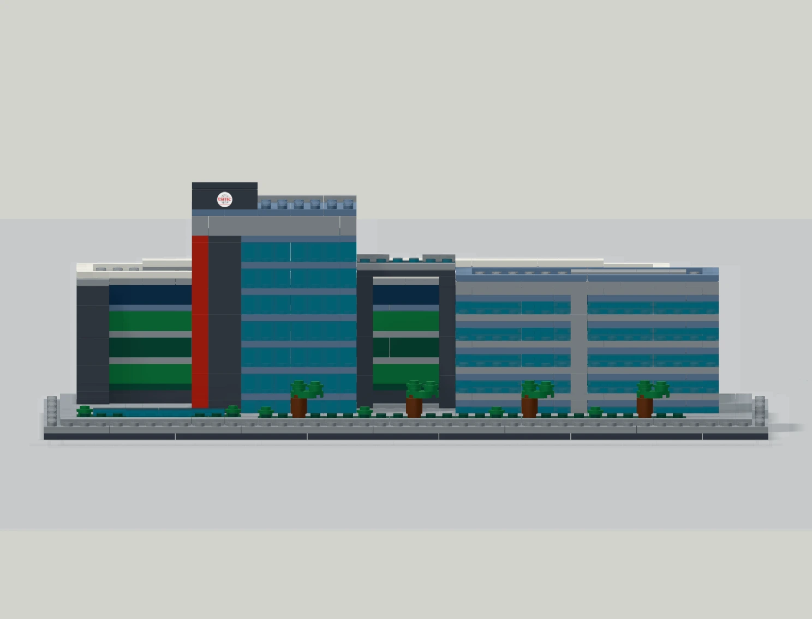
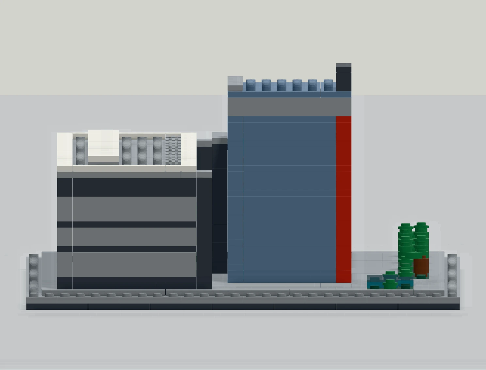
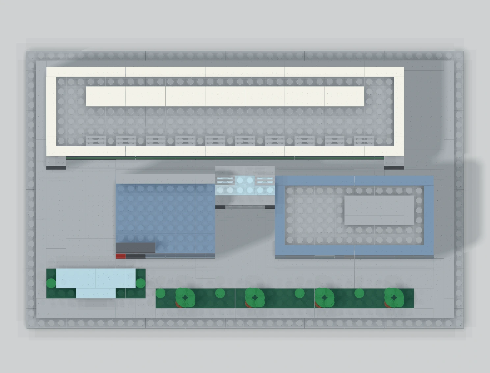

# 台中晶圓十五 A 廠｜組裝說明書

TC 01 · Taichung Fab 15A

從街道看向十五 A 廠，高玻璃棟的灰色角牆立著一條紅線，右側辦公翼較低。兩者之間架起挑高遮棚，後排廠房以植生屏和遮陽帶包覆。

847 件 · 5 袋 · 123 步

底座 44 × 28 凸點。

將底座較後的一側朝上，從左上角第 1 顆凸點開始數。X 由左向右，Z 由後向前。底高以薄板為單位，桌面是 0，一塊標準磚高 3 層薄板。每個位置均取零件佔地最左、最後的凸點。

圖號依每一步的安裝順序編列，回到下一個步驟時從 1 重新起算。[圖解說明書](manual.html) · [分袋 BOM](bom.csv) · [分步 LDraw 模型](model.ldr)

## 十五A廠・街景版

科雅六路的十五A廠以玻璃辦公樓、端牆與較低的水平翼樓形成高低差。植生立面與生態水景取自中科十五廠設計團隊的外觀資料。 取前方辦公樓及後方廠房作為同一幅街景。窗格、綠化及棟距按模型尺寸簡化，屋面和內部支撐採積木設計。

本版 847 件，另附 1 枚貼紙。

[建築師團隊・實景與外觀](https://www.twarchitect.org.tw/works/台積電中科十五廠/) · [台積電・十五A及十五B廠外觀](https://pr.tsmc.com/chinese/gallery-fabs-outside) · [台積電・廠區名錄](https://www.tsmc.com/english/aboutTSMC/TSMC_Fabs)

## 建築方位與配置

**正面**　高棟在左，較低的長翼在右。兩棟間的遮棚下方留出行走空間。

**側面**　金屬遮陽和植生屏構成後排廠房的外層。前排高棟以灰色角牆收住連續的玻璃窗。

**俯視**　模型保留前排兩棟的高低差與中庭開口。屋面構件和水池以代表性外觀取景，棟距依積木比例縮短。

## 原寸貼紙

本款有 1 張貼紙。請以 100% 列印原寸貼紙 PDF，依步驟中的 S 編號貼在指定磚面，再把該件扣入。

[下載 A4 可列印貼紙](stickers.pdf)

- S01　辦公高棟灰色角牆頂端，朝向街道 · 袋 03／步驟 79 · 7.5 × 7.5 mm · 正面（朝前），面中央。

## 第 01 袋　底座與定位

90 件，共 12 步。

| 顏色 | 零件 | 設計／庫號 | 數量 |
| --- | --- | --- | ---: |
| 淺藍灰 | 薄板 2×4 | 3020 | 2 |
| 淺藍灰 | 薄板 4×4 | 3031 | 6 |
| 淺藍灰 | 薄板 2×8 | 3034 | 10 |
| 淺藍灰 | 薄板 4×8 | 3035 | 30 |
| 深藍灰 | 薄板 4×4 | 3031 | 7 |
| 深藍灰 | 薄板 4×8 | 3035 | 35 |

### 步驟 01　併排底板（1/6）

將底板凸點朝上、長邊對齊排在平桌。下一層會跨接板縫。

**本步取件**

| 顏色 | 零件 | 設計／庫號 | 數量 |
| --- | --- | --- | ---: |
| 深藍灰 | 薄板 4×4 | 3031 | 1 |
| 深藍灰 | 薄板 4×8 | 3035 | 7 |

**安裝位置**

| 圖號 | 零件與顏色 | X | Z | 底高（薄板） | 方向 |
| ---: | --- | ---: | ---: | ---: | --- |
| 1 | 深藍灰 薄板 4×8（3035） | 1 | 1 | 0 | 沿 X |
| 2 | 深藍灰 薄板 4×8（3035） | 9 | 1 | 0 | 沿 X |
| 3 | 深藍灰 薄板 4×8（3035） | 17 | 1 | 0 | 沿 X |
| 4 | 深藍灰 薄板 4×8（3035） | 25 | 1 | 0 | 沿 X |
| 5 | 深藍灰 薄板 4×8（3035） | 33 | 1 | 0 | 沿 X |
| 6 | 深藍灰 薄板 4×4（3031） | 41 | 1 | 0 | — |
| 7 | 深藍灰 薄板 4×8（3035） | 1 | 5 | 0 | 沿 X |
| 8 | 深藍灰 薄板 4×8（3035） | 9 | 5 | 0 | 沿 X |

### 步驟 02　併排底板（2/6）

將底板凸點朝上、長邊對齊排在平桌。下一層會跨接板縫。

**本步取件**

| 顏色 | 零件 | 設計／庫號 | 數量 |
| --- | --- | --- | ---: |
| 深藍灰 | 薄板 4×4 | 3031 | 1 |
| 深藍灰 | 薄板 4×8 | 3035 | 7 |

**安裝位置**

| 圖號 | 零件與顏色 | X | Z | 底高（薄板） | 方向 |
| ---: | --- | ---: | ---: | ---: | --- |
| 1 | 深藍灰 薄板 4×8（3035） | 17 | 5 | 0 | 沿 X |
| 2 | 深藍灰 薄板 4×8（3035） | 25 | 5 | 0 | 沿 X |
| 3 | 深藍灰 薄板 4×8（3035） | 33 | 5 | 0 | 沿 X |
| 4 | 深藍灰 薄板 4×4（3031） | 41 | 5 | 0 | — |
| 5 | 深藍灰 薄板 4×8（3035） | 1 | 9 | 0 | 沿 X |
| 6 | 深藍灰 薄板 4×8（3035） | 9 | 9 | 0 | 沿 X |
| 7 | 深藍灰 薄板 4×8（3035） | 17 | 9 | 0 | 沿 X |
| 8 | 深藍灰 薄板 4×8（3035） | 25 | 9 | 0 | 沿 X |

### 步驟 03　併排底板（3/6）

將底板凸點朝上、長邊對齊排在平桌。下一層會跨接板縫。

**本步取件**

| 顏色 | 零件 | 設計／庫號 | 數量 |
| --- | --- | --- | ---: |
| 深藍灰 | 薄板 4×4 | 3031 | 2 |
| 深藍灰 | 薄板 4×8 | 3035 | 6 |

**安裝位置**

| 圖號 | 零件與顏色 | X | Z | 底高（薄板） | 方向 |
| ---: | --- | ---: | ---: | ---: | --- |
| 1 | 深藍灰 薄板 4×8（3035） | 33 | 9 | 0 | 沿 X |
| 2 | 深藍灰 薄板 4×4（3031） | 41 | 9 | 0 | — |
| 3 | 深藍灰 薄板 4×8（3035） | 1 | 13 | 0 | 沿 X |
| 4 | 深藍灰 薄板 4×8（3035） | 9 | 13 | 0 | 沿 X |
| 5 | 深藍灰 薄板 4×8（3035） | 17 | 13 | 0 | 沿 X |
| 6 | 深藍灰 薄板 4×8（3035） | 25 | 13 | 0 | 沿 X |
| 7 | 深藍灰 薄板 4×8（3035） | 33 | 13 | 0 | 沿 X |
| 8 | 深藍灰 薄板 4×4（3031） | 41 | 13 | 0 | — |

### 步驟 04　併排底板（4/6）

將底板凸點朝上、長邊對齊排在平桌。下一層會跨接板縫。

**本步取件**

| 顏色 | 零件 | 設計／庫號 | 數量 |
| --- | --- | --- | ---: |
| 深藍灰 | 薄板 4×4 | 3031 | 1 |
| 深藍灰 | 薄板 4×8 | 3035 | 7 |

**安裝位置**

| 圖號 | 零件與顏色 | X | Z | 底高（薄板） | 方向 |
| ---: | --- | ---: | ---: | ---: | --- |
| 1 | 深藍灰 薄板 4×8（3035） | 1 | 17 | 0 | 沿 X |
| 2 | 深藍灰 薄板 4×8（3035） | 9 | 17 | 0 | 沿 X |
| 3 | 深藍灰 薄板 4×8（3035） | 17 | 17 | 0 | 沿 X |
| 4 | 深藍灰 薄板 4×8（3035） | 25 | 17 | 0 | 沿 X |
| 5 | 深藍灰 薄板 4×8（3035） | 33 | 17 | 0 | 沿 X |
| 6 | 深藍灰 薄板 4×4（3031） | 41 | 17 | 0 | — |
| 7 | 深藍灰 薄板 4×8（3035） | 1 | 21 | 0 | 沿 X |
| 8 | 深藍灰 薄板 4×8（3035） | 9 | 21 | 0 | 沿 X |

### 步驟 05　併排底板（5/6）

將底板凸點朝上、長邊對齊排在平桌。下一層會跨接板縫。

**本步取件**

| 顏色 | 零件 | 設計／庫號 | 數量 |
| --- | --- | --- | ---: |
| 深藍灰 | 薄板 4×4 | 3031 | 1 |
| 深藍灰 | 薄板 4×8 | 3035 | 7 |

**安裝位置**

| 圖號 | 零件與顏色 | X | Z | 底高（薄板） | 方向 |
| ---: | --- | ---: | ---: | ---: | --- |
| 1 | 深藍灰 薄板 4×8（3035） | 17 | 21 | 0 | 沿 X |
| 2 | 深藍灰 薄板 4×8（3035） | 25 | 21 | 0 | 沿 X |
| 3 | 深藍灰 薄板 4×8（3035） | 33 | 21 | 0 | 沿 X |
| 4 | 深藍灰 薄板 4×4（3031） | 41 | 21 | 0 | — |
| 5 | 深藍灰 薄板 4×8（3035） | 1 | 25 | 0 | 沿 X |
| 6 | 深藍灰 薄板 4×8（3035） | 9 | 25 | 0 | 沿 X |
| 7 | 深藍灰 薄板 4×8（3035） | 17 | 25 | 0 | 沿 X |
| 8 | 深藍灰 薄板 4×8（3035） | 25 | 25 | 0 | 沿 X |

### 步驟 06　併排底板（6/6）

將底板凸點朝上、長邊對齊排在平桌。下一層會跨接板縫。

**本步取件**

| 顏色 | 零件 | 設計／庫號 | 數量 |
| --- | --- | --- | ---: |
| 深藍灰 | 薄板 4×4 | 3031 | 1 |
| 深藍灰 | 薄板 4×8 | 3035 | 1 |

**安裝位置**

| 圖號 | 零件與顏色 | X | Z | 底高（薄板） | 方向 |
| ---: | --- | ---: | ---: | ---: | --- |
| 1 | 深藍灰 薄板 4×8（3035） | 33 | 25 | 0 | 沿 X |
| 2 | 深藍灰 薄板 4×4（3031） | 41 | 25 | 0 | — |

### 步驟 07　錯縫鎖底（1/6）

上層相對底板橫移四格、縱移兩格。逐排按緊後，底座可整片拿起。

**本步取件**

| 顏色 | 零件 | 設計／庫號 | 數量 |
| --- | --- | --- | ---: |
| 淺藍灰 | 薄板 2×4 | 3020 | 1 |
| 淺藍灰 | 薄板 4×4 | 3031 | 1 |
| 淺藍灰 | 薄板 2×8 | 3034 | 5 |
| 淺藍灰 | 薄板 4×8 | 3035 | 1 |

**安裝位置**

| 圖號 | 零件與顏色 | X | Z | 底高（薄板） | 方向 |
| ---: | --- | ---: | ---: | ---: | --- |
| 1 | 淺藍灰 薄板 2×4（3020） | 1 | 1 | 1 | 沿 X |
| 2 | 淺藍灰 薄板 2×8（3034） | 5 | 1 | 1 | 沿 X |
| 3 | 淺藍灰 薄板 2×8（3034） | 13 | 1 | 1 | 沿 X |
| 4 | 淺藍灰 薄板 2×8（3034） | 21 | 1 | 1 | 沿 X |
| 5 | 淺藍灰 薄板 2×8（3034） | 29 | 1 | 1 | 沿 X |
| 6 | 淺藍灰 薄板 2×8（3034） | 37 | 1 | 1 | 沿 X |
| 7 | 淺藍灰 薄板 4×4（3031） | 1 | 3 | 1 | — |
| 8 | 淺藍灰 薄板 4×8（3035） | 5 | 3 | 1 | 沿 X |

### 步驟 08　錯縫鎖底（2/6）

上層相對底板橫移四格、縱移兩格。逐排按緊後，底座可整片拿起。

**本步取件**

| 顏色 | 零件 | 設計／庫號 | 數量 |
| --- | --- | --- | ---: |
| 淺藍灰 | 薄板 4×4 | 3031 | 1 |
| 淺藍灰 | 薄板 4×8 | 3035 | 7 |

**安裝位置**

| 圖號 | 零件與顏色 | X | Z | 底高（薄板） | 方向 |
| ---: | --- | ---: | ---: | ---: | --- |
| 1 | 淺藍灰 薄板 4×8（3035） | 13 | 3 | 1 | 沿 X |
| 2 | 淺藍灰 薄板 4×8（3035） | 21 | 3 | 1 | 沿 X |
| 3 | 淺藍灰 薄板 4×8（3035） | 29 | 3 | 1 | 沿 X |
| 4 | 淺藍灰 薄板 4×8（3035） | 37 | 3 | 1 | 沿 X |
| 5 | 淺藍灰 薄板 4×4（3031） | 1 | 7 | 1 | — |
| 6 | 淺藍灰 薄板 4×8（3035） | 5 | 7 | 1 | 沿 X |
| 7 | 淺藍灰 薄板 4×8（3035） | 13 | 7 | 1 | 沿 X |
| 8 | 淺藍灰 薄板 4×8（3035） | 21 | 7 | 1 | 沿 X |

### 步驟 09　錯縫鎖底（3/6）

上層相對底板橫移四格、縱移兩格。逐排按緊後，底座可整片拿起。

**本步取件**

| 顏色 | 零件 | 設計／庫號 | 數量 |
| --- | --- | --- | ---: |
| 淺藍灰 | 薄板 4×4 | 3031 | 1 |
| 淺藍灰 | 薄板 4×8 | 3035 | 7 |

**安裝位置**

| 圖號 | 零件與顏色 | X | Z | 底高（薄板） | 方向 |
| ---: | --- | ---: | ---: | ---: | --- |
| 1 | 淺藍灰 薄板 4×8（3035） | 29 | 7 | 1 | 沿 X |
| 2 | 淺藍灰 薄板 4×8（3035） | 37 | 7 | 1 | 沿 X |
| 3 | 淺藍灰 薄板 4×4（3031） | 1 | 11 | 1 | — |
| 4 | 淺藍灰 薄板 4×8（3035） | 5 | 11 | 1 | 沿 X |
| 5 | 淺藍灰 薄板 4×8（3035） | 13 | 11 | 1 | 沿 X |
| 6 | 淺藍灰 薄板 4×8（3035） | 21 | 11 | 1 | 沿 X |
| 7 | 淺藍灰 薄板 4×8（3035） | 29 | 11 | 1 | 沿 X |
| 8 | 淺藍灰 薄板 4×8（3035） | 37 | 11 | 1 | 沿 X |

### 步驟 10　錯縫鎖底（4/6）

上層相對底板橫移四格、縱移兩格。逐排按緊後，底座可整片拿起。

**本步取件**

| 顏色 | 零件 | 設計／庫號 | 數量 |
| --- | --- | --- | ---: |
| 淺藍灰 | 薄板 4×4 | 3031 | 2 |
| 淺藍灰 | 薄板 4×8 | 3035 | 6 |

**安裝位置**

| 圖號 | 零件與顏色 | X | Z | 底高（薄板） | 方向 |
| ---: | --- | ---: | ---: | ---: | --- |
| 1 | 淺藍灰 薄板 4×4（3031） | 1 | 15 | 1 | — |
| 2 | 淺藍灰 薄板 4×8（3035） | 5 | 15 | 1 | 沿 X |
| 3 | 淺藍灰 薄板 4×8（3035） | 13 | 15 | 1 | 沿 X |
| 4 | 淺藍灰 薄板 4×8（3035） | 21 | 15 | 1 | 沿 X |
| 5 | 淺藍灰 薄板 4×8（3035） | 29 | 15 | 1 | 沿 X |
| 6 | 淺藍灰 薄板 4×8（3035） | 37 | 15 | 1 | 沿 X |
| 7 | 淺藍灰 薄板 4×4（3031） | 1 | 19 | 1 | — |
| 8 | 淺藍灰 薄板 4×8（3035） | 5 | 19 | 1 | 沿 X |

### 步驟 11　錯縫鎖底（5/6）

上層相對底板橫移四格、縱移兩格。逐排按緊後，底座可整片拿起。

**本步取件**

| 顏色 | 零件 | 設計／庫號 | 數量 |
| --- | --- | --- | ---: |
| 淺藍灰 | 薄板 4×4 | 3031 | 1 |
| 淺藍灰 | 薄板 4×8 | 3035 | 7 |

**安裝位置**

| 圖號 | 零件與顏色 | X | Z | 底高（薄板） | 方向 |
| ---: | --- | ---: | ---: | ---: | --- |
| 1 | 淺藍灰 薄板 4×8（3035） | 13 | 19 | 1 | 沿 X |
| 2 | 淺藍灰 薄板 4×8（3035） | 21 | 19 | 1 | 沿 X |
| 3 | 淺藍灰 薄板 4×8（3035） | 29 | 19 | 1 | 沿 X |
| 4 | 淺藍灰 薄板 4×8（3035） | 37 | 19 | 1 | 沿 X |
| 5 | 淺藍灰 薄板 4×4（3031） | 1 | 23 | 1 | — |
| 6 | 淺藍灰 薄板 4×8（3035） | 5 | 23 | 1 | 沿 X |
| 7 | 淺藍灰 薄板 4×8（3035） | 13 | 23 | 1 | 沿 X |
| 8 | 淺藍灰 薄板 4×8（3035） | 21 | 23 | 1 | 沿 X |

### 步驟 12　錯縫鎖底（6/6）

上層相對底板橫移四格、縱移兩格。逐排按緊後，底座可整片拿起。

**本步取件**

| 顏色 | 零件 | 設計／庫號 | 數量 |
| --- | --- | --- | ---: |
| 淺藍灰 | 薄板 2×4 | 3020 | 1 |
| 淺藍灰 | 薄板 2×8 | 3034 | 5 |
| 淺藍灰 | 薄板 4×8 | 3035 | 2 |

**安裝位置**

| 圖號 | 零件與顏色 | X | Z | 底高（薄板） | 方向 |
| ---: | --- | ---: | ---: | ---: | --- |
| 1 | 淺藍灰 薄板 4×8（3035） | 29 | 23 | 1 | 沿 X |
| 2 | 淺藍灰 薄板 4×8（3035） | 37 | 23 | 1 | 沿 X |
| 3 | 淺藍灰 薄板 2×4（3020） | 1 | 27 | 1 | 沿 X |
| 4 | 淺藍灰 薄板 2×8（3034） | 5 | 27 | 1 | 沿 X |
| 5 | 淺藍灰 薄板 2×8（3034） | 13 | 27 | 1 | 沿 X |
| 6 | 淺藍灰 薄板 2×8（3034） | 21 | 27 | 1 | 沿 X |
| 7 | 淺藍灰 薄板 2×8（3034） | 29 | 27 | 1 | 沿 X |
| 8 | 淺藍灰 薄板 2×8（3034） | 37 | 27 | 1 | 沿 X |

## 第 02 袋　後排植生立面與遮陽屋緣

246 件，共 37 步。

| 顏色 | 零件 | 設計／庫號 | 數量 |
| --- | --- | --- | ---: |
| 綠色 | 磚 1×2 | 3004 | 2 |
| 綠色 | 磚 1×8 | 3008 | 8 |
| 白色 | 光面板 1×4 | 2431 | 2 |
| 白色 | 光面板 1×1 | 3070b | 2 |
| 白色 | 光面板 1×8 | 4162 | 8 |
| 白色 | 光面板 1×6 | 6636 | 2 |
| 白色 | 光面板 2×4 | 87079 | 7 |
| 淺藍灰 | 格柵板 1×2 | 2412b | 10 |
| 淺藍灰 | 磚 1×2 | 3004 | 5 |
| 淺藍灰 | 磚 1×8 | 3008 | 38 |
| 淺藍灰 | 磚 1×4 | 3010 | 3 |
| 淺藍灰 | 薄板 2×4 | 3020 | 1 |
| 淺藍灰 | 薄板 1×2 | 3023 | 24 |
| 淺藍灰 | 薄板 2×8 | 3034 | 21 |
| 淺藍灰 | 光面板 1×2 | 3069b | 2 |
| 淺藍灰 | 薄板 1×8 | 3460 | 36 |
| 淺藍灰 | 薄板 1×4 | 3710 | 2 |
| 深藍灰 | 磚 1×2 | 3004 | 11 |
| 深藍灰 | 磚 1×8 | 3008 | 16 |
| 深藍灰 | 磚 1×4 | 3010 | 2 |
| 深藍灰 | 薄板 1×2 | 3023 | 8 |
| 深藍灰 | 薄板 1×8 | 3460 | 12 |
| 深藍灰 | 薄板 1×4 | 3710 | 2 |
| 深藍 | 磚 1×2 | 3004 | 1 |
| 深藍 | 磚 1×8 | 3008 | 4 |
| 深綠 | 磚 1×6 | 3009 | 5 |
| 深綠 | 磚 1×4 | 3010 | 1 |
| 深綠 | 薄板 1×2 | 3023 | 1 |
| 深綠 | 薄板 1×8 | 3460 | 4 |
| 沙藍 | 薄板 1×6 | 3666 | 5 |
| 沙藍 | 薄板 1×4 | 3710 | 1 |

### 步驟 13　後排廠房 · 第 1 道外牆（1/3）

先沿背面和兩側砌灰色條紋牆，正面植生屏退入一格，兩端立柱突出。每層將中間承板肋疊至同高。

**本步取件**

| 顏色 | 零件 | 設計／庫號 | 數量 |
| --- | --- | --- | ---: |
| 深藍灰 | 磚 1×8 | 3008 | 7 |
| 深藍灰 | 磚 1×4 | 3010 | 1 |

**安裝位置**

| 圖號 | 零件與顏色 | X | Z | 底高（薄板） | 方向 |
| ---: | --- | ---: | ---: | ---: | --- |
| 1 | 深藍灰 磚 1×8（3008） | 3 | 3 | 2 | 沿 X |
| 2 | 深藍灰 磚 1×8（3008） | 11 | 3 | 2 | 沿 X |
| 3 | 深藍灰 磚 1×8（3008） | 19 | 3 | 2 | 沿 X |
| 4 | 深藍灰 磚 1×8（3008） | 27 | 3 | 2 | 沿 X |
| 5 | 深藍灰 磚 1×4（3010） | 35 | 3 | 2 | 沿 X |
| 6 | 深藍灰 磚 1×8（3008） | 3 | 4 | 2 | 沿 Z |
| 7 | 深藍灰 磚 1×8（3008） | 38 | 4 | 2 | 沿 Z |
| 8 | 深藍灰 磚 1×8（3008） | 4 | 11 | 2 | 沿 X |

### 步驟 14　後排廠房 · 第 1 道外牆（2/3）

先沿背面和兩側砌灰色條紋牆，正面植生屏退入一格，兩端立柱突出。每層將中間承板肋疊至同高。

**本步取件**

| 顏色 | 零件 | 設計／庫號 | 數量 |
| --- | --- | --- | ---: |
| 淺藍灰 | 磚 1×8 | 3008 | 2 |
| 深藍灰 | 磚 1×2 | 3004 | 3 |
| 深藍灰 | 磚 1×8 | 3008 | 3 |

**安裝位置**

| 圖號 | 零件與顏色 | X | Z | 底高（薄板） | 方向 |
| ---: | --- | ---: | ---: | ---: | --- |
| 1 | 深藍灰 磚 1×8（3008） | 12 | 11 | 2 | 沿 X |
| 2 | 深藍灰 磚 1×8（3008） | 20 | 11 | 2 | 沿 X |
| 3 | 深藍灰 磚 1×8（3008） | 28 | 11 | 2 | 沿 X |
| 4 | 深藍灰 磚 1×2（3004） | 36 | 11 | 2 | 沿 X |
| 5 | 深藍灰 磚 1×2（3004） | 3 | 12 | 2 | 沿 X |
| 6 | 深藍灰 磚 1×2（3004） | 37 | 12 | 2 | 沿 X |
| 7 | 淺藍灰 磚 1×8（3008） | 4 | 9 | 2 | 沿 X |
| 8 | 淺藍灰 磚 1×8（3008） | 12 | 9 | 2 | 沿 X |

### 步驟 15　後排廠房 · 第 1 道外牆（3/3）

先沿背面和兩側砌灰色條紋牆，正面植生屏退入一格，兩端立柱突出。每層將中間承板肋疊至同高。

**本步取件**

| 顏色 | 零件 | 設計／庫號 | 數量 |
| --- | --- | --- | ---: |
| 淺藍灰 | 磚 1×2 | 3004 | 1 |
| 淺藍灰 | 磚 1×8 | 3008 | 2 |

**安裝位置**

| 圖號 | 零件與顏色 | X | Z | 底高（薄板） | 方向 |
| ---: | --- | ---: | ---: | ---: | --- |
| 1 | 淺藍灰 磚 1×8（3008） | 20 | 9 | 2 | 沿 X |
| 2 | 淺藍灰 磚 1×8（3008） | 28 | 9 | 2 | 沿 X |
| 3 | 淺藍灰 磚 1×2（3004） | 36 | 9 | 2 | 沿 X |

### 步驟 16　後排廠房 · 第 2 道外牆（1/3）

先沿背面和兩側砌灰色條紋牆，正面植生屏退入一格，兩端立柱突出。每層將中間承板肋疊至同高。

**本步取件**

| 顏色 | 零件 | 設計／庫號 | 數量 |
| --- | --- | --- | ---: |
| 淺藍灰 | 薄板 1×8 | 3460 | 6 |
| 淺藍灰 | 薄板 1×4 | 3710 | 1 |
| 深綠 | 薄板 1×8 | 3460 | 1 |

**安裝位置**

| 圖號 | 零件與顏色 | X | Z | 底高（薄板） | 方向 |
| ---: | --- | ---: | ---: | ---: | --- |
| 1 | 淺藍灰 薄板 1×8（3460） | 3 | 3 | 5 | 沿 X |
| 2 | 淺藍灰 薄板 1×8（3460） | 11 | 3 | 5 | 沿 X |
| 3 | 淺藍灰 薄板 1×8（3460） | 19 | 3 | 5 | 沿 X |
| 4 | 淺藍灰 薄板 1×8（3460） | 27 | 3 | 5 | 沿 X |
| 5 | 淺藍灰 薄板 1×4（3710） | 35 | 3 | 5 | 沿 X |
| 6 | 淺藍灰 薄板 1×8（3460） | 3 | 4 | 5 | 沿 Z |
| 7 | 淺藍灰 薄板 1×8（3460） | 38 | 4 | 5 | 沿 Z |
| 8 | 深綠 薄板 1×8（3460） | 4 | 11 | 5 | 沿 X |

### 步驟 17　後排廠房 · 第 2 道外牆（2/3）

先沿背面和兩側砌灰色條紋牆，正面植生屏退入一格，兩端立柱突出。每層將中間承板肋疊至同高。

**本步取件**

| 顏色 | 零件 | 設計／庫號 | 數量 |
| --- | --- | --- | ---: |
| 淺藍灰 | 薄板 1×8 | 3460 | 2 |
| 深藍灰 | 薄板 1×2 | 3023 | 2 |
| 深綠 | 薄板 1×2 | 3023 | 1 |
| 深綠 | 薄板 1×8 | 3460 | 3 |

**安裝位置**

| 圖號 | 零件與顏色 | X | Z | 底高（薄板） | 方向 |
| ---: | --- | ---: | ---: | ---: | --- |
| 1 | 深綠 薄板 1×8（3460） | 12 | 11 | 5 | 沿 X |
| 2 | 深綠 薄板 1×8（3460） | 20 | 11 | 5 | 沿 X |
| 3 | 深綠 薄板 1×8（3460） | 28 | 11 | 5 | 沿 X |
| 4 | 深綠 薄板 1×2（3023） | 36 | 11 | 5 | 沿 X |
| 5 | 深藍灰 薄板 1×2（3023） | 3 | 12 | 5 | 沿 X |
| 6 | 深藍灰 薄板 1×2（3023） | 37 | 12 | 5 | 沿 X |
| 7 | 淺藍灰 薄板 1×8（3460） | 4 | 9 | 5 | 沿 X |
| 8 | 淺藍灰 薄板 1×8（3460） | 12 | 9 | 5 | 沿 X |

### 步驟 18　後排廠房 · 第 2 道外牆（3/3）

先沿背面和兩側砌灰色條紋牆，正面植生屏退入一格，兩端立柱突出。每層將中間承板肋疊至同高。

**本步取件**

| 顏色 | 零件 | 設計／庫號 | 數量 |
| --- | --- | --- | ---: |
| 淺藍灰 | 薄板 1×2 | 3023 | 1 |
| 淺藍灰 | 薄板 1×8 | 3460 | 2 |

**安裝位置**

| 圖號 | 零件與顏色 | X | Z | 底高（薄板） | 方向 |
| ---: | --- | ---: | ---: | ---: | --- |
| 1 | 淺藍灰 薄板 1×8（3460） | 20 | 9 | 5 | 沿 X |
| 2 | 淺藍灰 薄板 1×8（3460） | 28 | 9 | 5 | 沿 X |
| 3 | 淺藍灰 薄板 1×2（3023） | 36 | 9 | 5 | 沿 X |

### 步驟 19　後排廠房 · 第 3 道外牆（1/3）

先沿背面和兩側砌灰色條紋牆，正面植生屏退入一格，兩端立柱突出。每層將中間承板肋疊至同高。

**本步取件**

| 顏色 | 零件 | 設計／庫號 | 數量 |
| --- | --- | --- | ---: |
| 綠色 | 磚 1×8 | 3008 | 1 |
| 淺藍灰 | 磚 1×8 | 3008 | 6 |
| 淺藍灰 | 磚 1×4 | 3010 | 1 |

**安裝位置**

| 圖號 | 零件與顏色 | X | Z | 底高（薄板） | 方向 |
| ---: | --- | ---: | ---: | ---: | --- |
| 1 | 淺藍灰 磚 1×8（3008） | 3 | 3 | 6 | 沿 X |
| 2 | 淺藍灰 磚 1×8（3008） | 11 | 3 | 6 | 沿 X |
| 3 | 淺藍灰 磚 1×8（3008） | 19 | 3 | 6 | 沿 X |
| 4 | 淺藍灰 磚 1×8（3008） | 27 | 3 | 6 | 沿 X |
| 5 | 淺藍灰 磚 1×4（3010） | 35 | 3 | 6 | 沿 X |
| 6 | 淺藍灰 磚 1×8（3008） | 3 | 4 | 6 | 沿 Z |
| 7 | 淺藍灰 磚 1×8（3008） | 38 | 4 | 6 | 沿 Z |
| 8 | 綠色 磚 1×8（3008） | 4 | 11 | 6 | 沿 X |

### 步驟 20　後排廠房 · 第 3 道外牆（2/3）

先沿背面和兩側砌灰色條紋牆，正面植生屏退入一格，兩端立柱突出。每層將中間承板肋疊至同高。

**本步取件**

| 顏色 | 零件 | 設計／庫號 | 數量 |
| --- | --- | --- | ---: |
| 綠色 | 磚 1×2 | 3004 | 1 |
| 綠色 | 磚 1×8 | 3008 | 3 |
| 淺藍灰 | 磚 1×8 | 3008 | 2 |
| 深藍灰 | 磚 1×2 | 3004 | 2 |

**安裝位置**

| 圖號 | 零件與顏色 | X | Z | 底高（薄板） | 方向 |
| ---: | --- | ---: | ---: | ---: | --- |
| 1 | 綠色 磚 1×8（3008） | 12 | 11 | 6 | 沿 X |
| 2 | 綠色 磚 1×8（3008） | 20 | 11 | 6 | 沿 X |
| 3 | 綠色 磚 1×8（3008） | 28 | 11 | 6 | 沿 X |
| 4 | 綠色 磚 1×2（3004） | 36 | 11 | 6 | 沿 X |
| 5 | 深藍灰 磚 1×2（3004） | 3 | 12 | 6 | 沿 X |
| 6 | 深藍灰 磚 1×2（3004） | 37 | 12 | 6 | 沿 X |
| 7 | 淺藍灰 磚 1×8（3008） | 4 | 9 | 6 | 沿 X |
| 8 | 淺藍灰 磚 1×8（3008） | 12 | 9 | 6 | 沿 X |

### 步驟 21　後排廠房 · 第 3 道外牆（3/3）

先沿背面和兩側砌灰色條紋牆，正面植生屏退入一格，兩端立柱突出。每層將中間承板肋疊至同高。

**本步取件**

| 顏色 | 零件 | 設計／庫號 | 數量 |
| --- | --- | --- | ---: |
| 淺藍灰 | 磚 1×2 | 3004 | 1 |
| 淺藍灰 | 磚 1×8 | 3008 | 2 |

**安裝位置**

| 圖號 | 零件與顏色 | X | Z | 底高（薄板） | 方向 |
| ---: | --- | ---: | ---: | ---: | --- |
| 1 | 淺藍灰 磚 1×8（3008） | 20 | 9 | 6 | 沿 X |
| 2 | 淺藍灰 磚 1×8（3008） | 28 | 9 | 6 | 沿 X |
| 3 | 淺藍灰 磚 1×2（3004） | 36 | 9 | 6 | 沿 X |

### 步驟 22　後排廠房 · 第 4 道外牆（1/3）

先沿背面和兩側砌灰色條紋牆，正面植生屏退入一格，兩端立柱突出。每層將中間承板肋疊至同高。

**本步取件**

| 顏色 | 零件 | 設計／庫號 | 數量 |
| --- | --- | --- | ---: |
| 淺藍灰 | 薄板 1×8 | 3460 | 1 |
| 深藍灰 | 薄板 1×8 | 3460 | 6 |
| 深藍灰 | 薄板 1×4 | 3710 | 1 |

**安裝位置**

| 圖號 | 零件與顏色 | X | Z | 底高（薄板） | 方向 |
| ---: | --- | ---: | ---: | ---: | --- |
| 1 | 深藍灰 薄板 1×8（3460） | 3 | 3 | 9 | 沿 X |
| 2 | 深藍灰 薄板 1×8（3460） | 11 | 3 | 9 | 沿 X |
| 3 | 深藍灰 薄板 1×8（3460） | 19 | 3 | 9 | 沿 X |
| 4 | 深藍灰 薄板 1×8（3460） | 27 | 3 | 9 | 沿 X |
| 5 | 深藍灰 薄板 1×4（3710） | 35 | 3 | 9 | 沿 X |
| 6 | 深藍灰 薄板 1×8（3460） | 3 | 4 | 9 | 沿 Z |
| 7 | 深藍灰 薄板 1×8（3460） | 38 | 4 | 9 | 沿 Z |
| 8 | 淺藍灰 薄板 1×8（3460） | 4 | 11 | 9 | 沿 X |

### 步驟 23　後排廠房 · 第 4 道外牆（2/3）

先沿背面和兩側砌灰色條紋牆，正面植生屏退入一格，兩端立柱突出。每層將中間承板肋疊至同高。

**本步取件**

| 顏色 | 零件 | 設計／庫號 | 數量 |
| --- | --- | --- | ---: |
| 淺藍灰 | 薄板 1×2 | 3023 | 1 |
| 淺藍灰 | 薄板 1×8 | 3460 | 5 |
| 深藍灰 | 薄板 1×2 | 3023 | 2 |

**安裝位置**

| 圖號 | 零件與顏色 | X | Z | 底高（薄板） | 方向 |
| ---: | --- | ---: | ---: | ---: | --- |
| 1 | 淺藍灰 薄板 1×8（3460） | 12 | 11 | 9 | 沿 X |
| 2 | 淺藍灰 薄板 1×8（3460） | 20 | 11 | 9 | 沿 X |
| 3 | 淺藍灰 薄板 1×8（3460） | 28 | 11 | 9 | 沿 X |
| 4 | 淺藍灰 薄板 1×2（3023） | 36 | 11 | 9 | 沿 X |
| 5 | 深藍灰 薄板 1×2（3023） | 3 | 12 | 9 | 沿 X |
| 6 | 深藍灰 薄板 1×2（3023） | 37 | 12 | 9 | 沿 X |
| 7 | 淺藍灰 薄板 1×8（3460） | 4 | 9 | 9 | 沿 X |
| 8 | 淺藍灰 薄板 1×8（3460） | 12 | 9 | 9 | 沿 X |

### 步驟 24　後排廠房 · 第 4 道外牆（3/3）

先沿背面和兩側砌灰色條紋牆，正面植生屏退入一格，兩端立柱突出。每層將中間承板肋疊至同高。

**本步取件**

| 顏色 | 零件 | 設計／庫號 | 數量 |
| --- | --- | --- | ---: |
| 淺藍灰 | 薄板 1×2 | 3023 | 1 |
| 淺藍灰 | 薄板 1×8 | 3460 | 2 |

**安裝位置**

| 圖號 | 零件與顏色 | X | Z | 底高（薄板） | 方向 |
| ---: | --- | ---: | ---: | ---: | --- |
| 1 | 淺藍灰 薄板 1×8（3460） | 20 | 9 | 9 | 沿 X |
| 2 | 淺藍灰 薄板 1×8（3460） | 28 | 9 | 9 | 沿 X |
| 3 | 淺藍灰 薄板 1×2（3023） | 36 | 9 | 9 | 沿 X |

### 步驟 25　後排廠房 · 第 5 道外牆（1/3）

先沿背面和兩側砌灰色條紋牆，正面植生屏退入一格，兩端立柱突出。每層將中間承板肋疊至同高。

**本步取件**

| 顏色 | 零件 | 設計／庫號 | 數量 |
| --- | --- | --- | ---: |
| 淺藍灰 | 磚 1×8 | 3008 | 6 |
| 淺藍灰 | 磚 1×4 | 3010 | 1 |
| 深綠 | 磚 1×6 | 3009 | 1 |

**安裝位置**

| 圖號 | 零件與顏色 | X | Z | 底高（薄板） | 方向 |
| ---: | --- | ---: | ---: | ---: | --- |
| 1 | 淺藍灰 磚 1×8（3008） | 3 | 3 | 10 | 沿 X |
| 2 | 淺藍灰 磚 1×8（3008） | 11 | 3 | 10 | 沿 X |
| 3 | 淺藍灰 磚 1×8（3008） | 19 | 3 | 10 | 沿 X |
| 4 | 淺藍灰 磚 1×8（3008） | 27 | 3 | 10 | 沿 X |
| 5 | 淺藍灰 磚 1×4（3010） | 35 | 3 | 10 | 沿 X |
| 6 | 淺藍灰 磚 1×8（3008） | 3 | 4 | 10 | 沿 Z |
| 7 | 淺藍灰 磚 1×8（3008） | 38 | 4 | 10 | 沿 Z |
| 8 | 深綠 磚 1×6（3009） | 4 | 11 | 10 | 沿 X |

### 步驟 26　後排廠房 · 第 5 道外牆（2/3）

先沿背面和兩側砌灰色條紋牆，正面植生屏退入一格，兩端立柱突出。每層將中間承板肋疊至同高。

**本步取件**

| 顏色 | 零件 | 設計／庫號 | 數量 |
| --- | --- | --- | ---: |
| 淺藍灰 | 磚 1×8 | 3008 | 1 |
| 深藍灰 | 磚 1×2 | 3004 | 2 |
| 深綠 | 磚 1×6 | 3009 | 4 |
| 深綠 | 磚 1×4 | 3010 | 1 |

**安裝位置**

| 圖號 | 零件與顏色 | X | Z | 底高（薄板） | 方向 |
| ---: | --- | ---: | ---: | ---: | --- |
| 1 | 深綠 磚 1×6（3009） | 10 | 11 | 10 | 沿 X |
| 2 | 深綠 磚 1×6（3009） | 16 | 11 | 10 | 沿 X |
| 3 | 深綠 磚 1×6（3009） | 22 | 11 | 10 | 沿 X |
| 4 | 深綠 磚 1×6（3009） | 28 | 11 | 10 | 沿 X |
| 5 | 深綠 磚 1×4（3010） | 34 | 11 | 10 | 沿 X |
| 6 | 深藍灰 磚 1×2（3004） | 3 | 12 | 10 | 沿 X |
| 7 | 深藍灰 磚 1×2（3004） | 37 | 12 | 10 | 沿 X |
| 8 | 淺藍灰 磚 1×8（3008） | 4 | 9 | 10 | 沿 X |

### 步驟 27　後排廠房 · 第 5 道外牆（3/3）

先沿背面和兩側砌灰色條紋牆，正面植生屏退入一格，兩端立柱突出。每層將中間承板肋疊至同高。

**本步取件**

| 顏色 | 零件 | 設計／庫號 | 數量 |
| --- | --- | --- | ---: |
| 淺藍灰 | 磚 1×2 | 3004 | 1 |
| 淺藍灰 | 磚 1×8 | 3008 | 3 |

**安裝位置**

| 圖號 | 零件與顏色 | X | Z | 底高（薄板） | 方向 |
| ---: | --- | ---: | ---: | ---: | --- |
| 1 | 淺藍灰 磚 1×8（3008） | 12 | 9 | 10 | 沿 X |
| 2 | 淺藍灰 磚 1×8（3008） | 20 | 9 | 10 | 沿 X |
| 3 | 淺藍灰 磚 1×8（3008） | 28 | 9 | 10 | 沿 X |
| 4 | 淺藍灰 磚 1×2（3004） | 36 | 9 | 10 | 沿 X |

### 步驟 28　後排廠房 · 第 6 道外牆（1/3）

先沿背面和兩側砌灰色條紋牆，正面植生屏退入一格，兩端立柱突出。每層將中間承板肋疊至同高。

**本步取件**

| 顏色 | 零件 | 設計／庫號 | 數量 |
| --- | --- | --- | ---: |
| 淺藍灰 | 薄板 1×8 | 3460 | 1 |
| 深藍灰 | 薄板 1×8 | 3460 | 6 |
| 深藍灰 | 薄板 1×4 | 3710 | 1 |

**安裝位置**

| 圖號 | 零件與顏色 | X | Z | 底高（薄板） | 方向 |
| ---: | --- | ---: | ---: | ---: | --- |
| 1 | 深藍灰 薄板 1×8（3460） | 3 | 3 | 13 | 沿 X |
| 2 | 深藍灰 薄板 1×8（3460） | 11 | 3 | 13 | 沿 X |
| 3 | 深藍灰 薄板 1×8（3460） | 19 | 3 | 13 | 沿 X |
| 4 | 深藍灰 薄板 1×8（3460） | 27 | 3 | 13 | 沿 X |
| 5 | 深藍灰 薄板 1×4（3710） | 35 | 3 | 13 | 沿 X |
| 6 | 深藍灰 薄板 1×8（3460） | 3 | 4 | 13 | 沿 Z |
| 7 | 深藍灰 薄板 1×8（3460） | 38 | 4 | 13 | 沿 Z |
| 8 | 淺藍灰 薄板 1×8（3460） | 4 | 11 | 13 | 沿 X |

### 步驟 29　後排廠房 · 第 6 道外牆（2/3）

先沿背面和兩側砌灰色條紋牆，正面植生屏退入一格，兩端立柱突出。每層將中間承板肋疊至同高。

**本步取件**

| 顏色 | 零件 | 設計／庫號 | 數量 |
| --- | --- | --- | ---: |
| 淺藍灰 | 薄板 1×2 | 3023 | 1 |
| 淺藍灰 | 薄板 1×8 | 3460 | 5 |
| 深藍灰 | 薄板 1×2 | 3023 | 2 |

**安裝位置**

| 圖號 | 零件與顏色 | X | Z | 底高（薄板） | 方向 |
| ---: | --- | ---: | ---: | ---: | --- |
| 1 | 淺藍灰 薄板 1×8（3460） | 12 | 11 | 13 | 沿 X |
| 2 | 淺藍灰 薄板 1×8（3460） | 20 | 11 | 13 | 沿 X |
| 3 | 淺藍灰 薄板 1×8（3460） | 28 | 11 | 13 | 沿 X |
| 4 | 淺藍灰 薄板 1×2（3023） | 36 | 11 | 13 | 沿 X |
| 5 | 深藍灰 薄板 1×2（3023） | 3 | 12 | 13 | 沿 X |
| 6 | 深藍灰 薄板 1×2（3023） | 37 | 12 | 13 | 沿 X |
| 7 | 淺藍灰 薄板 1×8（3460） | 4 | 9 | 13 | 沿 X |
| 8 | 淺藍灰 薄板 1×8（3460） | 12 | 9 | 13 | 沿 X |

### 步驟 30　後排廠房 · 第 6 道外牆（3/3）

先沿背面和兩側砌灰色條紋牆，正面植生屏退入一格，兩端立柱突出。每層將中間承板肋疊至同高。

**本步取件**

| 顏色 | 零件 | 設計／庫號 | 數量 |
| --- | --- | --- | ---: |
| 淺藍灰 | 薄板 1×2 | 3023 | 1 |
| 淺藍灰 | 薄板 1×8 | 3460 | 2 |

**安裝位置**

| 圖號 | 零件與顏色 | X | Z | 底高（薄板） | 方向 |
| ---: | --- | ---: | ---: | ---: | --- |
| 1 | 淺藍灰 薄板 1×8（3460） | 20 | 9 | 13 | 沿 X |
| 2 | 淺藍灰 薄板 1×8（3460） | 28 | 9 | 13 | 沿 X |
| 3 | 淺藍灰 薄板 1×2（3023） | 36 | 9 | 13 | 沿 X |

### 步驟 31　後排廠房 · 第 7 道外牆（1/3）

先沿背面和兩側砌灰色條紋牆，正面植生屏退入一格，兩端立柱突出。每層將中間承板肋疊至同高。

**本步取件**

| 顏色 | 零件 | 設計／庫號 | 數量 |
| --- | --- | --- | ---: |
| 綠色 | 磚 1×8 | 3008 | 1 |
| 淺藍灰 | 磚 1×8 | 3008 | 6 |
| 淺藍灰 | 磚 1×4 | 3010 | 1 |

**安裝位置**

| 圖號 | 零件與顏色 | X | Z | 底高（薄板） | 方向 |
| ---: | --- | ---: | ---: | ---: | --- |
| 1 | 淺藍灰 磚 1×8（3008） | 3 | 3 | 14 | 沿 X |
| 2 | 淺藍灰 磚 1×8（3008） | 11 | 3 | 14 | 沿 X |
| 3 | 淺藍灰 磚 1×8（3008） | 19 | 3 | 14 | 沿 X |
| 4 | 淺藍灰 磚 1×8（3008） | 27 | 3 | 14 | 沿 X |
| 5 | 淺藍灰 磚 1×4（3010） | 35 | 3 | 14 | 沿 X |
| 6 | 淺藍灰 磚 1×8（3008） | 3 | 4 | 14 | 沿 Z |
| 7 | 淺藍灰 磚 1×8（3008） | 38 | 4 | 14 | 沿 Z |
| 8 | 綠色 磚 1×8（3008） | 4 | 11 | 14 | 沿 X |

### 步驟 32　後排廠房 · 第 7 道外牆（2/3）

先沿背面和兩側砌灰色條紋牆，正面植生屏退入一格，兩端立柱突出。每層將中間承板肋疊至同高。

**本步取件**

| 顏色 | 零件 | 設計／庫號 | 數量 |
| --- | --- | --- | ---: |
| 綠色 | 磚 1×2 | 3004 | 1 |
| 綠色 | 磚 1×8 | 3008 | 3 |
| 淺藍灰 | 磚 1×8 | 3008 | 2 |
| 深藍灰 | 磚 1×2 | 3004 | 2 |

**安裝位置**

| 圖號 | 零件與顏色 | X | Z | 底高（薄板） | 方向 |
| ---: | --- | ---: | ---: | ---: | --- |
| 1 | 綠色 磚 1×8（3008） | 12 | 11 | 14 | 沿 X |
| 2 | 綠色 磚 1×8（3008） | 20 | 11 | 14 | 沿 X |
| 3 | 綠色 磚 1×8（3008） | 28 | 11 | 14 | 沿 X |
| 4 | 綠色 磚 1×2（3004） | 36 | 11 | 14 | 沿 X |
| 5 | 深藍灰 磚 1×2（3004） | 3 | 12 | 14 | 沿 X |
| 6 | 深藍灰 磚 1×2（3004） | 37 | 12 | 14 | 沿 X |
| 7 | 淺藍灰 磚 1×8（3008） | 4 | 9 | 14 | 沿 X |
| 8 | 淺藍灰 磚 1×8（3008） | 12 | 9 | 14 | 沿 X |

### 步驟 33　後排廠房 · 第 7 道外牆（3/3）

先沿背面和兩側砌灰色條紋牆，正面植生屏退入一格，兩端立柱突出。每層將中間承板肋疊至同高。

**本步取件**

| 顏色 | 零件 | 設計／庫號 | 數量 |
| --- | --- | --- | ---: |
| 淺藍灰 | 磚 1×2 | 3004 | 1 |
| 淺藍灰 | 磚 1×8 | 3008 | 2 |

**安裝位置**

| 圖號 | 零件與顏色 | X | Z | 底高（薄板） | 方向 |
| ---: | --- | ---: | ---: | ---: | --- |
| 1 | 淺藍灰 磚 1×8（3008） | 20 | 9 | 14 | 沿 X |
| 2 | 淺藍灰 磚 1×8（3008） | 28 | 9 | 14 | 沿 X |
| 3 | 淺藍灰 磚 1×2（3004） | 36 | 9 | 14 | 沿 X |

### 步驟 34　後排廠房 · 第 8 道外牆（1/3）

先沿背面和兩側砌灰色條紋牆，正面植生屏退入一格，兩端立柱突出。每層將中間承板肋疊至同高。

**本步取件**

| 顏色 | 零件 | 設計／庫號 | 數量 |
| --- | --- | --- | ---: |
| 淺藍灰 | 薄板 1×8 | 3460 | 6 |
| 淺藍灰 | 薄板 1×4 | 3710 | 1 |
| 沙藍 | 薄板 1×6 | 3666 | 1 |

**安裝位置**

| 圖號 | 零件與顏色 | X | Z | 底高（薄板） | 方向 |
| ---: | --- | ---: | ---: | ---: | --- |
| 1 | 淺藍灰 薄板 1×8（3460） | 3 | 3 | 17 | 沿 X |
| 2 | 淺藍灰 薄板 1×8（3460） | 11 | 3 | 17 | 沿 X |
| 3 | 淺藍灰 薄板 1×8（3460） | 19 | 3 | 17 | 沿 X |
| 4 | 淺藍灰 薄板 1×8（3460） | 27 | 3 | 17 | 沿 X |
| 5 | 淺藍灰 薄板 1×4（3710） | 35 | 3 | 17 | 沿 X |
| 6 | 淺藍灰 薄板 1×8（3460） | 3 | 4 | 17 | 沿 Z |
| 7 | 淺藍灰 薄板 1×8（3460） | 38 | 4 | 17 | 沿 Z |
| 8 | 沙藍 薄板 1×6（3666） | 4 | 11 | 17 | 沿 X |

### 步驟 35　後排廠房 · 第 8 道外牆（2/3）

先沿背面和兩側砌灰色條紋牆，正面植生屏退入一格，兩端立柱突出。每層將中間承板肋疊至同高。

**本步取件**

| 顏色 | 零件 | 設計／庫號 | 數量 |
| --- | --- | --- | ---: |
| 淺藍灰 | 薄板 1×8 | 3460 | 1 |
| 深藍灰 | 薄板 1×2 | 3023 | 2 |
| 沙藍 | 薄板 1×6 | 3666 | 4 |
| 沙藍 | 薄板 1×4 | 3710 | 1 |

**安裝位置**

| 圖號 | 零件與顏色 | X | Z | 底高（薄板） | 方向 |
| ---: | --- | ---: | ---: | ---: | --- |
| 1 | 沙藍 薄板 1×6（3666） | 10 | 11 | 17 | 沿 X |
| 2 | 沙藍 薄板 1×6（3666） | 16 | 11 | 17 | 沿 X |
| 3 | 沙藍 薄板 1×6（3666） | 22 | 11 | 17 | 沿 X |
| 4 | 沙藍 薄板 1×6（3666） | 28 | 11 | 17 | 沿 X |
| 5 | 沙藍 薄板 1×4（3710） | 34 | 11 | 17 | 沿 X |
| 6 | 深藍灰 薄板 1×2（3023） | 3 | 12 | 17 | 沿 X |
| 7 | 深藍灰 薄板 1×2（3023） | 37 | 12 | 17 | 沿 X |
| 8 | 淺藍灰 薄板 1×8（3460） | 4 | 9 | 17 | 沿 X |

### 步驟 36　後排廠房 · 第 8 道外牆（3/3）

先沿背面和兩側砌灰色條紋牆，正面植生屏退入一格，兩端立柱突出。每層將中間承板肋疊至同高。

**本步取件**

| 顏色 | 零件 | 設計／庫號 | 數量 |
| --- | --- | --- | ---: |
| 淺藍灰 | 薄板 1×2 | 3023 | 1 |
| 淺藍灰 | 薄板 1×8 | 3460 | 3 |

**安裝位置**

| 圖號 | 零件與顏色 | X | Z | 底高（薄板） | 方向 |
| ---: | --- | ---: | ---: | ---: | --- |
| 1 | 淺藍灰 薄板 1×8（3460） | 12 | 9 | 17 | 沿 X |
| 2 | 淺藍灰 薄板 1×8（3460） | 20 | 9 | 17 | 沿 X |
| 3 | 淺藍灰 薄板 1×8（3460） | 28 | 9 | 17 | 沿 X |
| 4 | 淺藍灰 薄板 1×2（3023） | 36 | 9 | 17 | 沿 X |

### 步驟 37　後排廠房 · 第 9 道外牆（1/3）

先沿背面和兩側砌灰色條紋牆，正面植生屏退入一格，兩端立柱突出。每層將中間承板肋疊至同高。

**本步取件**

| 顏色 | 零件 | 設計／庫號 | 數量 |
| --- | --- | --- | ---: |
| 深藍灰 | 磚 1×8 | 3008 | 6 |
| 深藍灰 | 磚 1×4 | 3010 | 1 |
| 深藍 | 磚 1×8 | 3008 | 1 |

**安裝位置**

| 圖號 | 零件與顏色 | X | Z | 底高（薄板） | 方向 |
| ---: | --- | ---: | ---: | ---: | --- |
| 1 | 深藍灰 磚 1×8（3008） | 3 | 3 | 18 | 沿 X |
| 2 | 深藍灰 磚 1×8（3008） | 11 | 3 | 18 | 沿 X |
| 3 | 深藍灰 磚 1×8（3008） | 19 | 3 | 18 | 沿 X |
| 4 | 深藍灰 磚 1×8（3008） | 27 | 3 | 18 | 沿 X |
| 5 | 深藍灰 磚 1×4（3010） | 35 | 3 | 18 | 沿 X |
| 6 | 深藍灰 磚 1×8（3008） | 3 | 4 | 18 | 沿 Z |
| 7 | 深藍灰 磚 1×8（3008） | 38 | 4 | 18 | 沿 Z |
| 8 | 深藍 磚 1×8（3008） | 4 | 11 | 18 | 沿 X |

### 步驟 38　後排廠房 · 第 9 道外牆（2/3）

先沿背面和兩側砌灰色條紋牆，正面植生屏退入一格，兩端立柱突出。每層將中間承板肋疊至同高。

**本步取件**

| 顏色 | 零件 | 設計／庫號 | 數量 |
| --- | --- | --- | ---: |
| 淺藍灰 | 磚 1×8 | 3008 | 2 |
| 深藍灰 | 磚 1×2 | 3004 | 2 |
| 深藍 | 磚 1×2 | 3004 | 1 |
| 深藍 | 磚 1×8 | 3008 | 3 |

**安裝位置**

| 圖號 | 零件與顏色 | X | Z | 底高（薄板） | 方向 |
| ---: | --- | ---: | ---: | ---: | --- |
| 1 | 深藍 磚 1×8（3008） | 12 | 11 | 18 | 沿 X |
| 2 | 深藍 磚 1×8（3008） | 20 | 11 | 18 | 沿 X |
| 3 | 深藍 磚 1×8（3008） | 28 | 11 | 18 | 沿 X |
| 4 | 深藍 磚 1×2（3004） | 36 | 11 | 18 | 沿 X |
| 5 | 深藍灰 磚 1×2（3004） | 3 | 12 | 18 | 沿 X |
| 6 | 深藍灰 磚 1×2（3004） | 37 | 12 | 18 | 沿 X |
| 7 | 淺藍灰 磚 1×8（3008） | 4 | 9 | 18 | 沿 X |
| 8 | 淺藍灰 磚 1×8（3008） | 12 | 9 | 18 | 沿 X |

### 步驟 39　後排廠房 · 第 9 道外牆（3/3）

先沿背面和兩側砌灰色條紋牆，正面植生屏退入一格，兩端立柱突出。每層將中間承板肋疊至同高。

**本步取件**

| 顏色 | 零件 | 設計／庫號 | 數量 |
| --- | --- | --- | ---: |
| 淺藍灰 | 磚 1×2 | 3004 | 1 |
| 淺藍灰 | 磚 1×8 | 3008 | 2 |

**安裝位置**

| 圖號 | 零件與顏色 | X | Z | 底高（薄板） | 方向 |
| ---: | --- | ---: | ---: | ---: | --- |
| 1 | 淺藍灰 磚 1×8（3008） | 20 | 9 | 18 | 沿 X |
| 2 | 淺藍灰 磚 1×8（3008） | 28 | 9 | 18 | 沿 X |
| 3 | 淺藍灰 磚 1×2（3004） | 36 | 9 | 18 | 沿 X |

### 步驟 40　後排廠房 · 跨牆屋面（1/5）

每排屋面薄板跨在後牆、承板肋或前牆之間。最後用光面長板勾出兩端突出的灰柱。

**本步取件**

| 顏色 | 零件 | 設計／庫號 | 數量 |
| --- | --- | --- | ---: |
| 淺藍灰 | 薄板 1×2 | 3023 | 4 |
| 淺藍灰 | 薄板 2×8 | 3034 | 4 |

**安裝位置**

| 圖號 | 零件與顏色 | X | Z | 底高（薄板） | 方向 |
| ---: | --- | ---: | ---: | ---: | --- |
| 1 | 淺藍灰 薄板 2×8（3034） | 3 | 3 | 21 | 沿 Z |
| 2 | 淺藍灰 薄板 1×2（3023） | 3 | 11 | 21 | 沿 X |
| 3 | 淺藍灰 薄板 2×8（3034） | 5 | 3 | 21 | 沿 Z |
| 4 | 淺藍灰 薄板 1×2（3023） | 5 | 11 | 21 | 沿 X |
| 5 | 淺藍灰 薄板 2×8（3034） | 7 | 3 | 21 | 沿 Z |
| 6 | 淺藍灰 薄板 1×2（3023） | 7 | 11 | 21 | 沿 X |
| 7 | 淺藍灰 薄板 2×8（3034） | 9 | 3 | 21 | 沿 Z |
| 8 | 淺藍灰 薄板 1×2（3023） | 9 | 11 | 21 | 沿 X |

### 步驟 41　後排廠房 · 跨牆屋面（2/5）

每排屋面薄板跨在後牆、承板肋或前牆之間。最後用光面長板勾出兩端突出的灰柱。

**本步取件**

| 顏色 | 零件 | 設計／庫號 | 數量 |
| --- | --- | --- | ---: |
| 淺藍灰 | 薄板 1×2 | 3023 | 4 |
| 淺藍灰 | 薄板 2×8 | 3034 | 4 |

**安裝位置**

| 圖號 | 零件與顏色 | X | Z | 底高（薄板） | 方向 |
| ---: | --- | ---: | ---: | ---: | --- |
| 1 | 淺藍灰 薄板 2×8（3034） | 11 | 3 | 21 | 沿 Z |
| 2 | 淺藍灰 薄板 1×2（3023） | 11 | 11 | 21 | 沿 X |
| 3 | 淺藍灰 薄板 2×8（3034） | 13 | 3 | 21 | 沿 Z |
| 4 | 淺藍灰 薄板 1×2（3023） | 13 | 11 | 21 | 沿 X |
| 5 | 淺藍灰 薄板 2×8（3034） | 15 | 3 | 21 | 沿 Z |
| 6 | 淺藍灰 薄板 1×2（3023） | 15 | 11 | 21 | 沿 X |
| 7 | 淺藍灰 薄板 2×8（3034） | 17 | 3 | 21 | 沿 Z |
| 8 | 淺藍灰 薄板 1×2（3023） | 17 | 11 | 21 | 沿 X |

### 步驟 42　後排廠房 · 跨牆屋面（3/5）

每排屋面薄板跨在後牆、承板肋或前牆之間。最後用光面長板勾出兩端突出的灰柱。

**本步取件**

| 顏色 | 零件 | 設計／庫號 | 數量 |
| --- | --- | --- | ---: |
| 淺藍灰 | 薄板 1×2 | 3023 | 4 |
| 淺藍灰 | 薄板 2×8 | 3034 | 4 |

**安裝位置**

| 圖號 | 零件與顏色 | X | Z | 底高（薄板） | 方向 |
| ---: | --- | ---: | ---: | ---: | --- |
| 1 | 淺藍灰 薄板 2×8（3034） | 19 | 3 | 21 | 沿 Z |
| 2 | 淺藍灰 薄板 1×2（3023） | 19 | 11 | 21 | 沿 X |
| 3 | 淺藍灰 薄板 2×8（3034） | 21 | 3 | 21 | 沿 Z |
| 4 | 淺藍灰 薄板 1×2（3023） | 21 | 11 | 21 | 沿 X |
| 5 | 淺藍灰 薄板 2×8（3034） | 23 | 3 | 21 | 沿 Z |
| 6 | 淺藍灰 薄板 1×2（3023） | 23 | 11 | 21 | 沿 X |
| 7 | 淺藍灰 薄板 2×8（3034） | 25 | 3 | 21 | 沿 Z |
| 8 | 淺藍灰 薄板 1×2（3023） | 25 | 11 | 21 | 沿 X |

### 步驟 43　後排廠房 · 跨牆屋面（4/5）

每排屋面薄板跨在後牆、承板肋或前牆之間。最後用光面長板勾出兩端突出的灰柱。

**本步取件**

| 顏色 | 零件 | 設計／庫號 | 數量 |
| --- | --- | --- | ---: |
| 淺藍灰 | 薄板 1×2 | 3023 | 4 |
| 淺藍灰 | 薄板 2×8 | 3034 | 4 |

**安裝位置**

| 圖號 | 零件與顏色 | X | Z | 底高（薄板） | 方向 |
| ---: | --- | ---: | ---: | ---: | --- |
| 1 | 淺藍灰 薄板 2×8（3034） | 27 | 3 | 21 | 沿 Z |
| 2 | 淺藍灰 薄板 1×2（3023） | 27 | 11 | 21 | 沿 X |
| 3 | 淺藍灰 薄板 2×8（3034） | 29 | 3 | 21 | 沿 Z |
| 4 | 淺藍灰 薄板 1×2（3023） | 29 | 11 | 21 | 沿 X |
| 5 | 淺藍灰 薄板 2×8（3034） | 31 | 3 | 21 | 沿 Z |
| 6 | 淺藍灰 薄板 1×2（3023） | 31 | 11 | 21 | 沿 X |
| 7 | 淺藍灰 薄板 2×8（3034） | 33 | 3 | 21 | 沿 Z |
| 8 | 淺藍灰 薄板 1×2（3023） | 33 | 11 | 21 | 沿 X |

### 步驟 44　後排廠房 · 跨牆屋面（5/5）

每排屋面薄板跨在後牆、承板肋或前牆之間。最後用光面長板勾出兩端突出的灰柱。

**本步取件**

| 顏色 | 零件 | 設計／庫號 | 數量 |
| --- | --- | --- | ---: |
| 淺藍灰 | 薄板 1×2 | 3023 | 2 |
| 淺藍灰 | 薄板 2×8 | 3034 | 2 |
| 淺藍灰 | 光面板 1×2 | 3069b | 2 |

**安裝位置**

| 圖號 | 零件與顏色 | X | Z | 底高（薄板） | 方向 |
| ---: | --- | ---: | ---: | ---: | --- |
| 1 | 淺藍灰 薄板 2×8（3034） | 35 | 3 | 21 | 沿 Z |
| 2 | 淺藍灰 薄板 1×2（3023） | 35 | 11 | 21 | 沿 X |
| 3 | 淺藍灰 薄板 2×8（3034） | 37 | 3 | 21 | 沿 Z |
| 4 | 淺藍灰 薄板 1×2（3023） | 37 | 11 | 21 | 沿 X |
| 5 | 淺藍灰 光面板 1×2（3069b） | 3 | 12 | 21 | 沿 X |
| 6 | 淺藍灰 光面板 1×2（3069b） | 37 | 12 | 21 | 沿 X |

### 步驟 45　後排廠房 · 屋面輪廓（1/5）

沿主體收白色屋緣。中央淺灰短台和格柵概括照片中的高低輪廓，保留兩側平整的屋面。

**本步取件**

| 顏色 | 零件 | 設計／庫號 | 數量 |
| --- | --- | --- | ---: |
| 白色 | 光面板 1×4 | 2431 | 1 |
| 白色 | 光面板 1×8 | 4162 | 7 |

**安裝位置**

| 圖號 | 零件與顏色 | X | Z | 底高（薄板） | 方向 |
| ---: | --- | ---: | ---: | ---: | --- |
| 1 | 白色 光面板 1×8（4162） | 3 | 3 | 22 | 沿 X |
| 2 | 白色 光面板 1×8（4162） | 11 | 3 | 22 | 沿 X |
| 3 | 白色 光面板 1×8（4162） | 19 | 3 | 22 | 沿 X |
| 4 | 白色 光面板 1×8（4162） | 27 | 3 | 22 | 沿 X |
| 5 | 白色 光面板 1×4（2431） | 35 | 3 | 22 | 沿 X |
| 6 | 白色 光面板 1×8（4162） | 3 | 11 | 22 | 沿 X |
| 7 | 白色 光面板 1×8（4162） | 11 | 11 | 22 | 沿 X |
| 8 | 白色 光面板 1×8（4162） | 19 | 11 | 22 | 沿 X |

### 步驟 46　後排廠房 · 屋面輪廓（2/5）

沿主體收白色屋緣。中央淺灰短台和格柵概括照片中的高低輪廓，保留兩側平整的屋面。

**本步取件**

| 顏色 | 零件 | 設計／庫號 | 數量 |
| --- | --- | --- | ---: |
| 白色 | 光面板 1×4 | 2431 | 1 |
| 白色 | 光面板 1×1 | 3070b | 2 |
| 白色 | 光面板 1×8 | 4162 | 1 |
| 白色 | 光面板 1×6 | 6636 | 2 |
| 淺藍灰 | 薄板 2×8 | 3034 | 2 |

**安裝位置**

| 圖號 | 零件與顏色 | X | Z | 底高（薄板） | 方向 |
| ---: | --- | ---: | ---: | ---: | --- |
| 1 | 白色 光面板 1×8（4162） | 27 | 11 | 22 | 沿 X |
| 2 | 白色 光面板 1×4（2431） | 35 | 11 | 22 | 沿 X |
| 3 | 白色 光面板 1×6（6636） | 3 | 4 | 22 | 沿 Z |
| 4 | 白色 光面板 1×1（3070b） | 3 | 10 | 22 | — |
| 5 | 白色 光面板 1×6（6636） | 38 | 4 | 22 | 沿 Z |
| 6 | 白色 光面板 1×1（3070b） | 38 | 10 | 22 | — |
| 7 | 淺藍灰 薄板 2×8（3034） | 7 | 5 | 22 | 沿 X |
| 8 | 淺藍灰 薄板 2×8（3034） | 15 | 5 | 22 | 沿 X |

### 步驟 47　後排廠房 · 屋面輪廓（3/5）

沿主體收白色屋緣。中央淺灰短台和格柵概括照片中的高低輪廓，保留兩側平整的屋面。

**本步取件**

| 顏色 | 零件 | 設計／庫號 | 數量 |
| --- | --- | --- | ---: |
| 白色 | 光面板 2×4 | 87079 | 6 |
| 淺藍灰 | 薄板 2×4 | 3020 | 1 |
| 淺藍灰 | 薄板 2×8 | 3034 | 1 |

**安裝位置**

| 圖號 | 零件與顏色 | X | Z | 底高（薄板） | 方向 |
| ---: | --- | ---: | ---: | ---: | --- |
| 1 | 淺藍灰 薄板 2×8（3034） | 23 | 5 | 22 | 沿 X |
| 2 | 淺藍灰 薄板 2×4（3020） | 31 | 5 | 22 | 沿 X |
| 3 | 白色 光面板 2×4（87079） | 7 | 5 | 23 | 沿 X |
| 4 | 白色 光面板 2×4（87079） | 11 | 5 | 23 | 沿 X |
| 5 | 白色 光面板 2×4（87079） | 15 | 5 | 23 | 沿 X |
| 6 | 白色 光面板 2×4（87079） | 19 | 5 | 23 | 沿 X |
| 7 | 白色 光面板 2×4（87079） | 23 | 5 | 23 | 沿 X |
| 8 | 白色 光面板 2×4（87079） | 27 | 5 | 23 | 沿 X |

### 步驟 48　後排廠房 · 屋面輪廓（4/5）

沿主體收白色屋緣。中央淺灰短台和格柵概括照片中的高低輪廓，保留兩側平整的屋面。

**本步取件**

| 顏色 | 零件 | 設計／庫號 | 數量 |
| --- | --- | --- | ---: |
| 白色 | 光面板 2×4 | 87079 | 1 |
| 淺藍灰 | 格柵板 1×2 | 2412b | 7 |

**安裝位置**

| 圖號 | 零件與顏色 | X | Z | 底高（薄板） | 方向 |
| ---: | --- | ---: | ---: | ---: | --- |
| 1 | 白色 光面板 2×4（87079） | 31 | 5 | 23 | 沿 X |
| 2 | 淺藍灰 格柵板 1×2（2412b） | 7 | 10 | 22 | 沿 X |
| 3 | 淺藍灰 格柵板 1×2（2412b） | 10 | 10 | 22 | 沿 X |
| 4 | 淺藍灰 格柵板 1×2（2412b） | 13 | 10 | 22 | 沿 X |
| 5 | 淺藍灰 格柵板 1×2（2412b） | 16 | 10 | 22 | 沿 X |
| 6 | 淺藍灰 格柵板 1×2（2412b） | 19 | 10 | 22 | 沿 X |
| 7 | 淺藍灰 格柵板 1×2（2412b） | 22 | 10 | 22 | 沿 X |
| 8 | 淺藍灰 格柵板 1×2（2412b） | 25 | 10 | 22 | 沿 X |

### 步驟 49　後排廠房 · 屋面輪廓（5/5）

沿主體收白色屋緣。中央淺灰短台和格柵概括照片中的高低輪廓，保留兩側平整的屋面。

**本步取件**

| 顏色 | 零件 | 設計／庫號 | 數量 |
| --- | --- | --- | ---: |
| 淺藍灰 | 格柵板 1×2 | 2412b | 3 |

**安裝位置**

| 圖號 | 零件與顏色 | X | Z | 底高（薄板） | 方向 |
| ---: | --- | ---: | ---: | ---: | --- |
| 1 | 淺藍灰 格柵板 1×2（2412b） | 28 | 10 | 22 | 沿 X |
| 2 | 淺藍灰 格柵板 1×2（2412b） | 31 | 10 | 22 | 沿 X |
| 3 | 淺藍灰 格柵板 1×2（2412b） | 34 | 10 | 22 | 沿 X |

## 第 03 袋　紅色角線和辦公高棟

200 件，共 31 步。

| 顏色 | 零件 | 設計／庫號 | 數量 |
| --- | --- | --- | ---: |
| 紅色 | 磚 1×1 | 3005 | 7 |
| 紅色 | 薄板 1×1 | 3024 | 7 |
| 透明淺藍 | 磚 1×1 | 3005 | 91 |
| 淺藍灰 | 磚 1×8 | 3008 | 4 |
| 淺藍灰 | 光面板 1×2 | 3069b | 1 |
| 淺藍灰 | 光面板 1×8 | 4162 | 1 |
| 深藍灰 | 光面板 1×4 | 2431 | 1 |
| 深藍灰 | 磚 1×2 | 3004 | 7 |
| 深藍灰 | 磚 1×4 | 3010 | 1 |
| 深藍灰 | 薄板 1×2 | 3023 | 7 |
| 沙藍 | 磚 1×6 | 3009 | 14 |
| 沙藍 | 磚 1×4 | 3010 | 7 |
| 沙藍 | 薄板 2×2 | 3022 | 5 |
| 沙藍 | 薄板 1×1 | 3024 | 7 |
| 沙藍 | 薄板 1×6 | 3666 | 28 |
| 沙藍 | 薄板 1×4 | 3710 | 7 |
| 沙藍 | 薄板 2×6 | 3795 | 5 |

### 步驟 50　高棟玻璃與遮陽 · 窗帶 1（1/4）

紅線與灰色角牆沿同一條鉛直線向上。藍色玻璃繞到寬立面的另一側，各排窗頂以薄板分層。

**本步取件**

| 顏色 | 零件 | 設計／庫號 | 數量 |
| --- | --- | --- | ---: |
| 透明淺藍 | 磚 1×1 | 3005 | 5 |
| 沙藍 | 磚 1×6 | 3009 | 2 |
| 沙藍 | 磚 1×4 | 3010 | 1 |

**安裝位置**

| 圖號 | 零件與顏色 | X | Z | 底高（薄板） | 方向 |
| ---: | --- | ---: | ---: | ---: | --- |
| 1 | 沙藍 磚 1×6（3009） | 10 | 14 | 2 | 沿 X |
| 2 | 沙藍 磚 1×4（3010） | 16 | 14 | 2 | 沿 X |
| 3 | 沙藍 磚 1×6（3009） | 10 | 15 | 2 | 沿 Z |
| 4 | 透明淺藍 磚 1×1（3005） | 19 | 15 | 2 | — |
| 5 | 透明淺藍 磚 1×1（3005） | 19 | 16 | 2 | — |
| 6 | 透明淺藍 磚 1×1（3005） | 19 | 17 | 2 | — |
| 7 | 透明淺藍 磚 1×1（3005） | 19 | 18 | 2 | — |
| 8 | 透明淺藍 磚 1×1（3005） | 19 | 19 | 2 | — |

### 步驟 51　高棟玻璃與遮陽 · 窗帶 1（2/4）

紅線與灰色角牆沿同一條鉛直線向上。藍色玻璃繞到寬立面的另一側，各排窗頂以薄板分層。

**本步取件**

| 顏色 | 零件 | 設計／庫號 | 數量 |
| --- | --- | --- | ---: |
| 紅色 | 磚 1×1 | 3005 | 1 |
| 透明淺藍 | 磚 1×1 | 3005 | 6 |
| 深藍灰 | 磚 1×2 | 3004 | 1 |

**安裝位置**

| 圖號 | 零件與顏色 | X | Z | 底高（薄板） | 方向 |
| ---: | --- | ---: | ---: | ---: | --- |
| 1 | 透明淺藍 磚 1×1（3005） | 19 | 20 | 2 | — |
| 2 | 紅色 磚 1×1（3005） | 10 | 21 | 2 | — |
| 3 | 深藍灰 磚 1×2（3004） | 11 | 21 | 2 | 沿 X |
| 4 | 透明淺藍 磚 1×1（3005） | 13 | 21 | 2 | — |
| 5 | 透明淺藍 磚 1×1（3005） | 14 | 21 | 2 | — |
| 6 | 透明淺藍 磚 1×1（3005） | 15 | 21 | 2 | — |
| 7 | 透明淺藍 磚 1×1（3005） | 16 | 21 | 2 | — |
| 8 | 透明淺藍 磚 1×1（3005） | 17 | 21 | 2 | — |

### 步驟 52　高棟玻璃與遮陽 · 窗帶 1（3/4）

紅線與灰色角牆沿同一條鉛直線向上。藍色玻璃繞到寬立面的另一側，各排窗頂以薄板分層。

**本步取件**

| 顏色 | 零件 | 設計／庫號 | 數量 |
| --- | --- | --- | ---: |
| 紅色 | 薄板 1×1 | 3024 | 1 |
| 透明淺藍 | 磚 1×1 | 3005 | 2 |
| 深藍灰 | 薄板 1×2 | 3023 | 1 |
| 沙藍 | 薄板 1×6 | 3666 | 3 |
| 沙藍 | 薄板 1×4 | 3710 | 1 |

**安裝位置**

| 圖號 | 零件與顏色 | X | Z | 底高（薄板） | 方向 |
| ---: | --- | ---: | ---: | ---: | --- |
| 1 | 透明淺藍 磚 1×1（3005） | 18 | 21 | 2 | — |
| 2 | 透明淺藍 磚 1×1（3005） | 19 | 21 | 2 | — |
| 3 | 沙藍 薄板 1×6（3666） | 10 | 14 | 5 | 沿 X |
| 4 | 沙藍 薄板 1×4（3710） | 16 | 14 | 5 | 沿 X |
| 5 | 沙藍 薄板 1×6（3666） | 10 | 15 | 5 | 沿 Z |
| 6 | 沙藍 薄板 1×6（3666） | 19 | 15 | 5 | 沿 Z |
| 7 | 紅色 薄板 1×1（3024） | 10 | 21 | 5 | — |
| 8 | 深藍灰 薄板 1×2（3023） | 11 | 21 | 5 | 沿 X |

### 步驟 53　高棟玻璃與遮陽 · 窗帶 1（4/4）

紅線與灰色角牆沿同一條鉛直線向上。藍色玻璃繞到寬立面的另一側，各排窗頂以薄板分層。

**本步取件**

| 顏色 | 零件 | 設計／庫號 | 數量 |
| --- | --- | --- | ---: |
| 沙藍 | 薄板 1×1 | 3024 | 1 |
| 沙藍 | 薄板 1×6 | 3666 | 1 |

**安裝位置**

| 圖號 | 零件與顏色 | X | Z | 底高（薄板） | 方向 |
| ---: | --- | ---: | ---: | ---: | --- |
| 1 | 沙藍 薄板 1×6（3666） | 13 | 21 | 5 | 沿 X |
| 2 | 沙藍 薄板 1×1（3024） | 19 | 21 | 5 | — |

### 步驟 54　高棟玻璃與遮陽 · 窗帶 2（1/4）

紅線與灰色角牆沿同一條鉛直線向上。藍色玻璃繞到寬立面的另一側，各排窗頂以薄板分層。

**本步取件**

| 顏色 | 零件 | 設計／庫號 | 數量 |
| --- | --- | --- | ---: |
| 透明淺藍 | 磚 1×1 | 3005 | 5 |
| 沙藍 | 磚 1×6 | 3009 | 2 |
| 沙藍 | 磚 1×4 | 3010 | 1 |

**安裝位置**

| 圖號 | 零件與顏色 | X | Z | 底高（薄板） | 方向 |
| ---: | --- | ---: | ---: | ---: | --- |
| 1 | 沙藍 磚 1×6（3009） | 10 | 14 | 6 | 沿 X |
| 2 | 沙藍 磚 1×4（3010） | 16 | 14 | 6 | 沿 X |
| 3 | 沙藍 磚 1×6（3009） | 10 | 15 | 6 | 沿 Z |
| 4 | 透明淺藍 磚 1×1（3005） | 19 | 15 | 6 | — |
| 5 | 透明淺藍 磚 1×1（3005） | 19 | 16 | 6 | — |
| 6 | 透明淺藍 磚 1×1（3005） | 19 | 17 | 6 | — |
| 7 | 透明淺藍 磚 1×1（3005） | 19 | 18 | 6 | — |
| 8 | 透明淺藍 磚 1×1（3005） | 19 | 19 | 6 | — |

### 步驟 55　高棟玻璃與遮陽 · 窗帶 2（2/4）

紅線與灰色角牆沿同一條鉛直線向上。藍色玻璃繞到寬立面的另一側，各排窗頂以薄板分層。

**本步取件**

| 顏色 | 零件 | 設計／庫號 | 數量 |
| --- | --- | --- | ---: |
| 紅色 | 磚 1×1 | 3005 | 1 |
| 透明淺藍 | 磚 1×1 | 3005 | 6 |
| 深藍灰 | 磚 1×2 | 3004 | 1 |

**安裝位置**

| 圖號 | 零件與顏色 | X | Z | 底高（薄板） | 方向 |
| ---: | --- | ---: | ---: | ---: | --- |
| 1 | 透明淺藍 磚 1×1（3005） | 19 | 20 | 6 | — |
| 2 | 紅色 磚 1×1（3005） | 10 | 21 | 6 | — |
| 3 | 深藍灰 磚 1×2（3004） | 11 | 21 | 6 | 沿 X |
| 4 | 透明淺藍 磚 1×1（3005） | 13 | 21 | 6 | — |
| 5 | 透明淺藍 磚 1×1（3005） | 14 | 21 | 6 | — |
| 6 | 透明淺藍 磚 1×1（3005） | 15 | 21 | 6 | — |
| 7 | 透明淺藍 磚 1×1（3005） | 16 | 21 | 6 | — |
| 8 | 透明淺藍 磚 1×1（3005） | 17 | 21 | 6 | — |

### 步驟 56　高棟玻璃與遮陽 · 窗帶 2（3/4）

紅線與灰色角牆沿同一條鉛直線向上。藍色玻璃繞到寬立面的另一側，各排窗頂以薄板分層。

**本步取件**

| 顏色 | 零件 | 設計／庫號 | 數量 |
| --- | --- | --- | ---: |
| 紅色 | 薄板 1×1 | 3024 | 1 |
| 透明淺藍 | 磚 1×1 | 3005 | 2 |
| 深藍灰 | 薄板 1×2 | 3023 | 1 |
| 沙藍 | 薄板 1×6 | 3666 | 3 |
| 沙藍 | 薄板 1×4 | 3710 | 1 |

**安裝位置**

| 圖號 | 零件與顏色 | X | Z | 底高（薄板） | 方向 |
| ---: | --- | ---: | ---: | ---: | --- |
| 1 | 透明淺藍 磚 1×1（3005） | 18 | 21 | 6 | — |
| 2 | 透明淺藍 磚 1×1（3005） | 19 | 21 | 6 | — |
| 3 | 沙藍 薄板 1×6（3666） | 10 | 14 | 9 | 沿 X |
| 4 | 沙藍 薄板 1×4（3710） | 16 | 14 | 9 | 沿 X |
| 5 | 沙藍 薄板 1×6（3666） | 10 | 15 | 9 | 沿 Z |
| 6 | 沙藍 薄板 1×6（3666） | 19 | 15 | 9 | 沿 Z |
| 7 | 紅色 薄板 1×1（3024） | 10 | 21 | 9 | — |
| 8 | 深藍灰 薄板 1×2（3023） | 11 | 21 | 9 | 沿 X |

### 步驟 57　高棟玻璃與遮陽 · 窗帶 2（4/4）

紅線與灰色角牆沿同一條鉛直線向上。藍色玻璃繞到寬立面的另一側，各排窗頂以薄板分層。

**本步取件**

| 顏色 | 零件 | 設計／庫號 | 數量 |
| --- | --- | --- | ---: |
| 沙藍 | 薄板 1×1 | 3024 | 1 |
| 沙藍 | 薄板 1×6 | 3666 | 1 |

**安裝位置**

| 圖號 | 零件與顏色 | X | Z | 底高（薄板） | 方向 |
| ---: | --- | ---: | ---: | ---: | --- |
| 1 | 沙藍 薄板 1×6（3666） | 13 | 21 | 9 | 沿 X |
| 2 | 沙藍 薄板 1×1（3024） | 19 | 21 | 9 | — |

### 步驟 58　高棟玻璃與遮陽 · 窗帶 3（1/4）

紅線與灰色角牆沿同一條鉛直線向上。藍色玻璃繞到寬立面的另一側，各排窗頂以薄板分層。

**本步取件**

| 顏色 | 零件 | 設計／庫號 | 數量 |
| --- | --- | --- | ---: |
| 透明淺藍 | 磚 1×1 | 3005 | 5 |
| 沙藍 | 磚 1×6 | 3009 | 2 |
| 沙藍 | 磚 1×4 | 3010 | 1 |

**安裝位置**

| 圖號 | 零件與顏色 | X | Z | 底高（薄板） | 方向 |
| ---: | --- | ---: | ---: | ---: | --- |
| 1 | 沙藍 磚 1×6（3009） | 10 | 14 | 10 | 沿 X |
| 2 | 沙藍 磚 1×4（3010） | 16 | 14 | 10 | 沿 X |
| 3 | 沙藍 磚 1×6（3009） | 10 | 15 | 10 | 沿 Z |
| 4 | 透明淺藍 磚 1×1（3005） | 19 | 15 | 10 | — |
| 5 | 透明淺藍 磚 1×1（3005） | 19 | 16 | 10 | — |
| 6 | 透明淺藍 磚 1×1（3005） | 19 | 17 | 10 | — |
| 7 | 透明淺藍 磚 1×1（3005） | 19 | 18 | 10 | — |
| 8 | 透明淺藍 磚 1×1（3005） | 19 | 19 | 10 | — |

### 步驟 59　高棟玻璃與遮陽 · 窗帶 3（2/4）

紅線與灰色角牆沿同一條鉛直線向上。藍色玻璃繞到寬立面的另一側，各排窗頂以薄板分層。

**本步取件**

| 顏色 | 零件 | 設計／庫號 | 數量 |
| --- | --- | --- | ---: |
| 紅色 | 磚 1×1 | 3005 | 1 |
| 透明淺藍 | 磚 1×1 | 3005 | 6 |
| 深藍灰 | 磚 1×2 | 3004 | 1 |

**安裝位置**

| 圖號 | 零件與顏色 | X | Z | 底高（薄板） | 方向 |
| ---: | --- | ---: | ---: | ---: | --- |
| 1 | 透明淺藍 磚 1×1（3005） | 19 | 20 | 10 | — |
| 2 | 紅色 磚 1×1（3005） | 10 | 21 | 10 | — |
| 3 | 深藍灰 磚 1×2（3004） | 11 | 21 | 10 | 沿 X |
| 4 | 透明淺藍 磚 1×1（3005） | 13 | 21 | 10 | — |
| 5 | 透明淺藍 磚 1×1（3005） | 14 | 21 | 10 | — |
| 6 | 透明淺藍 磚 1×1（3005） | 15 | 21 | 10 | — |
| 7 | 透明淺藍 磚 1×1（3005） | 16 | 21 | 10 | — |
| 8 | 透明淺藍 磚 1×1（3005） | 17 | 21 | 10 | — |

### 步驟 60　高棟玻璃與遮陽 · 窗帶 3（3/4）

紅線與灰色角牆沿同一條鉛直線向上。藍色玻璃繞到寬立面的另一側，各排窗頂以薄板分層。

**本步取件**

| 顏色 | 零件 | 設計／庫號 | 數量 |
| --- | --- | --- | ---: |
| 紅色 | 薄板 1×1 | 3024 | 1 |
| 透明淺藍 | 磚 1×1 | 3005 | 2 |
| 深藍灰 | 薄板 1×2 | 3023 | 1 |
| 沙藍 | 薄板 1×6 | 3666 | 3 |
| 沙藍 | 薄板 1×4 | 3710 | 1 |

**安裝位置**

| 圖號 | 零件與顏色 | X | Z | 底高（薄板） | 方向 |
| ---: | --- | ---: | ---: | ---: | --- |
| 1 | 透明淺藍 磚 1×1（3005） | 18 | 21 | 10 | — |
| 2 | 透明淺藍 磚 1×1（3005） | 19 | 21 | 10 | — |
| 3 | 沙藍 薄板 1×6（3666） | 10 | 14 | 13 | 沿 X |
| 4 | 沙藍 薄板 1×4（3710） | 16 | 14 | 13 | 沿 X |
| 5 | 沙藍 薄板 1×6（3666） | 10 | 15 | 13 | 沿 Z |
| 6 | 沙藍 薄板 1×6（3666） | 19 | 15 | 13 | 沿 Z |
| 7 | 紅色 薄板 1×1（3024） | 10 | 21 | 13 | — |
| 8 | 深藍灰 薄板 1×2（3023） | 11 | 21 | 13 | 沿 X |

### 步驟 61　高棟玻璃與遮陽 · 窗帶 3（4/4）

紅線與灰色角牆沿同一條鉛直線向上。藍色玻璃繞到寬立面的另一側，各排窗頂以薄板分層。

**本步取件**

| 顏色 | 零件 | 設計／庫號 | 數量 |
| --- | --- | --- | ---: |
| 沙藍 | 薄板 1×1 | 3024 | 1 |
| 沙藍 | 薄板 1×6 | 3666 | 1 |

**安裝位置**

| 圖號 | 零件與顏色 | X | Z | 底高（薄板） | 方向 |
| ---: | --- | ---: | ---: | ---: | --- |
| 1 | 沙藍 薄板 1×6（3666） | 13 | 21 | 13 | 沿 X |
| 2 | 沙藍 薄板 1×1（3024） | 19 | 21 | 13 | — |

### 步驟 62　高棟玻璃與遮陽 · 窗帶 4（1/4）

紅線與灰色角牆沿同一條鉛直線向上。藍色玻璃繞到寬立面的另一側，各排窗頂以薄板分層。

**本步取件**

| 顏色 | 零件 | 設計／庫號 | 數量 |
| --- | --- | --- | ---: |
| 透明淺藍 | 磚 1×1 | 3005 | 5 |
| 沙藍 | 磚 1×6 | 3009 | 2 |
| 沙藍 | 磚 1×4 | 3010 | 1 |

**安裝位置**

| 圖號 | 零件與顏色 | X | Z | 底高（薄板） | 方向 |
| ---: | --- | ---: | ---: | ---: | --- |
| 1 | 沙藍 磚 1×6（3009） | 10 | 14 | 14 | 沿 X |
| 2 | 沙藍 磚 1×4（3010） | 16 | 14 | 14 | 沿 X |
| 3 | 沙藍 磚 1×6（3009） | 10 | 15 | 14 | 沿 Z |
| 4 | 透明淺藍 磚 1×1（3005） | 19 | 15 | 14 | — |
| 5 | 透明淺藍 磚 1×1（3005） | 19 | 16 | 14 | — |
| 6 | 透明淺藍 磚 1×1（3005） | 19 | 17 | 14 | — |
| 7 | 透明淺藍 磚 1×1（3005） | 19 | 18 | 14 | — |
| 8 | 透明淺藍 磚 1×1（3005） | 19 | 19 | 14 | — |

### 步驟 63　高棟玻璃與遮陽 · 窗帶 4（2/4）

紅線與灰色角牆沿同一條鉛直線向上。藍色玻璃繞到寬立面的另一側，各排窗頂以薄板分層。

**本步取件**

| 顏色 | 零件 | 設計／庫號 | 數量 |
| --- | --- | --- | ---: |
| 紅色 | 磚 1×1 | 3005 | 1 |
| 透明淺藍 | 磚 1×1 | 3005 | 6 |
| 深藍灰 | 磚 1×2 | 3004 | 1 |

**安裝位置**

| 圖號 | 零件與顏色 | X | Z | 底高（薄板） | 方向 |
| ---: | --- | ---: | ---: | ---: | --- |
| 1 | 透明淺藍 磚 1×1（3005） | 19 | 20 | 14 | — |
| 2 | 紅色 磚 1×1（3005） | 10 | 21 | 14 | — |
| 3 | 深藍灰 磚 1×2（3004） | 11 | 21 | 14 | 沿 X |
| 4 | 透明淺藍 磚 1×1（3005） | 13 | 21 | 14 | — |
| 5 | 透明淺藍 磚 1×1（3005） | 14 | 21 | 14 | — |
| 6 | 透明淺藍 磚 1×1（3005） | 15 | 21 | 14 | — |
| 7 | 透明淺藍 磚 1×1（3005） | 16 | 21 | 14 | — |
| 8 | 透明淺藍 磚 1×1（3005） | 17 | 21 | 14 | — |

### 步驟 64　高棟玻璃與遮陽 · 窗帶 4（3/4）

紅線與灰色角牆沿同一條鉛直線向上。藍色玻璃繞到寬立面的另一側，各排窗頂以薄板分層。

**本步取件**

| 顏色 | 零件 | 設計／庫號 | 數量 |
| --- | --- | --- | ---: |
| 紅色 | 薄板 1×1 | 3024 | 1 |
| 透明淺藍 | 磚 1×1 | 3005 | 2 |
| 深藍灰 | 薄板 1×2 | 3023 | 1 |
| 沙藍 | 薄板 1×6 | 3666 | 3 |
| 沙藍 | 薄板 1×4 | 3710 | 1 |

**安裝位置**

| 圖號 | 零件與顏色 | X | Z | 底高（薄板） | 方向 |
| ---: | --- | ---: | ---: | ---: | --- |
| 1 | 透明淺藍 磚 1×1（3005） | 18 | 21 | 14 | — |
| 2 | 透明淺藍 磚 1×1（3005） | 19 | 21 | 14 | — |
| 3 | 沙藍 薄板 1×6（3666） | 10 | 14 | 17 | 沿 X |
| 4 | 沙藍 薄板 1×4（3710） | 16 | 14 | 17 | 沿 X |
| 5 | 沙藍 薄板 1×6（3666） | 10 | 15 | 17 | 沿 Z |
| 6 | 沙藍 薄板 1×6（3666） | 19 | 15 | 17 | 沿 Z |
| 7 | 紅色 薄板 1×1（3024） | 10 | 21 | 17 | — |
| 8 | 深藍灰 薄板 1×2（3023） | 11 | 21 | 17 | 沿 X |

### 步驟 65　高棟玻璃與遮陽 · 窗帶 4（4/4）

紅線與灰色角牆沿同一條鉛直線向上。藍色玻璃繞到寬立面的另一側，各排窗頂以薄板分層。

**本步取件**

| 顏色 | 零件 | 設計／庫號 | 數量 |
| --- | --- | --- | ---: |
| 沙藍 | 薄板 1×1 | 3024 | 1 |
| 沙藍 | 薄板 1×6 | 3666 | 1 |

**安裝位置**

| 圖號 | 零件與顏色 | X | Z | 底高（薄板） | 方向 |
| ---: | --- | ---: | ---: | ---: | --- |
| 1 | 沙藍 薄板 1×6（3666） | 13 | 21 | 17 | 沿 X |
| 2 | 沙藍 薄板 1×1（3024） | 19 | 21 | 17 | — |

### 步驟 66　高棟玻璃與遮陽 · 窗帶 5（1/4）

紅線與灰色角牆沿同一條鉛直線向上。藍色玻璃繞到寬立面的另一側，各排窗頂以薄板分層。

**本步取件**

| 顏色 | 零件 | 設計／庫號 | 數量 |
| --- | --- | --- | ---: |
| 透明淺藍 | 磚 1×1 | 3005 | 5 |
| 沙藍 | 磚 1×6 | 3009 | 2 |
| 沙藍 | 磚 1×4 | 3010 | 1 |

**安裝位置**

| 圖號 | 零件與顏色 | X | Z | 底高（薄板） | 方向 |
| ---: | --- | ---: | ---: | ---: | --- |
| 1 | 沙藍 磚 1×6（3009） | 10 | 14 | 18 | 沿 X |
| 2 | 沙藍 磚 1×4（3010） | 16 | 14 | 18 | 沿 X |
| 3 | 沙藍 磚 1×6（3009） | 10 | 15 | 18 | 沿 Z |
| 4 | 透明淺藍 磚 1×1（3005） | 19 | 15 | 18 | — |
| 5 | 透明淺藍 磚 1×1（3005） | 19 | 16 | 18 | — |
| 6 | 透明淺藍 磚 1×1（3005） | 19 | 17 | 18 | — |
| 7 | 透明淺藍 磚 1×1（3005） | 19 | 18 | 18 | — |
| 8 | 透明淺藍 磚 1×1（3005） | 19 | 19 | 18 | — |

### 步驟 67　高棟玻璃與遮陽 · 窗帶 5（2/4）

紅線與灰色角牆沿同一條鉛直線向上。藍色玻璃繞到寬立面的另一側，各排窗頂以薄板分層。

**本步取件**

| 顏色 | 零件 | 設計／庫號 | 數量 |
| --- | --- | --- | ---: |
| 紅色 | 磚 1×1 | 3005 | 1 |
| 透明淺藍 | 磚 1×1 | 3005 | 6 |
| 深藍灰 | 磚 1×2 | 3004 | 1 |

**安裝位置**

| 圖號 | 零件與顏色 | X | Z | 底高（薄板） | 方向 |
| ---: | --- | ---: | ---: | ---: | --- |
| 1 | 透明淺藍 磚 1×1（3005） | 19 | 20 | 18 | — |
| 2 | 紅色 磚 1×1（3005） | 10 | 21 | 18 | — |
| 3 | 深藍灰 磚 1×2（3004） | 11 | 21 | 18 | 沿 X |
| 4 | 透明淺藍 磚 1×1（3005） | 13 | 21 | 18 | — |
| 5 | 透明淺藍 磚 1×1（3005） | 14 | 21 | 18 | — |
| 6 | 透明淺藍 磚 1×1（3005） | 15 | 21 | 18 | — |
| 7 | 透明淺藍 磚 1×1（3005） | 16 | 21 | 18 | — |
| 8 | 透明淺藍 磚 1×1（3005） | 17 | 21 | 18 | — |

### 步驟 68　高棟玻璃與遮陽 · 窗帶 5（3/4）

紅線與灰色角牆沿同一條鉛直線向上。藍色玻璃繞到寬立面的另一側，各排窗頂以薄板分層。

**本步取件**

| 顏色 | 零件 | 設計／庫號 | 數量 |
| --- | --- | --- | ---: |
| 紅色 | 薄板 1×1 | 3024 | 1 |
| 透明淺藍 | 磚 1×1 | 3005 | 2 |
| 深藍灰 | 薄板 1×2 | 3023 | 1 |
| 沙藍 | 薄板 1×6 | 3666 | 3 |
| 沙藍 | 薄板 1×4 | 3710 | 1 |

**安裝位置**

| 圖號 | 零件與顏色 | X | Z | 底高（薄板） | 方向 |
| ---: | --- | ---: | ---: | ---: | --- |
| 1 | 透明淺藍 磚 1×1（3005） | 18 | 21 | 18 | — |
| 2 | 透明淺藍 磚 1×1（3005） | 19 | 21 | 18 | — |
| 3 | 沙藍 薄板 1×6（3666） | 10 | 14 | 21 | 沿 X |
| 4 | 沙藍 薄板 1×4（3710） | 16 | 14 | 21 | 沿 X |
| 5 | 沙藍 薄板 1×6（3666） | 10 | 15 | 21 | 沿 Z |
| 6 | 沙藍 薄板 1×6（3666） | 19 | 15 | 21 | 沿 Z |
| 7 | 紅色 薄板 1×1（3024） | 10 | 21 | 21 | — |
| 8 | 深藍灰 薄板 1×2（3023） | 11 | 21 | 21 | 沿 X |

### 步驟 69　高棟玻璃與遮陽 · 窗帶 5（4/4）

紅線與灰色角牆沿同一條鉛直線向上。藍色玻璃繞到寬立面的另一側，各排窗頂以薄板分層。

**本步取件**

| 顏色 | 零件 | 設計／庫號 | 數量 |
| --- | --- | --- | ---: |
| 沙藍 | 薄板 1×1 | 3024 | 1 |
| 沙藍 | 薄板 1×6 | 3666 | 1 |

**安裝位置**

| 圖號 | 零件與顏色 | X | Z | 底高（薄板） | 方向 |
| ---: | --- | ---: | ---: | ---: | --- |
| 1 | 沙藍 薄板 1×6（3666） | 13 | 21 | 21 | 沿 X |
| 2 | 沙藍 薄板 1×1（3024） | 19 | 21 | 21 | — |

### 步驟 70　高棟玻璃與遮陽 · 窗帶 6（1/4）

紅線與灰色角牆沿同一條鉛直線向上。藍色玻璃繞到寬立面的另一側，各排窗頂以薄板分層。

**本步取件**

| 顏色 | 零件 | 設計／庫號 | 數量 |
| --- | --- | --- | ---: |
| 透明淺藍 | 磚 1×1 | 3005 | 5 |
| 沙藍 | 磚 1×6 | 3009 | 2 |
| 沙藍 | 磚 1×4 | 3010 | 1 |

**安裝位置**

| 圖號 | 零件與顏色 | X | Z | 底高（薄板） | 方向 |
| ---: | --- | ---: | ---: | ---: | --- |
| 1 | 沙藍 磚 1×6（3009） | 10 | 14 | 22 | 沿 X |
| 2 | 沙藍 磚 1×4（3010） | 16 | 14 | 22 | 沿 X |
| 3 | 沙藍 磚 1×6（3009） | 10 | 15 | 22 | 沿 Z |
| 4 | 透明淺藍 磚 1×1（3005） | 19 | 15 | 22 | — |
| 5 | 透明淺藍 磚 1×1（3005） | 19 | 16 | 22 | — |
| 6 | 透明淺藍 磚 1×1（3005） | 19 | 17 | 22 | — |
| 7 | 透明淺藍 磚 1×1（3005） | 19 | 18 | 22 | — |
| 8 | 透明淺藍 磚 1×1（3005） | 19 | 19 | 22 | — |

### 步驟 71　高棟玻璃與遮陽 · 窗帶 6（2/4）

紅線與灰色角牆沿同一條鉛直線向上。藍色玻璃繞到寬立面的另一側，各排窗頂以薄板分層。

**本步取件**

| 顏色 | 零件 | 設計／庫號 | 數量 |
| --- | --- | --- | ---: |
| 紅色 | 磚 1×1 | 3005 | 1 |
| 透明淺藍 | 磚 1×1 | 3005 | 6 |
| 深藍灰 | 磚 1×2 | 3004 | 1 |

**安裝位置**

| 圖號 | 零件與顏色 | X | Z | 底高（薄板） | 方向 |
| ---: | --- | ---: | ---: | ---: | --- |
| 1 | 透明淺藍 磚 1×1（3005） | 19 | 20 | 22 | — |
| 2 | 紅色 磚 1×1（3005） | 10 | 21 | 22 | — |
| 3 | 深藍灰 磚 1×2（3004） | 11 | 21 | 22 | 沿 X |
| 4 | 透明淺藍 磚 1×1（3005） | 13 | 21 | 22 | — |
| 5 | 透明淺藍 磚 1×1（3005） | 14 | 21 | 22 | — |
| 6 | 透明淺藍 磚 1×1（3005） | 15 | 21 | 22 | — |
| 7 | 透明淺藍 磚 1×1（3005） | 16 | 21 | 22 | — |
| 8 | 透明淺藍 磚 1×1（3005） | 17 | 21 | 22 | — |

### 步驟 72　高棟玻璃與遮陽 · 窗帶 6（3/4）

紅線與灰色角牆沿同一條鉛直線向上。藍色玻璃繞到寬立面的另一側，各排窗頂以薄板分層。

**本步取件**

| 顏色 | 零件 | 設計／庫號 | 數量 |
| --- | --- | --- | ---: |
| 紅色 | 薄板 1×1 | 3024 | 1 |
| 透明淺藍 | 磚 1×1 | 3005 | 2 |
| 深藍灰 | 薄板 1×2 | 3023 | 1 |
| 沙藍 | 薄板 1×6 | 3666 | 3 |
| 沙藍 | 薄板 1×4 | 3710 | 1 |

**安裝位置**

| 圖號 | 零件與顏色 | X | Z | 底高（薄板） | 方向 |
| ---: | --- | ---: | ---: | ---: | --- |
| 1 | 透明淺藍 磚 1×1（3005） | 18 | 21 | 22 | — |
| 2 | 透明淺藍 磚 1×1（3005） | 19 | 21 | 22 | — |
| 3 | 沙藍 薄板 1×6（3666） | 10 | 14 | 25 | 沿 X |
| 4 | 沙藍 薄板 1×4（3710） | 16 | 14 | 25 | 沿 X |
| 5 | 沙藍 薄板 1×6（3666） | 10 | 15 | 25 | 沿 Z |
| 6 | 沙藍 薄板 1×6（3666） | 19 | 15 | 25 | 沿 Z |
| 7 | 紅色 薄板 1×1（3024） | 10 | 21 | 25 | — |
| 8 | 深藍灰 薄板 1×2（3023） | 11 | 21 | 25 | 沿 X |

### 步驟 73　高棟玻璃與遮陽 · 窗帶 6（4/4）

紅線與灰色角牆沿同一條鉛直線向上。藍色玻璃繞到寬立面的另一側，各排窗頂以薄板分層。

**本步取件**

| 顏色 | 零件 | 設計／庫號 | 數量 |
| --- | --- | --- | ---: |
| 沙藍 | 薄板 1×1 | 3024 | 1 |
| 沙藍 | 薄板 1×6 | 3666 | 1 |

**安裝位置**

| 圖號 | 零件與顏色 | X | Z | 底高（薄板） | 方向 |
| ---: | --- | ---: | ---: | ---: | --- |
| 1 | 沙藍 薄板 1×6（3666） | 13 | 21 | 25 | 沿 X |
| 2 | 沙藍 薄板 1×1（3024） | 19 | 21 | 25 | — |

### 步驟 74　高棟玻璃與遮陽 · 窗帶 7（1/4）

紅線與灰色角牆沿同一條鉛直線向上。藍色玻璃繞到寬立面的另一側，各排窗頂以薄板分層。

**本步取件**

| 顏色 | 零件 | 設計／庫號 | 數量 |
| --- | --- | --- | ---: |
| 透明淺藍 | 磚 1×1 | 3005 | 5 |
| 沙藍 | 磚 1×6 | 3009 | 2 |
| 沙藍 | 磚 1×4 | 3010 | 1 |

**安裝位置**

| 圖號 | 零件與顏色 | X | Z | 底高（薄板） | 方向 |
| ---: | --- | ---: | ---: | ---: | --- |
| 1 | 沙藍 磚 1×6（3009） | 10 | 14 | 26 | 沿 X |
| 2 | 沙藍 磚 1×4（3010） | 16 | 14 | 26 | 沿 X |
| 3 | 沙藍 磚 1×6（3009） | 10 | 15 | 26 | 沿 Z |
| 4 | 透明淺藍 磚 1×1（3005） | 19 | 15 | 26 | — |
| 5 | 透明淺藍 磚 1×1（3005） | 19 | 16 | 26 | — |
| 6 | 透明淺藍 磚 1×1（3005） | 19 | 17 | 26 | — |
| 7 | 透明淺藍 磚 1×1（3005） | 19 | 18 | 26 | — |
| 8 | 透明淺藍 磚 1×1（3005） | 19 | 19 | 26 | — |

### 步驟 75　高棟玻璃與遮陽 · 窗帶 7（2/4）

紅線與灰色角牆沿同一條鉛直線向上。藍色玻璃繞到寬立面的另一側，各排窗頂以薄板分層。

**本步取件**

| 顏色 | 零件 | 設計／庫號 | 數量 |
| --- | --- | --- | ---: |
| 紅色 | 磚 1×1 | 3005 | 1 |
| 透明淺藍 | 磚 1×1 | 3005 | 6 |
| 深藍灰 | 磚 1×2 | 3004 | 1 |

**安裝位置**

| 圖號 | 零件與顏色 | X | Z | 底高（薄板） | 方向 |
| ---: | --- | ---: | ---: | ---: | --- |
| 1 | 透明淺藍 磚 1×1（3005） | 19 | 20 | 26 | — |
| 2 | 紅色 磚 1×1（3005） | 10 | 21 | 26 | — |
| 3 | 深藍灰 磚 1×2（3004） | 11 | 21 | 26 | 沿 X |
| 4 | 透明淺藍 磚 1×1（3005） | 13 | 21 | 26 | — |
| 5 | 透明淺藍 磚 1×1（3005） | 14 | 21 | 26 | — |
| 6 | 透明淺藍 磚 1×1（3005） | 15 | 21 | 26 | — |
| 7 | 透明淺藍 磚 1×1（3005） | 16 | 21 | 26 | — |
| 8 | 透明淺藍 磚 1×1（3005） | 17 | 21 | 26 | — |

### 步驟 76　高棟玻璃與遮陽 · 窗帶 7（3/4）

紅線與灰色角牆沿同一條鉛直線向上。藍色玻璃繞到寬立面的另一側，各排窗頂以薄板分層。

**本步取件**

| 顏色 | 零件 | 設計／庫號 | 數量 |
| --- | --- | --- | ---: |
| 紅色 | 薄板 1×1 | 3024 | 1 |
| 透明淺藍 | 磚 1×1 | 3005 | 2 |
| 深藍灰 | 薄板 1×2 | 3023 | 1 |
| 沙藍 | 薄板 1×6 | 3666 | 3 |
| 沙藍 | 薄板 1×4 | 3710 | 1 |

**安裝位置**

| 圖號 | 零件與顏色 | X | Z | 底高（薄板） | 方向 |
| ---: | --- | ---: | ---: | ---: | --- |
| 1 | 透明淺藍 磚 1×1（3005） | 18 | 21 | 26 | — |
| 2 | 透明淺藍 磚 1×1（3005） | 19 | 21 | 26 | — |
| 3 | 沙藍 薄板 1×6（3666） | 10 | 14 | 29 | 沿 X |
| 4 | 沙藍 薄板 1×4（3710） | 16 | 14 | 29 | 沿 X |
| 5 | 沙藍 薄板 1×6（3666） | 10 | 15 | 29 | 沿 Z |
| 6 | 沙藍 薄板 1×6（3666） | 19 | 15 | 29 | 沿 Z |
| 7 | 紅色 薄板 1×1（3024） | 10 | 21 | 29 | — |
| 8 | 深藍灰 薄板 1×2（3023） | 11 | 21 | 29 | 沿 X |

### 步驟 77　高棟玻璃與遮陽 · 窗帶 7（4/4）

紅線與灰色角牆沿同一條鉛直線向上。藍色玻璃繞到寬立面的另一側，各排窗頂以薄板分層。

**本步取件**

| 顏色 | 零件 | 設計／庫號 | 數量 |
| --- | --- | --- | ---: |
| 沙藍 | 薄板 1×1 | 3024 | 1 |
| 沙藍 | 薄板 1×6 | 3666 | 1 |

**安裝位置**

| 圖號 | 零件與顏色 | X | Z | 底高（薄板） | 方向 |
| ---: | --- | ---: | ---: | ---: | --- |
| 1 | 沙藍 薄板 1×6（3666） | 13 | 21 | 29 | 沿 X |
| 2 | 沙藍 薄板 1×1（3024） | 19 | 21 | 29 | — |

### 步驟 78　角牆樓冠與晶圓徽章（1/3）

讓晶圓標誌面向街道，和灰色角牆對齊。在兩側牆間封頂，沿玻璃上緣加灰色壓頂。

**本步取件**

| 顏色 | 零件 | 設計／庫號 | 數量 |
| --- | --- | --- | ---: |
| 淺藍灰 | 磚 1×8 | 3008 | 4 |
| 沙藍 | 薄板 2×2 | 3022 | 2 |
| 沙藍 | 薄板 2×6 | 3795 | 2 |

**安裝位置**

| 圖號 | 零件與顏色 | X | Z | 底高（薄板） | 方向 |
| ---: | --- | ---: | ---: | ---: | --- |
| 1 | 淺藍灰 磚 1×8（3008） | 10 | 14 | 30 | 沿 Z |
| 2 | 淺藍灰 磚 1×8（3008） | 19 | 14 | 30 | 沿 Z |
| 3 | 淺藍灰 磚 1×8（3008） | 11 | 14 | 30 | 沿 X |
| 4 | 淺藍灰 磚 1×8（3008） | 11 | 21 | 30 | 沿 X |
| 5 | 沙藍 薄板 2×6（3795） | 10 | 14 | 33 | 沿 Z |
| 6 | 沙藍 薄板 2×2（3022） | 10 | 20 | 33 | — |
| 7 | 沙藍 薄板 2×6（3795） | 12 | 14 | 33 | 沿 Z |
| 8 | 沙藍 薄板 2×2（3022） | 12 | 20 | 33 | — |

### 步驟 79　角牆樓冠與晶圓徽章（2/3）

讓晶圓標誌面向街道，和灰色角牆對齊。在兩側牆間封頂，沿玻璃上緣加灰色壓頂。

**本步取件**

| 顏色 | 零件 | 設計／庫號 | 數量 |
| --- | --- | --- | ---: |
| 深藍灰 | 光面板 1×4 | 2431 | 1 |
| 深藍灰 | 磚 1×4 | 3010 | 1 |
| 沙藍 | 薄板 2×2 | 3022 | 3 |
| 沙藍 | 薄板 2×6 | 3795 | 3 |

**安裝位置**

| 圖號 | 零件與顏色 | X | Z | 底高（薄板） | 方向 |
| ---: | --- | ---: | ---: | ---: | --- |
| 1 | 沙藍 薄板 2×6（3795） | 14 | 14 | 33 | 沿 Z |
| 2 | 沙藍 薄板 2×2（3022） | 14 | 20 | 33 | — |
| 3 | 沙藍 薄板 2×6（3795） | 16 | 14 | 33 | 沿 Z |
| 4 | 沙藍 薄板 2×2（3022） | 16 | 20 | 33 | — |
| 5 | 沙藍 薄板 2×6（3795） | 18 | 14 | 33 | 沿 Z |
| 6 | 沙藍 薄板 2×2（3022） | 18 | 20 | 33 | — |
| 7 | 深藍灰 磚 1×4（3010） | 10 | 21 | 34 | 沿 X |
| 8 | 深藍灰 光面板 1×4（2431） | 10 | 21 | 37 | 沿 X |

**貼紙 S01**　辦公高棟灰色角牆頂端，朝向街道。圖號 7，正面（朝前），面中央。貼好再扣入。尺寸 7.5 × 7.5 mm。

### 步驟 80　角牆樓冠與晶圓徽章（3/3）

讓晶圓標誌面向街道，和灰色角牆對齊。在兩側牆間封頂，沿玻璃上緣加灰色壓頂。

**本步取件**

| 顏色 | 零件 | 設計／庫號 | 數量 |
| --- | --- | --- | ---: |
| 淺藍灰 | 光面板 1×2 | 3069b | 1 |
| 淺藍灰 | 光面板 1×8 | 4162 | 1 |

**安裝位置**

| 圖號 | 零件與顏色 | X | Z | 底高（薄板） | 方向 |
| ---: | --- | ---: | ---: | ---: | --- |
| 1 | 淺藍灰 光面板 1×8（4162） | 10 | 14 | 34 | 沿 X |
| 2 | 淺藍灰 光面板 1×2（3069b） | 18 | 14 | 34 | 沿 X |

## 第 04 袋　低層玻璃長翼與挑高中庭

210 件，共 29 步。

| 顏色 | 零件 | 設計／庫號 | 數量 |
| --- | --- | --- | ---: |
| 透明淺藍 | 薄板 2×4 | 3020 | 31 |
| 透明淺藍 | 薄板 1×2 | 3023 | 32 |
| 淺藍灰 | 格柵板 1×2 | 2412b | 2 |
| 淺藍灰 | 磚 1×2 | 3004 | 5 |
| 淺藍灰 | 磚 1×8 | 3008 | 10 |
| 淺藍灰 | 薄板 2×8 | 3034 | 8 |
| 淺藍灰 | 光面板 2×2 | 3068b | 1 |
| 淺藍灰 | 薄板 1×8 | 3460 | 25 |
| 淺藍灰 | 薄板 1×6 | 3666 | 15 |
| 淺藍灰 | 光面板 1×3 | 63864 | 1 |
| 淺藍灰 | 光面板 1×6 | 6636 | 3 |
| 淺藍灰 | 光面板 2×4 | 87079 | 1 |
| 深藍灰 | 磚 1×1 | 3005 | 28 |
| 深藍灰 | 薄板 2×6 | 3795 | 2 |
| 沙藍 | 磚 1×1 | 3005 | 10 |
| 沙藍 | 磚 1×4 | 3010 | 10 |
| 沙藍 | 薄板 2×2 | 3022 | 5 |
| 沙藍 | 薄板 1×2 | 3023 | 5 |
| 沙藍 | 薄板 2×6 | 3795 | 10 |
| 沙藍 | 光面板 1×8 | 4162 | 4 |
| 沙藍 | 光面板 1×6 | 6636 | 2 |

### 步驟 81　低翼水平窗帶 1（1/4）

長翼低於高棟。灰色後牆與兩端立柱先砌，臨街一面留連續藍窗，在中間插入窄窗框。

**本步取件**

| 顏色 | 零件 | 設計／庫號 | 數量 |
| --- | --- | --- | ---: |
| 透明淺藍 | 薄板 2×4 | 3020 | 1 |
| 透明淺藍 | 薄板 1×2 | 3023 | 1 |
| 淺藍灰 | 磚 1×8 | 3008 | 2 |
| 沙藍 | 磚 1×1 | 3005 | 2 |
| 沙藍 | 磚 1×4 | 3010 | 2 |

**安裝位置**

| 圖號 | 零件與顏色 | X | Z | 底高（薄板） | 方向 |
| ---: | --- | ---: | ---: | ---: | --- |
| 1 | 淺藍灰 磚 1×8（3008） | 26 | 14 | 2 | 沿 X |
| 2 | 淺藍灰 磚 1×8（3008） | 34 | 14 | 2 | 沿 X |
| 3 | 沙藍 磚 1×4（3010） | 26 | 15 | 2 | 沿 Z |
| 4 | 沙藍 磚 1×1（3005） | 26 | 19 | 2 | — |
| 5 | 沙藍 磚 1×4（3010） | 41 | 15 | 2 | 沿 Z |
| 6 | 沙藍 磚 1×1（3005） | 41 | 19 | 2 | — |
| 7 | 透明淺藍 薄板 2×4（3020） | 26 | 20 | 2 | 沿 X |
| 8 | 透明淺藍 薄板 1×2（3023） | 30 | 20 | 2 | 沿 X |

### 步驟 82　低翼水平窗帶 1（2/4）

長翼低於高棟。灰色後牆與兩端立柱先砌，臨街一面留連續藍窗，在中間插入窄窗框。

**本步取件**

| 顏色 | 零件 | 設計／庫號 | 數量 |
| --- | --- | --- | ---: |
| 透明淺藍 | 薄板 2×4 | 3020 | 3 |
| 透明淺藍 | 薄板 1×2 | 3023 | 5 |

**安裝位置**

| 圖號 | 零件與顏色 | X | Z | 底高（薄板） | 方向 |
| ---: | --- | ---: | ---: | ---: | --- |
| 1 | 透明淺藍 薄板 1×2（3023） | 32 | 20 | 2 | 沿 Z |
| 2 | 透明淺藍 薄板 1×2（3023） | 30 | 21 | 2 | 沿 X |
| 3 | 透明淺藍 薄板 2×4（3020） | 34 | 20 | 2 | 沿 X |
| 4 | 透明淺藍 薄板 2×4（3020） | 38 | 20 | 2 | 沿 X |
| 5 | 透明淺藍 薄板 2×4（3020） | 26 | 20 | 3 | 沿 X |
| 6 | 透明淺藍 薄板 1×2（3023） | 30 | 20 | 3 | 沿 X |
| 7 | 透明淺藍 薄板 1×2（3023） | 32 | 20 | 3 | 沿 Z |
| 8 | 透明淺藍 薄板 1×2（3023） | 30 | 21 | 3 | 沿 X |

### 步驟 83　低翼水平窗帶 1（3/4）

長翼低於高棟。灰色後牆與兩端立柱先砌，臨街一面留連續藍窗，在中間插入窄窗框。

**本步取件**

| 顏色 | 零件 | 設計／庫號 | 數量 |
| --- | --- | --- | ---: |
| 透明淺藍 | 薄板 2×4 | 3020 | 2 |
| 淺藍灰 | 磚 1×2 | 3004 | 1 |
| 淺藍灰 | 薄板 1×8 | 3460 | 1 |
| 沙藍 | 薄板 2×2 | 3022 | 1 |
| 沙藍 | 薄板 1×2 | 3023 | 1 |
| 沙藍 | 薄板 2×6 | 3795 | 2 |

**安裝位置**

| 圖號 | 零件與顏色 | X | Z | 底高（薄板） | 方向 |
| ---: | --- | ---: | ---: | ---: | --- |
| 1 | 透明淺藍 薄板 2×4（3020） | 34 | 20 | 3 | 沿 X |
| 2 | 透明淺藍 薄板 2×4（3020） | 38 | 20 | 3 | 沿 X |
| 3 | 沙藍 薄板 2×6（3795） | 26 | 20 | 4 | 沿 X |
| 4 | 沙藍 薄板 1×2（3023） | 32 | 20 | 4 | 沿 Z |
| 5 | 沙藍 薄板 2×6（3795） | 34 | 20 | 4 | 沿 X |
| 6 | 沙藍 薄板 2×2（3022） | 40 | 20 | 4 | — |
| 7 | 淺藍灰 磚 1×2（3004） | 33 | 20 | 2 | 沿 Z |
| 8 | 淺藍灰 薄板 1×8（3460） | 26 | 14 | 5 | 沿 Z |

### 步驟 84　低翼水平窗帶 1（4/4）

長翼低於高棟。灰色後牆與兩端立柱先砌，臨街一面留連續藍窗，在中間插入窄窗框。

**本步取件**

| 顏色 | 零件 | 設計／庫號 | 數量 |
| --- | --- | --- | ---: |
| 淺藍灰 | 薄板 1×8 | 3460 | 4 |
| 淺藍灰 | 薄板 1×6 | 3666 | 3 |

**安裝位置**

| 圖號 | 零件與顏色 | X | Z | 底高（薄板） | 方向 |
| ---: | --- | ---: | ---: | ---: | --- |
| 1 | 淺藍灰 薄板 1×8（3460） | 41 | 14 | 5 | 沿 Z |
| 2 | 淺藍灰 薄板 1×8（3460） | 27 | 14 | 5 | 沿 X |
| 3 | 淺藍灰 薄板 1×6（3666） | 35 | 14 | 5 | 沿 X |
| 4 | 淺藍灰 薄板 1×8（3460） | 27 | 21 | 5 | 沿 X |
| 5 | 淺藍灰 薄板 1×6（3666） | 35 | 21 | 5 | 沿 X |
| 6 | 淺藍灰 薄板 1×8（3460） | 27 | 20 | 5 | 沿 X |
| 7 | 淺藍灰 薄板 1×6（3666） | 35 | 20 | 5 | 沿 X |

### 步驟 85　低翼水平窗帶 2（1/4）

長翼低於高棟。灰色後牆與兩端立柱先砌，臨街一面留連續藍窗，在中間插入窄窗框。

**本步取件**

| 顏色 | 零件 | 設計／庫號 | 數量 |
| --- | --- | --- | ---: |
| 透明淺藍 | 薄板 2×4 | 3020 | 1 |
| 透明淺藍 | 薄板 1×2 | 3023 | 1 |
| 淺藍灰 | 磚 1×8 | 3008 | 2 |
| 沙藍 | 磚 1×1 | 3005 | 2 |
| 沙藍 | 磚 1×4 | 3010 | 2 |

**安裝位置**

| 圖號 | 零件與顏色 | X | Z | 底高（薄板） | 方向 |
| ---: | --- | ---: | ---: | ---: | --- |
| 1 | 淺藍灰 磚 1×8（3008） | 26 | 14 | 6 | 沿 X |
| 2 | 淺藍灰 磚 1×8（3008） | 34 | 14 | 6 | 沿 X |
| 3 | 沙藍 磚 1×4（3010） | 26 | 15 | 6 | 沿 Z |
| 4 | 沙藍 磚 1×1（3005） | 26 | 19 | 6 | — |
| 5 | 沙藍 磚 1×4（3010） | 41 | 15 | 6 | 沿 Z |
| 6 | 沙藍 磚 1×1（3005） | 41 | 19 | 6 | — |
| 7 | 透明淺藍 薄板 2×4（3020） | 26 | 20 | 6 | 沿 X |
| 8 | 透明淺藍 薄板 1×2（3023） | 30 | 20 | 6 | 沿 X |

### 步驟 86　低翼水平窗帶 2（2/4）

長翼低於高棟。灰色後牆與兩端立柱先砌，臨街一面留連續藍窗，在中間插入窄窗框。

**本步取件**

| 顏色 | 零件 | 設計／庫號 | 數量 |
| --- | --- | --- | ---: |
| 透明淺藍 | 薄板 2×4 | 3020 | 3 |
| 透明淺藍 | 薄板 1×2 | 3023 | 5 |

**安裝位置**

| 圖號 | 零件與顏色 | X | Z | 底高（薄板） | 方向 |
| ---: | --- | ---: | ---: | ---: | --- |
| 1 | 透明淺藍 薄板 1×2（3023） | 32 | 20 | 6 | 沿 Z |
| 2 | 透明淺藍 薄板 1×2（3023） | 30 | 21 | 6 | 沿 X |
| 3 | 透明淺藍 薄板 2×4（3020） | 34 | 20 | 6 | 沿 X |
| 4 | 透明淺藍 薄板 2×4（3020） | 38 | 20 | 6 | 沿 X |
| 5 | 透明淺藍 薄板 2×4（3020） | 26 | 20 | 7 | 沿 X |
| 6 | 透明淺藍 薄板 1×2（3023） | 30 | 20 | 7 | 沿 X |
| 7 | 透明淺藍 薄板 1×2（3023） | 32 | 20 | 7 | 沿 Z |
| 8 | 透明淺藍 薄板 1×2（3023） | 30 | 21 | 7 | 沿 X |

### 步驟 87　低翼水平窗帶 2（3/4）

長翼低於高棟。灰色後牆與兩端立柱先砌，臨街一面留連續藍窗，在中間插入窄窗框。

**本步取件**

| 顏色 | 零件 | 設計／庫號 | 數量 |
| --- | --- | --- | ---: |
| 透明淺藍 | 薄板 2×4 | 3020 | 2 |
| 淺藍灰 | 磚 1×2 | 3004 | 1 |
| 淺藍灰 | 薄板 1×8 | 3460 | 1 |
| 沙藍 | 薄板 2×2 | 3022 | 1 |
| 沙藍 | 薄板 1×2 | 3023 | 1 |
| 沙藍 | 薄板 2×6 | 3795 | 2 |

**安裝位置**

| 圖號 | 零件與顏色 | X | Z | 底高（薄板） | 方向 |
| ---: | --- | ---: | ---: | ---: | --- |
| 1 | 透明淺藍 薄板 2×4（3020） | 34 | 20 | 7 | 沿 X |
| 2 | 透明淺藍 薄板 2×4（3020） | 38 | 20 | 7 | 沿 X |
| 3 | 沙藍 薄板 2×6（3795） | 26 | 20 | 8 | 沿 X |
| 4 | 沙藍 薄板 1×2（3023） | 32 | 20 | 8 | 沿 Z |
| 5 | 沙藍 薄板 2×6（3795） | 34 | 20 | 8 | 沿 X |
| 6 | 沙藍 薄板 2×2（3022） | 40 | 20 | 8 | — |
| 7 | 淺藍灰 磚 1×2（3004） | 33 | 20 | 6 | 沿 Z |
| 8 | 淺藍灰 薄板 1×8（3460） | 26 | 14 | 9 | 沿 X |

### 步驟 88　低翼水平窗帶 2（4/4）

長翼低於高棟。灰色後牆與兩端立柱先砌，臨街一面留連續藍窗，在中間插入窄窗框。

**本步取件**

| 顏色 | 零件 | 設計／庫號 | 數量 |
| --- | --- | --- | ---: |
| 淺藍灰 | 薄板 1×8 | 3460 | 4 |
| 淺藍灰 | 薄板 1×6 | 3666 | 3 |

**安裝位置**

| 圖號 | 零件與顏色 | X | Z | 底高（薄板） | 方向 |
| ---: | --- | ---: | ---: | ---: | --- |
| 1 | 淺藍灰 薄板 1×8（3460） | 34 | 14 | 9 | 沿 X |
| 2 | 淺藍灰 薄板 1×8（3460） | 26 | 21 | 9 | 沿 X |
| 3 | 淺藍灰 薄板 1×8（3460） | 34 | 21 | 9 | 沿 X |
| 4 | 淺藍灰 薄板 1×6（3666） | 26 | 15 | 9 | 沿 Z |
| 5 | 淺藍灰 薄板 1×6（3666） | 41 | 15 | 9 | 沿 Z |
| 6 | 淺藍灰 薄板 1×8（3460） | 27 | 20 | 9 | 沿 X |
| 7 | 淺藍灰 薄板 1×6（3666） | 35 | 20 | 9 | 沿 X |

### 步驟 89　低翼水平窗帶 3（1/4）

長翼低於高棟。灰色後牆與兩端立柱先砌，臨街一面留連續藍窗，在中間插入窄窗框。

**本步取件**

| 顏色 | 零件 | 設計／庫號 | 數量 |
| --- | --- | --- | ---: |
| 透明淺藍 | 薄板 2×4 | 3020 | 1 |
| 透明淺藍 | 薄板 1×2 | 3023 | 1 |
| 淺藍灰 | 磚 1×8 | 3008 | 2 |
| 沙藍 | 磚 1×1 | 3005 | 2 |
| 沙藍 | 磚 1×4 | 3010 | 2 |

**安裝位置**

| 圖號 | 零件與顏色 | X | Z | 底高（薄板） | 方向 |
| ---: | --- | ---: | ---: | ---: | --- |
| 1 | 淺藍灰 磚 1×8（3008） | 26 | 14 | 10 | 沿 X |
| 2 | 淺藍灰 磚 1×8（3008） | 34 | 14 | 10 | 沿 X |
| 3 | 沙藍 磚 1×4（3010） | 26 | 15 | 10 | 沿 Z |
| 4 | 沙藍 磚 1×1（3005） | 26 | 19 | 10 | — |
| 5 | 沙藍 磚 1×4（3010） | 41 | 15 | 10 | 沿 Z |
| 6 | 沙藍 磚 1×1（3005） | 41 | 19 | 10 | — |
| 7 | 透明淺藍 薄板 2×4（3020） | 26 | 20 | 10 | 沿 X |
| 8 | 透明淺藍 薄板 1×2（3023） | 30 | 20 | 10 | 沿 X |

### 步驟 90　低翼水平窗帶 3（2/4）

長翼低於高棟。灰色後牆與兩端立柱先砌，臨街一面留連續藍窗，在中間插入窄窗框。

**本步取件**

| 顏色 | 零件 | 設計／庫號 | 數量 |
| --- | --- | --- | ---: |
| 透明淺藍 | 薄板 2×4 | 3020 | 3 |
| 透明淺藍 | 薄板 1×2 | 3023 | 5 |

**安裝位置**

| 圖號 | 零件與顏色 | X | Z | 底高（薄板） | 方向 |
| ---: | --- | ---: | ---: | ---: | --- |
| 1 | 透明淺藍 薄板 1×2（3023） | 32 | 20 | 10 | 沿 Z |
| 2 | 透明淺藍 薄板 1×2（3023） | 30 | 21 | 10 | 沿 X |
| 3 | 透明淺藍 薄板 2×4（3020） | 34 | 20 | 10 | 沿 X |
| 4 | 透明淺藍 薄板 2×4（3020） | 38 | 20 | 10 | 沿 X |
| 5 | 透明淺藍 薄板 2×4（3020） | 26 | 20 | 11 | 沿 X |
| 6 | 透明淺藍 薄板 1×2（3023） | 30 | 20 | 11 | 沿 X |
| 7 | 透明淺藍 薄板 1×2（3023） | 32 | 20 | 11 | 沿 Z |
| 8 | 透明淺藍 薄板 1×2（3023） | 30 | 21 | 11 | 沿 X |

### 步驟 91　低翼水平窗帶 3（3/4）

長翼低於高棟。灰色後牆與兩端立柱先砌，臨街一面留連續藍窗，在中間插入窄窗框。

**本步取件**

| 顏色 | 零件 | 設計／庫號 | 數量 |
| --- | --- | --- | ---: |
| 透明淺藍 | 薄板 2×4 | 3020 | 2 |
| 淺藍灰 | 磚 1×2 | 3004 | 1 |
| 淺藍灰 | 薄板 1×8 | 3460 | 1 |
| 沙藍 | 薄板 2×2 | 3022 | 1 |
| 沙藍 | 薄板 1×2 | 3023 | 1 |
| 沙藍 | 薄板 2×6 | 3795 | 2 |

**安裝位置**

| 圖號 | 零件與顏色 | X | Z | 底高（薄板） | 方向 |
| ---: | --- | ---: | ---: | ---: | --- |
| 1 | 透明淺藍 薄板 2×4（3020） | 34 | 20 | 11 | 沿 X |
| 2 | 透明淺藍 薄板 2×4（3020） | 38 | 20 | 11 | 沿 X |
| 3 | 沙藍 薄板 2×6（3795） | 26 | 20 | 12 | 沿 X |
| 4 | 沙藍 薄板 1×2（3023） | 32 | 20 | 12 | 沿 Z |
| 5 | 沙藍 薄板 2×6（3795） | 34 | 20 | 12 | 沿 X |
| 6 | 沙藍 薄板 2×2（3022） | 40 | 20 | 12 | — |
| 7 | 淺藍灰 磚 1×2（3004） | 33 | 20 | 10 | 沿 Z |
| 8 | 淺藍灰 薄板 1×8（3460） | 26 | 14 | 13 | 沿 Z |

### 步驟 92　低翼水平窗帶 3（4/4）

長翼低於高棟。灰色後牆與兩端立柱先砌，臨街一面留連續藍窗，在中間插入窄窗框。

**本步取件**

| 顏色 | 零件 | 設計／庫號 | 數量 |
| --- | --- | --- | ---: |
| 淺藍灰 | 薄板 1×8 | 3460 | 4 |
| 淺藍灰 | 薄板 1×6 | 3666 | 3 |

**安裝位置**

| 圖號 | 零件與顏色 | X | Z | 底高（薄板） | 方向 |
| ---: | --- | ---: | ---: | ---: | --- |
| 1 | 淺藍灰 薄板 1×8（3460） | 41 | 14 | 13 | 沿 Z |
| 2 | 淺藍灰 薄板 1×8（3460） | 27 | 14 | 13 | 沿 X |
| 3 | 淺藍灰 薄板 1×6（3666） | 35 | 14 | 13 | 沿 X |
| 4 | 淺藍灰 薄板 1×8（3460） | 27 | 21 | 13 | 沿 X |
| 5 | 淺藍灰 薄板 1×6（3666） | 35 | 21 | 13 | 沿 X |
| 6 | 淺藍灰 薄板 1×8（3460） | 27 | 20 | 13 | 沿 X |
| 7 | 淺藍灰 薄板 1×6（3666） | 35 | 20 | 13 | 沿 X |

### 步驟 93　低翼水平窗帶 4（1/4）

長翼低於高棟。灰色後牆與兩端立柱先砌，臨街一面留連續藍窗，在中間插入窄窗框。

**本步取件**

| 顏色 | 零件 | 設計／庫號 | 數量 |
| --- | --- | --- | ---: |
| 透明淺藍 | 薄板 2×4 | 3020 | 1 |
| 透明淺藍 | 薄板 1×2 | 3023 | 1 |
| 淺藍灰 | 磚 1×8 | 3008 | 2 |
| 沙藍 | 磚 1×1 | 3005 | 2 |
| 沙藍 | 磚 1×4 | 3010 | 2 |

**安裝位置**

| 圖號 | 零件與顏色 | X | Z | 底高（薄板） | 方向 |
| ---: | --- | ---: | ---: | ---: | --- |
| 1 | 淺藍灰 磚 1×8（3008） | 26 | 14 | 14 | 沿 X |
| 2 | 淺藍灰 磚 1×8（3008） | 34 | 14 | 14 | 沿 X |
| 3 | 沙藍 磚 1×4（3010） | 26 | 15 | 14 | 沿 Z |
| 4 | 沙藍 磚 1×1（3005） | 26 | 19 | 14 | — |
| 5 | 沙藍 磚 1×4（3010） | 41 | 15 | 14 | 沿 Z |
| 6 | 沙藍 磚 1×1（3005） | 41 | 19 | 14 | — |
| 7 | 透明淺藍 薄板 2×4（3020） | 26 | 20 | 14 | 沿 X |
| 8 | 透明淺藍 薄板 1×2（3023） | 30 | 20 | 14 | 沿 X |

### 步驟 94　低翼水平窗帶 4（2/4）

長翼低於高棟。灰色後牆與兩端立柱先砌，臨街一面留連續藍窗，在中間插入窄窗框。

**本步取件**

| 顏色 | 零件 | 設計／庫號 | 數量 |
| --- | --- | --- | ---: |
| 透明淺藍 | 薄板 2×4 | 3020 | 3 |
| 透明淺藍 | 薄板 1×2 | 3023 | 5 |

**安裝位置**

| 圖號 | 零件與顏色 | X | Z | 底高（薄板） | 方向 |
| ---: | --- | ---: | ---: | ---: | --- |
| 1 | 透明淺藍 薄板 1×2（3023） | 32 | 20 | 14 | 沿 Z |
| 2 | 透明淺藍 薄板 1×2（3023） | 30 | 21 | 14 | 沿 X |
| 3 | 透明淺藍 薄板 2×4（3020） | 34 | 20 | 14 | 沿 X |
| 4 | 透明淺藍 薄板 2×4（3020） | 38 | 20 | 14 | 沿 X |
| 5 | 透明淺藍 薄板 2×4（3020） | 26 | 20 | 15 | 沿 X |
| 6 | 透明淺藍 薄板 1×2（3023） | 30 | 20 | 15 | 沿 X |
| 7 | 透明淺藍 薄板 1×2（3023） | 32 | 20 | 15 | 沿 Z |
| 8 | 透明淺藍 薄板 1×2（3023） | 30 | 21 | 15 | 沿 X |

### 步驟 95　低翼水平窗帶 4（3/4）

長翼低於高棟。灰色後牆與兩端立柱先砌，臨街一面留連續藍窗，在中間插入窄窗框。

**本步取件**

| 顏色 | 零件 | 設計／庫號 | 數量 |
| --- | --- | --- | ---: |
| 透明淺藍 | 薄板 2×4 | 3020 | 2 |
| 淺藍灰 | 磚 1×2 | 3004 | 1 |
| 淺藍灰 | 薄板 1×8 | 3460 | 1 |
| 沙藍 | 薄板 2×2 | 3022 | 1 |
| 沙藍 | 薄板 1×2 | 3023 | 1 |
| 沙藍 | 薄板 2×6 | 3795 | 2 |

**安裝位置**

| 圖號 | 零件與顏色 | X | Z | 底高（薄板） | 方向 |
| ---: | --- | ---: | ---: | ---: | --- |
| 1 | 透明淺藍 薄板 2×4（3020） | 34 | 20 | 15 | 沿 X |
| 2 | 透明淺藍 薄板 2×4（3020） | 38 | 20 | 15 | 沿 X |
| 3 | 沙藍 薄板 2×6（3795） | 26 | 20 | 16 | 沿 X |
| 4 | 沙藍 薄板 1×2（3023） | 32 | 20 | 16 | 沿 Z |
| 5 | 沙藍 薄板 2×6（3795） | 34 | 20 | 16 | 沿 X |
| 6 | 沙藍 薄板 2×2（3022） | 40 | 20 | 16 | — |
| 7 | 淺藍灰 磚 1×2（3004） | 33 | 20 | 14 | 沿 Z |
| 8 | 淺藍灰 薄板 1×8（3460） | 26 | 14 | 17 | 沿 X |

### 步驟 96　低翼水平窗帶 4（4/4）

長翼低於高棟。灰色後牆與兩端立柱先砌，臨街一面留連續藍窗，在中間插入窄窗框。

**本步取件**

| 顏色 | 零件 | 設計／庫號 | 數量 |
| --- | --- | --- | ---: |
| 淺藍灰 | 薄板 1×8 | 3460 | 4 |
| 淺藍灰 | 薄板 1×6 | 3666 | 3 |

**安裝位置**

| 圖號 | 零件與顏色 | X | Z | 底高（薄板） | 方向 |
| ---: | --- | ---: | ---: | ---: | --- |
| 1 | 淺藍灰 薄板 1×8（3460） | 34 | 14 | 17 | 沿 X |
| 2 | 淺藍灰 薄板 1×8（3460） | 26 | 21 | 17 | 沿 X |
| 3 | 淺藍灰 薄板 1×8（3460） | 34 | 21 | 17 | 沿 X |
| 4 | 淺藍灰 薄板 1×6（3666） | 26 | 15 | 17 | 沿 Z |
| 5 | 淺藍灰 薄板 1×6（3666） | 41 | 15 | 17 | 沿 Z |
| 6 | 淺藍灰 薄板 1×8（3460） | 27 | 20 | 17 | 沿 X |
| 7 | 淺藍灰 薄板 1×6（3666） | 35 | 20 | 17 | 沿 X |

### 步驟 97　低翼水平窗帶 5（1/4）

長翼低於高棟。灰色後牆與兩端立柱先砌，臨街一面留連續藍窗，在中間插入窄窗框。

**本步取件**

| 顏色 | 零件 | 設計／庫號 | 數量 |
| --- | --- | --- | ---: |
| 透明淺藍 | 薄板 2×4 | 3020 | 1 |
| 透明淺藍 | 薄板 1×2 | 3023 | 1 |
| 淺藍灰 | 磚 1×8 | 3008 | 2 |
| 沙藍 | 磚 1×1 | 3005 | 2 |
| 沙藍 | 磚 1×4 | 3010 | 2 |

**安裝位置**

| 圖號 | 零件與顏色 | X | Z | 底高（薄板） | 方向 |
| ---: | --- | ---: | ---: | ---: | --- |
| 1 | 淺藍灰 磚 1×8（3008） | 26 | 14 | 18 | 沿 X |
| 2 | 淺藍灰 磚 1×8（3008） | 34 | 14 | 18 | 沿 X |
| 3 | 沙藍 磚 1×4（3010） | 26 | 15 | 18 | 沿 Z |
| 4 | 沙藍 磚 1×1（3005） | 26 | 19 | 18 | — |
| 5 | 沙藍 磚 1×4（3010） | 41 | 15 | 18 | 沿 Z |
| 6 | 沙藍 磚 1×1（3005） | 41 | 19 | 18 | — |
| 7 | 透明淺藍 薄板 2×4（3020） | 26 | 20 | 18 | 沿 X |
| 8 | 透明淺藍 薄板 1×2（3023） | 30 | 20 | 18 | 沿 X |

### 步驟 98　低翼水平窗帶 5（2/4）

長翼低於高棟。灰色後牆與兩端立柱先砌，臨街一面留連續藍窗，在中間插入窄窗框。

**本步取件**

| 顏色 | 零件 | 設計／庫號 | 數量 |
| --- | --- | --- | ---: |
| 透明淺藍 | 薄板 2×4 | 3020 | 3 |
| 透明淺藍 | 薄板 1×2 | 3023 | 5 |

**安裝位置**

| 圖號 | 零件與顏色 | X | Z | 底高（薄板） | 方向 |
| ---: | --- | ---: | ---: | ---: | --- |
| 1 | 透明淺藍 薄板 1×2（3023） | 32 | 20 | 18 | 沿 Z |
| 2 | 透明淺藍 薄板 1×2（3023） | 30 | 21 | 18 | 沿 X |
| 3 | 透明淺藍 薄板 2×4（3020） | 34 | 20 | 18 | 沿 X |
| 4 | 透明淺藍 薄板 2×4（3020） | 38 | 20 | 18 | 沿 X |
| 5 | 透明淺藍 薄板 2×4（3020） | 26 | 20 | 19 | 沿 X |
| 6 | 透明淺藍 薄板 1×2（3023） | 30 | 20 | 19 | 沿 X |
| 7 | 透明淺藍 薄板 1×2（3023） | 32 | 20 | 19 | 沿 Z |
| 8 | 透明淺藍 薄板 1×2（3023） | 30 | 21 | 19 | 沿 X |

### 步驟 99　低翼水平窗帶 5（3/4）

長翼低於高棟。灰色後牆與兩端立柱先砌，臨街一面留連續藍窗，在中間插入窄窗框。

**本步取件**

| 顏色 | 零件 | 設計／庫號 | 數量 |
| --- | --- | --- | ---: |
| 透明淺藍 | 薄板 2×4 | 3020 | 2 |
| 淺藍灰 | 磚 1×2 | 3004 | 1 |
| 淺藍灰 | 薄板 1×8 | 3460 | 1 |
| 沙藍 | 薄板 2×2 | 3022 | 1 |
| 沙藍 | 薄板 1×2 | 3023 | 1 |
| 沙藍 | 薄板 2×6 | 3795 | 2 |

**安裝位置**

| 圖號 | 零件與顏色 | X | Z | 底高（薄板） | 方向 |
| ---: | --- | ---: | ---: | ---: | --- |
| 1 | 透明淺藍 薄板 2×4（3020） | 34 | 20 | 19 | 沿 X |
| 2 | 透明淺藍 薄板 2×4（3020） | 38 | 20 | 19 | 沿 X |
| 3 | 沙藍 薄板 2×6（3795） | 26 | 20 | 20 | 沿 X |
| 4 | 沙藍 薄板 1×2（3023） | 32 | 20 | 20 | 沿 Z |
| 5 | 沙藍 薄板 2×6（3795） | 34 | 20 | 20 | 沿 X |
| 6 | 沙藍 薄板 2×2（3022） | 40 | 20 | 20 | — |
| 7 | 淺藍灰 磚 1×2（3004） | 33 | 20 | 18 | 沿 Z |
| 8 | 淺藍灰 薄板 1×8（3460） | 26 | 14 | 21 | 沿 Z |

### 步驟 100　低翼水平窗帶 5（4/4）

長翼低於高棟。灰色後牆與兩端立柱先砌，臨街一面留連續藍窗，在中間插入窄窗框。

**本步取件**

| 顏色 | 零件 | 設計／庫號 | 數量 |
| --- | --- | --- | ---: |
| 淺藍灰 | 薄板 1×8 | 3460 | 4 |
| 淺藍灰 | 薄板 1×6 | 3666 | 3 |

**安裝位置**

| 圖號 | 零件與顏色 | X | Z | 底高（薄板） | 方向 |
| ---: | --- | ---: | ---: | ---: | --- |
| 1 | 淺藍灰 薄板 1×8（3460） | 41 | 14 | 21 | 沿 Z |
| 2 | 淺藍灰 薄板 1×8（3460） | 27 | 14 | 21 | 沿 X |
| 3 | 淺藍灰 薄板 1×6（3666） | 35 | 14 | 21 | 沿 X |
| 4 | 淺藍灰 薄板 1×8（3460） | 27 | 21 | 21 | 沿 X |
| 5 | 淺藍灰 薄板 1×6（3666） | 35 | 21 | 21 | 沿 X |
| 6 | 淺藍灰 薄板 1×8（3460） | 27 | 20 | 21 | 沿 X |
| 7 | 淺藍灰 薄板 1×6（3666） | 35 | 20 | 21 | 沿 X |

### 步驟 101　低翼平頂與露台（1/3）

跨過進深八格的辦公棟後，壓上灰色輪廓線。在右端退入一格鋪設淺色屋頂平台。

**本步取件**

| 顏色 | 零件 | 設計／庫號 | 數量 |
| --- | --- | --- | ---: |
| 淺藍灰 | 薄板 2×8 | 3034 | 8 |

**安裝位置**

| 圖號 | 零件與顏色 | X | Z | 底高（薄板） | 方向 |
| ---: | --- | ---: | ---: | ---: | --- |
| 1 | 淺藍灰 薄板 2×8（3034） | 26 | 14 | 22 | 沿 Z |
| 2 | 淺藍灰 薄板 2×8（3034） | 28 | 14 | 22 | 沿 Z |
| 3 | 淺藍灰 薄板 2×8（3034） | 30 | 14 | 22 | 沿 Z |
| 4 | 淺藍灰 薄板 2×8（3034） | 32 | 14 | 22 | 沿 Z |
| 5 | 淺藍灰 薄板 2×8（3034） | 34 | 14 | 22 | 沿 Z |
| 6 | 淺藍灰 薄板 2×8（3034） | 36 | 14 | 22 | 沿 Z |
| 7 | 淺藍灰 薄板 2×8（3034） | 38 | 14 | 22 | 沿 Z |
| 8 | 淺藍灰 薄板 2×8（3034） | 40 | 14 | 22 | 沿 Z |

### 步驟 102　低翼平頂與露台（2/3）

跨過進深八格的辦公棟後，壓上灰色輪廓線。在右端退入一格鋪設淺色屋頂平台。

**本步取件**

| 顏色 | 零件 | 設計／庫號 | 數量 |
| --- | --- | --- | ---: |
| 淺藍灰 | 光面板 2×2 | 3068b | 1 |
| 淺藍灰 | 光面板 2×4 | 87079 | 1 |
| 沙藍 | 光面板 1×8 | 4162 | 4 |
| 沙藍 | 光面板 1×6 | 6636 | 2 |

**安裝位置**

| 圖號 | 零件與顏色 | X | Z | 底高（薄板） | 方向 |
| ---: | --- | ---: | ---: | ---: | --- |
| 1 | 沙藍 光面板 1×8（4162） | 26 | 14 | 23 | 沿 X |
| 2 | 沙藍 光面板 1×8（4162） | 34 | 14 | 23 | 沿 X |
| 3 | 沙藍 光面板 1×8（4162） | 26 | 21 | 23 | 沿 X |
| 4 | 沙藍 光面板 1×8（4162） | 34 | 21 | 23 | 沿 X |
| 5 | 沙藍 光面板 1×6（6636） | 26 | 15 | 23 | 沿 Z |
| 6 | 沙藍 光面板 1×6（6636） | 41 | 15 | 23 | 沿 Z |
| 7 | 淺藍灰 光面板 2×4（87079） | 33 | 16 | 23 | 沿 X |
| 8 | 淺藍灰 光面板 2×2（3068b） | 37 | 16 | 23 | — |

### 步驟 103　低翼平頂與露台（3/3）

跨過進深八格的辦公棟後，壓上灰色輪廓線。在右端退入一格鋪設淺色屋頂平台。

**本步取件**

| 顏色 | 零件 | 設計／庫號 | 數量 |
| --- | --- | --- | ---: |
| 淺藍灰 | 光面板 1×3 | 63864 | 1 |
| 淺藍灰 | 光面板 1×6 | 6636 | 1 |

**安裝位置**

| 圖號 | 零件與顏色 | X | Z | 底高（薄板） | 方向 |
| ---: | --- | ---: | ---: | ---: | --- |
| 1 | 淺藍灰 光面板 1×3（63864） | 39 | 16 | 23 | 沿 Z |
| 2 | 淺藍灰 光面板 1×6（6636） | 33 | 18 | 23 | 沿 X |

### 步驟 104　中庭兩側結構柱（1/4）

在高低兩翼之間立四根細灰柱，留出六格寬的中庭跨距。各柱疊七塊標準磚高，再架遮棚。

**本步取件**

| 顏色 | 零件 | 設計／庫號 | 數量 |
| --- | --- | --- | ---: |
| 深藍灰 | 磚 1×1 | 3005 | 8 |

**安裝位置**

| 圖號 | 零件與顏色 | X | Z | 底高（薄板） | 方向 |
| ---: | --- | ---: | ---: | ---: | --- |
| 1 | 深藍灰 磚 1×1（3005） | 20 | 13 | 2 | — |
| 2 | 深藍灰 磚 1×1（3005） | 20 | 16 | 2 | — |
| 3 | 深藍灰 磚 1×1（3005） | 25 | 13 | 2 | — |
| 4 | 深藍灰 磚 1×1（3005） | 25 | 16 | 2 | — |
| 5 | 深藍灰 磚 1×1（3005） | 20 | 13 | 5 | — |
| 6 | 深藍灰 磚 1×1（3005） | 20 | 16 | 5 | — |
| 7 | 深藍灰 磚 1×1（3005） | 25 | 13 | 5 | — |
| 8 | 深藍灰 磚 1×1（3005） | 25 | 16 | 5 | — |

### 步驟 105　中庭兩側結構柱（2/4）

在高低兩翼之間立四根細灰柱，留出六格寬的中庭跨距。各柱疊七塊標準磚高，再架遮棚。

**本步取件**

| 顏色 | 零件 | 設計／庫號 | 數量 |
| --- | --- | --- | ---: |
| 深藍灰 | 磚 1×1 | 3005 | 8 |

**安裝位置**

| 圖號 | 零件與顏色 | X | Z | 底高（薄板） | 方向 |
| ---: | --- | ---: | ---: | ---: | --- |
| 1 | 深藍灰 磚 1×1（3005） | 20 | 13 | 8 | — |
| 2 | 深藍灰 磚 1×1（3005） | 20 | 16 | 8 | — |
| 3 | 深藍灰 磚 1×1（3005） | 25 | 13 | 8 | — |
| 4 | 深藍灰 磚 1×1（3005） | 25 | 16 | 8 | — |
| 5 | 深藍灰 磚 1×1（3005） | 20 | 13 | 11 | — |
| 6 | 深藍灰 磚 1×1（3005） | 20 | 16 | 11 | — |
| 7 | 深藍灰 磚 1×1（3005） | 25 | 13 | 11 | — |
| 8 | 深藍灰 磚 1×1（3005） | 25 | 16 | 11 | — |

### 步驟 106　中庭兩側結構柱（3/4）

在高低兩翼之間立四根細灰柱，留出六格寬的中庭跨距。各柱疊七塊標準磚高，再架遮棚。

**本步取件**

| 顏色 | 零件 | 設計／庫號 | 數量 |
| --- | --- | --- | ---: |
| 深藍灰 | 磚 1×1 | 3005 | 8 |

**安裝位置**

| 圖號 | 零件與顏色 | X | Z | 底高（薄板） | 方向 |
| ---: | --- | ---: | ---: | ---: | --- |
| 1 | 深藍灰 磚 1×1（3005） | 20 | 13 | 14 | — |
| 2 | 深藍灰 磚 1×1（3005） | 20 | 16 | 14 | — |
| 3 | 深藍灰 磚 1×1（3005） | 25 | 13 | 14 | — |
| 4 | 深藍灰 磚 1×1（3005） | 25 | 16 | 14 | — |
| 5 | 深藍灰 磚 1×1（3005） | 20 | 13 | 17 | — |
| 6 | 深藍灰 磚 1×1（3005） | 20 | 16 | 17 | — |
| 7 | 深藍灰 磚 1×1（3005） | 25 | 13 | 17 | — |
| 8 | 深藍灰 磚 1×1（3005） | 25 | 16 | 17 | — |

### 步驟 107　中庭兩側結構柱（4/4）

在高低兩翼之間立四根細灰柱，留出六格寬的中庭跨距。各柱疊七塊標準磚高，再架遮棚。

**本步取件**

| 顏色 | 零件 | 設計／庫號 | 數量 |
| --- | --- | --- | ---: |
| 深藍灰 | 磚 1×1 | 3005 | 4 |

**安裝位置**

| 圖號 | 零件與顏色 | X | Z | 底高（薄板） | 方向 |
| ---: | --- | ---: | ---: | ---: | --- |
| 1 | 深藍灰 磚 1×1（3005） | 20 | 13 | 20 | — |
| 2 | 深藍灰 磚 1×1（3005） | 20 | 16 | 20 | — |
| 3 | 深藍灰 磚 1×1（3005） | 25 | 13 | 20 | — |
| 4 | 深藍灰 磚 1×1（3005） | 25 | 16 | 20 | — |

### 步驟 108　挑高遮棚的中央透光帶（1/2）

兩片六格長板跨接左右柱列。前後加灰色屋緣，中央以透明板和窄片交錯表現採光帶。

**本步取件**

| 顏色 | 零件 | 設計／庫號 | 數量 |
| --- | --- | --- | ---: |
| 透明淺藍 | 薄板 2×4 | 3020 | 1 |
| 透明淺藍 | 薄板 1×2 | 3023 | 2 |
| 淺藍灰 | 格柵板 1×2 | 2412b | 1 |
| 淺藍灰 | 光面板 1×6 | 6636 | 2 |
| 深藍灰 | 薄板 2×6 | 3795 | 2 |

**安裝位置**

| 圖號 | 零件與顏色 | X | Z | 底高（薄板） | 方向 |
| ---: | --- | ---: | ---: | ---: | --- |
| 1 | 深藍灰 薄板 2×6（3795） | 20 | 13 | 23 | 沿 X |
| 2 | 深藍灰 薄板 2×6（3795） | 20 | 15 | 23 | 沿 X |
| 3 | 淺藍灰 光面板 1×6（6636） | 20 | 13 | 24 | 沿 X |
| 4 | 淺藍灰 光面板 1×6（6636） | 20 | 16 | 24 | 沿 X |
| 5 | 透明淺藍 薄板 2×4（3020） | 20 | 14 | 24 | 沿 X |
| 6 | 透明淺藍 薄板 1×2（3023） | 24 | 14 | 24 | 沿 X |
| 7 | 透明淺藍 薄板 1×2（3023） | 24 | 15 | 24 | 沿 X |
| 8 | 淺藍灰 格柵板 1×2（2412b） | 20 | 14 | 25 | 沿 X |

### 步驟 109　挑高遮棚的中央透光帶（2/2）

兩片六格長板跨接左右柱列。前後加灰色屋緣，中央以透明板和窄片交錯表現採光帶。

**本步取件**

| 顏色 | 零件 | 設計／庫號 | 數量 |
| --- | --- | --- | ---: |
| 淺藍灰 | 格柵板 1×2 | 2412b | 1 |

**安裝位置**

| 圖號 | 零件與顏色 | X | Z | 底高（薄板） | 方向 |
| ---: | --- | ---: | ---: | ---: | --- |
| 1 | 淺藍灰 格柵板 1×2（2412b） | 24 | 14 | 25 | 沿 X |

## 第 05 袋　街景樹列與生態池

101 件，共 14 步。

| 顏色 | 零件 | 設計／庫號 | 數量 |
| --- | --- | --- | ---: |
| 綠色 | 圓薄板 2×2 | 4032a | 4 |
| 綠色 | 圓薄板 1×1 | 4073 | 14 |
| 透明淺藍 | 光面板 1×4 | 2431 | 5 |
| 紅棕 | 圓磚 1×1 | 3062b | 4 |
| 淺藍灰 | 光面板 1×4 | 2431 | 2 |
| 淺藍灰 | 光面板 2×2 | 3068b | 5 |
| 淺藍灰 | 光面板 1×2 | 3069b | 6 |
| 淺藍灰 | 光面板 1×8 | 4162 | 46 |
| 淺藍灰 | 光面板 1×3 | 63864 | 2 |
| 淺藍灰 | 光面板 1×6 | 6636 | 2 |
| 淺藍灰 | 光面板 2×4 | 87079 | 3 |
| 深綠 | 薄板 2×3 | 3021 | 1 |
| 深綠 | 薄板 1×2 | 3023 | 2 |
| 深綠 | 薄板 2×8 | 3034 | 4 |
| 深綠 | 薄板 1×8 | 3460 | 1 |

### 步驟 110　路緣、步道與前庭水池

草地前端以透明淺藍積木表現生態池。寬水面前方接窄水面，岸線保留栽植空間。

**本步取件**

| 顏色 | 零件 | 設計／庫號 | 數量 |
| --- | --- | --- | ---: |
| 透明淺藍 | 光面板 1×4 | 2431 | 5 |
| 深綠 | 薄板 2×3 | 3021 | 1 |
| 深綠 | 薄板 2×8 | 3034 | 1 |
| 深綠 | 薄板 1×8 | 3460 | 1 |

**安裝位置**

| 圖號 | 零件與顏色 | X | Z | 底高（薄板） | 方向 |
| ---: | --- | ---: | ---: | ---: | --- |
| 1 | 深綠 薄板 2×8（3034） | 3 | 23 | 2 | 沿 X |
| 2 | 深綠 薄板 2×3（3021） | 11 | 23 | 2 | 沿 Z |
| 3 | 深綠 薄板 1×8（3460） | 3 | 25 | 2 | 沿 X |
| 4 | 透明淺藍 光面板 1×4（2431） | 4 | 23 | 3 | 沿 X |
| 5 | 透明淺藍 光面板 1×4（2431） | 8 | 23 | 3 | 沿 X |
| 6 | 透明淺藍 光面板 1×4（2431） | 4 | 24 | 3 | 沿 X |
| 7 | 透明淺藍 光面板 1×4（2431） | 8 | 24 | 3 | 沿 X |
| 8 | 透明淺藍 光面板 1×4（2431） | 6 | 25 | 3 | 沿 X |

### 步驟 111　街樹與灌木層次（1/4）

沿前庭分別栽入樹幹與灌木。小圓葉的高低差呼應大肚山麓的複層綠化。

**本步取件**

| 顏色 | 零件 | 設計／庫號 | 數量 |
| --- | --- | --- | ---: |
| 綠色 | 圓薄板 2×2 | 4032a | 1 |
| 綠色 | 圓薄板 1×1 | 4073 | 1 |
| 紅棕 | 圓磚 1×1 | 3062b | 1 |
| 深綠 | 薄板 1×2 | 3023 | 2 |
| 深綠 | 薄板 2×8 | 3034 | 3 |

**安裝位置**

| 圖號 | 零件與顏色 | X | Z | 底高（薄板） | 方向 |
| ---: | --- | ---: | ---: | ---: | --- |
| 1 | 深綠 薄板 2×8（3034） | 14 | 25 | 2 | 沿 X |
| 2 | 深綠 薄板 2×8（3034） | 22 | 25 | 2 | 沿 X |
| 3 | 深綠 薄板 2×8（3034） | 30 | 25 | 2 | 沿 X |
| 4 | 深綠 薄板 1×2（3023） | 38 | 25 | 2 | 沿 X |
| 5 | 深綠 薄板 1×2（3023） | 38 | 26 | 2 | 沿 X |
| 6 | 紅棕 圓磚 1×1（3062b） | 16 | 26 | 3 | — |
| 7 | 綠色 圓薄板 2×2（4032a） | 16 | 25 | 6 | — |
| 8 | 綠色 圓薄板 1×1（4073） | 16 | 25 | 7 | — |

### 步驟 112　街樹與灌木層次（2/4）

沿前庭分別栽入樹幹與灌木。小圓葉的高低差呼應大肚山麓的複層綠化。

**本步取件**

| 顏色 | 零件 | 設計／庫號 | 數量 |
| --- | --- | --- | ---: |
| 綠色 | 圓薄板 2×2 | 4032a | 2 |
| 綠色 | 圓薄板 1×1 | 4073 | 4 |
| 紅棕 | 圓磚 1×1 | 3062b | 2 |

**安裝位置**

| 圖號 | 零件與顏色 | X | Z | 底高（薄板） | 方向 |
| ---: | --- | ---: | ---: | ---: | --- |
| 1 | 綠色 圓薄板 1×1（4073） | 17 | 26 | 7 | — |
| 2 | 紅棕 圓磚 1×1（3062b） | 23 | 26 | 3 | — |
| 3 | 綠色 圓薄板 2×2（4032a） | 23 | 25 | 6 | — |
| 4 | 綠色 圓薄板 1×1（4073） | 23 | 25 | 7 | — |
| 5 | 綠色 圓薄板 1×1（4073） | 24 | 26 | 7 | — |
| 6 | 紅棕 圓磚 1×1（3062b） | 30 | 26 | 3 | — |
| 7 | 綠色 圓薄板 2×2（4032a） | 30 | 25 | 6 | — |
| 8 | 綠色 圓薄板 1×1（4073） | 30 | 25 | 7 | — |

### 步驟 113　街樹與灌木層次（3/4）

沿前庭分別栽入樹幹與灌木。小圓葉的高低差呼應大肚山麓的複層綠化。

**本步取件**

| 顏色 | 零件 | 設計／庫號 | 數量 |
| --- | --- | --- | ---: |
| 綠色 | 圓薄板 2×2 | 4032a | 1 |
| 綠色 | 圓薄板 1×1 | 4073 | 6 |
| 紅棕 | 圓磚 1×1 | 3062b | 1 |

**安裝位置**

| 圖號 | 零件與顏色 | X | Z | 底高（薄板） | 方向 |
| ---: | --- | ---: | ---: | ---: | --- |
| 1 | 綠色 圓薄板 1×1（4073） | 31 | 26 | 7 | — |
| 2 | 紅棕 圓磚 1×1（3062b） | 37 | 26 | 3 | — |
| 3 | 綠色 圓薄板 2×2（4032a） | 37 | 25 | 6 | — |
| 4 | 綠色 圓薄板 1×1（4073） | 37 | 25 | 7 | — |
| 5 | 綠色 圓薄板 1×1（4073） | 38 | 26 | 7 | — |
| 6 | 綠色 圓薄板 1×1（4073） | 14 | 25 | 3 | — |
| 7 | 綠色 圓薄板 1×1（4073） | 20 | 25 | 3 | — |
| 8 | 綠色 圓薄板 1×1（4073） | 28 | 25 | 3 | — |

### 步驟 114　街樹與灌木層次（4/4）

沿前庭分別栽入樹幹與灌木。小圓葉的高低差呼應大肚山麓的複層綠化。

**本步取件**

| 顏色 | 零件 | 設計／庫號 | 數量 |
| --- | --- | --- | ---: |
| 綠色 | 圓薄板 1×1 | 4073 | 3 |

**安裝位置**

| 圖號 | 零件與顏色 | X | Z | 底高（薄板） | 方向 |
| ---: | --- | ---: | ---: | ---: | --- |
| 1 | 綠色 圓薄板 1×1（4073） | 34 | 25 | 3 | — |
| 2 | 綠色 圓薄板 1×1（4073） | 3 | 24 | 3 | — |
| 3 | 綠色 圓薄板 1×1（4073） | 12 | 24 | 3 | — |

### 步驟 115　廣場鋪面收尾（1/9）

沿建築外圍鋪設光面板，由後向前填滿步道，底座邊緣保留一格凸點。

**本步取件**

| 顏色 | 零件 | 設計／庫號 | 數量 |
| --- | --- | --- | ---: |
| 淺藍灰 | 光面板 1×8 | 4162 | 8 |

**安裝位置**

| 圖號 | 零件與顏色 | X | Z | 底高（薄板） | 方向 |
| ---: | --- | ---: | ---: | ---: | --- |
| 1 | 淺藍灰 光面板 1×8（4162） | 2 | 2 | 2 | 沿 Z |
| 2 | 淺藍灰 光面板 1×8（4162） | 3 | 2 | 2 | 沿 X |
| 3 | 淺藍灰 光面板 1×8（4162） | 11 | 2 | 2 | 沿 X |
| 4 | 淺藍灰 光面板 1×8（4162） | 19 | 2 | 2 | 沿 X |
| 5 | 淺藍灰 光面板 1×8（4162） | 27 | 2 | 2 | 沿 X |
| 6 | 淺藍灰 光面板 1×8（4162） | 35 | 2 | 2 | 沿 X |
| 7 | 淺藍灰 光面板 1×8（4162） | 43 | 2 | 2 | 沿 Z |
| 8 | 淺藍灰 光面板 1×8（4162） | 39 | 3 | 2 | 沿 Z |

### 步驟 116　廣場鋪面收尾（2/9）

沿建築外圍鋪設光面板，由後向前填滿步道，底座邊緣保留一格凸點。

**本步取件**

| 顏色 | 零件 | 設計／庫號 | 數量 |
| --- | --- | --- | ---: |
| 淺藍灰 | 光面板 1×8 | 4162 | 7 |
| 淺藍灰 | 光面板 2×4 | 87079 | 1 |

**安裝位置**

| 圖號 | 零件與顏色 | X | Z | 底高（薄板） | 方向 |
| ---: | --- | ---: | ---: | ---: | --- |
| 1 | 淺藍灰 光面板 1×8（4162） | 40 | 3 | 2 | 沿 Z |
| 2 | 淺藍灰 光面板 1×8（4162） | 41 | 3 | 2 | 沿 Z |
| 3 | 淺藍灰 光面板 1×8（4162） | 42 | 3 | 2 | 沿 Z |
| 4 | 淺藍灰 光面板 1×8（4162） | 2 | 10 | 2 | 沿 Z |
| 5 | 淺藍灰 光面板 1×8（4162） | 43 | 10 | 2 | 沿 Z |
| 6 | 淺藍灰 光面板 2×4（87079） | 39 | 11 | 2 | 沿 X |
| 7 | 淺藍灰 光面板 1×8（4162） | 5 | 12 | 2 | 沿 Z |
| 8 | 淺藍灰 光面板 1×8（4162） | 6 | 12 | 2 | 沿 Z |

### 步驟 117　廣場鋪面收尾（3/9）

沿建築外圍鋪設光面板，由後向前填滿步道，底座邊緣保留一格凸點。

**本步取件**

| 顏色 | 零件 | 設計／庫號 | 數量 |
| --- | --- | --- | ---: |
| 淺藍灰 | 光面板 2×2 | 3068b | 1 |
| 淺藍灰 | 光面板 1×2 | 3069b | 1 |
| 淺藍灰 | 光面板 1×8 | 4162 | 6 |

**安裝位置**

| 圖號 | 零件與顏色 | X | Z | 底高（薄板） | 方向 |
| ---: | --- | ---: | ---: | ---: | --- |
| 1 | 淺藍灰 光面板 1×8（4162） | 7 | 12 | 2 | 沿 Z |
| 2 | 淺藍灰 光面板 1×8（4162） | 8 | 12 | 2 | 沿 Z |
| 3 | 淺藍灰 光面板 1×8（4162） | 9 | 12 | 2 | 沿 Z |
| 4 | 淺藍灰 光面板 1×8（4162） | 10 | 12 | 2 | 沿 X |
| 5 | 淺藍灰 光面板 1×8（4162） | 18 | 12 | 2 | 沿 X |
| 6 | 淺藍灰 光面板 1×8（4162） | 26 | 12 | 2 | 沿 X |
| 7 | 淺藍灰 光面板 2×2（3068b） | 34 | 12 | 2 | — |
| 8 | 淺藍灰 光面板 1×2（3069b） | 36 | 12 | 2 | 沿 Z |

### 步驟 118　廣場鋪面收尾（4/9）

沿建築外圍鋪設光面板，由後向前填滿步道，底座邊緣保留一格凸點。

**本步取件**

| 顏色 | 零件 | 設計／庫號 | 數量 |
| --- | --- | --- | ---: |
| 淺藍灰 | 光面板 1×2 | 3069b | 1 |
| 淺藍灰 | 光面板 1×8 | 4162 | 6 |
| 淺藍灰 | 光面板 1×6 | 6636 | 1 |

**安裝位置**

| 圖號 | 零件與顏色 | X | Z | 底高（薄板） | 方向 |
| ---: | --- | ---: | ---: | ---: | --- |
| 1 | 淺藍灰 光面板 1×8（4162） | 3 | 13 | 2 | 沿 Z |
| 2 | 淺藍灰 光面板 1×8（4162） | 4 | 13 | 2 | 沿 Z |
| 3 | 淺藍灰 光面板 1×8（4162） | 10 | 13 | 2 | 沿 X |
| 4 | 淺藍灰 光面板 1×2（3069b） | 18 | 13 | 2 | 沿 X |
| 5 | 淺藍灰 光面板 1×8（4162） | 26 | 13 | 2 | 沿 X |
| 6 | 淺藍灰 光面板 1×6（6636） | 37 | 13 | 2 | 沿 X |
| 7 | 淺藍灰 光面板 1×8（4162） | 42 | 14 | 2 | 沿 Z |
| 8 | 淺藍灰 光面板 1×8（4162） | 20 | 17 | 2 | 沿 Z |

### 步驟 119　廣場鋪面收尾（5/9）

沿建築外圍鋪設光面板，由後向前填滿步道，底座邊緣保留一格凸點。

**本步取件**

| 顏色 | 零件 | 設計／庫號 | 數量 |
| --- | --- | --- | ---: |
| 淺藍灰 | 光面板 1×8 | 4162 | 7 |
| 淺藍灰 | 光面板 2×4 | 87079 | 1 |

**安裝位置**

| 圖號 | 零件與顏色 | X | Z | 底高（薄板） | 方向 |
| ---: | --- | ---: | ---: | ---: | --- |
| 1 | 淺藍灰 光面板 1×8（4162） | 21 | 17 | 2 | 沿 Z |
| 2 | 淺藍灰 光面板 1×8（4162） | 22 | 17 | 2 | 沿 Z |
| 3 | 淺藍灰 光面板 1×8（4162） | 23 | 17 | 2 | 沿 Z |
| 4 | 淺藍灰 光面板 1×8（4162） | 24 | 17 | 2 | 沿 Z |
| 5 | 淺藍灰 光面板 1×8（4162） | 25 | 17 | 2 | 沿 Z |
| 6 | 淺藍灰 光面板 1×8（4162） | 2 | 18 | 2 | 沿 Z |
| 7 | 淺藍灰 光面板 1×8（4162） | 43 | 18 | 2 | 沿 Z |
| 8 | 淺藍灰 光面板 2×4（87079） | 5 | 20 | 2 | 沿 X |

### 步驟 120　廣場鋪面收尾（6/9）

沿建築外圍鋪設光面板，由後向前填滿步道，底座邊緣保留一格凸點。

**本步取件**

| 顏色 | 零件 | 設計／庫號 | 數量 |
| --- | --- | --- | ---: |
| 淺藍灰 | 光面板 1×4 | 2431 | 1 |
| 淺藍灰 | 光面板 2×2 | 3068b | 2 |
| 淺藍灰 | 光面板 1×8 | 4162 | 3 |
| 淺藍灰 | 光面板 1×3 | 63864 | 1 |
| 淺藍灰 | 光面板 1×6 | 6636 | 1 |

**安裝位置**

| 圖號 | 零件與顏色 | X | Z | 底高（薄板） | 方向 |
| ---: | --- | ---: | ---: | ---: | --- |
| 1 | 淺藍灰 光面板 1×3（63864） | 9 | 20 | 2 | 沿 Z |
| 2 | 淺藍灰 光面板 2×2（3068b） | 3 | 21 | 2 | — |
| 3 | 淺藍灰 光面板 1×4（2431） | 5 | 22 | 2 | 沿 X |
| 4 | 淺藍灰 光面板 1×8（4162） | 10 | 22 | 2 | 沿 X |
| 5 | 淺藍灰 光面板 2×2（3068b） | 18 | 22 | 2 | — |
| 6 | 淺藍灰 光面板 1×8（4162） | 26 | 22 | 2 | 沿 X |
| 7 | 淺藍灰 光面板 1×8（4162） | 34 | 22 | 2 | 沿 X |
| 8 | 淺藍灰 光面板 1×6（6636） | 42 | 22 | 2 | 沿 Z |

### 步驟 121　廣場鋪面收尾（7/9）

沿建築外圍鋪設光面板，由後向前填滿步道，底座邊緣保留一格凸點。

**本步取件**

| 顏色 | 零件 | 設計／庫號 | 數量 |
| --- | --- | --- | ---: |
| 淺藍灰 | 光面板 1×2 | 3069b | 2 |
| 淺藍灰 | 光面板 1×8 | 4162 | 4 |
| 淺藍灰 | 光面板 1×3 | 63864 | 1 |
| 淺藍灰 | 光面板 2×4 | 87079 | 1 |

**安裝位置**

| 圖號 | 零件與顏色 | X | Z | 底高（薄板） | 方向 |
| ---: | --- | ---: | ---: | ---: | --- |
| 1 | 淺藍灰 光面板 2×4（87079） | 13 | 23 | 2 | 沿 X |
| 2 | 淺藍灰 光面板 1×2（3069b） | 17 | 23 | 2 | 沿 Z |
| 3 | 淺藍灰 光面板 1×8（4162） | 26 | 23 | 2 | 沿 X |
| 4 | 淺藍灰 光面板 1×8（4162） | 34 | 23 | 2 | 沿 X |
| 5 | 淺藍灰 光面板 1×2（3069b） | 18 | 24 | 2 | 沿 X |
| 6 | 淺藍灰 光面板 1×8（4162） | 26 | 24 | 2 | 沿 X |
| 7 | 淺藍灰 光面板 1×8（4162） | 34 | 24 | 2 | 沿 X |
| 8 | 淺藍灰 光面板 1×3（63864） | 13 | 25 | 2 | 沿 Z |

### 步驟 122　廣場鋪面收尾（8/9）

沿建築外圍鋪設光面板，由後向前填滿步道，底座邊緣保留一格凸點。

**本步取件**

| 顏色 | 零件 | 設計／庫號 | 數量 |
| --- | --- | --- | ---: |
| 淺藍灰 | 光面板 2×2 | 3068b | 2 |
| 淺藍灰 | 光面板 1×2 | 3069b | 2 |
| 淺藍灰 | 光面板 1×8 | 4162 | 4 |

**安裝位置**

| 圖號 | 零件與顏色 | X | Z | 底高（薄板） | 方向 |
| ---: | --- | ---: | ---: | ---: | --- |
| 1 | 淺藍灰 光面板 2×2（3068b） | 40 | 25 | 2 | — |
| 2 | 淺藍灰 光面板 1×8（4162） | 2 | 26 | 2 | 沿 X |
| 3 | 淺藍灰 光面板 2×2（3068b） | 10 | 26 | 2 | — |
| 4 | 淺藍灰 光面板 1×2（3069b） | 12 | 26 | 2 | 沿 Z |
| 5 | 淺藍灰 光面板 1×2（3069b） | 43 | 26 | 2 | 沿 Z |
| 6 | 淺藍灰 光面板 1×8（4162） | 2 | 27 | 2 | 沿 X |
| 7 | 淺藍灰 光面板 1×8（4162） | 14 | 27 | 2 | 沿 X |
| 8 | 淺藍灰 光面板 1×8（4162） | 22 | 27 | 2 | 沿 X |

### 步驟 123　廣場鋪面收尾（9/9）

沿建築外圍鋪設光面板，由後向前填滿步道，底座邊緣保留一格凸點。

**本步取件**

| 顏色 | 零件 | 設計／庫號 | 數量 |
| --- | --- | --- | ---: |
| 淺藍灰 | 光面板 1×4 | 2431 | 1 |
| 淺藍灰 | 光面板 1×8 | 4162 | 1 |

**安裝位置**

| 圖號 | 零件與顏色 | X | Z | 底高（薄板） | 方向 |
| ---: | --- | ---: | ---: | ---: | --- |
| 1 | 淺藍灰 光面板 1×8（4162） | 30 | 27 | 2 | 沿 X |
| 2 | 淺藍灰 光面板 1×4（2431） | 38 | 27 | 2 | 沿 X |

## 全套零件表

| 顏色 | 零件 | 設計／庫號 | 數量 |
| --- | --- | --- | ---: |
| 綠色 | 磚 1×2 | 3004 | 2 |
| 綠色 | 磚 1×8 | 3008 | 8 |
| 綠色 | 圓薄板 2×2 | 4032a | 4 |
| 綠色 | 圓薄板 1×1 | 4073 | 14 |
| 紅色 | 磚 1×1 | 3005 | 7 |
| 紅色 | 薄板 1×1 | 3024 | 7 |
| 白色 | 光面板 1×4 | 2431 | 2 |
| 白色 | 光面板 1×1 | 3070b | 2 |
| 白色 | 光面板 1×8 | 4162 | 8 |
| 白色 | 光面板 1×6 | 6636 | 2 |
| 白色 | 光面板 2×4 | 87079 | 7 |
| 透明淺藍 | 光面板 1×4 | 2431 | 5 |
| 透明淺藍 | 磚 1×1 | 3005 | 91 |
| 透明淺藍 | 薄板 2×4 | 3020 | 31 |
| 透明淺藍 | 薄板 1×2 | 3023 | 32 |
| 紅棕 | 圓磚 1×1 | 3062b | 4 |
| 淺藍灰 | 格柵板 1×2 | 2412b | 12 |
| 淺藍灰 | 光面板 1×4 | 2431 | 2 |
| 淺藍灰 | 磚 1×2 | 3004 | 10 |
| 淺藍灰 | 磚 1×8 | 3008 | 52 |
| 淺藍灰 | 磚 1×4 | 3010 | 3 |
| 淺藍灰 | 薄板 2×4 | 3020 | 3 |
| 淺藍灰 | 薄板 1×2 | 3023 | 24 |
| 淺藍灰 | 薄板 4×4 | 3031 | 6 |
| 淺藍灰 | 薄板 2×8 | 3034 | 39 |
| 淺藍灰 | 薄板 4×8 | 3035 | 30 |
| 淺藍灰 | 光面板 2×2 | 3068b | 6 |
| 淺藍灰 | 光面板 1×2 | 3069b | 9 |
| 淺藍灰 | 薄板 1×8 | 3460 | 61 |
| 淺藍灰 | 薄板 1×6 | 3666 | 15 |
| 淺藍灰 | 薄板 1×4 | 3710 | 2 |
| 淺藍灰 | 光面板 1×8 | 4162 | 47 |
| 淺藍灰 | 光面板 1×3 | 63864 | 3 |
| 淺藍灰 | 光面板 1×6 | 6636 | 5 |
| 淺藍灰 | 光面板 2×4 | 87079 | 4 |
| 深藍灰 | 光面板 1×4 | 2431 | 1 |
| 深藍灰 | 磚 1×2 | 3004 | 18 |
| 深藍灰 | 磚 1×1 | 3005 | 28 |
| 深藍灰 | 磚 1×8 | 3008 | 16 |
| 深藍灰 | 磚 1×4 | 3010 | 3 |
| 深藍灰 | 薄板 1×2 | 3023 | 15 |
| 深藍灰 | 薄板 4×4 | 3031 | 7 |
| 深藍灰 | 薄板 4×8 | 3035 | 35 |
| 深藍灰 | 薄板 1×8 | 3460 | 12 |
| 深藍灰 | 薄板 1×4 | 3710 | 2 |
| 深藍灰 | 薄板 2×6 | 3795 | 2 |
| 深藍 | 磚 1×2 | 3004 | 1 |
| 深藍 | 磚 1×8 | 3008 | 4 |
| 深綠 | 磚 1×6 | 3009 | 5 |
| 深綠 | 磚 1×4 | 3010 | 1 |
| 深綠 | 薄板 2×3 | 3021 | 1 |
| 深綠 | 薄板 1×2 | 3023 | 3 |
| 深綠 | 薄板 2×8 | 3034 | 4 |
| 深綠 | 薄板 1×8 | 3460 | 5 |
| 沙藍 | 磚 1×1 | 3005 | 10 |
| 沙藍 | 磚 1×6 | 3009 | 14 |
| 沙藍 | 磚 1×4 | 3010 | 17 |
| 沙藍 | 薄板 2×2 | 3022 | 10 |
| 沙藍 | 薄板 1×2 | 3023 | 5 |
| 沙藍 | 薄板 1×1 | 3024 | 7 |
| 沙藍 | 薄板 1×6 | 3666 | 33 |
| 沙藍 | 薄板 1×4 | 3710 | 8 |
| 沙藍 | 薄板 2×6 | 3795 | 15 |
| 沙藍 | 光面板 1×8 | 4162 | 4 |
| 沙藍 | 光面板 1×6 | 6636 | 2 |
