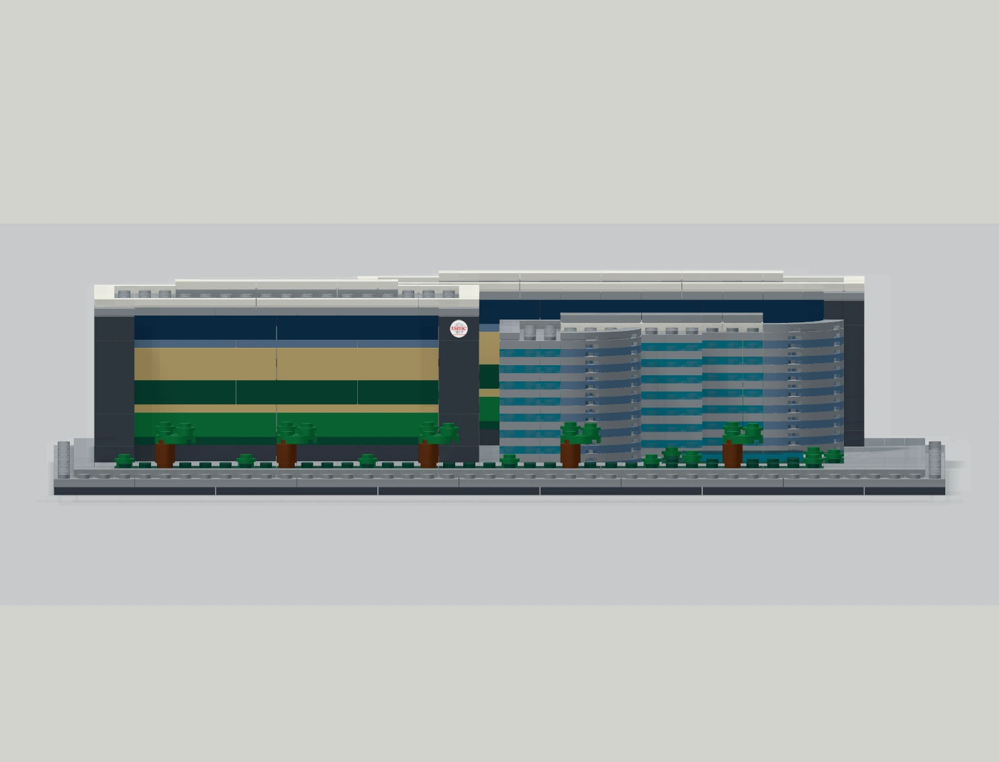
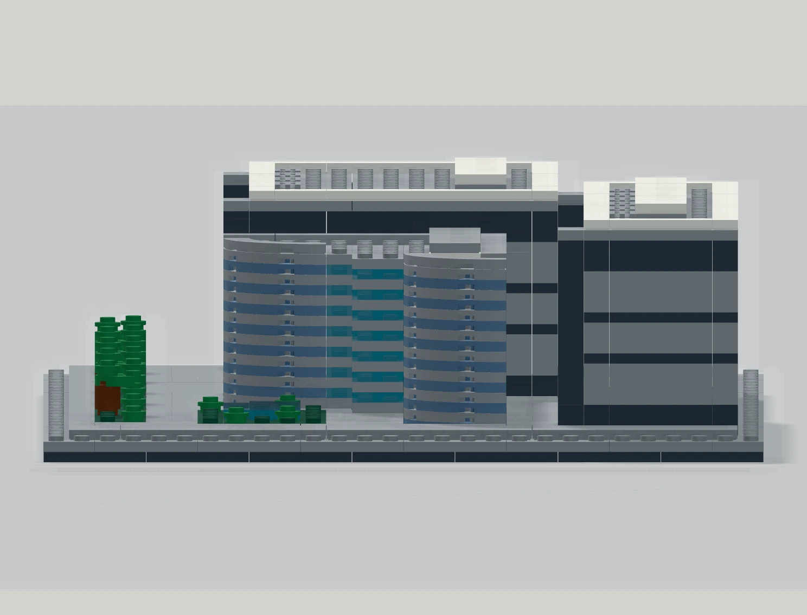
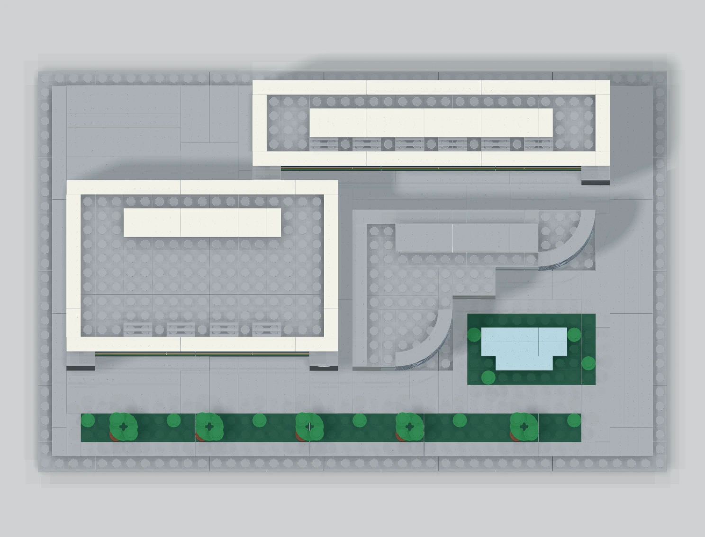

# 台中晶圓十五 B 廠｜組裝說明書

TC 02 · Taichung Fab 15B

十五 B 廠的方正廠房以金綠色水平屏面和灰白條紋相接。中央較低的 L 形辦公棟以八道窗帶繞過兩處弧角，圍著前庭的樹影和水景。

845 件 · 5 袋 · 117 步

底座 44 × 28 凸點。

將底座較後的一側朝上，從左上角第 1 顆凸點開始數。X 由左向右，Z 由後向前。底高以薄板為單位，桌面是 0，一塊標準磚高 3 層薄板。每個位置均取零件佔地最左、最後的凸點。

圖號依每一步的安裝順序編列，回到下一個步驟時從 1 重新起算。[圖解說明書](manual.html) · [分袋 BOM](bom.csv) · [分步 LDraw 模型](model.ldr)

## 十五B廠・五期廠辦

新科路的十五B廠五期辦公棟地上八層，兩翼以 L 形圍合，立面水平線條沿轉角延伸。廠房以大片金綠色外屏與灰白條帶形成對比。 保留辦公翼與廠房的高低差。弧形外緣以凸點分段轉折，綠屏、窗帶及棟距依獨立底座縮編。

本版 845 件，另附 1 枚貼紙。

[綠建築協會・五期辦公棟](https://www.taiwangbc.org.tw/tw/modules/news/article.php?storyid=520) · [五期廠辦・外觀照片](https://www.taiwangbc.org.tw/en/uploads/news/1000/2/3ddc8e51b6beec44.jpg) · [台積電・廠區名錄](https://www.tsmc.com/english/aboutTSMC/TSMC_Fabs)

## 建築方位與配置

**正面**　左側量體有金綠色長屏和深灰端柱；右方辦公翼用八道窗帶收出較低的簷線。

**側面**　從辦公棟一側可以看見兩翼的退進、圓弧角，以及廠房灰白相間的側牆。

**俯視**　兩個方正量體選取自公開空拍。辦公棟兩翼轉折包住水景，廠房間距和綠地依展示底板縮短。

## 原寸貼紙

本款有 1 張貼紙。請以 100% 列印原寸貼紙 PDF，依步驟中的 S 編號貼在指定磚面，再把該件扣入。

[下載 A4 可列印貼紙](stickers.pdf)

- S01　迎向前庭的深灰端柱上方 · 袋 02／步驟 30 · 7 × 7 mm · 正面（朝前），面中央。

## 第 01 袋　底座與定位

90 件，共 12 步。

| 顏色 | 零件 | 設計／庫號 | 數量 |
| --- | --- | --- | ---: |
| 淺藍灰 | 薄板 2×4 | 3020 | 2 |
| 淺藍灰 | 薄板 4×4 | 3031 | 6 |
| 淺藍灰 | 薄板 2×8 | 3034 | 10 |
| 淺藍灰 | 薄板 4×8 | 3035 | 30 |
| 深藍灰 | 薄板 4×4 | 3031 | 7 |
| 深藍灰 | 薄板 4×8 | 3035 | 35 |

### 步驟 01　併排底板（1/6）

將底板凸點朝上、長邊對齊排在平桌。下一層會跨接板縫。

**本步取件**

| 顏色 | 零件 | 設計／庫號 | 數量 |
| --- | --- | --- | ---: |
| 深藍灰 | 薄板 4×4 | 3031 | 1 |
| 深藍灰 | 薄板 4×8 | 3035 | 7 |

**安裝位置**

| 圖號 | 零件與顏色 | X | Z | 底高（薄板） | 方向 |
| ---: | --- | ---: | ---: | ---: | --- |
| 1 | 深藍灰 薄板 4×8（3035） | 1 | 1 | 0 | 沿 X |
| 2 | 深藍灰 薄板 4×8（3035） | 9 | 1 | 0 | 沿 X |
| 3 | 深藍灰 薄板 4×8（3035） | 17 | 1 | 0 | 沿 X |
| 4 | 深藍灰 薄板 4×8（3035） | 25 | 1 | 0 | 沿 X |
| 5 | 深藍灰 薄板 4×8（3035） | 33 | 1 | 0 | 沿 X |
| 6 | 深藍灰 薄板 4×4（3031） | 41 | 1 | 0 | — |
| 7 | 深藍灰 薄板 4×8（3035） | 1 | 5 | 0 | 沿 X |
| 8 | 深藍灰 薄板 4×8（3035） | 9 | 5 | 0 | 沿 X |

### 步驟 02　併排底板（2/6）

將底板凸點朝上、長邊對齊排在平桌。下一層會跨接板縫。

**本步取件**

| 顏色 | 零件 | 設計／庫號 | 數量 |
| --- | --- | --- | ---: |
| 深藍灰 | 薄板 4×4 | 3031 | 1 |
| 深藍灰 | 薄板 4×8 | 3035 | 7 |

**安裝位置**

| 圖號 | 零件與顏色 | X | Z | 底高（薄板） | 方向 |
| ---: | --- | ---: | ---: | ---: | --- |
| 1 | 深藍灰 薄板 4×8（3035） | 17 | 5 | 0 | 沿 X |
| 2 | 深藍灰 薄板 4×8（3035） | 25 | 5 | 0 | 沿 X |
| 3 | 深藍灰 薄板 4×8（3035） | 33 | 5 | 0 | 沿 X |
| 4 | 深藍灰 薄板 4×4（3031） | 41 | 5 | 0 | — |
| 5 | 深藍灰 薄板 4×8（3035） | 1 | 9 | 0 | 沿 X |
| 6 | 深藍灰 薄板 4×8（3035） | 9 | 9 | 0 | 沿 X |
| 7 | 深藍灰 薄板 4×8（3035） | 17 | 9 | 0 | 沿 X |
| 8 | 深藍灰 薄板 4×8（3035） | 25 | 9 | 0 | 沿 X |

### 步驟 03　併排底板（3/6）

將底板凸點朝上、長邊對齊排在平桌。下一層會跨接板縫。

**本步取件**

| 顏色 | 零件 | 設計／庫號 | 數量 |
| --- | --- | --- | ---: |
| 深藍灰 | 薄板 4×4 | 3031 | 2 |
| 深藍灰 | 薄板 4×8 | 3035 | 6 |

**安裝位置**

| 圖號 | 零件與顏色 | X | Z | 底高（薄板） | 方向 |
| ---: | --- | ---: | ---: | ---: | --- |
| 1 | 深藍灰 薄板 4×8（3035） | 33 | 9 | 0 | 沿 X |
| 2 | 深藍灰 薄板 4×4（3031） | 41 | 9 | 0 | — |
| 3 | 深藍灰 薄板 4×8（3035） | 1 | 13 | 0 | 沿 X |
| 4 | 深藍灰 薄板 4×8（3035） | 9 | 13 | 0 | 沿 X |
| 5 | 深藍灰 薄板 4×8（3035） | 17 | 13 | 0 | 沿 X |
| 6 | 深藍灰 薄板 4×8（3035） | 25 | 13 | 0 | 沿 X |
| 7 | 深藍灰 薄板 4×8（3035） | 33 | 13 | 0 | 沿 X |
| 8 | 深藍灰 薄板 4×4（3031） | 41 | 13 | 0 | — |

### 步驟 04　併排底板（4/6）

將底板凸點朝上、長邊對齊排在平桌。下一層會跨接板縫。

**本步取件**

| 顏色 | 零件 | 設計／庫號 | 數量 |
| --- | --- | --- | ---: |
| 深藍灰 | 薄板 4×4 | 3031 | 1 |
| 深藍灰 | 薄板 4×8 | 3035 | 7 |

**安裝位置**

| 圖號 | 零件與顏色 | X | Z | 底高（薄板） | 方向 |
| ---: | --- | ---: | ---: | ---: | --- |
| 1 | 深藍灰 薄板 4×8（3035） | 1 | 17 | 0 | 沿 X |
| 2 | 深藍灰 薄板 4×8（3035） | 9 | 17 | 0 | 沿 X |
| 3 | 深藍灰 薄板 4×8（3035） | 17 | 17 | 0 | 沿 X |
| 4 | 深藍灰 薄板 4×8（3035） | 25 | 17 | 0 | 沿 X |
| 5 | 深藍灰 薄板 4×8（3035） | 33 | 17 | 0 | 沿 X |
| 6 | 深藍灰 薄板 4×4（3031） | 41 | 17 | 0 | — |
| 7 | 深藍灰 薄板 4×8（3035） | 1 | 21 | 0 | 沿 X |
| 8 | 深藍灰 薄板 4×8（3035） | 9 | 21 | 0 | 沿 X |

### 步驟 05　併排底板（5/6）

將底板凸點朝上、長邊對齊排在平桌。下一層會跨接板縫。

**本步取件**

| 顏色 | 零件 | 設計／庫號 | 數量 |
| --- | --- | --- | ---: |
| 深藍灰 | 薄板 4×4 | 3031 | 1 |
| 深藍灰 | 薄板 4×8 | 3035 | 7 |

**安裝位置**

| 圖號 | 零件與顏色 | X | Z | 底高（薄板） | 方向 |
| ---: | --- | ---: | ---: | ---: | --- |
| 1 | 深藍灰 薄板 4×8（3035） | 17 | 21 | 0 | 沿 X |
| 2 | 深藍灰 薄板 4×8（3035） | 25 | 21 | 0 | 沿 X |
| 3 | 深藍灰 薄板 4×8（3035） | 33 | 21 | 0 | 沿 X |
| 4 | 深藍灰 薄板 4×4（3031） | 41 | 21 | 0 | — |
| 5 | 深藍灰 薄板 4×8（3035） | 1 | 25 | 0 | 沿 X |
| 6 | 深藍灰 薄板 4×8（3035） | 9 | 25 | 0 | 沿 X |
| 7 | 深藍灰 薄板 4×8（3035） | 17 | 25 | 0 | 沿 X |
| 8 | 深藍灰 薄板 4×8（3035） | 25 | 25 | 0 | 沿 X |

### 步驟 06　併排底板（6/6）

將底板凸點朝上、長邊對齊排在平桌。下一層會跨接板縫。

**本步取件**

| 顏色 | 零件 | 設計／庫號 | 數量 |
| --- | --- | --- | ---: |
| 深藍灰 | 薄板 4×4 | 3031 | 1 |
| 深藍灰 | 薄板 4×8 | 3035 | 1 |

**安裝位置**

| 圖號 | 零件與顏色 | X | Z | 底高（薄板） | 方向 |
| ---: | --- | ---: | ---: | ---: | --- |
| 1 | 深藍灰 薄板 4×8（3035） | 33 | 25 | 0 | 沿 X |
| 2 | 深藍灰 薄板 4×4（3031） | 41 | 25 | 0 | — |

### 步驟 07　錯縫鎖底（1/6）

上層相對底板橫移四格、縱移兩格。逐排按緊後，底座可整片拿起。

**本步取件**

| 顏色 | 零件 | 設計／庫號 | 數量 |
| --- | --- | --- | ---: |
| 淺藍灰 | 薄板 2×4 | 3020 | 1 |
| 淺藍灰 | 薄板 4×4 | 3031 | 1 |
| 淺藍灰 | 薄板 2×8 | 3034 | 5 |
| 淺藍灰 | 薄板 4×8 | 3035 | 1 |

**安裝位置**

| 圖號 | 零件與顏色 | X | Z | 底高（薄板） | 方向 |
| ---: | --- | ---: | ---: | ---: | --- |
| 1 | 淺藍灰 薄板 2×4（3020） | 1 | 1 | 1 | 沿 X |
| 2 | 淺藍灰 薄板 2×8（3034） | 5 | 1 | 1 | 沿 X |
| 3 | 淺藍灰 薄板 2×8（3034） | 13 | 1 | 1 | 沿 X |
| 4 | 淺藍灰 薄板 2×8（3034） | 21 | 1 | 1 | 沿 X |
| 5 | 淺藍灰 薄板 2×8（3034） | 29 | 1 | 1 | 沿 X |
| 6 | 淺藍灰 薄板 2×8（3034） | 37 | 1 | 1 | 沿 X |
| 7 | 淺藍灰 薄板 4×4（3031） | 1 | 3 | 1 | — |
| 8 | 淺藍灰 薄板 4×8（3035） | 5 | 3 | 1 | 沿 X |

### 步驟 08　錯縫鎖底（2/6）

上層相對底板橫移四格、縱移兩格。逐排按緊後，底座可整片拿起。

**本步取件**

| 顏色 | 零件 | 設計／庫號 | 數量 |
| --- | --- | --- | ---: |
| 淺藍灰 | 薄板 4×4 | 3031 | 1 |
| 淺藍灰 | 薄板 4×8 | 3035 | 7 |

**安裝位置**

| 圖號 | 零件與顏色 | X | Z | 底高（薄板） | 方向 |
| ---: | --- | ---: | ---: | ---: | --- |
| 1 | 淺藍灰 薄板 4×8（3035） | 13 | 3 | 1 | 沿 X |
| 2 | 淺藍灰 薄板 4×8（3035） | 21 | 3 | 1 | 沿 X |
| 3 | 淺藍灰 薄板 4×8（3035） | 29 | 3 | 1 | 沿 X |
| 4 | 淺藍灰 薄板 4×8（3035） | 37 | 3 | 1 | 沿 X |
| 5 | 淺藍灰 薄板 4×4（3031） | 1 | 7 | 1 | — |
| 6 | 淺藍灰 薄板 4×8（3035） | 5 | 7 | 1 | 沿 X |
| 7 | 淺藍灰 薄板 4×8（3035） | 13 | 7 | 1 | 沿 X |
| 8 | 淺藍灰 薄板 4×8（3035） | 21 | 7 | 1 | 沿 X |

### 步驟 09　錯縫鎖底（3/6）

上層相對底板橫移四格、縱移兩格。逐排按緊後，底座可整片拿起。

**本步取件**

| 顏色 | 零件 | 設計／庫號 | 數量 |
| --- | --- | --- | ---: |
| 淺藍灰 | 薄板 4×4 | 3031 | 1 |
| 淺藍灰 | 薄板 4×8 | 3035 | 7 |

**安裝位置**

| 圖號 | 零件與顏色 | X | Z | 底高（薄板） | 方向 |
| ---: | --- | ---: | ---: | ---: | --- |
| 1 | 淺藍灰 薄板 4×8（3035） | 29 | 7 | 1 | 沿 X |
| 2 | 淺藍灰 薄板 4×8（3035） | 37 | 7 | 1 | 沿 X |
| 3 | 淺藍灰 薄板 4×4（3031） | 1 | 11 | 1 | — |
| 4 | 淺藍灰 薄板 4×8（3035） | 5 | 11 | 1 | 沿 X |
| 5 | 淺藍灰 薄板 4×8（3035） | 13 | 11 | 1 | 沿 X |
| 6 | 淺藍灰 薄板 4×8（3035） | 21 | 11 | 1 | 沿 X |
| 7 | 淺藍灰 薄板 4×8（3035） | 29 | 11 | 1 | 沿 X |
| 8 | 淺藍灰 薄板 4×8（3035） | 37 | 11 | 1 | 沿 X |

### 步驟 10　錯縫鎖底（4/6）

上層相對底板橫移四格、縱移兩格。逐排按緊後，底座可整片拿起。

**本步取件**

| 顏色 | 零件 | 設計／庫號 | 數量 |
| --- | --- | --- | ---: |
| 淺藍灰 | 薄板 4×4 | 3031 | 2 |
| 淺藍灰 | 薄板 4×8 | 3035 | 6 |

**安裝位置**

| 圖號 | 零件與顏色 | X | Z | 底高（薄板） | 方向 |
| ---: | --- | ---: | ---: | ---: | --- |
| 1 | 淺藍灰 薄板 4×4（3031） | 1 | 15 | 1 | — |
| 2 | 淺藍灰 薄板 4×8（3035） | 5 | 15 | 1 | 沿 X |
| 3 | 淺藍灰 薄板 4×8（3035） | 13 | 15 | 1 | 沿 X |
| 4 | 淺藍灰 薄板 4×8（3035） | 21 | 15 | 1 | 沿 X |
| 5 | 淺藍灰 薄板 4×8（3035） | 29 | 15 | 1 | 沿 X |
| 6 | 淺藍灰 薄板 4×8（3035） | 37 | 15 | 1 | 沿 X |
| 7 | 淺藍灰 薄板 4×4（3031） | 1 | 19 | 1 | — |
| 8 | 淺藍灰 薄板 4×8（3035） | 5 | 19 | 1 | 沿 X |

### 步驟 11　錯縫鎖底（5/6）

上層相對底板橫移四格、縱移兩格。逐排按緊後，底座可整片拿起。

**本步取件**

| 顏色 | 零件 | 設計／庫號 | 數量 |
| --- | --- | --- | ---: |
| 淺藍灰 | 薄板 4×4 | 3031 | 1 |
| 淺藍灰 | 薄板 4×8 | 3035 | 7 |

**安裝位置**

| 圖號 | 零件與顏色 | X | Z | 底高（薄板） | 方向 |
| ---: | --- | ---: | ---: | ---: | --- |
| 1 | 淺藍灰 薄板 4×8（3035） | 13 | 19 | 1 | 沿 X |
| 2 | 淺藍灰 薄板 4×8（3035） | 21 | 19 | 1 | 沿 X |
| 3 | 淺藍灰 薄板 4×8（3035） | 29 | 19 | 1 | 沿 X |
| 4 | 淺藍灰 薄板 4×8（3035） | 37 | 19 | 1 | 沿 X |
| 5 | 淺藍灰 薄板 4×4（3031） | 1 | 23 | 1 | — |
| 6 | 淺藍灰 薄板 4×8（3035） | 5 | 23 | 1 | 沿 X |
| 7 | 淺藍灰 薄板 4×8（3035） | 13 | 23 | 1 | 沿 X |
| 8 | 淺藍灰 薄板 4×8（3035） | 21 | 23 | 1 | 沿 X |

### 步驟 12　錯縫鎖底（6/6）

上層相對底板橫移四格、縱移兩格。逐排按緊後，底座可整片拿起。

**本步取件**

| 顏色 | 零件 | 設計／庫號 | 數量 |
| --- | --- | --- | ---: |
| 淺藍灰 | 薄板 2×4 | 3020 | 1 |
| 淺藍灰 | 薄板 2×8 | 3034 | 5 |
| 淺藍灰 | 薄板 4×8 | 3035 | 2 |

**安裝位置**

| 圖號 | 零件與顏色 | X | Z | 底高（薄板） | 方向 |
| ---: | --- | ---: | ---: | ---: | --- |
| 1 | 淺藍灰 薄板 4×8（3035） | 29 | 23 | 1 | 沿 X |
| 2 | 淺藍灰 薄板 4×8（3035） | 37 | 23 | 1 | 沿 X |
| 3 | 淺藍灰 薄板 2×4（3020） | 1 | 27 | 1 | 沿 X |
| 4 | 淺藍灰 薄板 2×8（3034） | 5 | 27 | 1 | 沿 X |
| 5 | 淺藍灰 薄板 2×8（3034） | 13 | 27 | 1 | 沿 X |
| 6 | 淺藍灰 薄板 2×8（3034） | 21 | 27 | 1 | 沿 X |
| 7 | 淺藍灰 薄板 2×8（3034） | 29 | 27 | 1 | 沿 X |
| 8 | 淺藍灰 薄板 2×8（3034） | 37 | 27 | 1 | 沿 X |

## 第 02 袋　前方金綠屏面與灰白廠房

179 件，共 24 步。

| 顏色 | 零件 | 設計／庫號 | 數量 |
| --- | --- | --- | ---: |
| 綠色 | 磚 1×1 | 3005 | 1 |
| 綠色 | 磚 1×8 | 3008 | 2 |
| 白色 | 光面板 2×2 | 3068b | 1 |
| 白色 | 光面板 1×2 | 3069b | 3 |
| 白色 | 光面板 1×8 | 4162 | 6 |
| 白色 | 光面板 1×3 | 63864 | 2 |
| 白色 | 光面板 2×4 | 87079 | 2 |
| 沙色 | 磚 1×1 | 3005 | 1 |
| 沙色 | 磚 1×8 | 3008 | 2 |
| 沙色 | 薄板 1×1 | 3024 | 2 |
| 沙色 | 薄板 1×8 | 3460 | 4 |
| 淺藍灰 | 格柵板 1×2 | 2412b | 4 |
| 淺藍灰 | 磚 1×1 | 3005 | 5 |
| 淺藍灰 | 磚 1×8 | 3008 | 22 |
| 淺藍灰 | 薄板 2×4 | 3020 | 9 |
| 淺藍灰 | 薄板 2×3 | 3021 | 1 |
| 淺藍灰 | 薄板 1×1 | 3024 | 4 |
| 淺藍灰 | 薄板 2×8 | 3034 | 10 |
| 淺藍灰 | 光面板 1×2 | 3069b | 2 |
| 淺藍灰 | 薄板 1×8 | 3460 | 17 |
| 淺藍灰 | 磚 1×3 | 3622 | 9 |
| 淺藍灰 | 薄板 1×3 | 3623 | 6 |
| 淺藍灰 | 薄板 1×4 | 3710 | 1 |
| 深藍灰 | 磚 1×2 | 3004 | 10 |
| 深藍灰 | 磚 1×1 | 3005 | 1 |
| 深藍灰 | 磚 1×8 | 3008 | 10 |
| 深藍灰 | 薄板 1×2 | 3023 | 8 |
| 深藍灰 | 薄板 1×8 | 3460 | 8 |
| 深藍灰 | 磚 1×3 | 3622 | 6 |
| 深藍灰 | 薄板 1×3 | 3623 | 6 |
| 深藍 | 磚 1×1 | 3005 | 1 |
| 深藍 | 磚 1×8 | 3008 | 2 |
| 深綠 | 磚 1×1 | 3005 | 1 |
| 深綠 | 磚 1×6 | 3009 | 2 |
| 深綠 | 磚 1×4 | 3010 | 1 |
| 深綠 | 薄板 1×1 | 3024 | 1 |
| 深綠 | 薄板 1×8 | 3460 | 2 |
| 沙藍 | 薄板 1×1 | 3024 | 1 |
| 沙藍 | 薄板 1×6 | 3666 | 2 |
| 沙藍 | 薄板 1×4 | 3710 | 1 |

### 步驟 13　前方廠房 · 第 1 道外牆（1/2）

先沿背面和兩側砌灰色條紋牆，正面植生屏退入一格，兩端立柱突出。每層將中間承板肋疊至同高。

**本步取件**

| 顏色 | 零件 | 設計／庫號 | 數量 |
| --- | --- | --- | ---: |
| 深藍灰 | 磚 1×8 | 3008 | 5 |
| 深藍灰 | 磚 1×3 | 3622 | 3 |

**安裝位置**

| 圖號 | 零件與顏色 | X | Z | 底高（薄板） | 方向 |
| ---: | --- | ---: | ---: | ---: | --- |
| 1 | 深藍灰 磚 1×8（3008） | 3 | 9 | 2 | 沿 X |
| 2 | 深藍灰 磚 1×8（3008） | 11 | 9 | 2 | 沿 X |
| 3 | 深藍灰 磚 1×3（3622） | 19 | 9 | 2 | 沿 X |
| 4 | 深藍灰 磚 1×8（3008） | 3 | 10 | 2 | 沿 Z |
| 5 | 深藍灰 磚 1×3（3622） | 3 | 18 | 2 | 沿 Z |
| 6 | 深藍灰 磚 1×8（3008） | 21 | 10 | 2 | 沿 Z |
| 7 | 深藍灰 磚 1×3（3622） | 21 | 18 | 2 | 沿 Z |
| 8 | 深藍灰 磚 1×8（3008） | 4 | 20 | 2 | 沿 X |

### 步驟 14　前方廠房 · 第 1 道外牆（2/2）

先沿背面和兩側砌灰色條紋牆，正面植生屏退入一格，兩端立柱突出。每層將中間承板肋疊至同高。

**本步取件**

| 顏色 | 零件 | 設計／庫號 | 數量 |
| --- | --- | --- | ---: |
| 淺藍灰 | 磚 1×1 | 3005 | 1 |
| 淺藍灰 | 磚 1×8 | 3008 | 2 |
| 深藍灰 | 磚 1×2 | 3004 | 2 |
| 深藍灰 | 磚 1×1 | 3005 | 1 |
| 深藍灰 | 磚 1×8 | 3008 | 1 |

**安裝位置**

| 圖號 | 零件與顏色 | X | Z | 底高（薄板） | 方向 |
| ---: | --- | ---: | ---: | ---: | --- |
| 1 | 深藍灰 磚 1×8（3008） | 12 | 20 | 2 | 沿 X |
| 2 | 深藍灰 磚 1×1（3005） | 20 | 20 | 2 | — |
| 3 | 深藍灰 磚 1×2（3004） | 3 | 21 | 2 | 沿 X |
| 4 | 深藍灰 磚 1×2（3004） | 20 | 21 | 2 | 沿 X |
| 5 | 淺藍灰 磚 1×8（3008） | 4 | 15 | 2 | 沿 X |
| 6 | 淺藍灰 磚 1×8（3008） | 12 | 15 | 2 | 沿 X |
| 7 | 淺藍灰 磚 1×1（3005） | 20 | 15 | 2 | — |

### 步驟 15　前方廠房 · 第 2 道外牆（1/2）

先沿背面和兩側砌灰色條紋牆，正面植生屏退入一格，兩端立柱突出。每層將中間承板肋疊至同高。

**本步取件**

| 顏色 | 零件 | 設計／庫號 | 數量 |
| --- | --- | --- | ---: |
| 淺藍灰 | 薄板 1×8 | 3460 | 4 |
| 淺藍灰 | 薄板 1×3 | 3623 | 3 |
| 深綠 | 薄板 1×8 | 3460 | 1 |

**安裝位置**

| 圖號 | 零件與顏色 | X | Z | 底高（薄板） | 方向 |
| ---: | --- | ---: | ---: | ---: | --- |
| 1 | 淺藍灰 薄板 1×8（3460） | 3 | 9 | 5 | 沿 X |
| 2 | 淺藍灰 薄板 1×8（3460） | 11 | 9 | 5 | 沿 X |
| 3 | 淺藍灰 薄板 1×3（3623） | 19 | 9 | 5 | 沿 X |
| 4 | 淺藍灰 薄板 1×8（3460） | 3 | 10 | 5 | 沿 Z |
| 5 | 淺藍灰 薄板 1×3（3623） | 3 | 18 | 5 | 沿 Z |
| 6 | 淺藍灰 薄板 1×8（3460） | 21 | 10 | 5 | 沿 Z |
| 7 | 淺藍灰 薄板 1×3（3623） | 21 | 18 | 5 | 沿 Z |
| 8 | 深綠 薄板 1×8（3460） | 4 | 20 | 5 | 沿 X |

### 步驟 16　前方廠房 · 第 2 道外牆（2/2）

先沿背面和兩側砌灰色條紋牆，正面植生屏退入一格，兩端立柱突出。每層將中間承板肋疊至同高。

**本步取件**

| 顏色 | 零件 | 設計／庫號 | 數量 |
| --- | --- | --- | ---: |
| 淺藍灰 | 薄板 1×1 | 3024 | 1 |
| 淺藍灰 | 薄板 1×8 | 3460 | 2 |
| 深藍灰 | 薄板 1×2 | 3023 | 2 |
| 深綠 | 薄板 1×1 | 3024 | 1 |
| 深綠 | 薄板 1×8 | 3460 | 1 |

**安裝位置**

| 圖號 | 零件與顏色 | X | Z | 底高（薄板） | 方向 |
| ---: | --- | ---: | ---: | ---: | --- |
| 1 | 深綠 薄板 1×8（3460） | 12 | 20 | 5 | 沿 X |
| 2 | 深綠 薄板 1×1（3024） | 20 | 20 | 5 | — |
| 3 | 深藍灰 薄板 1×2（3023） | 3 | 21 | 5 | 沿 X |
| 4 | 深藍灰 薄板 1×2（3023） | 20 | 21 | 5 | 沿 X |
| 5 | 淺藍灰 薄板 1×8（3460） | 4 | 15 | 5 | 沿 X |
| 6 | 淺藍灰 薄板 1×8（3460） | 12 | 15 | 5 | 沿 X |
| 7 | 淺藍灰 薄板 1×1（3024） | 20 | 15 | 5 | — |

### 步驟 17　前方廠房 · 第 3 道外牆（1/2）

先沿背面和兩側砌灰色條紋牆，正面植生屏退入一格，兩端立柱突出。每層將中間承板肋疊至同高。

**本步取件**

| 顏色 | 零件 | 設計／庫號 | 數量 |
| --- | --- | --- | ---: |
| 綠色 | 磚 1×8 | 3008 | 1 |
| 淺藍灰 | 磚 1×8 | 3008 | 4 |
| 淺藍灰 | 磚 1×3 | 3622 | 3 |

**安裝位置**

| 圖號 | 零件與顏色 | X | Z | 底高（薄板） | 方向 |
| ---: | --- | ---: | ---: | ---: | --- |
| 1 | 淺藍灰 磚 1×8（3008） | 3 | 9 | 6 | 沿 X |
| 2 | 淺藍灰 磚 1×8（3008） | 11 | 9 | 6 | 沿 X |
| 3 | 淺藍灰 磚 1×3（3622） | 19 | 9 | 6 | 沿 X |
| 4 | 淺藍灰 磚 1×8（3008） | 3 | 10 | 6 | 沿 Z |
| 5 | 淺藍灰 磚 1×3（3622） | 3 | 18 | 6 | 沿 Z |
| 6 | 淺藍灰 磚 1×8（3008） | 21 | 10 | 6 | 沿 Z |
| 7 | 淺藍灰 磚 1×3（3622） | 21 | 18 | 6 | 沿 Z |
| 8 | 綠色 磚 1×8（3008） | 4 | 20 | 6 | 沿 X |

### 步驟 18　前方廠房 · 第 3 道外牆（2/2）

先沿背面和兩側砌灰色條紋牆，正面植生屏退入一格，兩端立柱突出。每層將中間承板肋疊至同高。

**本步取件**

| 顏色 | 零件 | 設計／庫號 | 數量 |
| --- | --- | --- | ---: |
| 綠色 | 磚 1×1 | 3005 | 1 |
| 綠色 | 磚 1×8 | 3008 | 1 |
| 淺藍灰 | 磚 1×1 | 3005 | 1 |
| 淺藍灰 | 磚 1×8 | 3008 | 2 |
| 深藍灰 | 磚 1×2 | 3004 | 2 |

**安裝位置**

| 圖號 | 零件與顏色 | X | Z | 底高（薄板） | 方向 |
| ---: | --- | ---: | ---: | ---: | --- |
| 1 | 綠色 磚 1×8（3008） | 12 | 20 | 6 | 沿 X |
| 2 | 綠色 磚 1×1（3005） | 20 | 20 | 6 | — |
| 3 | 深藍灰 磚 1×2（3004） | 3 | 21 | 6 | 沿 X |
| 4 | 深藍灰 磚 1×2（3004） | 20 | 21 | 6 | 沿 X |
| 5 | 淺藍灰 磚 1×8（3008） | 4 | 15 | 6 | 沿 X |
| 6 | 淺藍灰 磚 1×8（3008） | 12 | 15 | 6 | 沿 X |
| 7 | 淺藍灰 磚 1×1（3005） | 20 | 15 | 6 | — |

### 步驟 19　前方廠房 · 第 4 道外牆（1/2）

先沿背面和兩側砌灰色條紋牆，正面植生屏退入一格，兩端立柱突出。每層將中間承板肋疊至同高。

**本步取件**

| 顏色 | 零件 | 設計／庫號 | 數量 |
| --- | --- | --- | ---: |
| 沙色 | 薄板 1×8 | 3460 | 1 |
| 深藍灰 | 薄板 1×8 | 3460 | 4 |
| 深藍灰 | 薄板 1×3 | 3623 | 3 |

**安裝位置**

| 圖號 | 零件與顏色 | X | Z | 底高（薄板） | 方向 |
| ---: | --- | ---: | ---: | ---: | --- |
| 1 | 深藍灰 薄板 1×8（3460） | 3 | 9 | 9 | 沿 X |
| 2 | 深藍灰 薄板 1×8（3460） | 11 | 9 | 9 | 沿 X |
| 3 | 深藍灰 薄板 1×3（3623） | 19 | 9 | 9 | 沿 X |
| 4 | 深藍灰 薄板 1×8（3460） | 3 | 10 | 9 | 沿 Z |
| 5 | 深藍灰 薄板 1×3（3623） | 3 | 18 | 9 | 沿 Z |
| 6 | 深藍灰 薄板 1×8（3460） | 21 | 10 | 9 | 沿 Z |
| 7 | 深藍灰 薄板 1×3（3623） | 21 | 18 | 9 | 沿 Z |
| 8 | 沙色 薄板 1×8（3460） | 4 | 20 | 9 | 沿 X |

### 步驟 20　前方廠房 · 第 4 道外牆（2/2）

先沿背面和兩側砌灰色條紋牆，正面植生屏退入一格，兩端立柱突出。每層將中間承板肋疊至同高。

**本步取件**

| 顏色 | 零件 | 設計／庫號 | 數量 |
| --- | --- | --- | ---: |
| 沙色 | 薄板 1×1 | 3024 | 1 |
| 沙色 | 薄板 1×8 | 3460 | 1 |
| 淺藍灰 | 薄板 1×1 | 3024 | 1 |
| 淺藍灰 | 薄板 1×8 | 3460 | 2 |
| 深藍灰 | 薄板 1×2 | 3023 | 2 |

**安裝位置**

| 圖號 | 零件與顏色 | X | Z | 底高（薄板） | 方向 |
| ---: | --- | ---: | ---: | ---: | --- |
| 1 | 沙色 薄板 1×8（3460） | 12 | 20 | 9 | 沿 X |
| 2 | 沙色 薄板 1×1（3024） | 20 | 20 | 9 | — |
| 3 | 深藍灰 薄板 1×2（3023） | 3 | 21 | 9 | 沿 X |
| 4 | 深藍灰 薄板 1×2（3023） | 20 | 21 | 9 | 沿 X |
| 5 | 淺藍灰 薄板 1×8（3460） | 4 | 15 | 9 | 沿 X |
| 6 | 淺藍灰 薄板 1×8（3460） | 12 | 15 | 9 | 沿 X |
| 7 | 淺藍灰 薄板 1×1（3024） | 20 | 15 | 9 | — |

### 步驟 21　前方廠房 · 第 5 道外牆（1/2）

先沿背面和兩側砌灰色條紋牆，正面植生屏退入一格，兩端立柱突出。每層將中間承板肋疊至同高。

**本步取件**

| 顏色 | 零件 | 設計／庫號 | 數量 |
| --- | --- | --- | ---: |
| 淺藍灰 | 磚 1×8 | 3008 | 4 |
| 淺藍灰 | 磚 1×3 | 3622 | 3 |
| 深綠 | 磚 1×6 | 3009 | 1 |

**安裝位置**

| 圖號 | 零件與顏色 | X | Z | 底高（薄板） | 方向 |
| ---: | --- | ---: | ---: | ---: | --- |
| 1 | 淺藍灰 磚 1×8（3008） | 3 | 9 | 10 | 沿 X |
| 2 | 淺藍灰 磚 1×8（3008） | 11 | 9 | 10 | 沿 X |
| 3 | 淺藍灰 磚 1×3（3622） | 19 | 9 | 10 | 沿 X |
| 4 | 淺藍灰 磚 1×8（3008） | 3 | 10 | 10 | 沿 Z |
| 5 | 淺藍灰 磚 1×3（3622） | 3 | 18 | 10 | 沿 Z |
| 6 | 淺藍灰 磚 1×8（3008） | 21 | 10 | 10 | 沿 Z |
| 7 | 淺藍灰 磚 1×3（3622） | 21 | 18 | 10 | 沿 Z |
| 8 | 深綠 磚 1×6（3009） | 4 | 20 | 10 | 沿 X |

### 步驟 22　前方廠房 · 第 5 道外牆（2/2）

先沿背面和兩側砌灰色條紋牆，正面植生屏退入一格，兩端立柱突出。每層將中間承板肋疊至同高。

**本步取件**

| 顏色 | 零件 | 設計／庫號 | 數量 |
| --- | --- | --- | ---: |
| 淺藍灰 | 磚 1×1 | 3005 | 1 |
| 淺藍灰 | 磚 1×8 | 3008 | 2 |
| 深藍灰 | 磚 1×2 | 3004 | 2 |
| 深綠 | 磚 1×1 | 3005 | 1 |
| 深綠 | 磚 1×6 | 3009 | 1 |
| 深綠 | 磚 1×4 | 3010 | 1 |

**安裝位置**

| 圖號 | 零件與顏色 | X | Z | 底高（薄板） | 方向 |
| ---: | --- | ---: | ---: | ---: | --- |
| 1 | 深綠 磚 1×6（3009） | 10 | 20 | 10 | 沿 X |
| 2 | 深綠 磚 1×4（3010） | 16 | 20 | 10 | 沿 X |
| 3 | 深綠 磚 1×1（3005） | 20 | 20 | 10 | — |
| 4 | 深藍灰 磚 1×2（3004） | 3 | 21 | 10 | 沿 X |
| 5 | 深藍灰 磚 1×2（3004） | 20 | 21 | 10 | 沿 X |
| 6 | 淺藍灰 磚 1×8（3008） | 4 | 15 | 10 | 沿 X |
| 7 | 淺藍灰 磚 1×8（3008） | 12 | 15 | 10 | 沿 X |
| 8 | 淺藍灰 磚 1×1（3005） | 20 | 15 | 10 | — |

### 步驟 23　前方廠房 · 第 6 道外牆（1/2）

先沿背面和兩側砌灰色條紋牆，正面植生屏退入一格，兩端立柱突出。每層將中間承板肋疊至同高。

**本步取件**

| 顏色 | 零件 | 設計／庫號 | 數量 |
| --- | --- | --- | ---: |
| 沙色 | 薄板 1×8 | 3460 | 1 |
| 深藍灰 | 薄板 1×8 | 3460 | 4 |
| 深藍灰 | 薄板 1×3 | 3623 | 3 |

**安裝位置**

| 圖號 | 零件與顏色 | X | Z | 底高（薄板） | 方向 |
| ---: | --- | ---: | ---: | ---: | --- |
| 1 | 深藍灰 薄板 1×8（3460） | 3 | 9 | 13 | 沿 X |
| 2 | 深藍灰 薄板 1×8（3460） | 11 | 9 | 13 | 沿 X |
| 3 | 深藍灰 薄板 1×3（3623） | 19 | 9 | 13 | 沿 X |
| 4 | 深藍灰 薄板 1×8（3460） | 3 | 10 | 13 | 沿 Z |
| 5 | 深藍灰 薄板 1×3（3623） | 3 | 18 | 13 | 沿 Z |
| 6 | 深藍灰 薄板 1×8（3460） | 21 | 10 | 13 | 沿 Z |
| 7 | 深藍灰 薄板 1×3（3623） | 21 | 18 | 13 | 沿 Z |
| 8 | 沙色 薄板 1×8（3460） | 4 | 20 | 13 | 沿 X |

### 步驟 24　前方廠房 · 第 6 道外牆（2/2）

先沿背面和兩側砌灰色條紋牆，正面植生屏退入一格，兩端立柱突出。每層將中間承板肋疊至同高。

**本步取件**

| 顏色 | 零件 | 設計／庫號 | 數量 |
| --- | --- | --- | ---: |
| 沙色 | 薄板 1×1 | 3024 | 1 |
| 沙色 | 薄板 1×8 | 3460 | 1 |
| 淺藍灰 | 薄板 1×1 | 3024 | 1 |
| 淺藍灰 | 薄板 1×8 | 3460 | 2 |
| 深藍灰 | 薄板 1×2 | 3023 | 2 |

**安裝位置**

| 圖號 | 零件與顏色 | X | Z | 底高（薄板） | 方向 |
| ---: | --- | ---: | ---: | ---: | --- |
| 1 | 沙色 薄板 1×8（3460） | 12 | 20 | 13 | 沿 X |
| 2 | 沙色 薄板 1×1（3024） | 20 | 20 | 13 | — |
| 3 | 深藍灰 薄板 1×2（3023） | 3 | 21 | 13 | 沿 X |
| 4 | 深藍灰 薄板 1×2（3023） | 20 | 21 | 13 | 沿 X |
| 5 | 淺藍灰 薄板 1×8（3460） | 4 | 15 | 13 | 沿 X |
| 6 | 淺藍灰 薄板 1×8（3460） | 12 | 15 | 13 | 沿 X |
| 7 | 淺藍灰 薄板 1×1（3024） | 20 | 15 | 13 | — |

### 步驟 25　前方廠房 · 第 7 道外牆（1/2）

先沿背面和兩側砌灰色條紋牆，正面植生屏退入一格，兩端立柱突出。每層將中間承板肋疊至同高。

**本步取件**

| 顏色 | 零件 | 設計／庫號 | 數量 |
| --- | --- | --- | ---: |
| 沙色 | 磚 1×8 | 3008 | 1 |
| 淺藍灰 | 磚 1×8 | 3008 | 4 |
| 淺藍灰 | 磚 1×3 | 3622 | 3 |

**安裝位置**

| 圖號 | 零件與顏色 | X | Z | 底高（薄板） | 方向 |
| ---: | --- | ---: | ---: | ---: | --- |
| 1 | 淺藍灰 磚 1×8（3008） | 3 | 9 | 14 | 沿 X |
| 2 | 淺藍灰 磚 1×8（3008） | 11 | 9 | 14 | 沿 X |
| 3 | 淺藍灰 磚 1×3（3622） | 19 | 9 | 14 | 沿 X |
| 4 | 淺藍灰 磚 1×8（3008） | 3 | 10 | 14 | 沿 Z |
| 5 | 淺藍灰 磚 1×3（3622） | 3 | 18 | 14 | 沿 Z |
| 6 | 淺藍灰 磚 1×8（3008） | 21 | 10 | 14 | 沿 Z |
| 7 | 淺藍灰 磚 1×3（3622） | 21 | 18 | 14 | 沿 Z |
| 8 | 沙色 磚 1×8（3008） | 4 | 20 | 14 | 沿 X |

### 步驟 26　前方廠房 · 第 7 道外牆（2/2）

先沿背面和兩側砌灰色條紋牆，正面植生屏退入一格，兩端立柱突出。每層將中間承板肋疊至同高。

**本步取件**

| 顏色 | 零件 | 設計／庫號 | 數量 |
| --- | --- | --- | ---: |
| 沙色 | 磚 1×1 | 3005 | 1 |
| 沙色 | 磚 1×8 | 3008 | 1 |
| 淺藍灰 | 磚 1×1 | 3005 | 1 |
| 淺藍灰 | 磚 1×8 | 3008 | 2 |
| 深藍灰 | 磚 1×2 | 3004 | 2 |

**安裝位置**

| 圖號 | 零件與顏色 | X | Z | 底高（薄板） | 方向 |
| ---: | --- | ---: | ---: | ---: | --- |
| 1 | 沙色 磚 1×8（3008） | 12 | 20 | 14 | 沿 X |
| 2 | 沙色 磚 1×1（3005） | 20 | 20 | 14 | — |
| 3 | 深藍灰 磚 1×2（3004） | 3 | 21 | 14 | 沿 X |
| 4 | 深藍灰 磚 1×2（3004） | 20 | 21 | 14 | 沿 X |
| 5 | 淺藍灰 磚 1×8（3008） | 4 | 15 | 14 | 沿 X |
| 6 | 淺藍灰 磚 1×8（3008） | 12 | 15 | 14 | 沿 X |
| 7 | 淺藍灰 磚 1×1（3005） | 20 | 15 | 14 | — |

### 步驟 27　前方廠房 · 第 8 道外牆（1/2）

先沿背面和兩側砌灰色條紋牆，正面植生屏退入一格，兩端立柱突出。每層將中間承板肋疊至同高。

**本步取件**

| 顏色 | 零件 | 設計／庫號 | 數量 |
| --- | --- | --- | ---: |
| 淺藍灰 | 薄板 1×8 | 3460 | 4 |
| 淺藍灰 | 薄板 1×3 | 3623 | 3 |
| 沙藍 | 薄板 1×6 | 3666 | 1 |

**安裝位置**

| 圖號 | 零件與顏色 | X | Z | 底高（薄板） | 方向 |
| ---: | --- | ---: | ---: | ---: | --- |
| 1 | 淺藍灰 薄板 1×8（3460） | 3 | 9 | 17 | 沿 X |
| 2 | 淺藍灰 薄板 1×8（3460） | 11 | 9 | 17 | 沿 X |
| 3 | 淺藍灰 薄板 1×3（3623） | 19 | 9 | 17 | 沿 X |
| 4 | 淺藍灰 薄板 1×8（3460） | 3 | 10 | 17 | 沿 Z |
| 5 | 淺藍灰 薄板 1×3（3623） | 3 | 18 | 17 | 沿 Z |
| 6 | 淺藍灰 薄板 1×8（3460） | 21 | 10 | 17 | 沿 Z |
| 7 | 淺藍灰 薄板 1×3（3623） | 21 | 18 | 17 | 沿 Z |
| 8 | 沙藍 薄板 1×6（3666） | 4 | 20 | 17 | 沿 X |

### 步驟 28　前方廠房 · 第 8 道外牆（2/2）

先沿背面和兩側砌灰色條紋牆，正面植生屏退入一格，兩端立柱突出。每層將中間承板肋疊至同高。

**本步取件**

| 顏色 | 零件 | 設計／庫號 | 數量 |
| --- | --- | --- | ---: |
| 淺藍灰 | 薄板 1×1 | 3024 | 1 |
| 淺藍灰 | 薄板 1×8 | 3460 | 2 |
| 深藍灰 | 薄板 1×2 | 3023 | 2 |
| 沙藍 | 薄板 1×1 | 3024 | 1 |
| 沙藍 | 薄板 1×6 | 3666 | 1 |
| 沙藍 | 薄板 1×4 | 3710 | 1 |

**安裝位置**

| 圖號 | 零件與顏色 | X | Z | 底高（薄板） | 方向 |
| ---: | --- | ---: | ---: | ---: | --- |
| 1 | 沙藍 薄板 1×6（3666） | 10 | 20 | 17 | 沿 X |
| 2 | 沙藍 薄板 1×4（3710） | 16 | 20 | 17 | 沿 X |
| 3 | 沙藍 薄板 1×1（3024） | 20 | 20 | 17 | — |
| 4 | 深藍灰 薄板 1×2（3023） | 3 | 21 | 17 | 沿 X |
| 5 | 深藍灰 薄板 1×2（3023） | 20 | 21 | 17 | 沿 X |
| 6 | 淺藍灰 薄板 1×8（3460） | 4 | 15 | 17 | 沿 X |
| 7 | 淺藍灰 薄板 1×8（3460） | 12 | 15 | 17 | 沿 X |
| 8 | 淺藍灰 薄板 1×1（3024） | 20 | 15 | 17 | — |

### 步驟 29　前方廠房 · 第 9 道外牆（1/2）

先沿背面和兩側砌灰色條紋牆，正面植生屏退入一格，兩端立柱突出。每層將中間承板肋疊至同高。

**本步取件**

| 顏色 | 零件 | 設計／庫號 | 數量 |
| --- | --- | --- | ---: |
| 深藍灰 | 磚 1×8 | 3008 | 4 |
| 深藍灰 | 磚 1×3 | 3622 | 3 |
| 深藍 | 磚 1×8 | 3008 | 1 |

**安裝位置**

| 圖號 | 零件與顏色 | X | Z | 底高（薄板） | 方向 |
| ---: | --- | ---: | ---: | ---: | --- |
| 1 | 深藍灰 磚 1×8（3008） | 3 | 9 | 18 | 沿 X |
| 2 | 深藍灰 磚 1×8（3008） | 11 | 9 | 18 | 沿 X |
| 3 | 深藍灰 磚 1×3（3622） | 19 | 9 | 18 | 沿 X |
| 4 | 深藍灰 磚 1×8（3008） | 3 | 10 | 18 | 沿 Z |
| 5 | 深藍灰 磚 1×3（3622） | 3 | 18 | 18 | 沿 Z |
| 6 | 深藍灰 磚 1×8（3008） | 21 | 10 | 18 | 沿 Z |
| 7 | 深藍灰 磚 1×3（3622） | 21 | 18 | 18 | 沿 Z |
| 8 | 深藍 磚 1×8（3008） | 4 | 20 | 18 | 沿 X |

### 步驟 30　前方廠房 · 第 9 道外牆（2/2）

先沿背面和兩側砌灰色條紋牆，正面植生屏退入一格，兩端立柱突出。每層將中間承板肋疊至同高。

**本步取件**

| 顏色 | 零件 | 設計／庫號 | 數量 |
| --- | --- | --- | ---: |
| 淺藍灰 | 磚 1×1 | 3005 | 1 |
| 淺藍灰 | 磚 1×8 | 3008 | 2 |
| 深藍灰 | 磚 1×2 | 3004 | 2 |
| 深藍 | 磚 1×1 | 3005 | 1 |
| 深藍 | 磚 1×8 | 3008 | 1 |

**安裝位置**

| 圖號 | 零件與顏色 | X | Z | 底高（薄板） | 方向 |
| ---: | --- | ---: | ---: | ---: | --- |
| 1 | 深藍 磚 1×8（3008） | 12 | 20 | 18 | 沿 X |
| 2 | 深藍 磚 1×1（3005） | 20 | 20 | 18 | — |
| 3 | 深藍灰 磚 1×2（3004） | 3 | 21 | 18 | 沿 X |
| 4 | 深藍灰 磚 1×2（3004） | 20 | 21 | 18 | 沿 X |
| 5 | 淺藍灰 磚 1×8（3008） | 4 | 15 | 18 | 沿 X |
| 6 | 淺藍灰 磚 1×8（3008） | 12 | 15 | 18 | 沿 X |
| 7 | 淺藍灰 磚 1×1（3005） | 20 | 15 | 18 | — |

**貼紙 S01**　迎向前庭的深灰端柱上方。圖號 4，正面（朝前），面中央。貼好再扣入。尺寸 7 × 7 mm。

### 步驟 31　前方廠房 · 跨牆屋面（1/3）

每排屋面薄板跨在後牆、承板肋或前牆之間。最後用光面長板勾出兩端突出的灰柱。

**本步取件**

| 顏色 | 零件 | 設計／庫號 | 數量 |
| --- | --- | --- | ---: |
| 淺藍灰 | 薄板 2×4 | 3020 | 4 |
| 淺藍灰 | 薄板 2×8 | 3034 | 4 |

**安裝位置**

| 圖號 | 零件與顏色 | X | Z | 底高（薄板） | 方向 |
| ---: | --- | ---: | ---: | ---: | --- |
| 1 | 淺藍灰 薄板 2×8（3034） | 3 | 9 | 21 | 沿 Z |
| 2 | 淺藍灰 薄板 2×4（3020） | 3 | 17 | 21 | 沿 Z |
| 3 | 淺藍灰 薄板 2×8（3034） | 5 | 9 | 21 | 沿 Z |
| 4 | 淺藍灰 薄板 2×4（3020） | 5 | 17 | 21 | 沿 Z |
| 5 | 淺藍灰 薄板 2×8（3034） | 7 | 9 | 21 | 沿 Z |
| 6 | 淺藍灰 薄板 2×4（3020） | 7 | 17 | 21 | 沿 Z |
| 7 | 淺藍灰 薄板 2×8（3034） | 9 | 9 | 21 | 沿 Z |
| 8 | 淺藍灰 薄板 2×4（3020） | 9 | 17 | 21 | 沿 Z |

### 步驟 32　前方廠房 · 跨牆屋面（2/3）

每排屋面薄板跨在後牆、承板肋或前牆之間。最後用光面長板勾出兩端突出的灰柱。

**本步取件**

| 顏色 | 零件 | 設計／庫號 | 數量 |
| --- | --- | --- | ---: |
| 淺藍灰 | 薄板 2×4 | 3020 | 4 |
| 淺藍灰 | 薄板 2×8 | 3034 | 4 |

**安裝位置**

| 圖號 | 零件與顏色 | X | Z | 底高（薄板） | 方向 |
| ---: | --- | ---: | ---: | ---: | --- |
| 1 | 淺藍灰 薄板 2×8（3034） | 11 | 9 | 21 | 沿 Z |
| 2 | 淺藍灰 薄板 2×4（3020） | 11 | 17 | 21 | 沿 Z |
| 3 | 淺藍灰 薄板 2×8（3034） | 13 | 9 | 21 | 沿 Z |
| 4 | 淺藍灰 薄板 2×4（3020） | 13 | 17 | 21 | 沿 Z |
| 5 | 淺藍灰 薄板 2×8（3034） | 15 | 9 | 21 | 沿 Z |
| 6 | 淺藍灰 薄板 2×4（3020） | 15 | 17 | 21 | 沿 Z |
| 7 | 淺藍灰 薄板 2×8（3034） | 17 | 9 | 21 | 沿 Z |
| 8 | 淺藍灰 薄板 2×4（3020） | 17 | 17 | 21 | 沿 Z |

### 步驟 33　前方廠房 · 跨牆屋面（3/3）

每排屋面薄板跨在後牆、承板肋或前牆之間。最後用光面長板勾出兩端突出的灰柱。

**本步取件**

| 顏色 | 零件 | 設計／庫號 | 數量 |
| --- | --- | --- | ---: |
| 淺藍灰 | 薄板 2×4 | 3020 | 1 |
| 淺藍灰 | 薄板 2×8 | 3034 | 1 |
| 淺藍灰 | 光面板 1×2 | 3069b | 2 |
| 淺藍灰 | 薄板 1×8 | 3460 | 1 |
| 淺藍灰 | 薄板 1×4 | 3710 | 1 |

**安裝位置**

| 圖號 | 零件與顏色 | X | Z | 底高（薄板） | 方向 |
| ---: | --- | ---: | ---: | ---: | --- |
| 1 | 淺藍灰 薄板 2×8（3034） | 19 | 9 | 21 | 沿 Z |
| 2 | 淺藍灰 薄板 2×4（3020） | 19 | 17 | 21 | 沿 Z |
| 3 | 淺藍灰 薄板 1×8（3460） | 21 | 9 | 21 | 沿 Z |
| 4 | 淺藍灰 薄板 1×4（3710） | 21 | 17 | 21 | 沿 Z |
| 5 | 淺藍灰 光面板 1×2（3069b） | 3 | 21 | 21 | 沿 X |
| 6 | 淺藍灰 光面板 1×2（3069b） | 20 | 21 | 21 | 沿 X |

### 步驟 34　前方廠房 · 屋面輪廓（1/3）

沿主體收白色屋緣。中央淺灰短台和格柵概括照片中的高低輪廓，保留兩側平整的屋面。

**本步取件**

| 顏色 | 零件 | 設計／庫號 | 數量 |
| --- | --- | --- | ---: |
| 白色 | 光面板 1×2 | 3069b | 1 |
| 白色 | 光面板 1×8 | 4162 | 5 |
| 白色 | 光面板 1×3 | 63864 | 2 |

**安裝位置**

| 圖號 | 零件與顏色 | X | Z | 底高（薄板） | 方向 |
| ---: | --- | ---: | ---: | ---: | --- |
| 1 | 白色 光面板 1×8（4162） | 3 | 9 | 22 | 沿 X |
| 2 | 白色 光面板 1×8（4162） | 11 | 9 | 22 | 沿 X |
| 3 | 白色 光面板 1×3（63864） | 19 | 9 | 22 | 沿 X |
| 4 | 白色 光面板 1×8（4162） | 3 | 20 | 22 | 沿 X |
| 5 | 白色 光面板 1×8（4162） | 11 | 20 | 22 | 沿 X |
| 6 | 白色 光面板 1×3（63864） | 19 | 20 | 22 | 沿 X |
| 7 | 白色 光面板 1×8（4162） | 3 | 10 | 22 | 沿 Z |
| 8 | 白色 光面板 1×2（3069b） | 3 | 18 | 22 | 沿 Z |

### 步驟 35　前方廠房 · 屋面輪廓（2/3）

沿主體收白色屋緣。中央淺灰短台和格柵概括照片中的高低輪廓，保留兩側平整的屋面。

**本步取件**

| 顏色 | 零件 | 設計／庫號 | 數量 |
| --- | --- | --- | ---: |
| 白色 | 光面板 2×2 | 3068b | 1 |
| 白色 | 光面板 1×2 | 3069b | 2 |
| 白色 | 光面板 1×8 | 4162 | 1 |
| 白色 | 光面板 2×4 | 87079 | 2 |
| 淺藍灰 | 薄板 2×3 | 3021 | 1 |
| 淺藍灰 | 薄板 2×8 | 3034 | 1 |

**安裝位置**

| 圖號 | 零件與顏色 | X | Z | 底高（薄板） | 方向 |
| ---: | --- | ---: | ---: | ---: | --- |
| 1 | 白色 光面板 1×8（4162） | 21 | 10 | 22 | 沿 Z |
| 2 | 白色 光面板 1×2（3069b） | 21 | 18 | 22 | 沿 Z |
| 3 | 淺藍灰 薄板 2×8（3034） | 7 | 11 | 22 | 沿 X |
| 4 | 淺藍灰 薄板 2×3（3021） | 15 | 11 | 22 | 沿 X |
| 5 | 白色 光面板 2×4（87079） | 7 | 11 | 23 | 沿 X |
| 6 | 白色 光面板 2×4（87079） | 11 | 11 | 23 | 沿 X |
| 7 | 白色 光面板 2×2（3068b） | 15 | 11 | 23 | — |
| 8 | 白色 光面板 1×2（3069b） | 17 | 11 | 23 | 沿 Z |

### 步驟 36　前方廠房 · 屋面輪廓（3/3）

沿主體收白色屋緣。中央淺灰短台和格柵概括照片中的高低輪廓，保留兩側平整的屋面。

**本步取件**

| 顏色 | 零件 | 設計／庫號 | 數量 |
| --- | --- | --- | ---: |
| 淺藍灰 | 格柵板 1×2 | 2412b | 4 |

**安裝位置**

| 圖號 | 零件與顏色 | X | Z | 底高（薄板） | 方向 |
| ---: | --- | ---: | ---: | ---: | --- |
| 1 | 淺藍灰 格柵板 1×2（2412b） | 7 | 19 | 22 | 沿 X |
| 2 | 淺藍灰 格柵板 1×2（2412b） | 10 | 19 | 22 | 沿 X |
| 3 | 淺藍灰 格柵板 1×2（2412b） | 13 | 19 | 22 | 沿 X |
| 4 | 淺藍灰 格柵板 1×2（2412b） | 16 | 19 | 22 | 沿 X |

## 第 03 袋　後方平行廠房與屋頂分層

167 件，共 23 步。

| 顏色 | 零件 | 設計／庫號 | 數量 |
| --- | --- | --- | ---: |
| 綠色 | 磚 1×1 | 3005 | 1 |
| 綠色 | 磚 1×8 | 3008 | 2 |
| 綠色 | 磚 1×6 | 3009 | 1 |
| 白色 | 光面板 1×4 | 2431 | 2 |
| 白色 | 光面板 1×2 | 3069b | 1 |
| 白色 | 光面板 1×1 | 3070b | 2 |
| 白色 | 光面板 1×8 | 4162 | 6 |
| 白色 | 光面板 2×4 | 87079 | 4 |
| 沙色 | 磚 1×1 | 3005 | 1 |
| 沙色 | 磚 1×8 | 3008 | 2 |
| 沙色 | 磚 1×6 | 3009 | 1 |
| 沙色 | 薄板 1×1 | 3024 | 2 |
| 沙色 | 薄板 1×8 | 3460 | 4 |
| 沙色 | 薄板 1×6 | 3666 | 2 |
| 淺藍灰 | 格柵板 1×2 | 2412b | 6 |
| 淺藍灰 | 磚 1×1 | 3005 | 9 |
| 淺藍灰 | 磚 1×8 | 3008 | 9 |
| 淺藍灰 | 磚 1×4 | 3010 | 6 |
| 淺藍灰 | 薄板 1×2 | 3023 | 1 |
| 淺藍灰 | 薄板 1×1 | 3024 | 6 |
| 淺藍灰 | 薄板 2×8 | 3034 | 2 |
| 淺藍灰 | 光面板 1×2 | 3069b | 2 |
| 淺藍灰 | 薄板 1×8 | 3460 | 6 |
| 淺藍灰 | 薄板 1×6 | 3666 | 1 |
| 淺藍灰 | 薄板 1×4 | 3710 | 4 |
| 淺藍灰 | 薄板 2×6 | 3795 | 12 |
| 深藍灰 | 磚 1×2 | 3004 | 10 |
| 深藍灰 | 磚 1×1 | 3005 | 7 |
| 深藍灰 | 磚 1×8 | 3008 | 8 |
| 深藍灰 | 磚 1×6 | 3009 | 1 |
| 深藍灰 | 磚 1×4 | 3010 | 4 |
| 深藍灰 | 薄板 1×2 | 3023 | 8 |
| 深藍灰 | 薄板 1×1 | 3024 | 6 |
| 深藍灰 | 薄板 1×8 | 3460 | 6 |
| 深藍灰 | 薄板 1×4 | 3710 | 4 |
| 深藍 | 磚 1×1 | 3005 | 1 |
| 深藍 | 磚 1×8 | 3008 | 2 |
| 深藍 | 磚 1×6 | 3009 | 1 |
| 深綠 | 磚 1×1 | 3005 | 1 |
| 深綠 | 磚 1×6 | 3009 | 3 |
| 深綠 | 磚 1×4 | 3010 | 1 |
| 深綠 | 薄板 1×1 | 3024 | 1 |
| 深綠 | 薄板 1×8 | 3460 | 2 |
| 深綠 | 薄板 1×6 | 3666 | 1 |
| 沙藍 | 薄板 1×1 | 3024 | 1 |
| 沙藍 | 薄板 1×6 | 3666 | 3 |
| 沙藍 | 薄板 1×4 | 3710 | 1 |

### 步驟 37　後方廠房 · 第 1 道外牆（1/2）

先沿背面和兩側砌灰色條紋牆，正面植生屏退入一格，兩端立柱突出。每層將中間承板肋疊至同高。

**本步取件**

| 顏色 | 零件 | 設計／庫號 | 數量 |
| --- | --- | --- | ---: |
| 深藍灰 | 磚 1×1 | 3005 | 3 |
| 深藍灰 | 磚 1×8 | 3008 | 3 |
| 深藍灰 | 磚 1×4 | 3010 | 2 |

**安裝位置**

| 圖號 | 零件與顏色 | X | Z | 底高（薄板） | 方向 |
| ---: | --- | ---: | ---: | ---: | --- |
| 1 | 深藍灰 磚 1×8（3008） | 16 | 2 | 2 | 沿 X |
| 2 | 深藍灰 磚 1×8（3008） | 24 | 2 | 2 | 沿 X |
| 3 | 深藍灰 磚 1×8（3008） | 32 | 2 | 2 | 沿 X |
| 4 | 深藍灰 磚 1×1（3005） | 40 | 2 | 2 | — |
| 5 | 深藍灰 磚 1×4（3010） | 16 | 3 | 2 | 沿 Z |
| 6 | 深藍灰 磚 1×1（3005） | 16 | 7 | 2 | — |
| 7 | 深藍灰 磚 1×4（3010） | 40 | 3 | 2 | 沿 Z |
| 8 | 深藍灰 磚 1×1（3005） | 40 | 7 | 2 | — |

### 步驟 38　後方廠房 · 第 1 道外牆（2/2）

先沿背面和兩側砌灰色條紋牆，正面植生屏退入一格，兩端立柱突出。每層將中間承板肋疊至同高。

**本步取件**

| 顏色 | 零件 | 設計／庫號 | 數量 |
| --- | --- | --- | ---: |
| 深藍灰 | 磚 1×2 | 3004 | 2 |
| 深藍灰 | 磚 1×1 | 3005 | 1 |
| 深藍灰 | 磚 1×8 | 3008 | 2 |
| 深藍灰 | 磚 1×6 | 3009 | 1 |

**安裝位置**

| 圖號 | 零件與顏色 | X | Z | 底高（薄板） | 方向 |
| ---: | --- | ---: | ---: | ---: | --- |
| 1 | 深藍灰 磚 1×8（3008） | 17 | 7 | 2 | 沿 X |
| 2 | 深藍灰 磚 1×8（3008） | 25 | 7 | 2 | 沿 X |
| 3 | 深藍灰 磚 1×6（3009） | 33 | 7 | 2 | 沿 X |
| 4 | 深藍灰 磚 1×1（3005） | 39 | 7 | 2 | — |
| 5 | 深藍灰 磚 1×2（3004） | 16 | 8 | 2 | 沿 X |
| 6 | 深藍灰 磚 1×2（3004） | 39 | 8 | 2 | 沿 X |

### 步驟 39　後方廠房 · 第 2 道外牆（1/2）

先沿背面和兩側砌灰色條紋牆，正面植生屏退入一格，兩端立柱突出。每層將中間承板肋疊至同高。

**本步取件**

| 顏色 | 零件 | 設計／庫號 | 數量 |
| --- | --- | --- | ---: |
| 淺藍灰 | 薄板 1×1 | 3024 | 3 |
| 淺藍灰 | 薄板 1×8 | 3460 | 3 |
| 淺藍灰 | 薄板 1×4 | 3710 | 2 |

**安裝位置**

| 圖號 | 零件與顏色 | X | Z | 底高（薄板） | 方向 |
| ---: | --- | ---: | ---: | ---: | --- |
| 1 | 淺藍灰 薄板 1×8（3460） | 16 | 2 | 5 | 沿 X |
| 2 | 淺藍灰 薄板 1×8（3460） | 24 | 2 | 5 | 沿 X |
| 3 | 淺藍灰 薄板 1×8（3460） | 32 | 2 | 5 | 沿 X |
| 4 | 淺藍灰 薄板 1×1（3024） | 40 | 2 | 5 | — |
| 5 | 淺藍灰 薄板 1×4（3710） | 16 | 3 | 5 | 沿 Z |
| 6 | 淺藍灰 薄板 1×1（3024） | 16 | 7 | 5 | — |
| 7 | 淺藍灰 薄板 1×4（3710） | 40 | 3 | 5 | 沿 Z |
| 8 | 淺藍灰 薄板 1×1（3024） | 40 | 7 | 5 | — |

### 步驟 40　後方廠房 · 第 2 道外牆（2/2）

先沿背面和兩側砌灰色條紋牆，正面植生屏退入一格，兩端立柱突出。每層將中間承板肋疊至同高。

**本步取件**

| 顏色 | 零件 | 設計／庫號 | 數量 |
| --- | --- | --- | ---: |
| 深藍灰 | 薄板 1×2 | 3023 | 2 |
| 深綠 | 薄板 1×1 | 3024 | 1 |
| 深綠 | 薄板 1×8 | 3460 | 2 |
| 深綠 | 薄板 1×6 | 3666 | 1 |

**安裝位置**

| 圖號 | 零件與顏色 | X | Z | 底高（薄板） | 方向 |
| ---: | --- | ---: | ---: | ---: | --- |
| 1 | 深綠 薄板 1×8（3460） | 17 | 7 | 5 | 沿 X |
| 2 | 深綠 薄板 1×8（3460） | 25 | 7 | 5 | 沿 X |
| 3 | 深綠 薄板 1×6（3666） | 33 | 7 | 5 | 沿 X |
| 4 | 深綠 薄板 1×1（3024） | 39 | 7 | 5 | — |
| 5 | 深藍灰 薄板 1×2（3023） | 16 | 8 | 5 | 沿 X |
| 6 | 深藍灰 薄板 1×2（3023） | 39 | 8 | 5 | 沿 X |

### 步驟 41　後方廠房 · 第 3 道外牆（1/2）

先沿背面和兩側砌灰色條紋牆，正面植生屏退入一格，兩端立柱突出。每層將中間承板肋疊至同高。

**本步取件**

| 顏色 | 零件 | 設計／庫號 | 數量 |
| --- | --- | --- | ---: |
| 淺藍灰 | 磚 1×1 | 3005 | 3 |
| 淺藍灰 | 磚 1×8 | 3008 | 3 |
| 淺藍灰 | 磚 1×4 | 3010 | 2 |

**安裝位置**

| 圖號 | 零件與顏色 | X | Z | 底高（薄板） | 方向 |
| ---: | --- | ---: | ---: | ---: | --- |
| 1 | 淺藍灰 磚 1×8（3008） | 16 | 2 | 6 | 沿 X |
| 2 | 淺藍灰 磚 1×8（3008） | 24 | 2 | 6 | 沿 X |
| 3 | 淺藍灰 磚 1×8（3008） | 32 | 2 | 6 | 沿 X |
| 4 | 淺藍灰 磚 1×1（3005） | 40 | 2 | 6 | — |
| 5 | 淺藍灰 磚 1×4（3010） | 16 | 3 | 6 | 沿 Z |
| 6 | 淺藍灰 磚 1×1（3005） | 16 | 7 | 6 | — |
| 7 | 淺藍灰 磚 1×4（3010） | 40 | 3 | 6 | 沿 Z |
| 8 | 淺藍灰 磚 1×1（3005） | 40 | 7 | 6 | — |

### 步驟 42　後方廠房 · 第 3 道外牆（2/2）

先沿背面和兩側砌灰色條紋牆，正面植生屏退入一格，兩端立柱突出。每層將中間承板肋疊至同高。

**本步取件**

| 顏色 | 零件 | 設計／庫號 | 數量 |
| --- | --- | --- | ---: |
| 綠色 | 磚 1×1 | 3005 | 1 |
| 綠色 | 磚 1×8 | 3008 | 2 |
| 綠色 | 磚 1×6 | 3009 | 1 |
| 深藍灰 | 磚 1×2 | 3004 | 2 |

**安裝位置**

| 圖號 | 零件與顏色 | X | Z | 底高（薄板） | 方向 |
| ---: | --- | ---: | ---: | ---: | --- |
| 1 | 綠色 磚 1×8（3008） | 17 | 7 | 6 | 沿 X |
| 2 | 綠色 磚 1×8（3008） | 25 | 7 | 6 | 沿 X |
| 3 | 綠色 磚 1×6（3009） | 33 | 7 | 6 | 沿 X |
| 4 | 綠色 磚 1×1（3005） | 39 | 7 | 6 | — |
| 5 | 深藍灰 磚 1×2（3004） | 16 | 8 | 6 | 沿 X |
| 6 | 深藍灰 磚 1×2（3004） | 39 | 8 | 6 | 沿 X |

### 步驟 43　後方廠房 · 第 4 道外牆（1/2）

先沿背面和兩側砌灰色條紋牆，正面植生屏退入一格，兩端立柱突出。每層將中間承板肋疊至同高。

**本步取件**

| 顏色 | 零件 | 設計／庫號 | 數量 |
| --- | --- | --- | ---: |
| 深藍灰 | 薄板 1×1 | 3024 | 3 |
| 深藍灰 | 薄板 1×8 | 3460 | 3 |
| 深藍灰 | 薄板 1×4 | 3710 | 2 |

**安裝位置**

| 圖號 | 零件與顏色 | X | Z | 底高（薄板） | 方向 |
| ---: | --- | ---: | ---: | ---: | --- |
| 1 | 深藍灰 薄板 1×8（3460） | 16 | 2 | 9 | 沿 X |
| 2 | 深藍灰 薄板 1×8（3460） | 24 | 2 | 9 | 沿 X |
| 3 | 深藍灰 薄板 1×8（3460） | 32 | 2 | 9 | 沿 X |
| 4 | 深藍灰 薄板 1×1（3024） | 40 | 2 | 9 | — |
| 5 | 深藍灰 薄板 1×4（3710） | 16 | 3 | 9 | 沿 Z |
| 6 | 深藍灰 薄板 1×1（3024） | 16 | 7 | 9 | — |
| 7 | 深藍灰 薄板 1×4（3710） | 40 | 3 | 9 | 沿 Z |
| 8 | 深藍灰 薄板 1×1（3024） | 40 | 7 | 9 | — |

### 步驟 44　後方廠房 · 第 4 道外牆（2/2）

先沿背面和兩側砌灰色條紋牆，正面植生屏退入一格，兩端立柱突出。每層將中間承板肋疊至同高。

**本步取件**

| 顏色 | 零件 | 設計／庫號 | 數量 |
| --- | --- | --- | ---: |
| 沙色 | 薄板 1×1 | 3024 | 1 |
| 沙色 | 薄板 1×8 | 3460 | 2 |
| 沙色 | 薄板 1×6 | 3666 | 1 |
| 深藍灰 | 薄板 1×2 | 3023 | 2 |

**安裝位置**

| 圖號 | 零件與顏色 | X | Z | 底高（薄板） | 方向 |
| ---: | --- | ---: | ---: | ---: | --- |
| 1 | 沙色 薄板 1×8（3460） | 17 | 7 | 9 | 沿 X |
| 2 | 沙色 薄板 1×8（3460） | 25 | 7 | 9 | 沿 X |
| 3 | 沙色 薄板 1×6（3666） | 33 | 7 | 9 | 沿 X |
| 4 | 沙色 薄板 1×1（3024） | 39 | 7 | 9 | — |
| 5 | 深藍灰 薄板 1×2（3023） | 16 | 8 | 9 | 沿 X |
| 6 | 深藍灰 薄板 1×2（3023） | 39 | 8 | 9 | 沿 X |

### 步驟 45　後方廠房 · 第 5 道外牆（1/2）

先沿背面和兩側砌灰色條紋牆，正面植生屏退入一格，兩端立柱突出。每層將中間承板肋疊至同高。

**本步取件**

| 顏色 | 零件 | 設計／庫號 | 數量 |
| --- | --- | --- | ---: |
| 淺藍灰 | 磚 1×1 | 3005 | 3 |
| 淺藍灰 | 磚 1×8 | 3008 | 3 |
| 淺藍灰 | 磚 1×4 | 3010 | 2 |

**安裝位置**

| 圖號 | 零件與顏色 | X | Z | 底高（薄板） | 方向 |
| ---: | --- | ---: | ---: | ---: | --- |
| 1 | 淺藍灰 磚 1×8（3008） | 16 | 2 | 10 | 沿 X |
| 2 | 淺藍灰 磚 1×8（3008） | 24 | 2 | 10 | 沿 X |
| 3 | 淺藍灰 磚 1×8（3008） | 32 | 2 | 10 | 沿 X |
| 4 | 淺藍灰 磚 1×1（3005） | 40 | 2 | 10 | — |
| 5 | 淺藍灰 磚 1×4（3010） | 16 | 3 | 10 | 沿 Z |
| 6 | 淺藍灰 磚 1×1（3005） | 16 | 7 | 10 | — |
| 7 | 淺藍灰 磚 1×4（3010） | 40 | 3 | 10 | 沿 Z |
| 8 | 淺藍灰 磚 1×1（3005） | 40 | 7 | 10 | — |

### 步驟 46　後方廠房 · 第 5 道外牆（2/2）

先沿背面和兩側砌灰色條紋牆，正面植生屏退入一格，兩端立柱突出。每層將中間承板肋疊至同高。

**本步取件**

| 顏色 | 零件 | 設計／庫號 | 數量 |
| --- | --- | --- | ---: |
| 深藍灰 | 磚 1×2 | 3004 | 2 |
| 深綠 | 磚 1×1 | 3005 | 1 |
| 深綠 | 磚 1×6 | 3009 | 3 |
| 深綠 | 磚 1×4 | 3010 | 1 |

**安裝位置**

| 圖號 | 零件與顏色 | X | Z | 底高（薄板） | 方向 |
| ---: | --- | ---: | ---: | ---: | --- |
| 1 | 深綠 磚 1×6（3009） | 17 | 7 | 10 | 沿 X |
| 2 | 深綠 磚 1×6（3009） | 23 | 7 | 10 | 沿 X |
| 3 | 深綠 磚 1×6（3009） | 29 | 7 | 10 | 沿 X |
| 4 | 深綠 磚 1×4（3010） | 35 | 7 | 10 | 沿 X |
| 5 | 深綠 磚 1×1（3005） | 39 | 7 | 10 | — |
| 6 | 深藍灰 磚 1×2（3004） | 16 | 8 | 10 | 沿 X |
| 7 | 深藍灰 磚 1×2（3004） | 39 | 8 | 10 | 沿 X |

### 步驟 47　後方廠房 · 第 6 道外牆（1/2）

先沿背面和兩側砌灰色條紋牆，正面植生屏退入一格，兩端立柱突出。每層將中間承板肋疊至同高。

**本步取件**

| 顏色 | 零件 | 設計／庫號 | 數量 |
| --- | --- | --- | ---: |
| 深藍灰 | 薄板 1×1 | 3024 | 3 |
| 深藍灰 | 薄板 1×8 | 3460 | 3 |
| 深藍灰 | 薄板 1×4 | 3710 | 2 |

**安裝位置**

| 圖號 | 零件與顏色 | X | Z | 底高（薄板） | 方向 |
| ---: | --- | ---: | ---: | ---: | --- |
| 1 | 深藍灰 薄板 1×8（3460） | 16 | 2 | 13 | 沿 X |
| 2 | 深藍灰 薄板 1×8（3460） | 24 | 2 | 13 | 沿 X |
| 3 | 深藍灰 薄板 1×8（3460） | 32 | 2 | 13 | 沿 X |
| 4 | 深藍灰 薄板 1×1（3024） | 40 | 2 | 13 | — |
| 5 | 深藍灰 薄板 1×4（3710） | 16 | 3 | 13 | 沿 Z |
| 6 | 深藍灰 薄板 1×1（3024） | 16 | 7 | 13 | — |
| 7 | 深藍灰 薄板 1×4（3710） | 40 | 3 | 13 | 沿 Z |
| 8 | 深藍灰 薄板 1×1（3024） | 40 | 7 | 13 | — |

### 步驟 48　後方廠房 · 第 6 道外牆（2/2）

先沿背面和兩側砌灰色條紋牆，正面植生屏退入一格，兩端立柱突出。每層將中間承板肋疊至同高。

**本步取件**

| 顏色 | 零件 | 設計／庫號 | 數量 |
| --- | --- | --- | ---: |
| 沙色 | 薄板 1×1 | 3024 | 1 |
| 沙色 | 薄板 1×8 | 3460 | 2 |
| 沙色 | 薄板 1×6 | 3666 | 1 |
| 深藍灰 | 薄板 1×2 | 3023 | 2 |

**安裝位置**

| 圖號 | 零件與顏色 | X | Z | 底高（薄板） | 方向 |
| ---: | --- | ---: | ---: | ---: | --- |
| 1 | 沙色 薄板 1×8（3460） | 17 | 7 | 13 | 沿 X |
| 2 | 沙色 薄板 1×8（3460） | 25 | 7 | 13 | 沿 X |
| 3 | 沙色 薄板 1×6（3666） | 33 | 7 | 13 | 沿 X |
| 4 | 沙色 薄板 1×1（3024） | 39 | 7 | 13 | — |
| 5 | 深藍灰 薄板 1×2（3023） | 16 | 8 | 13 | 沿 X |
| 6 | 深藍灰 薄板 1×2（3023） | 39 | 8 | 13 | 沿 X |

### 步驟 49　後方廠房 · 第 7 道外牆（1/2）

先沿背面和兩側砌灰色條紋牆，正面植生屏退入一格，兩端立柱突出。每層將中間承板肋疊至同高。

**本步取件**

| 顏色 | 零件 | 設計／庫號 | 數量 |
| --- | --- | --- | ---: |
| 淺藍灰 | 磚 1×1 | 3005 | 3 |
| 淺藍灰 | 磚 1×8 | 3008 | 3 |
| 淺藍灰 | 磚 1×4 | 3010 | 2 |

**安裝位置**

| 圖號 | 零件與顏色 | X | Z | 底高（薄板） | 方向 |
| ---: | --- | ---: | ---: | ---: | --- |
| 1 | 淺藍灰 磚 1×8（3008） | 16 | 2 | 14 | 沿 X |
| 2 | 淺藍灰 磚 1×8（3008） | 24 | 2 | 14 | 沿 X |
| 3 | 淺藍灰 磚 1×8（3008） | 32 | 2 | 14 | 沿 X |
| 4 | 淺藍灰 磚 1×1（3005） | 40 | 2 | 14 | — |
| 5 | 淺藍灰 磚 1×4（3010） | 16 | 3 | 14 | 沿 Z |
| 6 | 淺藍灰 磚 1×1（3005） | 16 | 7 | 14 | — |
| 7 | 淺藍灰 磚 1×4（3010） | 40 | 3 | 14 | 沿 Z |
| 8 | 淺藍灰 磚 1×1（3005） | 40 | 7 | 14 | — |

### 步驟 50　後方廠房 · 第 7 道外牆（2/2）

先沿背面和兩側砌灰色條紋牆，正面植生屏退入一格，兩端立柱突出。每層將中間承板肋疊至同高。

**本步取件**

| 顏色 | 零件 | 設計／庫號 | 數量 |
| --- | --- | --- | ---: |
| 沙色 | 磚 1×1 | 3005 | 1 |
| 沙色 | 磚 1×8 | 3008 | 2 |
| 沙色 | 磚 1×6 | 3009 | 1 |
| 深藍灰 | 磚 1×2 | 3004 | 2 |

**安裝位置**

| 圖號 | 零件與顏色 | X | Z | 底高（薄板） | 方向 |
| ---: | --- | ---: | ---: | ---: | --- |
| 1 | 沙色 磚 1×8（3008） | 17 | 7 | 14 | 沿 X |
| 2 | 沙色 磚 1×8（3008） | 25 | 7 | 14 | 沿 X |
| 3 | 沙色 磚 1×6（3009） | 33 | 7 | 14 | 沿 X |
| 4 | 沙色 磚 1×1（3005） | 39 | 7 | 14 | — |
| 5 | 深藍灰 磚 1×2（3004） | 16 | 8 | 14 | 沿 X |
| 6 | 深藍灰 磚 1×2（3004） | 39 | 8 | 14 | 沿 X |

### 步驟 51　後方廠房 · 第 8 道外牆（1/2）

先沿背面和兩側砌灰色條紋牆，正面植生屏退入一格，兩端立柱突出。每層將中間承板肋疊至同高。

**本步取件**

| 顏色 | 零件 | 設計／庫號 | 數量 |
| --- | --- | --- | ---: |
| 淺藍灰 | 薄板 1×1 | 3024 | 3 |
| 淺藍灰 | 薄板 1×8 | 3460 | 3 |
| 淺藍灰 | 薄板 1×4 | 3710 | 2 |

**安裝位置**

| 圖號 | 零件與顏色 | X | Z | 底高（薄板） | 方向 |
| ---: | --- | ---: | ---: | ---: | --- |
| 1 | 淺藍灰 薄板 1×8（3460） | 16 | 2 | 17 | 沿 X |
| 2 | 淺藍灰 薄板 1×8（3460） | 24 | 2 | 17 | 沿 X |
| 3 | 淺藍灰 薄板 1×8（3460） | 32 | 2 | 17 | 沿 X |
| 4 | 淺藍灰 薄板 1×1（3024） | 40 | 2 | 17 | — |
| 5 | 淺藍灰 薄板 1×4（3710） | 16 | 3 | 17 | 沿 Z |
| 6 | 淺藍灰 薄板 1×1（3024） | 16 | 7 | 17 | — |
| 7 | 淺藍灰 薄板 1×4（3710） | 40 | 3 | 17 | 沿 Z |
| 8 | 淺藍灰 薄板 1×1（3024） | 40 | 7 | 17 | — |

### 步驟 52　後方廠房 · 第 8 道外牆（2/2）

先沿背面和兩側砌灰色條紋牆，正面植生屏退入一格，兩端立柱突出。每層將中間承板肋疊至同高。

**本步取件**

| 顏色 | 零件 | 設計／庫號 | 數量 |
| --- | --- | --- | ---: |
| 深藍灰 | 薄板 1×2 | 3023 | 2 |
| 沙藍 | 薄板 1×1 | 3024 | 1 |
| 沙藍 | 薄板 1×6 | 3666 | 3 |
| 沙藍 | 薄板 1×4 | 3710 | 1 |

**安裝位置**

| 圖號 | 零件與顏色 | X | Z | 底高（薄板） | 方向 |
| ---: | --- | ---: | ---: | ---: | --- |
| 1 | 沙藍 薄板 1×6（3666） | 17 | 7 | 17 | 沿 X |
| 2 | 沙藍 薄板 1×6（3666） | 23 | 7 | 17 | 沿 X |
| 3 | 沙藍 薄板 1×6（3666） | 29 | 7 | 17 | 沿 X |
| 4 | 沙藍 薄板 1×4（3710） | 35 | 7 | 17 | 沿 X |
| 5 | 沙藍 薄板 1×1（3024） | 39 | 7 | 17 | — |
| 6 | 深藍灰 薄板 1×2（3023） | 16 | 8 | 17 | 沿 X |
| 7 | 深藍灰 薄板 1×2（3023） | 39 | 8 | 17 | 沿 X |

### 步驟 53　後方廠房 · 第 9 道外牆（1/2）

先沿背面和兩側砌灰色條紋牆，正面植生屏退入一格，兩端立柱突出。每層將中間承板肋疊至同高。

**本步取件**

| 顏色 | 零件 | 設計／庫號 | 數量 |
| --- | --- | --- | ---: |
| 深藍灰 | 磚 1×1 | 3005 | 3 |
| 深藍灰 | 磚 1×8 | 3008 | 3 |
| 深藍灰 | 磚 1×4 | 3010 | 2 |

**安裝位置**

| 圖號 | 零件與顏色 | X | Z | 底高（薄板） | 方向 |
| ---: | --- | ---: | ---: | ---: | --- |
| 1 | 深藍灰 磚 1×8（3008） | 16 | 2 | 18 | 沿 X |
| 2 | 深藍灰 磚 1×8（3008） | 24 | 2 | 18 | 沿 X |
| 3 | 深藍灰 磚 1×8（3008） | 32 | 2 | 18 | 沿 X |
| 4 | 深藍灰 磚 1×1（3005） | 40 | 2 | 18 | — |
| 5 | 深藍灰 磚 1×4（3010） | 16 | 3 | 18 | 沿 Z |
| 6 | 深藍灰 磚 1×1（3005） | 16 | 7 | 18 | — |
| 7 | 深藍灰 磚 1×4（3010） | 40 | 3 | 18 | 沿 Z |
| 8 | 深藍灰 磚 1×1（3005） | 40 | 7 | 18 | — |

### 步驟 54　後方廠房 · 第 9 道外牆（2/2）

先沿背面和兩側砌灰色條紋牆，正面植生屏退入一格，兩端立柱突出。每層將中間承板肋疊至同高。

**本步取件**

| 顏色 | 零件 | 設計／庫號 | 數量 |
| --- | --- | --- | ---: |
| 深藍灰 | 磚 1×2 | 3004 | 2 |
| 深藍 | 磚 1×1 | 3005 | 1 |
| 深藍 | 磚 1×8 | 3008 | 2 |
| 深藍 | 磚 1×6 | 3009 | 1 |

**安裝位置**

| 圖號 | 零件與顏色 | X | Z | 底高（薄板） | 方向 |
| ---: | --- | ---: | ---: | ---: | --- |
| 1 | 深藍 磚 1×8（3008） | 17 | 7 | 18 | 沿 X |
| 2 | 深藍 磚 1×8（3008） | 25 | 7 | 18 | 沿 X |
| 3 | 深藍 磚 1×6（3009） | 33 | 7 | 18 | 沿 X |
| 4 | 深藍 磚 1×1（3005） | 39 | 7 | 18 | — |
| 5 | 深藍灰 磚 1×2（3004） | 16 | 8 | 18 | 沿 X |
| 6 | 深藍灰 磚 1×2（3004） | 39 | 8 | 18 | 沿 X |

### 步驟 55　後方廠房 · 跨牆屋面（1/2）

每排屋面薄板跨在後牆、承板肋或前牆之間。最後用光面長板勾出兩端突出的灰柱。

**本步取件**

| 顏色 | 零件 | 設計／庫號 | 數量 |
| --- | --- | --- | ---: |
| 淺藍灰 | 薄板 2×6 | 3795 | 8 |

**安裝位置**

| 圖號 | 零件與顏色 | X | Z | 底高（薄板） | 方向 |
| ---: | --- | ---: | ---: | ---: | --- |
| 1 | 淺藍灰 薄板 2×6（3795） | 16 | 2 | 21 | 沿 Z |
| 2 | 淺藍灰 薄板 2×6（3795） | 18 | 2 | 21 | 沿 Z |
| 3 | 淺藍灰 薄板 2×6（3795） | 20 | 2 | 21 | 沿 Z |
| 4 | 淺藍灰 薄板 2×6（3795） | 22 | 2 | 21 | 沿 Z |
| 5 | 淺藍灰 薄板 2×6（3795） | 24 | 2 | 21 | 沿 Z |
| 6 | 淺藍灰 薄板 2×6（3795） | 26 | 2 | 21 | 沿 Z |
| 7 | 淺藍灰 薄板 2×6（3795） | 28 | 2 | 21 | 沿 Z |
| 8 | 淺藍灰 薄板 2×6（3795） | 30 | 2 | 21 | 沿 Z |

### 步驟 56　後方廠房 · 跨牆屋面（2/2）

每排屋面薄板跨在後牆、承板肋或前牆之間。最後用光面長板勾出兩端突出的灰柱。

**本步取件**

| 顏色 | 零件 | 設計／庫號 | 數量 |
| --- | --- | --- | ---: |
| 淺藍灰 | 光面板 1×2 | 3069b | 2 |
| 淺藍灰 | 薄板 1×6 | 3666 | 1 |
| 淺藍灰 | 薄板 2×6 | 3795 | 4 |

**安裝位置**

| 圖號 | 零件與顏色 | X | Z | 底高（薄板） | 方向 |
| ---: | --- | ---: | ---: | ---: | --- |
| 1 | 淺藍灰 薄板 2×6（3795） | 32 | 2 | 21 | 沿 Z |
| 2 | 淺藍灰 薄板 2×6（3795） | 34 | 2 | 21 | 沿 Z |
| 3 | 淺藍灰 薄板 2×6（3795） | 36 | 2 | 21 | 沿 Z |
| 4 | 淺藍灰 薄板 2×6（3795） | 38 | 2 | 21 | 沿 Z |
| 5 | 淺藍灰 薄板 1×6（3666） | 40 | 2 | 21 | 沿 Z |
| 6 | 淺藍灰 光面板 1×2（3069b） | 16 | 8 | 21 | 沿 X |
| 7 | 淺藍灰 光面板 1×2（3069b） | 39 | 8 | 21 | 沿 X |

### 步驟 57　後方廠房 · 屋面輪廓（1/3）

沿主體收白色屋緣。中央淺灰短台和格柵概括照片中的高低輪廓，保留兩側平整的屋面。

**本步取件**

| 顏色 | 零件 | 設計／庫號 | 數量 |
| --- | --- | --- | ---: |
| 白色 | 光面板 1×1 | 3070b | 2 |
| 白色 | 光面板 1×8 | 4162 | 6 |

**安裝位置**

| 圖號 | 零件與顏色 | X | Z | 底高（薄板） | 方向 |
| ---: | --- | ---: | ---: | ---: | --- |
| 1 | 白色 光面板 1×8（4162） | 16 | 2 | 22 | 沿 X |
| 2 | 白色 光面板 1×8（4162） | 24 | 2 | 22 | 沿 X |
| 3 | 白色 光面板 1×8（4162） | 32 | 2 | 22 | 沿 X |
| 4 | 白色 光面板 1×1（3070b） | 40 | 2 | 22 | — |
| 5 | 白色 光面板 1×8（4162） | 16 | 7 | 22 | 沿 X |
| 6 | 白色 光面板 1×8（4162） | 24 | 7 | 22 | 沿 X |
| 7 | 白色 光面板 1×8（4162） | 32 | 7 | 22 | 沿 X |
| 8 | 白色 光面板 1×1（3070b） | 40 | 7 | 22 | — |

### 步驟 58　後方廠房 · 屋面輪廓（2/3）

沿主體收白色屋緣。中央淺灰短台和格柵概括照片中的高低輪廓，保留兩側平整的屋面。

**本步取件**

| 顏色 | 零件 | 設計／庫號 | 數量 |
| --- | --- | --- | ---: |
| 白色 | 光面板 1×4 | 2431 | 2 |
| 白色 | 光面板 2×4 | 87079 | 3 |
| 淺藍灰 | 薄板 1×2 | 3023 | 1 |
| 淺藍灰 | 薄板 2×8 | 3034 | 2 |

**安裝位置**

| 圖號 | 零件與顏色 | X | Z | 底高（薄板） | 方向 |
| ---: | --- | ---: | ---: | ---: | --- |
| 1 | 白色 光面板 1×4（2431） | 16 | 3 | 22 | 沿 Z |
| 2 | 白色 光面板 1×4（2431） | 40 | 3 | 22 | 沿 Z |
| 3 | 淺藍灰 薄板 2×8（3034） | 20 | 4 | 22 | 沿 X |
| 4 | 淺藍灰 薄板 2×8（3034） | 28 | 4 | 22 | 沿 X |
| 5 | 淺藍灰 薄板 1×2（3023） | 36 | 4 | 22 | 沿 Z |
| 6 | 白色 光面板 2×4（87079） | 20 | 4 | 23 | 沿 X |
| 7 | 白色 光面板 2×4（87079） | 24 | 4 | 23 | 沿 X |
| 8 | 白色 光面板 2×4（87079） | 28 | 4 | 23 | 沿 X |

### 步驟 59　後方廠房 · 屋面輪廓（3/3）

沿主體收白色屋緣。中央淺灰短台和格柵概括照片中的高低輪廓，保留兩側平整的屋面。

**本步取件**

| 顏色 | 零件 | 設計／庫號 | 數量 |
| --- | --- | --- | ---: |
| 白色 | 光面板 1×2 | 3069b | 1 |
| 白色 | 光面板 2×4 | 87079 | 1 |
| 淺藍灰 | 格柵板 1×2 | 2412b | 6 |

**安裝位置**

| 圖號 | 零件與顏色 | X | Z | 底高（薄板） | 方向 |
| ---: | --- | ---: | ---: | ---: | --- |
| 1 | 白色 光面板 2×4（87079） | 32 | 4 | 23 | 沿 X |
| 2 | 白色 光面板 1×2（3069b） | 36 | 4 | 23 | 沿 Z |
| 3 | 淺藍灰 格柵板 1×2（2412b） | 20 | 6 | 22 | 沿 X |
| 4 | 淺藍灰 格柵板 1×2（2412b） | 23 | 6 | 22 | 沿 X |
| 5 | 淺藍灰 格柵板 1×2（2412b） | 26 | 6 | 22 | 沿 X |
| 6 | 淺藍灰 格柵板 1×2（2412b） | 29 | 6 | 22 | 沿 X |
| 7 | 淺藍灰 格柵板 1×2（2412b） | 32 | 6 | 22 | 沿 X |
| 8 | 淺藍灰 格柵板 1×2（2412b） | 35 | 6 | 22 | 沿 X |

## 第 04 袋　八層 L 形辦公棟與圓角

292 件，共 42 步。

| 顏色 | 零件 | 設計／庫號 | 數量 |
| --- | --- | --- | ---: |
| 白色 | 薄板 2×2 | 3022 | 1 |
| 白色 | 薄板 2×8 | 3034 | 1 |
| 透明淺藍 | 薄板 2×4 | 3020 | 64 |
| 透明淺藍 | 薄板 1×2 | 3023 | 104 |
| 透明淺藍 | 薄板 1×1 | 3024 | 8 |
| 淺藍灰 | 光面板 1×4 | 2431 | 1 |
| 淺藍灰 | 弧形光面板 4×4 | 27507 | 2 |
| 淺藍灰 | 薄板 2×4 | 3020 | 8 |
| 淺藍灰 | 薄板 2×3 | 3021 | 8 |
| 淺藍灰 | 薄板 4×4 | 3031 | 8 |
| 淺藍灰 | 薄板 4×8 | 3035 | 8 |
| 淺藍灰 | 四分之一圓薄板 4×4 | 30565 | 16 |
| 淺藍灰 | 光面板 2×2 | 3068b | 1 |
| 淺藍灰 | 光面板 1×2 | 3069b | 1 |
| 淺藍灰 | 光面板 1×1 | 3070b | 1 |
| 淺藍灰 | 薄板 1×3 | 3623 | 8 |
| 淺藍灰 | 薄板 1×6 | 3666 | 8 |
| 淺藍灰 | 薄板 1×4 | 3710 | 16 |
| 淺藍灰 | 薄板 2×6 | 3795 | 8 |
| 淺藍灰 | 光面板 1×8 | 4162 | 2 |
| 淺藍灰 | 光面板 2×4 | 87079 | 2 |
| 沙藍 | 四分之一圓薄板 4×4 | 30565 | 16 |

### 步驟 60　辦公棟第 1 層 · 藍窗（1/3）

沿 L 形長翼鋪玻璃色薄板，短翼往前庭伸出。每翼末端接一片沙藍四分之一圓板，圓邊朝前庭。

**本步取件**

| 顏色 | 零件 | 設計／庫號 | 數量 |
| --- | --- | --- | ---: |
| 透明淺藍 | 薄板 2×4 | 3020 | 6 |
| 透明淺藍 | 薄板 1×2 | 3023 | 2 |

**安裝位置**

| 圖號 | 零件與顏色 | X | Z | 底高（薄板） | 方向 |
| ---: | --- | ---: | ---: | ---: | --- |
| 1 | 透明淺藍 薄板 2×4（3020） | 23 | 11 | 2 | 沿 X |
| 2 | 透明淺藍 薄板 2×4（3020） | 27 | 11 | 2 | 沿 X |
| 3 | 透明淺藍 薄板 2×4（3020） | 31 | 11 | 2 | 沿 X |
| 4 | 透明淺藍 薄板 1×2（3023） | 35 | 11 | 2 | 沿 Z |
| 5 | 透明淺藍 薄板 2×4（3020） | 23 | 13 | 2 | 沿 X |
| 6 | 透明淺藍 薄板 2×4（3020） | 27 | 13 | 2 | 沿 X |
| 7 | 透明淺藍 薄板 2×4（3020） | 31 | 13 | 2 | 沿 X |
| 8 | 透明淺藍 薄板 1×2（3023） | 35 | 13 | 2 | 沿 Z |

### 步驟 61　辦公棟第 1 層 · 藍窗（2/3）

沿 L 形長翼鋪玻璃色薄板，短翼往前庭伸出。每翼末端接一片沙藍四分之一圓板，圓邊朝前庭。

**本步取件**

| 顏色 | 零件 | 設計／庫號 | 數量 |
| --- | --- | --- | ---: |
| 透明淺藍 | 薄板 2×4 | 3020 | 1 |
| 透明淺藍 | 薄板 1×2 | 3023 | 6 |
| 透明淺藍 | 薄板 1×1 | 3024 | 1 |

**安裝位置**

| 圖號 | 零件與顏色 | X | Z | 底高（薄板） | 方向 |
| ---: | --- | ---: | ---: | ---: | --- |
| 1 | 透明淺藍 薄板 2×4（3020） | 23 | 15 | 2 | 沿 X |
| 2 | 透明淺藍 薄板 1×2（3023） | 27 | 15 | 2 | 沿 X |
| 3 | 透明淺藍 薄板 1×2（3023） | 29 | 15 | 2 | 沿 Z |
| 4 | 透明淺藍 薄板 1×2（3023） | 27 | 16 | 2 | 沿 X |
| 5 | 透明淺藍 薄板 1×2（3023） | 23 | 17 | 2 | 沿 X |
| 6 | 透明淺藍 薄板 1×2（3023） | 25 | 17 | 2 | 沿 X |
| 7 | 透明淺藍 薄板 1×2（3023） | 27 | 17 | 2 | 沿 X |
| 8 | 透明淺藍 薄板 1×1（3024） | 29 | 17 | 2 | — |

### 步驟 62　辦公棟第 1 層 · 藍窗（3/3）

沿 L 形長翼鋪玻璃色薄板，短翼往前庭伸出。每翼末端接一片沙藍四分之一圓板，圓邊朝前庭。

**本步取件**

| 顏色 | 零件 | 設計／庫號 | 數量 |
| --- | --- | --- | ---: |
| 透明淺藍 | 薄板 2×4 | 3020 | 1 |
| 透明淺藍 | 薄板 1×2 | 3023 | 5 |
| 沙藍 | 四分之一圓薄板 4×4 | 30565 | 2 |

**安裝位置**

| 圖號 | 零件與顏色 | X | Z | 底高（薄板） | 方向 |
| ---: | --- | ---: | ---: | ---: | --- |
| 1 | 透明淺藍 薄板 2×4（3020） | 23 | 18 | 2 | 沿 Z |
| 2 | 透明淺藍 薄板 1×2（3023） | 25 | 18 | 2 | 沿 Z |
| 3 | 透明淺藍 薄板 1×2（3023） | 25 | 20 | 2 | 沿 Z |
| 4 | 透明淺藍 薄板 1×2（3023） | 30 | 15 | 2 | 沿 X |
| 5 | 透明淺藍 薄板 1×2（3023） | 32 | 15 | 2 | 沿 Z |
| 6 | 透明淺藍 薄板 1×2（3023） | 30 | 16 | 2 | 沿 X |
| 7 | 沙藍 四分之一圓薄板 4×4（30565） | 36 | 11 | 2 | 圓心左後 |
| 8 | 沙藍 四分之一圓薄板 4×4（30565） | 26 | 18 | 2 | 圓心左後 |

### 步驟 63　辦公棟第 1 層 · 銀灰窗帶（1/2）

以銀灰板覆在藍窗上方，兩個圓板朝向與下層一致。從側面可看見繞過轉角的連續銀灰色帶。

**本步取件**

| 顏色 | 零件 | 設計／庫號 | 數量 |
| --- | --- | --- | ---: |
| 淺藍灰 | 薄板 2×4 | 3020 | 1 |
| 淺藍灰 | 薄板 4×4 | 3031 | 1 |
| 淺藍灰 | 薄板 4×8 | 3035 | 1 |
| 淺藍灰 | 薄板 1×3 | 3623 | 1 |
| 淺藍灰 | 薄板 1×6 | 3666 | 1 |
| 淺藍灰 | 薄板 1×4 | 3710 | 2 |
| 淺藍灰 | 薄板 2×6 | 3795 | 1 |

**安裝位置**

| 圖號 | 零件與顏色 | X | Z | 底高（薄板） | 方向 |
| ---: | --- | ---: | ---: | ---: | --- |
| 1 | 淺藍灰 薄板 4×8（3035） | 23 | 11 | 3 | 沿 X |
| 2 | 淺藍灰 薄板 4×4（3031） | 31 | 11 | 3 | — |
| 3 | 淺藍灰 薄板 1×4（3710） | 35 | 11 | 3 | 沿 Z |
| 4 | 淺藍灰 薄板 2×6（3795） | 23 | 15 | 3 | 沿 X |
| 5 | 淺藍灰 薄板 1×3（3623） | 29 | 15 | 3 | 沿 Z |
| 6 | 淺藍灰 薄板 1×6（3666） | 23 | 17 | 3 | 沿 X |
| 7 | 淺藍灰 薄板 2×4（3020） | 23 | 18 | 3 | 沿 Z |
| 8 | 淺藍灰 薄板 1×4（3710） | 25 | 18 | 3 | 沿 Z |

### 步驟 64　辦公棟第 1 層 · 銀灰窗帶（2/2）

以銀灰板覆在藍窗上方，兩個圓板朝向與下層一致。從側面可看見繞過轉角的連續銀灰色帶。

**本步取件**

| 顏色 | 零件 | 設計／庫號 | 數量 |
| --- | --- | --- | ---: |
| 淺藍灰 | 薄板 2×3 | 3021 | 1 |
| 淺藍灰 | 四分之一圓薄板 4×4 | 30565 | 2 |

**安裝位置**

| 圖號 | 零件與顏色 | X | Z | 底高（薄板） | 方向 |
| ---: | --- | ---: | ---: | ---: | --- |
| 1 | 淺藍灰 薄板 2×3（3021） | 30 | 15 | 3 | 沿 X |
| 2 | 淺藍灰 四分之一圓薄板 4×4（30565） | 36 | 11 | 3 | 圓心左後 |
| 3 | 淺藍灰 四分之一圓薄板 4×4（30565） | 26 | 18 | 3 | 圓心左後 |

### 步驟 65　辦公棟第 2 層 · 藍窗（1/3）

沿 L 形長翼鋪玻璃色薄板，短翼往前庭伸出。每翼末端接一片沙藍四分之一圓板，圓邊朝前庭。

**本步取件**

| 顏色 | 零件 | 設計／庫號 | 數量 |
| --- | --- | --- | ---: |
| 透明淺藍 | 薄板 2×4 | 3020 | 6 |
| 透明淺藍 | 薄板 1×2 | 3023 | 2 |

**安裝位置**

| 圖號 | 零件與顏色 | X | Z | 底高（薄板） | 方向 |
| ---: | --- | ---: | ---: | ---: | --- |
| 1 | 透明淺藍 薄板 2×4（3020） | 23 | 11 | 4 | 沿 X |
| 2 | 透明淺藍 薄板 2×4（3020） | 27 | 11 | 4 | 沿 X |
| 3 | 透明淺藍 薄板 2×4（3020） | 31 | 11 | 4 | 沿 X |
| 4 | 透明淺藍 薄板 1×2（3023） | 35 | 11 | 4 | 沿 Z |
| 5 | 透明淺藍 薄板 2×4（3020） | 23 | 13 | 4 | 沿 X |
| 6 | 透明淺藍 薄板 2×4（3020） | 27 | 13 | 4 | 沿 X |
| 7 | 透明淺藍 薄板 2×4（3020） | 31 | 13 | 4 | 沿 X |
| 8 | 透明淺藍 薄板 1×2（3023） | 35 | 13 | 4 | 沿 Z |

### 步驟 66　辦公棟第 2 層 · 藍窗（2/3）

沿 L 形長翼鋪玻璃色薄板，短翼往前庭伸出。每翼末端接一片沙藍四分之一圓板，圓邊朝前庭。

**本步取件**

| 顏色 | 零件 | 設計／庫號 | 數量 |
| --- | --- | --- | ---: |
| 透明淺藍 | 薄板 2×4 | 3020 | 1 |
| 透明淺藍 | 薄板 1×2 | 3023 | 6 |
| 透明淺藍 | 薄板 1×1 | 3024 | 1 |

**安裝位置**

| 圖號 | 零件與顏色 | X | Z | 底高（薄板） | 方向 |
| ---: | --- | ---: | ---: | ---: | --- |
| 1 | 透明淺藍 薄板 2×4（3020） | 23 | 15 | 4 | 沿 X |
| 2 | 透明淺藍 薄板 1×2（3023） | 27 | 15 | 4 | 沿 X |
| 3 | 透明淺藍 薄板 1×2（3023） | 29 | 15 | 4 | 沿 Z |
| 4 | 透明淺藍 薄板 1×2（3023） | 27 | 16 | 4 | 沿 X |
| 5 | 透明淺藍 薄板 1×2（3023） | 23 | 17 | 4 | 沿 X |
| 6 | 透明淺藍 薄板 1×2（3023） | 25 | 17 | 4 | 沿 X |
| 7 | 透明淺藍 薄板 1×2（3023） | 27 | 17 | 4 | 沿 X |
| 8 | 透明淺藍 薄板 1×1（3024） | 29 | 17 | 4 | — |

### 步驟 67　辦公棟第 2 層 · 藍窗（3/3）

沿 L 形長翼鋪玻璃色薄板，短翼往前庭伸出。每翼末端接一片沙藍四分之一圓板，圓邊朝前庭。

**本步取件**

| 顏色 | 零件 | 設計／庫號 | 數量 |
| --- | --- | --- | ---: |
| 透明淺藍 | 薄板 2×4 | 3020 | 1 |
| 透明淺藍 | 薄板 1×2 | 3023 | 5 |
| 沙藍 | 四分之一圓薄板 4×4 | 30565 | 2 |

**安裝位置**

| 圖號 | 零件與顏色 | X | Z | 底高（薄板） | 方向 |
| ---: | --- | ---: | ---: | ---: | --- |
| 1 | 透明淺藍 薄板 2×4（3020） | 23 | 18 | 4 | 沿 Z |
| 2 | 透明淺藍 薄板 1×2（3023） | 25 | 18 | 4 | 沿 Z |
| 3 | 透明淺藍 薄板 1×2（3023） | 25 | 20 | 4 | 沿 Z |
| 4 | 透明淺藍 薄板 1×2（3023） | 30 | 15 | 4 | 沿 X |
| 5 | 透明淺藍 薄板 1×2（3023） | 32 | 15 | 4 | 沿 Z |
| 6 | 透明淺藍 薄板 1×2（3023） | 30 | 16 | 4 | 沿 X |
| 7 | 沙藍 四分之一圓薄板 4×4（30565） | 36 | 11 | 4 | 圓心左後 |
| 8 | 沙藍 四分之一圓薄板 4×4（30565） | 26 | 18 | 4 | 圓心左後 |

### 步驟 68　辦公棟第 2 層 · 銀灰窗帶（1/2）

以銀灰板覆在藍窗上方，兩個圓板朝向與下層一致。從側面可看見繞過轉角的連續銀灰色帶。

**本步取件**

| 顏色 | 零件 | 設計／庫號 | 數量 |
| --- | --- | --- | ---: |
| 淺藍灰 | 薄板 2×4 | 3020 | 1 |
| 淺藍灰 | 薄板 4×4 | 3031 | 1 |
| 淺藍灰 | 薄板 4×8 | 3035 | 1 |
| 淺藍灰 | 薄板 1×3 | 3623 | 1 |
| 淺藍灰 | 薄板 1×6 | 3666 | 1 |
| 淺藍灰 | 薄板 1×4 | 3710 | 2 |
| 淺藍灰 | 薄板 2×6 | 3795 | 1 |

**安裝位置**

| 圖號 | 零件與顏色 | X | Z | 底高（薄板） | 方向 |
| ---: | --- | ---: | ---: | ---: | --- |
| 1 | 淺藍灰 薄板 4×8（3035） | 23 | 11 | 5 | 沿 X |
| 2 | 淺藍灰 薄板 4×4（3031） | 31 | 11 | 5 | — |
| 3 | 淺藍灰 薄板 1×4（3710） | 35 | 11 | 5 | 沿 Z |
| 4 | 淺藍灰 薄板 2×6（3795） | 23 | 15 | 5 | 沿 X |
| 5 | 淺藍灰 薄板 1×3（3623） | 29 | 15 | 5 | 沿 Z |
| 6 | 淺藍灰 薄板 1×6（3666） | 23 | 17 | 5 | 沿 X |
| 7 | 淺藍灰 薄板 2×4（3020） | 23 | 18 | 5 | 沿 Z |
| 8 | 淺藍灰 薄板 1×4（3710） | 25 | 18 | 5 | 沿 Z |

### 步驟 69　辦公棟第 2 層 · 銀灰窗帶（2/2）

以銀灰板覆在藍窗上方，兩個圓板朝向與下層一致。從側面可看見繞過轉角的連續銀灰色帶。

**本步取件**

| 顏色 | 零件 | 設計／庫號 | 數量 |
| --- | --- | --- | ---: |
| 淺藍灰 | 薄板 2×3 | 3021 | 1 |
| 淺藍灰 | 四分之一圓薄板 4×4 | 30565 | 2 |

**安裝位置**

| 圖號 | 零件與顏色 | X | Z | 底高（薄板） | 方向 |
| ---: | --- | ---: | ---: | ---: | --- |
| 1 | 淺藍灰 薄板 2×3（3021） | 30 | 15 | 5 | 沿 X |
| 2 | 淺藍灰 四分之一圓薄板 4×4（30565） | 36 | 11 | 5 | 圓心左後 |
| 3 | 淺藍灰 四分之一圓薄板 4×4（30565） | 26 | 18 | 5 | 圓心左後 |

### 步驟 70　辦公棟第 3 層 · 藍窗（1/3）

沿 L 形長翼鋪玻璃色薄板，短翼往前庭伸出。每翼末端接一片沙藍四分之一圓板，圓邊朝前庭。

**本步取件**

| 顏色 | 零件 | 設計／庫號 | 數量 |
| --- | --- | --- | ---: |
| 透明淺藍 | 薄板 2×4 | 3020 | 6 |
| 透明淺藍 | 薄板 1×2 | 3023 | 2 |

**安裝位置**

| 圖號 | 零件與顏色 | X | Z | 底高（薄板） | 方向 |
| ---: | --- | ---: | ---: | ---: | --- |
| 1 | 透明淺藍 薄板 2×4（3020） | 23 | 11 | 6 | 沿 X |
| 2 | 透明淺藍 薄板 2×4（3020） | 27 | 11 | 6 | 沿 X |
| 3 | 透明淺藍 薄板 2×4（3020） | 31 | 11 | 6 | 沿 X |
| 4 | 透明淺藍 薄板 1×2（3023） | 35 | 11 | 6 | 沿 Z |
| 5 | 透明淺藍 薄板 2×4（3020） | 23 | 13 | 6 | 沿 X |
| 6 | 透明淺藍 薄板 2×4（3020） | 27 | 13 | 6 | 沿 X |
| 7 | 透明淺藍 薄板 2×4（3020） | 31 | 13 | 6 | 沿 X |
| 8 | 透明淺藍 薄板 1×2（3023） | 35 | 13 | 6 | 沿 Z |

### 步驟 71　辦公棟第 3 層 · 藍窗（2/3）

沿 L 形長翼鋪玻璃色薄板，短翼往前庭伸出。每翼末端接一片沙藍四分之一圓板，圓邊朝前庭。

**本步取件**

| 顏色 | 零件 | 設計／庫號 | 數量 |
| --- | --- | --- | ---: |
| 透明淺藍 | 薄板 2×4 | 3020 | 1 |
| 透明淺藍 | 薄板 1×2 | 3023 | 6 |
| 透明淺藍 | 薄板 1×1 | 3024 | 1 |

**安裝位置**

| 圖號 | 零件與顏色 | X | Z | 底高（薄板） | 方向 |
| ---: | --- | ---: | ---: | ---: | --- |
| 1 | 透明淺藍 薄板 2×4（3020） | 23 | 15 | 6 | 沿 X |
| 2 | 透明淺藍 薄板 1×2（3023） | 27 | 15 | 6 | 沿 X |
| 3 | 透明淺藍 薄板 1×2（3023） | 29 | 15 | 6 | 沿 Z |
| 4 | 透明淺藍 薄板 1×2（3023） | 27 | 16 | 6 | 沿 X |
| 5 | 透明淺藍 薄板 1×2（3023） | 23 | 17 | 6 | 沿 X |
| 6 | 透明淺藍 薄板 1×2（3023） | 25 | 17 | 6 | 沿 X |
| 7 | 透明淺藍 薄板 1×2（3023） | 27 | 17 | 6 | 沿 X |
| 8 | 透明淺藍 薄板 1×1（3024） | 29 | 17 | 6 | — |

### 步驟 72　辦公棟第 3 層 · 藍窗（3/3）

沿 L 形長翼鋪玻璃色薄板，短翼往前庭伸出。每翼末端接一片沙藍四分之一圓板，圓邊朝前庭。

**本步取件**

| 顏色 | 零件 | 設計／庫號 | 數量 |
| --- | --- | --- | ---: |
| 透明淺藍 | 薄板 2×4 | 3020 | 1 |
| 透明淺藍 | 薄板 1×2 | 3023 | 5 |
| 沙藍 | 四分之一圓薄板 4×4 | 30565 | 2 |

**安裝位置**

| 圖號 | 零件與顏色 | X | Z | 底高（薄板） | 方向 |
| ---: | --- | ---: | ---: | ---: | --- |
| 1 | 透明淺藍 薄板 2×4（3020） | 23 | 18 | 6 | 沿 Z |
| 2 | 透明淺藍 薄板 1×2（3023） | 25 | 18 | 6 | 沿 Z |
| 3 | 透明淺藍 薄板 1×2（3023） | 25 | 20 | 6 | 沿 Z |
| 4 | 透明淺藍 薄板 1×2（3023） | 30 | 15 | 6 | 沿 X |
| 5 | 透明淺藍 薄板 1×2（3023） | 32 | 15 | 6 | 沿 Z |
| 6 | 透明淺藍 薄板 1×2（3023） | 30 | 16 | 6 | 沿 X |
| 7 | 沙藍 四分之一圓薄板 4×4（30565） | 36 | 11 | 6 | 圓心左後 |
| 8 | 沙藍 四分之一圓薄板 4×4（30565） | 26 | 18 | 6 | 圓心左後 |

### 步驟 73　辦公棟第 3 層 · 銀灰窗帶（1/2）

以銀灰板覆在藍窗上方，兩個圓板朝向與下層一致。從側面可看見繞過轉角的連續銀灰色帶。

**本步取件**

| 顏色 | 零件 | 設計／庫號 | 數量 |
| --- | --- | --- | ---: |
| 淺藍灰 | 薄板 2×4 | 3020 | 1 |
| 淺藍灰 | 薄板 4×4 | 3031 | 1 |
| 淺藍灰 | 薄板 4×8 | 3035 | 1 |
| 淺藍灰 | 薄板 1×3 | 3623 | 1 |
| 淺藍灰 | 薄板 1×6 | 3666 | 1 |
| 淺藍灰 | 薄板 1×4 | 3710 | 2 |
| 淺藍灰 | 薄板 2×6 | 3795 | 1 |

**安裝位置**

| 圖號 | 零件與顏色 | X | Z | 底高（薄板） | 方向 |
| ---: | --- | ---: | ---: | ---: | --- |
| 1 | 淺藍灰 薄板 4×8（3035） | 23 | 11 | 7 | 沿 X |
| 2 | 淺藍灰 薄板 4×4（3031） | 31 | 11 | 7 | — |
| 3 | 淺藍灰 薄板 1×4（3710） | 35 | 11 | 7 | 沿 Z |
| 4 | 淺藍灰 薄板 2×6（3795） | 23 | 15 | 7 | 沿 X |
| 5 | 淺藍灰 薄板 1×3（3623） | 29 | 15 | 7 | 沿 Z |
| 6 | 淺藍灰 薄板 1×6（3666） | 23 | 17 | 7 | 沿 X |
| 7 | 淺藍灰 薄板 2×4（3020） | 23 | 18 | 7 | 沿 Z |
| 8 | 淺藍灰 薄板 1×4（3710） | 25 | 18 | 7 | 沿 Z |

### 步驟 74　辦公棟第 3 層 · 銀灰窗帶（2/2）

以銀灰板覆在藍窗上方，兩個圓板朝向與下層一致。從側面可看見繞過轉角的連續銀灰色帶。

**本步取件**

| 顏色 | 零件 | 設計／庫號 | 數量 |
| --- | --- | --- | ---: |
| 淺藍灰 | 薄板 2×3 | 3021 | 1 |
| 淺藍灰 | 四分之一圓薄板 4×4 | 30565 | 2 |

**安裝位置**

| 圖號 | 零件與顏色 | X | Z | 底高（薄板） | 方向 |
| ---: | --- | ---: | ---: | ---: | --- |
| 1 | 淺藍灰 薄板 2×3（3021） | 30 | 15 | 7 | 沿 X |
| 2 | 淺藍灰 四分之一圓薄板 4×4（30565） | 36 | 11 | 7 | 圓心左後 |
| 3 | 淺藍灰 四分之一圓薄板 4×4（30565） | 26 | 18 | 7 | 圓心左後 |

### 步驟 75　辦公棟第 4 層 · 藍窗（1/3）

沿 L 形長翼鋪玻璃色薄板，短翼往前庭伸出。每翼末端接一片沙藍四分之一圓板，圓邊朝前庭。

**本步取件**

| 顏色 | 零件 | 設計／庫號 | 數量 |
| --- | --- | --- | ---: |
| 透明淺藍 | 薄板 2×4 | 3020 | 6 |
| 透明淺藍 | 薄板 1×2 | 3023 | 2 |

**安裝位置**

| 圖號 | 零件與顏色 | X | Z | 底高（薄板） | 方向 |
| ---: | --- | ---: | ---: | ---: | --- |
| 1 | 透明淺藍 薄板 2×4（3020） | 23 | 11 | 8 | 沿 X |
| 2 | 透明淺藍 薄板 2×4（3020） | 27 | 11 | 8 | 沿 X |
| 3 | 透明淺藍 薄板 2×4（3020） | 31 | 11 | 8 | 沿 X |
| 4 | 透明淺藍 薄板 1×2（3023） | 35 | 11 | 8 | 沿 Z |
| 5 | 透明淺藍 薄板 2×4（3020） | 23 | 13 | 8 | 沿 X |
| 6 | 透明淺藍 薄板 2×4（3020） | 27 | 13 | 8 | 沿 X |
| 7 | 透明淺藍 薄板 2×4（3020） | 31 | 13 | 8 | 沿 X |
| 8 | 透明淺藍 薄板 1×2（3023） | 35 | 13 | 8 | 沿 Z |

### 步驟 76　辦公棟第 4 層 · 藍窗（2/3）

沿 L 形長翼鋪玻璃色薄板，短翼往前庭伸出。每翼末端接一片沙藍四分之一圓板，圓邊朝前庭。

**本步取件**

| 顏色 | 零件 | 設計／庫號 | 數量 |
| --- | --- | --- | ---: |
| 透明淺藍 | 薄板 2×4 | 3020 | 1 |
| 透明淺藍 | 薄板 1×2 | 3023 | 6 |
| 透明淺藍 | 薄板 1×1 | 3024 | 1 |

**安裝位置**

| 圖號 | 零件與顏色 | X | Z | 底高（薄板） | 方向 |
| ---: | --- | ---: | ---: | ---: | --- |
| 1 | 透明淺藍 薄板 2×4（3020） | 23 | 15 | 8 | 沿 X |
| 2 | 透明淺藍 薄板 1×2（3023） | 27 | 15 | 8 | 沿 X |
| 3 | 透明淺藍 薄板 1×2（3023） | 29 | 15 | 8 | 沿 Z |
| 4 | 透明淺藍 薄板 1×2（3023） | 27 | 16 | 8 | 沿 X |
| 5 | 透明淺藍 薄板 1×2（3023） | 23 | 17 | 8 | 沿 X |
| 6 | 透明淺藍 薄板 1×2（3023） | 25 | 17 | 8 | 沿 X |
| 7 | 透明淺藍 薄板 1×2（3023） | 27 | 17 | 8 | 沿 X |
| 8 | 透明淺藍 薄板 1×1（3024） | 29 | 17 | 8 | — |

### 步驟 77　辦公棟第 4 層 · 藍窗（3/3）

沿 L 形長翼鋪玻璃色薄板，短翼往前庭伸出。每翼末端接一片沙藍四分之一圓板，圓邊朝前庭。

**本步取件**

| 顏色 | 零件 | 設計／庫號 | 數量 |
| --- | --- | --- | ---: |
| 透明淺藍 | 薄板 2×4 | 3020 | 1 |
| 透明淺藍 | 薄板 1×2 | 3023 | 5 |
| 沙藍 | 四分之一圓薄板 4×4 | 30565 | 2 |

**安裝位置**

| 圖號 | 零件與顏色 | X | Z | 底高（薄板） | 方向 |
| ---: | --- | ---: | ---: | ---: | --- |
| 1 | 透明淺藍 薄板 2×4（3020） | 23 | 18 | 8 | 沿 Z |
| 2 | 透明淺藍 薄板 1×2（3023） | 25 | 18 | 8 | 沿 Z |
| 3 | 透明淺藍 薄板 1×2（3023） | 25 | 20 | 8 | 沿 Z |
| 4 | 透明淺藍 薄板 1×2（3023） | 30 | 15 | 8 | 沿 X |
| 5 | 透明淺藍 薄板 1×2（3023） | 32 | 15 | 8 | 沿 Z |
| 6 | 透明淺藍 薄板 1×2（3023） | 30 | 16 | 8 | 沿 X |
| 7 | 沙藍 四分之一圓薄板 4×4（30565） | 36 | 11 | 8 | 圓心左後 |
| 8 | 沙藍 四分之一圓薄板 4×4（30565） | 26 | 18 | 8 | 圓心左後 |

### 步驟 78　辦公棟第 4 層 · 銀灰窗帶（1/2）

以銀灰板覆在藍窗上方，兩個圓板朝向與下層一致。從側面可看見繞過轉角的連續銀灰色帶。

**本步取件**

| 顏色 | 零件 | 設計／庫號 | 數量 |
| --- | --- | --- | ---: |
| 淺藍灰 | 薄板 2×4 | 3020 | 1 |
| 淺藍灰 | 薄板 4×4 | 3031 | 1 |
| 淺藍灰 | 薄板 4×8 | 3035 | 1 |
| 淺藍灰 | 薄板 1×3 | 3623 | 1 |
| 淺藍灰 | 薄板 1×6 | 3666 | 1 |
| 淺藍灰 | 薄板 1×4 | 3710 | 2 |
| 淺藍灰 | 薄板 2×6 | 3795 | 1 |

**安裝位置**

| 圖號 | 零件與顏色 | X | Z | 底高（薄板） | 方向 |
| ---: | --- | ---: | ---: | ---: | --- |
| 1 | 淺藍灰 薄板 4×8（3035） | 23 | 11 | 9 | 沿 X |
| 2 | 淺藍灰 薄板 4×4（3031） | 31 | 11 | 9 | — |
| 3 | 淺藍灰 薄板 1×4（3710） | 35 | 11 | 9 | 沿 Z |
| 4 | 淺藍灰 薄板 2×6（3795） | 23 | 15 | 9 | 沿 X |
| 5 | 淺藍灰 薄板 1×3（3623） | 29 | 15 | 9 | 沿 Z |
| 6 | 淺藍灰 薄板 1×6（3666） | 23 | 17 | 9 | 沿 X |
| 7 | 淺藍灰 薄板 2×4（3020） | 23 | 18 | 9 | 沿 Z |
| 8 | 淺藍灰 薄板 1×4（3710） | 25 | 18 | 9 | 沿 Z |

### 步驟 79　辦公棟第 4 層 · 銀灰窗帶（2/2）

以銀灰板覆在藍窗上方，兩個圓板朝向與下層一致。從側面可看見繞過轉角的連續銀灰色帶。

**本步取件**

| 顏色 | 零件 | 設計／庫號 | 數量 |
| --- | --- | --- | ---: |
| 淺藍灰 | 薄板 2×3 | 3021 | 1 |
| 淺藍灰 | 四分之一圓薄板 4×4 | 30565 | 2 |

**安裝位置**

| 圖號 | 零件與顏色 | X | Z | 底高（薄板） | 方向 |
| ---: | --- | ---: | ---: | ---: | --- |
| 1 | 淺藍灰 薄板 2×3（3021） | 30 | 15 | 9 | 沿 X |
| 2 | 淺藍灰 四分之一圓薄板 4×4（30565） | 36 | 11 | 9 | 圓心左後 |
| 3 | 淺藍灰 四分之一圓薄板 4×4（30565） | 26 | 18 | 9 | 圓心左後 |

### 步驟 80　辦公棟第 5 層 · 藍窗（1/3）

沿 L 形長翼鋪玻璃色薄板，短翼往前庭伸出。每翼末端接一片沙藍四分之一圓板，圓邊朝前庭。

**本步取件**

| 顏色 | 零件 | 設計／庫號 | 數量 |
| --- | --- | --- | ---: |
| 透明淺藍 | 薄板 2×4 | 3020 | 6 |
| 透明淺藍 | 薄板 1×2 | 3023 | 2 |

**安裝位置**

| 圖號 | 零件與顏色 | X | Z | 底高（薄板） | 方向 |
| ---: | --- | ---: | ---: | ---: | --- |
| 1 | 透明淺藍 薄板 2×4（3020） | 23 | 11 | 10 | 沿 X |
| 2 | 透明淺藍 薄板 2×4（3020） | 27 | 11 | 10 | 沿 X |
| 3 | 透明淺藍 薄板 2×4（3020） | 31 | 11 | 10 | 沿 X |
| 4 | 透明淺藍 薄板 1×2（3023） | 35 | 11 | 10 | 沿 Z |
| 5 | 透明淺藍 薄板 2×4（3020） | 23 | 13 | 10 | 沿 X |
| 6 | 透明淺藍 薄板 2×4（3020） | 27 | 13 | 10 | 沿 X |
| 7 | 透明淺藍 薄板 2×4（3020） | 31 | 13 | 10 | 沿 X |
| 8 | 透明淺藍 薄板 1×2（3023） | 35 | 13 | 10 | 沿 Z |

### 步驟 81　辦公棟第 5 層 · 藍窗（2/3）

沿 L 形長翼鋪玻璃色薄板，短翼往前庭伸出。每翼末端接一片沙藍四分之一圓板，圓邊朝前庭。

**本步取件**

| 顏色 | 零件 | 設計／庫號 | 數量 |
| --- | --- | --- | ---: |
| 透明淺藍 | 薄板 2×4 | 3020 | 1 |
| 透明淺藍 | 薄板 1×2 | 3023 | 6 |
| 透明淺藍 | 薄板 1×1 | 3024 | 1 |

**安裝位置**

| 圖號 | 零件與顏色 | X | Z | 底高（薄板） | 方向 |
| ---: | --- | ---: | ---: | ---: | --- |
| 1 | 透明淺藍 薄板 2×4（3020） | 23 | 15 | 10 | 沿 X |
| 2 | 透明淺藍 薄板 1×2（3023） | 27 | 15 | 10 | 沿 X |
| 3 | 透明淺藍 薄板 1×2（3023） | 29 | 15 | 10 | 沿 Z |
| 4 | 透明淺藍 薄板 1×2（3023） | 27 | 16 | 10 | 沿 X |
| 5 | 透明淺藍 薄板 1×2（3023） | 23 | 17 | 10 | 沿 X |
| 6 | 透明淺藍 薄板 1×2（3023） | 25 | 17 | 10 | 沿 X |
| 7 | 透明淺藍 薄板 1×2（3023） | 27 | 17 | 10 | 沿 X |
| 8 | 透明淺藍 薄板 1×1（3024） | 29 | 17 | 10 | — |

### 步驟 82　辦公棟第 5 層 · 藍窗（3/3）

沿 L 形長翼鋪玻璃色薄板，短翼往前庭伸出。每翼末端接一片沙藍四分之一圓板，圓邊朝前庭。

**本步取件**

| 顏色 | 零件 | 設計／庫號 | 數量 |
| --- | --- | --- | ---: |
| 透明淺藍 | 薄板 2×4 | 3020 | 1 |
| 透明淺藍 | 薄板 1×2 | 3023 | 5 |
| 沙藍 | 四分之一圓薄板 4×4 | 30565 | 2 |

**安裝位置**

| 圖號 | 零件與顏色 | X | Z | 底高（薄板） | 方向 |
| ---: | --- | ---: | ---: | ---: | --- |
| 1 | 透明淺藍 薄板 2×4（3020） | 23 | 18 | 10 | 沿 Z |
| 2 | 透明淺藍 薄板 1×2（3023） | 25 | 18 | 10 | 沿 Z |
| 3 | 透明淺藍 薄板 1×2（3023） | 25 | 20 | 10 | 沿 Z |
| 4 | 透明淺藍 薄板 1×2（3023） | 30 | 15 | 10 | 沿 X |
| 5 | 透明淺藍 薄板 1×2（3023） | 32 | 15 | 10 | 沿 Z |
| 6 | 透明淺藍 薄板 1×2（3023） | 30 | 16 | 10 | 沿 X |
| 7 | 沙藍 四分之一圓薄板 4×4（30565） | 36 | 11 | 10 | 圓心左後 |
| 8 | 沙藍 四分之一圓薄板 4×4（30565） | 26 | 18 | 10 | 圓心左後 |

### 步驟 83　辦公棟第 5 層 · 銀灰窗帶（1/2）

以銀灰板覆在藍窗上方，兩個圓板朝向與下層一致。從側面可看見繞過轉角的連續銀灰色帶。

**本步取件**

| 顏色 | 零件 | 設計／庫號 | 數量 |
| --- | --- | --- | ---: |
| 淺藍灰 | 薄板 2×4 | 3020 | 1 |
| 淺藍灰 | 薄板 4×4 | 3031 | 1 |
| 淺藍灰 | 薄板 4×8 | 3035 | 1 |
| 淺藍灰 | 薄板 1×3 | 3623 | 1 |
| 淺藍灰 | 薄板 1×6 | 3666 | 1 |
| 淺藍灰 | 薄板 1×4 | 3710 | 2 |
| 淺藍灰 | 薄板 2×6 | 3795 | 1 |

**安裝位置**

| 圖號 | 零件與顏色 | X | Z | 底高（薄板） | 方向 |
| ---: | --- | ---: | ---: | ---: | --- |
| 1 | 淺藍灰 薄板 4×8（3035） | 23 | 11 | 11 | 沿 X |
| 2 | 淺藍灰 薄板 4×4（3031） | 31 | 11 | 11 | — |
| 3 | 淺藍灰 薄板 1×4（3710） | 35 | 11 | 11 | 沿 Z |
| 4 | 淺藍灰 薄板 2×6（3795） | 23 | 15 | 11 | 沿 X |
| 5 | 淺藍灰 薄板 1×3（3623） | 29 | 15 | 11 | 沿 Z |
| 6 | 淺藍灰 薄板 1×6（3666） | 23 | 17 | 11 | 沿 X |
| 7 | 淺藍灰 薄板 2×4（3020） | 23 | 18 | 11 | 沿 Z |
| 8 | 淺藍灰 薄板 1×4（3710） | 25 | 18 | 11 | 沿 Z |

### 步驟 84　辦公棟第 5 層 · 銀灰窗帶（2/2）

以銀灰板覆在藍窗上方，兩個圓板朝向與下層一致。從側面可看見繞過轉角的連續銀灰色帶。

**本步取件**

| 顏色 | 零件 | 設計／庫號 | 數量 |
| --- | --- | --- | ---: |
| 淺藍灰 | 薄板 2×3 | 3021 | 1 |
| 淺藍灰 | 四分之一圓薄板 4×4 | 30565 | 2 |

**安裝位置**

| 圖號 | 零件與顏色 | X | Z | 底高（薄板） | 方向 |
| ---: | --- | ---: | ---: | ---: | --- |
| 1 | 淺藍灰 薄板 2×3（3021） | 30 | 15 | 11 | 沿 X |
| 2 | 淺藍灰 四分之一圓薄板 4×4（30565） | 36 | 11 | 11 | 圓心左後 |
| 3 | 淺藍灰 四分之一圓薄板 4×4（30565） | 26 | 18 | 11 | 圓心左後 |

### 步驟 85　辦公棟第 6 層 · 藍窗（1/3）

沿 L 形長翼鋪玻璃色薄板，短翼往前庭伸出。每翼末端接一片沙藍四分之一圓板，圓邊朝前庭。

**本步取件**

| 顏色 | 零件 | 設計／庫號 | 數量 |
| --- | --- | --- | ---: |
| 透明淺藍 | 薄板 2×4 | 3020 | 6 |
| 透明淺藍 | 薄板 1×2 | 3023 | 2 |

**安裝位置**

| 圖號 | 零件與顏色 | X | Z | 底高（薄板） | 方向 |
| ---: | --- | ---: | ---: | ---: | --- |
| 1 | 透明淺藍 薄板 2×4（3020） | 23 | 11 | 12 | 沿 X |
| 2 | 透明淺藍 薄板 2×4（3020） | 27 | 11 | 12 | 沿 X |
| 3 | 透明淺藍 薄板 2×4（3020） | 31 | 11 | 12 | 沿 X |
| 4 | 透明淺藍 薄板 1×2（3023） | 35 | 11 | 12 | 沿 Z |
| 5 | 透明淺藍 薄板 2×4（3020） | 23 | 13 | 12 | 沿 X |
| 6 | 透明淺藍 薄板 2×4（3020） | 27 | 13 | 12 | 沿 X |
| 7 | 透明淺藍 薄板 2×4（3020） | 31 | 13 | 12 | 沿 X |
| 8 | 透明淺藍 薄板 1×2（3023） | 35 | 13 | 12 | 沿 Z |

### 步驟 86　辦公棟第 6 層 · 藍窗（2/3）

沿 L 形長翼鋪玻璃色薄板，短翼往前庭伸出。每翼末端接一片沙藍四分之一圓板，圓邊朝前庭。

**本步取件**

| 顏色 | 零件 | 設計／庫號 | 數量 |
| --- | --- | --- | ---: |
| 透明淺藍 | 薄板 2×4 | 3020 | 1 |
| 透明淺藍 | 薄板 1×2 | 3023 | 6 |
| 透明淺藍 | 薄板 1×1 | 3024 | 1 |

**安裝位置**

| 圖號 | 零件與顏色 | X | Z | 底高（薄板） | 方向 |
| ---: | --- | ---: | ---: | ---: | --- |
| 1 | 透明淺藍 薄板 2×4（3020） | 23 | 15 | 12 | 沿 X |
| 2 | 透明淺藍 薄板 1×2（3023） | 27 | 15 | 12 | 沿 X |
| 3 | 透明淺藍 薄板 1×2（3023） | 29 | 15 | 12 | 沿 Z |
| 4 | 透明淺藍 薄板 1×2（3023） | 27 | 16 | 12 | 沿 X |
| 5 | 透明淺藍 薄板 1×2（3023） | 23 | 17 | 12 | 沿 X |
| 6 | 透明淺藍 薄板 1×2（3023） | 25 | 17 | 12 | 沿 X |
| 7 | 透明淺藍 薄板 1×2（3023） | 27 | 17 | 12 | 沿 X |
| 8 | 透明淺藍 薄板 1×1（3024） | 29 | 17 | 12 | — |

### 步驟 87　辦公棟第 6 層 · 藍窗（3/3）

沿 L 形長翼鋪玻璃色薄板，短翼往前庭伸出。每翼末端接一片沙藍四分之一圓板，圓邊朝前庭。

**本步取件**

| 顏色 | 零件 | 設計／庫號 | 數量 |
| --- | --- | --- | ---: |
| 透明淺藍 | 薄板 2×4 | 3020 | 1 |
| 透明淺藍 | 薄板 1×2 | 3023 | 5 |
| 沙藍 | 四分之一圓薄板 4×4 | 30565 | 2 |

**安裝位置**

| 圖號 | 零件與顏色 | X | Z | 底高（薄板） | 方向 |
| ---: | --- | ---: | ---: | ---: | --- |
| 1 | 透明淺藍 薄板 2×4（3020） | 23 | 18 | 12 | 沿 Z |
| 2 | 透明淺藍 薄板 1×2（3023） | 25 | 18 | 12 | 沿 Z |
| 3 | 透明淺藍 薄板 1×2（3023） | 25 | 20 | 12 | 沿 Z |
| 4 | 透明淺藍 薄板 1×2（3023） | 30 | 15 | 12 | 沿 X |
| 5 | 透明淺藍 薄板 1×2（3023） | 32 | 15 | 12 | 沿 Z |
| 6 | 透明淺藍 薄板 1×2（3023） | 30 | 16 | 12 | 沿 X |
| 7 | 沙藍 四分之一圓薄板 4×4（30565） | 36 | 11 | 12 | 圓心左後 |
| 8 | 沙藍 四分之一圓薄板 4×4（30565） | 26 | 18 | 12 | 圓心左後 |

### 步驟 88　辦公棟第 6 層 · 銀灰窗帶（1/2）

以銀灰板覆在藍窗上方，兩個圓板朝向與下層一致。從側面可看見繞過轉角的連續銀灰色帶。

**本步取件**

| 顏色 | 零件 | 設計／庫號 | 數量 |
| --- | --- | --- | ---: |
| 淺藍灰 | 薄板 2×4 | 3020 | 1 |
| 淺藍灰 | 薄板 4×4 | 3031 | 1 |
| 淺藍灰 | 薄板 4×8 | 3035 | 1 |
| 淺藍灰 | 薄板 1×3 | 3623 | 1 |
| 淺藍灰 | 薄板 1×6 | 3666 | 1 |
| 淺藍灰 | 薄板 1×4 | 3710 | 2 |
| 淺藍灰 | 薄板 2×6 | 3795 | 1 |

**安裝位置**

| 圖號 | 零件與顏色 | X | Z | 底高（薄板） | 方向 |
| ---: | --- | ---: | ---: | ---: | --- |
| 1 | 淺藍灰 薄板 4×8（3035） | 23 | 11 | 13 | 沿 X |
| 2 | 淺藍灰 薄板 4×4（3031） | 31 | 11 | 13 | — |
| 3 | 淺藍灰 薄板 1×4（3710） | 35 | 11 | 13 | 沿 Z |
| 4 | 淺藍灰 薄板 2×6（3795） | 23 | 15 | 13 | 沿 X |
| 5 | 淺藍灰 薄板 1×3（3623） | 29 | 15 | 13 | 沿 Z |
| 6 | 淺藍灰 薄板 1×6（3666） | 23 | 17 | 13 | 沿 X |
| 7 | 淺藍灰 薄板 2×4（3020） | 23 | 18 | 13 | 沿 Z |
| 8 | 淺藍灰 薄板 1×4（3710） | 25 | 18 | 13 | 沿 Z |

### 步驟 89　辦公棟第 6 層 · 銀灰窗帶（2/2）

以銀灰板覆在藍窗上方，兩個圓板朝向與下層一致。從側面可看見繞過轉角的連續銀灰色帶。

**本步取件**

| 顏色 | 零件 | 設計／庫號 | 數量 |
| --- | --- | --- | ---: |
| 淺藍灰 | 薄板 2×3 | 3021 | 1 |
| 淺藍灰 | 四分之一圓薄板 4×4 | 30565 | 2 |

**安裝位置**

| 圖號 | 零件與顏色 | X | Z | 底高（薄板） | 方向 |
| ---: | --- | ---: | ---: | ---: | --- |
| 1 | 淺藍灰 薄板 2×3（3021） | 30 | 15 | 13 | 沿 X |
| 2 | 淺藍灰 四分之一圓薄板 4×4（30565） | 36 | 11 | 13 | 圓心左後 |
| 3 | 淺藍灰 四分之一圓薄板 4×4（30565） | 26 | 18 | 13 | 圓心左後 |

### 步驟 90　辦公棟第 7 層 · 藍窗（1/3）

沿 L 形長翼鋪玻璃色薄板，短翼往前庭伸出。每翼末端接一片沙藍四分之一圓板，圓邊朝前庭。

**本步取件**

| 顏色 | 零件 | 設計／庫號 | 數量 |
| --- | --- | --- | ---: |
| 透明淺藍 | 薄板 2×4 | 3020 | 6 |
| 透明淺藍 | 薄板 1×2 | 3023 | 2 |

**安裝位置**

| 圖號 | 零件與顏色 | X | Z | 底高（薄板） | 方向 |
| ---: | --- | ---: | ---: | ---: | --- |
| 1 | 透明淺藍 薄板 2×4（3020） | 23 | 11 | 14 | 沿 X |
| 2 | 透明淺藍 薄板 2×4（3020） | 27 | 11 | 14 | 沿 X |
| 3 | 透明淺藍 薄板 2×4（3020） | 31 | 11 | 14 | 沿 X |
| 4 | 透明淺藍 薄板 1×2（3023） | 35 | 11 | 14 | 沿 Z |
| 5 | 透明淺藍 薄板 2×4（3020） | 23 | 13 | 14 | 沿 X |
| 6 | 透明淺藍 薄板 2×4（3020） | 27 | 13 | 14 | 沿 X |
| 7 | 透明淺藍 薄板 2×4（3020） | 31 | 13 | 14 | 沿 X |
| 8 | 透明淺藍 薄板 1×2（3023） | 35 | 13 | 14 | 沿 Z |

### 步驟 91　辦公棟第 7 層 · 藍窗（2/3）

沿 L 形長翼鋪玻璃色薄板，短翼往前庭伸出。每翼末端接一片沙藍四分之一圓板，圓邊朝前庭。

**本步取件**

| 顏色 | 零件 | 設計／庫號 | 數量 |
| --- | --- | --- | ---: |
| 透明淺藍 | 薄板 2×4 | 3020 | 1 |
| 透明淺藍 | 薄板 1×2 | 3023 | 6 |
| 透明淺藍 | 薄板 1×1 | 3024 | 1 |

**安裝位置**

| 圖號 | 零件與顏色 | X | Z | 底高（薄板） | 方向 |
| ---: | --- | ---: | ---: | ---: | --- |
| 1 | 透明淺藍 薄板 2×4（3020） | 23 | 15 | 14 | 沿 X |
| 2 | 透明淺藍 薄板 1×2（3023） | 27 | 15 | 14 | 沿 X |
| 3 | 透明淺藍 薄板 1×2（3023） | 29 | 15 | 14 | 沿 Z |
| 4 | 透明淺藍 薄板 1×2（3023） | 27 | 16 | 14 | 沿 X |
| 5 | 透明淺藍 薄板 1×2（3023） | 23 | 17 | 14 | 沿 X |
| 6 | 透明淺藍 薄板 1×2（3023） | 25 | 17 | 14 | 沿 X |
| 7 | 透明淺藍 薄板 1×2（3023） | 27 | 17 | 14 | 沿 X |
| 8 | 透明淺藍 薄板 1×1（3024） | 29 | 17 | 14 | — |

### 步驟 92　辦公棟第 7 層 · 藍窗（3/3）

沿 L 形長翼鋪玻璃色薄板，短翼往前庭伸出。每翼末端接一片沙藍四分之一圓板，圓邊朝前庭。

**本步取件**

| 顏色 | 零件 | 設計／庫號 | 數量 |
| --- | --- | --- | ---: |
| 透明淺藍 | 薄板 2×4 | 3020 | 1 |
| 透明淺藍 | 薄板 1×2 | 3023 | 5 |
| 沙藍 | 四分之一圓薄板 4×4 | 30565 | 2 |

**安裝位置**

| 圖號 | 零件與顏色 | X | Z | 底高（薄板） | 方向 |
| ---: | --- | ---: | ---: | ---: | --- |
| 1 | 透明淺藍 薄板 2×4（3020） | 23 | 18 | 14 | 沿 Z |
| 2 | 透明淺藍 薄板 1×2（3023） | 25 | 18 | 14 | 沿 Z |
| 3 | 透明淺藍 薄板 1×2（3023） | 25 | 20 | 14 | 沿 Z |
| 4 | 透明淺藍 薄板 1×2（3023） | 30 | 15 | 14 | 沿 X |
| 5 | 透明淺藍 薄板 1×2（3023） | 32 | 15 | 14 | 沿 Z |
| 6 | 透明淺藍 薄板 1×2（3023） | 30 | 16 | 14 | 沿 X |
| 7 | 沙藍 四分之一圓薄板 4×4（30565） | 36 | 11 | 14 | 圓心左後 |
| 8 | 沙藍 四分之一圓薄板 4×4（30565） | 26 | 18 | 14 | 圓心左後 |

### 步驟 93　辦公棟第 7 層 · 銀灰窗帶（1/2）

以銀灰板覆在藍窗上方，兩個圓板朝向與下層一致。從側面可看見繞過轉角的連續銀灰色帶。

**本步取件**

| 顏色 | 零件 | 設計／庫號 | 數量 |
| --- | --- | --- | ---: |
| 淺藍灰 | 薄板 2×4 | 3020 | 1 |
| 淺藍灰 | 薄板 4×4 | 3031 | 1 |
| 淺藍灰 | 薄板 4×8 | 3035 | 1 |
| 淺藍灰 | 薄板 1×3 | 3623 | 1 |
| 淺藍灰 | 薄板 1×6 | 3666 | 1 |
| 淺藍灰 | 薄板 1×4 | 3710 | 2 |
| 淺藍灰 | 薄板 2×6 | 3795 | 1 |

**安裝位置**

| 圖號 | 零件與顏色 | X | Z | 底高（薄板） | 方向 |
| ---: | --- | ---: | ---: | ---: | --- |
| 1 | 淺藍灰 薄板 4×8（3035） | 23 | 11 | 15 | 沿 X |
| 2 | 淺藍灰 薄板 4×4（3031） | 31 | 11 | 15 | — |
| 3 | 淺藍灰 薄板 1×4（3710） | 35 | 11 | 15 | 沿 Z |
| 4 | 淺藍灰 薄板 2×6（3795） | 23 | 15 | 15 | 沿 X |
| 5 | 淺藍灰 薄板 1×3（3623） | 29 | 15 | 15 | 沿 Z |
| 6 | 淺藍灰 薄板 1×6（3666） | 23 | 17 | 15 | 沿 X |
| 7 | 淺藍灰 薄板 2×4（3020） | 23 | 18 | 15 | 沿 Z |
| 8 | 淺藍灰 薄板 1×4（3710） | 25 | 18 | 15 | 沿 Z |

### 步驟 94　辦公棟第 7 層 · 銀灰窗帶（2/2）

以銀灰板覆在藍窗上方，兩個圓板朝向與下層一致。從側面可看見繞過轉角的連續銀灰色帶。

**本步取件**

| 顏色 | 零件 | 設計／庫號 | 數量 |
| --- | --- | --- | ---: |
| 淺藍灰 | 薄板 2×3 | 3021 | 1 |
| 淺藍灰 | 四分之一圓薄板 4×4 | 30565 | 2 |

**安裝位置**

| 圖號 | 零件與顏色 | X | Z | 底高（薄板） | 方向 |
| ---: | --- | ---: | ---: | ---: | --- |
| 1 | 淺藍灰 薄板 2×3（3021） | 30 | 15 | 15 | 沿 X |
| 2 | 淺藍灰 四分之一圓薄板 4×4（30565） | 36 | 11 | 15 | 圓心左後 |
| 3 | 淺藍灰 四分之一圓薄板 4×4（30565） | 26 | 18 | 15 | 圓心左後 |

### 步驟 95　辦公棟第 8 層 · 藍窗（1/3）

沿 L 形長翼鋪玻璃色薄板，短翼往前庭伸出。每翼末端接一片沙藍四分之一圓板，圓邊朝前庭。

**本步取件**

| 顏色 | 零件 | 設計／庫號 | 數量 |
| --- | --- | --- | ---: |
| 透明淺藍 | 薄板 2×4 | 3020 | 6 |
| 透明淺藍 | 薄板 1×2 | 3023 | 2 |

**安裝位置**

| 圖號 | 零件與顏色 | X | Z | 底高（薄板） | 方向 |
| ---: | --- | ---: | ---: | ---: | --- |
| 1 | 透明淺藍 薄板 2×4（3020） | 23 | 11 | 16 | 沿 X |
| 2 | 透明淺藍 薄板 2×4（3020） | 27 | 11 | 16 | 沿 X |
| 3 | 透明淺藍 薄板 2×4（3020） | 31 | 11 | 16 | 沿 X |
| 4 | 透明淺藍 薄板 1×2（3023） | 35 | 11 | 16 | 沿 Z |
| 5 | 透明淺藍 薄板 2×4（3020） | 23 | 13 | 16 | 沿 X |
| 6 | 透明淺藍 薄板 2×4（3020） | 27 | 13 | 16 | 沿 X |
| 7 | 透明淺藍 薄板 2×4（3020） | 31 | 13 | 16 | 沿 X |
| 8 | 透明淺藍 薄板 1×2（3023） | 35 | 13 | 16 | 沿 Z |

### 步驟 96　辦公棟第 8 層 · 藍窗（2/3）

沿 L 形長翼鋪玻璃色薄板，短翼往前庭伸出。每翼末端接一片沙藍四分之一圓板，圓邊朝前庭。

**本步取件**

| 顏色 | 零件 | 設計／庫號 | 數量 |
| --- | --- | --- | ---: |
| 透明淺藍 | 薄板 2×4 | 3020 | 1 |
| 透明淺藍 | 薄板 1×2 | 3023 | 6 |
| 透明淺藍 | 薄板 1×1 | 3024 | 1 |

**安裝位置**

| 圖號 | 零件與顏色 | X | Z | 底高（薄板） | 方向 |
| ---: | --- | ---: | ---: | ---: | --- |
| 1 | 透明淺藍 薄板 2×4（3020） | 23 | 15 | 16 | 沿 X |
| 2 | 透明淺藍 薄板 1×2（3023） | 27 | 15 | 16 | 沿 X |
| 3 | 透明淺藍 薄板 1×2（3023） | 29 | 15 | 16 | 沿 Z |
| 4 | 透明淺藍 薄板 1×2（3023） | 27 | 16 | 16 | 沿 X |
| 5 | 透明淺藍 薄板 1×2（3023） | 23 | 17 | 16 | 沿 X |
| 6 | 透明淺藍 薄板 1×2（3023） | 25 | 17 | 16 | 沿 X |
| 7 | 透明淺藍 薄板 1×2（3023） | 27 | 17 | 16 | 沿 X |
| 8 | 透明淺藍 薄板 1×1（3024） | 29 | 17 | 16 | — |

### 步驟 97　辦公棟第 8 層 · 藍窗（3/3）

沿 L 形長翼鋪玻璃色薄板，短翼往前庭伸出。每翼末端接一片沙藍四分之一圓板，圓邊朝前庭。

**本步取件**

| 顏色 | 零件 | 設計／庫號 | 數量 |
| --- | --- | --- | ---: |
| 透明淺藍 | 薄板 2×4 | 3020 | 1 |
| 透明淺藍 | 薄板 1×2 | 3023 | 5 |
| 沙藍 | 四分之一圓薄板 4×4 | 30565 | 2 |

**安裝位置**

| 圖號 | 零件與顏色 | X | Z | 底高（薄板） | 方向 |
| ---: | --- | ---: | ---: | ---: | --- |
| 1 | 透明淺藍 薄板 2×4（3020） | 23 | 18 | 16 | 沿 Z |
| 2 | 透明淺藍 薄板 1×2（3023） | 25 | 18 | 16 | 沿 Z |
| 3 | 透明淺藍 薄板 1×2（3023） | 25 | 20 | 16 | 沿 Z |
| 4 | 透明淺藍 薄板 1×2（3023） | 30 | 15 | 16 | 沿 X |
| 5 | 透明淺藍 薄板 1×2（3023） | 32 | 15 | 16 | 沿 Z |
| 6 | 透明淺藍 薄板 1×2（3023） | 30 | 16 | 16 | 沿 X |
| 7 | 沙藍 四分之一圓薄板 4×4（30565） | 36 | 11 | 16 | 圓心左後 |
| 8 | 沙藍 四分之一圓薄板 4×4（30565） | 26 | 18 | 16 | 圓心左後 |

### 步驟 98　辦公棟第 8 層 · 銀灰窗帶（1/2）

以銀灰板覆在藍窗上方，兩個圓板朝向與下層一致。從側面可看見繞過轉角的連續銀灰色帶。

**本步取件**

| 顏色 | 零件 | 設計／庫號 | 數量 |
| --- | --- | --- | ---: |
| 淺藍灰 | 薄板 2×4 | 3020 | 1 |
| 淺藍灰 | 薄板 4×4 | 3031 | 1 |
| 淺藍灰 | 薄板 4×8 | 3035 | 1 |
| 淺藍灰 | 薄板 1×3 | 3623 | 1 |
| 淺藍灰 | 薄板 1×6 | 3666 | 1 |
| 淺藍灰 | 薄板 1×4 | 3710 | 2 |
| 淺藍灰 | 薄板 2×6 | 3795 | 1 |

**安裝位置**

| 圖號 | 零件與顏色 | X | Z | 底高（薄板） | 方向 |
| ---: | --- | ---: | ---: | ---: | --- |
| 1 | 淺藍灰 薄板 4×8（3035） | 23 | 11 | 17 | 沿 X |
| 2 | 淺藍灰 薄板 4×4（3031） | 31 | 11 | 17 | — |
| 3 | 淺藍灰 薄板 1×4（3710） | 35 | 11 | 17 | 沿 Z |
| 4 | 淺藍灰 薄板 2×6（3795） | 23 | 15 | 17 | 沿 X |
| 5 | 淺藍灰 薄板 1×3（3623） | 29 | 15 | 17 | 沿 Z |
| 6 | 淺藍灰 薄板 1×6（3666） | 23 | 17 | 17 | 沿 X |
| 7 | 淺藍灰 薄板 2×4（3020） | 23 | 18 | 17 | 沿 Z |
| 8 | 淺藍灰 薄板 1×4（3710） | 25 | 18 | 17 | 沿 Z |

### 步驟 99　辦公棟第 8 層 · 銀灰窗帶（2/2）

以銀灰板覆在藍窗上方，兩個圓板朝向與下層一致。從側面可看見繞過轉角的連續銀灰色帶。

**本步取件**

| 顏色 | 零件 | 設計／庫號 | 數量 |
| --- | --- | --- | ---: |
| 淺藍灰 | 薄板 2×3 | 3021 | 1 |
| 淺藍灰 | 四分之一圓薄板 4×4 | 30565 | 2 |

**安裝位置**

| 圖號 | 零件與顏色 | X | Z | 底高（薄板） | 方向 |
| ---: | --- | ---: | ---: | ---: | --- |
| 1 | 淺藍灰 薄板 2×3（3021） | 30 | 15 | 17 | 沿 X |
| 2 | 淺藍灰 四分之一圓薄板 4×4（30565） | 36 | 11 | 17 | 圓心左後 |
| 3 | 淺藍灰 四分之一圓薄板 4×4（30565） | 26 | 18 | 17 | 圓心左後 |

### 步驟 100　屋頂退台與弧形壓頂（1/2）

在 L 形兩端的弧形凸點上壓銀灰圓弧光面。兩翼中段收窄一格鋪設退台。

**本步取件**

| 顏色 | 零件 | 設計／庫號 | 數量 |
| --- | --- | --- | ---: |
| 白色 | 薄板 2×8 | 3034 | 1 |
| 淺藍灰 | 光面板 1×4 | 2431 | 1 |
| 淺藍灰 | 弧形光面板 4×4 | 27507 | 2 |
| 淺藍灰 | 光面板 1×2 | 3069b | 1 |
| 淺藍灰 | 光面板 1×1 | 3070b | 1 |
| 淺藍灰 | 光面板 1×8 | 4162 | 2 |

**安裝位置**

| 圖號 | 零件與顏色 | X | Z | 底高（薄板） | 方向 |
| ---: | --- | ---: | ---: | ---: | --- |
| 1 | 淺藍灰 弧形光面板 4×4（27507） | 36 | 11 | 18 | 依圖 0° |
| 2 | 淺藍灰 弧形光面板 4×4（27507） | 26 | 18 | 18 | 依圖 0° |
| 3 | 淺藍灰 光面板 1×8（4162） | 23 | 11 | 18 | 沿 X |
| 4 | 淺藍灰 光面板 1×4（2431） | 31 | 11 | 18 | 沿 X |
| 5 | 淺藍灰 光面板 1×1（3070b） | 35 | 11 | 18 | — |
| 6 | 淺藍灰 光面板 1×8（4162） | 23 | 12 | 18 | 沿 Z |
| 7 | 淺藍灰 光面板 1×2（3069b） | 23 | 20 | 18 | 沿 Z |
| 8 | 白色 薄板 2×8（3034） | 26 | 12 | 18 | 沿 X |

### 步驟 101　屋頂退台與弧形壓頂（2/2）

在 L 形兩端的弧形凸點上壓銀灰圓弧光面。兩翼中段收窄一格鋪設退台。

**本步取件**

| 顏色 | 零件 | 設計／庫號 | 數量 |
| --- | --- | --- | ---: |
| 白色 | 薄板 2×2 | 3022 | 1 |
| 淺藍灰 | 光面板 2×2 | 3068b | 1 |
| 淺藍灰 | 光面板 2×4 | 87079 | 2 |

**安裝位置**

| 圖號 | 零件與顏色 | X | Z | 底高（薄板） | 方向 |
| ---: | --- | ---: | ---: | ---: | --- |
| 1 | 白色 薄板 2×2（3022） | 34 | 12 | 18 | — |
| 2 | 淺藍灰 光面板 2×4（87079） | 26 | 12 | 19 | 沿 X |
| 3 | 淺藍灰 光面板 2×4（87079） | 30 | 12 | 19 | 沿 X |
| 4 | 淺藍灰 光面板 2×2（3068b） | 34 | 12 | 19 | — |

## 第 05 袋　前庭景觀水池與大肚山綠帶

117 件，共 16 步。

| 顏色 | 零件 | 設計／庫號 | 數量 |
| --- | --- | --- | ---: |
| 綠色 | 圓薄板 2×2 | 4032a | 5 |
| 綠色 | 圓薄板 1×1 | 4073 | 20 |
| 透明淺藍 | 光面板 1×4 | 2431 | 3 |
| 透明淺藍 | 光面板 1×2 | 3069b | 2 |
| 紅棕 | 圓磚 1×1 | 3062b | 5 |
| 淺藍灰 | 光面板 1×4 | 2431 | 5 |
| 淺藍灰 | 光面板 2×2 | 3068b | 7 |
| 淺藍灰 | 光面板 1×2 | 3069b | 5 |
| 淺藍灰 | 光面板 1×1 | 3070b | 2 |
| 淺藍灰 | 光面板 1×8 | 4162 | 39 |
| 淺藍灰 | 光面板 1×3 | 63864 | 4 |
| 淺藍灰 | 光面板 1×6 | 6636 | 2 |
| 淺藍灰 | 光面板 2×4 | 87079 | 9 |
| 深綠 | 薄板 2×3 | 3021 | 1 |
| 深綠 | 薄板 1×1 | 3024 | 1 |
| 深綠 | 薄板 2×8 | 3034 | 4 |
| 深綠 | 薄板 4×8 | 3035 | 1 |
| 深綠 | 薄板 1×8 | 3460 | 1 |
| 深綠 | 薄板 1×4 | 3710 | 1 |

### 步驟 102　環灌木的前庭水池（1/2）

在辦公棟下凹的轉角鋪綠地與藍色水面，水池外側以灌木留出步行空間。

**本步取件**

| 顏色 | 零件 | 設計／庫號 | 數量 |
| --- | --- | --- | ---: |
| 透明淺藍 | 光面板 1×4 | 2431 | 2 |
| 透明淺藍 | 光面板 1×2 | 3069b | 2 |
| 深綠 | 薄板 1×1 | 3024 | 1 |
| 深綠 | 薄板 4×8 | 3035 | 1 |
| 深綠 | 薄板 1×8 | 3460 | 1 |
| 深綠 | 薄板 1×4 | 3710 | 1 |

**安裝位置**

| 圖號 | 零件與顏色 | X | Z | 底高（薄板） | 方向 |
| ---: | --- | ---: | ---: | ---: | --- |
| 1 | 深綠 薄板 4×8（3035） | 31 | 18 | 2 | 沿 X |
| 2 | 深綠 薄板 1×4（3710） | 39 | 18 | 2 | 沿 Z |
| 3 | 深綠 薄板 1×8（3460） | 31 | 22 | 2 | 沿 X |
| 4 | 深綠 薄板 1×1（3024） | 39 | 22 | 2 | — |
| 5 | 透明淺藍 光面板 1×4（2431） | 32 | 19 | 3 | 沿 X |
| 6 | 透明淺藍 光面板 1×2（3069b） | 36 | 19 | 3 | 沿 X |
| 7 | 透明淺藍 光面板 1×4（2431） | 32 | 20 | 3 | 沿 X |
| 8 | 透明淺藍 光面板 1×2（3069b） | 36 | 20 | 3 | 沿 X |

### 步驟 103　環灌木的前庭水池（2/2）

在辦公棟下凹的轉角鋪綠地與藍色水面，水池外側以灌木留出步行空間。

**本步取件**

| 顏色 | 零件 | 設計／庫號 | 數量 |
| --- | --- | --- | ---: |
| 綠色 | 圓薄板 1×1 | 4073 | 4 |
| 透明淺藍 | 光面板 1×4 | 2431 | 1 |

**安裝位置**

| 圖號 | 零件與顏色 | X | Z | 底高（薄板） | 方向 |
| ---: | --- | ---: | ---: | ---: | --- |
| 1 | 透明淺藍 光面板 1×4（2431） | 33 | 21 | 3 | 沿 X |
| 2 | 綠色 圓薄板 1×1（4073） | 31 | 19 | 3 | — |
| 3 | 綠色 圓薄板 1×1（4073） | 38 | 19 | 3 | — |
| 4 | 綠色 圓薄板 1×1（4073） | 39 | 21 | 3 | — |
| 5 | 綠色 圓薄板 1×1（4073） | 32 | 22 | 3 | — |

### 步驟 104　路緣與連續樹帶（1/4）

以長草帶和不同高度的樹冠圍出前景，從低視角能同時看見曲線辦公棟和廠房的水平分層。

**本步取件**

| 顏色 | 零件 | 設計／庫號 | 數量 |
| --- | --- | --- | ---: |
| 綠色 | 圓薄板 2×2 | 4032a | 1 |
| 綠色 | 圓薄板 1×1 | 4073 | 1 |
| 紅棕 | 圓磚 1×1 | 3062b | 1 |
| 深綠 | 薄板 2×3 | 3021 | 1 |
| 深綠 | 薄板 2×8 | 3034 | 4 |

**安裝位置**

| 圖號 | 零件與顏色 | X | Z | 底高（薄板） | 方向 |
| ---: | --- | ---: | ---: | ---: | --- |
| 1 | 深綠 薄板 2×8（3034） | 4 | 25 | 2 | 沿 X |
| 2 | 深綠 薄板 2×8（3034） | 12 | 25 | 2 | 沿 X |
| 3 | 深綠 薄板 2×8（3034） | 20 | 25 | 2 | 沿 X |
| 4 | 深綠 薄板 2×8（3034） | 28 | 25 | 2 | 沿 X |
| 5 | 深綠 薄板 2×3（3021） | 36 | 25 | 2 | 沿 X |
| 6 | 紅棕 圓磚 1×1（3062b） | 6 | 26 | 3 | — |
| 7 | 綠色 圓薄板 2×2（4032a） | 6 | 25 | 6 | — |
| 8 | 綠色 圓薄板 1×1（4073） | 6 | 25 | 7 | — |

### 步驟 105　路緣與連續樹帶（2/4）

以長草帶和不同高度的樹冠圍出前景，從低視角能同時看見曲線辦公棟和廠房的水平分層。

**本步取件**

| 顏色 | 零件 | 設計／庫號 | 數量 |
| --- | --- | --- | ---: |
| 綠色 | 圓薄板 2×2 | 4032a | 2 |
| 綠色 | 圓薄板 1×1 | 4073 | 4 |
| 紅棕 | 圓磚 1×1 | 3062b | 2 |

**安裝位置**

| 圖號 | 零件與顏色 | X | Z | 底高（薄板） | 方向 |
| ---: | --- | ---: | ---: | ---: | --- |
| 1 | 綠色 圓薄板 1×1（4073） | 7 | 26 | 7 | — |
| 2 | 紅棕 圓磚 1×1（3062b） | 12 | 26 | 3 | — |
| 3 | 綠色 圓薄板 2×2（4032a） | 12 | 25 | 6 | — |
| 4 | 綠色 圓薄板 1×1（4073） | 12 | 25 | 7 | — |
| 5 | 綠色 圓薄板 1×1（4073） | 13 | 26 | 7 | — |
| 6 | 紅棕 圓磚 1×1（3062b） | 19 | 26 | 3 | — |
| 7 | 綠色 圓薄板 2×2（4032a） | 19 | 25 | 6 | — |
| 8 | 綠色 圓薄板 1×1（4073） | 19 | 25 | 7 | — |

### 步驟 106　路緣與連續樹帶（3/4）

以長草帶和不同高度的樹冠圍出前景，從低視角能同時看見曲線辦公棟和廠房的水平分層。

**本步取件**

| 顏色 | 零件 | 設計／庫號 | 數量 |
| --- | --- | --- | ---: |
| 綠色 | 圓薄板 2×2 | 4032a | 2 |
| 綠色 | 圓薄板 1×1 | 4073 | 4 |
| 紅棕 | 圓磚 1×1 | 3062b | 2 |

**安裝位置**

| 圖號 | 零件與顏色 | X | Z | 底高（薄板） | 方向 |
| ---: | --- | ---: | ---: | ---: | --- |
| 1 | 綠色 圓薄板 1×1（4073） | 20 | 26 | 7 | — |
| 2 | 紅棕 圓磚 1×1（3062b） | 26 | 26 | 3 | — |
| 3 | 綠色 圓薄板 2×2（4032a） | 26 | 25 | 6 | — |
| 4 | 綠色 圓薄板 1×1（4073） | 26 | 25 | 7 | — |
| 5 | 綠色 圓薄板 1×1（4073） | 27 | 26 | 7 | — |
| 6 | 紅棕 圓磚 1×1（3062b） | 34 | 26 | 3 | — |
| 7 | 綠色 圓薄板 2×2（4032a） | 34 | 25 | 6 | — |
| 8 | 綠色 圓薄板 1×1（4073） | 34 | 25 | 7 | — |

### 步驟 107　路緣與連續樹帶（4/4）

以長草帶和不同高度的樹冠圍出前景，從低視角能同時看見曲線辦公棟和廠房的水平分層。

**本步取件**

| 顏色 | 零件 | 設計／庫號 | 數量 |
| --- | --- | --- | ---: |
| 綠色 | 圓薄板 1×1 | 4073 | 7 |

**安裝位置**

| 圖號 | 零件與顏色 | X | Z | 底高（薄板） | 方向 |
| ---: | --- | ---: | ---: | ---: | --- |
| 1 | 綠色 圓薄板 1×1（4073） | 35 | 26 | 7 | — |
| 2 | 綠色 圓薄板 1×1（4073） | 4 | 25 | 3 | — |
| 3 | 綠色 圓薄板 1×1（4073） | 10 | 25 | 3 | — |
| 4 | 綠色 圓薄板 1×1（4073） | 16 | 25 | 3 | — |
| 5 | 綠色 圓薄板 1×1（4073） | 23 | 25 | 3 | — |
| 6 | 綠色 圓薄板 1×1（4073） | 30 | 25 | 3 | — |
| 7 | 綠色 圓薄板 1×1（4073） | 38 | 25 | 3 | — |

### 步驟 108　廣場鋪面收尾（1/10）

沿建築外圍鋪設光面板，由後向前填滿步道，底座邊緣保留一格凸點。

**本步取件**

| 顏色 | 零件 | 設計／庫號 | 數量 |
| --- | --- | --- | ---: |
| 淺藍灰 | 光面板 1×8 | 4162 | 5 |
| 淺藍灰 | 光面板 1×6 | 6636 | 1 |
| 淺藍灰 | 光面板 2×4 | 87079 | 2 |

**安裝位置**

| 圖號 | 零件與顏色 | X | Z | 底高（薄板） | 方向 |
| ---: | --- | ---: | ---: | ---: | --- |
| 1 | 淺藍灰 光面板 1×8（4162） | 2 | 2 | 2 | 沿 Z |
| 2 | 淺藍灰 光面板 1×8（4162） | 3 | 2 | 2 | 沿 X |
| 3 | 淺藍灰 光面板 2×4（87079） | 11 | 2 | 2 | 沿 Z |
| 4 | 淺藍灰 光面板 2×4（87079） | 13 | 2 | 2 | 沿 Z |
| 5 | 淺藍灰 光面板 1×6（6636） | 15 | 2 | 2 | 沿 Z |
| 6 | 淺藍灰 光面板 1×8（4162） | 41 | 2 | 2 | 沿 Z |
| 7 | 淺藍灰 光面板 1×8（4162） | 42 | 2 | 2 | 沿 Z |
| 8 | 淺藍灰 光面板 1×8（4162） | 43 | 2 | 2 | 沿 Z |

### 步驟 109　廣場鋪面收尾（2/10）

沿建築外圍鋪設光面板，由後向前填滿步道，底座邊緣保留一格凸點。

**本步取件**

| 顏色 | 零件 | 設計／庫號 | 數量 |
| --- | --- | --- | ---: |
| 淺藍灰 | 光面板 1×4 | 2431 | 1 |
| 淺藍灰 | 光面板 1×8 | 4162 | 6 |
| 淺藍灰 | 光面板 2×4 | 87079 | 1 |

**安裝位置**

| 圖號 | 零件與顏色 | X | Z | 底高（薄板） | 方向 |
| ---: | --- | ---: | ---: | ---: | --- |
| 1 | 淺藍灰 光面板 1×8（4162） | 3 | 3 | 2 | 沿 X |
| 2 | 淺藍灰 光面板 1×8（4162） | 3 | 4 | 2 | 沿 X |
| 3 | 淺藍灰 光面板 1×8（4162） | 3 | 5 | 2 | 沿 X |
| 4 | 淺藍灰 光面板 1×8（4162） | 3 | 6 | 2 | 沿 X |
| 5 | 淺藍灰 光面板 2×4（87079） | 11 | 6 | 2 | 沿 X |
| 6 | 淺藍灰 光面板 1×8（4162） | 3 | 7 | 2 | 沿 X |
| 7 | 淺藍灰 光面板 1×8（4162） | 3 | 8 | 2 | 沿 X |
| 8 | 淺藍灰 光面板 1×4（2431） | 11 | 8 | 2 | 沿 X |

### 步驟 110　廣場鋪面收尾（3/10）

沿建築外圍鋪設光面板，由後向前填滿步道，底座邊緣保留一格凸點。

**本步取件**

| 顏色 | 零件 | 設計／庫號 | 數量 |
| --- | --- | --- | ---: |
| 淺藍灰 | 光面板 2×2 | 3068b | 1 |
| 淺藍灰 | 光面板 1×1 | 3070b | 1 |
| 淺藍灰 | 光面板 1×8 | 4162 | 4 |
| 淺藍灰 | 光面板 1×3 | 63864 | 1 |
| 淺藍灰 | 光面板 2×4 | 87079 | 1 |

**安裝位置**

| 圖號 | 零件與顏色 | X | Z | 底高（薄板） | 方向 |
| ---: | --- | ---: | ---: | ---: | --- |
| 1 | 淺藍灰 光面板 1×1（3070b） | 15 | 8 | 2 | — |
| 2 | 淺藍灰 光面板 1×8（4162） | 18 | 8 | 2 | 沿 X |
| 3 | 淺藍灰 光面板 1×8（4162） | 26 | 8 | 2 | 沿 X |
| 4 | 淺藍灰 光面板 2×4（87079） | 34 | 8 | 2 | 沿 X |
| 5 | 淺藍灰 光面板 1×3（63864） | 38 | 8 | 2 | 沿 Z |
| 6 | 淺藍灰 光面板 1×8（4162） | 22 | 9 | 2 | 沿 Z |
| 7 | 淺藍灰 光面板 1×8（4162） | 23 | 9 | 2 | 沿 X |
| 8 | 淺藍灰 光面板 2×2（3068b） | 31 | 9 | 2 | — |

### 步驟 111　廣場鋪面收尾（4/10）

沿建築外圍鋪設光面板，由後向前填滿步道，底座邊緣保留一格凸點。

**本步取件**

| 顏色 | 零件 | 設計／庫號 | 數量 |
| --- | --- | --- | ---: |
| 淺藍灰 | 光面板 1×4 | 2431 | 1 |
| 淺藍灰 | 光面板 2×2 | 3068b | 1 |
| 淺藍灰 | 光面板 1×2 | 3069b | 1 |
| 淺藍灰 | 光面板 1×8 | 4162 | 5 |

**安裝位置**

| 圖號 | 零件與顏色 | X | Z | 底高（薄板） | 方向 |
| ---: | --- | ---: | ---: | ---: | --- |
| 1 | 淺藍灰 光面板 1×2（3069b） | 33 | 9 | 2 | 沿 Z |
| 2 | 淺藍灰 光面板 2×2（3068b） | 39 | 9 | 2 | — |
| 3 | 淺藍灰 光面板 1×8（4162） | 2 | 10 | 2 | 沿 Z |
| 4 | 淺藍灰 光面板 1×8（4162） | 23 | 10 | 2 | 沿 X |
| 5 | 淺藍灰 光面板 1×4（2431） | 34 | 10 | 2 | 沿 X |
| 6 | 淺藍灰 光面板 1×8（4162） | 41 | 10 | 2 | 沿 Z |
| 7 | 淺藍灰 光面板 1×8（4162） | 42 | 10 | 2 | 沿 Z |
| 8 | 淺藍灰 光面板 1×8（4162） | 43 | 10 | 2 | 沿 Z |

### 步驟 112　廣場鋪面收尾（5/10）

沿建築外圍鋪設光面板，由後向前填滿步道，底座邊緣保留一格凸點。

**本步取件**

| 顏色 | 零件 | 設計／庫號 | 數量 |
| --- | --- | --- | ---: |
| 淺藍灰 | 光面板 2×2 | 3068b | 1 |
| 淺藍灰 | 光面板 1×8 | 4162 | 5 |
| 淺藍灰 | 光面板 1×3 | 63864 | 1 |
| 淺藍灰 | 光面板 2×4 | 87079 | 1 |

**安裝位置**

| 圖號 | 零件與顏色 | X | Z | 底高（薄板） | 方向 |
| ---: | --- | ---: | ---: | ---: | --- |
| 1 | 淺藍灰 光面板 1×8（4162） | 40 | 11 | 2 | 沿 Z |
| 2 | 淺藍灰 光面板 2×4（87079） | 33 | 15 | 2 | 沿 X |
| 3 | 淺藍灰 光面板 2×2（3068b） | 37 | 15 | 2 | — |
| 4 | 淺藍灰 光面板 1×3（63864） | 39 | 15 | 2 | 沿 Z |
| 5 | 淺藍灰 光面板 1×8（4162） | 22 | 17 | 2 | 沿 Z |
| 6 | 淺藍灰 光面板 1×8（4162） | 30 | 17 | 2 | 沿 Z |
| 7 | 淺藍灰 光面板 1×8（4162） | 31 | 17 | 2 | 沿 X |
| 8 | 淺藍灰 光面板 1×8（4162） | 2 | 18 | 2 | 沿 Z |

### 步驟 113　廣場鋪面收尾（6/10）

沿建築外圍鋪設光面板，由後向前填滿步道，底座邊緣保留一格凸點。

**本步取件**

| 顏色 | 零件 | 設計／庫號 | 數量 |
| --- | --- | --- | ---: |
| 淺藍灰 | 光面板 1×8 | 4162 | 5 |
| 淺藍灰 | 光面板 2×4 | 87079 | 3 |

**安裝位置**

| 圖號 | 零件與顏色 | X | Z | 底高（薄板） | 方向 |
| ---: | --- | ---: | ---: | ---: | --- |
| 1 | 淺藍灰 光面板 1×8（4162） | 41 | 18 | 2 | 沿 Z |
| 2 | 淺藍灰 光面板 1×8（4162） | 42 | 18 | 2 | 沿 Z |
| 3 | 淺藍灰 光面板 1×8（4162） | 43 | 18 | 2 | 沿 Z |
| 4 | 淺藍灰 光面板 1×8（4162） | 40 | 19 | 2 | 沿 Z |
| 5 | 淺藍灰 光面板 1×8（4162） | 5 | 21 | 2 | 沿 X |
| 6 | 淺藍灰 光面板 2×4（87079） | 13 | 21 | 2 | 沿 Z |
| 7 | 淺藍灰 光面板 2×4（87079） | 15 | 21 | 2 | 沿 Z |
| 8 | 淺藍灰 光面板 2×4（87079） | 17 | 21 | 2 | 沿 Z |

### 步驟 114　廣場鋪面收尾（7/10）

沿建築外圍鋪設光面板，由後向前填滿步道，底座邊緣保留一格凸點。

**本步取件**

| 顏色 | 零件 | 設計／庫號 | 數量 |
| --- | --- | --- | ---: |
| 淺藍灰 | 光面板 1×4 | 2431 | 1 |
| 淺藍灰 | 光面板 2×2 | 3068b | 3 |
| 淺藍灰 | 光面板 1×8 | 4162 | 2 |
| 淺藍灰 | 光面板 1×3 | 63864 | 1 |
| 淺藍灰 | 光面板 2×4 | 87079 | 1 |

**安裝位置**

| 圖號 | 零件與顏色 | X | Z | 底高（薄板） | 方向 |
| ---: | --- | ---: | ---: | ---: | --- |
| 1 | 淺藍灰 光面板 1×4（2431） | 19 | 21 | 2 | 沿 Z |
| 2 | 淺藍灰 光面板 1×8（4162） | 3 | 22 | 2 | 沿 X |
| 3 | 淺藍灰 光面板 2×2（3068b） | 11 | 22 | 2 | — |
| 4 | 淺藍灰 光面板 2×2（3068b） | 20 | 22 | 2 | — |
| 5 | 淺藍灰 光面板 2×4（87079） | 23 | 22 | 2 | 沿 X |
| 6 | 淺藍灰 光面板 2×2（3068b） | 27 | 22 | 2 | — |
| 7 | 淺藍灰 光面板 1×3（63864） | 29 | 22 | 2 | 沿 Z |
| 8 | 淺藍灰 光面板 1×8（4162） | 3 | 23 | 2 | 沿 X |

### 步驟 115　廣場鋪面收尾（8/10）

沿建築外圍鋪設光面板，由後向前填滿步道，底座邊緣保留一格凸點。

**本步取件**

| 顏色 | 零件 | 設計／庫號 | 數量 |
| --- | --- | --- | ---: |
| 淺藍灰 | 光面板 1×4 | 2431 | 1 |
| 淺藍灰 | 光面板 1×2 | 3069b | 2 |
| 淺藍灰 | 光面板 1×8 | 4162 | 3 |
| 淺藍灰 | 光面板 1×3 | 63864 | 1 |
| 淺藍灰 | 光面板 1×6 | 6636 | 1 |

**安裝位置**

| 圖號 | 零件與顏色 | X | Z | 底高（薄板） | 方向 |
| ---: | --- | ---: | ---: | ---: | --- |
| 1 | 淺藍灰 光面板 1×8（4162） | 31 | 23 | 2 | 沿 X |
| 2 | 淺藍灰 光面板 1×4（2431） | 39 | 23 | 2 | 沿 Z |
| 3 | 淺藍灰 光面板 1×8（4162） | 3 | 24 | 2 | 沿 X |
| 4 | 淺藍灰 光面板 1×2（3069b） | 11 | 24 | 2 | 沿 X |
| 5 | 淺藍灰 光面板 1×2（3069b） | 20 | 24 | 2 | 沿 X |
| 6 | 淺藍灰 光面板 1×6（6636） | 23 | 24 | 2 | 沿 X |
| 7 | 淺藍灰 光面板 1×8（4162） | 31 | 24 | 2 | 沿 X |
| 8 | 淺藍灰 光面板 1×3（63864） | 3 | 25 | 2 | 沿 Z |

### 步驟 116　廣場鋪面收尾（9/10）

沿建築外圍鋪設光面板，由後向前填滿步道，底座邊緣保留一格凸點。

**本步取件**

| 顏色 | 零件 | 設計／庫號 | 數量 |
| --- | --- | --- | ---: |
| 淺藍灰 | 光面板 1×4 | 2431 | 1 |
| 淺藍灰 | 光面板 2×2 | 3068b | 1 |
| 淺藍灰 | 光面板 1×2 | 3069b | 2 |
| 淺藍灰 | 光面板 1×8 | 4162 | 4 |

**安裝位置**

| 圖號 | 零件與顏色 | X | Z | 底高（薄板） | 方向 |
| ---: | --- | ---: | ---: | ---: | --- |
| 1 | 淺藍灰 光面板 1×2（3069b） | 2 | 26 | 2 | 沿 Z |
| 2 | 淺藍灰 光面板 2×2（3068b） | 41 | 26 | 2 | — |
| 3 | 淺藍灰 光面板 1×2（3069b） | 43 | 26 | 2 | 沿 Z |
| 4 | 淺藍灰 光面板 1×8（4162） | 4 | 27 | 2 | 沿 X |
| 5 | 淺藍灰 光面板 1×8（4162） | 12 | 27 | 2 | 沿 X |
| 6 | 淺藍灰 光面板 1×8（4162） | 20 | 27 | 2 | 沿 X |
| 7 | 淺藍灰 光面板 1×8（4162） | 28 | 27 | 2 | 沿 X |
| 8 | 淺藍灰 光面板 1×4（2431） | 36 | 27 | 2 | 沿 X |

### 步驟 117　廣場鋪面收尾（10/10）

沿建築外圍鋪設光面板，由後向前填滿步道，底座邊緣保留一格凸點。

**本步取件**

| 顏色 | 零件 | 設計／庫號 | 數量 |
| --- | --- | --- | ---: |
| 淺藍灰 | 光面板 1×1 | 3070b | 1 |

**安裝位置**

| 圖號 | 零件與顏色 | X | Z | 底高（薄板） | 方向 |
| ---: | --- | ---: | ---: | ---: | --- |
| 1 | 淺藍灰 光面板 1×1（3070b） | 40 | 27 | 2 | — |

## 全套零件表

| 顏色 | 零件 | 設計／庫號 | 數量 |
| --- | --- | --- | ---: |
| 綠色 | 磚 1×1 | 3005 | 2 |
| 綠色 | 磚 1×8 | 3008 | 4 |
| 綠色 | 磚 1×6 | 3009 | 1 |
| 綠色 | 圓薄板 2×2 | 4032a | 5 |
| 綠色 | 圓薄板 1×1 | 4073 | 20 |
| 白色 | 光面板 1×4 | 2431 | 2 |
| 白色 | 薄板 2×2 | 3022 | 1 |
| 白色 | 薄板 2×8 | 3034 | 1 |
| 白色 | 光面板 2×2 | 3068b | 1 |
| 白色 | 光面板 1×2 | 3069b | 4 |
| 白色 | 光面板 1×1 | 3070b | 2 |
| 白色 | 光面板 1×8 | 4162 | 12 |
| 白色 | 光面板 1×3 | 63864 | 2 |
| 白色 | 光面板 2×4 | 87079 | 6 |
| 沙色 | 磚 1×1 | 3005 | 2 |
| 沙色 | 磚 1×8 | 3008 | 4 |
| 沙色 | 磚 1×6 | 3009 | 1 |
| 沙色 | 薄板 1×1 | 3024 | 4 |
| 沙色 | 薄板 1×8 | 3460 | 8 |
| 沙色 | 薄板 1×6 | 3666 | 2 |
| 透明淺藍 | 光面板 1×4 | 2431 | 3 |
| 透明淺藍 | 薄板 2×4 | 3020 | 64 |
| 透明淺藍 | 薄板 1×2 | 3023 | 104 |
| 透明淺藍 | 薄板 1×1 | 3024 | 8 |
| 透明淺藍 | 光面板 1×2 | 3069b | 2 |
| 紅棕 | 圓磚 1×1 | 3062b | 5 |
| 淺藍灰 | 格柵板 1×2 | 2412b | 10 |
| 淺藍灰 | 光面板 1×4 | 2431 | 6 |
| 淺藍灰 | 弧形光面板 4×4 | 27507 | 2 |
| 淺藍灰 | 磚 1×1 | 3005 | 14 |
| 淺藍灰 | 磚 1×8 | 3008 | 31 |
| 淺藍灰 | 磚 1×4 | 3010 | 6 |
| 淺藍灰 | 薄板 2×4 | 3020 | 19 |
| 淺藍灰 | 薄板 2×3 | 3021 | 9 |
| 淺藍灰 | 薄板 1×2 | 3023 | 1 |
| 淺藍灰 | 薄板 1×1 | 3024 | 10 |
| 淺藍灰 | 薄板 4×4 | 3031 | 14 |
| 淺藍灰 | 薄板 2×8 | 3034 | 22 |
| 淺藍灰 | 薄板 4×8 | 3035 | 38 |
| 淺藍灰 | 四分之一圓薄板 4×4 | 30565 | 16 |
| 淺藍灰 | 光面板 2×2 | 3068b | 8 |
| 淺藍灰 | 光面板 1×2 | 3069b | 10 |
| 淺藍灰 | 光面板 1×1 | 3070b | 3 |
| 淺藍灰 | 薄板 1×8 | 3460 | 23 |
| 淺藍灰 | 磚 1×3 | 3622 | 9 |
| 淺藍灰 | 薄板 1×3 | 3623 | 14 |
| 淺藍灰 | 薄板 1×6 | 3666 | 9 |
| 淺藍灰 | 薄板 1×4 | 3710 | 21 |
| 淺藍灰 | 薄板 2×6 | 3795 | 20 |
| 淺藍灰 | 光面板 1×8 | 4162 | 41 |
| 淺藍灰 | 光面板 1×3 | 63864 | 4 |
| 淺藍灰 | 光面板 1×6 | 6636 | 2 |
| 淺藍灰 | 光面板 2×4 | 87079 | 11 |
| 深藍灰 | 磚 1×2 | 3004 | 20 |
| 深藍灰 | 磚 1×1 | 3005 | 8 |
| 深藍灰 | 磚 1×8 | 3008 | 18 |
| 深藍灰 | 磚 1×6 | 3009 | 1 |
| 深藍灰 | 磚 1×4 | 3010 | 4 |
| 深藍灰 | 薄板 1×2 | 3023 | 16 |
| 深藍灰 | 薄板 1×1 | 3024 | 6 |
| 深藍灰 | 薄板 4×4 | 3031 | 7 |
| 深藍灰 | 薄板 4×8 | 3035 | 35 |
| 深藍灰 | 薄板 1×8 | 3460 | 14 |
| 深藍灰 | 磚 1×3 | 3622 | 6 |
| 深藍灰 | 薄板 1×3 | 3623 | 6 |
| 深藍灰 | 薄板 1×4 | 3710 | 4 |
| 深藍 | 磚 1×1 | 3005 | 2 |
| 深藍 | 磚 1×8 | 3008 | 4 |
| 深藍 | 磚 1×6 | 3009 | 1 |
| 深綠 | 磚 1×1 | 3005 | 2 |
| 深綠 | 磚 1×6 | 3009 | 5 |
| 深綠 | 磚 1×4 | 3010 | 2 |
| 深綠 | 薄板 2×3 | 3021 | 1 |
| 深綠 | 薄板 1×1 | 3024 | 3 |
| 深綠 | 薄板 2×8 | 3034 | 4 |
| 深綠 | 薄板 4×8 | 3035 | 1 |
| 深綠 | 薄板 1×8 | 3460 | 5 |
| 深綠 | 薄板 1×6 | 3666 | 1 |
| 深綠 | 薄板 1×4 | 3710 | 1 |
| 沙藍 | 薄板 1×1 | 3024 | 2 |
| 沙藍 | 四分之一圓薄板 4×4 | 30565 | 16 |
| 沙藍 | 薄板 1×6 | 3666 | 5 |
| 沙藍 | 薄板 1×4 | 3710 | 2 |
