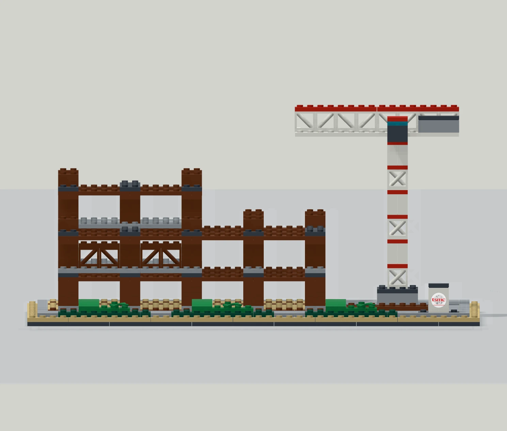
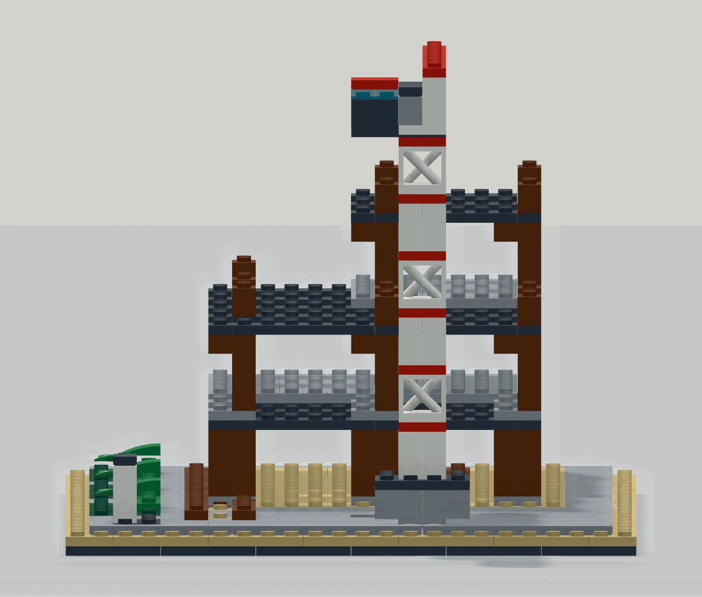
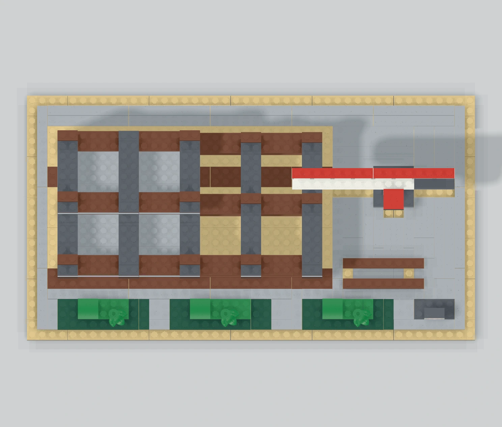

# 台中 F25 新廠・鋼構工程｜組裝說明書

TC 03 · Fab 25 P1 · Steelwork, August 2026

取材自 2026 年 8 月 31 日的中科新廠會勘。紅棕色柱梁圍出透空的主體，局部樓板露出交叉梁格，前景保留遠眺工地時可見的綠坡。柱網、樓層與吊車按積木比例編排。

450 件 · 4 袋 · 71 步

底座 44 × 24 凸點。

將底座較後的一側朝上，從左上角第 1 顆凸點開始數。X 由左向右，Z 由後向前。底高以薄板為單位，桌面是 0，一塊標準磚高 3 層薄板。每個位置均取零件佔地最左、最後的凸點。

圖號依每一步的安裝順序編列，回到下一個步驟時從 1 重新起算。[圖解說明書](manual.html) · [分袋 BOM](bom.csv) · [分步 LDraw 模型](model.ldr)

## F25 P1・2026 年 8 月工程紀念版

以 2026 年 8 月 31 日臺中市政府會勘為時間點。P1 當時正進行主體鋼構作業，遠景可見未封閉的紅棕色梁架與伸出的柱頭。 四跨兩進深的柱網、局部樓板與紅白塔吊用來表現搭建過程。塔吊位置、樓層及柱距為模型構圖；TSMC 字牌置於展示底座。

本版 450 件，另附 1 枚貼紙。

[臺中市政府・會勘與工地影像](https://www.taichung.gov.tw/3359331/post) · [中科管理局・二十五廠一期紀錄](https://www.ctsp.gov.tw/files/839ef9a9-1a15-4f06-a574-2534515aca42.pdf)

## 建築方位與配置

**正面**　以綠坡為前景，深色橫梁與較高柱頭勾出尚未封閉的廠房輪廓。

**側面**　從右側可以看見前低後高的施工剖面、梁間透空與白色起重臂。

**俯視**　左半部鋪樓板，右半部露出規律的梁格。此為工程紀念模型的構圖。

## 原寸貼紙

本款有 1 張貼紙。請以 100% 列印原寸貼紙 PDF，依步驟中的 S 編號貼在指定磚面，再把該件扣入。

[下載 A4 可列印貼紙](stickers.pdf)

- S01　模型右前方的獨立工程紀念牌 · 袋 04／步驟 64 · 12 × 12 mm · 正面（朝前），面中央。

## 第 01 袋　底座與定位

78 件，共 11 步。

| 顏色 | 零件 | 設計／庫號 | 數量 |
| --- | --- | --- | ---: |
| 沙色 | 薄板 2×4 | 3020 | 2 |
| 沙色 | 薄板 4×4 | 3031 | 5 |
| 沙色 | 薄板 2×8 | 3034 | 10 |
| 沙色 | 薄板 4×8 | 3035 | 25 |
| 深藍灰 | 薄板 4×4 | 3031 | 6 |
| 深藍灰 | 薄板 4×8 | 3035 | 30 |

### 步驟 01　併排底板（1/5）

將底板凸點朝上、長邊對齊排在平桌。下一層會跨接板縫。

**本步取件**

| 顏色 | 零件 | 設計／庫號 | 數量 |
| --- | --- | --- | ---: |
| 深藍灰 | 薄板 4×4 | 3031 | 1 |
| 深藍灰 | 薄板 4×8 | 3035 | 7 |

**安裝位置**

| 圖號 | 零件與顏色 | X | Z | 底高（薄板） | 方向 |
| ---: | --- | ---: | ---: | ---: | --- |
| 1 | 深藍灰 薄板 4×8（3035） | 1 | 1 | 0 | 沿 X |
| 2 | 深藍灰 薄板 4×8（3035） | 9 | 1 | 0 | 沿 X |
| 3 | 深藍灰 薄板 4×8（3035） | 17 | 1 | 0 | 沿 X |
| 4 | 深藍灰 薄板 4×8（3035） | 25 | 1 | 0 | 沿 X |
| 5 | 深藍灰 薄板 4×8（3035） | 33 | 1 | 0 | 沿 X |
| 6 | 深藍灰 薄板 4×4（3031） | 41 | 1 | 0 | — |
| 7 | 深藍灰 薄板 4×8（3035） | 1 | 5 | 0 | 沿 X |
| 8 | 深藍灰 薄板 4×8（3035） | 9 | 5 | 0 | 沿 X |

### 步驟 02　併排底板（2/5）

將底板凸點朝上、長邊對齊排在平桌。下一層會跨接板縫。

**本步取件**

| 顏色 | 零件 | 設計／庫號 | 數量 |
| --- | --- | --- | ---: |
| 深藍灰 | 薄板 4×4 | 3031 | 1 |
| 深藍灰 | 薄板 4×8 | 3035 | 7 |

**安裝位置**

| 圖號 | 零件與顏色 | X | Z | 底高（薄板） | 方向 |
| ---: | --- | ---: | ---: | ---: | --- |
| 1 | 深藍灰 薄板 4×8（3035） | 17 | 5 | 0 | 沿 X |
| 2 | 深藍灰 薄板 4×8（3035） | 25 | 5 | 0 | 沿 X |
| 3 | 深藍灰 薄板 4×8（3035） | 33 | 5 | 0 | 沿 X |
| 4 | 深藍灰 薄板 4×4（3031） | 41 | 5 | 0 | — |
| 5 | 深藍灰 薄板 4×8（3035） | 1 | 9 | 0 | 沿 X |
| 6 | 深藍灰 薄板 4×8（3035） | 9 | 9 | 0 | 沿 X |
| 7 | 深藍灰 薄板 4×8（3035） | 17 | 9 | 0 | 沿 X |
| 8 | 深藍灰 薄板 4×8（3035） | 25 | 9 | 0 | 沿 X |

### 步驟 03　併排底板（3/5）

將底板凸點朝上、長邊對齊排在平桌。下一層會跨接板縫。

**本步取件**

| 顏色 | 零件 | 設計／庫號 | 數量 |
| --- | --- | --- | ---: |
| 深藍灰 | 薄板 4×4 | 3031 | 2 |
| 深藍灰 | 薄板 4×8 | 3035 | 6 |

**安裝位置**

| 圖號 | 零件與顏色 | X | Z | 底高（薄板） | 方向 |
| ---: | --- | ---: | ---: | ---: | --- |
| 1 | 深藍灰 薄板 4×8（3035） | 33 | 9 | 0 | 沿 X |
| 2 | 深藍灰 薄板 4×4（3031） | 41 | 9 | 0 | — |
| 3 | 深藍灰 薄板 4×8（3035） | 1 | 13 | 0 | 沿 X |
| 4 | 深藍灰 薄板 4×8（3035） | 9 | 13 | 0 | 沿 X |
| 5 | 深藍灰 薄板 4×8（3035） | 17 | 13 | 0 | 沿 X |
| 6 | 深藍灰 薄板 4×8（3035） | 25 | 13 | 0 | 沿 X |
| 7 | 深藍灰 薄板 4×8（3035） | 33 | 13 | 0 | 沿 X |
| 8 | 深藍灰 薄板 4×4（3031） | 41 | 13 | 0 | — |

### 步驟 04　併排底板（4/5）

將底板凸點朝上、長邊對齊排在平桌。下一層會跨接板縫。

**本步取件**

| 顏色 | 零件 | 設計／庫號 | 數量 |
| --- | --- | --- | ---: |
| 深藍灰 | 薄板 4×4 | 3031 | 1 |
| 深藍灰 | 薄板 4×8 | 3035 | 7 |

**安裝位置**

| 圖號 | 零件與顏色 | X | Z | 底高（薄板） | 方向 |
| ---: | --- | ---: | ---: | ---: | --- |
| 1 | 深藍灰 薄板 4×8（3035） | 1 | 17 | 0 | 沿 X |
| 2 | 深藍灰 薄板 4×8（3035） | 9 | 17 | 0 | 沿 X |
| 3 | 深藍灰 薄板 4×8（3035） | 17 | 17 | 0 | 沿 X |
| 4 | 深藍灰 薄板 4×8（3035） | 25 | 17 | 0 | 沿 X |
| 5 | 深藍灰 薄板 4×8（3035） | 33 | 17 | 0 | 沿 X |
| 6 | 深藍灰 薄板 4×4（3031） | 41 | 17 | 0 | — |
| 7 | 深藍灰 薄板 4×8（3035） | 1 | 21 | 0 | 沿 X |
| 8 | 深藍灰 薄板 4×8（3035） | 9 | 21 | 0 | 沿 X |

### 步驟 05　併排底板（5/5）

將底板凸點朝上、長邊對齊排在平桌。下一層會跨接板縫。

**本步取件**

| 顏色 | 零件 | 設計／庫號 | 數量 |
| --- | --- | --- | ---: |
| 深藍灰 | 薄板 4×4 | 3031 | 1 |
| 深藍灰 | 薄板 4×8 | 3035 | 3 |

**安裝位置**

| 圖號 | 零件與顏色 | X | Z | 底高（薄板） | 方向 |
| ---: | --- | ---: | ---: | ---: | --- |
| 1 | 深藍灰 薄板 4×8（3035） | 17 | 21 | 0 | 沿 X |
| 2 | 深藍灰 薄板 4×8（3035） | 25 | 21 | 0 | 沿 X |
| 3 | 深藍灰 薄板 4×8（3035） | 33 | 21 | 0 | 沿 X |
| 4 | 深藍灰 薄板 4×4（3031） | 41 | 21 | 0 | — |

### 步驟 06　錯縫鎖底（1/6）

上層相對底板橫移四格、縱移兩格。逐排按緊後，底座可整片拿起。

**本步取件**

| 顏色 | 零件 | 設計／庫號 | 數量 |
| --- | --- | --- | ---: |
| 沙色 | 薄板 2×4 | 3020 | 1 |
| 沙色 | 薄板 4×4 | 3031 | 1 |
| 沙色 | 薄板 2×8 | 3034 | 5 |
| 沙色 | 薄板 4×8 | 3035 | 1 |

**安裝位置**

| 圖號 | 零件與顏色 | X | Z | 底高（薄板） | 方向 |
| ---: | --- | ---: | ---: | ---: | --- |
| 1 | 沙色 薄板 2×4（3020） | 1 | 1 | 1 | 沿 X |
| 2 | 沙色 薄板 2×8（3034） | 5 | 1 | 1 | 沿 X |
| 3 | 沙色 薄板 2×8（3034） | 13 | 1 | 1 | 沿 X |
| 4 | 沙色 薄板 2×8（3034） | 21 | 1 | 1 | 沿 X |
| 5 | 沙色 薄板 2×8（3034） | 29 | 1 | 1 | 沿 X |
| 6 | 沙色 薄板 2×8（3034） | 37 | 1 | 1 | 沿 X |
| 7 | 沙色 薄板 4×4（3031） | 1 | 3 | 1 | — |
| 8 | 沙色 薄板 4×8（3035） | 5 | 3 | 1 | 沿 X |

### 步驟 07　錯縫鎖底（2/6）

上層相對底板橫移四格、縱移兩格。逐排按緊後，底座可整片拿起。

**本步取件**

| 顏色 | 零件 | 設計／庫號 | 數量 |
| --- | --- | --- | ---: |
| 沙色 | 薄板 4×4 | 3031 | 1 |
| 沙色 | 薄板 4×8 | 3035 | 7 |

**安裝位置**

| 圖號 | 零件與顏色 | X | Z | 底高（薄板） | 方向 |
| ---: | --- | ---: | ---: | ---: | --- |
| 1 | 沙色 薄板 4×8（3035） | 13 | 3 | 1 | 沿 X |
| 2 | 沙色 薄板 4×8（3035） | 21 | 3 | 1 | 沿 X |
| 3 | 沙色 薄板 4×8（3035） | 29 | 3 | 1 | 沿 X |
| 4 | 沙色 薄板 4×8（3035） | 37 | 3 | 1 | 沿 X |
| 5 | 沙色 薄板 4×4（3031） | 1 | 7 | 1 | — |
| 6 | 沙色 薄板 4×8（3035） | 5 | 7 | 1 | 沿 X |
| 7 | 沙色 薄板 4×8（3035） | 13 | 7 | 1 | 沿 X |
| 8 | 沙色 薄板 4×8（3035） | 21 | 7 | 1 | 沿 X |

### 步驟 08　錯縫鎖底（3/6）

上層相對底板橫移四格、縱移兩格。逐排按緊後，底座可整片拿起。

**本步取件**

| 顏色 | 零件 | 設計／庫號 | 數量 |
| --- | --- | --- | ---: |
| 沙色 | 薄板 4×4 | 3031 | 1 |
| 沙色 | 薄板 4×8 | 3035 | 7 |

**安裝位置**

| 圖號 | 零件與顏色 | X | Z | 底高（薄板） | 方向 |
| ---: | --- | ---: | ---: | ---: | --- |
| 1 | 沙色 薄板 4×8（3035） | 29 | 7 | 1 | 沿 X |
| 2 | 沙色 薄板 4×8（3035） | 37 | 7 | 1 | 沿 X |
| 3 | 沙色 薄板 4×4（3031） | 1 | 11 | 1 | — |
| 4 | 沙色 薄板 4×8（3035） | 5 | 11 | 1 | 沿 X |
| 5 | 沙色 薄板 4×8（3035） | 13 | 11 | 1 | 沿 X |
| 6 | 沙色 薄板 4×8（3035） | 21 | 11 | 1 | 沿 X |
| 7 | 沙色 薄板 4×8（3035） | 29 | 11 | 1 | 沿 X |
| 8 | 沙色 薄板 4×8（3035） | 37 | 11 | 1 | 沿 X |

### 步驟 09　錯縫鎖底（4/6）

上層相對底板橫移四格、縱移兩格。逐排按緊後，底座可整片拿起。

**本步取件**

| 顏色 | 零件 | 設計／庫號 | 數量 |
| --- | --- | --- | ---: |
| 沙色 | 薄板 4×4 | 3031 | 2 |
| 沙色 | 薄板 4×8 | 3035 | 6 |

**安裝位置**

| 圖號 | 零件與顏色 | X | Z | 底高（薄板） | 方向 |
| ---: | --- | ---: | ---: | ---: | --- |
| 1 | 沙色 薄板 4×4（3031） | 1 | 15 | 1 | — |
| 2 | 沙色 薄板 4×8（3035） | 5 | 15 | 1 | 沿 X |
| 3 | 沙色 薄板 4×8（3035） | 13 | 15 | 1 | 沿 X |
| 4 | 沙色 薄板 4×8（3035） | 21 | 15 | 1 | 沿 X |
| 5 | 沙色 薄板 4×8（3035） | 29 | 15 | 1 | 沿 X |
| 6 | 沙色 薄板 4×8（3035） | 37 | 15 | 1 | 沿 X |
| 7 | 沙色 薄板 4×4（3031） | 1 | 19 | 1 | — |
| 8 | 沙色 薄板 4×8（3035） | 5 | 19 | 1 | 沿 X |

### 步驟 10　錯縫鎖底（5/6）

上層相對底板橫移四格、縱移兩格。逐排按緊後，底座可整片拿起。

**本步取件**

| 顏色 | 零件 | 設計／庫號 | 數量 |
| --- | --- | --- | ---: |
| 沙色 | 薄板 2×4 | 3020 | 1 |
| 沙色 | 薄板 2×8 | 3034 | 3 |
| 沙色 | 薄板 4×8 | 3035 | 4 |

**安裝位置**

| 圖號 | 零件與顏色 | X | Z | 底高（薄板） | 方向 |
| ---: | --- | ---: | ---: | ---: | --- |
| 1 | 沙色 薄板 4×8（3035） | 13 | 19 | 1 | 沿 X |
| 2 | 沙色 薄板 4×8（3035） | 21 | 19 | 1 | 沿 X |
| 3 | 沙色 薄板 4×8（3035） | 29 | 19 | 1 | 沿 X |
| 4 | 沙色 薄板 4×8（3035） | 37 | 19 | 1 | 沿 X |
| 5 | 沙色 薄板 2×4（3020） | 1 | 23 | 1 | 沿 X |
| 6 | 沙色 薄板 2×8（3034） | 5 | 23 | 1 | 沿 X |
| 7 | 沙色 薄板 2×8（3034） | 13 | 23 | 1 | 沿 X |
| 8 | 沙色 薄板 2×8（3034） | 21 | 23 | 1 | 沿 X |

### 步驟 11　錯縫鎖底（6/6）

上層相對底板橫移四格、縱移兩格。逐排按緊後，底座可整片拿起。

**本步取件**

| 顏色 | 零件 | 設計／庫號 | 數量 |
| --- | --- | --- | ---: |
| 沙色 | 薄板 2×8 | 3034 | 2 |

**安裝位置**

| 圖號 | 零件與顏色 | X | Z | 底高（薄板） | 方向 |
| ---: | --- | ---: | ---: | ---: | --- |
| 1 | 沙色 薄板 2×8（3034） | 29 | 23 | 1 | 沿 X |
| 2 | 沙色 薄板 2×8（3034） | 37 | 23 | 1 | 沿 X |

## 第 02 袋　土色場地、柱腳與第一層鋼架

125 件，共 18 步。

| 顏色 | 零件 | 設計／庫號 | 數量 |
| --- | --- | --- | ---: |
| 沙色 | 薄板 4×4 | 3031 | 3 |
| 沙色 | 薄板 4×8 | 3035 | 9 |
| 紅棕 | 磚 2×2 | 3003 | 30 |
| 紅棕 | 薄板 2×4 | 3020 | 2 |
| 紅棕 | 薄板 1×2 | 3023 | 6 |
| 紅棕 | 薄板 2×8 | 3034 | 6 |
| 紅棕 | 薄板 2×6 | 3795 | 12 |
| 淺藍灰 | 薄板 2×2 | 3022 | 21 |
| 淺藍灰 | 薄板 4×6 | 3032 | 4 |
| 淺藍灰 | 薄板 1×8 | 3460 | 4 |
| 淺藍灰 | 薄板 1×6 | 3666 | 2 |
| 淺藍灰 | 薄板 1×4 | 3710 | 2 |
| 淺藍灰 | 薄板 2×6 | 3795 | 4 |
| 深藍灰 | 薄板 1×2 | 3023 | 10 |
| 深藍灰 | 薄板 2×6 | 3795 | 10 |

### 步驟 12　土方工作面（1/3）

以沙色板鋪出長形工作面，間隔插入紅棕土帶，兩側預留吊車位置與草坡。

**本步取件**

| 顏色 | 零件 | 設計／庫號 | 數量 |
| --- | --- | --- | ---: |
| 沙色 | 薄板 4×4 | 3031 | 1 |
| 沙色 | 薄板 4×8 | 3035 | 3 |
| 紅棕 | 薄板 2×4 | 3020 | 1 |
| 紅棕 | 薄板 2×8 | 3034 | 3 |

**安裝位置**

| 圖號 | 零件與顏色 | X | Z | 底高（薄板） | 方向 |
| ---: | --- | ---: | ---: | ---: | --- |
| 1 | 沙色 薄板 4×8（3035） | 3 | 4 | 2 | 沿 X |
| 2 | 沙色 薄板 4×8（3035） | 11 | 4 | 2 | 沿 X |
| 3 | 沙色 薄板 4×8（3035） | 19 | 4 | 2 | 沿 X |
| 4 | 沙色 薄板 4×4（3031） | 27 | 4 | 2 | — |
| 5 | 紅棕 薄板 2×8（3034） | 3 | 8 | 2 | 沿 X |
| 6 | 紅棕 薄板 2×8（3034） | 11 | 8 | 2 | 沿 X |
| 7 | 紅棕 薄板 2×8（3034） | 19 | 8 | 2 | 沿 X |
| 8 | 紅棕 薄板 2×4（3020） | 27 | 8 | 2 | 沿 X |

### 步驟 13　土方工作面（2/3）

以沙色板鋪出長形工作面，間隔插入紅棕土帶，兩側預留吊車位置與草坡。

**本步取件**

| 顏色 | 零件 | 設計／庫號 | 數量 |
| --- | --- | --- | ---: |
| 沙色 | 薄板 4×4 | 3031 | 2 |
| 沙色 | 薄板 4×8 | 3035 | 6 |

**安裝位置**

| 圖號 | 零件與顏色 | X | Z | 底高（薄板） | 方向 |
| ---: | --- | ---: | ---: | ---: | --- |
| 1 | 沙色 薄板 4×8（3035） | 3 | 10 | 2 | 沿 X |
| 2 | 沙色 薄板 4×8（3035） | 11 | 10 | 2 | 沿 X |
| 3 | 沙色 薄板 4×8（3035） | 19 | 10 | 2 | 沿 X |
| 4 | 沙色 薄板 4×4（3031） | 27 | 10 | 2 | — |
| 5 | 沙色 薄板 4×8（3035） | 3 | 14 | 2 | 沿 X |
| 6 | 沙色 薄板 4×8（3035） | 11 | 14 | 2 | 沿 X |
| 7 | 沙色 薄板 4×8（3035） | 19 | 14 | 2 | 沿 X |
| 8 | 沙色 薄板 4×4（3031） | 27 | 14 | 2 | — |

### 步驟 14　土方工作面（3/3）

以沙色板鋪出長形工作面，間隔插入紅棕土帶，兩側預留吊車位置與草坡。

**本步取件**

| 顏色 | 零件 | 設計／庫號 | 數量 |
| --- | --- | --- | ---: |
| 紅棕 | 薄板 2×4 | 3020 | 1 |
| 紅棕 | 薄板 2×8 | 3034 | 3 |

**安裝位置**

| 圖號 | 零件與顏色 | X | Z | 底高（薄板） | 方向 |
| ---: | --- | ---: | ---: | ---: | --- |
| 1 | 紅棕 薄板 2×8（3034） | 3 | 18 | 2 | 沿 X |
| 2 | 紅棕 薄板 2×8（3034） | 11 | 18 | 2 | 沿 X |
| 3 | 紅棕 薄板 2×8（3034） | 19 | 18 | 2 | 沿 X |
| 4 | 紅棕 薄板 2×4（3020） | 27 | 18 | 2 | 沿 X |

### 步驟 15　淺灰承台與鋼柱（1/6）

三列柱腳各排五座；相鄰柱心相距六格。先扣淺灰方形承台，再疊兩塊紅棕方磚立起首層柱。

**本步取件**

| 顏色 | 零件 | 設計／庫號 | 數量 |
| --- | --- | --- | ---: |
| 紅棕 | 磚 2×2 | 3003 | 5 |
| 淺藍灰 | 薄板 2×2 | 3022 | 3 |

**安裝位置**

| 圖號 | 零件與顏色 | X | Z | 底高（薄板） | 方向 |
| ---: | --- | ---: | ---: | ---: | --- |
| 1 | 淺藍灰 薄板 2×2（3022） | 4 | 5 | 3 | — |
| 2 | 紅棕 磚 2×2（3003） | 4 | 5 | 4 | — |
| 3 | 紅棕 磚 2×2（3003） | 4 | 5 | 7 | — |
| 4 | 淺藍灰 薄板 2×2（3022） | 10 | 5 | 3 | — |
| 5 | 紅棕 磚 2×2（3003） | 10 | 5 | 4 | — |
| 6 | 紅棕 磚 2×2（3003） | 10 | 5 | 7 | — |
| 7 | 淺藍灰 薄板 2×2（3022） | 16 | 5 | 3 | — |
| 8 | 紅棕 磚 2×2（3003） | 16 | 5 | 4 | — |

### 步驟 16　淺灰承台與鋼柱（2/6）

三列柱腳各排五座；相鄰柱心相距六格。先扣淺灰方形承台，再疊兩塊紅棕方磚立起首層柱。

**本步取件**

| 顏色 | 零件 | 設計／庫號 | 數量 |
| --- | --- | --- | ---: |
| 紅棕 | 磚 2×2 | 3003 | 5 |
| 淺藍灰 | 薄板 2×2 | 3022 | 3 |

**安裝位置**

| 圖號 | 零件與顏色 | X | Z | 底高（薄板） | 方向 |
| ---: | --- | ---: | ---: | ---: | --- |
| 1 | 紅棕 磚 2×2（3003） | 16 | 5 | 7 | — |
| 2 | 淺藍灰 薄板 2×2（3022） | 22 | 5 | 3 | — |
| 3 | 紅棕 磚 2×2（3003） | 22 | 5 | 4 | — |
| 4 | 紅棕 磚 2×2（3003） | 22 | 5 | 7 | — |
| 5 | 淺藍灰 薄板 2×2（3022） | 28 | 5 | 3 | — |
| 6 | 紅棕 磚 2×2（3003） | 28 | 5 | 4 | — |
| 7 | 紅棕 磚 2×2（3003） | 28 | 5 | 7 | — |
| 8 | 淺藍灰 薄板 2×2（3022） | 4 | 11 | 3 | — |

### 步驟 17　淺灰承台與鋼柱（3/6）

三列柱腳各排五座；相鄰柱心相距六格。先扣淺灰方形承台，再疊兩塊紅棕方磚立起首層柱。

**本步取件**

| 顏色 | 零件 | 設計／庫號 | 數量 |
| --- | --- | --- | ---: |
| 紅棕 | 磚 2×2 | 3003 | 6 |
| 淺藍灰 | 薄板 2×2 | 3022 | 2 |

**安裝位置**

| 圖號 | 零件與顏色 | X | Z | 底高（薄板） | 方向 |
| ---: | --- | ---: | ---: | ---: | --- |
| 1 | 紅棕 磚 2×2（3003） | 4 | 11 | 4 | — |
| 2 | 紅棕 磚 2×2（3003） | 4 | 11 | 7 | — |
| 3 | 淺藍灰 薄板 2×2（3022） | 10 | 11 | 3 | — |
| 4 | 紅棕 磚 2×2（3003） | 10 | 11 | 4 | — |
| 5 | 紅棕 磚 2×2（3003） | 10 | 11 | 7 | — |
| 6 | 淺藍灰 薄板 2×2（3022） | 16 | 11 | 3 | — |
| 7 | 紅棕 磚 2×2（3003） | 16 | 11 | 4 | — |
| 8 | 紅棕 磚 2×2（3003） | 16 | 11 | 7 | — |

### 步驟 18　淺灰承台與鋼柱（4/6）

三列柱腳各排五座；相鄰柱心相距六格。先扣淺灰方形承台，再疊兩塊紅棕方磚立起首層柱。

**本步取件**

| 顏色 | 零件 | 設計／庫號 | 數量 |
| --- | --- | --- | ---: |
| 紅棕 | 磚 2×2 | 3003 | 5 |
| 淺藍灰 | 薄板 2×2 | 3022 | 3 |

**安裝位置**

| 圖號 | 零件與顏色 | X | Z | 底高（薄板） | 方向 |
| ---: | --- | ---: | ---: | ---: | --- |
| 1 | 淺藍灰 薄板 2×2（3022） | 22 | 11 | 3 | — |
| 2 | 紅棕 磚 2×2（3003） | 22 | 11 | 4 | — |
| 3 | 紅棕 磚 2×2（3003） | 22 | 11 | 7 | — |
| 4 | 淺藍灰 薄板 2×2（3022） | 28 | 11 | 3 | — |
| 5 | 紅棕 磚 2×2（3003） | 28 | 11 | 4 | — |
| 6 | 紅棕 磚 2×2（3003） | 28 | 11 | 7 | — |
| 7 | 淺藍灰 薄板 2×2（3022） | 4 | 17 | 3 | — |
| 8 | 紅棕 磚 2×2（3003） | 4 | 17 | 4 | — |

### 步驟 19　淺灰承台與鋼柱（5/6）

三列柱腳各排五座；相鄰柱心相距六格。先扣淺灰方形承台，再疊兩塊紅棕方磚立起首層柱。

**本步取件**

| 顏色 | 零件 | 設計／庫號 | 數量 |
| --- | --- | --- | ---: |
| 紅棕 | 磚 2×2 | 3003 | 5 |
| 淺藍灰 | 薄板 2×2 | 3022 | 3 |

**安裝位置**

| 圖號 | 零件與顏色 | X | Z | 底高（薄板） | 方向 |
| ---: | --- | ---: | ---: | ---: | --- |
| 1 | 紅棕 磚 2×2（3003） | 4 | 17 | 7 | — |
| 2 | 淺藍灰 薄板 2×2（3022） | 10 | 17 | 3 | — |
| 3 | 紅棕 磚 2×2（3003） | 10 | 17 | 4 | — |
| 4 | 紅棕 磚 2×2（3003） | 10 | 17 | 7 | — |
| 5 | 淺藍灰 薄板 2×2（3022） | 16 | 17 | 3 | — |
| 6 | 紅棕 磚 2×2（3003） | 16 | 17 | 4 | — |
| 7 | 紅棕 磚 2×2（3003） | 16 | 17 | 7 | — |
| 8 | 淺藍灰 薄板 2×2（3022） | 22 | 17 | 3 | — |

### 步驟 20　淺灰承台與鋼柱（6/6）

三列柱腳各排五座；相鄰柱心相距六格。先扣淺灰方形承台，再疊兩塊紅棕方磚立起首層柱。

**本步取件**

| 顏色 | 零件 | 設計／庫號 | 數量 |
| --- | --- | --- | ---: |
| 紅棕 | 磚 2×2 | 3003 | 4 |
| 淺藍灰 | 薄板 2×2 | 3022 | 1 |

**安裝位置**

| 圖號 | 零件與顏色 | X | Z | 底高（薄板） | 方向 |
| ---: | --- | ---: | ---: | ---: | --- |
| 1 | 紅棕 磚 2×2（3003） | 22 | 17 | 4 | — |
| 2 | 紅棕 磚 2×2（3003） | 22 | 17 | 7 | — |
| 3 | 淺藍灰 薄板 2×2（3022） | 28 | 17 | 3 | — |
| 4 | 紅棕 磚 2×2（3003） | 28 | 17 | 4 | — |
| 5 | 紅棕 磚 2×2（3003） | 28 | 17 | 7 | — |

### 步驟 21　架橫梁（1/3）

每根六格薄板架在相鄰兩個柱頭上，兩端各壓一格。橫梁沿長邊排成平行列，在最外側補齊短邊。

**本步取件**

| 顏色 | 零件 | 設計／庫號 | 數量 |
| --- | --- | --- | ---: |
| 紅棕 | 薄板 1×2 | 3023 | 2 |
| 紅棕 | 薄板 2×6 | 3795 | 6 |

**安裝位置**

| 圖號 | 零件與顏色 | X | Z | 底高（薄板） | 方向 |
| ---: | --- | ---: | ---: | ---: | --- |
| 1 | 紅棕 薄板 2×6（3795） | 5 | 5 | 10 | 沿 X |
| 2 | 紅棕 薄板 2×6（3795） | 11 | 5 | 10 | 沿 X |
| 3 | 紅棕 薄板 2×6（3795） | 17 | 5 | 10 | 沿 X |
| 4 | 紅棕 薄板 2×6（3795） | 23 | 5 | 10 | 沿 X |
| 5 | 紅棕 薄板 1×2（3023） | 4 | 5 | 10 | 沿 Z |
| 6 | 紅棕 薄板 1×2（3023） | 29 | 5 | 10 | 沿 Z |
| 7 | 紅棕 薄板 2×6（3795） | 5 | 11 | 10 | 沿 X |
| 8 | 紅棕 薄板 2×6（3795） | 11 | 11 | 10 | 沿 X |

### 步驟 22　架橫梁（2/3）

每根六格薄板架在相鄰兩個柱頭上，兩端各壓一格。橫梁沿長邊排成平行列，在最外側補齊短邊。

**本步取件**

| 顏色 | 零件 | 設計／庫號 | 數量 |
| --- | --- | --- | ---: |
| 紅棕 | 薄板 1×2 | 3023 | 2 |
| 紅棕 | 薄板 2×6 | 3795 | 6 |

**安裝位置**

| 圖號 | 零件與顏色 | X | Z | 底高（薄板） | 方向 |
| ---: | --- | ---: | ---: | ---: | --- |
| 1 | 紅棕 薄板 2×6（3795） | 17 | 11 | 10 | 沿 X |
| 2 | 紅棕 薄板 2×6（3795） | 23 | 11 | 10 | 沿 X |
| 3 | 紅棕 薄板 1×2（3023） | 4 | 11 | 10 | 沿 Z |
| 4 | 紅棕 薄板 1×2（3023） | 29 | 11 | 10 | 沿 Z |
| 5 | 紅棕 薄板 2×6（3795） | 5 | 17 | 10 | 沿 X |
| 6 | 紅棕 薄板 2×6（3795） | 11 | 17 | 10 | 沿 X |
| 7 | 紅棕 薄板 2×6（3795） | 17 | 17 | 10 | 沿 X |
| 8 | 紅棕 薄板 2×6（3795） | 23 | 17 | 10 | 沿 X |

### 步驟 23　架橫梁（3/3）

每根六格薄板架在相鄰兩個柱頭上，兩端各壓一格。橫梁沿長邊排成平行列，在最外側補齊短邊。

**本步取件**

| 顏色 | 零件 | 設計／庫號 | 數量 |
| --- | --- | --- | ---: |
| 紅棕 | 薄板 1×2 | 3023 | 2 |

**安裝位置**

| 圖號 | 零件與顏色 | X | Z | 底高（薄板） | 方向 |
| ---: | --- | ---: | ---: | ---: | --- |
| 1 | 紅棕 薄板 1×2（3023） | 4 | 17 | 10 | 沿 Z |
| 2 | 紅棕 薄板 1×2（3023） | 29 | 17 | 10 | 沿 Z |

### 步驟 24　交叉扣合縱梁（1/3）

把第二向的六格梁轉九十度，在上一層交點扣緊。從兩個側面看，縱橫梁之間保留方形透空。

**本步取件**

| 顏色 | 零件 | 設計／庫號 | 數量 |
| --- | --- | --- | ---: |
| 深藍灰 | 薄板 1×2 | 3023 | 4 |
| 深藍灰 | 薄板 2×6 | 3795 | 4 |

**安裝位置**

| 圖號 | 零件與顏色 | X | Z | 底高（薄板） | 方向 |
| ---: | --- | ---: | ---: | ---: | --- |
| 1 | 深藍灰 薄板 2×6（3795） | 4 | 6 | 11 | 沿 Z |
| 2 | 深藍灰 薄板 2×6（3795） | 4 | 12 | 11 | 沿 Z |
| 3 | 深藍灰 薄板 1×2（3023） | 4 | 5 | 11 | 沿 X |
| 4 | 深藍灰 薄板 1×2（3023） | 4 | 18 | 11 | 沿 X |
| 5 | 深藍灰 薄板 2×6（3795） | 10 | 6 | 11 | 沿 Z |
| 6 | 深藍灰 薄板 2×6（3795） | 10 | 12 | 11 | 沿 Z |
| 7 | 深藍灰 薄板 1×2（3023） | 10 | 5 | 11 | 沿 X |
| 8 | 深藍灰 薄板 1×2（3023） | 10 | 18 | 11 | 沿 X |

### 步驟 25　交叉扣合縱梁（2/3）

把第二向的六格梁轉九十度，在上一層交點扣緊。從兩個側面看，縱橫梁之間保留方形透空。

**本步取件**

| 顏色 | 零件 | 設計／庫號 | 數量 |
| --- | --- | --- | ---: |
| 深藍灰 | 薄板 1×2 | 3023 | 4 |
| 深藍灰 | 薄板 2×6 | 3795 | 4 |

**安裝位置**

| 圖號 | 零件與顏色 | X | Z | 底高（薄板） | 方向 |
| ---: | --- | ---: | ---: | ---: | --- |
| 1 | 深藍灰 薄板 2×6（3795） | 16 | 6 | 11 | 沿 Z |
| 2 | 深藍灰 薄板 2×6（3795） | 16 | 12 | 11 | 沿 Z |
| 3 | 深藍灰 薄板 1×2（3023） | 16 | 5 | 11 | 沿 X |
| 4 | 深藍灰 薄板 1×2（3023） | 16 | 18 | 11 | 沿 X |
| 5 | 深藍灰 薄板 2×6（3795） | 22 | 6 | 11 | 沿 Z |
| 6 | 深藍灰 薄板 2×6（3795） | 22 | 12 | 11 | 沿 Z |
| 7 | 深藍灰 薄板 1×2（3023） | 22 | 5 | 11 | 沿 X |
| 8 | 深藍灰 薄板 1×2（3023） | 22 | 18 | 11 | 沿 X |

### 步驟 26　交叉扣合縱梁（3/3）

把第二向的六格梁轉九十度，在上一層交點扣緊。從兩個側面看，縱橫梁之間保留方形透空。

**本步取件**

| 顏色 | 零件 | 設計／庫號 | 數量 |
| --- | --- | --- | ---: |
| 深藍灰 | 薄板 1×2 | 3023 | 2 |
| 深藍灰 | 薄板 2×6 | 3795 | 2 |

**安裝位置**

| 圖號 | 零件與顏色 | X | Z | 底高（薄板） | 方向 |
| ---: | --- | ---: | ---: | ---: | --- |
| 1 | 深藍灰 薄板 2×6（3795） | 28 | 6 | 11 | 沿 Z |
| 2 | 深藍灰 薄板 2×6（3795） | 28 | 12 | 11 | 沿 Z |
| 3 | 深藍灰 薄板 1×2（3023） | 28 | 5 | 11 | 沿 X |
| 4 | 深藍灰 薄板 1×2（3023） | 28 | 18 | 11 | 沿 X |

### 步驟 27　局部鋪設樓板（1/3）

先鋪左側四個開間，由柱列向兩邊架設樓板。右側留出開口，以淺灰短板收住其餘柱頭。

**本步取件**

| 顏色 | 零件 | 設計／庫號 | 數量 |
| --- | --- | --- | ---: |
| 淺藍灰 | 薄板 4×6 | 3032 | 4 |
| 淺藍灰 | 薄板 2×6 | 3795 | 4 |

**安裝位置**

| 圖號 | 零件與顏色 | X | Z | 底高（薄板） | 方向 |
| ---: | --- | ---: | ---: | ---: | --- |
| 1 | 淺藍灰 薄板 4×6（3032） | 5 | 6 | 12 | 沿 X |
| 2 | 淺藍灰 薄板 2×6（3795） | 5 | 10 | 12 | 沿 X |
| 3 | 淺藍灰 薄板 4×6（3032） | 11 | 6 | 12 | 沿 X |
| 4 | 淺藍灰 薄板 2×6（3795） | 11 | 10 | 12 | 沿 X |
| 5 | 淺藍灰 薄板 4×6（3032） | 5 | 12 | 12 | 沿 X |
| 6 | 淺藍灰 薄板 2×6（3795） | 5 | 16 | 12 | 沿 X |
| 7 | 淺藍灰 薄板 4×6（3032） | 11 | 12 | 12 | 沿 X |
| 8 | 淺藍灰 薄板 2×6（3795） | 11 | 16 | 12 | 沿 X |

### 步驟 28　局部鋪設樓板（2/3）

先鋪左側四個開間，由柱列向兩邊架設樓板。右側留出開口，以淺灰短板收住其餘柱頭。

**本步取件**

| 顏色 | 零件 | 設計／庫號 | 數量 |
| --- | --- | --- | ---: |
| 淺藍灰 | 薄板 1×8 | 3460 | 4 |
| 淺藍灰 | 薄板 1×6 | 3666 | 2 |
| 淺藍灰 | 薄板 1×4 | 3710 | 2 |

**安裝位置**

| 圖號 | 零件與顏色 | X | Z | 底高（薄板） | 方向 |
| ---: | --- | ---: | ---: | ---: | --- |
| 1 | 淺藍灰 薄板 1×8（3460） | 4 | 6 | 12 | 沿 Z |
| 2 | 淺藍灰 薄板 1×4（3710） | 4 | 14 | 12 | 沿 Z |
| 3 | 淺藍灰 薄板 1×8（3460） | 17 | 6 | 12 | 沿 Z |
| 4 | 淺藍灰 薄板 1×4（3710） | 17 | 14 | 12 | 沿 Z |
| 5 | 淺藍灰 薄板 1×8（3460） | 4 | 5 | 12 | 沿 X |
| 6 | 淺藍灰 薄板 1×6（3666） | 12 | 5 | 12 | 沿 X |
| 7 | 淺藍灰 薄板 1×8（3460） | 4 | 18 | 12 | 沿 X |
| 8 | 淺藍灰 薄板 1×6（3666） | 12 | 18 | 12 | 沿 X |

### 步驟 29　局部鋪設樓板（3/3）

先鋪左側四個開間，由柱列向兩邊架設樓板。右側留出開口，以淺灰短板收住其餘柱頭。

**本步取件**

| 顏色 | 零件 | 設計／庫號 | 數量 |
| --- | --- | --- | ---: |
| 淺藍灰 | 薄板 2×2 | 3022 | 6 |

**安裝位置**

| 圖號 | 零件與顏色 | X | Z | 底高（薄板） | 方向 |
| ---: | --- | ---: | ---: | ---: | --- |
| 1 | 淺藍灰 薄板 2×2（3022） | 22 | 5 | 12 | — |
| 2 | 淺藍灰 薄板 2×2（3022） | 28 | 5 | 12 | — |
| 3 | 淺藍灰 薄板 2×2（3022） | 22 | 11 | 12 | — |
| 4 | 淺藍灰 薄板 2×2（3022） | 28 | 11 | 12 | — |
| 5 | 淺藍灰 薄板 2×2（3022） | 22 | 17 | 12 | — |
| 6 | 淺藍灰 薄板 2×2（3022） | 28 | 17 | 12 | — |

## 第 03 袋　上層裸梁、斜撐與未封頂柱頭

124 件，共 20 步。

| 顏色 | 零件 | 設計／庫號 | 數量 |
| --- | --- | --- | ---: |
| 紅棕 | 磚 1×2 | 3004 | 11 |
| 紅棕 | 薄板 2×2 | 3022 | 21 |
| 紅棕 | 薄板 1×2 | 3023 | 10 |
| 紅棕 | 鏤空斜撐框 1×2 | 3224 | 4 |
| 紅棕 | 雙層磚 1×2 | 3245c | 21 |
| 紅棕 | 薄板 1×4 | 3710 | 2 |
| 紅棕 | 薄板 2×6 | 3795 | 16 |
| 淺藍灰 | 薄板 4×6 | 3032 | 2 |
| 淺藍灰 | 薄板 1×8 | 3460 | 2 |
| 淺藍灰 | 薄板 1×6 | 3666 | 4 |
| 淺藍灰 | 薄板 2×6 | 3795 | 2 |
| 深藍灰 | 薄板 1×2 | 3023 | 16 |
| 深藍灰 | 薄板 2×6 | 3795 | 13 |

### 步驟 30　上層細柱（1/4）

兩格面的紅棕雙層磚立在柱頭前緣；在頂端裝上方形承板，供兩向橫梁扣合。

**本步取件**

| 顏色 | 零件 | 設計／庫號 | 數量 |
| --- | --- | --- | ---: |
| 紅棕 | 薄板 2×2 | 3022 | 4 |
| 紅棕 | 雙層磚 1×2 | 3245c | 4 |

**安裝位置**

| 圖號 | 零件與顏色 | X | Z | 底高（薄板） | 方向 |
| ---: | --- | ---: | ---: | ---: | --- |
| 1 | 紅棕 雙層磚 1×2（3245c） | 4 | 5 | 13 | 沿 X |
| 2 | 紅棕 薄板 2×2（3022） | 4 | 5 | 19 | — |
| 3 | 紅棕 雙層磚 1×2（3245c） | 10 | 5 | 13 | 沿 X |
| 4 | 紅棕 薄板 2×2（3022） | 10 | 5 | 19 | — |
| 5 | 紅棕 雙層磚 1×2（3245c） | 16 | 5 | 13 | 沿 X |
| 6 | 紅棕 薄板 2×2（3022） | 16 | 5 | 19 | — |
| 7 | 紅棕 雙層磚 1×2（3245c） | 22 | 5 | 13 | 沿 X |
| 8 | 紅棕 薄板 2×2（3022） | 22 | 5 | 19 | — |

### 步驟 31　上層細柱（2/4）

兩格面的紅棕雙層磚立在柱頭前緣；在頂端裝上方形承板，供兩向橫梁扣合。

**本步取件**

| 顏色 | 零件 | 設計／庫號 | 數量 |
| --- | --- | --- | ---: |
| 紅棕 | 薄板 2×2 | 3022 | 4 |
| 紅棕 | 雙層磚 1×2 | 3245c | 4 |

**安裝位置**

| 圖號 | 零件與顏色 | X | Z | 底高（薄板） | 方向 |
| ---: | --- | ---: | ---: | ---: | --- |
| 1 | 紅棕 雙層磚 1×2（3245c） | 28 | 5 | 13 | 沿 X |
| 2 | 紅棕 薄板 2×2（3022） | 28 | 5 | 19 | — |
| 3 | 紅棕 雙層磚 1×2（3245c） | 4 | 11 | 13 | 沿 X |
| 4 | 紅棕 薄板 2×2（3022） | 4 | 11 | 19 | — |
| 5 | 紅棕 雙層磚 1×2（3245c） | 10 | 11 | 13 | 沿 X |
| 6 | 紅棕 薄板 2×2（3022） | 10 | 11 | 19 | — |
| 7 | 紅棕 雙層磚 1×2（3245c） | 16 | 11 | 13 | 沿 X |
| 8 | 紅棕 薄板 2×2（3022） | 16 | 11 | 19 | — |

### 步驟 32　上層細柱（3/4）

兩格面的紅棕雙層磚立在柱頭前緣；在頂端裝上方形承板，供兩向橫梁扣合。

**本步取件**

| 顏色 | 零件 | 設計／庫號 | 數量 |
| --- | --- | --- | ---: |
| 紅棕 | 薄板 2×2 | 3022 | 4 |
| 紅棕 | 雙層磚 1×2 | 3245c | 4 |

**安裝位置**

| 圖號 | 零件與顏色 | X | Z | 底高（薄板） | 方向 |
| ---: | --- | ---: | ---: | ---: | --- |
| 1 | 紅棕 雙層磚 1×2（3245c） | 22 | 11 | 13 | 沿 X |
| 2 | 紅棕 薄板 2×2（3022） | 22 | 11 | 19 | — |
| 3 | 紅棕 雙層磚 1×2（3245c） | 28 | 11 | 13 | 沿 X |
| 4 | 紅棕 薄板 2×2（3022） | 28 | 11 | 19 | — |
| 5 | 紅棕 雙層磚 1×2（3245c） | 4 | 17 | 13 | 沿 X |
| 6 | 紅棕 薄板 2×2（3022） | 4 | 17 | 19 | — |
| 7 | 紅棕 雙層磚 1×2（3245c） | 10 | 17 | 13 | 沿 X |
| 8 | 紅棕 薄板 2×2（3022） | 10 | 17 | 19 | — |

### 步驟 33　上層細柱（4/4）

兩格面的紅棕雙層磚立在柱頭前緣；在頂端裝上方形承板，供兩向橫梁扣合。

**本步取件**

| 顏色 | 零件 | 設計／庫號 | 數量 |
| --- | --- | --- | ---: |
| 紅棕 | 薄板 2×2 | 3022 | 3 |
| 紅棕 | 雙層磚 1×2 | 3245c | 3 |

**安裝位置**

| 圖號 | 零件與顏色 | X | Z | 底高（薄板） | 方向 |
| ---: | --- | ---: | ---: | ---: | --- |
| 1 | 紅棕 雙層磚 1×2（3245c） | 16 | 17 | 13 | 沿 X |
| 2 | 紅棕 薄板 2×2（3022） | 16 | 17 | 19 | — |
| 3 | 紅棕 雙層磚 1×2（3245c） | 22 | 17 | 13 | 沿 X |
| 4 | 紅棕 薄板 2×2（3022） | 22 | 17 | 19 | — |
| 5 | 紅棕 雙層磚 1×2（3245c） | 28 | 17 | 13 | 沿 X |
| 6 | 紅棕 薄板 2×2（3022） | 28 | 17 | 19 | — |

### 步驟 34　正面兩組人字撐

前方兩個已有樓板的開間各裝兩件鏤空斜撐。兩件互為鏡像，使斜桿在中央上方會合。

**本步取件**

| 顏色 | 零件 | 設計／庫號 | 數量 |
| --- | --- | --- | ---: |
| 紅棕 | 鏤空斜撐框 1×2 | 3224 | 4 |
| 紅棕 | 薄板 1×4 | 3710 | 2 |

**安裝位置**

| 圖號 | 零件與顏色 | X | Z | 底高（薄板） | 方向 |
| ---: | --- | ---: | ---: | ---: | --- |
| 1 | 紅棕 鏤空斜撐框 1×2（3224） | 6 | 17 | 13 | 斜桿右高左低 |
| 2 | 紅棕 鏤空斜撐框 1×2（3224） | 8 | 17 | 13 | 斜桿左高右低 |
| 3 | 紅棕 薄板 1×4（3710） | 6 | 17 | 18 | 沿 X |
| 4 | 紅棕 鏤空斜撐框 1×2（3224） | 12 | 17 | 13 | 斜桿右高左低 |
| 5 | 紅棕 鏤空斜撐框 1×2（3224） | 14 | 17 | 13 | 斜桿左高右低 |
| 6 | 紅棕 薄板 1×4（3710） | 12 | 17 | 18 | 沿 X |

### 步驟 35　架橫梁（1/3）

每根六格薄板架在相鄰兩個柱頭上，兩端各壓一格。橫梁沿長邊排成平行列，在最外側補齊短邊。

**本步取件**

| 顏色 | 零件 | 設計／庫號 | 數量 |
| --- | --- | --- | ---: |
| 紅棕 | 薄板 1×2 | 3023 | 2 |
| 紅棕 | 薄板 2×6 | 3795 | 6 |

**安裝位置**

| 圖號 | 零件與顏色 | X | Z | 底高（薄板） | 方向 |
| ---: | --- | ---: | ---: | ---: | --- |
| 1 | 紅棕 薄板 2×6（3795） | 5 | 5 | 20 | 沿 X |
| 2 | 紅棕 薄板 2×6（3795） | 11 | 5 | 20 | 沿 X |
| 3 | 紅棕 薄板 2×6（3795） | 17 | 5 | 20 | 沿 X |
| 4 | 紅棕 薄板 2×6（3795） | 23 | 5 | 20 | 沿 X |
| 5 | 紅棕 薄板 1×2（3023） | 4 | 5 | 20 | 沿 Z |
| 6 | 紅棕 薄板 1×2（3023） | 29 | 5 | 20 | 沿 Z |
| 7 | 紅棕 薄板 2×6（3795） | 5 | 11 | 20 | 沿 X |
| 8 | 紅棕 薄板 2×6（3795） | 11 | 11 | 20 | 沿 X |

### 步驟 36　架橫梁（2/3）

每根六格薄板架在相鄰兩個柱頭上，兩端各壓一格。橫梁沿長邊排成平行列，在最外側補齊短邊。

**本步取件**

| 顏色 | 零件 | 設計／庫號 | 數量 |
| --- | --- | --- | ---: |
| 紅棕 | 薄板 1×2 | 3023 | 2 |
| 紅棕 | 薄板 2×6 | 3795 | 6 |

**安裝位置**

| 圖號 | 零件與顏色 | X | Z | 底高（薄板） | 方向 |
| ---: | --- | ---: | ---: | ---: | --- |
| 1 | 紅棕 薄板 2×6（3795） | 17 | 11 | 20 | 沿 X |
| 2 | 紅棕 薄板 2×6（3795） | 23 | 11 | 20 | 沿 X |
| 3 | 紅棕 薄板 1×2（3023） | 4 | 11 | 20 | 沿 Z |
| 4 | 紅棕 薄板 1×2（3023） | 29 | 11 | 20 | 沿 Z |
| 5 | 紅棕 薄板 2×6（3795） | 5 | 17 | 20 | 沿 X |
| 6 | 紅棕 薄板 2×6（3795） | 11 | 17 | 20 | 沿 X |
| 7 | 紅棕 薄板 2×6（3795） | 17 | 17 | 20 | 沿 X |
| 8 | 紅棕 薄板 2×6（3795） | 23 | 17 | 20 | 沿 X |

### 步驟 37　架橫梁（3/3）

每根六格薄板架在相鄰兩個柱頭上，兩端各壓一格。橫梁沿長邊排成平行列，在最外側補齊短邊。

**本步取件**

| 顏色 | 零件 | 設計／庫號 | 數量 |
| --- | --- | --- | ---: |
| 紅棕 | 薄板 1×2 | 3023 | 2 |

**安裝位置**

| 圖號 | 零件與顏色 | X | Z | 底高（薄板） | 方向 |
| ---: | --- | ---: | ---: | ---: | --- |
| 1 | 紅棕 薄板 1×2（3023） | 4 | 17 | 20 | 沿 Z |
| 2 | 紅棕 薄板 1×2（3023） | 29 | 17 | 20 | 沿 Z |

### 步驟 38　交叉扣合縱梁（1/3）

把第二向的六格梁轉九十度，在上一層交點扣緊。從兩個側面看，縱橫梁之間保留方形透空。

**本步取件**

| 顏色 | 零件 | 設計／庫號 | 數量 |
| --- | --- | --- | ---: |
| 深藍灰 | 薄板 1×2 | 3023 | 4 |
| 深藍灰 | 薄板 2×6 | 3795 | 4 |

**安裝位置**

| 圖號 | 零件與顏色 | X | Z | 底高（薄板） | 方向 |
| ---: | --- | ---: | ---: | ---: | --- |
| 1 | 深藍灰 薄板 2×6（3795） | 4 | 6 | 21 | 沿 Z |
| 2 | 深藍灰 薄板 2×6（3795） | 4 | 12 | 21 | 沿 Z |
| 3 | 深藍灰 薄板 1×2（3023） | 4 | 5 | 21 | 沿 X |
| 4 | 深藍灰 薄板 1×2（3023） | 4 | 18 | 21 | 沿 X |
| 5 | 深藍灰 薄板 2×6（3795） | 10 | 6 | 21 | 沿 Z |
| 6 | 深藍灰 薄板 2×6（3795） | 10 | 12 | 21 | 沿 Z |
| 7 | 深藍灰 薄板 1×2（3023） | 10 | 5 | 21 | 沿 X |
| 8 | 深藍灰 薄板 1×2（3023） | 10 | 18 | 21 | 沿 X |

### 步驟 39　交叉扣合縱梁（2/3）

把第二向的六格梁轉九十度，在上一層交點扣緊。從兩個側面看，縱橫梁之間保留方形透空。

**本步取件**

| 顏色 | 零件 | 設計／庫號 | 數量 |
| --- | --- | --- | ---: |
| 深藍灰 | 薄板 1×2 | 3023 | 4 |
| 深藍灰 | 薄板 2×6 | 3795 | 4 |

**安裝位置**

| 圖號 | 零件與顏色 | X | Z | 底高（薄板） | 方向 |
| ---: | --- | ---: | ---: | ---: | --- |
| 1 | 深藍灰 薄板 2×6（3795） | 16 | 6 | 21 | 沿 Z |
| 2 | 深藍灰 薄板 2×6（3795） | 16 | 12 | 21 | 沿 Z |
| 3 | 深藍灰 薄板 1×2（3023） | 16 | 5 | 21 | 沿 X |
| 4 | 深藍灰 薄板 1×2（3023） | 16 | 18 | 21 | 沿 X |
| 5 | 深藍灰 薄板 2×6（3795） | 22 | 6 | 21 | 沿 Z |
| 6 | 深藍灰 薄板 2×6（3795） | 22 | 12 | 21 | 沿 Z |
| 7 | 深藍灰 薄板 1×2（3023） | 22 | 5 | 21 | 沿 X |
| 8 | 深藍灰 薄板 1×2（3023） | 22 | 18 | 21 | 沿 X |

### 步驟 40　交叉扣合縱梁（3/3）

把第二向的六格梁轉九十度，在上一層交點扣緊。從兩個側面看，縱橫梁之間保留方形透空。

**本步取件**

| 顏色 | 零件 | 設計／庫號 | 數量 |
| --- | --- | --- | ---: |
| 深藍灰 | 薄板 1×2 | 3023 | 2 |
| 深藍灰 | 薄板 2×6 | 3795 | 2 |

**安裝位置**

| 圖號 | 零件與顏色 | X | Z | 底高（薄板） | 方向 |
| ---: | --- | ---: | ---: | ---: | --- |
| 1 | 深藍灰 薄板 2×6（3795） | 28 | 6 | 21 | 沿 Z |
| 2 | 深藍灰 薄板 2×6（3795） | 28 | 12 | 21 | 沿 Z |
| 3 | 深藍灰 薄板 1×2（3023） | 28 | 5 | 21 | 沿 X |
| 4 | 深藍灰 薄板 1×2（3023） | 28 | 18 | 21 | 沿 X |

### 步驟 41　後排施工層（1/2）

只給後方左側兩個開間鋪板。從正面朝內望，樓板前緣與敞開的梁格形成高低差。

**本步取件**

| 顏色 | 零件 | 設計／庫號 | 數量 |
| --- | --- | --- | ---: |
| 淺藍灰 | 薄板 4×6 | 3032 | 2 |
| 淺藍灰 | 薄板 1×8 | 3460 | 1 |
| 淺藍灰 | 薄板 1×6 | 3666 | 3 |
| 淺藍灰 | 薄板 2×6 | 3795 | 2 |

**安裝位置**

| 圖號 | 零件與顏色 | X | Z | 底高（薄板） | 方向 |
| ---: | --- | ---: | ---: | ---: | --- |
| 1 | 淺藍灰 薄板 4×6（3032） | 5 | 6 | 22 | 沿 X |
| 2 | 淺藍灰 薄板 2×6（3795） | 5 | 10 | 22 | 沿 X |
| 3 | 淺藍灰 薄板 4×6（3032） | 11 | 6 | 22 | 沿 X |
| 4 | 淺藍灰 薄板 2×6（3795） | 11 | 10 | 22 | 沿 X |
| 5 | 淺藍灰 薄板 1×6（3666） | 4 | 6 | 22 | 沿 Z |
| 6 | 淺藍灰 薄板 1×6（3666） | 17 | 6 | 22 | 沿 Z |
| 7 | 淺藍灰 薄板 1×8（3460） | 4 | 5 | 22 | 沿 X |
| 8 | 淺藍灰 薄板 1×6（3666） | 12 | 5 | 22 | 沿 X |

### 步驟 42　後排施工層（2/2）

只給後方左側兩個開間鋪板。從正面朝內望，樓板前緣與敞開的梁格形成高低差。

**本步取件**

| 顏色 | 零件 | 設計／庫號 | 數量 |
| --- | --- | --- | ---: |
| 淺藍灰 | 薄板 1×8 | 3460 | 1 |
| 淺藍灰 | 薄板 1×6 | 3666 | 1 |

**安裝位置**

| 圖號 | 零件與顏色 | X | Z | 底高（薄板） | 方向 |
| ---: | --- | ---: | ---: | ---: | --- |
| 1 | 淺藍灰 薄板 1×8（3460） | 4 | 12 | 22 | 沿 X |
| 2 | 淺藍灰 薄板 1×6（3666） | 12 | 12 | 22 | 沿 X |

### 步驟 43　抬升最後一段屋架（1/3）

在後排左半部再架一段鋼構。兩格高的柱身上扣方形柱頭，保留右側向上的短柱。

**本步取件**

| 顏色 | 零件 | 設計／庫號 | 數量 |
| --- | --- | --- | ---: |
| 紅棕 | 薄板 2×2 | 3022 | 4 |
| 紅棕 | 雙層磚 1×2 | 3245c | 4 |

**安裝位置**

| 圖號 | 零件與顏色 | X | Z | 底高（薄板） | 方向 |
| ---: | --- | ---: | ---: | ---: | --- |
| 1 | 紅棕 雙層磚 1×2（3245c） | 4 | 5 | 23 | 沿 X |
| 2 | 紅棕 薄板 2×2（3022） | 4 | 5 | 29 | — |
| 3 | 紅棕 雙層磚 1×2（3245c） | 10 | 5 | 23 | 沿 X |
| 4 | 紅棕 薄板 2×2（3022） | 10 | 5 | 29 | — |
| 5 | 紅棕 雙層磚 1×2（3245c） | 16 | 5 | 23 | 沿 X |
| 6 | 紅棕 薄板 2×2（3022） | 16 | 5 | 29 | — |
| 7 | 紅棕 雙層磚 1×2（3245c） | 4 | 11 | 23 | 沿 X |
| 8 | 紅棕 薄板 2×2（3022） | 4 | 11 | 29 | — |

### 步驟 44　抬升最後一段屋架（2/3）

在後排左半部再架一段鋼構。兩格高的柱身上扣方形柱頭，保留右側向上的短柱。

**本步取件**

| 顏色 | 零件 | 設計／庫號 | 數量 |
| --- | --- | --- | ---: |
| 紅棕 | 磚 1×2 | 3004 | 4 |
| 紅棕 | 薄板 2×2 | 3022 | 2 |
| 紅棕 | 雙層磚 1×2 | 3245c | 2 |

**安裝位置**

| 圖號 | 零件與顏色 | X | Z | 底高（薄板） | 方向 |
| ---: | --- | ---: | ---: | ---: | --- |
| 1 | 紅棕 雙層磚 1×2（3245c） | 10 | 11 | 23 | 沿 X |
| 2 | 紅棕 薄板 2×2（3022） | 10 | 11 | 29 | — |
| 3 | 紅棕 雙層磚 1×2（3245c） | 16 | 11 | 23 | 沿 X |
| 4 | 紅棕 薄板 2×2（3022） | 16 | 11 | 29 | — |
| 5 | 紅棕 磚 1×2（3004） | 22 | 5 | 22 | 沿 X |
| 6 | 紅棕 磚 1×2（3004） | 28 | 5 | 22 | 沿 X |
| 7 | 紅棕 磚 1×2（3004） | 22 | 11 | 22 | 沿 X |
| 8 | 紅棕 磚 1×2（3004） | 28 | 11 | 22 | 沿 X |

### 步驟 45　抬升最後一段屋架（3/3）

在後排左半部再架一段鋼構。兩格高的柱身上扣方形柱頭，保留右側向上的短柱。

**本步取件**

| 顏色 | 零件 | 設計／庫號 | 數量 |
| --- | --- | --- | ---: |
| 紅棕 | 磚 1×2 | 3004 | 3 |

**安裝位置**

| 圖號 | 零件與顏色 | X | Z | 底高（薄板） | 方向 |
| ---: | --- | ---: | ---: | ---: | --- |
| 1 | 紅棕 磚 1×2（3004） | 4 | 17 | 22 | 沿 X |
| 2 | 紅棕 磚 1×2（3004） | 16 | 17 | 22 | 沿 X |
| 3 | 紅棕 磚 1×2（3004） | 22 | 17 | 22 | 沿 X |

### 步驟 46　架橫梁

每根六格薄板架在相鄰兩個柱頭上，兩端各壓一格。橫梁沿長邊排成平行列，在最外側補齊短邊。

**本步取件**

| 顏色 | 零件 | 設計／庫號 | 數量 |
| --- | --- | --- | ---: |
| 紅棕 | 薄板 1×2 | 3023 | 4 |
| 紅棕 | 薄板 2×6 | 3795 | 4 |

**安裝位置**

| 圖號 | 零件與顏色 | X | Z | 底高（薄板） | 方向 |
| ---: | --- | ---: | ---: | ---: | --- |
| 1 | 紅棕 薄板 2×6（3795） | 5 | 5 | 30 | 沿 X |
| 2 | 紅棕 薄板 2×6（3795） | 11 | 5 | 30 | 沿 X |
| 3 | 紅棕 薄板 1×2（3023） | 4 | 5 | 30 | 沿 Z |
| 4 | 紅棕 薄板 1×2（3023） | 17 | 5 | 30 | 沿 Z |
| 5 | 紅棕 薄板 2×6（3795） | 5 | 11 | 30 | 沿 X |
| 6 | 紅棕 薄板 2×6（3795） | 11 | 11 | 30 | 沿 X |
| 7 | 紅棕 薄板 1×2（3023） | 4 | 11 | 30 | 沿 Z |
| 8 | 紅棕 薄板 1×2（3023） | 17 | 11 | 30 | 沿 Z |

### 步驟 47　交叉扣合縱梁（1/2）

把第二向的六格梁轉九十度，在上一層交點扣緊。從兩個側面看，縱橫梁之間保留方形透空。

**本步取件**

| 顏色 | 零件 | 設計／庫號 | 數量 |
| --- | --- | --- | ---: |
| 深藍灰 | 薄板 1×2 | 3023 | 5 |
| 深藍灰 | 薄板 2×6 | 3795 | 3 |

**安裝位置**

| 圖號 | 零件與顏色 | X | Z | 底高（薄板） | 方向 |
| ---: | --- | ---: | ---: | ---: | --- |
| 1 | 深藍灰 薄板 2×6（3795） | 4 | 6 | 31 | 沿 Z |
| 2 | 深藍灰 薄板 1×2（3023） | 4 | 5 | 31 | 沿 X |
| 3 | 深藍灰 薄板 1×2（3023） | 4 | 12 | 31 | 沿 X |
| 4 | 深藍灰 薄板 2×6（3795） | 10 | 6 | 31 | 沿 Z |
| 5 | 深藍灰 薄板 1×2（3023） | 10 | 5 | 31 | 沿 X |
| 6 | 深藍灰 薄板 1×2（3023） | 10 | 12 | 31 | 沿 X |
| 7 | 深藍灰 薄板 2×6（3795） | 16 | 6 | 31 | 沿 Z |
| 8 | 深藍灰 薄板 1×2（3023） | 16 | 5 | 31 | 沿 X |

### 步驟 48　交叉扣合縱梁（2/2）

把第二向的六格梁轉九十度，在上一層交點扣緊。從兩個側面看，縱橫梁之間保留方形透空。

**本步取件**

| 顏色 | 零件 | 設計／庫號 | 數量 |
| --- | --- | --- | ---: |
| 深藍灰 | 薄板 1×2 | 3023 | 1 |

**安裝位置**

| 圖號 | 零件與顏色 | X | Z | 底高（薄板） | 方向 |
| ---: | --- | ---: | ---: | ---: | --- |
| 1 | 深藍灰 薄板 1×2（3023） | 16 | 12 | 31 | 沿 X |

### 步驟 49　頂部接柱

在最高兩排的外角留下超出梁面的短柱頭，表現下一節鋼柱尚待吊裝的輪廓。

**本步取件**

| 顏色 | 零件 | 設計／庫號 | 數量 |
| --- | --- | --- | ---: |
| 紅棕 | 磚 1×2 | 3004 | 4 |

**安裝位置**

| 圖號 | 零件與顏色 | X | Z | 底高（薄板） | 方向 |
| ---: | --- | ---: | ---: | ---: | --- |
| 1 | 紅棕 磚 1×2（3004） | 4 | 5 | 32 | 沿 X |
| 2 | 紅棕 磚 1×2（3004） | 4 | 11 | 32 | 沿 X |
| 3 | 紅棕 磚 1×2（3004） | 16 | 5 | 32 | 沿 X |
| 4 | 紅棕 磚 1×2（3004） | 16 | 11 | 32 | 沿 X |

## 第 04 袋　吊裝場景、前景綠坡與展示牌

123 件，共 22 步。

| 顏色 | 零件 | 設計／庫號 | 數量 |
| --- | --- | --- | ---: |
| 綠色 | 弧面斜磚 2×2 | 15068 | 3 |
| 綠色 | 薄板 2×4 | 3020 | 2 |
| 綠色 | 薄板 1×2 | 3023 | 2 |
| 綠色 | 三葉枝 1×1 | 32607 | 3 |
| 綠色 | 薄板 2×6 | 3795 | 1 |
| 紅色 | 薄板 2×2 | 3022 | 6 |
| 紅色 | 光面板 2×2 | 3068b | 1 |
| 紅色 | 薄板 1×8 | 3460 | 2 |
| 白色 | 鏤空斜撐框 1×2 | 3224 | 20 |
| 白色 | 雙層磚 1×2 | 3245c | 1 |
| 白色 | 長薄板 2×16 | 4282 | 1 |
| 沙色 | 薄板 1×3 | 3623 | 2 |
| 透明淺藍 | 薄板 1×2 | 3023 | 2 |
| 紅棕 | 薄板 1×8 | 3460 | 2 |
| 淺藍灰 | 光面板 1×4 | 2431 | 7 |
| 淺藍灰 | 磚 2×4 | 3001 | 2 |
| 淺藍灰 | 磚 1×4 | 3010 | 1 |
| 淺藍灰 | 薄板 4×4 | 3031 | 1 |
| 淺藍灰 | 光面板 2×2 | 3068b | 6 |
| 淺藍灰 | 光面板 1×2 | 3069b | 3 |
| 淺藍灰 | 光面板 1×1 | 3070b | 4 |
| 淺藍灰 | 光面板 1×8 | 4162 | 25 |
| 淺藍灰 | 光面板 1×3 | 63864 | 2 |
| 淺藍灰 | 光面板 1×6 | 6636 | 4 |
| 淺藍灰 | 光面板 2×4 | 87079 | 5 |
| 深藍灰 | 光面板 1×4 | 2431 | 1 |
| 深藍灰 | 磚 2×2 | 3003 | 1 |
| 深藍灰 | 薄板 2×4 | 3020 | 2 |
| 深藍灰 | 薄板 4×4 | 3031 | 1 |
| 深藍灰 | 光面板 1×2 | 3069b | 1 |
| 深綠 | 薄板 2×3 | 3021 | 1 |
| 深綠 | 薄板 2×8 | 3034 | 3 |
| 深綠 | 薄板 1×8 | 3460 | 3 |
| 深綠 | 薄板 1×3 | 3623 | 2 |

### 步驟 50　示意塔吊底座

將寬四格的淺灰底板扣在梁架旁。先砌混凝土配重台，再在中央預留兩格寬的塔身扣點。

**本步取件**

| 顏色 | 零件 | 設計／庫號 | 數量 |
| --- | --- | --- | ---: |
| 淺藍灰 | 磚 2×4 | 3001 | 2 |
| 淺藍灰 | 薄板 4×4 | 3031 | 1 |
| 深藍灰 | 薄板 4×4 | 3031 | 1 |

**安裝位置**

| 圖號 | 零件與顏色 | X | Z | 底高（薄板） | 方向 |
| ---: | --- | ---: | ---: | ---: | --- |
| 1 | 淺藍灰 薄板 4×4（3031） | 35 | 8 | 2 | — |
| 2 | 淺藍灰 磚 2×4（3001） | 35 | 8 | 3 | 沿 X |
| 3 | 淺藍灰 磚 2×4（3001） | 35 | 10 | 3 | 沿 X |
| 4 | 深藍灰 薄板 4×4（3031） | 35 | 8 | 6 | — |

### 步驟 51　塔身桁架第 1 節

將兩片白色斜框背靠背扣在塔身。紅色方板壓住兩片框架；下一節轉九十度，讓不同方向的立面輪流受扣。

**本步取件**

| 顏色 | 零件 | 設計／庫號 | 數量 |
| --- | --- | --- | ---: |
| 紅色 | 薄板 2×2 | 3022 | 1 |
| 白色 | 鏤空斜撐框 1×2 | 3224 | 2 |

**安裝位置**

| 圖號 | 零件與顏色 | X | Z | 底高（薄板） | 方向 |
| ---: | --- | ---: | ---: | ---: | --- |
| 1 | 白色 鏤空斜撐框 1×2（3224） | 36 | 9 | 7 | 斜桿左高右低 |
| 2 | 白色 鏤空斜撐框 1×2（3224） | 36 | 10 | 7 | 斜桿右高左低 |
| 3 | 紅色 薄板 2×2（3022） | 36 | 9 | 12 | — |

### 步驟 52　塔身桁架第 2 節

將兩片白色斜框背靠背扣在塔身。紅色方板壓住兩片框架；下一節轉九十度，讓不同方向的立面輪流受扣。

**本步取件**

| 顏色 | 零件 | 設計／庫號 | 數量 |
| --- | --- | --- | ---: |
| 紅色 | 薄板 2×2 | 3022 | 1 |
| 白色 | 鏤空斜撐框 1×2 | 3224 | 2 |

**安裝位置**

| 圖號 | 零件與顏色 | X | Z | 底高（薄板） | 方向 |
| ---: | --- | ---: | ---: | ---: | --- |
| 1 | 白色 鏤空斜撐框 1×2（3224） | 36 | 9 | 13 | 斜桿後高前低 |
| 2 | 白色 鏤空斜撐框 1×2（3224） | 37 | 9 | 13 | 斜桿前高後低 |
| 3 | 紅色 薄板 2×2（3022） | 36 | 9 | 18 | — |

### 步驟 53　塔身桁架第 3 節

將兩片白色斜框背靠背扣在塔身。紅色方板壓住兩片框架；下一節轉九十度，讓不同方向的立面輪流受扣。

**本步取件**

| 顏色 | 零件 | 設計／庫號 | 數量 |
| --- | --- | --- | ---: |
| 紅色 | 薄板 2×2 | 3022 | 1 |
| 白色 | 鏤空斜撐框 1×2 | 3224 | 2 |

**安裝位置**

| 圖號 | 零件與顏色 | X | Z | 底高（薄板） | 方向 |
| ---: | --- | ---: | ---: | ---: | --- |
| 1 | 白色 鏤空斜撐框 1×2（3224） | 36 | 9 | 19 | 斜桿左高右低 |
| 2 | 白色 鏤空斜撐框 1×2（3224） | 36 | 10 | 19 | 斜桿右高左低 |
| 3 | 紅色 薄板 2×2（3022） | 36 | 9 | 24 | — |

### 步驟 54　塔身桁架第 4 節

將兩片白色斜框背靠背扣在塔身。紅色方板壓住兩片框架；下一節轉九十度，讓不同方向的立面輪流受扣。

**本步取件**

| 顏色 | 零件 | 設計／庫號 | 數量 |
| --- | --- | --- | ---: |
| 紅色 | 薄板 2×2 | 3022 | 1 |
| 白色 | 鏤空斜撐框 1×2 | 3224 | 2 |

**安裝位置**

| 圖號 | 零件與顏色 | X | Z | 底高（薄板） | 方向 |
| ---: | --- | ---: | ---: | ---: | --- |
| 1 | 白色 鏤空斜撐框 1×2（3224） | 36 | 9 | 25 | 斜桿後高前低 |
| 2 | 白色 鏤空斜撐框 1×2（3224） | 37 | 9 | 25 | 斜桿前高後低 |
| 3 | 紅色 薄板 2×2（3022） | 36 | 9 | 30 | — |

### 步驟 55　塔身桁架第 5 節

將兩片白色斜框背靠背扣在塔身。紅色方板壓住兩片框架；下一節轉九十度，讓不同方向的立面輪流受扣。

**本步取件**

| 顏色 | 零件 | 設計／庫號 | 數量 |
| --- | --- | --- | ---: |
| 紅色 | 薄板 2×2 | 3022 | 1 |
| 白色 | 鏤空斜撐框 1×2 | 3224 | 2 |

**安裝位置**

| 圖號 | 零件與顏色 | X | Z | 底高（薄板） | 方向 |
| ---: | --- | ---: | ---: | ---: | --- |
| 1 | 白色 鏤空斜撐框 1×2（3224） | 36 | 9 | 31 | 斜桿左高右低 |
| 2 | 白色 鏤空斜撐框 1×2（3224） | 36 | 10 | 31 | 斜桿右高左低 |
| 3 | 紅色 薄板 2×2（3022） | 36 | 9 | 36 | — |

### 步驟 56　塔身桁架第 6 節

將兩片白色斜框背靠背扣在塔身。紅色方板壓住兩片框架；下一節轉九十度，讓不同方向的立面輪流受扣。

**本步取件**

| 顏色 | 零件 | 設計／庫號 | 數量 |
| --- | --- | --- | ---: |
| 紅色 | 薄板 2×2 | 3022 | 1 |
| 白色 | 鏤空斜撐框 1×2 | 3224 | 2 |

**安裝位置**

| 圖號 | 零件與顏色 | X | Z | 底高（薄板） | 方向 |
| ---: | --- | ---: | ---: | ---: | --- |
| 1 | 白色 鏤空斜撐框 1×2（3224） | 36 | 9 | 37 | 斜桿後高前低 |
| 2 | 白色 鏤空斜撐框 1×2（3224） | 37 | 9 | 37 | 斜桿前高後低 |
| 3 | 紅色 薄板 2×2（3022） | 36 | 9 | 42 | — |

### 步驟 57　駕駛平台與平衡臂

兩格寬的平台自塔身向前伸出。用整片 2 × 16 白色長梁架住兩端，短端用灰色配重，長端朝鋼構。

**本步取件**

| 顏色 | 零件 | 設計／庫號 | 數量 |
| --- | --- | --- | ---: |
| 紅色 | 光面板 2×2 | 3068b | 1 |
| 白色 | 長薄板 2×16 | 4282 | 1 |
| 透明淺藍 | 薄板 1×2 | 3023 | 2 |
| 淺藍灰 | 磚 1×4 | 3010 | 1 |
| 深藍灰 | 光面板 1×4 | 2431 | 1 |
| 深藍灰 | 磚 2×2 | 3003 | 1 |
| 深藍灰 | 薄板 2×4 | 3020 | 1 |

**安裝位置**

| 圖號 | 零件與顏色 | X | Z | 底高（薄板） | 方向 |
| ---: | --- | ---: | ---: | ---: | --- |
| 1 | 深藍灰 薄板 2×4（3020） | 36 | 9 | 43 | 沿 Z |
| 2 | 白色 長薄板 2×16（4282） | 27 | 9 | 44 | 沿 X |
| 3 | 深藍灰 磚 2×2（3003） | 36 | 11 | 44 | — |
| 4 | 透明淺藍 薄板 1×2（3023） | 36 | 11 | 47 | 沿 X |
| 5 | 透明淺藍 薄板 1×2（3023） | 36 | 12 | 47 | 沿 X |
| 6 | 紅色 光面板 2×2（3068b） | 36 | 11 | 48 | — |
| 7 | 淺藍灰 磚 1×4（3010） | 39 | 10 | 45 | 沿 X |
| 8 | 深藍灰 光面板 1×4（2431） | 39 | 10 | 48 | 沿 X |

### 步驟 58　透空起重臂（1/2）

沿長梁後排交錯放置八片白框，最後以兩塊八格紅薄板從上方鎖住。前排留出配重及淨空。

**本步取件**

| 顏色 | 零件 | 設計／庫號 | 數量 |
| --- | --- | --- | ---: |
| 白色 | 鏤空斜撐框 1×2 | 3224 | 8 |

**安裝位置**

| 圖號 | 零件與顏色 | X | Z | 底高（薄板） | 方向 |
| ---: | --- | ---: | ---: | ---: | --- |
| 1 | 白色 鏤空斜撐框 1×2（3224） | 27 | 9 | 45 | 斜桿左高右低 |
| 2 | 白色 鏤空斜撐框 1×2（3224） | 29 | 9 | 45 | 斜桿右高左低 |
| 3 | 白色 鏤空斜撐框 1×2（3224） | 31 | 9 | 45 | 斜桿左高右低 |
| 4 | 白色 鏤空斜撐框 1×2（3224） | 33 | 9 | 45 | 斜桿右高左低 |
| 5 | 白色 鏤空斜撐框 1×2（3224） | 35 | 9 | 45 | 斜桿左高右低 |
| 6 | 白色 鏤空斜撐框 1×2（3224） | 37 | 9 | 45 | 斜桿右高左低 |
| 7 | 白色 鏤空斜撐框 1×2（3224） | 39 | 9 | 45 | 斜桿左高右低 |
| 8 | 白色 鏤空斜撐框 1×2（3224） | 41 | 9 | 45 | 斜桿右高左低 |

### 步驟 59　透空起重臂（2/2）

沿長梁後排交錯放置八片白框，最後以兩塊八格紅薄板從上方鎖住。前排留出配重及淨空。

**本步取件**

| 顏色 | 零件 | 設計／庫號 | 數量 |
| --- | --- | --- | ---: |
| 紅色 | 薄板 1×8 | 3460 | 2 |

**安裝位置**

| 圖號 | 零件與顏色 | X | Z | 底高（薄板） | 方向 |
| ---: | --- | ---: | ---: | ---: | --- |
| 1 | 紅色 薄板 1×8（3460） | 27 | 9 | 50 | 沿 X |
| 2 | 紅色 薄板 1×8（3460） | 35 | 9 | 50 | 沿 X |

### 步驟 60　待架鋼材

在兩對墊木上平放紅棕長料。堆料、吊車與承台都是展示用的縮尺構圖。

**本步取件**

| 顏色 | 零件 | 設計／庫號 | 數量 |
| --- | --- | --- | ---: |
| 沙色 | 薄板 1×3 | 3623 | 2 |
| 紅棕 | 薄板 1×8 | 3460 | 2 |

**安裝位置**

| 圖號 | 零件與顏色 | X | Z | 底高（薄板） | 方向 |
| ---: | --- | ---: | ---: | ---: | --- |
| 1 | 沙色 薄板 1×3（3623） | 32 | 17 | 2 | 沿 Z |
| 2 | 沙色 薄板 1×3（3623） | 38 | 17 | 2 | 沿 Z |
| 3 | 紅棕 薄板 1×8（3460） | 32 | 17 | 3 | 沿 X |
| 4 | 紅棕 薄板 1×8（3460） | 32 | 19 | 3 | 沿 X |

### 步驟 61　前景綠坡（1/3）

沿前緣分段扣深綠板，第二層縮短並交錯放置圓角與弧面。由坡前看可把草帶、土方、鋼梁讀成三層。

**本步取件**

| 顏色 | 零件 | 設計／庫號 | 數量 |
| --- | --- | --- | ---: |
| 綠色 | 弧面斜磚 2×2 | 15068 | 1 |
| 綠色 | 薄板 2×4 | 3020 | 1 |
| 綠色 | 薄板 1×2 | 3023 | 1 |
| 綠色 | 三葉枝 1×1 | 32607 | 1 |
| 深綠 | 薄板 2×8 | 3034 | 2 |
| 深綠 | 薄板 1×8 | 3460 | 1 |
| 深綠 | 薄板 1×3 | 3623 | 1 |

**安裝位置**

| 圖號 | 零件與顏色 | X | Z | 底高（薄板） | 方向 |
| ---: | --- | ---: | ---: | ---: | --- |
| 1 | 深綠 薄板 2×8（3034） | 4 | 21 | 2 | 沿 X |
| 2 | 深綠 薄板 1×3（3623） | 12 | 21 | 2 | 沿 Z |
| 3 | 深綠 薄板 1×8（3460） | 4 | 23 | 2 | 沿 X |
| 4 | 綠色 薄板 2×4（3020） | 6 | 21 | 3 | 沿 X |
| 5 | 綠色 薄板 1×2（3023） | 10 | 21 | 3 | 沿 Z |
| 6 | 綠色 弧面斜磚 2×2（15068） | 6 | 21 | 4 | 高肩朝後 |
| 7 | 綠色 三葉枝 1×1（32607） | 9 | 22 | 4 | 依圖 0° |
| 8 | 深綠 薄板 2×8（3034） | 15 | 21 | 2 | 沿 X |

### 步驟 62　前景綠坡（2/3）

沿前緣分段扣深綠板，第二層縮短並交錯放置圓角與弧面。由坡前看可把草帶、土方、鋼梁讀成三層。

**本步取件**

| 顏色 | 零件 | 設計／庫號 | 數量 |
| --- | --- | --- | ---: |
| 綠色 | 弧面斜磚 2×2 | 15068 | 1 |
| 綠色 | 三葉枝 1×1 | 32607 | 1 |
| 綠色 | 薄板 2×6 | 3795 | 1 |
| 深綠 | 薄板 2×3 | 3021 | 1 |
| 深綠 | 薄板 2×8 | 3034 | 1 |
| 深綠 | 薄板 1×8 | 3460 | 2 |
| 深綠 | 薄板 1×3 | 3623 | 1 |

**安裝位置**

| 圖號 | 零件與顏色 | X | Z | 底高（薄板） | 方向 |
| ---: | --- | ---: | ---: | ---: | --- |
| 1 | 深綠 薄板 2×3（3021） | 23 | 21 | 2 | 沿 Z |
| 2 | 深綠 薄板 1×8（3460） | 15 | 23 | 2 | 沿 X |
| 3 | 綠色 薄板 2×6（3795） | 17 | 21 | 3 | 沿 X |
| 4 | 綠色 弧面斜磚 2×2（15068） | 17 | 21 | 4 | 高肩朝後 |
| 5 | 綠色 三葉枝 1×1（32607） | 20 | 22 | 4 | 依圖 0° |
| 6 | 深綠 薄板 2×8（3034） | 28 | 21 | 2 | 沿 X |
| 7 | 深綠 薄板 1×3（3623） | 36 | 21 | 2 | 沿 Z |
| 8 | 深綠 薄板 1×8（3460） | 28 | 23 | 2 | 沿 X |

### 步驟 63　前景綠坡（3/3）

沿前緣分段扣深綠板，第二層縮短並交錯放置圓角與弧面。由坡前看可把草帶、土方、鋼梁讀成三層。

**本步取件**

| 顏色 | 零件 | 設計／庫號 | 數量 |
| --- | --- | --- | ---: |
| 綠色 | 弧面斜磚 2×2 | 15068 | 1 |
| 綠色 | 薄板 2×4 | 3020 | 1 |
| 綠色 | 薄板 1×2 | 3023 | 1 |
| 綠色 | 三葉枝 1×1 | 32607 | 1 |

**安裝位置**

| 圖號 | 零件與顏色 | X | Z | 底高（薄板） | 方向 |
| ---: | --- | ---: | ---: | ---: | --- |
| 1 | 綠色 薄板 2×4（3020） | 30 | 21 | 3 | 沿 X |
| 2 | 綠色 薄板 1×2（3023） | 34 | 21 | 3 | 沿 Z |
| 3 | 綠色 弧面斜磚 2×2（15068） | 30 | 21 | 4 | 高肩朝後 |
| 4 | 綠色 三葉枝 1×1（32607） | 33 | 22 | 4 | 依圖 0° |

### 步驟 64　工地紀念展示牌

將晶圓徽章居中貼在牌面朝觀者的平面，再把牌子扣入底座右前角。這是本模型的展示標記。

**本步取件**

| 顏色 | 零件 | 設計／庫號 | 數量 |
| --- | --- | --- | ---: |
| 白色 | 雙層磚 1×2 | 3245c | 1 |
| 深藍灰 | 薄板 2×4 | 3020 | 1 |
| 深藍灰 | 光面板 1×2 | 3069b | 1 |

**安裝位置**

| 圖號 | 零件與顏色 | X | Z | 底高（薄板） | 方向 |
| ---: | --- | ---: | ---: | ---: | --- |
| 1 | 深藍灰 薄板 2×4（3020） | 39 | 21 | 2 | 沿 X |
| 2 | 白色 雙層磚 1×2（3245c） | 40 | 22 | 3 | 沿 X |
| 3 | 深藍灰 光面板 1×2（3069b） | 40 | 22 | 9 | 沿 X |

**貼紙 S01**　模型右前方的獨立工程紀念牌。圖號 2，正面（朝前），面中央。貼好再扣入。尺寸 12 × 12 mm。

### 步驟 65　廣場鋪面收尾（1/7）

沿建築外圍鋪設光面板，由後向前填滿步道，底座邊緣保留一格凸點。

**本步取件**

| 顏色 | 零件 | 設計／庫號 | 數量 |
| --- | --- | --- | ---: |
| 淺藍灰 | 光面板 1×8 | 4162 | 8 |

**安裝位置**

| 圖號 | 零件與顏色 | X | Z | 底高（薄板） | 方向 |
| ---: | --- | ---: | ---: | ---: | --- |
| 1 | 淺藍灰 光面板 1×8（4162） | 2 | 2 | 2 | 沿 Z |
| 2 | 淺藍灰 光面板 1×8（4162） | 3 | 2 | 2 | 沿 X |
| 3 | 淺藍灰 光面板 1×8（4162） | 11 | 2 | 2 | 沿 X |
| 4 | 淺藍灰 光面板 1×8（4162） | 19 | 2 | 2 | 沿 X |
| 5 | 淺藍灰 光面板 1×8（4162） | 27 | 2 | 2 | 沿 X |
| 6 | 淺藍灰 光面板 1×8（4162） | 35 | 2 | 2 | 沿 X |
| 7 | 淺藍灰 光面板 1×8（4162） | 43 | 2 | 2 | 沿 Z |
| 8 | 淺藍灰 光面板 1×8（4162） | 3 | 3 | 2 | 沿 X |

### 步驟 66　廣場鋪面收尾（2/7）

沿建築外圍鋪設光面板，由後向前填滿步道，底座邊緣保留一格凸點。

**本步取件**

| 顏色 | 零件 | 設計／庫號 | 數量 |
| --- | --- | --- | ---: |
| 淺藍灰 | 光面板 1×8 | 4162 | 6 |
| 淺藍灰 | 光面板 2×4 | 87079 | 2 |

**安裝位置**

| 圖號 | 零件與顏色 | X | Z | 底高（薄板） | 方向 |
| ---: | --- | ---: | ---: | ---: | --- |
| 1 | 淺藍灰 光面板 1×8（4162） | 11 | 3 | 2 | 沿 X |
| 2 | 淺藍灰 光面板 1×8（4162） | 19 | 3 | 2 | 沿 X |
| 3 | 淺藍灰 光面板 1×8（4162） | 27 | 3 | 2 | 沿 X |
| 4 | 淺藍灰 光面板 1×8（4162） | 35 | 3 | 2 | 沿 X |
| 5 | 淺藍灰 光面板 1×8（4162） | 31 | 4 | 2 | 沿 X |
| 6 | 淺藍灰 光面板 2×4（87079） | 39 | 4 | 2 | 沿 Z |
| 7 | 淺藍灰 光面板 2×4（87079） | 41 | 4 | 2 | 沿 Z |
| 8 | 淺藍灰 光面板 1×8（4162） | 31 | 5 | 2 | 沿 X |

### 步驟 67　廣場鋪面收尾（3/7）

沿建築外圍鋪設光面板，由後向前填滿步道，底座邊緣保留一格凸點。

**本步取件**

| 顏色 | 零件 | 設計／庫號 | 數量 |
| --- | --- | --- | ---: |
| 淺藍灰 | 光面板 1×4 | 2431 | 2 |
| 淺藍灰 | 光面板 1×8 | 4162 | 5 |
| 淺藍灰 | 光面板 2×4 | 87079 | 1 |

**安裝位置**

| 圖號 | 零件與顏色 | X | Z | 底高（薄板） | 方向 |
| ---: | --- | ---: | ---: | ---: | --- |
| 1 | 淺藍灰 光面板 1×8（4162） | 31 | 6 | 2 | 沿 X |
| 2 | 淺藍灰 光面板 1×8（4162） | 31 | 7 | 2 | 沿 X |
| 3 | 淺藍灰 光面板 1×4（2431） | 31 | 8 | 2 | 沿 X |
| 4 | 淺藍灰 光面板 1×4（2431） | 39 | 8 | 2 | 沿 X |
| 5 | 淺藍灰 光面板 1×8（4162） | 2 | 10 | 2 | 沿 Z |
| 6 | 淺藍灰 光面板 1×8（4162） | 43 | 10 | 2 | 沿 Z |
| 7 | 淺藍灰 光面板 1×8（4162） | 31 | 11 | 2 | 沿 Z |
| 8 | 淺藍灰 光面板 2×4（87079） | 32 | 11 | 2 | 沿 Z |

### 步驟 68　廣場鋪面收尾（4/7）

沿建築外圍鋪設光面板，由後向前填滿步道，底座邊緣保留一格凸點。

**本步取件**

| 顏色 | 零件 | 設計／庫號 | 數量 |
| --- | --- | --- | ---: |
| 淺藍灰 | 光面板 1×4 | 2431 | 2 |
| 淺藍灰 | 光面板 2×2 | 3068b | 1 |
| 淺藍灰 | 光面板 1×8 | 4162 | 2 |
| 淺藍灰 | 光面板 1×6 | 6636 | 1 |
| 淺藍灰 | 光面板 2×4 | 87079 | 2 |

**安裝位置**

| 圖號 | 零件與顏色 | X | Z | 底高（薄板） | 方向 |
| ---: | --- | ---: | ---: | ---: | --- |
| 1 | 淺藍灰 光面板 1×6（6636） | 34 | 11 | 2 | 沿 Z |
| 2 | 淺藍灰 光面板 2×4（87079） | 39 | 11 | 2 | 沿 Z |
| 3 | 淺藍灰 光面板 1×8（4162） | 41 | 11 | 2 | 沿 Z |
| 4 | 淺藍灰 光面板 1×8（4162） | 42 | 11 | 2 | 沿 Z |
| 5 | 淺藍灰 光面板 1×4（2431） | 35 | 12 | 2 | 沿 Z |
| 6 | 淺藍灰 光面板 1×4（2431） | 38 | 12 | 2 | 沿 Z |
| 7 | 淺藍灰 光面板 2×4（87079） | 36 | 13 | 2 | 沿 Z |
| 8 | 淺藍灰 光面板 2×2（3068b） | 32 | 15 | 2 | — |

### 步驟 69　廣場鋪面收尾（5/7）

沿建築外圍鋪設光面板，由後向前填滿步道，底座邊緣保留一格凸點。

**本步取件**

| 顏色 | 零件 | 設計／庫號 | 數量 |
| --- | --- | --- | ---: |
| 淺藍灰 | 光面板 1×4 | 2431 | 2 |
| 淺藍灰 | 光面板 2×2 | 3068b | 1 |
| 淺藍灰 | 光面板 1×1 | 3070b | 4 |
| 淺藍灰 | 光面板 1×6 | 6636 | 1 |

**安裝位置**

| 圖號 | 零件與顏色 | X | Z | 底高（薄板） | 方向 |
| ---: | --- | ---: | ---: | ---: | --- |
| 1 | 淺藍灰 光面板 2×2（3068b） | 39 | 15 | 2 | — |
| 2 | 淺藍灰 光面板 1×1（3070b） | 35 | 16 | 2 | — |
| 3 | 淺藍灰 光面板 1×1（3070b） | 38 | 16 | 2 | — |
| 4 | 淺藍灰 光面板 1×4（2431） | 40 | 17 | 2 | 沿 Z |
| 5 | 淺藍灰 光面板 1×6（6636） | 2 | 18 | 2 | 沿 Z |
| 6 | 淺藍灰 光面板 1×4（2431） | 33 | 18 | 2 | 沿 X |
| 7 | 淺藍灰 光面板 1×1（3070b） | 37 | 18 | 2 | — |
| 8 | 淺藍灰 光面板 1×1（3070b） | 39 | 18 | 2 | — |

### 步驟 70　廣場鋪面收尾（6/7）

沿建築外圍鋪設光面板，由後向前填滿步道，底座邊緣保留一格凸點。

**本步取件**

| 顏色 | 零件 | 設計／庫號 | 數量 |
| --- | --- | --- | ---: |
| 淺藍灰 | 光面板 1×4 | 2431 | 1 |
| 淺藍灰 | 光面板 2×2 | 3068b | 1 |
| 淺藍灰 | 光面板 1×2 | 3069b | 1 |
| 淺藍灰 | 光面板 1×8 | 4162 | 3 |
| 淺藍灰 | 光面板 1×3 | 63864 | 1 |
| 淺藍灰 | 光面板 1×6 | 6636 | 1 |

**安裝位置**

| 圖號 | 零件與顏色 | X | Z | 底高（薄板） | 方向 |
| ---: | --- | ---: | ---: | ---: | --- |
| 1 | 淺藍灰 光面板 1×6（6636） | 43 | 18 | 2 | 沿 Z |
| 2 | 淺藍灰 光面板 1×2（3069b） | 31 | 19 | 2 | 沿 Z |
| 3 | 淺藍灰 光面板 2×2（3068b） | 41 | 19 | 2 | — |
| 4 | 淺藍灰 光面板 1×8（4162） | 3 | 20 | 2 | 沿 X |
| 5 | 淺藍灰 光面板 1×8（4162） | 11 | 20 | 2 | 沿 X |
| 6 | 淺藍灰 光面板 1×8（4162） | 19 | 20 | 2 | 沿 X |
| 7 | 淺藍灰 光面板 1×4（2431） | 27 | 20 | 2 | 沿 Z |
| 8 | 淺藍灰 光面板 1×3（63864） | 28 | 20 | 2 | 沿 X |

### 步驟 71　廣場鋪面收尾（7/7）

沿建築外圍鋪設光面板，由後向前填滿步道，底座邊緣保留一格凸點。

**本步取件**

| 顏色 | 零件 | 設計／庫號 | 數量 |
| --- | --- | --- | ---: |
| 淺藍灰 | 光面板 2×2 | 3068b | 3 |
| 淺藍灰 | 光面板 1×2 | 3069b | 2 |
| 淺藍灰 | 光面板 1×8 | 4162 | 1 |
| 淺藍灰 | 光面板 1×3 | 63864 | 1 |
| 淺藍灰 | 光面板 1×6 | 6636 | 1 |

**安裝位置**

| 圖號 | 零件與顏色 | X | Z | 底高（薄板） | 方向 |
| ---: | --- | ---: | ---: | ---: | --- |
| 1 | 淺藍灰 光面板 1×8（4162） | 32 | 20 | 2 | 沿 X |
| 2 | 淺藍灰 光面板 1×3（63864） | 3 | 21 | 2 | 沿 Z |
| 3 | 淺藍灰 光面板 2×2（3068b） | 13 | 21 | 2 | — |
| 4 | 淺藍灰 光面板 2×2（3068b） | 25 | 21 | 2 | — |
| 5 | 淺藍灰 光面板 2×2（3068b） | 37 | 21 | 2 | — |
| 6 | 淺藍灰 光面板 1×2（3069b） | 13 | 23 | 2 | 沿 X |
| 7 | 淺藍灰 光面板 1×2（3069b） | 25 | 23 | 2 | 沿 X |
| 8 | 淺藍灰 光面板 1×6（6636） | 37 | 23 | 2 | 沿 X |

## 全套零件表

| 顏色 | 零件 | 設計／庫號 | 數量 |
| --- | --- | --- | ---: |
| 綠色 | 弧面斜磚 2×2 | 15068 | 3 |
| 綠色 | 薄板 2×4 | 3020 | 2 |
| 綠色 | 薄板 1×2 | 3023 | 2 |
| 綠色 | 三葉枝 1×1 | 32607 | 3 |
| 綠色 | 薄板 2×6 | 3795 | 1 |
| 紅色 | 薄板 2×2 | 3022 | 6 |
| 紅色 | 光面板 2×2 | 3068b | 1 |
| 紅色 | 薄板 1×8 | 3460 | 2 |
| 白色 | 鏤空斜撐框 1×2 | 3224 | 20 |
| 白色 | 雙層磚 1×2 | 3245c | 1 |
| 白色 | 長薄板 2×16 | 4282 | 1 |
| 沙色 | 薄板 2×4 | 3020 | 2 |
| 沙色 | 薄板 4×4 | 3031 | 8 |
| 沙色 | 薄板 2×8 | 3034 | 10 |
| 沙色 | 薄板 4×8 | 3035 | 34 |
| 沙色 | 薄板 1×3 | 3623 | 2 |
| 透明淺藍 | 薄板 1×2 | 3023 | 2 |
| 紅棕 | 磚 2×2 | 3003 | 30 |
| 紅棕 | 磚 1×2 | 3004 | 11 |
| 紅棕 | 薄板 2×4 | 3020 | 2 |
| 紅棕 | 薄板 2×2 | 3022 | 21 |
| 紅棕 | 薄板 1×2 | 3023 | 16 |
| 紅棕 | 薄板 2×8 | 3034 | 6 |
| 紅棕 | 鏤空斜撐框 1×2 | 3224 | 4 |
| 紅棕 | 雙層磚 1×2 | 3245c | 21 |
| 紅棕 | 薄板 1×8 | 3460 | 2 |
| 紅棕 | 薄板 1×4 | 3710 | 2 |
| 紅棕 | 薄板 2×6 | 3795 | 28 |
| 淺藍灰 | 光面板 1×4 | 2431 | 7 |
| 淺藍灰 | 磚 2×4 | 3001 | 2 |
| 淺藍灰 | 磚 1×4 | 3010 | 1 |
| 淺藍灰 | 薄板 2×2 | 3022 | 21 |
| 淺藍灰 | 薄板 4×4 | 3031 | 1 |
| 淺藍灰 | 薄板 4×6 | 3032 | 6 |
| 淺藍灰 | 光面板 2×2 | 3068b | 6 |
| 淺藍灰 | 光面板 1×2 | 3069b | 3 |
| 淺藍灰 | 光面板 1×1 | 3070b | 4 |
| 淺藍灰 | 薄板 1×8 | 3460 | 6 |
| 淺藍灰 | 薄板 1×6 | 3666 | 6 |
| 淺藍灰 | 薄板 1×4 | 3710 | 2 |
| 淺藍灰 | 薄板 2×6 | 3795 | 6 |
| 淺藍灰 | 光面板 1×8 | 4162 | 25 |
| 淺藍灰 | 光面板 1×3 | 63864 | 2 |
| 淺藍灰 | 光面板 1×6 | 6636 | 4 |
| 淺藍灰 | 光面板 2×4 | 87079 | 5 |
| 深藍灰 | 光面板 1×4 | 2431 | 1 |
| 深藍灰 | 磚 2×2 | 3003 | 1 |
| 深藍灰 | 薄板 2×4 | 3020 | 2 |
| 深藍灰 | 薄板 1×2 | 3023 | 26 |
| 深藍灰 | 薄板 4×4 | 3031 | 7 |
| 深藍灰 | 薄板 4×8 | 3035 | 30 |
| 深藍灰 | 光面板 1×2 | 3069b | 1 |
| 深藍灰 | 薄板 2×6 | 3795 | 23 |
| 深綠 | 薄板 2×3 | 3021 | 1 |
| 深綠 | 薄板 2×8 | 3034 | 3 |
| 深綠 | 薄板 1×8 | 3460 | 3 |
| 深綠 | 薄板 1×3 | 3623 | 2 |
