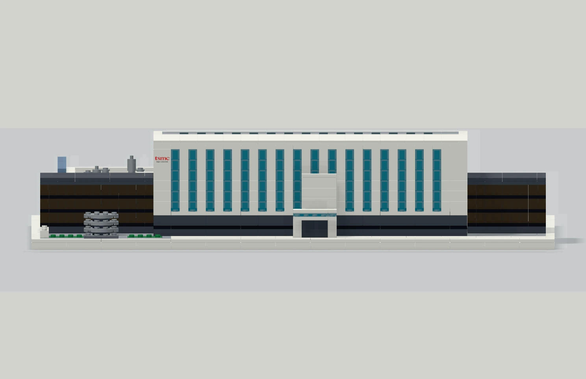
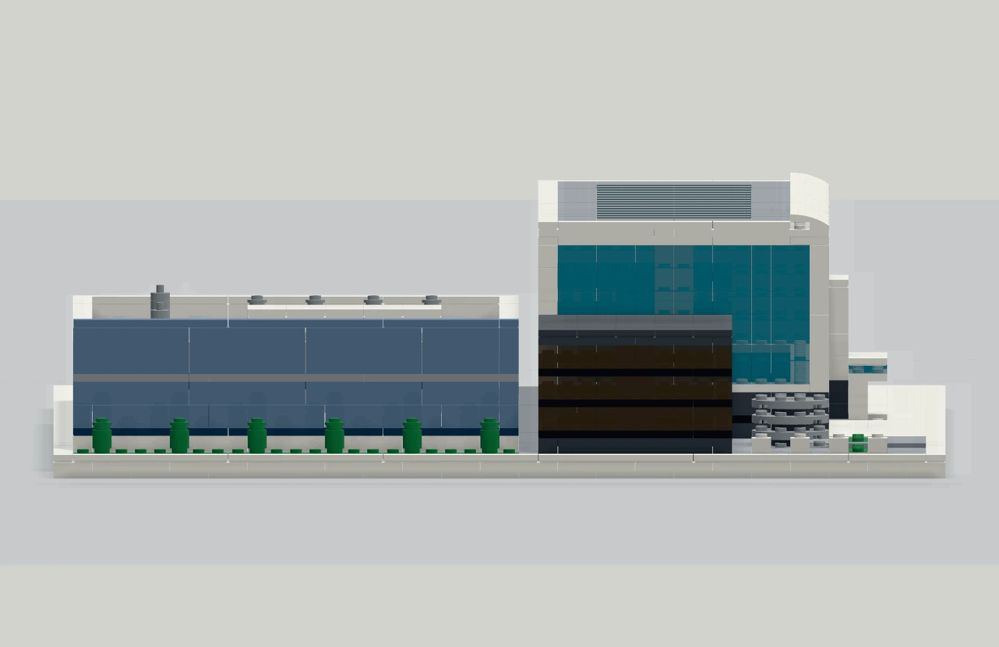
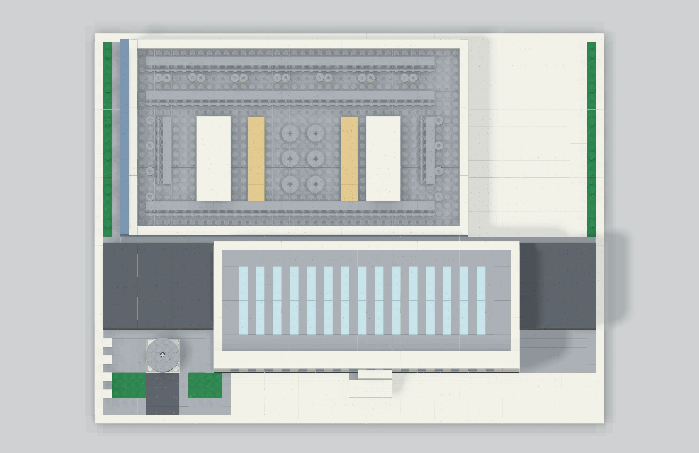

# 全球研發中心｜組裝說明書

FAB 02 · Global R&D Center

白色圓邊展廳跨在兩座煙灰玻璃翼樓之間。十六扇細直窗與屋頂採光帶呼應，左側沙藍端牆後方保留開放的機電庭院。

1928 件 · 5 袋 · 264 步

底座 60 × 46 凸點。

將底座較後的一側朝上，從左上角第 1 顆凸點開始數。X 由左向右，Z 由後向前。底高以薄板為單位，桌面是 0，一塊標準磚高 3 層薄板。每個位置均取零件佔地最左、最後的凸點。

圖號依每一步的安裝順序編列，回到下一個步驟時從 1 重新起算。[圖解說明書](manual.html) · [分袋 BOM](bom.csv) · [分步 LDraw 模型](model.ldr)

## 原盒資料與本版用量

白色直窗展廳在前，玻璃翼樓相鄰。俯視可分辨左後方的設備與右後方的淺色平台，兩列風道和風機分開排列。 西側環紋圓廳對應實景的圓柱迎賓大廳。

TShop 原盒 F010050101 標示 748 件，商品尺寸 19.3 × 25.6 × 7.2 公分。本版使用 1928 件標準積木，另有 1 枚貼紙。採購請依本版分袋 BOM。

[原盒與尺寸](https://www.tshop.life/zh-hant/products/micro-brick-series-global-rd-center-pre-order) · [商品三視圖](https://shoplineimg.com/64c760de75653b004eb51fc9/6ae4610e2192362448823a28/original.jpg) · [姚仁喜｜大元建築工場・竹科研發中心](https://www.krisyaoartech.com/zh-tw/projects/corporate/Tsmc-Global-R-D-Center)

## 建築方位與配置

**正面**　中央直柵展廳高過兩側的三道煙色玻璃窗。

**側面**　前端白框圍著整片藍玻璃，後端是獨立的沙藍機電牆。

**俯視**　天窗在地塊前半，後半從左到右是機電井、白色場坪與綠帶。

## 原寸貼紙

本款有 1 張貼紙。請以 100% 列印原寸貼紙 PDF，依步驟中的 S 編號貼在指定磚面，再把該件扣入。

[下載 A4 可列印貼紙](stickers.pdf)

- S01　展廳正面左側白色門柱 · 袋 04／步驟 209 · 14 × 7 mm · 正面（朝前），面中央。

## 第 01 袋　底座與定位

192 件，共 24 步。

| 顏色 | 零件 | 設計／庫號 | 數量 |
| --- | --- | --- | ---: |
| 白色 | 薄板 2×4 | 3020 | 2 |
| 白色 | 薄板 4×4 | 3031 | 22 |
| 白色 | 薄板 2×8 | 3034 | 14 |
| 白色 | 薄板 4×8 | 3035 | 154 |

### 步驟 01　併排底板（1/12）

將底板凸點朝上、長邊對齊排在平桌。下一層會跨接板縫。

**本步取件**

| 顏色 | 零件 | 設計／庫號 | 數量 |
| --- | --- | --- | ---: |
| 白色 | 薄板 4×4 | 3031 | 1 |
| 白色 | 薄板 4×8 | 3035 | 7 |

**安裝位置**

| 圖號 | 零件與顏色 | X | Z | 底高（薄板） | 方向 |
| ---: | --- | ---: | ---: | ---: | --- |
| 1 | 白色 薄板 4×8（3035） | 1 | 1 | 0 | 沿 X |
| 2 | 白色 薄板 4×8（3035） | 9 | 1 | 0 | 沿 X |
| 3 | 白色 薄板 4×8（3035） | 17 | 1 | 0 | 沿 X |
| 4 | 白色 薄板 4×8（3035） | 25 | 1 | 0 | 沿 X |
| 5 | 白色 薄板 4×8（3035） | 33 | 1 | 0 | 沿 X |
| 6 | 白色 薄板 4×8（3035） | 41 | 1 | 0 | 沿 X |
| 7 | 白色 薄板 4×8（3035） | 49 | 1 | 0 | 沿 X |
| 8 | 白色 薄板 4×4（3031） | 57 | 1 | 0 | — |

### 步驟 02　併排底板（2/12）

將底板凸點朝上、長邊對齊排在平桌。下一層會跨接板縫。

**本步取件**

| 顏色 | 零件 | 設計／庫號 | 數量 |
| --- | --- | --- | ---: |
| 白色 | 薄板 4×4 | 3031 | 1 |
| 白色 | 薄板 4×8 | 3035 | 7 |

**安裝位置**

| 圖號 | 零件與顏色 | X | Z | 底高（薄板） | 方向 |
| ---: | --- | ---: | ---: | ---: | --- |
| 1 | 白色 薄板 4×8（3035） | 1 | 5 | 0 | 沿 X |
| 2 | 白色 薄板 4×8（3035） | 9 | 5 | 0 | 沿 X |
| 3 | 白色 薄板 4×8（3035） | 17 | 5 | 0 | 沿 X |
| 4 | 白色 薄板 4×8（3035） | 25 | 5 | 0 | 沿 X |
| 5 | 白色 薄板 4×8（3035） | 33 | 5 | 0 | 沿 X |
| 6 | 白色 薄板 4×8（3035） | 41 | 5 | 0 | 沿 X |
| 7 | 白色 薄板 4×8（3035） | 49 | 5 | 0 | 沿 X |
| 8 | 白色 薄板 4×4（3031） | 57 | 5 | 0 | — |

### 步驟 03　併排底板（3/12）

將底板凸點朝上、長邊對齊排在平桌。下一層會跨接板縫。

**本步取件**

| 顏色 | 零件 | 設計／庫號 | 數量 |
| --- | --- | --- | ---: |
| 白色 | 薄板 4×4 | 3031 | 1 |
| 白色 | 薄板 4×8 | 3035 | 7 |

**安裝位置**

| 圖號 | 零件與顏色 | X | Z | 底高（薄板） | 方向 |
| ---: | --- | ---: | ---: | ---: | --- |
| 1 | 白色 薄板 4×8（3035） | 1 | 9 | 0 | 沿 X |
| 2 | 白色 薄板 4×8（3035） | 9 | 9 | 0 | 沿 X |
| 3 | 白色 薄板 4×8（3035） | 17 | 9 | 0 | 沿 X |
| 4 | 白色 薄板 4×8（3035） | 25 | 9 | 0 | 沿 X |
| 5 | 白色 薄板 4×8（3035） | 33 | 9 | 0 | 沿 X |
| 6 | 白色 薄板 4×8（3035） | 41 | 9 | 0 | 沿 X |
| 7 | 白色 薄板 4×8（3035） | 49 | 9 | 0 | 沿 X |
| 8 | 白色 薄板 4×4（3031） | 57 | 9 | 0 | — |

### 步驟 04　併排底板（4/12）

將底板凸點朝上、長邊對齊排在平桌。下一層會跨接板縫。

**本步取件**

| 顏色 | 零件 | 設計／庫號 | 數量 |
| --- | --- | --- | ---: |
| 白色 | 薄板 4×4 | 3031 | 1 |
| 白色 | 薄板 4×8 | 3035 | 7 |

**安裝位置**

| 圖號 | 零件與顏色 | X | Z | 底高（薄板） | 方向 |
| ---: | --- | ---: | ---: | ---: | --- |
| 1 | 白色 薄板 4×8（3035） | 1 | 13 | 0 | 沿 X |
| 2 | 白色 薄板 4×8（3035） | 9 | 13 | 0 | 沿 X |
| 3 | 白色 薄板 4×8（3035） | 17 | 13 | 0 | 沿 X |
| 4 | 白色 薄板 4×8（3035） | 25 | 13 | 0 | 沿 X |
| 5 | 白色 薄板 4×8（3035） | 33 | 13 | 0 | 沿 X |
| 6 | 白色 薄板 4×8（3035） | 41 | 13 | 0 | 沿 X |
| 7 | 白色 薄板 4×8（3035） | 49 | 13 | 0 | 沿 X |
| 8 | 白色 薄板 4×4（3031） | 57 | 13 | 0 | — |

### 步驟 05　併排底板（5/12）

將底板凸點朝上、長邊對齊排在平桌。下一層會跨接板縫。

**本步取件**

| 顏色 | 零件 | 設計／庫號 | 數量 |
| --- | --- | --- | ---: |
| 白色 | 薄板 4×4 | 3031 | 1 |
| 白色 | 薄板 4×8 | 3035 | 7 |

**安裝位置**

| 圖號 | 零件與顏色 | X | Z | 底高（薄板） | 方向 |
| ---: | --- | ---: | ---: | ---: | --- |
| 1 | 白色 薄板 4×8（3035） | 1 | 17 | 0 | 沿 X |
| 2 | 白色 薄板 4×8（3035） | 9 | 17 | 0 | 沿 X |
| 3 | 白色 薄板 4×8（3035） | 17 | 17 | 0 | 沿 X |
| 4 | 白色 薄板 4×8（3035） | 25 | 17 | 0 | 沿 X |
| 5 | 白色 薄板 4×8（3035） | 33 | 17 | 0 | 沿 X |
| 6 | 白色 薄板 4×8（3035） | 41 | 17 | 0 | 沿 X |
| 7 | 白色 薄板 4×8（3035） | 49 | 17 | 0 | 沿 X |
| 8 | 白色 薄板 4×4（3031） | 57 | 17 | 0 | — |

### 步驟 06　併排底板（6/12）

將底板凸點朝上、長邊對齊排在平桌。下一層會跨接板縫。

**本步取件**

| 顏色 | 零件 | 設計／庫號 | 數量 |
| --- | --- | --- | ---: |
| 白色 | 薄板 4×4 | 3031 | 1 |
| 白色 | 薄板 4×8 | 3035 | 7 |

**安裝位置**

| 圖號 | 零件與顏色 | X | Z | 底高（薄板） | 方向 |
| ---: | --- | ---: | ---: | ---: | --- |
| 1 | 白色 薄板 4×8（3035） | 1 | 21 | 0 | 沿 X |
| 2 | 白色 薄板 4×8（3035） | 9 | 21 | 0 | 沿 X |
| 3 | 白色 薄板 4×8（3035） | 17 | 21 | 0 | 沿 X |
| 4 | 白色 薄板 4×8（3035） | 25 | 21 | 0 | 沿 X |
| 5 | 白色 薄板 4×8（3035） | 33 | 21 | 0 | 沿 X |
| 6 | 白色 薄板 4×8（3035） | 41 | 21 | 0 | 沿 X |
| 7 | 白色 薄板 4×8（3035） | 49 | 21 | 0 | 沿 X |
| 8 | 白色 薄板 4×4（3031） | 57 | 21 | 0 | — |

### 步驟 07　併排底板（7/12）

將底板凸點朝上、長邊對齊排在平桌。下一層會跨接板縫。

**本步取件**

| 顏色 | 零件 | 設計／庫號 | 數量 |
| --- | --- | --- | ---: |
| 白色 | 薄板 4×4 | 3031 | 1 |
| 白色 | 薄板 4×8 | 3035 | 7 |

**安裝位置**

| 圖號 | 零件與顏色 | X | Z | 底高（薄板） | 方向 |
| ---: | --- | ---: | ---: | ---: | --- |
| 1 | 白色 薄板 4×8（3035） | 1 | 25 | 0 | 沿 X |
| 2 | 白色 薄板 4×8（3035） | 9 | 25 | 0 | 沿 X |
| 3 | 白色 薄板 4×8（3035） | 17 | 25 | 0 | 沿 X |
| 4 | 白色 薄板 4×8（3035） | 25 | 25 | 0 | 沿 X |
| 5 | 白色 薄板 4×8（3035） | 33 | 25 | 0 | 沿 X |
| 6 | 白色 薄板 4×8（3035） | 41 | 25 | 0 | 沿 X |
| 7 | 白色 薄板 4×8（3035） | 49 | 25 | 0 | 沿 X |
| 8 | 白色 薄板 4×4（3031） | 57 | 25 | 0 | — |

### 步驟 08　併排底板（8/12）

將底板凸點朝上、長邊對齊排在平桌。下一層會跨接板縫。

**本步取件**

| 顏色 | 零件 | 設計／庫號 | 數量 |
| --- | --- | --- | ---: |
| 白色 | 薄板 4×4 | 3031 | 1 |
| 白色 | 薄板 4×8 | 3035 | 7 |

**安裝位置**

| 圖號 | 零件與顏色 | X | Z | 底高（薄板） | 方向 |
| ---: | --- | ---: | ---: | ---: | --- |
| 1 | 白色 薄板 4×8（3035） | 1 | 29 | 0 | 沿 X |
| 2 | 白色 薄板 4×8（3035） | 9 | 29 | 0 | 沿 X |
| 3 | 白色 薄板 4×8（3035） | 17 | 29 | 0 | 沿 X |
| 4 | 白色 薄板 4×8（3035） | 25 | 29 | 0 | 沿 X |
| 5 | 白色 薄板 4×8（3035） | 33 | 29 | 0 | 沿 X |
| 6 | 白色 薄板 4×8（3035） | 41 | 29 | 0 | 沿 X |
| 7 | 白色 薄板 4×8（3035） | 49 | 29 | 0 | 沿 X |
| 8 | 白色 薄板 4×4（3031） | 57 | 29 | 0 | — |

### 步驟 09　併排底板（9/12）

將底板凸點朝上、長邊對齊排在平桌。下一層會跨接板縫。

**本步取件**

| 顏色 | 零件 | 設計／庫號 | 數量 |
| --- | --- | --- | ---: |
| 白色 | 薄板 4×4 | 3031 | 1 |
| 白色 | 薄板 4×8 | 3035 | 7 |

**安裝位置**

| 圖號 | 零件與顏色 | X | Z | 底高（薄板） | 方向 |
| ---: | --- | ---: | ---: | ---: | --- |
| 1 | 白色 薄板 4×8（3035） | 1 | 33 | 0 | 沿 X |
| 2 | 白色 薄板 4×8（3035） | 9 | 33 | 0 | 沿 X |
| 3 | 白色 薄板 4×8（3035） | 17 | 33 | 0 | 沿 X |
| 4 | 白色 薄板 4×8（3035） | 25 | 33 | 0 | 沿 X |
| 5 | 白色 薄板 4×8（3035） | 33 | 33 | 0 | 沿 X |
| 6 | 白色 薄板 4×8（3035） | 41 | 33 | 0 | 沿 X |
| 7 | 白色 薄板 4×8（3035） | 49 | 33 | 0 | 沿 X |
| 8 | 白色 薄板 4×4（3031） | 57 | 33 | 0 | — |

### 步驟 10　併排底板（10/12）

將底板凸點朝上、長邊對齊排在平桌。下一層會跨接板縫。

**本步取件**

| 顏色 | 零件 | 設計／庫號 | 數量 |
| --- | --- | --- | ---: |
| 白色 | 薄板 4×4 | 3031 | 1 |
| 白色 | 薄板 4×8 | 3035 | 7 |

**安裝位置**

| 圖號 | 零件與顏色 | X | Z | 底高（薄板） | 方向 |
| ---: | --- | ---: | ---: | ---: | --- |
| 1 | 白色 薄板 4×8（3035） | 1 | 37 | 0 | 沿 X |
| 2 | 白色 薄板 4×8（3035） | 9 | 37 | 0 | 沿 X |
| 3 | 白色 薄板 4×8（3035） | 17 | 37 | 0 | 沿 X |
| 4 | 白色 薄板 4×8（3035） | 25 | 37 | 0 | 沿 X |
| 5 | 白色 薄板 4×8（3035） | 33 | 37 | 0 | 沿 X |
| 6 | 白色 薄板 4×8（3035） | 41 | 37 | 0 | 沿 X |
| 7 | 白色 薄板 4×8（3035） | 49 | 37 | 0 | 沿 X |
| 8 | 白色 薄板 4×4（3031） | 57 | 37 | 0 | — |

### 步驟 11　併排底板（11/12）

將底板凸點朝上、長邊對齊排在平桌。下一層會跨接板縫。

**本步取件**

| 顏色 | 零件 | 設計／庫號 | 數量 |
| --- | --- | --- | ---: |
| 白色 | 薄板 4×4 | 3031 | 1 |
| 白色 | 薄板 4×8 | 3035 | 7 |

**安裝位置**

| 圖號 | 零件與顏色 | X | Z | 底高（薄板） | 方向 |
| ---: | --- | ---: | ---: | ---: | --- |
| 1 | 白色 薄板 4×8（3035） | 1 | 41 | 0 | 沿 X |
| 2 | 白色 薄板 4×8（3035） | 9 | 41 | 0 | 沿 X |
| 3 | 白色 薄板 4×8（3035） | 17 | 41 | 0 | 沿 X |
| 4 | 白色 薄板 4×8（3035） | 25 | 41 | 0 | 沿 X |
| 5 | 白色 薄板 4×8（3035） | 33 | 41 | 0 | 沿 X |
| 6 | 白色 薄板 4×8（3035） | 41 | 41 | 0 | 沿 X |
| 7 | 白色 薄板 4×8（3035） | 49 | 41 | 0 | 沿 X |
| 8 | 白色 薄板 4×4（3031） | 57 | 41 | 0 | — |

### 步驟 12　併排底板（12/12）

將底板凸點朝上、長邊對齊排在平桌。下一層會跨接板縫。

**本步取件**

| 顏色 | 零件 | 設計／庫號 | 數量 |
| --- | --- | --- | ---: |
| 白色 | 薄板 2×4 | 3020 | 1 |
| 白色 | 薄板 2×8 | 3034 | 7 |

**安裝位置**

| 圖號 | 零件與顏色 | X | Z | 底高（薄板） | 方向 |
| ---: | --- | ---: | ---: | ---: | --- |
| 1 | 白色 薄板 2×8（3034） | 1 | 45 | 0 | 沿 X |
| 2 | 白色 薄板 2×8（3034） | 9 | 45 | 0 | 沿 X |
| 3 | 白色 薄板 2×8（3034） | 17 | 45 | 0 | 沿 X |
| 4 | 白色 薄板 2×8（3034） | 25 | 45 | 0 | 沿 X |
| 5 | 白色 薄板 2×8（3034） | 33 | 45 | 0 | 沿 X |
| 6 | 白色 薄板 2×8（3034） | 41 | 45 | 0 | 沿 X |
| 7 | 白色 薄板 2×8（3034） | 49 | 45 | 0 | 沿 X |
| 8 | 白色 薄板 2×4（3020） | 57 | 45 | 0 | 沿 X |

### 步驟 13　錯縫鎖底（1/12）

上層相對底板橫移四格、縱移兩格。逐排按緊後，底座可整片拿起。

**本步取件**

| 顏色 | 零件 | 設計／庫號 | 數量 |
| --- | --- | --- | ---: |
| 白色 | 薄板 2×4 | 3020 | 1 |
| 白色 | 薄板 2×8 | 3034 | 7 |

**安裝位置**

| 圖號 | 零件與顏色 | X | Z | 底高（薄板） | 方向 |
| ---: | --- | ---: | ---: | ---: | --- |
| 1 | 白色 薄板 2×4（3020） | 1 | 1 | 1 | 沿 X |
| 2 | 白色 薄板 2×8（3034） | 5 | 1 | 1 | 沿 X |
| 3 | 白色 薄板 2×8（3034） | 13 | 1 | 1 | 沿 X |
| 4 | 白色 薄板 2×8（3034） | 21 | 1 | 1 | 沿 X |
| 5 | 白色 薄板 2×8（3034） | 29 | 1 | 1 | 沿 X |
| 6 | 白色 薄板 2×8（3034） | 37 | 1 | 1 | 沿 X |
| 7 | 白色 薄板 2×8（3034） | 45 | 1 | 1 | 沿 X |
| 8 | 白色 薄板 2×8（3034） | 53 | 1 | 1 | 沿 X |

### 步驟 14　錯縫鎖底（2/12）

上層相對底板橫移四格、縱移兩格。逐排按緊後，底座可整片拿起。

**本步取件**

| 顏色 | 零件 | 設計／庫號 | 數量 |
| --- | --- | --- | ---: |
| 白色 | 薄板 4×4 | 3031 | 1 |
| 白色 | 薄板 4×8 | 3035 | 7 |

**安裝位置**

| 圖號 | 零件與顏色 | X | Z | 底高（薄板） | 方向 |
| ---: | --- | ---: | ---: | ---: | --- |
| 1 | 白色 薄板 4×4（3031） | 1 | 3 | 1 | — |
| 2 | 白色 薄板 4×8（3035） | 5 | 3 | 1 | 沿 X |
| 3 | 白色 薄板 4×8（3035） | 13 | 3 | 1 | 沿 X |
| 4 | 白色 薄板 4×8（3035） | 21 | 3 | 1 | 沿 X |
| 5 | 白色 薄板 4×8（3035） | 29 | 3 | 1 | 沿 X |
| 6 | 白色 薄板 4×8（3035） | 37 | 3 | 1 | 沿 X |
| 7 | 白色 薄板 4×8（3035） | 45 | 3 | 1 | 沿 X |
| 8 | 白色 薄板 4×8（3035） | 53 | 3 | 1 | 沿 X |

### 步驟 15　錯縫鎖底（3/12）

上層相對底板橫移四格、縱移兩格。逐排按緊後，底座可整片拿起。

**本步取件**

| 顏色 | 零件 | 設計／庫號 | 數量 |
| --- | --- | --- | ---: |
| 白色 | 薄板 4×4 | 3031 | 1 |
| 白色 | 薄板 4×8 | 3035 | 7 |

**安裝位置**

| 圖號 | 零件與顏色 | X | Z | 底高（薄板） | 方向 |
| ---: | --- | ---: | ---: | ---: | --- |
| 1 | 白色 薄板 4×4（3031） | 1 | 7 | 1 | — |
| 2 | 白色 薄板 4×8（3035） | 5 | 7 | 1 | 沿 X |
| 3 | 白色 薄板 4×8（3035） | 13 | 7 | 1 | 沿 X |
| 4 | 白色 薄板 4×8（3035） | 21 | 7 | 1 | 沿 X |
| 5 | 白色 薄板 4×8（3035） | 29 | 7 | 1 | 沿 X |
| 6 | 白色 薄板 4×8（3035） | 37 | 7 | 1 | 沿 X |
| 7 | 白色 薄板 4×8（3035） | 45 | 7 | 1 | 沿 X |
| 8 | 白色 薄板 4×8（3035） | 53 | 7 | 1 | 沿 X |

### 步驟 16　錯縫鎖底（4/12）

上層相對底板橫移四格、縱移兩格。逐排按緊後，底座可整片拿起。

**本步取件**

| 顏色 | 零件 | 設計／庫號 | 數量 |
| --- | --- | --- | ---: |
| 白色 | 薄板 4×4 | 3031 | 1 |
| 白色 | 薄板 4×8 | 3035 | 7 |

**安裝位置**

| 圖號 | 零件與顏色 | X | Z | 底高（薄板） | 方向 |
| ---: | --- | ---: | ---: | ---: | --- |
| 1 | 白色 薄板 4×4（3031） | 1 | 11 | 1 | — |
| 2 | 白色 薄板 4×8（3035） | 5 | 11 | 1 | 沿 X |
| 3 | 白色 薄板 4×8（3035） | 13 | 11 | 1 | 沿 X |
| 4 | 白色 薄板 4×8（3035） | 21 | 11 | 1 | 沿 X |
| 5 | 白色 薄板 4×8（3035） | 29 | 11 | 1 | 沿 X |
| 6 | 白色 薄板 4×8（3035） | 37 | 11 | 1 | 沿 X |
| 7 | 白色 薄板 4×8（3035） | 45 | 11 | 1 | 沿 X |
| 8 | 白色 薄板 4×8（3035） | 53 | 11 | 1 | 沿 X |

### 步驟 17　錯縫鎖底（5/12）

上層相對底板橫移四格、縱移兩格。逐排按緊後，底座可整片拿起。

**本步取件**

| 顏色 | 零件 | 設計／庫號 | 數量 |
| --- | --- | --- | ---: |
| 白色 | 薄板 4×4 | 3031 | 1 |
| 白色 | 薄板 4×8 | 3035 | 7 |

**安裝位置**

| 圖號 | 零件與顏色 | X | Z | 底高（薄板） | 方向 |
| ---: | --- | ---: | ---: | ---: | --- |
| 1 | 白色 薄板 4×4（3031） | 1 | 15 | 1 | — |
| 2 | 白色 薄板 4×8（3035） | 5 | 15 | 1 | 沿 X |
| 3 | 白色 薄板 4×8（3035） | 13 | 15 | 1 | 沿 X |
| 4 | 白色 薄板 4×8（3035） | 21 | 15 | 1 | 沿 X |
| 5 | 白色 薄板 4×8（3035） | 29 | 15 | 1 | 沿 X |
| 6 | 白色 薄板 4×8（3035） | 37 | 15 | 1 | 沿 X |
| 7 | 白色 薄板 4×8（3035） | 45 | 15 | 1 | 沿 X |
| 8 | 白色 薄板 4×8（3035） | 53 | 15 | 1 | 沿 X |

### 步驟 18　錯縫鎖底（6/12）

上層相對底板橫移四格、縱移兩格。逐排按緊後，底座可整片拿起。

**本步取件**

| 顏色 | 零件 | 設計／庫號 | 數量 |
| --- | --- | --- | ---: |
| 白色 | 薄板 4×4 | 3031 | 1 |
| 白色 | 薄板 4×8 | 3035 | 7 |

**安裝位置**

| 圖號 | 零件與顏色 | X | Z | 底高（薄板） | 方向 |
| ---: | --- | ---: | ---: | ---: | --- |
| 1 | 白色 薄板 4×4（3031） | 1 | 19 | 1 | — |
| 2 | 白色 薄板 4×8（3035） | 5 | 19 | 1 | 沿 X |
| 3 | 白色 薄板 4×8（3035） | 13 | 19 | 1 | 沿 X |
| 4 | 白色 薄板 4×8（3035） | 21 | 19 | 1 | 沿 X |
| 5 | 白色 薄板 4×8（3035） | 29 | 19 | 1 | 沿 X |
| 6 | 白色 薄板 4×8（3035） | 37 | 19 | 1 | 沿 X |
| 7 | 白色 薄板 4×8（3035） | 45 | 19 | 1 | 沿 X |
| 8 | 白色 薄板 4×8（3035） | 53 | 19 | 1 | 沿 X |

### 步驟 19　錯縫鎖底（7/12）

上層相對底板橫移四格、縱移兩格。逐排按緊後，底座可整片拿起。

**本步取件**

| 顏色 | 零件 | 設計／庫號 | 數量 |
| --- | --- | --- | ---: |
| 白色 | 薄板 4×4 | 3031 | 1 |
| 白色 | 薄板 4×8 | 3035 | 7 |

**安裝位置**

| 圖號 | 零件與顏色 | X | Z | 底高（薄板） | 方向 |
| ---: | --- | ---: | ---: | ---: | --- |
| 1 | 白色 薄板 4×4（3031） | 1 | 23 | 1 | — |
| 2 | 白色 薄板 4×8（3035） | 5 | 23 | 1 | 沿 X |
| 3 | 白色 薄板 4×8（3035） | 13 | 23 | 1 | 沿 X |
| 4 | 白色 薄板 4×8（3035） | 21 | 23 | 1 | 沿 X |
| 5 | 白色 薄板 4×8（3035） | 29 | 23 | 1 | 沿 X |
| 6 | 白色 薄板 4×8（3035） | 37 | 23 | 1 | 沿 X |
| 7 | 白色 薄板 4×8（3035） | 45 | 23 | 1 | 沿 X |
| 8 | 白色 薄板 4×8（3035） | 53 | 23 | 1 | 沿 X |

### 步驟 20　錯縫鎖底（8/12）

上層相對底板橫移四格、縱移兩格。逐排按緊後，底座可整片拿起。

**本步取件**

| 顏色 | 零件 | 設計／庫號 | 數量 |
| --- | --- | --- | ---: |
| 白色 | 薄板 4×4 | 3031 | 1 |
| 白色 | 薄板 4×8 | 3035 | 7 |

**安裝位置**

| 圖號 | 零件與顏色 | X | Z | 底高（薄板） | 方向 |
| ---: | --- | ---: | ---: | ---: | --- |
| 1 | 白色 薄板 4×4（3031） | 1 | 27 | 1 | — |
| 2 | 白色 薄板 4×8（3035） | 5 | 27 | 1 | 沿 X |
| 3 | 白色 薄板 4×8（3035） | 13 | 27 | 1 | 沿 X |
| 4 | 白色 薄板 4×8（3035） | 21 | 27 | 1 | 沿 X |
| 5 | 白色 薄板 4×8（3035） | 29 | 27 | 1 | 沿 X |
| 6 | 白色 薄板 4×8（3035） | 37 | 27 | 1 | 沿 X |
| 7 | 白色 薄板 4×8（3035） | 45 | 27 | 1 | 沿 X |
| 8 | 白色 薄板 4×8（3035） | 53 | 27 | 1 | 沿 X |

### 步驟 21　錯縫鎖底（9/12）

上層相對底板橫移四格、縱移兩格。逐排按緊後，底座可整片拿起。

**本步取件**

| 顏色 | 零件 | 設計／庫號 | 數量 |
| --- | --- | --- | ---: |
| 白色 | 薄板 4×4 | 3031 | 1 |
| 白色 | 薄板 4×8 | 3035 | 7 |

**安裝位置**

| 圖號 | 零件與顏色 | X | Z | 底高（薄板） | 方向 |
| ---: | --- | ---: | ---: | ---: | --- |
| 1 | 白色 薄板 4×4（3031） | 1 | 31 | 1 | — |
| 2 | 白色 薄板 4×8（3035） | 5 | 31 | 1 | 沿 X |
| 3 | 白色 薄板 4×8（3035） | 13 | 31 | 1 | 沿 X |
| 4 | 白色 薄板 4×8（3035） | 21 | 31 | 1 | 沿 X |
| 5 | 白色 薄板 4×8（3035） | 29 | 31 | 1 | 沿 X |
| 6 | 白色 薄板 4×8（3035） | 37 | 31 | 1 | 沿 X |
| 7 | 白色 薄板 4×8（3035） | 45 | 31 | 1 | 沿 X |
| 8 | 白色 薄板 4×8（3035） | 53 | 31 | 1 | 沿 X |

### 步驟 22　錯縫鎖底（10/12）

上層相對底板橫移四格、縱移兩格。逐排按緊後，底座可整片拿起。

**本步取件**

| 顏色 | 零件 | 設計／庫號 | 數量 |
| --- | --- | --- | ---: |
| 白色 | 薄板 4×4 | 3031 | 1 |
| 白色 | 薄板 4×8 | 3035 | 7 |

**安裝位置**

| 圖號 | 零件與顏色 | X | Z | 底高（薄板） | 方向 |
| ---: | --- | ---: | ---: | ---: | --- |
| 1 | 白色 薄板 4×4（3031） | 1 | 35 | 1 | — |
| 2 | 白色 薄板 4×8（3035） | 5 | 35 | 1 | 沿 X |
| 3 | 白色 薄板 4×8（3035） | 13 | 35 | 1 | 沿 X |
| 4 | 白色 薄板 4×8（3035） | 21 | 35 | 1 | 沿 X |
| 5 | 白色 薄板 4×8（3035） | 29 | 35 | 1 | 沿 X |
| 6 | 白色 薄板 4×8（3035） | 37 | 35 | 1 | 沿 X |
| 7 | 白色 薄板 4×8（3035） | 45 | 35 | 1 | 沿 X |
| 8 | 白色 薄板 4×8（3035） | 53 | 35 | 1 | 沿 X |

### 步驟 23　錯縫鎖底（11/12）

上層相對底板橫移四格、縱移兩格。逐排按緊後，底座可整片拿起。

**本步取件**

| 顏色 | 零件 | 設計／庫號 | 數量 |
| --- | --- | --- | ---: |
| 白色 | 薄板 4×4 | 3031 | 1 |
| 白色 | 薄板 4×8 | 3035 | 7 |

**安裝位置**

| 圖號 | 零件與顏色 | X | Z | 底高（薄板） | 方向 |
| ---: | --- | ---: | ---: | ---: | --- |
| 1 | 白色 薄板 4×4（3031） | 1 | 39 | 1 | — |
| 2 | 白色 薄板 4×8（3035） | 5 | 39 | 1 | 沿 X |
| 3 | 白色 薄板 4×8（3035） | 13 | 39 | 1 | 沿 X |
| 4 | 白色 薄板 4×8（3035） | 21 | 39 | 1 | 沿 X |
| 5 | 白色 薄板 4×8（3035） | 29 | 39 | 1 | 沿 X |
| 6 | 白色 薄板 4×8（3035） | 37 | 39 | 1 | 沿 X |
| 7 | 白色 薄板 4×8（3035） | 45 | 39 | 1 | 沿 X |
| 8 | 白色 薄板 4×8（3035） | 53 | 39 | 1 | 沿 X |

### 步驟 24　錯縫鎖底（12/12）

上層相對底板橫移四格、縱移兩格。逐排按緊後，底座可整片拿起。

**本步取件**

| 顏色 | 零件 | 設計／庫號 | 數量 |
| --- | --- | --- | ---: |
| 白色 | 薄板 4×4 | 3031 | 1 |
| 白色 | 薄板 4×8 | 3035 | 7 |

**安裝位置**

| 圖號 | 零件與顏色 | X | Z | 底高（薄板） | 方向 |
| ---: | --- | ---: | ---: | ---: | --- |
| 1 | 白色 薄板 4×4（3031） | 1 | 43 | 1 | — |
| 2 | 白色 薄板 4×8（3035） | 5 | 43 | 1 | 沿 X |
| 3 | 白色 薄板 4×8（3035） | 13 | 43 | 1 | 沿 X |
| 4 | 白色 薄板 4×8（3035） | 21 | 43 | 1 | 沿 X |
| 5 | 白色 薄板 4×8（3035） | 29 | 43 | 1 | 沿 X |
| 6 | 白色 薄板 4×8（3035） | 37 | 43 | 1 | 沿 X |
| 7 | 白色 薄板 4×8（3035） | 45 | 43 | 1 | 沿 X |
| 8 | 白色 薄板 4×8（3035） | 53 | 43 | 1 | 沿 X |

## 第 02 袋　沙藍機電中庭

517 件，共 70 步。

| 顏色 | 零件 | 設計／庫號 | 數量 |
| --- | --- | --- | ---: |
| 綠色 | 薄板 1×1 | 3024 | 2 |
| 綠色 | 圓磚 1×1 | 3062b | 12 |
| 綠色 | 薄板 1×8 | 3460 | 4 |
| 綠色 | 薄板 1×6 | 3666 | 2 |
| 綠色 | 圓薄板 1×1 | 4073 | 12 |
| 白色 | 磚 2×6 | 2456 | 16 |
| 白色 | 磚 2×4 | 3001 | 4 |
| 白色 | 磚 2×3 | 3002 | 2 |
| 白色 | 磚 1×1 | 3005 | 6 |
| 白色 | 磚 1×8 | 3008 | 26 |
| 白色 | 磚 1×6 | 3009 | 4 |
| 白色 | 磚 1×4 | 3010 | 2 |
| 白色 | 光面板 2×2 | 3068b | 1 |
| 白色 | 光面板 1×1 | 3070b | 2 |
| 白色 | 光面板 1×8 | 4162 | 13 |
| 白色 | 光面板 1×6 | 6636 | 5 |
| 白色 | 光面板 2×4 | 87079 | 48 |
| 沙色 | 薄板 2×2 | 3022 | 2 |
| 沙色 | 薄板 2×8 | 3034 | 2 |
| 沙色 | 圓磚 1×1 | 3062b | 7 |
| 沙色 | 光面板 2×2 | 3068b | 2 |
| 沙色 | 光面板 2×4 | 87079 | 4 |
| 淺藍灰 | 中空立管圓板 1×1 | 20482 | 7 |
| 淺藍灰 | 側把手薄板 1×2 | 2540 | 59 |
| 淺藍灰 | 薄板 1×2 | 3023 | 20 |
| 淺藍灰 | 薄板 1×1 | 3024 | 1 |
| 淺藍灰 | 薄板 2×8 | 3034 | 40 |
| 淺藍灰 | 圓磚 1×1 | 3062b | 17 |
| 淺藍灰 | 光面板 1×2 | 3069b | 3 |
| 淺藍灰 | 薄板 1×8 | 3460 | 2 |
| 淺藍灰 | 薄板 1×6 | 3666 | 1 |
| 淺藍灰 | 薄板 2×6 | 3795 | 20 |
| 淺藍灰 | 圓薄板 2×2 | 4032a | 6 |
| 淺藍灰 | 光面板 1×8 | 4162 | 14 |
| 淺藍灰 | 開孔圓薄板 1×1 | 85861 | 15 |
| 深藍 | 薄板 1×2 | 3023 | 2 |
| 深藍 | 薄板 1×1 | 3024 | 4 |
| 深藍 | 薄板 2×8 | 3034 | 8 |
| 深藍 | 薄板 1×8 | 3460 | 12 |
| 深藍 | 薄板 1×6 | 3666 | 4 |
| 深藍 | 薄板 2×6 | 3795 | 2 |
| 沙藍 | 磚 2×4 | 3001 | 36 |
| 沙藍 | 磚 2×3 | 3002 | 4 |
| 沙藍 | 磚 1×1 | 3005 | 6 |
| 沙藍 | 磚 1×6 | 3009 | 42 |
| 沙藍 | 磚 1×4 | 3010 | 6 |
| 沙藍 | 光面板 1×1 | 3070b | 1 |
| 沙藍 | 磚 1×3 | 3622 | 4 |
| 沙藍 | 光面板 1×8 | 4162 | 2 |
| 沙藍 | 光面板 1×6 | 6636 | 1 |

### 步驟 25　後棟結構層 1（1/5）

沙藍外牆包住左後方設備井，右方預留地面白石場坪。

**本步取件**

| 顏色 | 零件 | 設計／庫號 | 數量 |
| --- | --- | --- | ---: |
| 白色 | 磚 1×1 | 3005 | 1 |
| 白色 | 磚 1×8 | 3008 | 7 |

**安裝位置**

| 圖號 | 零件與顏色 | X | Z | 底高（薄板） | 方向 |
| ---: | --- | ---: | ---: | ---: | --- |
| 1 | 白色 磚 1×8（3008） | 4 | 2 | 2 | 沿 X |
| 2 | 白色 磚 1×8（3008） | 12 | 2 | 2 | 沿 X |
| 3 | 白色 磚 1×8（3008） | 20 | 2 | 2 | 沿 X |
| 4 | 白色 磚 1×8（3008） | 28 | 2 | 2 | 沿 X |
| 5 | 白色 磚 1×8（3008） | 36 | 2 | 2 | 沿 X |
| 6 | 白色 磚 1×1（3005） | 44 | 2 | 2 | — |
| 7 | 白色 磚 1×8（3008） | 4 | 24 | 2 | 沿 X |
| 8 | 白色 磚 1×8（3008） | 12 | 24 | 2 | 沿 X |

### 步驟 26　後棟結構層 1（2/5）

沙藍外牆包住左後方設備井，右方預留地面白石場坪。

**本步取件**

| 顏色 | 零件 | 設計／庫號 | 數量 |
| --- | --- | --- | ---: |
| 白色 | 磚 1×1 | 3005 | 2 |
| 白色 | 磚 1×8 | 3008 | 5 |
| 白色 | 磚 1×4 | 3010 | 1 |

**安裝位置**

| 圖號 | 零件與顏色 | X | Z | 底高（薄板） | 方向 |
| ---: | --- | ---: | ---: | ---: | --- |
| 1 | 白色 磚 1×8（3008） | 20 | 24 | 2 | 沿 X |
| 2 | 白色 磚 1×8（3008） | 28 | 24 | 2 | 沿 X |
| 3 | 白色 磚 1×8（3008） | 36 | 24 | 2 | 沿 X |
| 4 | 白色 磚 1×1（3005） | 44 | 24 | 2 | — |
| 5 | 白色 磚 1×8（3008） | 4 | 3 | 2 | 沿 Z |
| 6 | 白色 磚 1×8（3008） | 4 | 11 | 2 | 沿 Z |
| 7 | 白色 磚 1×4（3010） | 4 | 19 | 2 | 沿 Z |
| 8 | 白色 磚 1×1（3005） | 4 | 23 | 2 | — |

### 步驟 27　後棟結構層 1（3/5）

沙藍外牆包住左後方設備井，右方預留地面白石場坪。

**本步取件**

| 顏色 | 零件 | 設計／庫號 | 數量 |
| --- | --- | --- | ---: |
| 白色 | 磚 2×6 | 2456 | 4 |
| 白色 | 磚 1×1 | 3005 | 1 |
| 白色 | 磚 1×8 | 3008 | 2 |
| 白色 | 磚 1×4 | 3010 | 1 |

**安裝位置**

| 圖號 | 零件與顏色 | X | Z | 底高（薄板） | 方向 |
| ---: | --- | ---: | ---: | ---: | --- |
| 1 | 白色 磚 1×8（3008） | 44 | 3 | 2 | 沿 Z |
| 2 | 白色 磚 1×8（3008） | 44 | 11 | 2 | 沿 Z |
| 3 | 白色 磚 1×4（3010） | 44 | 19 | 2 | 沿 Z |
| 4 | 白色 磚 1×1（3005） | 44 | 23 | 2 | — |
| 5 | 白色 磚 2×6（2456） | 5 | 8 | 2 | 沿 X |
| 6 | 白色 磚 2×6（2456） | 11 | 8 | 2 | 沿 X |
| 7 | 白色 磚 2×6（2456） | 17 | 8 | 2 | 沿 X |
| 8 | 白色 磚 2×6（2456） | 23 | 8 | 2 | 沿 X |

### 步驟 28　後棟結構層 1（4/5）

沙藍外牆包住左後方設備井，右方預留地面白石場坪。

**本步取件**

| 顏色 | 零件 | 設計／庫號 | 數量 |
| --- | --- | --- | ---: |
| 白色 | 磚 2×6 | 2456 | 7 |
| 白色 | 磚 2×3 | 3002 | 1 |

**安裝位置**

| 圖號 | 零件與顏色 | X | Z | 底高（薄板） | 方向 |
| ---: | --- | ---: | ---: | ---: | --- |
| 1 | 白色 磚 2×6（2456） | 29 | 8 | 2 | 沿 X |
| 2 | 白色 磚 2×6（2456） | 35 | 8 | 2 | 沿 X |
| 3 | 白色 磚 2×3（3002） | 41 | 8 | 2 | 沿 X |
| 4 | 白色 磚 2×6（2456） | 5 | 16 | 2 | 沿 X |
| 5 | 白色 磚 2×6（2456） | 11 | 16 | 2 | 沿 X |
| 6 | 白色 磚 2×6（2456） | 17 | 16 | 2 | 沿 X |
| 7 | 白色 磚 2×6（2456） | 23 | 16 | 2 | 沿 X |
| 8 | 白色 磚 2×6（2456） | 29 | 16 | 2 | 沿 X |

### 步驟 29　後棟結構層 1（5/5）

沙藍外牆包住左後方設備井，右方預留地面白石場坪。

**本步取件**

| 顏色 | 零件 | 設計／庫號 | 數量 |
| --- | --- | --- | ---: |
| 白色 | 磚 2×6 | 2456 | 1 |
| 白色 | 磚 2×3 | 3002 | 1 |

**安裝位置**

| 圖號 | 零件與顏色 | X | Z | 底高（薄板） | 方向 |
| ---: | --- | ---: | ---: | ---: | --- |
| 1 | 白色 磚 2×6（2456） | 35 | 16 | 2 | 沿 X |
| 2 | 白色 磚 2×3（3002） | 41 | 16 | 2 | 沿 X |

### 步驟 30　後棟結構層 2（1/4）

沙藍外牆包住左後方設備井，右方預留地面白石場坪。

**本步取件**

| 顏色 | 零件 | 設計／庫號 | 數量 |
| --- | --- | --- | ---: |
| 深藍 | 薄板 1×1 | 3024 | 2 |
| 深藍 | 薄板 1×8 | 3460 | 4 |
| 深藍 | 薄板 1×6 | 3666 | 2 |

**安裝位置**

| 圖號 | 零件與顏色 | X | Z | 底高（薄板） | 方向 |
| ---: | --- | ---: | ---: | ---: | --- |
| 1 | 深藍 薄板 1×8（3460） | 4 | 2 | 5 | 沿 Z |
| 2 | 深藍 薄板 1×8（3460） | 4 | 10 | 5 | 沿 Z |
| 3 | 深藍 薄板 1×6（3666） | 4 | 18 | 5 | 沿 Z |
| 4 | 深藍 薄板 1×1（3024） | 4 | 24 | 5 | — |
| 5 | 深藍 薄板 1×8（3460） | 44 | 2 | 5 | 沿 Z |
| 6 | 深藍 薄板 1×8（3460） | 44 | 10 | 5 | 沿 Z |
| 7 | 深藍 薄板 1×6（3666） | 44 | 18 | 5 | 沿 Z |
| 8 | 深藍 薄板 1×1（3024） | 44 | 24 | 5 | — |

### 步驟 31　後棟結構層 2（2/4）

沙藍外牆包住左後方設備井，右方預留地面白石場坪。

**本步取件**

| 顏色 | 零件 | 設計／庫號 | 數量 |
| --- | --- | --- | ---: |
| 深藍 | 薄板 1×1 | 3024 | 1 |
| 深藍 | 薄板 1×8 | 3460 | 6 |
| 深藍 | 薄板 1×6 | 3666 | 1 |

**安裝位置**

| 圖號 | 零件與顏色 | X | Z | 底高（薄板） | 方向 |
| ---: | --- | ---: | ---: | ---: | --- |
| 1 | 深藍 薄板 1×8（3460） | 5 | 2 | 5 | 沿 X |
| 2 | 深藍 薄板 1×8（3460） | 13 | 2 | 5 | 沿 X |
| 3 | 深藍 薄板 1×8（3460） | 21 | 2 | 5 | 沿 X |
| 4 | 深藍 薄板 1×8（3460） | 29 | 2 | 5 | 沿 X |
| 5 | 深藍 薄板 1×6（3666） | 37 | 2 | 5 | 沿 X |
| 6 | 深藍 薄板 1×1（3024） | 43 | 2 | 5 | — |
| 7 | 深藍 薄板 1×8（3460） | 5 | 24 | 5 | 沿 X |
| 8 | 深藍 薄板 1×8（3460） | 13 | 24 | 5 | 沿 X |

### 步驟 32　後棟結構層 2（3/4）

沙藍外牆包住左後方設備井，右方預留地面白石場坪。

**本步取件**

| 顏色 | 零件 | 設計／庫號 | 數量 |
| --- | --- | --- | ---: |
| 深藍 | 薄板 1×1 | 3024 | 1 |
| 深藍 | 薄板 2×8 | 3034 | 4 |
| 深藍 | 薄板 1×8 | 3460 | 2 |
| 深藍 | 薄板 1×6 | 3666 | 1 |

**安裝位置**

| 圖號 | 零件與顏色 | X | Z | 底高（薄板） | 方向 |
| ---: | --- | ---: | ---: | ---: | --- |
| 1 | 深藍 薄板 1×8（3460） | 21 | 24 | 5 | 沿 X |
| 2 | 深藍 薄板 1×8（3460） | 29 | 24 | 5 | 沿 X |
| 3 | 深藍 薄板 1×6（3666） | 37 | 24 | 5 | 沿 X |
| 4 | 深藍 薄板 1×1（3024） | 43 | 24 | 5 | — |
| 5 | 深藍 薄板 2×8（3034） | 5 | 8 | 5 | 沿 X |
| 6 | 深藍 薄板 2×8（3034） | 13 | 8 | 5 | 沿 X |
| 7 | 深藍 薄板 2×8（3034） | 21 | 8 | 5 | 沿 X |
| 8 | 深藍 薄板 2×8（3034） | 29 | 8 | 5 | 沿 X |

### 步驟 33　後棟結構層 2（4/4）

沙藍外牆包住左後方設備井，右方預留地面白石場坪。

**本步取件**

| 顏色 | 零件 | 設計／庫號 | 數量 |
| --- | --- | --- | ---: |
| 深藍 | 薄板 1×2 | 3023 | 2 |
| 深藍 | 薄板 2×8 | 3034 | 4 |
| 深藍 | 薄板 2×6 | 3795 | 2 |

**安裝位置**

| 圖號 | 零件與顏色 | X | Z | 底高（薄板） | 方向 |
| ---: | --- | ---: | ---: | ---: | --- |
| 1 | 深藍 薄板 2×6（3795） | 37 | 8 | 5 | 沿 X |
| 2 | 深藍 薄板 1×2（3023） | 43 | 8 | 5 | 沿 Z |
| 3 | 深藍 薄板 2×8（3034） | 5 | 16 | 5 | 沿 X |
| 4 | 深藍 薄板 2×8（3034） | 13 | 16 | 5 | 沿 X |
| 5 | 深藍 薄板 2×8（3034） | 21 | 16 | 5 | 沿 X |
| 6 | 深藍 薄板 2×8（3034） | 29 | 16 | 5 | 沿 X |
| 7 | 深藍 薄板 2×6（3795） | 37 | 16 | 5 | 沿 X |
| 8 | 深藍 薄板 1×2（3023） | 43 | 16 | 5 | 沿 Z |

### 步驟 34　後棟結構層 3（1/6）

沙藍外牆包住左後方設備井，右方預留地面白石場坪。

**本步取件**

| 顏色 | 零件 | 設計／庫號 | 數量 |
| --- | --- | --- | ---: |
| 沙藍 | 磚 1×1 | 3005 | 1 |
| 沙藍 | 磚 1×6 | 3009 | 6 |
| 沙藍 | 磚 1×4 | 3010 | 1 |

**安裝位置**

| 圖號 | 零件與顏色 | X | Z | 底高（薄板） | 方向 |
| ---: | --- | ---: | ---: | ---: | --- |
| 1 | 沙藍 磚 1×6（3009） | 4 | 2 | 6 | 沿 X |
| 2 | 沙藍 磚 1×6（3009） | 10 | 2 | 6 | 沿 X |
| 3 | 沙藍 磚 1×6（3009） | 16 | 2 | 6 | 沿 X |
| 4 | 沙藍 磚 1×6（3009） | 22 | 2 | 6 | 沿 X |
| 5 | 沙藍 磚 1×6（3009） | 28 | 2 | 6 | 沿 X |
| 6 | 沙藍 磚 1×6（3009） | 34 | 2 | 6 | 沿 X |
| 7 | 沙藍 磚 1×4（3010） | 40 | 2 | 6 | 沿 X |
| 8 | 沙藍 磚 1×1（3005） | 44 | 2 | 6 | — |

### 步驟 35　後棟結構層 3（2/6）

沙藍外牆包住左後方設備井，右方預留地面白石場坪。

**本步取件**

| 顏色 | 零件 | 設計／庫號 | 數量 |
| --- | --- | --- | ---: |
| 沙藍 | 磚 1×1 | 3005 | 1 |
| 沙藍 | 磚 1×6 | 3009 | 6 |
| 沙藍 | 磚 1×4 | 3010 | 1 |

**安裝位置**

| 圖號 | 零件與顏色 | X | Z | 底高（薄板） | 方向 |
| ---: | --- | ---: | ---: | ---: | --- |
| 1 | 沙藍 磚 1×6（3009） | 4 | 24 | 6 | 沿 X |
| 2 | 沙藍 磚 1×6（3009） | 10 | 24 | 6 | 沿 X |
| 3 | 沙藍 磚 1×6（3009） | 16 | 24 | 6 | 沿 X |
| 4 | 沙藍 磚 1×6（3009） | 22 | 24 | 6 | 沿 X |
| 5 | 沙藍 磚 1×6（3009） | 28 | 24 | 6 | 沿 X |
| 6 | 沙藍 磚 1×6（3009） | 34 | 24 | 6 | 沿 X |
| 7 | 沙藍 磚 1×4（3010） | 40 | 24 | 6 | 沿 X |
| 8 | 沙藍 磚 1×1（3005） | 44 | 24 | 6 | — |

### 步驟 36　後棟結構層 3（3/6）

沙藍外牆包住左後方設備井，右方預留地面白石場坪。

**本步取件**

| 顏色 | 零件 | 設計／庫號 | 數量 |
| --- | --- | --- | ---: |
| 沙藍 | 磚 1×6 | 3009 | 6 |
| 沙藍 | 磚 1×3 | 3622 | 2 |

**安裝位置**

| 圖號 | 零件與顏色 | X | Z | 底高（薄板） | 方向 |
| ---: | --- | ---: | ---: | ---: | --- |
| 1 | 沙藍 磚 1×6（3009） | 4 | 3 | 6 | 沿 Z |
| 2 | 沙藍 磚 1×6（3009） | 4 | 9 | 6 | 沿 Z |
| 3 | 沙藍 磚 1×6（3009） | 4 | 15 | 6 | 沿 Z |
| 4 | 沙藍 磚 1×3（3622） | 4 | 21 | 6 | 沿 Z |
| 5 | 沙藍 磚 1×6（3009） | 44 | 3 | 6 | 沿 Z |
| 6 | 沙藍 磚 1×6（3009） | 44 | 9 | 6 | 沿 Z |
| 7 | 沙藍 磚 1×6（3009） | 44 | 15 | 6 | 沿 Z |
| 8 | 沙藍 磚 1×3（3622） | 44 | 21 | 6 | 沿 Z |

### 步驟 37　後棟結構層 3（4/6）

沙藍外牆包住左後方設備井，右方預留地面白石場坪。

**本步取件**

| 顏色 | 零件 | 設計／庫號 | 數量 |
| --- | --- | --- | ---: |
| 沙藍 | 磚 2×4 | 3001 | 8 |

**安裝位置**

| 圖號 | 零件與顏色 | X | Z | 底高（薄板） | 方向 |
| ---: | --- | ---: | ---: | ---: | --- |
| 1 | 沙藍 磚 2×4（3001） | 5 | 8 | 6 | 沿 X |
| 2 | 沙藍 磚 2×4（3001） | 9 | 8 | 6 | 沿 X |
| 3 | 沙藍 磚 2×4（3001） | 13 | 8 | 6 | 沿 X |
| 4 | 沙藍 磚 2×4（3001） | 17 | 8 | 6 | 沿 X |
| 5 | 沙藍 磚 2×4（3001） | 21 | 8 | 6 | 沿 X |
| 6 | 沙藍 磚 2×4（3001） | 25 | 8 | 6 | 沿 X |
| 7 | 沙藍 磚 2×4（3001） | 29 | 8 | 6 | 沿 X |
| 8 | 沙藍 磚 2×4（3001） | 33 | 8 | 6 | 沿 X |

### 步驟 38　後棟結構層 3（5/6）

沙藍外牆包住左後方設備井，右方預留地面白石場坪。

**本步取件**

| 顏色 | 零件 | 設計／庫號 | 數量 |
| --- | --- | --- | ---: |
| 沙藍 | 磚 2×4 | 3001 | 7 |
| 沙藍 | 磚 2×3 | 3002 | 1 |

**安裝位置**

| 圖號 | 零件與顏色 | X | Z | 底高（薄板） | 方向 |
| ---: | --- | ---: | ---: | ---: | --- |
| 1 | 沙藍 磚 2×4（3001） | 37 | 8 | 6 | 沿 X |
| 2 | 沙藍 磚 2×3（3002） | 41 | 8 | 6 | 沿 X |
| 3 | 沙藍 磚 2×4（3001） | 5 | 16 | 6 | 沿 X |
| 4 | 沙藍 磚 2×4（3001） | 9 | 16 | 6 | 沿 X |
| 5 | 沙藍 磚 2×4（3001） | 13 | 16 | 6 | 沿 X |
| 6 | 沙藍 磚 2×4（3001） | 17 | 16 | 6 | 沿 X |
| 7 | 沙藍 磚 2×4（3001） | 21 | 16 | 6 | 沿 X |
| 8 | 沙藍 磚 2×4（3001） | 25 | 16 | 6 | 沿 X |

### 步驟 39　後棟結構層 3（6/6）

沙藍外牆包住左後方設備井，右方預留地面白石場坪。

**本步取件**

| 顏色 | 零件 | 設計／庫號 | 數量 |
| --- | --- | --- | ---: |
| 沙藍 | 磚 2×4 | 3001 | 3 |
| 沙藍 | 磚 2×3 | 3002 | 1 |

**安裝位置**

| 圖號 | 零件與顏色 | X | Z | 底高（薄板） | 方向 |
| ---: | --- | ---: | ---: | ---: | --- |
| 1 | 沙藍 磚 2×4（3001） | 29 | 16 | 6 | 沿 X |
| 2 | 沙藍 磚 2×4（3001） | 33 | 16 | 6 | 沿 X |
| 3 | 沙藍 磚 2×4（3001） | 37 | 16 | 6 | 沿 X |
| 4 | 沙藍 磚 2×3（3002） | 41 | 16 | 6 | 沿 X |

### 步驟 40　後棟結構層 4（1/6）

沙藍外牆包住左後方設備井，右方預留地面白石場坪。

**本步取件**

| 顏色 | 零件 | 設計／庫號 | 數量 |
| --- | --- | --- | ---: |
| 沙藍 | 磚 1×1 | 3005 | 1 |
| 沙藍 | 磚 1×6 | 3009 | 6 |
| 沙藍 | 磚 1×4 | 3010 | 1 |

**安裝位置**

| 圖號 | 零件與顏色 | X | Z | 底高（薄板） | 方向 |
| ---: | --- | ---: | ---: | ---: | --- |
| 1 | 沙藍 磚 1×6（3009） | 4 | 2 | 9 | 沿 Z |
| 2 | 沙藍 磚 1×6（3009） | 4 | 8 | 9 | 沿 Z |
| 3 | 沙藍 磚 1×6（3009） | 4 | 14 | 9 | 沿 Z |
| 4 | 沙藍 磚 1×4（3010） | 4 | 20 | 9 | 沿 Z |
| 5 | 沙藍 磚 1×1（3005） | 4 | 24 | 9 | — |
| 6 | 沙藍 磚 1×6（3009） | 44 | 2 | 9 | 沿 Z |
| 7 | 沙藍 磚 1×6（3009） | 44 | 8 | 9 | 沿 Z |
| 8 | 沙藍 磚 1×6（3009） | 44 | 14 | 9 | 沿 Z |

### 步驟 41　後棟結構層 4（2/6）

沙藍外牆包住左後方設備井，右方預留地面白石場坪。

**本步取件**

| 顏色 | 零件 | 設計／庫號 | 數量 |
| --- | --- | --- | ---: |
| 沙藍 | 磚 1×1 | 3005 | 1 |
| 沙藍 | 磚 1×6 | 3009 | 6 |
| 沙藍 | 磚 1×4 | 3010 | 1 |

**安裝位置**

| 圖號 | 零件與顏色 | X | Z | 底高（薄板） | 方向 |
| ---: | --- | ---: | ---: | ---: | --- |
| 1 | 沙藍 磚 1×4（3010） | 44 | 20 | 9 | 沿 Z |
| 2 | 沙藍 磚 1×1（3005） | 44 | 24 | 9 | — |
| 3 | 沙藍 磚 1×6（3009） | 5 | 2 | 9 | 沿 X |
| 4 | 沙藍 磚 1×6（3009） | 11 | 2 | 9 | 沿 X |
| 5 | 沙藍 磚 1×6（3009） | 17 | 2 | 9 | 沿 X |
| 6 | 沙藍 磚 1×6（3009） | 23 | 2 | 9 | 沿 X |
| 7 | 沙藍 磚 1×6（3009） | 29 | 2 | 9 | 沿 X |
| 8 | 沙藍 磚 1×6（3009） | 35 | 2 | 9 | 沿 X |

### 步驟 42　後棟結構層 4（3/6）

沙藍外牆包住左後方設備井，右方預留地面白石場坪。

**本步取件**

| 顏色 | 零件 | 設計／庫號 | 數量 |
| --- | --- | --- | ---: |
| 沙藍 | 磚 1×6 | 3009 | 6 |
| 沙藍 | 磚 1×3 | 3622 | 2 |

**安裝位置**

| 圖號 | 零件與顏色 | X | Z | 底高（薄板） | 方向 |
| ---: | --- | ---: | ---: | ---: | --- |
| 1 | 沙藍 磚 1×3（3622） | 41 | 2 | 9 | 沿 X |
| 2 | 沙藍 磚 1×6（3009） | 5 | 24 | 9 | 沿 X |
| 3 | 沙藍 磚 1×6（3009） | 11 | 24 | 9 | 沿 X |
| 4 | 沙藍 磚 1×6（3009） | 17 | 24 | 9 | 沿 X |
| 5 | 沙藍 磚 1×6（3009） | 23 | 24 | 9 | 沿 X |
| 6 | 沙藍 磚 1×6（3009） | 29 | 24 | 9 | 沿 X |
| 7 | 沙藍 磚 1×6（3009） | 35 | 24 | 9 | 沿 X |
| 8 | 沙藍 磚 1×3（3622） | 41 | 24 | 9 | 沿 X |

### 步驟 43　後棟結構層 4（4/6）

沙藍外牆包住左後方設備井，右方預留地面白石場坪。

**本步取件**

| 顏色 | 零件 | 設計／庫號 | 數量 |
| --- | --- | --- | ---: |
| 沙藍 | 磚 2×4 | 3001 | 8 |

**安裝位置**

| 圖號 | 零件與顏色 | X | Z | 底高（薄板） | 方向 |
| ---: | --- | ---: | ---: | ---: | --- |
| 1 | 沙藍 磚 2×4（3001） | 5 | 8 | 9 | 沿 X |
| 2 | 沙藍 磚 2×4（3001） | 9 | 8 | 9 | 沿 X |
| 3 | 沙藍 磚 2×4（3001） | 13 | 8 | 9 | 沿 X |
| 4 | 沙藍 磚 2×4（3001） | 17 | 8 | 9 | 沿 X |
| 5 | 沙藍 磚 2×4（3001） | 21 | 8 | 9 | 沿 X |
| 6 | 沙藍 磚 2×4（3001） | 25 | 8 | 9 | 沿 X |
| 7 | 沙藍 磚 2×4（3001） | 29 | 8 | 9 | 沿 X |
| 8 | 沙藍 磚 2×4（3001） | 33 | 8 | 9 | 沿 X |

### 步驟 44　後棟結構層 4（5/6）

沙藍外牆包住左後方設備井，右方預留地面白石場坪。

**本步取件**

| 顏色 | 零件 | 設計／庫號 | 數量 |
| --- | --- | --- | ---: |
| 沙藍 | 磚 2×4 | 3001 | 7 |
| 沙藍 | 磚 2×3 | 3002 | 1 |

**安裝位置**

| 圖號 | 零件與顏色 | X | Z | 底高（薄板） | 方向 |
| ---: | --- | ---: | ---: | ---: | --- |
| 1 | 沙藍 磚 2×4（3001） | 37 | 8 | 9 | 沿 X |
| 2 | 沙藍 磚 2×3（3002） | 41 | 8 | 9 | 沿 X |
| 3 | 沙藍 磚 2×4（3001） | 5 | 16 | 9 | 沿 X |
| 4 | 沙藍 磚 2×4（3001） | 9 | 16 | 9 | 沿 X |
| 5 | 沙藍 磚 2×4（3001） | 13 | 16 | 9 | 沿 X |
| 6 | 沙藍 磚 2×4（3001） | 17 | 16 | 9 | 沿 X |
| 7 | 沙藍 磚 2×4（3001） | 21 | 16 | 9 | 沿 X |
| 8 | 沙藍 磚 2×4（3001） | 25 | 16 | 9 | 沿 X |

### 步驟 45　後棟結構層 4（6/6）

沙藍外牆包住左後方設備井，右方預留地面白石場坪。

**本步取件**

| 顏色 | 零件 | 設計／庫號 | 數量 |
| --- | --- | --- | ---: |
| 沙藍 | 磚 2×4 | 3001 | 3 |
| 沙藍 | 磚 2×3 | 3002 | 1 |

**安裝位置**

| 圖號 | 零件與顏色 | X | Z | 底高（薄板） | 方向 |
| ---: | --- | ---: | ---: | ---: | --- |
| 1 | 沙藍 磚 2×4（3001） | 29 | 16 | 9 | 沿 X |
| 2 | 沙藍 磚 2×4（3001） | 33 | 16 | 9 | 沿 X |
| 3 | 沙藍 磚 2×4（3001） | 37 | 16 | 9 | 沿 X |
| 4 | 沙藍 磚 2×3（3002） | 41 | 16 | 9 | 沿 X |

### 步驟 46　機電井平台（1/11）

三列托板橫跨機房，讓每列接縫落在外牆或內部分隔牆上。

**本步取件**

| 顏色 | 零件 | 設計／庫號 | 數量 |
| --- | --- | --- | ---: |
| 淺藍灰 | 薄板 1×2 | 3023 | 4 |
| 淺藍灰 | 薄板 2×6 | 3795 | 4 |

**安裝位置**

| 圖號 | 零件與顏色 | X | Z | 底高（薄板） | 方向 |
| ---: | --- | ---: | ---: | ---: | --- |
| 1 | 淺藍灰 薄板 2×6（3795） | 4 | 2 | 12 | 沿 Z |
| 2 | 淺藍灰 薄板 1×2（3023） | 4 | 8 | 12 | 沿 X |
| 3 | 淺藍灰 薄板 2×6（3795） | 6 | 2 | 12 | 沿 Z |
| 4 | 淺藍灰 薄板 1×2（3023） | 6 | 8 | 12 | 沿 X |
| 5 | 淺藍灰 薄板 2×6（3795） | 8 | 2 | 12 | 沿 Z |
| 6 | 淺藍灰 薄板 1×2（3023） | 8 | 8 | 12 | 沿 X |
| 7 | 淺藍灰 薄板 2×6（3795） | 10 | 2 | 12 | 沿 Z |
| 8 | 淺藍灰 薄板 1×2（3023） | 10 | 8 | 12 | 沿 X |

### 步驟 47　機電井平台（2/11）

三列托板橫跨機房，讓每列接縫落在外牆或內部分隔牆上。

**本步取件**

| 顏色 | 零件 | 設計／庫號 | 數量 |
| --- | --- | --- | ---: |
| 淺藍灰 | 薄板 1×2 | 3023 | 4 |
| 淺藍灰 | 薄板 2×6 | 3795 | 4 |

**安裝位置**

| 圖號 | 零件與顏色 | X | Z | 底高（薄板） | 方向 |
| ---: | --- | ---: | ---: | ---: | --- |
| 1 | 淺藍灰 薄板 2×6（3795） | 12 | 2 | 12 | 沿 Z |
| 2 | 淺藍灰 薄板 1×2（3023） | 12 | 8 | 12 | 沿 X |
| 3 | 淺藍灰 薄板 2×6（3795） | 14 | 2 | 12 | 沿 Z |
| 4 | 淺藍灰 薄板 1×2（3023） | 14 | 8 | 12 | 沿 X |
| 5 | 淺藍灰 薄板 2×6（3795） | 16 | 2 | 12 | 沿 Z |
| 6 | 淺藍灰 薄板 1×2（3023） | 16 | 8 | 12 | 沿 X |
| 7 | 淺藍灰 薄板 2×6（3795） | 18 | 2 | 12 | 沿 Z |
| 8 | 淺藍灰 薄板 1×2（3023） | 18 | 8 | 12 | 沿 X |

### 步驟 48　機電井平台（3/11）

三列托板橫跨機房，讓每列接縫落在外牆或內部分隔牆上。

**本步取件**

| 顏色 | 零件 | 設計／庫號 | 數量 |
| --- | --- | --- | ---: |
| 淺藍灰 | 薄板 1×2 | 3023 | 4 |
| 淺藍灰 | 薄板 2×6 | 3795 | 4 |

**安裝位置**

| 圖號 | 零件與顏色 | X | Z | 底高（薄板） | 方向 |
| ---: | --- | ---: | ---: | ---: | --- |
| 1 | 淺藍灰 薄板 2×6（3795） | 20 | 2 | 12 | 沿 Z |
| 2 | 淺藍灰 薄板 1×2（3023） | 20 | 8 | 12 | 沿 X |
| 3 | 淺藍灰 薄板 2×6（3795） | 22 | 2 | 12 | 沿 Z |
| 4 | 淺藍灰 薄板 1×2（3023） | 22 | 8 | 12 | 沿 X |
| 5 | 淺藍灰 薄板 2×6（3795） | 24 | 2 | 12 | 沿 Z |
| 6 | 淺藍灰 薄板 1×2（3023） | 24 | 8 | 12 | 沿 X |
| 7 | 淺藍灰 薄板 2×6（3795） | 26 | 2 | 12 | 沿 Z |
| 8 | 淺藍灰 薄板 1×2（3023） | 26 | 8 | 12 | 沿 X |

### 步驟 49　機電井平台（4/11）

三列托板橫跨機房，讓每列接縫落在外牆或內部分隔牆上。

**本步取件**

| 顏色 | 零件 | 設計／庫號 | 數量 |
| --- | --- | --- | ---: |
| 淺藍灰 | 薄板 1×2 | 3023 | 4 |
| 淺藍灰 | 薄板 2×6 | 3795 | 4 |

**安裝位置**

| 圖號 | 零件與顏色 | X | Z | 底高（薄板） | 方向 |
| ---: | --- | ---: | ---: | ---: | --- |
| 1 | 淺藍灰 薄板 2×6（3795） | 28 | 2 | 12 | 沿 Z |
| 2 | 淺藍灰 薄板 1×2（3023） | 28 | 8 | 12 | 沿 X |
| 3 | 淺藍灰 薄板 2×6（3795） | 30 | 2 | 12 | 沿 Z |
| 4 | 淺藍灰 薄板 1×2（3023） | 30 | 8 | 12 | 沿 X |
| 5 | 淺藍灰 薄板 2×6（3795） | 32 | 2 | 12 | 沿 Z |
| 6 | 淺藍灰 薄板 1×2（3023） | 32 | 8 | 12 | 沿 X |
| 7 | 淺藍灰 薄板 2×6（3795） | 34 | 2 | 12 | 沿 Z |
| 8 | 淺藍灰 薄板 1×2（3023） | 34 | 8 | 12 | 沿 X |

### 步驟 50　機電井平台（5/11）

三列托板橫跨機房，讓每列接縫落在外牆或內部分隔牆上。

**本步取件**

| 顏色 | 零件 | 設計／庫號 | 數量 |
| --- | --- | --- | ---: |
| 淺藍灰 | 薄板 1×2 | 3023 | 4 |
| 淺藍灰 | 薄板 2×6 | 3795 | 4 |

**安裝位置**

| 圖號 | 零件與顏色 | X | Z | 底高（薄板） | 方向 |
| ---: | --- | ---: | ---: | ---: | --- |
| 1 | 淺藍灰 薄板 2×6（3795） | 36 | 2 | 12 | 沿 Z |
| 2 | 淺藍灰 薄板 1×2（3023） | 36 | 8 | 12 | 沿 X |
| 3 | 淺藍灰 薄板 2×6（3795） | 38 | 2 | 12 | 沿 Z |
| 4 | 淺藍灰 薄板 1×2（3023） | 38 | 8 | 12 | 沿 X |
| 5 | 淺藍灰 薄板 2×6（3795） | 40 | 2 | 12 | 沿 Z |
| 6 | 淺藍灰 薄板 1×2（3023） | 40 | 8 | 12 | 沿 X |
| 7 | 淺藍灰 薄板 2×6（3795） | 42 | 2 | 12 | 沿 Z |
| 8 | 淺藍灰 薄板 1×2（3023） | 42 | 8 | 12 | 沿 X |

### 步驟 51　機電井平台（6/11）

三列托板橫跨機房，讓每列接縫落在外牆或內部分隔牆上。

**本步取件**

| 顏色 | 零件 | 設計／庫號 | 數量 |
| --- | --- | --- | ---: |
| 淺藍灰 | 薄板 1×1 | 3024 | 1 |
| 淺藍灰 | 薄板 2×8 | 3034 | 6 |
| 淺藍灰 | 薄板 1×6 | 3666 | 1 |

**安裝位置**

| 圖號 | 零件與顏色 | X | Z | 底高（薄板） | 方向 |
| ---: | --- | ---: | ---: | ---: | --- |
| 1 | 淺藍灰 薄板 1×6（3666） | 44 | 2 | 12 | 沿 Z |
| 2 | 淺藍灰 薄板 1×1（3024） | 44 | 8 | 12 | — |
| 3 | 淺藍灰 薄板 2×8（3034） | 4 | 9 | 12 | 沿 Z |
| 4 | 淺藍灰 薄板 2×8（3034） | 6 | 9 | 12 | 沿 Z |
| 5 | 淺藍灰 薄板 2×8（3034） | 8 | 9 | 12 | 沿 Z |
| 6 | 淺藍灰 薄板 2×8（3034） | 10 | 9 | 12 | 沿 Z |
| 7 | 淺藍灰 薄板 2×8（3034） | 12 | 9 | 12 | 沿 Z |
| 8 | 淺藍灰 薄板 2×8（3034） | 14 | 9 | 12 | 沿 Z |

### 步驟 52　機電井平台（7/11）

三列托板橫跨機房，讓每列接縫落在外牆或內部分隔牆上。

**本步取件**

| 顏色 | 零件 | 設計／庫號 | 數量 |
| --- | --- | --- | ---: |
| 淺藍灰 | 薄板 2×8 | 3034 | 8 |

**安裝位置**

| 圖號 | 零件與顏色 | X | Z | 底高（薄板） | 方向 |
| ---: | --- | ---: | ---: | ---: | --- |
| 1 | 淺藍灰 薄板 2×8（3034） | 16 | 9 | 12 | 沿 Z |
| 2 | 淺藍灰 薄板 2×8（3034） | 18 | 9 | 12 | 沿 Z |
| 3 | 淺藍灰 薄板 2×8（3034） | 20 | 9 | 12 | 沿 Z |
| 4 | 淺藍灰 薄板 2×8（3034） | 22 | 9 | 12 | 沿 Z |
| 5 | 淺藍灰 薄板 2×8（3034） | 24 | 9 | 12 | 沿 Z |
| 6 | 淺藍灰 薄板 2×8（3034） | 26 | 9 | 12 | 沿 Z |
| 7 | 淺藍灰 薄板 2×8（3034） | 28 | 9 | 12 | 沿 Z |
| 8 | 淺藍灰 薄板 2×8（3034） | 30 | 9 | 12 | 沿 Z |

### 步驟 53　機電井平台（8/11）

三列托板橫跨機房，讓每列接縫落在外牆或內部分隔牆上。

**本步取件**

| 顏色 | 零件 | 設計／庫號 | 數量 |
| --- | --- | --- | ---: |
| 淺藍灰 | 薄板 2×8 | 3034 | 7 |
| 淺藍灰 | 薄板 1×8 | 3460 | 1 |

**安裝位置**

| 圖號 | 零件與顏色 | X | Z | 底高（薄板） | 方向 |
| ---: | --- | ---: | ---: | ---: | --- |
| 1 | 淺藍灰 薄板 2×8（3034） | 32 | 9 | 12 | 沿 Z |
| 2 | 淺藍灰 薄板 2×8（3034） | 34 | 9 | 12 | 沿 Z |
| 3 | 淺藍灰 薄板 2×8（3034） | 36 | 9 | 12 | 沿 Z |
| 4 | 淺藍灰 薄板 2×8（3034） | 38 | 9 | 12 | 沿 Z |
| 5 | 淺藍灰 薄板 2×8（3034） | 40 | 9 | 12 | 沿 Z |
| 6 | 淺藍灰 薄板 2×8（3034） | 42 | 9 | 12 | 沿 Z |
| 7 | 淺藍灰 薄板 1×8（3460） | 44 | 9 | 12 | 沿 Z |
| 8 | 淺藍灰 薄板 2×8（3034） | 4 | 17 | 12 | 沿 Z |

### 步驟 54　機電井平台（9/11）

三列托板橫跨機房，讓每列接縫落在外牆或內部分隔牆上。

**本步取件**

| 顏色 | 零件 | 設計／庫號 | 數量 |
| --- | --- | --- | ---: |
| 淺藍灰 | 薄板 2×8 | 3034 | 8 |

**安裝位置**

| 圖號 | 零件與顏色 | X | Z | 底高（薄板） | 方向 |
| ---: | --- | ---: | ---: | ---: | --- |
| 1 | 淺藍灰 薄板 2×8（3034） | 6 | 17 | 12 | 沿 Z |
| 2 | 淺藍灰 薄板 2×8（3034） | 8 | 17 | 12 | 沿 Z |
| 3 | 淺藍灰 薄板 2×8（3034） | 10 | 17 | 12 | 沿 Z |
| 4 | 淺藍灰 薄板 2×8（3034） | 12 | 17 | 12 | 沿 Z |
| 5 | 淺藍灰 薄板 2×8（3034） | 14 | 17 | 12 | 沿 Z |
| 6 | 淺藍灰 薄板 2×8（3034） | 16 | 17 | 12 | 沿 Z |
| 7 | 淺藍灰 薄板 2×8（3034） | 18 | 17 | 12 | 沿 Z |
| 8 | 淺藍灰 薄板 2×8（3034） | 20 | 17 | 12 | 沿 Z |

### 步驟 55　機電井平台（10/11）

三列托板橫跨機房，讓每列接縫落在外牆或內部分隔牆上。

**本步取件**

| 顏色 | 零件 | 設計／庫號 | 數量 |
| --- | --- | --- | ---: |
| 淺藍灰 | 薄板 2×8 | 3034 | 8 |

**安裝位置**

| 圖號 | 零件與顏色 | X | Z | 底高（薄板） | 方向 |
| ---: | --- | ---: | ---: | ---: | --- |
| 1 | 淺藍灰 薄板 2×8（3034） | 22 | 17 | 12 | 沿 Z |
| 2 | 淺藍灰 薄板 2×8（3034） | 24 | 17 | 12 | 沿 Z |
| 3 | 淺藍灰 薄板 2×8（3034） | 26 | 17 | 12 | 沿 Z |
| 4 | 淺藍灰 薄板 2×8（3034） | 28 | 17 | 12 | 沿 Z |
| 5 | 淺藍灰 薄板 2×8（3034） | 30 | 17 | 12 | 沿 Z |
| 6 | 淺藍灰 薄板 2×8（3034） | 32 | 17 | 12 | 沿 Z |
| 7 | 淺藍灰 薄板 2×8（3034） | 34 | 17 | 12 | 沿 Z |
| 8 | 淺藍灰 薄板 2×8（3034） | 36 | 17 | 12 | 沿 Z |

### 步驟 56　機電井平台（11/11）

三列托板橫跨機房，讓每列接縫落在外牆或內部分隔牆上。

**本步取件**

| 顏色 | 零件 | 設計／庫號 | 數量 |
| --- | --- | --- | ---: |
| 淺藍灰 | 薄板 2×8 | 3034 | 3 |
| 淺藍灰 | 薄板 1×8 | 3460 | 1 |

**安裝位置**

| 圖號 | 零件與顏色 | X | Z | 底高（薄板） | 方向 |
| ---: | --- | ---: | ---: | ---: | --- |
| 1 | 淺藍灰 薄板 2×8（3034） | 38 | 17 | 12 | 沿 Z |
| 2 | 淺藍灰 薄板 2×8（3034） | 40 | 17 | 12 | 沿 Z |
| 3 | 淺藍灰 薄板 2×8（3034） | 42 | 17 | 12 | 沿 Z |
| 4 | 淺藍灰 薄板 1×8（3460） | 44 | 17 | 12 | 沿 Z |

### 步驟 57　沙藍端牆與白色牆頂（1/7）

沿側面堆疊沙藍機房外殼，正面由白色框架收邊。

**本步取件**

| 顏色 | 零件 | 設計／庫號 | 數量 |
| --- | --- | --- | ---: |
| 沙藍 | 磚 1×1 | 3005 | 1 |
| 沙藍 | 磚 1×6 | 3009 | 6 |
| 沙藍 | 磚 1×4 | 3010 | 1 |

**安裝位置**

| 圖號 | 零件與顏色 | X | Z | 底高（薄板） | 方向 |
| ---: | --- | ---: | ---: | ---: | --- |
| 1 | 沙藍 磚 1×6（3009） | 4 | 2 | 13 | 沿 Z |
| 2 | 沙藍 磚 1×6（3009） | 4 | 8 | 13 | 沿 Z |
| 3 | 沙藍 磚 1×6（3009） | 4 | 14 | 13 | 沿 Z |
| 4 | 沙藍 磚 1×4（3010） | 4 | 20 | 13 | 沿 Z |
| 5 | 沙藍 磚 1×1（3005） | 4 | 24 | 13 | — |
| 6 | 沙藍 磚 1×6（3009） | 4 | 2 | 16 | 沿 Z |
| 7 | 沙藍 磚 1×6（3009） | 4 | 8 | 16 | 沿 Z |
| 8 | 沙藍 磚 1×6（3009） | 4 | 14 | 16 | 沿 Z |

### 步驟 58　沙藍端牆與白色牆頂（2/7）

沿側面堆疊沙藍機房外殼，正面由白色框架收邊。

**本步取件**

| 顏色 | 零件 | 設計／庫號 | 數量 |
| --- | --- | --- | ---: |
| 白色 | 磚 1×8 | 3008 | 2 |
| 沙藍 | 磚 1×1 | 3005 | 1 |
| 沙藍 | 磚 1×4 | 3010 | 1 |
| 沙藍 | 光面板 1×1 | 3070b | 1 |
| 沙藍 | 光面板 1×8 | 4162 | 2 |
| 沙藍 | 光面板 1×6 | 6636 | 1 |

**安裝位置**

| 圖號 | 零件與顏色 | X | Z | 底高（薄板） | 方向 |
| ---: | --- | ---: | ---: | ---: | --- |
| 1 | 沙藍 磚 1×4（3010） | 4 | 20 | 16 | 沿 Z |
| 2 | 沙藍 磚 1×1（3005） | 4 | 24 | 16 | — |
| 3 | 沙藍 光面板 1×8（4162） | 4 | 2 | 19 | 沿 Z |
| 4 | 沙藍 光面板 1×8（4162） | 4 | 10 | 19 | 沿 Z |
| 5 | 沙藍 光面板 1×6（6636） | 4 | 18 | 19 | 沿 Z |
| 6 | 沙藍 光面板 1×1（3070b） | 4 | 24 | 19 | — |
| 7 | 白色 磚 1×8（3008） | 5 | 2 | 13 | 沿 Z |
| 8 | 白色 磚 1×8（3008） | 5 | 10 | 13 | 沿 Z |

### 步驟 59　沙藍端牆與白色牆頂（3/7）

沿側面堆疊沙藍機房外殼，正面由白色框架收邊。

**本步取件**

| 顏色 | 零件 | 設計／庫號 | 數量 |
| --- | --- | --- | ---: |
| 白色 | 磚 1×1 | 3005 | 1 |
| 白色 | 磚 1×8 | 3008 | 2 |
| 白色 | 磚 1×6 | 3009 | 1 |
| 白色 | 光面板 1×1 | 3070b | 1 |
| 白色 | 光面板 1×8 | 4162 | 2 |
| 白色 | 光面板 1×6 | 6636 | 1 |

**安裝位置**

| 圖號 | 零件與顏色 | X | Z | 底高（薄板） | 方向 |
| ---: | --- | ---: | ---: | ---: | --- |
| 1 | 白色 磚 1×6（3009） | 5 | 18 | 13 | 沿 Z |
| 2 | 白色 磚 1×1（3005） | 5 | 24 | 13 | — |
| 3 | 白色 光面板 1×8（4162） | 5 | 2 | 16 | 沿 Z |
| 4 | 白色 光面板 1×8（4162） | 5 | 10 | 16 | 沿 Z |
| 5 | 白色 光面板 1×6（6636） | 5 | 18 | 16 | 沿 Z |
| 6 | 白色 光面板 1×1（3070b） | 5 | 24 | 16 | — |
| 7 | 白色 磚 1×8（3008） | 44 | 2 | 13 | 沿 Z |
| 8 | 白色 磚 1×8（3008） | 44 | 10 | 13 | 沿 Z |

### 步驟 60　沙藍端牆與白色牆頂（4/7）

沿側面堆疊沙藍機房外殼，正面由白色框架收邊。

**本步取件**

| 顏色 | 零件 | 設計／庫號 | 數量 |
| --- | --- | --- | ---: |
| 白色 | 磚 1×1 | 3005 | 1 |
| 白色 | 磚 1×8 | 3008 | 2 |
| 白色 | 磚 1×6 | 3009 | 1 |
| 白色 | 光面板 1×1 | 3070b | 1 |
| 白色 | 光面板 1×8 | 4162 | 2 |
| 白色 | 光面板 1×6 | 6636 | 1 |

**安裝位置**

| 圖號 | 零件與顏色 | X | Z | 底高（薄板） | 方向 |
| ---: | --- | ---: | ---: | ---: | --- |
| 1 | 白色 磚 1×6（3009） | 44 | 18 | 13 | 沿 Z |
| 2 | 白色 磚 1×1（3005） | 44 | 24 | 13 | — |
| 3 | 白色 光面板 1×8（4162） | 44 | 2 | 16 | 沿 Z |
| 4 | 白色 光面板 1×8（4162） | 44 | 10 | 16 | 沿 Z |
| 5 | 白色 光面板 1×6（6636） | 44 | 18 | 16 | 沿 Z |
| 6 | 白色 光面板 1×1（3070b） | 44 | 24 | 16 | — |
| 7 | 白色 磚 1×8（3008） | 6 | 2 | 13 | 沿 X |
| 8 | 白色 磚 1×8（3008） | 14 | 2 | 13 | 沿 X |

### 步驟 61　沙藍端牆與白色牆頂（5/7）

沿側面堆疊沙藍機房外殼，正面由白色框架收邊。

**本步取件**

| 顏色 | 零件 | 設計／庫號 | 數量 |
| --- | --- | --- | ---: |
| 白色 | 磚 1×8 | 3008 | 2 |
| 白色 | 磚 1×6 | 3009 | 1 |
| 白色 | 光面板 1×8 | 4162 | 4 |
| 白色 | 光面板 1×6 | 6636 | 1 |

**安裝位置**

| 圖號 | 零件與顏色 | X | Z | 底高（薄板） | 方向 |
| ---: | --- | ---: | ---: | ---: | --- |
| 1 | 白色 磚 1×8（3008） | 22 | 2 | 13 | 沿 X |
| 2 | 白色 磚 1×8（3008） | 30 | 2 | 13 | 沿 X |
| 3 | 白色 磚 1×6（3009） | 38 | 2 | 13 | 沿 X |
| 4 | 白色 光面板 1×8（4162） | 6 | 2 | 16 | 沿 X |
| 5 | 白色 光面板 1×8（4162） | 14 | 2 | 16 | 沿 X |
| 6 | 白色 光面板 1×8（4162） | 22 | 2 | 16 | 沿 X |
| 7 | 白色 光面板 1×8（4162） | 30 | 2 | 16 | 沿 X |
| 8 | 白色 光面板 1×6（6636） | 38 | 2 | 16 | 沿 X |

### 步驟 62　沙藍端牆與白色牆頂（6/7）

沿側面堆疊沙藍機房外殼，正面由白色框架收邊。

**本步取件**

| 顏色 | 零件 | 設計／庫號 | 數量 |
| --- | --- | --- | ---: |
| 白色 | 磚 1×8 | 3008 | 4 |
| 白色 | 磚 1×6 | 3009 | 1 |
| 白色 | 光面板 1×8 | 4162 | 3 |

**安裝位置**

| 圖號 | 零件與顏色 | X | Z | 底高（薄板） | 方向 |
| ---: | --- | ---: | ---: | ---: | --- |
| 1 | 白色 磚 1×8（3008） | 6 | 24 | 13 | 沿 X |
| 2 | 白色 磚 1×8（3008） | 14 | 24 | 13 | 沿 X |
| 3 | 白色 磚 1×8（3008） | 22 | 24 | 13 | 沿 X |
| 4 | 白色 磚 1×8（3008） | 30 | 24 | 13 | 沿 X |
| 5 | 白色 磚 1×6（3009） | 38 | 24 | 13 | 沿 X |
| 6 | 白色 光面板 1×8（4162） | 6 | 24 | 16 | 沿 X |
| 7 | 白色 光面板 1×8（4162） | 14 | 24 | 16 | 沿 X |
| 8 | 白色 光面板 1×8（4162） | 22 | 24 | 16 | 沿 X |

### 步驟 63　沙藍端牆與白色牆頂（7/7）

沿側面堆疊沙藍機房外殼，正面由白色框架收邊。

**本步取件**

| 顏色 | 零件 | 設計／庫號 | 數量 |
| --- | --- | --- | ---: |
| 白色 | 光面板 1×8 | 4162 | 1 |
| 白色 | 光面板 1×6 | 6636 | 1 |

**安裝位置**

| 圖號 | 零件與顏色 | X | Z | 底高（薄板） | 方向 |
| ---: | --- | ---: | ---: | ---: | --- |
| 1 | 白色 光面板 1×8（4162） | 30 | 24 | 16 | 沿 X |
| 2 | 白色 光面板 1×6（6636） | 38 | 24 | 16 | 沿 X |

### 步驟 64　後排銀灰集管（1/10）

銀色把手沿機房後牆延伸，在前後兩排風機之間轉成縱向支管。

**本步取件**

| 顏色 | 零件 | 設計／庫號 | 數量 |
| --- | --- | --- | ---: |
| 淺藍灰 | 側把手薄板 1×2 | 2540 | 8 |

**安裝位置**

| 圖號 | 零件與顏色 | X | Z | 底高（薄板） | 方向 |
| ---: | --- | ---: | ---: | ---: | --- |
| 1 | 淺藍灰 側把手薄板 1×2（2540） | 7 | 4 | 13 | 依圖 0° |
| 2 | 淺藍灰 側把手薄板 1×2（2540） | 9 | 4 | 13 | 依圖 0° |
| 3 | 淺藍灰 側把手薄板 1×2（2540） | 11 | 4 | 13 | 依圖 0° |
| 4 | 淺藍灰 側把手薄板 1×2（2540） | 13 | 4 | 13 | 依圖 0° |
| 5 | 淺藍灰 側把手薄板 1×2（2540） | 15 | 4 | 13 | 依圖 0° |
| 6 | 淺藍灰 側把手薄板 1×2（2540） | 17 | 4 | 13 | 依圖 0° |
| 7 | 淺藍灰 側把手薄板 1×2（2540） | 19 | 4 | 13 | 依圖 0° |
| 8 | 淺藍灰 側把手薄板 1×2（2540） | 21 | 4 | 13 | 依圖 0° |

### 步驟 65　後排銀灰集管（2/10）

銀色把手沿機房後牆延伸，在前後兩排風機之間轉成縱向支管。

**本步取件**

| 顏色 | 零件 | 設計／庫號 | 數量 |
| --- | --- | --- | ---: |
| 淺藍灰 | 側把手薄板 1×2 | 2540 | 8 |

**安裝位置**

| 圖號 | 零件與顏色 | X | Z | 底高（薄板） | 方向 |
| ---: | --- | ---: | ---: | ---: | --- |
| 1 | 淺藍灰 側把手薄板 1×2（2540） | 23 | 4 | 13 | 依圖 0° |
| 2 | 淺藍灰 側把手薄板 1×2（2540） | 25 | 4 | 13 | 依圖 0° |
| 3 | 淺藍灰 側把手薄板 1×2（2540） | 27 | 4 | 13 | 依圖 0° |
| 4 | 淺藍灰 側把手薄板 1×2（2540） | 29 | 4 | 13 | 依圖 0° |
| 5 | 淺藍灰 側把手薄板 1×2（2540） | 31 | 4 | 13 | 依圖 0° |
| 6 | 淺藍灰 側把手薄板 1×2（2540） | 33 | 4 | 13 | 依圖 0° |
| 7 | 淺藍灰 側把手薄板 1×2（2540） | 35 | 4 | 13 | 依圖 0° |
| 8 | 淺藍灰 側把手薄板 1×2（2540） | 37 | 4 | 13 | 依圖 0° |

### 步驟 66　後排銀灰集管（3/10）

銀色把手沿機房後牆延伸，在前後兩排風機之間轉成縱向支管。

**本步取件**

| 顏色 | 零件 | 設計／庫號 | 數量 |
| --- | --- | --- | ---: |
| 淺藍灰 | 側把手薄板 1×2 | 2540 | 3 |
| 淺藍灰 | 光面板 1×2 | 3069b | 1 |
| 淺藍灰 | 光面板 1×8 | 4162 | 4 |

**安裝位置**

| 圖號 | 零件與顏色 | X | Z | 底高（薄板） | 方向 |
| ---: | --- | ---: | ---: | ---: | --- |
| 1 | 淺藍灰 側把手薄板 1×2（2540） | 39 | 4 | 13 | 依圖 0° |
| 2 | 淺藍灰 光面板 1×8（4162） | 7 | 4 | 14 | 沿 X |
| 3 | 淺藍灰 光面板 1×8（4162） | 15 | 4 | 14 | 沿 X |
| 4 | 淺藍灰 光面板 1×8（4162） | 23 | 4 | 14 | 沿 X |
| 5 | 淺藍灰 光面板 1×8（4162） | 31 | 4 | 14 | 沿 X |
| 6 | 淺藍灰 光面板 1×2（3069b） | 39 | 4 | 14 | 沿 X |
| 7 | 淺藍灰 側把手薄板 1×2（2540） | 7 | 8 | 13 | 依圖 0° |
| 8 | 淺藍灰 側把手薄板 1×2（2540） | 9 | 8 | 13 | 依圖 0° |

### 步驟 67　後排銀灰集管（4/10）

銀色把手沿機房後牆延伸，在前後兩排風機之間轉成縱向支管。

**本步取件**

| 顏色 | 零件 | 設計／庫號 | 數量 |
| --- | --- | --- | ---: |
| 淺藍灰 | 側把手薄板 1×2 | 2540 | 8 |

**安裝位置**

| 圖號 | 零件與顏色 | X | Z | 底高（薄板） | 方向 |
| ---: | --- | ---: | ---: | ---: | --- |
| 1 | 淺藍灰 側把手薄板 1×2（2540） | 11 | 8 | 13 | 依圖 0° |
| 2 | 淺藍灰 側把手薄板 1×2（2540） | 13 | 8 | 13 | 依圖 0° |
| 3 | 淺藍灰 側把手薄板 1×2（2540） | 15 | 8 | 13 | 依圖 0° |
| 4 | 淺藍灰 側把手薄板 1×2（2540） | 17 | 8 | 13 | 依圖 0° |
| 5 | 淺藍灰 側把手薄板 1×2（2540） | 19 | 8 | 13 | 依圖 0° |
| 6 | 淺藍灰 側把手薄板 1×2（2540） | 21 | 8 | 13 | 依圖 0° |
| 7 | 淺藍灰 側把手薄板 1×2（2540） | 23 | 8 | 13 | 依圖 0° |
| 8 | 淺藍灰 側把手薄板 1×2（2540） | 25 | 8 | 13 | 依圖 0° |

### 步驟 68　後排銀灰集管（5/10）

銀色把手沿機房後牆延伸，在前後兩排風機之間轉成縱向支管。

**本步取件**

| 顏色 | 零件 | 設計／庫號 | 數量 |
| --- | --- | --- | ---: |
| 淺藍灰 | 側把手薄板 1×2 | 2540 | 7 |
| 淺藍灰 | 光面板 1×8 | 4162 | 1 |

**安裝位置**

| 圖號 | 零件與顏色 | X | Z | 底高（薄板） | 方向 |
| ---: | --- | ---: | ---: | ---: | --- |
| 1 | 淺藍灰 側把手薄板 1×2（2540） | 27 | 8 | 13 | 依圖 0° |
| 2 | 淺藍灰 側把手薄板 1×2（2540） | 29 | 8 | 13 | 依圖 0° |
| 3 | 淺藍灰 側把手薄板 1×2（2540） | 31 | 8 | 13 | 依圖 0° |
| 4 | 淺藍灰 側把手薄板 1×2（2540） | 33 | 8 | 13 | 依圖 0° |
| 5 | 淺藍灰 側把手薄板 1×2（2540） | 35 | 8 | 13 | 依圖 0° |
| 6 | 淺藍灰 側把手薄板 1×2（2540） | 37 | 8 | 13 | 依圖 0° |
| 7 | 淺藍灰 側把手薄板 1×2（2540） | 39 | 8 | 13 | 依圖 0° |
| 8 | 淺藍灰 光面板 1×8（4162） | 7 | 8 | 14 | 沿 X |

### 步驟 69　後排銀灰集管（6/10）

銀色把手沿機房後牆延伸，在前後兩排風機之間轉成縱向支管。

**本步取件**

| 顏色 | 零件 | 設計／庫號 | 數量 |
| --- | --- | --- | ---: |
| 淺藍灰 | 側把手薄板 1×2 | 2540 | 4 |
| 淺藍灰 | 光面板 1×2 | 3069b | 1 |
| 淺藍灰 | 光面板 1×8 | 4162 | 3 |

**安裝位置**

| 圖號 | 零件與顏色 | X | Z | 底高（薄板） | 方向 |
| ---: | --- | ---: | ---: | ---: | --- |
| 1 | 淺藍灰 光面板 1×8（4162） | 15 | 8 | 14 | 沿 X |
| 2 | 淺藍灰 光面板 1×8（4162） | 23 | 8 | 14 | 沿 X |
| 3 | 淺藍灰 光面板 1×8（4162） | 31 | 8 | 14 | 沿 X |
| 4 | 淺藍灰 光面板 1×2（3069b） | 39 | 8 | 14 | 沿 X |
| 5 | 淺藍灰 側把手薄板 1×2（2540） | 7 | 21 | 13 | 依圖 0° |
| 6 | 淺藍灰 側把手薄板 1×2（2540） | 9 | 21 | 13 | 依圖 0° |
| 7 | 淺藍灰 側把手薄板 1×2（2540） | 11 | 21 | 13 | 依圖 0° |
| 8 | 淺藍灰 側把手薄板 1×2（2540） | 13 | 21 | 13 | 依圖 0° |

### 步驟 70　後排銀灰集管（7/10）

銀色把手沿機房後牆延伸，在前後兩排風機之間轉成縱向支管。

**本步取件**

| 顏色 | 零件 | 設計／庫號 | 數量 |
| --- | --- | --- | ---: |
| 淺藍灰 | 側把手薄板 1×2 | 2540 | 8 |

**安裝位置**

| 圖號 | 零件與顏色 | X | Z | 底高（薄板） | 方向 |
| ---: | --- | ---: | ---: | ---: | --- |
| 1 | 淺藍灰 側把手薄板 1×2（2540） | 15 | 21 | 13 | 依圖 0° |
| 2 | 淺藍灰 側把手薄板 1×2（2540） | 17 | 21 | 13 | 依圖 0° |
| 3 | 淺藍灰 側把手薄板 1×2（2540） | 19 | 21 | 13 | 依圖 0° |
| 4 | 淺藍灰 側把手薄板 1×2（2540） | 21 | 21 | 13 | 依圖 0° |
| 5 | 淺藍灰 側把手薄板 1×2（2540） | 23 | 21 | 13 | 依圖 0° |
| 6 | 淺藍灰 側把手薄板 1×2（2540） | 25 | 21 | 13 | 依圖 0° |
| 7 | 淺藍灰 側把手薄板 1×2（2540） | 27 | 21 | 13 | 依圖 0° |
| 8 | 淺藍灰 側把手薄板 1×2（2540） | 29 | 21 | 13 | 依圖 0° |

### 步驟 71　後排銀灰集管（8/10）

銀色把手沿機房後牆延伸，在前後兩排風機之間轉成縱向支管。

**本步取件**

| 顏色 | 零件 | 設計／庫號 | 數量 |
| --- | --- | --- | ---: |
| 淺藍灰 | 側把手薄板 1×2 | 2540 | 5 |
| 淺藍灰 | 光面板 1×8 | 4162 | 3 |

**安裝位置**

| 圖號 | 零件與顏色 | X | Z | 底高（薄板） | 方向 |
| ---: | --- | ---: | ---: | ---: | --- |
| 1 | 淺藍灰 側把手薄板 1×2（2540） | 31 | 21 | 13 | 依圖 0° |
| 2 | 淺藍灰 側把手薄板 1×2（2540） | 33 | 21 | 13 | 依圖 0° |
| 3 | 淺藍灰 側把手薄板 1×2（2540） | 35 | 21 | 13 | 依圖 0° |
| 4 | 淺藍灰 側把手薄板 1×2（2540） | 37 | 21 | 13 | 依圖 0° |
| 5 | 淺藍灰 側把手薄板 1×2（2540） | 39 | 21 | 13 | 依圖 0° |
| 6 | 淺藍灰 光面板 1×8（4162） | 7 | 21 | 14 | 沿 X |
| 7 | 淺藍灰 光面板 1×8（4162） | 15 | 21 | 14 | 沿 X |
| 8 | 淺藍灰 光面板 1×8（4162） | 23 | 21 | 14 | 沿 X |

### 步驟 72　後排銀灰集管（9/10）

銀色把手沿機房後牆延伸，在前後兩排風機之間轉成縱向支管。

**本步取件**

| 顏色 | 零件 | 設計／庫號 | 數量 |
| --- | --- | --- | ---: |
| 淺藍灰 | 側把手薄板 1×2 | 2540 | 5 |
| 淺藍灰 | 光面板 1×2 | 3069b | 1 |
| 淺藍灰 | 光面板 1×8 | 4162 | 2 |

**安裝位置**

| 圖號 | 零件與顏色 | X | Z | 底高（薄板） | 方向 |
| ---: | --- | ---: | ---: | ---: | --- |
| 1 | 淺藍灰 光面板 1×8（4162） | 31 | 21 | 14 | 沿 X |
| 2 | 淺藍灰 光面板 1×2（3069b） | 39 | 21 | 14 | 沿 X |
| 3 | 淺藍灰 側把手薄板 1×2（2540） | 9 | 11 | 13 | 依圖 90° |
| 4 | 淺藍灰 側把手薄板 1×2（2540） | 9 | 13 | 13 | 依圖 90° |
| 5 | 淺藍灰 側把手薄板 1×2（2540） | 9 | 15 | 13 | 依圖 90° |
| 6 | 淺藍灰 側把手薄板 1×2（2540） | 9 | 17 | 13 | 依圖 90° |
| 7 | 淺藍灰 光面板 1×8（4162） | 9 | 11 | 14 | 沿 Z |
| 8 | 淺藍灰 側把手薄板 1×2（2540） | 40 | 11 | 13 | 依圖 90° |

### 步驟 73　後排銀灰集管（10/10）

銀色把手沿機房後牆延伸，在前後兩排風機之間轉成縱向支管。

**本步取件**

| 顏色 | 零件 | 設計／庫號 | 數量 |
| --- | --- | --- | ---: |
| 淺藍灰 | 側把手薄板 1×2 | 2540 | 3 |
| 淺藍灰 | 光面板 1×8 | 4162 | 1 |

**安裝位置**

| 圖號 | 零件與顏色 | X | Z | 底高（薄板） | 方向 |
| ---: | --- | ---: | ---: | ---: | --- |
| 1 | 淺藍灰 側把手薄板 1×2（2540） | 40 | 13 | 13 | 依圖 90° |
| 2 | 淺藍灰 側把手薄板 1×2（2540） | 40 | 15 | 13 | 依圖 90° |
| 3 | 淺藍灰 側把手薄板 1×2（2540） | 40 | 17 | 13 | 依圖 90° |
| 4 | 淺藍灰 光面板 1×8（4162） | 40 | 11 | 14 | 沿 Z |

### 步驟 74　四條縱向設備帶（1/4）

兩只白色長方形箱體對稱排列。內側並排的沙金色風道夾住中央的圓形風扇。

**本步取件**

| 顏色 | 零件 | 設計／庫號 | 數量 |
| --- | --- | --- | ---: |
| 白色 | 磚 2×6 | 2456 | 2 |
| 白色 | 磚 2×4 | 3001 | 2 |
| 白色 | 光面板 2×4 | 87079 | 4 |

**安裝位置**

| 圖號 | 零件與顏色 | X | Z | 底高（薄板） | 方向 |
| ---: | --- | ---: | ---: | ---: | --- |
| 1 | 白色 磚 2×6（2456） | 13 | 11 | 13 | 沿 Z |
| 2 | 白色 磚 2×6（2456） | 15 | 11 | 13 | 沿 Z |
| 3 | 白色 磚 2×4（3001） | 13 | 17 | 13 | 沿 X |
| 4 | 白色 磚 2×4（3001） | 13 | 19 | 13 | 沿 X |
| 5 | 白色 光面板 2×4（87079） | 13 | 11 | 16 | 沿 X |
| 6 | 白色 光面板 2×4（87079） | 13 | 13 | 16 | 沿 X |
| 7 | 白色 光面板 2×4（87079） | 13 | 15 | 16 | 沿 X |
| 8 | 白色 光面板 2×4（87079） | 13 | 17 | 16 | 沿 X |

### 步驟 75　四條縱向設備帶（2/4）

兩只白色長方形箱體對稱排列。內側並排的沙金色風道夾住中央的圓形風扇。

**本步取件**

| 顏色 | 零件 | 設計／庫號 | 數量 |
| --- | --- | --- | ---: |
| 白色 | 磚 2×6 | 2456 | 2 |
| 白色 | 磚 2×4 | 3001 | 2 |
| 白色 | 光面板 2×4 | 87079 | 4 |

**安裝位置**

| 圖號 | 零件與顏色 | X | Z | 底高（薄板） | 方向 |
| ---: | --- | ---: | ---: | ---: | --- |
| 1 | 白色 光面板 2×4（87079） | 13 | 19 | 16 | 沿 X |
| 2 | 白色 磚 2×6（2456） | 33 | 11 | 13 | 沿 Z |
| 3 | 白色 磚 2×6（2456） | 35 | 11 | 13 | 沿 Z |
| 4 | 白色 磚 2×4（3001） | 33 | 17 | 13 | 沿 X |
| 5 | 白色 磚 2×4（3001） | 33 | 19 | 13 | 沿 X |
| 6 | 白色 光面板 2×4（87079） | 33 | 11 | 16 | 沿 X |
| 7 | 白色 光面板 2×4（87079） | 33 | 13 | 16 | 沿 X |
| 8 | 白色 光面板 2×4（87079） | 33 | 15 | 16 | 沿 X |

### 步驟 76　四條縱向設備帶（3/4）

兩只白色長方形箱體對稱排列。內側並排的沙金色風道夾住中央的圓形風扇。

**本步取件**

| 顏色 | 零件 | 設計／庫號 | 數量 |
| --- | --- | --- | ---: |
| 白色 | 光面板 2×4 | 87079 | 2 |
| 沙色 | 薄板 2×2 | 3022 | 1 |
| 沙色 | 薄板 2×8 | 3034 | 2 |
| 沙色 | 光面板 2×2 | 3068b | 1 |
| 沙色 | 光面板 2×4 | 87079 | 2 |

**安裝位置**

| 圖號 | 零件與顏色 | X | Z | 底高（薄板） | 方向 |
| ---: | --- | ---: | ---: | ---: | --- |
| 1 | 白色 光面板 2×4（87079） | 33 | 17 | 16 | 沿 X |
| 2 | 白色 光面板 2×4（87079） | 33 | 19 | 16 | 沿 X |
| 3 | 沙色 薄板 2×8（3034） | 19 | 11 | 13 | 沿 Z |
| 4 | 沙色 薄板 2×2（3022） | 19 | 19 | 13 | — |
| 5 | 沙色 光面板 2×4（87079） | 19 | 11 | 14 | 沿 Z |
| 6 | 沙色 光面板 2×4（87079） | 19 | 15 | 14 | 沿 Z |
| 7 | 沙色 光面板 2×2（3068b） | 19 | 19 | 14 | — |
| 8 | 沙色 薄板 2×8（3034） | 30 | 11 | 13 | 沿 Z |

### 步驟 77　四條縱向設備帶（4/4）

兩只白色長方形箱體對稱排列。內側並排的沙金色風道夾住中央的圓形風扇。

**本步取件**

| 顏色 | 零件 | 設計／庫號 | 數量 |
| --- | --- | --- | ---: |
| 沙色 | 薄板 2×2 | 3022 | 1 |
| 沙色 | 光面板 2×2 | 3068b | 1 |
| 沙色 | 光面板 2×4 | 87079 | 2 |

**安裝位置**

| 圖號 | 零件與顏色 | X | Z | 底高（薄板） | 方向 |
| ---: | --- | ---: | ---: | ---: | --- |
| 1 | 沙色 薄板 2×2（3022） | 30 | 19 | 13 | — |
| 2 | 沙色 光面板 2×4（87079） | 30 | 11 | 14 | 沿 Z |
| 3 | 沙色 光面板 2×4（87079） | 30 | 15 | 14 | 沿 Z |
| 4 | 沙色 光面板 2×2（3068b） | 30 | 19 | 14 | — |

### 步驟 78　立管、閥組與六座中央風機（1/7）

中間三排雙風機向上，直立煙管沿著後方總管排列，兩道側排泵管一高一低。

**本步取件**

| 顏色 | 零件 | 設計／庫號 | 數量 |
| --- | --- | --- | ---: |
| 淺藍灰 | 中空立管圓板 1×1 | 20482 | 1 |
| 淺藍灰 | 圓磚 1×1 | 3062b | 1 |
| 淺藍灰 | 圓薄板 2×2 | 4032a | 6 |

**安裝位置**

| 圖號 | 零件與顏色 | X | Z | 底高（薄板） | 方向 |
| ---: | --- | ---: | ---: | ---: | --- |
| 1 | 淺藍灰 圓薄板 2×2（4032a） | 23 | 12 | 13 | — |
| 2 | 淺藍灰 圓薄板 2×2（4032a） | 23 | 15 | 13 | — |
| 3 | 淺藍灰 圓薄板 2×2（4032a） | 23 | 18 | 13 | — |
| 4 | 淺藍灰 圓薄板 2×2（4032a） | 26 | 12 | 13 | — |
| 5 | 淺藍灰 圓薄板 2×2（4032a） | 26 | 15 | 13 | — |
| 6 | 淺藍灰 圓薄板 2×2（4032a） | 26 | 18 | 13 | — |
| 7 | 淺藍灰 圓磚 1×1（3062b） | 8 | 6 | 13 | — |
| 8 | 淺藍灰 中空立管圓板 1×1（20482） | 8 | 6 | 16 | — |

### 步驟 79　立管、閥組與六座中央風機（2/7）

中間三排雙風機向上，直立煙管沿著後方總管排列，兩道側排泵管一高一低。

**本步取件**

| 顏色 | 零件 | 設計／庫號 | 數量 |
| --- | --- | --- | ---: |
| 沙色 | 圓磚 1×1 | 3062b | 2 |
| 淺藍灰 | 中空立管圓板 1×1 | 20482 | 1 |
| 淺藍灰 | 圓磚 1×1 | 3062b | 3 |
| 淺藍灰 | 開孔圓薄板 1×1 | 85861 | 2 |

**安裝位置**

| 圖號 | 零件與顏色 | X | Z | 底高（薄板） | 方向 |
| ---: | --- | ---: | ---: | ---: | --- |
| 1 | 沙色 圓磚 1×1（3062b） | 9 | 6 | 13 | — |
| 2 | 淺藍灰 開孔圓薄板 1×1（85861） | 9 | 6 | 16 | — |
| 3 | 淺藍灰 圓磚 1×1（3062b） | 12 | 6 | 13 | — |
| 4 | 淺藍灰 圓磚 1×1（3062b） | 12 | 6 | 16 | — |
| 5 | 淺藍灰 中空立管圓板 1×1（20482） | 12 | 6 | 19 | — |
| 6 | 沙色 圓磚 1×1（3062b） | 13 | 6 | 13 | — |
| 7 | 淺藍灰 開孔圓薄板 1×1（85861） | 13 | 6 | 16 | — |
| 8 | 淺藍灰 圓磚 1×1（3062b） | 17 | 6 | 13 | — |

### 步驟 80　立管、閥組與六座中央風機（3/7）

中間三排雙風機向上，直立煙管沿著後方總管排列，兩道側排泵管一高一低。

**本步取件**

| 顏色 | 零件 | 設計／庫號 | 數量 |
| --- | --- | --- | ---: |
| 沙色 | 圓磚 1×1 | 3062b | 2 |
| 淺藍灰 | 中空立管圓板 1×1 | 20482 | 2 |
| 淺藍灰 | 圓磚 1×1 | 3062b | 2 |
| 淺藍灰 | 開孔圓薄板 1×1 | 85861 | 2 |

**安裝位置**

| 圖號 | 零件與顏色 | X | Z | 底高（薄板） | 方向 |
| ---: | --- | ---: | ---: | ---: | --- |
| 1 | 淺藍灰 中空立管圓板 1×1（20482） | 17 | 6 | 16 | — |
| 2 | 沙色 圓磚 1×1（3062b） | 18 | 6 | 13 | — |
| 3 | 淺藍灰 開孔圓薄板 1×1（85861） | 18 | 6 | 16 | — |
| 4 | 淺藍灰 圓磚 1×1（3062b） | 22 | 6 | 13 | — |
| 5 | 淺藍灰 中空立管圓板 1×1（20482） | 22 | 6 | 16 | — |
| 6 | 沙色 圓磚 1×1（3062b） | 23 | 6 | 13 | — |
| 7 | 淺藍灰 開孔圓薄板 1×1（85861） | 23 | 6 | 16 | — |
| 8 | 淺藍灰 圓磚 1×1（3062b） | 27 | 6 | 13 | — |

### 步驟 81　立管、閥組與六座中央風機（4/7）

中間三排雙風機向上，直立煙管沿著後方總管排列，兩道側排泵管一高一低。

**本步取件**

| 顏色 | 零件 | 設計／庫號 | 數量 |
| --- | --- | --- | ---: |
| 沙色 | 圓磚 1×1 | 3062b | 2 |
| 淺藍灰 | 中空立管圓板 1×1 | 20482 | 2 |
| 淺藍灰 | 圓磚 1×1 | 3062b | 2 |
| 淺藍灰 | 開孔圓薄板 1×1 | 85861 | 2 |

**安裝位置**

| 圖號 | 零件與顏色 | X | Z | 底高（薄板） | 方向 |
| ---: | --- | ---: | ---: | ---: | --- |
| 1 | 淺藍灰 圓磚 1×1（3062b） | 27 | 6 | 16 | — |
| 2 | 淺藍灰 中空立管圓板 1×1（20482） | 27 | 6 | 19 | — |
| 3 | 沙色 圓磚 1×1（3062b） | 28 | 6 | 13 | — |
| 4 | 淺藍灰 開孔圓薄板 1×1（85861） | 28 | 6 | 16 | — |
| 5 | 淺藍灰 圓磚 1×1（3062b） | 32 | 6 | 13 | — |
| 6 | 淺藍灰 中空立管圓板 1×1（20482） | 32 | 6 | 16 | — |
| 7 | 沙色 圓磚 1×1（3062b） | 33 | 6 | 13 | — |
| 8 | 淺藍灰 開孔圓薄板 1×1（85861） | 33 | 6 | 16 | — |

### 步驟 82　立管、閥組與六座中央風機（5/7）

中間三排雙風機向上，直立煙管沿著後方總管排列，兩道側排泵管一高一低。

**本步取件**

| 顏色 | 零件 | 設計／庫號 | 數量 |
| --- | --- | --- | ---: |
| 沙色 | 圓磚 1×1 | 3062b | 1 |
| 淺藍灰 | 中空立管圓板 1×1 | 20482 | 1 |
| 淺藍灰 | 圓磚 1×1 | 3062b | 3 |
| 淺藍灰 | 開孔圓薄板 1×1 | 85861 | 3 |

**安裝位置**

| 圖號 | 零件與顏色 | X | Z | 底高（薄板） | 方向 |
| ---: | --- | ---: | ---: | ---: | --- |
| 1 | 淺藍灰 圓磚 1×1（3062b） | 37 | 6 | 13 | — |
| 2 | 淺藍灰 中空立管圓板 1×1（20482） | 37 | 6 | 16 | — |
| 3 | 沙色 圓磚 1×1（3062b） | 38 | 6 | 13 | — |
| 4 | 淺藍灰 開孔圓薄板 1×1（85861） | 38 | 6 | 16 | — |
| 5 | 淺藍灰 圓磚 1×1（3062b） | 7 | 11 | 13 | — |
| 6 | 淺藍灰 開孔圓薄板 1×1（85861） | 7 | 11 | 16 | — |
| 7 | 淺藍灰 圓磚 1×1（3062b） | 7 | 14 | 13 | — |
| 8 | 淺藍灰 開孔圓薄板 1×1（85861） | 7 | 14 | 16 | — |

### 步驟 83　立管、閥組與六座中央風機（6/7）

中間三排雙風機向上，直立煙管沿著後方總管排列，兩道側排泵管一高一低。

**本步取件**

| 顏色 | 零件 | 設計／庫號 | 數量 |
| --- | --- | --- | ---: |
| 淺藍灰 | 圓磚 1×1 | 3062b | 4 |
| 淺藍灰 | 開孔圓薄板 1×1 | 85861 | 4 |

**安裝位置**

| 圖號 | 零件與顏色 | X | Z | 底高（薄板） | 方向 |
| ---: | --- | ---: | ---: | ---: | --- |
| 1 | 淺藍灰 圓磚 1×1（3062b） | 7 | 17 | 13 | — |
| 2 | 淺藍灰 開孔圓薄板 1×1（85861） | 7 | 17 | 16 | — |
| 3 | 淺藍灰 圓磚 1×1（3062b） | 7 | 20 | 13 | — |
| 4 | 淺藍灰 開孔圓薄板 1×1（85861） | 7 | 20 | 16 | — |
| 5 | 淺藍灰 圓磚 1×1（3062b） | 41 | 11 | 13 | — |
| 6 | 淺藍灰 開孔圓薄板 1×1（85861） | 41 | 11 | 16 | — |
| 7 | 淺藍灰 圓磚 1×1（3062b） | 41 | 14 | 13 | — |
| 8 | 淺藍灰 開孔圓薄板 1×1（85861） | 41 | 14 | 16 | — |

### 步驟 84　立管、閥組與六座中央風機（7/7）

中間三排雙風機向上，直立煙管沿著後方總管排列，兩道側排泵管一高一低。

**本步取件**

| 顏色 | 零件 | 設計／庫號 | 數量 |
| --- | --- | --- | ---: |
| 淺藍灰 | 圓磚 1×1 | 3062b | 2 |
| 淺藍灰 | 開孔圓薄板 1×1 | 85861 | 2 |

**安裝位置**

| 圖號 | 零件與顏色 | X | Z | 底高（薄板） | 方向 |
| ---: | --- | ---: | ---: | ---: | --- |
| 1 | 淺藍灰 圓磚 1×1（3062b） | 41 | 17 | 13 | — |
| 2 | 淺藍灰 開孔圓薄板 1×1（85861） | 41 | 17 | 16 | — |
| 3 | 淺藍灰 圓磚 1×1（3062b） | 41 | 20 | 13 | — |
| 4 | 淺藍灰 開孔圓薄板 1×1（85861） | 41 | 20 | 16 | — |

### 步驟 85　右後白石場坪及兩側短樹（1/10）

白色場坪緊鄰機房右牆，兩條綠帶各沿地塊一側伸至翼樓後方。

**本步取件**

| 顏色 | 零件 | 設計／庫號 | 數量 |
| --- | --- | --- | ---: |
| 白色 | 光面板 2×4 | 87079 | 8 |

**安裝位置**

| 圖號 | 零件與顏色 | X | Z | 底高（薄板） | 方向 |
| ---: | --- | ---: | ---: | ---: | --- |
| 1 | 白色 光面板 2×4（87079） | 45 | 2 | 2 | 沿 X |
| 2 | 白色 光面板 2×4（87079） | 49 | 2 | 2 | 沿 X |
| 3 | 白色 光面板 2×4（87079） | 53 | 2 | 2 | 沿 X |
| 4 | 白色 光面板 2×4（87079） | 57 | 2 | 2 | 沿 Z |
| 5 | 白色 光面板 2×4（87079） | 45 | 4 | 2 | 沿 X |
| 6 | 白色 光面板 2×4（87079） | 49 | 4 | 2 | 沿 X |
| 7 | 白色 光面板 2×4（87079） | 53 | 4 | 2 | 沿 X |
| 8 | 白色 光面板 2×4（87079） | 45 | 6 | 2 | 沿 X |

### 步驟 86　右後白石場坪及兩側短樹（2/10）

白色場坪緊鄰機房右牆，兩條綠帶各沿地塊一側伸至翼樓後方。

**本步取件**

| 顏色 | 零件 | 設計／庫號 | 數量 |
| --- | --- | --- | ---: |
| 白色 | 光面板 2×4 | 87079 | 8 |

**安裝位置**

| 圖號 | 零件與顏色 | X | Z | 底高（薄板） | 方向 |
| ---: | --- | ---: | ---: | ---: | --- |
| 1 | 白色 光面板 2×4（87079） | 49 | 6 | 2 | 沿 X |
| 2 | 白色 光面板 2×4（87079） | 53 | 6 | 2 | 沿 X |
| 3 | 白色 光面板 2×4（87079） | 57 | 6 | 2 | 沿 Z |
| 4 | 白色 光面板 2×4（87079） | 45 | 8 | 2 | 沿 X |
| 5 | 白色 光面板 2×4（87079） | 49 | 8 | 2 | 沿 X |
| 6 | 白色 光面板 2×4（87079） | 53 | 8 | 2 | 沿 X |
| 7 | 白色 光面板 2×4（87079） | 45 | 10 | 2 | 沿 X |
| 8 | 白色 光面板 2×4（87079） | 49 | 10 | 2 | 沿 X |

### 步驟 87　右後白石場坪及兩側短樹（3/10）

白色場坪緊鄰機房右牆，兩條綠帶各沿地塊一側伸至翼樓後方。

**本步取件**

| 顏色 | 零件 | 設計／庫號 | 數量 |
| --- | --- | --- | ---: |
| 白色 | 光面板 2×4 | 87079 | 8 |

**安裝位置**

| 圖號 | 零件與顏色 | X | Z | 底高（薄板） | 方向 |
| ---: | --- | ---: | ---: | ---: | --- |
| 1 | 白色 光面板 2×4（87079） | 53 | 10 | 2 | 沿 X |
| 2 | 白色 光面板 2×4（87079） | 57 | 10 | 2 | 沿 Z |
| 3 | 白色 光面板 2×4（87079） | 45 | 12 | 2 | 沿 X |
| 4 | 白色 光面板 2×4（87079） | 49 | 12 | 2 | 沿 X |
| 5 | 白色 光面板 2×4（87079） | 53 | 12 | 2 | 沿 X |
| 6 | 白色 光面板 2×4（87079） | 45 | 14 | 2 | 沿 X |
| 7 | 白色 光面板 2×4（87079） | 49 | 14 | 2 | 沿 X |
| 8 | 白色 光面板 2×4（87079） | 53 | 14 | 2 | 沿 X |

### 步驟 88　右後白石場坪及兩側短樹（4/10）

白色場坪緊鄰機房右牆，兩條綠帶各沿地塊一側伸至翼樓後方。

**本步取件**

| 顏色 | 零件 | 設計／庫號 | 數量 |
| --- | --- | --- | ---: |
| 白色 | 光面板 2×4 | 87079 | 8 |

**安裝位置**

| 圖號 | 零件與顏色 | X | Z | 底高（薄板） | 方向 |
| ---: | --- | ---: | ---: | ---: | --- |
| 1 | 白色 光面板 2×4（87079） | 57 | 14 | 2 | 沿 Z |
| 2 | 白色 光面板 2×4（87079） | 45 | 16 | 2 | 沿 X |
| 3 | 白色 光面板 2×4（87079） | 49 | 16 | 2 | 沿 X |
| 4 | 白色 光面板 2×4（87079） | 53 | 16 | 2 | 沿 X |
| 5 | 白色 光面板 2×4（87079） | 45 | 18 | 2 | 沿 X |
| 6 | 白色 光面板 2×4（87079） | 49 | 18 | 2 | 沿 X |
| 7 | 白色 光面板 2×4（87079） | 53 | 18 | 2 | 沿 X |
| 8 | 白色 光面板 2×4（87079） | 57 | 18 | 2 | 沿 Z |

### 步驟 89　右後白石場坪及兩側短樹（5/10）

白色場坪緊鄰機房右牆，兩條綠帶各沿地塊一側伸至翼樓後方。

**本步取件**

| 顏色 | 零件 | 設計／庫號 | 數量 |
| --- | --- | --- | ---: |
| 白色 | 光面板 2×2 | 3068b | 1 |
| 白色 | 光面板 1×8 | 4162 | 1 |
| 白色 | 光面板 2×4 | 87079 | 6 |

**安裝位置**

| 圖號 | 零件與顏色 | X | Z | 底高（薄板） | 方向 |
| ---: | --- | ---: | ---: | ---: | --- |
| 1 | 白色 光面板 2×4（87079） | 45 | 20 | 2 | 沿 X |
| 2 | 白色 光面板 2×4（87079） | 49 | 20 | 2 | 沿 X |
| 3 | 白色 光面板 2×4（87079） | 53 | 20 | 2 | 沿 X |
| 4 | 白色 光面板 2×4（87079） | 45 | 22 | 2 | 沿 X |
| 5 | 白色 光面板 2×4（87079） | 49 | 22 | 2 | 沿 X |
| 6 | 白色 光面板 2×4（87079） | 53 | 22 | 2 | 沿 X |
| 7 | 白色 光面板 2×2（3068b） | 57 | 22 | 2 | — |
| 8 | 白色 光面板 1×8（4162） | 45 | 24 | 2 | 沿 X |

### 步驟 90　右後白石場坪及兩側短樹（6/10）

白色場坪緊鄰機房右牆，兩條綠帶各沿地塊一側伸至翼樓後方。

**本步取件**

| 顏色 | 零件 | 設計／庫號 | 數量 |
| --- | --- | --- | ---: |
| 綠色 | 薄板 1×1 | 3024 | 1 |
| 綠色 | 圓磚 1×1 | 3062b | 2 |
| 綠色 | 薄板 1×8 | 3460 | 2 |
| 綠色 | 薄板 1×6 | 3666 | 1 |
| 綠色 | 圓薄板 1×1 | 4073 | 1 |
| 白色 | 光面板 1×6 | 6636 | 1 |

**安裝位置**

| 圖號 | 零件與顏色 | X | Z | 底高（薄板） | 方向 |
| ---: | --- | ---: | ---: | ---: | --- |
| 1 | 白色 光面板 1×6（6636） | 53 | 24 | 2 | 沿 X |
| 2 | 綠色 薄板 1×8（3460） | 2 | 2 | 2 | 沿 Z |
| 3 | 綠色 薄板 1×8（3460） | 2 | 10 | 2 | 沿 Z |
| 4 | 綠色 薄板 1×6（3666） | 2 | 18 | 2 | 沿 Z |
| 5 | 綠色 薄板 1×1（3024） | 2 | 24 | 2 | — |
| 6 | 綠色 圓磚 1×1（3062b） | 2 | 3 | 3 | — |
| 7 | 綠色 圓薄板 1×1（4073） | 2 | 3 | 6 | — |
| 8 | 綠色 圓磚 1×1（3062b） | 2 | 7 | 3 | — |

### 步驟 91　右後白石場坪及兩側短樹（7/10）

白色場坪緊鄰機房右牆，兩條綠帶各沿地塊一側伸至翼樓後方。

**本步取件**

| 顏色 | 零件 | 設計／庫號 | 數量 |
| --- | --- | --- | ---: |
| 綠色 | 圓磚 1×1 | 3062b | 4 |
| 綠色 | 圓薄板 1×1 | 4073 | 4 |

**安裝位置**

| 圖號 | 零件與顏色 | X | Z | 底高（薄板） | 方向 |
| ---: | --- | ---: | ---: | ---: | --- |
| 1 | 綠色 圓薄板 1×1（4073） | 2 | 7 | 6 | — |
| 2 | 綠色 圓磚 1×1（3062b） | 2 | 11 | 3 | — |
| 3 | 綠色 圓薄板 1×1（4073） | 2 | 11 | 6 | — |
| 4 | 綠色 圓磚 1×1（3062b） | 2 | 15 | 3 | — |
| 5 | 綠色 圓薄板 1×1（4073） | 2 | 15 | 6 | — |
| 6 | 綠色 圓磚 1×1（3062b） | 2 | 19 | 3 | — |
| 7 | 綠色 圓薄板 1×1（4073） | 2 | 19 | 6 | — |
| 8 | 綠色 圓磚 1×1（3062b） | 2 | 23 | 3 | — |

### 步驟 92　右後白石場坪及兩側短樹（8/10）

白色場坪緊鄰機房右牆，兩條綠帶各沿地塊一側伸至翼樓後方。

**本步取件**

| 顏色 | 零件 | 設計／庫號 | 數量 |
| --- | --- | --- | ---: |
| 綠色 | 薄板 1×1 | 3024 | 1 |
| 綠色 | 圓磚 1×1 | 3062b | 2 |
| 綠色 | 薄板 1×8 | 3460 | 2 |
| 綠色 | 薄板 1×6 | 3666 | 1 |
| 綠色 | 圓薄板 1×1 | 4073 | 2 |

**安裝位置**

| 圖號 | 零件與顏色 | X | Z | 底高（薄板） | 方向 |
| ---: | --- | ---: | ---: | ---: | --- |
| 1 | 綠色 圓薄板 1×1（4073） | 2 | 23 | 6 | — |
| 2 | 綠色 薄板 1×8（3460） | 59 | 2 | 2 | 沿 Z |
| 3 | 綠色 薄板 1×8（3460） | 59 | 10 | 2 | 沿 Z |
| 4 | 綠色 薄板 1×6（3666） | 59 | 18 | 2 | 沿 Z |
| 5 | 綠色 薄板 1×1（3024） | 59 | 24 | 2 | — |
| 6 | 綠色 圓磚 1×1（3062b） | 59 | 3 | 3 | — |
| 7 | 綠色 圓薄板 1×1（4073） | 59 | 3 | 6 | — |
| 8 | 綠色 圓磚 1×1（3062b） | 59 | 7 | 3 | — |

### 步驟 93　右後白石場坪及兩側短樹（9/10）

白色場坪緊鄰機房右牆，兩條綠帶各沿地塊一側伸至翼樓後方。

**本步取件**

| 顏色 | 零件 | 設計／庫號 | 數量 |
| --- | --- | --- | ---: |
| 綠色 | 圓磚 1×1 | 3062b | 4 |
| 綠色 | 圓薄板 1×1 | 4073 | 4 |

**安裝位置**

| 圖號 | 零件與顏色 | X | Z | 底高（薄板） | 方向 |
| ---: | --- | ---: | ---: | ---: | --- |
| 1 | 綠色 圓薄板 1×1（4073） | 59 | 7 | 6 | — |
| 2 | 綠色 圓磚 1×1（3062b） | 59 | 11 | 3 | — |
| 3 | 綠色 圓薄板 1×1（4073） | 59 | 11 | 6 | — |
| 4 | 綠色 圓磚 1×1（3062b） | 59 | 15 | 3 | — |
| 5 | 綠色 圓薄板 1×1（4073） | 59 | 15 | 6 | — |
| 6 | 綠色 圓磚 1×1（3062b） | 59 | 19 | 3 | — |
| 7 | 綠色 圓薄板 1×1（4073） | 59 | 19 | 6 | — |
| 8 | 綠色 圓磚 1×1（3062b） | 59 | 23 | 3 | — |

### 步驟 94　右後白石場坪及兩側短樹（10/10）

白色場坪緊鄰機房右牆，兩條綠帶各沿地塊一側伸至翼樓後方。

**本步取件**

| 顏色 | 零件 | 設計／庫號 | 數量 |
| --- | --- | --- | ---: |
| 綠色 | 圓薄板 1×1 | 4073 | 1 |

**安裝位置**

| 圖號 | 零件與顏色 | X | Z | 底高（薄板） | 方向 |
| ---: | --- | ---: | ---: | ---: | --- |
| 1 | 綠色 圓薄板 1×1（4073） | 59 | 23 | 6 | — |

## 第 03 袋　雙側煙灰幕牆

399 件，共 55 步。

| 顏色 | 零件 | 設計／庫號 | 數量 |
| --- | --- | --- | ---: |
| 黑色 | 薄板 1×2 | 3023 | 12 |
| 黑色 | 薄板 1×1 | 3024 | 6 |
| 黑色 | 薄板 1×8 | 3460 | 18 |
| 黑色 | 薄板 1×3 | 3623 | 6 |
| 黑色 | 薄板 1×6 | 3666 | 6 |
| 透明煙棕 | 磚 1×1 | 3005 | 228 |
| 深藍灰 | 磚 2×6 | 2456 | 8 |
| 深藍灰 | 磚 2×4 | 3001 | 4 |
| 深藍灰 | 磚 1×2 | 3004 | 8 |
| 深藍灰 | 磚 1×1 | 3005 | 4 |
| 深藍灰 | 磚 1×8 | 3008 | 8 |
| 深藍灰 | 磚 1×4 | 3010 | 2 |
| 深藍灰 | 薄板 2×4 | 3020 | 20 |
| 深藍灰 | 薄板 2×3 | 3021 | 3 |
| 深藍灰 | 薄板 1×2 | 3023 | 23 |
| 深藍灰 | 薄板 1×1 | 3024 | 4 |
| 深藍灰 | 薄板 2×8 | 3034 | 3 |
| 深藍灰 | 光面板 1×2 | 3069b | 2 |
| 深藍灰 | 薄板 1×4 | 3710 | 4 |
| 深藍灰 | 薄板 2×6 | 3795 | 3 |
| 深藍灰 | 光面板 1×8 | 4162 | 2 |
| 深藍灰 | 光面板 2×4 | 87079 | 25 |

### 步驟 95　側翼水平窗 1

以黑色橫框夾住煙灰玻璃；窄翼樓兩端的水平線需對齊。

**本步取件**

| 顏色 | 零件 | 設計／庫號 | 數量 |
| --- | --- | --- | ---: |
| 深藍灰 | 磚 1×1 | 3005 | 2 |
| 深藍灰 | 磚 1×8 | 3008 | 4 |
| 深藍灰 | 磚 1×4 | 3010 | 2 |

**安裝位置**

| 圖號 | 零件與顏色 | X | Z | 底高（薄板） | 方向 |
| ---: | --- | ---: | ---: | ---: | --- |
| 1 | 深藍灰 磚 1×8（3008） | 2 | 26 | 2 | 沿 X |
| 2 | 深藍灰 磚 1×4（3010） | 10 | 26 | 2 | 沿 X |
| 3 | 深藍灰 磚 1×1（3005） | 14 | 26 | 2 | — |
| 4 | 深藍灰 磚 1×8（3008） | 2 | 35 | 2 | 沿 X |
| 5 | 深藍灰 磚 1×4（3010） | 10 | 35 | 2 | 沿 X |
| 6 | 深藍灰 磚 1×1（3005） | 14 | 35 | 2 | — |
| 7 | 深藍灰 磚 1×8（3008） | 2 | 27 | 2 | 沿 Z |
| 8 | 深藍灰 磚 1×8（3008） | 14 | 27 | 2 | 沿 Z |

### 步驟 96　側翼水平窗 2

以黑色橫框夾住煙灰玻璃；窄翼樓兩端的水平線需對齊。

**本步取件**

| 顏色 | 零件 | 設計／庫號 | 數量 |
| --- | --- | --- | ---: |
| 黑色 | 薄板 1×2 | 3023 | 2 |
| 黑色 | 薄板 1×8 | 3460 | 4 |
| 黑色 | 薄板 1×3 | 3623 | 2 |

**安裝位置**

| 圖號 | 零件與顏色 | X | Z | 底高（薄板） | 方向 |
| ---: | --- | ---: | ---: | ---: | --- |
| 1 | 黑色 薄板 1×8（3460） | 2 | 26 | 5 | 沿 Z |
| 2 | 黑色 薄板 1×2（3023） | 2 | 34 | 5 | 沿 Z |
| 3 | 黑色 薄板 1×8（3460） | 14 | 26 | 5 | 沿 Z |
| 4 | 黑色 薄板 1×2（3023） | 14 | 34 | 5 | 沿 Z |
| 5 | 黑色 薄板 1×8（3460） | 3 | 26 | 5 | 沿 X |
| 6 | 黑色 薄板 1×3（3623） | 11 | 26 | 5 | 沿 X |
| 7 | 黑色 薄板 1×8（3460） | 3 | 35 | 5 | 沿 X |
| 8 | 黑色 薄板 1×3（3623） | 11 | 35 | 5 | 沿 X |

### 步驟 97　側翼水平窗 3（1/6）

以黑色橫框夾住煙灰玻璃；窄翼樓兩端的水平線需對齊。

**本步取件**

| 顏色 | 零件 | 設計／庫號 | 數量 |
| --- | --- | --- | ---: |
| 透明煙棕 | 磚 1×1 | 3005 | 8 |

**安裝位置**

| 圖號 | 零件與顏色 | X | Z | 底高（薄板） | 方向 |
| ---: | --- | ---: | ---: | ---: | --- |
| 1 | 透明煙棕 磚 1×1（3005） | 2 | 26 | 6 | — |
| 2 | 透明煙棕 磚 1×1（3005） | 3 | 26 | 6 | — |
| 3 | 透明煙棕 磚 1×1（3005） | 4 | 26 | 6 | — |
| 4 | 透明煙棕 磚 1×1（3005） | 5 | 26 | 6 | — |
| 5 | 透明煙棕 磚 1×1（3005） | 6 | 26 | 6 | — |
| 6 | 透明煙棕 磚 1×1（3005） | 7 | 26 | 6 | — |
| 7 | 透明煙棕 磚 1×1（3005） | 8 | 26 | 6 | — |
| 8 | 透明煙棕 磚 1×1（3005） | 9 | 26 | 6 | — |

### 步驟 98　側翼水平窗 3（2/6）

以黑色橫框夾住煙灰玻璃；窄翼樓兩端的水平線需對齊。

**本步取件**

| 顏色 | 零件 | 設計／庫號 | 數量 |
| --- | --- | --- | ---: |
| 透明煙棕 | 磚 1×1 | 3005 | 8 |

**安裝位置**

| 圖號 | 零件與顏色 | X | Z | 底高（薄板） | 方向 |
| ---: | --- | ---: | ---: | ---: | --- |
| 1 | 透明煙棕 磚 1×1（3005） | 10 | 26 | 6 | — |
| 2 | 透明煙棕 磚 1×1（3005） | 11 | 26 | 6 | — |
| 3 | 透明煙棕 磚 1×1（3005） | 12 | 26 | 6 | — |
| 4 | 透明煙棕 磚 1×1（3005） | 13 | 26 | 6 | — |
| 5 | 透明煙棕 磚 1×1（3005） | 14 | 26 | 6 | — |
| 6 | 透明煙棕 磚 1×1（3005） | 2 | 35 | 6 | — |
| 7 | 透明煙棕 磚 1×1（3005） | 3 | 35 | 6 | — |
| 8 | 透明煙棕 磚 1×1（3005） | 4 | 35 | 6 | — |

### 步驟 99　側翼水平窗 3（3/6）

以黑色橫框夾住煙灰玻璃；窄翼樓兩端的水平線需對齊。

**本步取件**

| 顏色 | 零件 | 設計／庫號 | 數量 |
| --- | --- | --- | ---: |
| 透明煙棕 | 磚 1×1 | 3005 | 8 |

**安裝位置**

| 圖號 | 零件與顏色 | X | Z | 底高（薄板） | 方向 |
| ---: | --- | ---: | ---: | ---: | --- |
| 1 | 透明煙棕 磚 1×1（3005） | 5 | 35 | 6 | — |
| 2 | 透明煙棕 磚 1×1（3005） | 6 | 35 | 6 | — |
| 3 | 透明煙棕 磚 1×1（3005） | 7 | 35 | 6 | — |
| 4 | 透明煙棕 磚 1×1（3005） | 8 | 35 | 6 | — |
| 5 | 透明煙棕 磚 1×1（3005） | 9 | 35 | 6 | — |
| 6 | 透明煙棕 磚 1×1（3005） | 10 | 35 | 6 | — |
| 7 | 透明煙棕 磚 1×1（3005） | 11 | 35 | 6 | — |
| 8 | 透明煙棕 磚 1×1（3005） | 12 | 35 | 6 | — |

### 步驟 100　側翼水平窗 3（4/6）

以黑色橫框夾住煙灰玻璃；窄翼樓兩端的水平線需對齊。

**本步取件**

| 顏色 | 零件 | 設計／庫號 | 數量 |
| --- | --- | --- | ---: |
| 透明煙棕 | 磚 1×1 | 3005 | 8 |

**安裝位置**

| 圖號 | 零件與顏色 | X | Z | 底高（薄板） | 方向 |
| ---: | --- | ---: | ---: | ---: | --- |
| 1 | 透明煙棕 磚 1×1（3005） | 13 | 35 | 6 | — |
| 2 | 透明煙棕 磚 1×1（3005） | 14 | 35 | 6 | — |
| 3 | 透明煙棕 磚 1×1（3005） | 2 | 27 | 6 | — |
| 4 | 透明煙棕 磚 1×1（3005） | 2 | 28 | 6 | — |
| 5 | 透明煙棕 磚 1×1（3005） | 2 | 29 | 6 | — |
| 6 | 透明煙棕 磚 1×1（3005） | 2 | 30 | 6 | — |
| 7 | 透明煙棕 磚 1×1（3005） | 2 | 31 | 6 | — |
| 8 | 透明煙棕 磚 1×1（3005） | 2 | 32 | 6 | — |

### 步驟 101　側翼水平窗 3（5/6）

以黑色橫框夾住煙灰玻璃；窄翼樓兩端的水平線需對齊。

**本步取件**

| 顏色 | 零件 | 設計／庫號 | 數量 |
| --- | --- | --- | ---: |
| 透明煙棕 | 磚 1×1 | 3005 | 8 |

**安裝位置**

| 圖號 | 零件與顏色 | X | Z | 底高（薄板） | 方向 |
| ---: | --- | ---: | ---: | ---: | --- |
| 1 | 透明煙棕 磚 1×1（3005） | 2 | 33 | 6 | — |
| 2 | 透明煙棕 磚 1×1（3005） | 2 | 34 | 6 | — |
| 3 | 透明煙棕 磚 1×1（3005） | 14 | 27 | 6 | — |
| 4 | 透明煙棕 磚 1×1（3005） | 14 | 28 | 6 | — |
| 5 | 透明煙棕 磚 1×1（3005） | 14 | 29 | 6 | — |
| 6 | 透明煙棕 磚 1×1（3005） | 14 | 30 | 6 | — |
| 7 | 透明煙棕 磚 1×1（3005） | 14 | 31 | 6 | — |
| 8 | 透明煙棕 磚 1×1（3005） | 14 | 32 | 6 | — |

### 步驟 102　側翼水平窗 3（6/6）

以黑色橫框夾住煙灰玻璃；窄翼樓兩端的水平線需對齊。

**本步取件**

| 顏色 | 零件 | 設計／庫號 | 數量 |
| --- | --- | --- | ---: |
| 透明煙棕 | 磚 1×1 | 3005 | 2 |

**安裝位置**

| 圖號 | 零件與顏色 | X | Z | 底高（薄板） | 方向 |
| ---: | --- | ---: | ---: | ---: | --- |
| 1 | 透明煙棕 磚 1×1（3005） | 14 | 33 | 6 | — |
| 2 | 透明煙棕 磚 1×1（3005） | 14 | 34 | 6 | — |

### 步驟 103　側翼水平窗 4

以黑色橫框夾住煙灰玻璃；窄翼樓兩端的水平線需對齊。

**本步取件**

| 顏色 | 零件 | 設計／庫號 | 數量 |
| --- | --- | --- | ---: |
| 黑色 | 薄板 1×2 | 3023 | 2 |
| 黑色 | 薄板 1×8 | 3460 | 4 |
| 黑色 | 薄板 1×3 | 3623 | 2 |

**安裝位置**

| 圖號 | 零件與顏色 | X | Z | 底高（薄板） | 方向 |
| ---: | --- | ---: | ---: | ---: | --- |
| 1 | 黑色 薄板 1×8（3460） | 2 | 26 | 9 | 沿 Z |
| 2 | 黑色 薄板 1×2（3023） | 2 | 34 | 9 | 沿 Z |
| 3 | 黑色 薄板 1×8（3460） | 14 | 26 | 9 | 沿 Z |
| 4 | 黑色 薄板 1×2（3023） | 14 | 34 | 9 | 沿 Z |
| 5 | 黑色 薄板 1×8（3460） | 3 | 26 | 9 | 沿 X |
| 6 | 黑色 薄板 1×3（3623） | 11 | 26 | 9 | 沿 X |
| 7 | 黑色 薄板 1×8（3460） | 3 | 35 | 9 | 沿 X |
| 8 | 黑色 薄板 1×3（3623） | 11 | 35 | 9 | 沿 X |

### 步驟 104　側翼水平窗 5（1/6）

以黑色橫框夾住煙灰玻璃；窄翼樓兩端的水平線需對齊。

**本步取件**

| 顏色 | 零件 | 設計／庫號 | 數量 |
| --- | --- | --- | ---: |
| 透明煙棕 | 磚 1×1 | 3005 | 8 |

**安裝位置**

| 圖號 | 零件與顏色 | X | Z | 底高（薄板） | 方向 |
| ---: | --- | ---: | ---: | ---: | --- |
| 1 | 透明煙棕 磚 1×1（3005） | 2 | 26 | 10 | — |
| 2 | 透明煙棕 磚 1×1（3005） | 3 | 26 | 10 | — |
| 3 | 透明煙棕 磚 1×1（3005） | 4 | 26 | 10 | — |
| 4 | 透明煙棕 磚 1×1（3005） | 5 | 26 | 10 | — |
| 5 | 透明煙棕 磚 1×1（3005） | 6 | 26 | 10 | — |
| 6 | 透明煙棕 磚 1×1（3005） | 7 | 26 | 10 | — |
| 7 | 透明煙棕 磚 1×1（3005） | 8 | 26 | 10 | — |
| 8 | 透明煙棕 磚 1×1（3005） | 9 | 26 | 10 | — |

### 步驟 105　側翼水平窗 5（2/6）

以黑色橫框夾住煙灰玻璃；窄翼樓兩端的水平線需對齊。

**本步取件**

| 顏色 | 零件 | 設計／庫號 | 數量 |
| --- | --- | --- | ---: |
| 透明煙棕 | 磚 1×1 | 3005 | 8 |

**安裝位置**

| 圖號 | 零件與顏色 | X | Z | 底高（薄板） | 方向 |
| ---: | --- | ---: | ---: | ---: | --- |
| 1 | 透明煙棕 磚 1×1（3005） | 10 | 26 | 10 | — |
| 2 | 透明煙棕 磚 1×1（3005） | 11 | 26 | 10 | — |
| 3 | 透明煙棕 磚 1×1（3005） | 12 | 26 | 10 | — |
| 4 | 透明煙棕 磚 1×1（3005） | 13 | 26 | 10 | — |
| 5 | 透明煙棕 磚 1×1（3005） | 14 | 26 | 10 | — |
| 6 | 透明煙棕 磚 1×1（3005） | 2 | 35 | 10 | — |
| 7 | 透明煙棕 磚 1×1（3005） | 3 | 35 | 10 | — |
| 8 | 透明煙棕 磚 1×1（3005） | 4 | 35 | 10 | — |

### 步驟 106　側翼水平窗 5（3/6）

以黑色橫框夾住煙灰玻璃；窄翼樓兩端的水平線需對齊。

**本步取件**

| 顏色 | 零件 | 設計／庫號 | 數量 |
| --- | --- | --- | ---: |
| 透明煙棕 | 磚 1×1 | 3005 | 8 |

**安裝位置**

| 圖號 | 零件與顏色 | X | Z | 底高（薄板） | 方向 |
| ---: | --- | ---: | ---: | ---: | --- |
| 1 | 透明煙棕 磚 1×1（3005） | 5 | 35 | 10 | — |
| 2 | 透明煙棕 磚 1×1（3005） | 6 | 35 | 10 | — |
| 3 | 透明煙棕 磚 1×1（3005） | 7 | 35 | 10 | — |
| 4 | 透明煙棕 磚 1×1（3005） | 8 | 35 | 10 | — |
| 5 | 透明煙棕 磚 1×1（3005） | 9 | 35 | 10 | — |
| 6 | 透明煙棕 磚 1×1（3005） | 10 | 35 | 10 | — |
| 7 | 透明煙棕 磚 1×1（3005） | 11 | 35 | 10 | — |
| 8 | 透明煙棕 磚 1×1（3005） | 12 | 35 | 10 | — |

### 步驟 107　側翼水平窗 5（4/6）

以黑色橫框夾住煙灰玻璃；窄翼樓兩端的水平線需對齊。

**本步取件**

| 顏色 | 零件 | 設計／庫號 | 數量 |
| --- | --- | --- | ---: |
| 透明煙棕 | 磚 1×1 | 3005 | 8 |

**安裝位置**

| 圖號 | 零件與顏色 | X | Z | 底高（薄板） | 方向 |
| ---: | --- | ---: | ---: | ---: | --- |
| 1 | 透明煙棕 磚 1×1（3005） | 13 | 35 | 10 | — |
| 2 | 透明煙棕 磚 1×1（3005） | 14 | 35 | 10 | — |
| 3 | 透明煙棕 磚 1×1（3005） | 2 | 27 | 10 | — |
| 4 | 透明煙棕 磚 1×1（3005） | 2 | 28 | 10 | — |
| 5 | 透明煙棕 磚 1×1（3005） | 2 | 29 | 10 | — |
| 6 | 透明煙棕 磚 1×1（3005） | 2 | 30 | 10 | — |
| 7 | 透明煙棕 磚 1×1（3005） | 2 | 31 | 10 | — |
| 8 | 透明煙棕 磚 1×1（3005） | 2 | 32 | 10 | — |

### 步驟 108　側翼水平窗 5（5/6）

以黑色橫框夾住煙灰玻璃；窄翼樓兩端的水平線需對齊。

**本步取件**

| 顏色 | 零件 | 設計／庫號 | 數量 |
| --- | --- | --- | ---: |
| 透明煙棕 | 磚 1×1 | 3005 | 8 |

**安裝位置**

| 圖號 | 零件與顏色 | X | Z | 底高（薄板） | 方向 |
| ---: | --- | ---: | ---: | ---: | --- |
| 1 | 透明煙棕 磚 1×1（3005） | 2 | 33 | 10 | — |
| 2 | 透明煙棕 磚 1×1（3005） | 2 | 34 | 10 | — |
| 3 | 透明煙棕 磚 1×1（3005） | 14 | 27 | 10 | — |
| 4 | 透明煙棕 磚 1×1（3005） | 14 | 28 | 10 | — |
| 5 | 透明煙棕 磚 1×1（3005） | 14 | 29 | 10 | — |
| 6 | 透明煙棕 磚 1×1（3005） | 14 | 30 | 10 | — |
| 7 | 透明煙棕 磚 1×1（3005） | 14 | 31 | 10 | — |
| 8 | 透明煙棕 磚 1×1（3005） | 14 | 32 | 10 | — |

### 步驟 109　側翼水平窗 5（6/6）

以黑色橫框夾住煙灰玻璃；窄翼樓兩端的水平線需對齊。

**本步取件**

| 顏色 | 零件 | 設計／庫號 | 數量 |
| --- | --- | --- | ---: |
| 透明煙棕 | 磚 1×1 | 3005 | 2 |

**安裝位置**

| 圖號 | 零件與顏色 | X | Z | 底高（薄板） | 方向 |
| ---: | --- | ---: | ---: | ---: | --- |
| 1 | 透明煙棕 磚 1×1（3005） | 14 | 33 | 10 | — |
| 2 | 透明煙棕 磚 1×1（3005） | 14 | 34 | 10 | — |

### 步驟 110　側翼水平窗 6

以黑色橫框夾住煙灰玻璃；窄翼樓兩端的水平線需對齊。

**本步取件**

| 顏色 | 零件 | 設計／庫號 | 數量 |
| --- | --- | --- | ---: |
| 黑色 | 薄板 1×2 | 3023 | 2 |
| 黑色 | 薄板 1×8 | 3460 | 4 |
| 黑色 | 薄板 1×3 | 3623 | 2 |

**安裝位置**

| 圖號 | 零件與顏色 | X | Z | 底高（薄板） | 方向 |
| ---: | --- | ---: | ---: | ---: | --- |
| 1 | 黑色 薄板 1×8（3460） | 2 | 26 | 13 | 沿 Z |
| 2 | 黑色 薄板 1×2（3023） | 2 | 34 | 13 | 沿 Z |
| 3 | 黑色 薄板 1×8（3460） | 14 | 26 | 13 | 沿 Z |
| 4 | 黑色 薄板 1×2（3023） | 14 | 34 | 13 | 沿 Z |
| 5 | 黑色 薄板 1×8（3460） | 3 | 26 | 13 | 沿 X |
| 6 | 黑色 薄板 1×3（3623） | 11 | 26 | 13 | 沿 X |
| 7 | 黑色 薄板 1×8（3460） | 3 | 35 | 13 | 沿 X |
| 8 | 黑色 薄板 1×3（3623） | 11 | 35 | 13 | 沿 X |

### 步驟 111　側翼水平窗 7（1/6）

以黑色橫框夾住煙灰玻璃；窄翼樓兩端的水平線需對齊。

**本步取件**

| 顏色 | 零件 | 設計／庫號 | 數量 |
| --- | --- | --- | ---: |
| 透明煙棕 | 磚 1×1 | 3005 | 8 |

**安裝位置**

| 圖號 | 零件與顏色 | X | Z | 底高（薄板） | 方向 |
| ---: | --- | ---: | ---: | ---: | --- |
| 1 | 透明煙棕 磚 1×1（3005） | 2 | 26 | 14 | — |
| 2 | 透明煙棕 磚 1×1（3005） | 3 | 26 | 14 | — |
| 3 | 透明煙棕 磚 1×1（3005） | 4 | 26 | 14 | — |
| 4 | 透明煙棕 磚 1×1（3005） | 5 | 26 | 14 | — |
| 5 | 透明煙棕 磚 1×1（3005） | 6 | 26 | 14 | — |
| 6 | 透明煙棕 磚 1×1（3005） | 7 | 26 | 14 | — |
| 7 | 透明煙棕 磚 1×1（3005） | 8 | 26 | 14 | — |
| 8 | 透明煙棕 磚 1×1（3005） | 9 | 26 | 14 | — |

### 步驟 112　側翼水平窗 7（2/6）

以黑色橫框夾住煙灰玻璃；窄翼樓兩端的水平線需對齊。

**本步取件**

| 顏色 | 零件 | 設計／庫號 | 數量 |
| --- | --- | --- | ---: |
| 透明煙棕 | 磚 1×1 | 3005 | 8 |

**安裝位置**

| 圖號 | 零件與顏色 | X | Z | 底高（薄板） | 方向 |
| ---: | --- | ---: | ---: | ---: | --- |
| 1 | 透明煙棕 磚 1×1（3005） | 10 | 26 | 14 | — |
| 2 | 透明煙棕 磚 1×1（3005） | 11 | 26 | 14 | — |
| 3 | 透明煙棕 磚 1×1（3005） | 12 | 26 | 14 | — |
| 4 | 透明煙棕 磚 1×1（3005） | 13 | 26 | 14 | — |
| 5 | 透明煙棕 磚 1×1（3005） | 14 | 26 | 14 | — |
| 6 | 透明煙棕 磚 1×1（3005） | 2 | 35 | 14 | — |
| 7 | 透明煙棕 磚 1×1（3005） | 3 | 35 | 14 | — |
| 8 | 透明煙棕 磚 1×1（3005） | 4 | 35 | 14 | — |

### 步驟 113　側翼水平窗 7（3/6）

以黑色橫框夾住煙灰玻璃；窄翼樓兩端的水平線需對齊。

**本步取件**

| 顏色 | 零件 | 設計／庫號 | 數量 |
| --- | --- | --- | ---: |
| 透明煙棕 | 磚 1×1 | 3005 | 8 |

**安裝位置**

| 圖號 | 零件與顏色 | X | Z | 底高（薄板） | 方向 |
| ---: | --- | ---: | ---: | ---: | --- |
| 1 | 透明煙棕 磚 1×1（3005） | 5 | 35 | 14 | — |
| 2 | 透明煙棕 磚 1×1（3005） | 6 | 35 | 14 | — |
| 3 | 透明煙棕 磚 1×1（3005） | 7 | 35 | 14 | — |
| 4 | 透明煙棕 磚 1×1（3005） | 8 | 35 | 14 | — |
| 5 | 透明煙棕 磚 1×1（3005） | 9 | 35 | 14 | — |
| 6 | 透明煙棕 磚 1×1（3005） | 10 | 35 | 14 | — |
| 7 | 透明煙棕 磚 1×1（3005） | 11 | 35 | 14 | — |
| 8 | 透明煙棕 磚 1×1（3005） | 12 | 35 | 14 | — |

### 步驟 114　側翼水平窗 7（4/6）

以黑色橫框夾住煙灰玻璃；窄翼樓兩端的水平線需對齊。

**本步取件**

| 顏色 | 零件 | 設計／庫號 | 數量 |
| --- | --- | --- | ---: |
| 透明煙棕 | 磚 1×1 | 3005 | 8 |

**安裝位置**

| 圖號 | 零件與顏色 | X | Z | 底高（薄板） | 方向 |
| ---: | --- | ---: | ---: | ---: | --- |
| 1 | 透明煙棕 磚 1×1（3005） | 13 | 35 | 14 | — |
| 2 | 透明煙棕 磚 1×1（3005） | 14 | 35 | 14 | — |
| 3 | 透明煙棕 磚 1×1（3005） | 2 | 27 | 14 | — |
| 4 | 透明煙棕 磚 1×1（3005） | 2 | 28 | 14 | — |
| 5 | 透明煙棕 磚 1×1（3005） | 2 | 29 | 14 | — |
| 6 | 透明煙棕 磚 1×1（3005） | 2 | 30 | 14 | — |
| 7 | 透明煙棕 磚 1×1（3005） | 2 | 31 | 14 | — |
| 8 | 透明煙棕 磚 1×1（3005） | 2 | 32 | 14 | — |

### 步驟 115　側翼水平窗 7（5/6）

以黑色橫框夾住煙灰玻璃；窄翼樓兩端的水平線需對齊。

**本步取件**

| 顏色 | 零件 | 設計／庫號 | 數量 |
| --- | --- | --- | ---: |
| 透明煙棕 | 磚 1×1 | 3005 | 8 |

**安裝位置**

| 圖號 | 零件與顏色 | X | Z | 底高（薄板） | 方向 |
| ---: | --- | ---: | ---: | ---: | --- |
| 1 | 透明煙棕 磚 1×1（3005） | 2 | 33 | 14 | — |
| 2 | 透明煙棕 磚 1×1（3005） | 2 | 34 | 14 | — |
| 3 | 透明煙棕 磚 1×1（3005） | 14 | 27 | 14 | — |
| 4 | 透明煙棕 磚 1×1（3005） | 14 | 28 | 14 | — |
| 5 | 透明煙棕 磚 1×1（3005） | 14 | 29 | 14 | — |
| 6 | 透明煙棕 磚 1×1（3005） | 14 | 30 | 14 | — |
| 7 | 透明煙棕 磚 1×1（3005） | 14 | 31 | 14 | — |
| 8 | 透明煙棕 磚 1×1（3005） | 14 | 32 | 14 | — |

### 步驟 116　側翼水平窗 7（6/6）

以黑色橫框夾住煙灰玻璃；窄翼樓兩端的水平線需對齊。

**本步取件**

| 顏色 | 零件 | 設計／庫號 | 數量 |
| --- | --- | --- | ---: |
| 透明煙棕 | 磚 1×1 | 3005 | 2 |

**安裝位置**

| 圖號 | 零件與顏色 | X | Z | 底高（薄板） | 方向 |
| ---: | --- | ---: | ---: | ---: | --- |
| 1 | 透明煙棕 磚 1×1（3005） | 14 | 33 | 14 | — |
| 2 | 透明煙棕 磚 1×1（3005） | 14 | 34 | 14 | — |

### 步驟 117　側翼石墨平頂（1/8）

在煙灰窗頂橫架屋頂，封成平滑的深灰盒體。

**本步取件**

| 顏色 | 零件 | 設計／庫號 | 數量 |
| --- | --- | --- | ---: |
| 深藍灰 | 磚 2×6 | 2456 | 2 |
| 深藍灰 | 磚 2×4 | 3001 | 2 |
| 深藍灰 | 磚 1×2 | 3004 | 2 |
| 深藍灰 | 薄板 2×3 | 3021 | 1 |
| 深藍灰 | 薄板 2×8 | 3034 | 1 |

**安裝位置**

| 圖號 | 零件與顏色 | X | Z | 底高（薄板） | 方向 |
| ---: | --- | ---: | ---: | ---: | --- |
| 1 | 深藍灰 磚 2×6（2456） | 3 | 30 | 2 | 沿 X |
| 2 | 深藍灰 磚 2×4（3001） | 9 | 30 | 2 | 沿 X |
| 3 | 深藍灰 磚 1×2（3004） | 13 | 30 | 2 | 沿 Z |
| 4 | 深藍灰 薄板 2×8（3034） | 3 | 30 | 5 | 沿 X |
| 5 | 深藍灰 薄板 2×3（3021） | 11 | 30 | 5 | 沿 X |
| 6 | 深藍灰 磚 2×6（2456） | 3 | 30 | 6 | 沿 X |
| 7 | 深藍灰 磚 2×4（3001） | 9 | 30 | 6 | 沿 X |
| 8 | 深藍灰 磚 1×2（3004） | 13 | 30 | 6 | 沿 Z |

### 步驟 118　側翼石墨平頂（2/8）

在煙灰窗頂橫架屋頂，封成平滑的深灰盒體。

**本步取件**

| 顏色 | 零件 | 設計／庫號 | 數量 |
| --- | --- | --- | ---: |
| 深藍灰 | 磚 2×6 | 2456 | 2 |
| 深藍灰 | 磚 2×4 | 3001 | 1 |
| 深藍灰 | 磚 1×2 | 3004 | 1 |
| 深藍灰 | 薄板 2×3 | 3021 | 2 |
| 深藍灰 | 薄板 2×8 | 3034 | 2 |

**安裝位置**

| 圖號 | 零件與顏色 | X | Z | 底高（薄板） | 方向 |
| ---: | --- | ---: | ---: | ---: | --- |
| 1 | 深藍灰 薄板 2×8（3034） | 3 | 30 | 9 | 沿 X |
| 2 | 深藍灰 薄板 2×3（3021） | 11 | 30 | 9 | 沿 X |
| 3 | 深藍灰 磚 2×6（2456） | 3 | 30 | 10 | 沿 X |
| 4 | 深藍灰 磚 2×4（3001） | 9 | 30 | 10 | 沿 X |
| 5 | 深藍灰 磚 1×2（3004） | 13 | 30 | 10 | 沿 Z |
| 6 | 深藍灰 薄板 2×8（3034） | 3 | 30 | 13 | 沿 X |
| 7 | 深藍灰 薄板 2×3（3021） | 11 | 30 | 13 | 沿 X |
| 8 | 深藍灰 磚 2×6（2456） | 3 | 30 | 14 | 沿 X |

### 步驟 119　側翼石墨平頂（3/8）

在煙灰窗頂橫架屋頂，封成平滑的深灰盒體。

**本步取件**

| 顏色 | 零件 | 設計／庫號 | 數量 |
| --- | --- | --- | ---: |
| 深藍灰 | 磚 2×4 | 3001 | 1 |
| 深藍灰 | 磚 1×2 | 3004 | 1 |
| 深藍灰 | 薄板 2×4 | 3020 | 3 |
| 深藍灰 | 薄板 1×2 | 3023 | 3 |

**安裝位置**

| 圖號 | 零件與顏色 | X | Z | 底高（薄板） | 方向 |
| ---: | --- | ---: | ---: | ---: | --- |
| 1 | 深藍灰 磚 2×4（3001） | 9 | 30 | 14 | 沿 X |
| 2 | 深藍灰 磚 1×2（3004） | 13 | 30 | 14 | 沿 Z |
| 3 | 深藍灰 薄板 2×4（3020） | 2 | 26 | 17 | 沿 Z |
| 4 | 深藍灰 薄板 1×2（3023） | 2 | 30 | 17 | 沿 X |
| 5 | 深藍灰 薄板 2×4（3020） | 4 | 26 | 17 | 沿 Z |
| 6 | 深藍灰 薄板 1×2（3023） | 4 | 30 | 17 | 沿 X |
| 7 | 深藍灰 薄板 2×4（3020） | 6 | 26 | 17 | 沿 Z |
| 8 | 深藍灰 薄板 1×2（3023） | 6 | 30 | 17 | 沿 X |

### 步驟 120　側翼石墨平頂（4/8）

在煙灰窗頂橫架屋頂，封成平滑的深灰盒體。

**本步取件**

| 顏色 | 零件 | 設計／庫號 | 數量 |
| --- | --- | --- | ---: |
| 深藍灰 | 薄板 2×4 | 3020 | 3 |
| 深藍灰 | 薄板 1×2 | 3023 | 3 |
| 深藍灰 | 薄板 1×1 | 3024 | 1 |
| 深藍灰 | 薄板 1×4 | 3710 | 1 |

**安裝位置**

| 圖號 | 零件與顏色 | X | Z | 底高（薄板） | 方向 |
| ---: | --- | ---: | ---: | ---: | --- |
| 1 | 深藍灰 薄板 2×4（3020） | 8 | 26 | 17 | 沿 Z |
| 2 | 深藍灰 薄板 1×2（3023） | 8 | 30 | 17 | 沿 X |
| 3 | 深藍灰 薄板 2×4（3020） | 10 | 26 | 17 | 沿 Z |
| 4 | 深藍灰 薄板 1×2（3023） | 10 | 30 | 17 | 沿 X |
| 5 | 深藍灰 薄板 2×4（3020） | 12 | 26 | 17 | 沿 Z |
| 6 | 深藍灰 薄板 1×2（3023） | 12 | 30 | 17 | 沿 X |
| 7 | 深藍灰 薄板 1×4（3710） | 14 | 26 | 17 | 沿 Z |
| 8 | 深藍灰 薄板 1×1（3024） | 14 | 30 | 17 | — |

### 步驟 121　側翼石墨平頂（5/8）

在煙灰窗頂橫架屋頂，封成平滑的深灰盒體。

**本步取件**

| 顏色 | 零件 | 設計／庫號 | 數量 |
| --- | --- | --- | ---: |
| 深藍灰 | 薄板 2×4 | 3020 | 4 |
| 深藍灰 | 薄板 1×2 | 3023 | 4 |

**安裝位置**

| 圖號 | 零件與顏色 | X | Z | 底高（薄板） | 方向 |
| ---: | --- | ---: | ---: | ---: | --- |
| 1 | 深藍灰 薄板 2×4（3020） | 2 | 31 | 17 | 沿 Z |
| 2 | 深藍灰 薄板 1×2（3023） | 2 | 35 | 17 | 沿 X |
| 3 | 深藍灰 薄板 2×4（3020） | 4 | 31 | 17 | 沿 Z |
| 4 | 深藍灰 薄板 1×2（3023） | 4 | 35 | 17 | 沿 X |
| 5 | 深藍灰 薄板 2×4（3020） | 6 | 31 | 17 | 沿 Z |
| 6 | 深藍灰 薄板 1×2（3023） | 6 | 35 | 17 | 沿 X |
| 7 | 深藍灰 薄板 2×4（3020） | 8 | 31 | 17 | 沿 Z |
| 8 | 深藍灰 薄板 1×2（3023） | 8 | 35 | 17 | 沿 X |

### 步驟 122　側翼石墨平頂（6/8）

在煙灰窗頂橫架屋頂，封成平滑的深灰盒體。

**本步取件**

| 顏色 | 零件 | 設計／庫號 | 數量 |
| --- | --- | --- | ---: |
| 深藍灰 | 薄板 2×4 | 3020 | 2 |
| 深藍灰 | 薄板 1×2 | 3023 | 2 |
| 深藍灰 | 薄板 1×1 | 3024 | 1 |
| 深藍灰 | 薄板 1×4 | 3710 | 1 |
| 深藍灰 | 光面板 2×4 | 87079 | 2 |

**安裝位置**

| 圖號 | 零件與顏色 | X | Z | 底高（薄板） | 方向 |
| ---: | --- | ---: | ---: | ---: | --- |
| 1 | 深藍灰 薄板 2×4（3020） | 10 | 31 | 17 | 沿 Z |
| 2 | 深藍灰 薄板 1×2（3023） | 10 | 35 | 17 | 沿 X |
| 3 | 深藍灰 薄板 2×4（3020） | 12 | 31 | 17 | 沿 Z |
| 4 | 深藍灰 薄板 1×2（3023） | 12 | 35 | 17 | 沿 X |
| 5 | 深藍灰 薄板 1×4（3710） | 14 | 31 | 17 | 沿 Z |
| 6 | 深藍灰 薄板 1×1（3024） | 14 | 35 | 17 | — |
| 7 | 深藍灰 光面板 2×4（87079） | 2 | 26 | 18 | 沿 X |
| 8 | 深藍灰 光面板 2×4（87079） | 6 | 26 | 18 | 沿 X |

### 步驟 123　側翼石墨平頂（7/8）

在煙灰窗頂橫架屋頂，封成平滑的深灰盒體。

**本步取件**

| 顏色 | 零件 | 設計／庫號 | 數量 |
| --- | --- | --- | ---: |
| 深藍灰 | 光面板 1×8 | 4162 | 1 |
| 深藍灰 | 光面板 2×4 | 87079 | 7 |

**安裝位置**

| 圖號 | 零件與顏色 | X | Z | 底高（薄板） | 方向 |
| ---: | --- | ---: | ---: | ---: | --- |
| 1 | 深藍灰 光面板 2×4（87079） | 10 | 26 | 18 | 沿 X |
| 2 | 深藍灰 光面板 1×8（4162） | 14 | 26 | 18 | 沿 Z |
| 3 | 深藍灰 光面板 2×4（87079） | 2 | 28 | 18 | 沿 X |
| 4 | 深藍灰 光面板 2×4（87079） | 6 | 28 | 18 | 沿 X |
| 5 | 深藍灰 光面板 2×4（87079） | 10 | 28 | 18 | 沿 X |
| 6 | 深藍灰 光面板 2×4（87079） | 2 | 30 | 18 | 沿 X |
| 7 | 深藍灰 光面板 2×4（87079） | 6 | 30 | 18 | 沿 X |
| 8 | 深藍灰 光面板 2×4（87079） | 10 | 30 | 18 | 沿 X |

### 步驟 124　側翼石墨平頂（8/8）

在煙灰窗頂橫架屋頂，封成平滑的深灰盒體。

**本步取件**

| 顏色 | 零件 | 設計／庫號 | 數量 |
| --- | --- | --- | ---: |
| 深藍灰 | 光面板 1×2 | 3069b | 1 |
| 深藍灰 | 光面板 2×4 | 87079 | 6 |

**安裝位置**

| 圖號 | 零件與顏色 | X | Z | 底高（薄板） | 方向 |
| ---: | --- | ---: | ---: | ---: | --- |
| 1 | 深藍灰 光面板 2×4（87079） | 2 | 32 | 18 | 沿 X |
| 2 | 深藍灰 光面板 2×4（87079） | 6 | 32 | 18 | 沿 X |
| 3 | 深藍灰 光面板 2×4（87079） | 10 | 32 | 18 | 沿 X |
| 4 | 深藍灰 光面板 2×4（87079） | 2 | 34 | 18 | 沿 X |
| 5 | 深藍灰 光面板 2×4（87079） | 6 | 34 | 18 | 沿 X |
| 6 | 深藍灰 光面板 2×4（87079） | 10 | 34 | 18 | 沿 X |
| 7 | 深藍灰 光面板 1×2（3069b） | 14 | 34 | 18 | 沿 Z |

### 步驟 125　側翼水平窗 1

以黑色橫框夾住煙灰玻璃；窄翼樓兩端的水平線需對齊。

**本步取件**

| 顏色 | 零件 | 設計／庫號 | 數量 |
| --- | --- | --- | ---: |
| 深藍灰 | 磚 1×1 | 3005 | 2 |
| 深藍灰 | 磚 1×8 | 3008 | 4 |

**安裝位置**

| 圖號 | 零件與顏色 | X | Z | 底高（薄板） | 方向 |
| ---: | --- | ---: | ---: | ---: | --- |
| 1 | 深藍灰 磚 1×8（3008） | 51 | 26 | 2 | 沿 X |
| 2 | 深藍灰 磚 1×1（3005） | 59 | 26 | 2 | — |
| 3 | 深藍灰 磚 1×8（3008） | 51 | 35 | 2 | 沿 X |
| 4 | 深藍灰 磚 1×1（3005） | 59 | 35 | 2 | — |
| 5 | 深藍灰 磚 1×8（3008） | 51 | 27 | 2 | 沿 Z |
| 6 | 深藍灰 磚 1×8（3008） | 59 | 27 | 2 | 沿 Z |

### 步驟 126　側翼水平窗 2

以黑色橫框夾住煙灰玻璃；窄翼樓兩端的水平線需對齊。

**本步取件**

| 顏色 | 零件 | 設計／庫號 | 數量 |
| --- | --- | --- | ---: |
| 黑色 | 薄板 1×2 | 3023 | 2 |
| 黑色 | 薄板 1×1 | 3024 | 2 |
| 黑色 | 薄板 1×8 | 3460 | 2 |
| 黑色 | 薄板 1×6 | 3666 | 2 |

**安裝位置**

| 圖號 | 零件與顏色 | X | Z | 底高（薄板） | 方向 |
| ---: | --- | ---: | ---: | ---: | --- |
| 1 | 黑色 薄板 1×8（3460） | 51 | 26 | 5 | 沿 Z |
| 2 | 黑色 薄板 1×2（3023） | 51 | 34 | 5 | 沿 Z |
| 3 | 黑色 薄板 1×8（3460） | 59 | 26 | 5 | 沿 Z |
| 4 | 黑色 薄板 1×2（3023） | 59 | 34 | 5 | 沿 Z |
| 5 | 黑色 薄板 1×6（3666） | 52 | 26 | 5 | 沿 X |
| 6 | 黑色 薄板 1×1（3024） | 58 | 26 | 5 | — |
| 7 | 黑色 薄板 1×6（3666） | 52 | 35 | 5 | 沿 X |
| 8 | 黑色 薄板 1×1（3024） | 58 | 35 | 5 | — |

### 步驟 127　側翼水平窗 3（1/5）

以黑色橫框夾住煙灰玻璃；窄翼樓兩端的水平線需對齊。

**本步取件**

| 顏色 | 零件 | 設計／庫號 | 數量 |
| --- | --- | --- | ---: |
| 透明煙棕 | 磚 1×1 | 3005 | 8 |

**安裝位置**

| 圖號 | 零件與顏色 | X | Z | 底高（薄板） | 方向 |
| ---: | --- | ---: | ---: | ---: | --- |
| 1 | 透明煙棕 磚 1×1（3005） | 51 | 26 | 6 | — |
| 2 | 透明煙棕 磚 1×1（3005） | 52 | 26 | 6 | — |
| 3 | 透明煙棕 磚 1×1（3005） | 53 | 26 | 6 | — |
| 4 | 透明煙棕 磚 1×1（3005） | 54 | 26 | 6 | — |
| 5 | 透明煙棕 磚 1×1（3005） | 55 | 26 | 6 | — |
| 6 | 透明煙棕 磚 1×1（3005） | 56 | 26 | 6 | — |
| 7 | 透明煙棕 磚 1×1（3005） | 57 | 26 | 6 | — |
| 8 | 透明煙棕 磚 1×1（3005） | 58 | 26 | 6 | — |

### 步驟 128　側翼水平窗 3（2/5）

以黑色橫框夾住煙灰玻璃；窄翼樓兩端的水平線需對齊。

**本步取件**

| 顏色 | 零件 | 設計／庫號 | 數量 |
| --- | --- | --- | ---: |
| 透明煙棕 | 磚 1×1 | 3005 | 8 |

**安裝位置**

| 圖號 | 零件與顏色 | X | Z | 底高（薄板） | 方向 |
| ---: | --- | ---: | ---: | ---: | --- |
| 1 | 透明煙棕 磚 1×1（3005） | 59 | 26 | 6 | — |
| 2 | 透明煙棕 磚 1×1（3005） | 51 | 35 | 6 | — |
| 3 | 透明煙棕 磚 1×1（3005） | 52 | 35 | 6 | — |
| 4 | 透明煙棕 磚 1×1（3005） | 53 | 35 | 6 | — |
| 5 | 透明煙棕 磚 1×1（3005） | 54 | 35 | 6 | — |
| 6 | 透明煙棕 磚 1×1（3005） | 55 | 35 | 6 | — |
| 7 | 透明煙棕 磚 1×1（3005） | 56 | 35 | 6 | — |
| 8 | 透明煙棕 磚 1×1（3005） | 57 | 35 | 6 | — |

### 步驟 129　側翼水平窗 3（3/5）

以黑色橫框夾住煙灰玻璃；窄翼樓兩端的水平線需對齊。

**本步取件**

| 顏色 | 零件 | 設計／庫號 | 數量 |
| --- | --- | --- | ---: |
| 透明煙棕 | 磚 1×1 | 3005 | 8 |

**安裝位置**

| 圖號 | 零件與顏色 | X | Z | 底高（薄板） | 方向 |
| ---: | --- | ---: | ---: | ---: | --- |
| 1 | 透明煙棕 磚 1×1（3005） | 58 | 35 | 6 | — |
| 2 | 透明煙棕 磚 1×1（3005） | 59 | 35 | 6 | — |
| 3 | 透明煙棕 磚 1×1（3005） | 51 | 27 | 6 | — |
| 4 | 透明煙棕 磚 1×1（3005） | 51 | 28 | 6 | — |
| 5 | 透明煙棕 磚 1×1（3005） | 51 | 29 | 6 | — |
| 6 | 透明煙棕 磚 1×1（3005） | 51 | 30 | 6 | — |
| 7 | 透明煙棕 磚 1×1（3005） | 51 | 31 | 6 | — |
| 8 | 透明煙棕 磚 1×1（3005） | 51 | 32 | 6 | — |

### 步驟 130　側翼水平窗 3（4/5）

以黑色橫框夾住煙灰玻璃；窄翼樓兩端的水平線需對齊。

**本步取件**

| 顏色 | 零件 | 設計／庫號 | 數量 |
| --- | --- | --- | ---: |
| 透明煙棕 | 磚 1×1 | 3005 | 8 |

**安裝位置**

| 圖號 | 零件與顏色 | X | Z | 底高（薄板） | 方向 |
| ---: | --- | ---: | ---: | ---: | --- |
| 1 | 透明煙棕 磚 1×1（3005） | 51 | 33 | 6 | — |
| 2 | 透明煙棕 磚 1×1（3005） | 51 | 34 | 6 | — |
| 3 | 透明煙棕 磚 1×1（3005） | 59 | 27 | 6 | — |
| 4 | 透明煙棕 磚 1×1（3005） | 59 | 28 | 6 | — |
| 5 | 透明煙棕 磚 1×1（3005） | 59 | 29 | 6 | — |
| 6 | 透明煙棕 磚 1×1（3005） | 59 | 30 | 6 | — |
| 7 | 透明煙棕 磚 1×1（3005） | 59 | 31 | 6 | — |
| 8 | 透明煙棕 磚 1×1（3005） | 59 | 32 | 6 | — |

### 步驟 131　側翼水平窗 3（5/5）

以黑色橫框夾住煙灰玻璃；窄翼樓兩端的水平線需對齊。

**本步取件**

| 顏色 | 零件 | 設計／庫號 | 數量 |
| --- | --- | --- | ---: |
| 透明煙棕 | 磚 1×1 | 3005 | 2 |

**安裝位置**

| 圖號 | 零件與顏色 | X | Z | 底高（薄板） | 方向 |
| ---: | --- | ---: | ---: | ---: | --- |
| 1 | 透明煙棕 磚 1×1（3005） | 59 | 33 | 6 | — |
| 2 | 透明煙棕 磚 1×1（3005） | 59 | 34 | 6 | — |

### 步驟 132　側翼水平窗 4

以黑色橫框夾住煙灰玻璃；窄翼樓兩端的水平線需對齊。

**本步取件**

| 顏色 | 零件 | 設計／庫號 | 數量 |
| --- | --- | --- | ---: |
| 黑色 | 薄板 1×2 | 3023 | 2 |
| 黑色 | 薄板 1×1 | 3024 | 2 |
| 黑色 | 薄板 1×8 | 3460 | 2 |
| 黑色 | 薄板 1×6 | 3666 | 2 |

**安裝位置**

| 圖號 | 零件與顏色 | X | Z | 底高（薄板） | 方向 |
| ---: | --- | ---: | ---: | ---: | --- |
| 1 | 黑色 薄板 1×8（3460） | 51 | 26 | 9 | 沿 Z |
| 2 | 黑色 薄板 1×2（3023） | 51 | 34 | 9 | 沿 Z |
| 3 | 黑色 薄板 1×8（3460） | 59 | 26 | 9 | 沿 Z |
| 4 | 黑色 薄板 1×2（3023） | 59 | 34 | 9 | 沿 Z |
| 5 | 黑色 薄板 1×6（3666） | 52 | 26 | 9 | 沿 X |
| 6 | 黑色 薄板 1×1（3024） | 58 | 26 | 9 | — |
| 7 | 黑色 薄板 1×6（3666） | 52 | 35 | 9 | 沿 X |
| 8 | 黑色 薄板 1×1（3024） | 58 | 35 | 9 | — |

### 步驟 133　側翼水平窗 5（1/5）

以黑色橫框夾住煙灰玻璃；窄翼樓兩端的水平線需對齊。

**本步取件**

| 顏色 | 零件 | 設計／庫號 | 數量 |
| --- | --- | --- | ---: |
| 透明煙棕 | 磚 1×1 | 3005 | 8 |

**安裝位置**

| 圖號 | 零件與顏色 | X | Z | 底高（薄板） | 方向 |
| ---: | --- | ---: | ---: | ---: | --- |
| 1 | 透明煙棕 磚 1×1（3005） | 51 | 26 | 10 | — |
| 2 | 透明煙棕 磚 1×1（3005） | 52 | 26 | 10 | — |
| 3 | 透明煙棕 磚 1×1（3005） | 53 | 26 | 10 | — |
| 4 | 透明煙棕 磚 1×1（3005） | 54 | 26 | 10 | — |
| 5 | 透明煙棕 磚 1×1（3005） | 55 | 26 | 10 | — |
| 6 | 透明煙棕 磚 1×1（3005） | 56 | 26 | 10 | — |
| 7 | 透明煙棕 磚 1×1（3005） | 57 | 26 | 10 | — |
| 8 | 透明煙棕 磚 1×1（3005） | 58 | 26 | 10 | — |

### 步驟 134　側翼水平窗 5（2/5）

以黑色橫框夾住煙灰玻璃；窄翼樓兩端的水平線需對齊。

**本步取件**

| 顏色 | 零件 | 設計／庫號 | 數量 |
| --- | --- | --- | ---: |
| 透明煙棕 | 磚 1×1 | 3005 | 8 |

**安裝位置**

| 圖號 | 零件與顏色 | X | Z | 底高（薄板） | 方向 |
| ---: | --- | ---: | ---: | ---: | --- |
| 1 | 透明煙棕 磚 1×1（3005） | 59 | 26 | 10 | — |
| 2 | 透明煙棕 磚 1×1（3005） | 51 | 35 | 10 | — |
| 3 | 透明煙棕 磚 1×1（3005） | 52 | 35 | 10 | — |
| 4 | 透明煙棕 磚 1×1（3005） | 53 | 35 | 10 | — |
| 5 | 透明煙棕 磚 1×1（3005） | 54 | 35 | 10 | — |
| 6 | 透明煙棕 磚 1×1（3005） | 55 | 35 | 10 | — |
| 7 | 透明煙棕 磚 1×1（3005） | 56 | 35 | 10 | — |
| 8 | 透明煙棕 磚 1×1（3005） | 57 | 35 | 10 | — |

### 步驟 135　側翼水平窗 5（3/5）

以黑色橫框夾住煙灰玻璃；窄翼樓兩端的水平線需對齊。

**本步取件**

| 顏色 | 零件 | 設計／庫號 | 數量 |
| --- | --- | --- | ---: |
| 透明煙棕 | 磚 1×1 | 3005 | 8 |

**安裝位置**

| 圖號 | 零件與顏色 | X | Z | 底高（薄板） | 方向 |
| ---: | --- | ---: | ---: | ---: | --- |
| 1 | 透明煙棕 磚 1×1（3005） | 58 | 35 | 10 | — |
| 2 | 透明煙棕 磚 1×1（3005） | 59 | 35 | 10 | — |
| 3 | 透明煙棕 磚 1×1（3005） | 51 | 27 | 10 | — |
| 4 | 透明煙棕 磚 1×1（3005） | 51 | 28 | 10 | — |
| 5 | 透明煙棕 磚 1×1（3005） | 51 | 29 | 10 | — |
| 6 | 透明煙棕 磚 1×1（3005） | 51 | 30 | 10 | — |
| 7 | 透明煙棕 磚 1×1（3005） | 51 | 31 | 10 | — |
| 8 | 透明煙棕 磚 1×1（3005） | 51 | 32 | 10 | — |

### 步驟 136　側翼水平窗 5（4/5）

以黑色橫框夾住煙灰玻璃；窄翼樓兩端的水平線需對齊。

**本步取件**

| 顏色 | 零件 | 設計／庫號 | 數量 |
| --- | --- | --- | ---: |
| 透明煙棕 | 磚 1×1 | 3005 | 8 |

**安裝位置**

| 圖號 | 零件與顏色 | X | Z | 底高（薄板） | 方向 |
| ---: | --- | ---: | ---: | ---: | --- |
| 1 | 透明煙棕 磚 1×1（3005） | 51 | 33 | 10 | — |
| 2 | 透明煙棕 磚 1×1（3005） | 51 | 34 | 10 | — |
| 3 | 透明煙棕 磚 1×1（3005） | 59 | 27 | 10 | — |
| 4 | 透明煙棕 磚 1×1（3005） | 59 | 28 | 10 | — |
| 5 | 透明煙棕 磚 1×1（3005） | 59 | 29 | 10 | — |
| 6 | 透明煙棕 磚 1×1（3005） | 59 | 30 | 10 | — |
| 7 | 透明煙棕 磚 1×1（3005） | 59 | 31 | 10 | — |
| 8 | 透明煙棕 磚 1×1（3005） | 59 | 32 | 10 | — |

### 步驟 137　側翼水平窗 5（5/5）

以黑色橫框夾住煙灰玻璃；窄翼樓兩端的水平線需對齊。

**本步取件**

| 顏色 | 零件 | 設計／庫號 | 數量 |
| --- | --- | --- | ---: |
| 透明煙棕 | 磚 1×1 | 3005 | 2 |

**安裝位置**

| 圖號 | 零件與顏色 | X | Z | 底高（薄板） | 方向 |
| ---: | --- | ---: | ---: | ---: | --- |
| 1 | 透明煙棕 磚 1×1（3005） | 59 | 33 | 10 | — |
| 2 | 透明煙棕 磚 1×1（3005） | 59 | 34 | 10 | — |

### 步驟 138　側翼水平窗 6

以黑色橫框夾住煙灰玻璃；窄翼樓兩端的水平線需對齊。

**本步取件**

| 顏色 | 零件 | 設計／庫號 | 數量 |
| --- | --- | --- | ---: |
| 黑色 | 薄板 1×2 | 3023 | 2 |
| 黑色 | 薄板 1×1 | 3024 | 2 |
| 黑色 | 薄板 1×8 | 3460 | 2 |
| 黑色 | 薄板 1×6 | 3666 | 2 |

**安裝位置**

| 圖號 | 零件與顏色 | X | Z | 底高（薄板） | 方向 |
| ---: | --- | ---: | ---: | ---: | --- |
| 1 | 黑色 薄板 1×8（3460） | 51 | 26 | 13 | 沿 Z |
| 2 | 黑色 薄板 1×2（3023） | 51 | 34 | 13 | 沿 Z |
| 3 | 黑色 薄板 1×8（3460） | 59 | 26 | 13 | 沿 Z |
| 4 | 黑色 薄板 1×2（3023） | 59 | 34 | 13 | 沿 Z |
| 5 | 黑色 薄板 1×6（3666） | 52 | 26 | 13 | 沿 X |
| 6 | 黑色 薄板 1×1（3024） | 58 | 26 | 13 | — |
| 7 | 黑色 薄板 1×6（3666） | 52 | 35 | 13 | 沿 X |
| 8 | 黑色 薄板 1×1（3024） | 58 | 35 | 13 | — |

### 步驟 139　側翼水平窗 7（1/5）

以黑色橫框夾住煙灰玻璃；窄翼樓兩端的水平線需對齊。

**本步取件**

| 顏色 | 零件 | 設計／庫號 | 數量 |
| --- | --- | --- | ---: |
| 透明煙棕 | 磚 1×1 | 3005 | 8 |

**安裝位置**

| 圖號 | 零件與顏色 | X | Z | 底高（薄板） | 方向 |
| ---: | --- | ---: | ---: | ---: | --- |
| 1 | 透明煙棕 磚 1×1（3005） | 51 | 26 | 14 | — |
| 2 | 透明煙棕 磚 1×1（3005） | 52 | 26 | 14 | — |
| 3 | 透明煙棕 磚 1×1（3005） | 53 | 26 | 14 | — |
| 4 | 透明煙棕 磚 1×1（3005） | 54 | 26 | 14 | — |
| 5 | 透明煙棕 磚 1×1（3005） | 55 | 26 | 14 | — |
| 6 | 透明煙棕 磚 1×1（3005） | 56 | 26 | 14 | — |
| 7 | 透明煙棕 磚 1×1（3005） | 57 | 26 | 14 | — |
| 8 | 透明煙棕 磚 1×1（3005） | 58 | 26 | 14 | — |

### 步驟 140　側翼水平窗 7（2/5）

以黑色橫框夾住煙灰玻璃；窄翼樓兩端的水平線需對齊。

**本步取件**

| 顏色 | 零件 | 設計／庫號 | 數量 |
| --- | --- | --- | ---: |
| 透明煙棕 | 磚 1×1 | 3005 | 8 |

**安裝位置**

| 圖號 | 零件與顏色 | X | Z | 底高（薄板） | 方向 |
| ---: | --- | ---: | ---: | ---: | --- |
| 1 | 透明煙棕 磚 1×1（3005） | 59 | 26 | 14 | — |
| 2 | 透明煙棕 磚 1×1（3005） | 51 | 35 | 14 | — |
| 3 | 透明煙棕 磚 1×1（3005） | 52 | 35 | 14 | — |
| 4 | 透明煙棕 磚 1×1（3005） | 53 | 35 | 14 | — |
| 5 | 透明煙棕 磚 1×1（3005） | 54 | 35 | 14 | — |
| 6 | 透明煙棕 磚 1×1（3005） | 55 | 35 | 14 | — |
| 7 | 透明煙棕 磚 1×1（3005） | 56 | 35 | 14 | — |
| 8 | 透明煙棕 磚 1×1（3005） | 57 | 35 | 14 | — |

### 步驟 141　側翼水平窗 7（3/5）

以黑色橫框夾住煙灰玻璃；窄翼樓兩端的水平線需對齊。

**本步取件**

| 顏色 | 零件 | 設計／庫號 | 數量 |
| --- | --- | --- | ---: |
| 透明煙棕 | 磚 1×1 | 3005 | 8 |

**安裝位置**

| 圖號 | 零件與顏色 | X | Z | 底高（薄板） | 方向 |
| ---: | --- | ---: | ---: | ---: | --- |
| 1 | 透明煙棕 磚 1×1（3005） | 58 | 35 | 14 | — |
| 2 | 透明煙棕 磚 1×1（3005） | 59 | 35 | 14 | — |
| 3 | 透明煙棕 磚 1×1（3005） | 51 | 27 | 14 | — |
| 4 | 透明煙棕 磚 1×1（3005） | 51 | 28 | 14 | — |
| 5 | 透明煙棕 磚 1×1（3005） | 51 | 29 | 14 | — |
| 6 | 透明煙棕 磚 1×1（3005） | 51 | 30 | 14 | — |
| 7 | 透明煙棕 磚 1×1（3005） | 51 | 31 | 14 | — |
| 8 | 透明煙棕 磚 1×1（3005） | 51 | 32 | 14 | — |

### 步驟 142　側翼水平窗 7（4/5）

以黑色橫框夾住煙灰玻璃；窄翼樓兩端的水平線需對齊。

**本步取件**

| 顏色 | 零件 | 設計／庫號 | 數量 |
| --- | --- | --- | ---: |
| 透明煙棕 | 磚 1×1 | 3005 | 8 |

**安裝位置**

| 圖號 | 零件與顏色 | X | Z | 底高（薄板） | 方向 |
| ---: | --- | ---: | ---: | ---: | --- |
| 1 | 透明煙棕 磚 1×1（3005） | 51 | 33 | 14 | — |
| 2 | 透明煙棕 磚 1×1（3005） | 51 | 34 | 14 | — |
| 3 | 透明煙棕 磚 1×1（3005） | 59 | 27 | 14 | — |
| 4 | 透明煙棕 磚 1×1（3005） | 59 | 28 | 14 | — |
| 5 | 透明煙棕 磚 1×1（3005） | 59 | 29 | 14 | — |
| 6 | 透明煙棕 磚 1×1（3005） | 59 | 30 | 14 | — |
| 7 | 透明煙棕 磚 1×1（3005） | 59 | 31 | 14 | — |
| 8 | 透明煙棕 磚 1×1（3005） | 59 | 32 | 14 | — |

### 步驟 143　側翼水平窗 7（5/5）

以黑色橫框夾住煙灰玻璃；窄翼樓兩端的水平線需對齊。

**本步取件**

| 顏色 | 零件 | 設計／庫號 | 數量 |
| --- | --- | --- | ---: |
| 透明煙棕 | 磚 1×1 | 3005 | 2 |

**安裝位置**

| 圖號 | 零件與顏色 | X | Z | 底高（薄板） | 方向 |
| ---: | --- | ---: | ---: | ---: | --- |
| 1 | 透明煙棕 磚 1×1（3005） | 59 | 33 | 14 | — |
| 2 | 透明煙棕 磚 1×1（3005） | 59 | 34 | 14 | — |

### 步驟 144　側翼石墨平頂（1/6）

在煙灰窗頂橫架屋頂，封成平滑的深灰盒體。

**本步取件**

| 顏色 | 零件 | 設計／庫號 | 數量 |
| --- | --- | --- | ---: |
| 深藍灰 | 磚 2×6 | 2456 | 2 |
| 深藍灰 | 磚 1×2 | 3004 | 2 |
| 深藍灰 | 薄板 1×2 | 3023 | 2 |
| 深藍灰 | 薄板 2×6 | 3795 | 2 |

**安裝位置**

| 圖號 | 零件與顏色 | X | Z | 底高（薄板） | 方向 |
| ---: | --- | ---: | ---: | ---: | --- |
| 1 | 深藍灰 磚 2×6（2456） | 52 | 30 | 2 | 沿 X |
| 2 | 深藍灰 磚 1×2（3004） | 58 | 30 | 2 | 沿 Z |
| 3 | 深藍灰 薄板 2×6（3795） | 52 | 30 | 5 | 沿 X |
| 4 | 深藍灰 薄板 1×2（3023） | 58 | 30 | 5 | 沿 Z |
| 5 | 深藍灰 磚 2×6（2456） | 52 | 30 | 6 | 沿 X |
| 6 | 深藍灰 磚 1×2（3004） | 58 | 30 | 6 | 沿 Z |
| 7 | 深藍灰 薄板 2×6（3795） | 52 | 30 | 9 | 沿 X |
| 8 | 深藍灰 薄板 1×2（3023） | 58 | 30 | 9 | 沿 Z |

### 步驟 145　側翼石墨平頂（2/6）

在煙灰窗頂橫架屋頂，封成平滑的深灰盒體。

**本步取件**

| 顏色 | 零件 | 設計／庫號 | 數量 |
| --- | --- | --- | ---: |
| 深藍灰 | 磚 2×6 | 2456 | 2 |
| 深藍灰 | 磚 1×2 | 3004 | 2 |
| 深藍灰 | 薄板 2×4 | 3020 | 1 |
| 深藍灰 | 薄板 1×2 | 3023 | 2 |
| 深藍灰 | 薄板 2×6 | 3795 | 1 |

**安裝位置**

| 圖號 | 零件與顏色 | X | Z | 底高（薄板） | 方向 |
| ---: | --- | ---: | ---: | ---: | --- |
| 1 | 深藍灰 磚 2×6（2456） | 52 | 30 | 10 | 沿 X |
| 2 | 深藍灰 磚 1×2（3004） | 58 | 30 | 10 | 沿 Z |
| 3 | 深藍灰 薄板 2×6（3795） | 52 | 30 | 13 | 沿 X |
| 4 | 深藍灰 薄板 1×2（3023） | 58 | 30 | 13 | 沿 Z |
| 5 | 深藍灰 磚 2×6（2456） | 52 | 30 | 14 | 沿 X |
| 6 | 深藍灰 磚 1×2（3004） | 58 | 30 | 14 | 沿 Z |
| 7 | 深藍灰 薄板 2×4（3020） | 51 | 26 | 17 | 沿 Z |
| 8 | 深藍灰 薄板 1×2（3023） | 51 | 30 | 17 | 沿 X |

### 步驟 146　側翼石墨平頂（3/6）

在煙灰窗頂橫架屋頂，封成平滑的深灰盒體。

**本步取件**

| 顏色 | 零件 | 設計／庫號 | 數量 |
| --- | --- | --- | ---: |
| 深藍灰 | 薄板 2×4 | 3020 | 3 |
| 深藍灰 | 薄板 1×2 | 3023 | 3 |
| 深藍灰 | 薄板 1×1 | 3024 | 1 |
| 深藍灰 | 薄板 1×4 | 3710 | 1 |

**安裝位置**

| 圖號 | 零件與顏色 | X | Z | 底高（薄板） | 方向 |
| ---: | --- | ---: | ---: | ---: | --- |
| 1 | 深藍灰 薄板 2×4（3020） | 53 | 26 | 17 | 沿 Z |
| 2 | 深藍灰 薄板 1×2（3023） | 53 | 30 | 17 | 沿 X |
| 3 | 深藍灰 薄板 2×4（3020） | 55 | 26 | 17 | 沿 Z |
| 4 | 深藍灰 薄板 1×2（3023） | 55 | 30 | 17 | 沿 X |
| 5 | 深藍灰 薄板 2×4（3020） | 57 | 26 | 17 | 沿 Z |
| 6 | 深藍灰 薄板 1×2（3023） | 57 | 30 | 17 | 沿 X |
| 7 | 深藍灰 薄板 1×4（3710） | 59 | 26 | 17 | 沿 Z |
| 8 | 深藍灰 薄板 1×1（3024） | 59 | 30 | 17 | — |

### 步驟 147　側翼石墨平頂（4/6）

在煙灰窗頂橫架屋頂，封成平滑的深灰盒體。

**本步取件**

| 顏色 | 零件 | 設計／庫號 | 數量 |
| --- | --- | --- | ---: |
| 深藍灰 | 薄板 2×4 | 3020 | 4 |
| 深藍灰 | 薄板 1×2 | 3023 | 4 |

**安裝位置**

| 圖號 | 零件與顏色 | X | Z | 底高（薄板） | 方向 |
| ---: | --- | ---: | ---: | ---: | --- |
| 1 | 深藍灰 薄板 2×4（3020） | 51 | 31 | 17 | 沿 Z |
| 2 | 深藍灰 薄板 1×2（3023） | 51 | 35 | 17 | 沿 X |
| 3 | 深藍灰 薄板 2×4（3020） | 53 | 31 | 17 | 沿 Z |
| 4 | 深藍灰 薄板 1×2（3023） | 53 | 35 | 17 | 沿 X |
| 5 | 深藍灰 薄板 2×4（3020） | 55 | 31 | 17 | 沿 Z |
| 6 | 深藍灰 薄板 1×2（3023） | 55 | 35 | 17 | 沿 X |
| 7 | 深藍灰 薄板 2×4（3020） | 57 | 31 | 17 | 沿 Z |
| 8 | 深藍灰 薄板 1×2（3023） | 57 | 35 | 17 | 沿 X |

### 步驟 148　側翼石墨平頂（5/6）

在煙灰窗頂橫架屋頂，封成平滑的深灰盒體。

**本步取件**

| 顏色 | 零件 | 設計／庫號 | 數量 |
| --- | --- | --- | ---: |
| 深藍灰 | 薄板 1×1 | 3024 | 1 |
| 深藍灰 | 薄板 1×4 | 3710 | 1 |
| 深藍灰 | 光面板 1×8 | 4162 | 1 |
| 深藍灰 | 光面板 2×4 | 87079 | 5 |

**安裝位置**

| 圖號 | 零件與顏色 | X | Z | 底高（薄板） | 方向 |
| ---: | --- | ---: | ---: | ---: | --- |
| 1 | 深藍灰 薄板 1×4（3710） | 59 | 31 | 17 | 沿 Z |
| 2 | 深藍灰 薄板 1×1（3024） | 59 | 35 | 17 | — |
| 3 | 深藍灰 光面板 2×4（87079） | 51 | 26 | 18 | 沿 X |
| 4 | 深藍灰 光面板 2×4（87079） | 55 | 26 | 18 | 沿 X |
| 5 | 深藍灰 光面板 1×8（4162） | 59 | 26 | 18 | 沿 Z |
| 6 | 深藍灰 光面板 2×4（87079） | 51 | 28 | 18 | 沿 X |
| 7 | 深藍灰 光面板 2×4（87079） | 55 | 28 | 18 | 沿 X |
| 8 | 深藍灰 光面板 2×4（87079） | 51 | 30 | 18 | 沿 X |

### 步驟 149　側翼石墨平頂（6/6）

在煙灰窗頂橫架屋頂，封成平滑的深灰盒體。

**本步取件**

| 顏色 | 零件 | 設計／庫號 | 數量 |
| --- | --- | --- | ---: |
| 深藍灰 | 光面板 1×2 | 3069b | 1 |
| 深藍灰 | 光面板 2×4 | 87079 | 5 |

**安裝位置**

| 圖號 | 零件與顏色 | X | Z | 底高（薄板） | 方向 |
| ---: | --- | ---: | ---: | ---: | --- |
| 1 | 深藍灰 光面板 2×4（87079） | 55 | 30 | 18 | 沿 X |
| 2 | 深藍灰 光面板 2×4（87079） | 51 | 32 | 18 | 沿 X |
| 3 | 深藍灰 光面板 2×4（87079） | 55 | 32 | 18 | 沿 X |
| 4 | 深藍灰 光面板 2×4（87079） | 51 | 34 | 18 | 沿 X |
| 5 | 深藍灰 光面板 2×4（87079） | 55 | 34 | 18 | 沿 X |
| 6 | 深藍灰 光面板 1×2（3069b） | 59 | 34 | 18 | 沿 Z |

## 第 04 袋　直柵外框與頂部採光帶

694 件，共 97 步。

| 顏色 | 零件 | 設計／庫號 | 數量 |
| --- | --- | --- | ---: |
| 黑色 | 薄板 1×2 | 3023 | 2 |
| 黑色 | 薄板 2×8 | 3034 | 10 |
| 黑色 | 薄板 2×6 | 3795 | 2 |
| 白色 | 弧面斜磚 1×2 | 11477 | 36 |
| 白色 | 光面板 1×4 | 2431 | 3 |
| 白色 | 磚 2×6 | 2456 | 30 |
| 白色 | 磚 2×4 | 3001 | 6 |
| 白色 | 磚 1×2 | 3004 | 10 |
| 白色 | 磚 1×1 | 3005 | 96 |
| 白色 | 磚 1×8 | 3008 | 24 |
| 白色 | 磚 1×4 | 3010 | 6 |
| 白色 | 薄板 2×4 | 3020 | 1 |
| 白色 | 薄板 2×2 | 3022 | 1 |
| 白色 | 薄板 1×2 | 3023 | 20 |
| 白色 | 薄板 2×8 | 3034 | 36 |
| 白色 | 雙層磚 1×2 | 3245c | 1 |
| 白色 | 薄板 1×8 | 3460 | 6 |
| 白色 | 薄板 1×4 | 3710 | 3 |
| 白色 | 薄板 2×6 | 3795 | 20 |
| 白色 | 光面板 1×8 | 4162 | 6 |
| 透明淺藍 | 光面板 1×4 | 2431 | 30 |
| 透明淺藍 | 磚 1×1 | 3005 | 252 |
| 淺藍灰 | 光面板 2×2 | 3068b | 2 |
| 淺藍灰 | 光面板 1×8 | 4162 | 15 |
| 淺藍灰 | 光面板 2×4 | 87079 | 20 |
| 深藍灰 | 磚 2×6 | 2456 | 38 |
| 深藍灰 | 磚 2×4 | 3001 | 4 |
| 深藍灰 | 磚 2×2 | 3003 | 2 |
| 深藍灰 | 磚 1×2 | 3004 | 4 |
| 深藍灰 | 薄板 2×8 | 3034 | 8 |

### 步驟 150　展廳承台 1（1/3）

沿白色展廳外緣砌成深灰承台，中間橫牆承托大跨屋頂。

**本步取件**

| 顏色 | 零件 | 設計／庫號 | 數量 |
| --- | --- | --- | ---: |
| 深藍灰 | 磚 2×6 | 2456 | 8 |

**安裝位置**

| 圖號 | 零件與顏色 | X | Z | 底高（薄板） | 方向 |
| ---: | --- | ---: | ---: | ---: | --- |
| 1 | 深藍灰 磚 2×6（2456） | 15 | 26 | 2 | 沿 X |
| 2 | 深藍灰 磚 2×6（2456） | 21 | 26 | 2 | 沿 X |
| 3 | 深藍灰 磚 2×6（2456） | 27 | 26 | 2 | 沿 X |
| 4 | 深藍灰 磚 2×6（2456） | 33 | 26 | 2 | 沿 X |
| 5 | 深藍灰 磚 2×6（2456） | 39 | 26 | 2 | 沿 X |
| 6 | 深藍灰 磚 2×6（2456） | 45 | 26 | 2 | 沿 X |
| 7 | 深藍灰 磚 2×6（2456） | 15 | 39 | 2 | 沿 X |
| 8 | 深藍灰 磚 2×6（2456） | 21 | 39 | 2 | 沿 X |

### 步驟 151　展廳承台 1（2/3）

沿白色展廳外緣砌成深灰承台，中間橫牆承托大跨屋頂。

**本步取件**

| 顏色 | 零件 | 設計／庫號 | 數量 |
| --- | --- | --- | ---: |
| 深藍灰 | 磚 2×6 | 2456 | 6 |
| 深藍灰 | 磚 2×4 | 3001 | 1 |
| 深藍灰 | 磚 1×2 | 3004 | 1 |

**安裝位置**

| 圖號 | 零件與顏色 | X | Z | 底高（薄板） | 方向 |
| ---: | --- | ---: | ---: | ---: | --- |
| 1 | 深藍灰 磚 2×6（2456） | 27 | 39 | 2 | 沿 X |
| 2 | 深藍灰 磚 2×6（2456） | 33 | 39 | 2 | 沿 X |
| 3 | 深藍灰 磚 2×6（2456） | 39 | 39 | 2 | 沿 X |
| 4 | 深藍灰 磚 2×6（2456） | 45 | 39 | 2 | 沿 X |
| 5 | 深藍灰 磚 2×6（2456） | 15 | 28 | 2 | 沿 Z |
| 6 | 深藍灰 磚 2×4（3001） | 15 | 34 | 2 | 沿 Z |
| 7 | 深藍灰 磚 1×2（3004） | 15 | 38 | 2 | 沿 X |
| 8 | 深藍灰 磚 2×6（2456） | 49 | 28 | 2 | 沿 Z |

### 步驟 152　展廳承台 1（3/3）

沿白色展廳外緣砌成深灰承台，中間橫牆承托大跨屋頂。

**本步取件**

| 顏色 | 零件 | 設計／庫號 | 數量 |
| --- | --- | --- | ---: |
| 深藍灰 | 磚 2×6 | 2456 | 5 |
| 深藍灰 | 磚 2×4 | 3001 | 1 |
| 深藍灰 | 磚 2×2 | 3003 | 1 |
| 深藍灰 | 磚 1×2 | 3004 | 1 |

**安裝位置**

| 圖號 | 零件與顏色 | X | Z | 底高（薄板） | 方向 |
| ---: | --- | ---: | ---: | ---: | --- |
| 1 | 深藍灰 磚 2×4（3001） | 49 | 34 | 2 | 沿 Z |
| 2 | 深藍灰 磚 1×2（3004） | 49 | 38 | 2 | 沿 X |
| 3 | 深藍灰 磚 2×6（2456） | 17 | 32 | 2 | 沿 X |
| 4 | 深藍灰 磚 2×6（2456） | 23 | 32 | 2 | 沿 X |
| 5 | 深藍灰 磚 2×6（2456） | 29 | 32 | 2 | 沿 X |
| 6 | 深藍灰 磚 2×6（2456） | 35 | 32 | 2 | 沿 X |
| 7 | 深藍灰 磚 2×6（2456） | 41 | 32 | 2 | 沿 X |
| 8 | 深藍灰 磚 2×2（3003） | 47 | 32 | 2 | — |

### 步驟 153　展廳承台 2（1/3）

沿白色展廳外緣砌成深灰承台，中間橫牆承托大跨屋頂。

**本步取件**

| 顏色 | 零件 | 設計／庫號 | 數量 |
| --- | --- | --- | ---: |
| 黑色 | 薄板 1×2 | 3023 | 2 |
| 黑色 | 薄板 2×8 | 3034 | 4 |
| 黑色 | 薄板 2×6 | 3795 | 2 |

**安裝位置**

| 圖號 | 零件與顏色 | X | Z | 底高（薄板） | 方向 |
| ---: | --- | ---: | ---: | ---: | --- |
| 1 | 黑色 薄板 2×8（3034） | 15 | 26 | 5 | 沿 Z |
| 2 | 黑色 薄板 2×6（3795） | 15 | 34 | 5 | 沿 Z |
| 3 | 黑色 薄板 1×2（3023） | 15 | 40 | 5 | 沿 X |
| 4 | 黑色 薄板 2×8（3034） | 49 | 26 | 5 | 沿 Z |
| 5 | 黑色 薄板 2×6（3795） | 49 | 34 | 5 | 沿 Z |
| 6 | 黑色 薄板 1×2（3023） | 49 | 40 | 5 | 沿 X |
| 7 | 黑色 薄板 2×8（3034） | 17 | 26 | 5 | 沿 X |
| 8 | 黑色 薄板 2×8（3034） | 25 | 26 | 5 | 沿 X |

### 步驟 154　展廳承台 2（2/3）

沿白色展廳外緣砌成深灰承台，中間橫牆承托大跨屋頂。

**本步取件**

| 顏色 | 零件 | 設計／庫號 | 數量 |
| --- | --- | --- | ---: |
| 黑色 | 薄板 2×8 | 3034 | 6 |
| 深藍灰 | 薄板 2×8 | 3034 | 2 |

**安裝位置**

| 圖號 | 零件與顏色 | X | Z | 底高（薄板） | 方向 |
| ---: | --- | ---: | ---: | ---: | --- |
| 1 | 黑色 薄板 2×8（3034） | 33 | 26 | 5 | 沿 X |
| 2 | 黑色 薄板 2×8（3034） | 41 | 26 | 5 | 沿 X |
| 3 | 黑色 薄板 2×8（3034） | 17 | 39 | 5 | 沿 X |
| 4 | 黑色 薄板 2×8（3034） | 25 | 39 | 5 | 沿 X |
| 5 | 黑色 薄板 2×8（3034） | 33 | 39 | 5 | 沿 X |
| 6 | 黑色 薄板 2×8（3034） | 41 | 39 | 5 | 沿 X |
| 7 | 深藍灰 薄板 2×8（3034） | 17 | 32 | 5 | 沿 X |
| 8 | 深藍灰 薄板 2×8（3034） | 25 | 32 | 5 | 沿 X |

### 步驟 155　展廳承台 2（3/3）

沿白色展廳外緣砌成深灰承台，中間橫牆承托大跨屋頂。

**本步取件**

| 顏色 | 零件 | 設計／庫號 | 數量 |
| --- | --- | --- | ---: |
| 深藍灰 | 薄板 2×8 | 3034 | 2 |

**安裝位置**

| 圖號 | 零件與顏色 | X | Z | 底高（薄板） | 方向 |
| ---: | --- | ---: | ---: | ---: | --- |
| 1 | 深藍灰 薄板 2×8（3034） | 33 | 32 | 5 | 沿 X |
| 2 | 深藍灰 薄板 2×8（3034） | 41 | 32 | 5 | 沿 X |

### 步驟 156　展廳承台 3（1/3）

沿白色展廳外緣砌成深灰承台，中間橫牆承托大跨屋頂。

**本步取件**

| 顏色 | 零件 | 設計／庫號 | 數量 |
| --- | --- | --- | ---: |
| 深藍灰 | 磚 2×6 | 2456 | 8 |

**安裝位置**

| 圖號 | 零件與顏色 | X | Z | 底高（薄板） | 方向 |
| ---: | --- | ---: | ---: | ---: | --- |
| 1 | 深藍灰 磚 2×6（2456） | 15 | 26 | 6 | 沿 X |
| 2 | 深藍灰 磚 2×6（2456） | 21 | 26 | 6 | 沿 X |
| 3 | 深藍灰 磚 2×6（2456） | 27 | 26 | 6 | 沿 X |
| 4 | 深藍灰 磚 2×6（2456） | 33 | 26 | 6 | 沿 X |
| 5 | 深藍灰 磚 2×6（2456） | 39 | 26 | 6 | 沿 X |
| 6 | 深藍灰 磚 2×6（2456） | 45 | 26 | 6 | 沿 X |
| 7 | 深藍灰 磚 2×6（2456） | 15 | 39 | 6 | 沿 X |
| 8 | 深藍灰 磚 2×6（2456） | 21 | 39 | 6 | 沿 X |

### 步驟 157　展廳承台 3（2/3）

沿白色展廳外緣砌成深灰承台，中間橫牆承托大跨屋頂。

**本步取件**

| 顏色 | 零件 | 設計／庫號 | 數量 |
| --- | --- | --- | ---: |
| 深藍灰 | 磚 2×6 | 2456 | 6 |
| 深藍灰 | 磚 2×4 | 3001 | 1 |
| 深藍灰 | 磚 1×2 | 3004 | 1 |

**安裝位置**

| 圖號 | 零件與顏色 | X | Z | 底高（薄板） | 方向 |
| ---: | --- | ---: | ---: | ---: | --- |
| 1 | 深藍灰 磚 2×6（2456） | 27 | 39 | 6 | 沿 X |
| 2 | 深藍灰 磚 2×6（2456） | 33 | 39 | 6 | 沿 X |
| 3 | 深藍灰 磚 2×6（2456） | 39 | 39 | 6 | 沿 X |
| 4 | 深藍灰 磚 2×6（2456） | 45 | 39 | 6 | 沿 X |
| 5 | 深藍灰 磚 2×6（2456） | 15 | 28 | 6 | 沿 Z |
| 6 | 深藍灰 磚 2×4（3001） | 15 | 34 | 6 | 沿 Z |
| 7 | 深藍灰 磚 1×2（3004） | 15 | 38 | 6 | 沿 X |
| 8 | 深藍灰 磚 2×6（2456） | 49 | 28 | 6 | 沿 Z |

### 步驟 158　展廳承台 3（3/3）

沿白色展廳外緣砌成深灰承台，中間橫牆承托大跨屋頂。

**本步取件**

| 顏色 | 零件 | 設計／庫號 | 數量 |
| --- | --- | --- | ---: |
| 深藍灰 | 磚 2×6 | 2456 | 5 |
| 深藍灰 | 磚 2×4 | 3001 | 1 |
| 深藍灰 | 磚 2×2 | 3003 | 1 |
| 深藍灰 | 磚 1×2 | 3004 | 1 |

**安裝位置**

| 圖號 | 零件與顏色 | X | Z | 底高（薄板） | 方向 |
| ---: | --- | ---: | ---: | ---: | --- |
| 1 | 深藍灰 磚 2×4（3001） | 49 | 34 | 6 | 沿 Z |
| 2 | 深藍灰 磚 1×2（3004） | 49 | 38 | 6 | 沿 X |
| 3 | 深藍灰 磚 2×6（2456） | 17 | 32 | 6 | 沿 X |
| 4 | 深藍灰 磚 2×6（2456） | 23 | 32 | 6 | 沿 X |
| 5 | 深藍灰 磚 2×6（2456） | 29 | 32 | 6 | 沿 X |
| 6 | 深藍灰 磚 2×6（2456） | 35 | 32 | 6 | 沿 X |
| 7 | 深藍灰 磚 2×6（2456） | 41 | 32 | 6 | 沿 X |
| 8 | 深藍灰 磚 2×2（3003） | 47 | 32 | 6 | — |

### 步驟 159　展廳承台 4（1/3）

沿白色展廳外緣砌成深灰承台，中間橫牆承托大跨屋頂。

**本步取件**

| 顏色 | 零件 | 設計／庫號 | 數量 |
| --- | --- | --- | ---: |
| 白色 | 薄板 1×2 | 3023 | 2 |
| 白色 | 薄板 2×8 | 3034 | 4 |
| 白色 | 薄板 2×6 | 3795 | 2 |

**安裝位置**

| 圖號 | 零件與顏色 | X | Z | 底高（薄板） | 方向 |
| ---: | --- | ---: | ---: | ---: | --- |
| 1 | 白色 薄板 2×8（3034） | 15 | 26 | 9 | 沿 Z |
| 2 | 白色 薄板 2×6（3795） | 15 | 34 | 9 | 沿 Z |
| 3 | 白色 薄板 1×2（3023） | 15 | 40 | 9 | 沿 X |
| 4 | 白色 薄板 2×8（3034） | 49 | 26 | 9 | 沿 Z |
| 5 | 白色 薄板 2×6（3795） | 49 | 34 | 9 | 沿 Z |
| 6 | 白色 薄板 1×2（3023） | 49 | 40 | 9 | 沿 X |
| 7 | 白色 薄板 2×8（3034） | 17 | 26 | 9 | 沿 X |
| 8 | 白色 薄板 2×8（3034） | 25 | 26 | 9 | 沿 X |

### 步驟 160　展廳承台 4（2/3）

沿白色展廳外緣砌成深灰承台，中間橫牆承托大跨屋頂。

**本步取件**

| 顏色 | 零件 | 設計／庫號 | 數量 |
| --- | --- | --- | ---: |
| 白色 | 薄板 2×8 | 3034 | 6 |
| 深藍灰 | 薄板 2×8 | 3034 | 2 |

**安裝位置**

| 圖號 | 零件與顏色 | X | Z | 底高（薄板） | 方向 |
| ---: | --- | ---: | ---: | ---: | --- |
| 1 | 白色 薄板 2×8（3034） | 33 | 26 | 9 | 沿 X |
| 2 | 白色 薄板 2×8（3034） | 41 | 26 | 9 | 沿 X |
| 3 | 白色 薄板 2×8（3034） | 17 | 39 | 9 | 沿 X |
| 4 | 白色 薄板 2×8（3034） | 25 | 39 | 9 | 沿 X |
| 5 | 白色 薄板 2×8（3034） | 33 | 39 | 9 | 沿 X |
| 6 | 白色 薄板 2×8（3034） | 41 | 39 | 9 | 沿 X |
| 7 | 深藍灰 薄板 2×8（3034） | 17 | 32 | 9 | 沿 X |
| 8 | 深藍灰 薄板 2×8（3034） | 25 | 32 | 9 | 沿 X |

### 步驟 161　展廳承台 4（3/3）

沿白色展廳外緣砌成深灰承台，中間橫牆承托大跨屋頂。

**本步取件**

| 顏色 | 零件 | 設計／庫號 | 數量 |
| --- | --- | --- | ---: |
| 深藍灰 | 薄板 2×8 | 3034 | 2 |

**安裝位置**

| 圖號 | 零件與顏色 | X | Z | 底高（薄板） | 方向 |
| ---: | --- | ---: | ---: | ---: | --- |
| 1 | 深藍灰 薄板 2×8（3034） | 33 | 32 | 9 | 沿 X |
| 2 | 深藍灰 薄板 2×8（3034） | 41 | 32 | 9 | 沿 X |

### 步驟 162　主廳藍色窗列 1（1/7）

透明磚與窄白柱交替扣在正面凸點。向左轉可見側面的整片玻璃。

**本步取件**

| 顏色 | 零件 | 設計／庫號 | 數量 |
| --- | --- | --- | ---: |
| 白色 | 磚 1×8 | 3008 | 4 |
| 白色 | 磚 1×4 | 3010 | 1 |
| 透明淺藍 | 磚 1×1 | 3005 | 3 |

**安裝位置**

| 圖號 | 零件與顏色 | X | Z | 底高（薄板） | 方向 |
| ---: | --- | ---: | ---: | ---: | --- |
| 1 | 白色 磚 1×8（3008） | 15 | 26 | 10 | 沿 X |
| 2 | 白色 磚 1×8（3008） | 23 | 26 | 10 | 沿 X |
| 3 | 白色 磚 1×8（3008） | 31 | 26 | 10 | 沿 X |
| 4 | 白色 磚 1×8（3008） | 39 | 26 | 10 | 沿 X |
| 5 | 白色 磚 1×4（3010） | 47 | 26 | 10 | 沿 X |
| 6 | 透明淺藍 磚 1×1（3005） | 15 | 27 | 10 | — |
| 7 | 透明淺藍 磚 1×1（3005） | 15 | 28 | 10 | — |
| 8 | 透明淺藍 磚 1×1（3005） | 15 | 29 | 10 | — |

### 步驟 163　主廳藍色窗列 1（2/7）

透明磚與窄白柱交替扣在正面凸點。向左轉可見側面的整片玻璃。

**本步取件**

| 顏色 | 零件 | 設計／庫號 | 數量 |
| --- | --- | --- | ---: |
| 透明淺藍 | 磚 1×1 | 3005 | 8 |

**安裝位置**

| 圖號 | 零件與顏色 | X | Z | 底高（薄板） | 方向 |
| ---: | --- | ---: | ---: | ---: | --- |
| 1 | 透明淺藍 磚 1×1（3005） | 15 | 30 | 10 | — |
| 2 | 透明淺藍 磚 1×1（3005） | 15 | 31 | 10 | — |
| 3 | 透明淺藍 磚 1×1（3005） | 15 | 32 | 10 | — |
| 4 | 透明淺藍 磚 1×1（3005） | 15 | 33 | 10 | — |
| 5 | 透明淺藍 磚 1×1（3005） | 15 | 34 | 10 | — |
| 6 | 透明淺藍 磚 1×1（3005） | 15 | 35 | 10 | — |
| 7 | 透明淺藍 磚 1×1（3005） | 15 | 36 | 10 | — |
| 8 | 透明淺藍 磚 1×1（3005） | 15 | 37 | 10 | — |

### 步驟 164　主廳藍色窗列 1（3/7）

透明磚與窄白柱交替扣在正面凸點。向左轉可見側面的整片玻璃。

**本步取件**

| 顏色 | 零件 | 設計／庫號 | 數量 |
| --- | --- | --- | ---: |
| 透明淺藍 | 磚 1×1 | 3005 | 8 |

**安裝位置**

| 圖號 | 零件與顏色 | X | Z | 底高（薄板） | 方向 |
| ---: | --- | ---: | ---: | ---: | --- |
| 1 | 透明淺藍 磚 1×1（3005） | 15 | 38 | 10 | — |
| 2 | 透明淺藍 磚 1×1（3005） | 15 | 39 | 10 | — |
| 3 | 透明淺藍 磚 1×1（3005） | 50 | 27 | 10 | — |
| 4 | 透明淺藍 磚 1×1（3005） | 50 | 28 | 10 | — |
| 5 | 透明淺藍 磚 1×1（3005） | 50 | 29 | 10 | — |
| 6 | 透明淺藍 磚 1×1（3005） | 50 | 30 | 10 | — |
| 7 | 透明淺藍 磚 1×1（3005） | 50 | 31 | 10 | — |
| 8 | 透明淺藍 磚 1×1（3005） | 50 | 32 | 10 | — |

### 步驟 165　主廳藍色窗列 1（4/7）

透明磚與窄白柱交替扣在正面凸點。向左轉可見側面的整片玻璃。

**本步取件**

| 顏色 | 零件 | 設計／庫號 | 數量 |
| --- | --- | --- | ---: |
| 白色 | 磚 2×6 | 2456 | 1 |
| 透明淺藍 | 磚 1×1 | 3005 | 7 |

**安裝位置**

| 圖號 | 零件與顏色 | X | Z | 底高（薄板） | 方向 |
| ---: | --- | ---: | ---: | ---: | --- |
| 1 | 透明淺藍 磚 1×1（3005） | 50 | 33 | 10 | — |
| 2 | 透明淺藍 磚 1×1（3005） | 50 | 34 | 10 | — |
| 3 | 透明淺藍 磚 1×1（3005） | 50 | 35 | 10 | — |
| 4 | 透明淺藍 磚 1×1（3005） | 50 | 36 | 10 | — |
| 5 | 透明淺藍 磚 1×1（3005） | 50 | 37 | 10 | — |
| 6 | 透明淺藍 磚 1×1（3005） | 50 | 38 | 10 | — |
| 7 | 透明淺藍 磚 1×1（3005） | 50 | 39 | 10 | — |
| 8 | 白色 磚 2×6（2456） | 16 | 32 | 10 | 沿 X |

### 步驟 166　主廳藍色窗列 1（5/7）

透明磚與窄白柱交替扣在正面凸點。向左轉可見側面的整片玻璃。

**本步取件**

| 顏色 | 零件 | 設計／庫號 | 數量 |
| --- | --- | --- | ---: |
| 白色 | 磚 2×6 | 2456 | 4 |
| 白色 | 磚 2×4 | 3001 | 1 |
| 透明淺藍 | 磚 1×1 | 3005 | 3 |

**安裝位置**

| 圖號 | 零件與顏色 | X | Z | 底高（薄板） | 方向 |
| ---: | --- | ---: | ---: | ---: | --- |
| 1 | 白色 磚 2×6（2456） | 22 | 32 | 10 | 沿 X |
| 2 | 白色 磚 2×6（2456） | 28 | 32 | 10 | 沿 X |
| 3 | 白色 磚 2×6（2456） | 34 | 32 | 10 | 沿 X |
| 4 | 白色 磚 2×6（2456） | 40 | 32 | 10 | 沿 X |
| 5 | 白色 磚 2×4（3001） | 46 | 32 | 10 | 沿 X |
| 6 | 透明淺藍 磚 1×1（3005） | 17 | 40 | 10 | — |
| 7 | 透明淺藍 磚 1×1（3005） | 19 | 40 | 10 | — |
| 8 | 透明淺藍 磚 1×1（3005） | 21 | 40 | 10 | — |

### 步驟 167　主廳藍色窗列 1（6/7）

透明磚與窄白柱交替扣在正面凸點。向左轉可見側面的整片玻璃。

**本步取件**

| 顏色 | 零件 | 設計／庫號 | 數量 |
| --- | --- | --- | ---: |
| 透明淺藍 | 磚 1×1 | 3005 | 8 |

**安裝位置**

| 圖號 | 零件與顏色 | X | Z | 底高（薄板） | 方向 |
| ---: | --- | ---: | ---: | ---: | --- |
| 1 | 透明淺藍 磚 1×1（3005） | 23 | 40 | 10 | — |
| 2 | 透明淺藍 磚 1×1（3005） | 25 | 40 | 10 | — |
| 3 | 透明淺藍 磚 1×1（3005） | 27 | 40 | 10 | — |
| 4 | 透明淺藍 磚 1×1（3005） | 29 | 40 | 10 | — |
| 5 | 透明淺藍 磚 1×1（3005） | 31 | 40 | 10 | — |
| 6 | 透明淺藍 磚 1×1（3005） | 33 | 40 | 10 | — |
| 7 | 透明淺藍 磚 1×1（3005） | 35 | 40 | 10 | — |
| 8 | 透明淺藍 磚 1×1（3005） | 37 | 40 | 10 | — |

### 步驟 168　主廳藍色窗列 1（7/7）

透明磚與窄白柱交替扣在正面凸點。向左轉可見側面的整片玻璃。

**本步取件**

| 顏色 | 零件 | 設計／庫號 | 數量 |
| --- | --- | --- | ---: |
| 透明淺藍 | 磚 1×1 | 3005 | 5 |

**安裝位置**

| 圖號 | 零件與顏色 | X | Z | 底高（薄板） | 方向 |
| ---: | --- | ---: | ---: | ---: | --- |
| 1 | 透明淺藍 磚 1×1（3005） | 39 | 40 | 10 | — |
| 2 | 透明淺藍 磚 1×1（3005） | 41 | 40 | 10 | — |
| 3 | 透明淺藍 磚 1×1（3005） | 43 | 40 | 10 | — |
| 4 | 透明淺藍 磚 1×1（3005） | 45 | 40 | 10 | — |
| 5 | 透明淺藍 磚 1×1（3005） | 47 | 40 | 10 | — |

### 步驟 169　白色窗柱 1（1/3）

白色窄柱與藍窗交錯排列，兩側白色門框比細柱更寬。

**本步取件**

| 顏色 | 零件 | 設計／庫號 | 數量 |
| --- | --- | --- | ---: |
| 白色 | 磚 1×2 | 3004 | 2 |
| 白色 | 磚 1×1 | 3005 | 6 |

**安裝位置**

| 圖號 | 零件與顏色 | X | Z | 底高（薄板） | 方向 |
| ---: | --- | ---: | ---: | ---: | --- |
| 1 | 白色 磚 1×2（3004） | 15 | 40 | 10 | 沿 X |
| 2 | 白色 磚 1×2（3004） | 49 | 40 | 10 | 沿 X |
| 3 | 白色 磚 1×1（3005） | 18 | 40 | 10 | — |
| 4 | 白色 磚 1×1（3005） | 20 | 40 | 10 | — |
| 5 | 白色 磚 1×1（3005） | 22 | 40 | 10 | — |
| 6 | 白色 磚 1×1（3005） | 24 | 40 | 10 | — |
| 7 | 白色 磚 1×1（3005） | 26 | 40 | 10 | — |
| 8 | 白色 磚 1×1（3005） | 28 | 40 | 10 | — |

### 步驟 170　白色窗柱 1（2/3）

白色窄柱與藍窗交錯排列，兩側白色門框比細柱更寬。

**本步取件**

| 顏色 | 零件 | 設計／庫號 | 數量 |
| --- | --- | --- | ---: |
| 白色 | 磚 1×1 | 3005 | 8 |

**安裝位置**

| 圖號 | 零件與顏色 | X | Z | 底高（薄板） | 方向 |
| ---: | --- | ---: | ---: | ---: | --- |
| 1 | 白色 磚 1×1（3005） | 30 | 40 | 10 | — |
| 2 | 白色 磚 1×1（3005） | 32 | 40 | 10 | — |
| 3 | 白色 磚 1×1（3005） | 34 | 40 | 10 | — |
| 4 | 白色 磚 1×1（3005） | 36 | 40 | 10 | — |
| 5 | 白色 磚 1×1（3005） | 38 | 40 | 10 | — |
| 6 | 白色 磚 1×1（3005） | 40 | 40 | 10 | — |
| 7 | 白色 磚 1×1（3005） | 42 | 40 | 10 | — |
| 8 | 白色 磚 1×1（3005） | 44 | 40 | 10 | — |

### 步驟 171　白色窗柱 1（3/3）

白色窄柱與藍窗交錯排列，兩側白色門框比細柱更寬。

**本步取件**

| 顏色 | 零件 | 設計／庫號 | 數量 |
| --- | --- | --- | ---: |
| 白色 | 磚 1×1 | 3005 | 2 |

**安裝位置**

| 圖號 | 零件與顏色 | X | Z | 底高（薄板） | 方向 |
| ---: | --- | ---: | ---: | ---: | --- |
| 1 | 白色 磚 1×1（3005） | 46 | 40 | 10 | — |
| 2 | 白色 磚 1×1（3005） | 48 | 40 | 10 | — |

### 步驟 172　主廳藍色窗列 2（1/7）

透明磚與窄白柱交替扣在正面凸點。向左轉可見側面的整片玻璃。

**本步取件**

| 顏色 | 零件 | 設計／庫號 | 數量 |
| --- | --- | --- | ---: |
| 白色 | 磚 1×8 | 3008 | 4 |
| 白色 | 磚 1×4 | 3010 | 1 |
| 透明淺藍 | 磚 1×1 | 3005 | 3 |

**安裝位置**

| 圖號 | 零件與顏色 | X | Z | 底高（薄板） | 方向 |
| ---: | --- | ---: | ---: | ---: | --- |
| 1 | 白色 磚 1×8（3008） | 15 | 26 | 13 | 沿 X |
| 2 | 白色 磚 1×8（3008） | 23 | 26 | 13 | 沿 X |
| 3 | 白色 磚 1×8（3008） | 31 | 26 | 13 | 沿 X |
| 4 | 白色 磚 1×8（3008） | 39 | 26 | 13 | 沿 X |
| 5 | 白色 磚 1×4（3010） | 47 | 26 | 13 | 沿 X |
| 6 | 透明淺藍 磚 1×1（3005） | 15 | 27 | 13 | — |
| 7 | 透明淺藍 磚 1×1（3005） | 15 | 28 | 13 | — |
| 8 | 透明淺藍 磚 1×1（3005） | 15 | 29 | 13 | — |

### 步驟 173　主廳藍色窗列 2（2/7）

透明磚與窄白柱交替扣在正面凸點。向左轉可見側面的整片玻璃。

**本步取件**

| 顏色 | 零件 | 設計／庫號 | 數量 |
| --- | --- | --- | ---: |
| 透明淺藍 | 磚 1×1 | 3005 | 8 |

**安裝位置**

| 圖號 | 零件與顏色 | X | Z | 底高（薄板） | 方向 |
| ---: | --- | ---: | ---: | ---: | --- |
| 1 | 透明淺藍 磚 1×1（3005） | 15 | 30 | 13 | — |
| 2 | 透明淺藍 磚 1×1（3005） | 15 | 31 | 13 | — |
| 3 | 透明淺藍 磚 1×1（3005） | 15 | 32 | 13 | — |
| 4 | 透明淺藍 磚 1×1（3005） | 15 | 33 | 13 | — |
| 5 | 透明淺藍 磚 1×1（3005） | 15 | 34 | 13 | — |
| 6 | 透明淺藍 磚 1×1（3005） | 15 | 35 | 13 | — |
| 7 | 透明淺藍 磚 1×1（3005） | 15 | 36 | 13 | — |
| 8 | 透明淺藍 磚 1×1（3005） | 15 | 37 | 13 | — |

### 步驟 174　主廳藍色窗列 2（3/7）

透明磚與窄白柱交替扣在正面凸點。向左轉可見側面的整片玻璃。

**本步取件**

| 顏色 | 零件 | 設計／庫號 | 數量 |
| --- | --- | --- | ---: |
| 透明淺藍 | 磚 1×1 | 3005 | 8 |

**安裝位置**

| 圖號 | 零件與顏色 | X | Z | 底高（薄板） | 方向 |
| ---: | --- | ---: | ---: | ---: | --- |
| 1 | 透明淺藍 磚 1×1（3005） | 15 | 38 | 13 | — |
| 2 | 透明淺藍 磚 1×1（3005） | 15 | 39 | 13 | — |
| 3 | 透明淺藍 磚 1×1（3005） | 50 | 27 | 13 | — |
| 4 | 透明淺藍 磚 1×1（3005） | 50 | 28 | 13 | — |
| 5 | 透明淺藍 磚 1×1（3005） | 50 | 29 | 13 | — |
| 6 | 透明淺藍 磚 1×1（3005） | 50 | 30 | 13 | — |
| 7 | 透明淺藍 磚 1×1（3005） | 50 | 31 | 13 | — |
| 8 | 透明淺藍 磚 1×1（3005） | 50 | 32 | 13 | — |

### 步驟 175　主廳藍色窗列 2（4/7）

透明磚與窄白柱交替扣在正面凸點。向左轉可見側面的整片玻璃。

**本步取件**

| 顏色 | 零件 | 設計／庫號 | 數量 |
| --- | --- | --- | ---: |
| 白色 | 磚 2×6 | 2456 | 1 |
| 透明淺藍 | 磚 1×1 | 3005 | 7 |

**安裝位置**

| 圖號 | 零件與顏色 | X | Z | 底高（薄板） | 方向 |
| ---: | --- | ---: | ---: | ---: | --- |
| 1 | 透明淺藍 磚 1×1（3005） | 50 | 33 | 13 | — |
| 2 | 透明淺藍 磚 1×1（3005） | 50 | 34 | 13 | — |
| 3 | 透明淺藍 磚 1×1（3005） | 50 | 35 | 13 | — |
| 4 | 透明淺藍 磚 1×1（3005） | 50 | 36 | 13 | — |
| 5 | 透明淺藍 磚 1×1（3005） | 50 | 37 | 13 | — |
| 6 | 透明淺藍 磚 1×1（3005） | 50 | 38 | 13 | — |
| 7 | 透明淺藍 磚 1×1（3005） | 50 | 39 | 13 | — |
| 8 | 白色 磚 2×6（2456） | 16 | 32 | 13 | 沿 X |

### 步驟 176　主廳藍色窗列 2（5/7）

透明磚與窄白柱交替扣在正面凸點。向左轉可見側面的整片玻璃。

**本步取件**

| 顏色 | 零件 | 設計／庫號 | 數量 |
| --- | --- | --- | ---: |
| 白色 | 磚 2×6 | 2456 | 4 |
| 白色 | 磚 2×4 | 3001 | 1 |
| 透明淺藍 | 磚 1×1 | 3005 | 3 |

**安裝位置**

| 圖號 | 零件與顏色 | X | Z | 底高（薄板） | 方向 |
| ---: | --- | ---: | ---: | ---: | --- |
| 1 | 白色 磚 2×6（2456） | 22 | 32 | 13 | 沿 X |
| 2 | 白色 磚 2×6（2456） | 28 | 32 | 13 | 沿 X |
| 3 | 白色 磚 2×6（2456） | 34 | 32 | 13 | 沿 X |
| 4 | 白色 磚 2×6（2456） | 40 | 32 | 13 | 沿 X |
| 5 | 白色 磚 2×4（3001） | 46 | 32 | 13 | 沿 X |
| 6 | 透明淺藍 磚 1×1（3005） | 17 | 40 | 13 | — |
| 7 | 透明淺藍 磚 1×1（3005） | 19 | 40 | 13 | — |
| 8 | 透明淺藍 磚 1×1（3005） | 21 | 40 | 13 | — |

### 步驟 177　主廳藍色窗列 2（6/7）

透明磚與窄白柱交替扣在正面凸點。向左轉可見側面的整片玻璃。

**本步取件**

| 顏色 | 零件 | 設計／庫號 | 數量 |
| --- | --- | --- | ---: |
| 透明淺藍 | 磚 1×1 | 3005 | 8 |

**安裝位置**

| 圖號 | 零件與顏色 | X | Z | 底高（薄板） | 方向 |
| ---: | --- | ---: | ---: | ---: | --- |
| 1 | 透明淺藍 磚 1×1（3005） | 23 | 40 | 13 | — |
| 2 | 透明淺藍 磚 1×1（3005） | 25 | 40 | 13 | — |
| 3 | 透明淺藍 磚 1×1（3005） | 27 | 40 | 13 | — |
| 4 | 透明淺藍 磚 1×1（3005） | 29 | 40 | 13 | — |
| 5 | 透明淺藍 磚 1×1（3005） | 31 | 40 | 13 | — |
| 6 | 透明淺藍 磚 1×1（3005） | 33 | 40 | 13 | — |
| 7 | 透明淺藍 磚 1×1（3005） | 35 | 40 | 13 | — |
| 8 | 透明淺藍 磚 1×1（3005） | 37 | 40 | 13 | — |

### 步驟 178　主廳藍色窗列 2（7/7）

透明磚與窄白柱交替扣在正面凸點。向左轉可見側面的整片玻璃。

**本步取件**

| 顏色 | 零件 | 設計／庫號 | 數量 |
| --- | --- | --- | ---: |
| 透明淺藍 | 磚 1×1 | 3005 | 5 |

**安裝位置**

| 圖號 | 零件與顏色 | X | Z | 底高（薄板） | 方向 |
| ---: | --- | ---: | ---: | ---: | --- |
| 1 | 透明淺藍 磚 1×1（3005） | 39 | 40 | 13 | — |
| 2 | 透明淺藍 磚 1×1（3005） | 41 | 40 | 13 | — |
| 3 | 透明淺藍 磚 1×1（3005） | 43 | 40 | 13 | — |
| 4 | 透明淺藍 磚 1×1（3005） | 45 | 40 | 13 | — |
| 5 | 透明淺藍 磚 1×1（3005） | 47 | 40 | 13 | — |

### 步驟 179　白色窗柱 2（1/3）

白色窄柱與藍窗交錯排列，兩側白色門框比細柱更寬。

**本步取件**

| 顏色 | 零件 | 設計／庫號 | 數量 |
| --- | --- | --- | ---: |
| 白色 | 磚 1×2 | 3004 | 2 |
| 白色 | 磚 1×1 | 3005 | 6 |

**安裝位置**

| 圖號 | 零件與顏色 | X | Z | 底高（薄板） | 方向 |
| ---: | --- | ---: | ---: | ---: | --- |
| 1 | 白色 磚 1×2（3004） | 15 | 40 | 13 | 沿 X |
| 2 | 白色 磚 1×2（3004） | 49 | 40 | 13 | 沿 X |
| 3 | 白色 磚 1×1（3005） | 18 | 40 | 13 | — |
| 4 | 白色 磚 1×1（3005） | 20 | 40 | 13 | — |
| 5 | 白色 磚 1×1（3005） | 22 | 40 | 13 | — |
| 6 | 白色 磚 1×1（3005） | 24 | 40 | 13 | — |
| 7 | 白色 磚 1×1（3005） | 26 | 40 | 13 | — |
| 8 | 白色 磚 1×1（3005） | 28 | 40 | 13 | — |

### 步驟 180　白色窗柱 2（2/3）

白色窄柱與藍窗交錯排列，兩側白色門框比細柱更寬。

**本步取件**

| 顏色 | 零件 | 設計／庫號 | 數量 |
| --- | --- | --- | ---: |
| 白色 | 磚 1×1 | 3005 | 8 |

**安裝位置**

| 圖號 | 零件與顏色 | X | Z | 底高（薄板） | 方向 |
| ---: | --- | ---: | ---: | ---: | --- |
| 1 | 白色 磚 1×1（3005） | 30 | 40 | 13 | — |
| 2 | 白色 磚 1×1（3005） | 32 | 40 | 13 | — |
| 3 | 白色 磚 1×1（3005） | 34 | 40 | 13 | — |
| 4 | 白色 磚 1×1（3005） | 36 | 40 | 13 | — |
| 5 | 白色 磚 1×1（3005） | 38 | 40 | 13 | — |
| 6 | 白色 磚 1×1（3005） | 40 | 40 | 13 | — |
| 7 | 白色 磚 1×1（3005） | 42 | 40 | 13 | — |
| 8 | 白色 磚 1×1（3005） | 44 | 40 | 13 | — |

### 步驟 181　白色窗柱 2（3/3）

白色窄柱與藍窗交錯排列，兩側白色門框比細柱更寬。

**本步取件**

| 顏色 | 零件 | 設計／庫號 | 數量 |
| --- | --- | --- | ---: |
| 白色 | 磚 1×1 | 3005 | 2 |

**安裝位置**

| 圖號 | 零件與顏色 | X | Z | 底高（薄板） | 方向 |
| ---: | --- | ---: | ---: | ---: | --- |
| 1 | 白色 磚 1×1（3005） | 46 | 40 | 13 | — |
| 2 | 白色 磚 1×1（3005） | 48 | 40 | 13 | — |

### 步驟 182　主廳藍色窗列 3（1/7）

透明磚與窄白柱交替扣在正面凸點。向左轉可見側面的整片玻璃。

**本步取件**

| 顏色 | 零件 | 設計／庫號 | 數量 |
| --- | --- | --- | ---: |
| 白色 | 磚 1×8 | 3008 | 4 |
| 白色 | 磚 1×4 | 3010 | 1 |
| 透明淺藍 | 磚 1×1 | 3005 | 3 |

**安裝位置**

| 圖號 | 零件與顏色 | X | Z | 底高（薄板） | 方向 |
| ---: | --- | ---: | ---: | ---: | --- |
| 1 | 白色 磚 1×8（3008） | 15 | 26 | 16 | 沿 X |
| 2 | 白色 磚 1×8（3008） | 23 | 26 | 16 | 沿 X |
| 3 | 白色 磚 1×8（3008） | 31 | 26 | 16 | 沿 X |
| 4 | 白色 磚 1×8（3008） | 39 | 26 | 16 | 沿 X |
| 5 | 白色 磚 1×4（3010） | 47 | 26 | 16 | 沿 X |
| 6 | 透明淺藍 磚 1×1（3005） | 15 | 27 | 16 | — |
| 7 | 透明淺藍 磚 1×1（3005） | 15 | 28 | 16 | — |
| 8 | 透明淺藍 磚 1×1（3005） | 15 | 29 | 16 | — |

### 步驟 183　主廳藍色窗列 3（2/7）

透明磚與窄白柱交替扣在正面凸點。向左轉可見側面的整片玻璃。

**本步取件**

| 顏色 | 零件 | 設計／庫號 | 數量 |
| --- | --- | --- | ---: |
| 透明淺藍 | 磚 1×1 | 3005 | 8 |

**安裝位置**

| 圖號 | 零件與顏色 | X | Z | 底高（薄板） | 方向 |
| ---: | --- | ---: | ---: | ---: | --- |
| 1 | 透明淺藍 磚 1×1（3005） | 15 | 30 | 16 | — |
| 2 | 透明淺藍 磚 1×1（3005） | 15 | 31 | 16 | — |
| 3 | 透明淺藍 磚 1×1（3005） | 15 | 32 | 16 | — |
| 4 | 透明淺藍 磚 1×1（3005） | 15 | 33 | 16 | — |
| 5 | 透明淺藍 磚 1×1（3005） | 15 | 34 | 16 | — |
| 6 | 透明淺藍 磚 1×1（3005） | 15 | 35 | 16 | — |
| 7 | 透明淺藍 磚 1×1（3005） | 15 | 36 | 16 | — |
| 8 | 透明淺藍 磚 1×1（3005） | 15 | 37 | 16 | — |

### 步驟 184　主廳藍色窗列 3（3/7）

透明磚與窄白柱交替扣在正面凸點。向左轉可見側面的整片玻璃。

**本步取件**

| 顏色 | 零件 | 設計／庫號 | 數量 |
| --- | --- | --- | ---: |
| 透明淺藍 | 磚 1×1 | 3005 | 8 |

**安裝位置**

| 圖號 | 零件與顏色 | X | Z | 底高（薄板） | 方向 |
| ---: | --- | ---: | ---: | ---: | --- |
| 1 | 透明淺藍 磚 1×1（3005） | 15 | 38 | 16 | — |
| 2 | 透明淺藍 磚 1×1（3005） | 15 | 39 | 16 | — |
| 3 | 透明淺藍 磚 1×1（3005） | 50 | 27 | 16 | — |
| 4 | 透明淺藍 磚 1×1（3005） | 50 | 28 | 16 | — |
| 5 | 透明淺藍 磚 1×1（3005） | 50 | 29 | 16 | — |
| 6 | 透明淺藍 磚 1×1（3005） | 50 | 30 | 16 | — |
| 7 | 透明淺藍 磚 1×1（3005） | 50 | 31 | 16 | — |
| 8 | 透明淺藍 磚 1×1（3005） | 50 | 32 | 16 | — |

### 步驟 185　主廳藍色窗列 3（4/7）

透明磚與窄白柱交替扣在正面凸點。向左轉可見側面的整片玻璃。

**本步取件**

| 顏色 | 零件 | 設計／庫號 | 數量 |
| --- | --- | --- | ---: |
| 白色 | 磚 2×6 | 2456 | 1 |
| 透明淺藍 | 磚 1×1 | 3005 | 7 |

**安裝位置**

| 圖號 | 零件與顏色 | X | Z | 底高（薄板） | 方向 |
| ---: | --- | ---: | ---: | ---: | --- |
| 1 | 透明淺藍 磚 1×1（3005） | 50 | 33 | 16 | — |
| 2 | 透明淺藍 磚 1×1（3005） | 50 | 34 | 16 | — |
| 3 | 透明淺藍 磚 1×1（3005） | 50 | 35 | 16 | — |
| 4 | 透明淺藍 磚 1×1（3005） | 50 | 36 | 16 | — |
| 5 | 透明淺藍 磚 1×1（3005） | 50 | 37 | 16 | — |
| 6 | 透明淺藍 磚 1×1（3005） | 50 | 38 | 16 | — |
| 7 | 透明淺藍 磚 1×1（3005） | 50 | 39 | 16 | — |
| 8 | 白色 磚 2×6（2456） | 16 | 32 | 16 | 沿 X |

### 步驟 186　主廳藍色窗列 3（5/7）

透明磚與窄白柱交替扣在正面凸點。向左轉可見側面的整片玻璃。

**本步取件**

| 顏色 | 零件 | 設計／庫號 | 數量 |
| --- | --- | --- | ---: |
| 白色 | 磚 2×6 | 2456 | 4 |
| 白色 | 磚 2×4 | 3001 | 1 |
| 透明淺藍 | 磚 1×1 | 3005 | 3 |

**安裝位置**

| 圖號 | 零件與顏色 | X | Z | 底高（薄板） | 方向 |
| ---: | --- | ---: | ---: | ---: | --- |
| 1 | 白色 磚 2×6（2456） | 22 | 32 | 16 | 沿 X |
| 2 | 白色 磚 2×6（2456） | 28 | 32 | 16 | 沿 X |
| 3 | 白色 磚 2×6（2456） | 34 | 32 | 16 | 沿 X |
| 4 | 白色 磚 2×6（2456） | 40 | 32 | 16 | 沿 X |
| 5 | 白色 磚 2×4（3001） | 46 | 32 | 16 | 沿 X |
| 6 | 透明淺藍 磚 1×1（3005） | 17 | 40 | 16 | — |
| 7 | 透明淺藍 磚 1×1（3005） | 19 | 40 | 16 | — |
| 8 | 透明淺藍 磚 1×1（3005） | 21 | 40 | 16 | — |

### 步驟 187　主廳藍色窗列 3（6/7）

透明磚與窄白柱交替扣在正面凸點。向左轉可見側面的整片玻璃。

**本步取件**

| 顏色 | 零件 | 設計／庫號 | 數量 |
| --- | --- | --- | ---: |
| 透明淺藍 | 磚 1×1 | 3005 | 8 |

**安裝位置**

| 圖號 | 零件與顏色 | X | Z | 底高（薄板） | 方向 |
| ---: | --- | ---: | ---: | ---: | --- |
| 1 | 透明淺藍 磚 1×1（3005） | 23 | 40 | 16 | — |
| 2 | 透明淺藍 磚 1×1（3005） | 25 | 40 | 16 | — |
| 3 | 透明淺藍 磚 1×1（3005） | 27 | 40 | 16 | — |
| 4 | 透明淺藍 磚 1×1（3005） | 29 | 40 | 16 | — |
| 5 | 透明淺藍 磚 1×1（3005） | 31 | 40 | 16 | — |
| 6 | 透明淺藍 磚 1×1（3005） | 33 | 40 | 16 | — |
| 7 | 透明淺藍 磚 1×1（3005） | 35 | 40 | 16 | — |
| 8 | 透明淺藍 磚 1×1（3005） | 37 | 40 | 16 | — |

### 步驟 188　主廳藍色窗列 3（7/7）

透明磚與窄白柱交替扣在正面凸點。向左轉可見側面的整片玻璃。

**本步取件**

| 顏色 | 零件 | 設計／庫號 | 數量 |
| --- | --- | --- | ---: |
| 透明淺藍 | 磚 1×1 | 3005 | 5 |

**安裝位置**

| 圖號 | 零件與顏色 | X | Z | 底高（薄板） | 方向 |
| ---: | --- | ---: | ---: | ---: | --- |
| 1 | 透明淺藍 磚 1×1（3005） | 39 | 40 | 16 | — |
| 2 | 透明淺藍 磚 1×1（3005） | 41 | 40 | 16 | — |
| 3 | 透明淺藍 磚 1×1（3005） | 43 | 40 | 16 | — |
| 4 | 透明淺藍 磚 1×1（3005） | 45 | 40 | 16 | — |
| 5 | 透明淺藍 磚 1×1（3005） | 47 | 40 | 16 | — |

### 步驟 189　白色窗柱 3（1/3）

白色窄柱與藍窗交錯排列，兩側白色門框比細柱更寬。

**本步取件**

| 顏色 | 零件 | 設計／庫號 | 數量 |
| --- | --- | --- | ---: |
| 白色 | 磚 1×2 | 3004 | 2 |
| 白色 | 磚 1×1 | 3005 | 6 |

**安裝位置**

| 圖號 | 零件與顏色 | X | Z | 底高（薄板） | 方向 |
| ---: | --- | ---: | ---: | ---: | --- |
| 1 | 白色 磚 1×2（3004） | 15 | 40 | 16 | 沿 X |
| 2 | 白色 磚 1×2（3004） | 49 | 40 | 16 | 沿 X |
| 3 | 白色 磚 1×1（3005） | 18 | 40 | 16 | — |
| 4 | 白色 磚 1×1（3005） | 20 | 40 | 16 | — |
| 5 | 白色 磚 1×1（3005） | 22 | 40 | 16 | — |
| 6 | 白色 磚 1×1（3005） | 24 | 40 | 16 | — |
| 7 | 白色 磚 1×1（3005） | 26 | 40 | 16 | — |
| 8 | 白色 磚 1×1（3005） | 28 | 40 | 16 | — |

### 步驟 190　白色窗柱 3（2/3）

白色窄柱與藍窗交錯排列，兩側白色門框比細柱更寬。

**本步取件**

| 顏色 | 零件 | 設計／庫號 | 數量 |
| --- | --- | --- | ---: |
| 白色 | 磚 1×1 | 3005 | 8 |

**安裝位置**

| 圖號 | 零件與顏色 | X | Z | 底高（薄板） | 方向 |
| ---: | --- | ---: | ---: | ---: | --- |
| 1 | 白色 磚 1×1（3005） | 30 | 40 | 16 | — |
| 2 | 白色 磚 1×1（3005） | 32 | 40 | 16 | — |
| 3 | 白色 磚 1×1（3005） | 34 | 40 | 16 | — |
| 4 | 白色 磚 1×1（3005） | 36 | 40 | 16 | — |
| 5 | 白色 磚 1×1（3005） | 38 | 40 | 16 | — |
| 6 | 白色 磚 1×1（3005） | 40 | 40 | 16 | — |
| 7 | 白色 磚 1×1（3005） | 42 | 40 | 16 | — |
| 8 | 白色 磚 1×1（3005） | 44 | 40 | 16 | — |

### 步驟 191　白色窗柱 3（3/3）

白色窄柱與藍窗交錯排列，兩側白色門框比細柱更寬。

**本步取件**

| 顏色 | 零件 | 設計／庫號 | 數量 |
| --- | --- | --- | ---: |
| 白色 | 磚 1×1 | 3005 | 2 |

**安裝位置**

| 圖號 | 零件與顏色 | X | Z | 底高（薄板） | 方向 |
| ---: | --- | ---: | ---: | ---: | --- |
| 1 | 白色 磚 1×1（3005） | 46 | 40 | 16 | — |
| 2 | 白色 磚 1×1（3005） | 48 | 40 | 16 | — |

### 步驟 192　主廳藍色窗列 4（1/7）

透明磚與窄白柱交替扣在正面凸點。向左轉可見側面的整片玻璃。

**本步取件**

| 顏色 | 零件 | 設計／庫號 | 數量 |
| --- | --- | --- | ---: |
| 白色 | 磚 1×8 | 3008 | 4 |
| 白色 | 磚 1×4 | 3010 | 1 |
| 透明淺藍 | 磚 1×1 | 3005 | 3 |

**安裝位置**

| 圖號 | 零件與顏色 | X | Z | 底高（薄板） | 方向 |
| ---: | --- | ---: | ---: | ---: | --- |
| 1 | 白色 磚 1×8（3008） | 15 | 26 | 19 | 沿 X |
| 2 | 白色 磚 1×8（3008） | 23 | 26 | 19 | 沿 X |
| 3 | 白色 磚 1×8（3008） | 31 | 26 | 19 | 沿 X |
| 4 | 白色 磚 1×8（3008） | 39 | 26 | 19 | 沿 X |
| 5 | 白色 磚 1×4（3010） | 47 | 26 | 19 | 沿 X |
| 6 | 透明淺藍 磚 1×1（3005） | 15 | 27 | 19 | — |
| 7 | 透明淺藍 磚 1×1（3005） | 15 | 28 | 19 | — |
| 8 | 透明淺藍 磚 1×1（3005） | 15 | 29 | 19 | — |

### 步驟 193　主廳藍色窗列 4（2/7）

透明磚與窄白柱交替扣在正面凸點。向左轉可見側面的整片玻璃。

**本步取件**

| 顏色 | 零件 | 設計／庫號 | 數量 |
| --- | --- | --- | ---: |
| 透明淺藍 | 磚 1×1 | 3005 | 8 |

**安裝位置**

| 圖號 | 零件與顏色 | X | Z | 底高（薄板） | 方向 |
| ---: | --- | ---: | ---: | ---: | --- |
| 1 | 透明淺藍 磚 1×1（3005） | 15 | 30 | 19 | — |
| 2 | 透明淺藍 磚 1×1（3005） | 15 | 31 | 19 | — |
| 3 | 透明淺藍 磚 1×1（3005） | 15 | 32 | 19 | — |
| 4 | 透明淺藍 磚 1×1（3005） | 15 | 33 | 19 | — |
| 5 | 透明淺藍 磚 1×1（3005） | 15 | 34 | 19 | — |
| 6 | 透明淺藍 磚 1×1（3005） | 15 | 35 | 19 | — |
| 7 | 透明淺藍 磚 1×1（3005） | 15 | 36 | 19 | — |
| 8 | 透明淺藍 磚 1×1（3005） | 15 | 37 | 19 | — |

### 步驟 194　主廳藍色窗列 4（3/7）

透明磚與窄白柱交替扣在正面凸點。向左轉可見側面的整片玻璃。

**本步取件**

| 顏色 | 零件 | 設計／庫號 | 數量 |
| --- | --- | --- | ---: |
| 透明淺藍 | 磚 1×1 | 3005 | 8 |

**安裝位置**

| 圖號 | 零件與顏色 | X | Z | 底高（薄板） | 方向 |
| ---: | --- | ---: | ---: | ---: | --- |
| 1 | 透明淺藍 磚 1×1（3005） | 15 | 38 | 19 | — |
| 2 | 透明淺藍 磚 1×1（3005） | 15 | 39 | 19 | — |
| 3 | 透明淺藍 磚 1×1（3005） | 50 | 27 | 19 | — |
| 4 | 透明淺藍 磚 1×1（3005） | 50 | 28 | 19 | — |
| 5 | 透明淺藍 磚 1×1（3005） | 50 | 29 | 19 | — |
| 6 | 透明淺藍 磚 1×1（3005） | 50 | 30 | 19 | — |
| 7 | 透明淺藍 磚 1×1（3005） | 50 | 31 | 19 | — |
| 8 | 透明淺藍 磚 1×1（3005） | 50 | 32 | 19 | — |

### 步驟 195　主廳藍色窗列 4（4/7）

透明磚與窄白柱交替扣在正面凸點。向左轉可見側面的整片玻璃。

**本步取件**

| 顏色 | 零件 | 設計／庫號 | 數量 |
| --- | --- | --- | ---: |
| 白色 | 磚 2×6 | 2456 | 1 |
| 透明淺藍 | 磚 1×1 | 3005 | 7 |

**安裝位置**

| 圖號 | 零件與顏色 | X | Z | 底高（薄板） | 方向 |
| ---: | --- | ---: | ---: | ---: | --- |
| 1 | 透明淺藍 磚 1×1（3005） | 50 | 33 | 19 | — |
| 2 | 透明淺藍 磚 1×1（3005） | 50 | 34 | 19 | — |
| 3 | 透明淺藍 磚 1×1（3005） | 50 | 35 | 19 | — |
| 4 | 透明淺藍 磚 1×1（3005） | 50 | 36 | 19 | — |
| 5 | 透明淺藍 磚 1×1（3005） | 50 | 37 | 19 | — |
| 6 | 透明淺藍 磚 1×1（3005） | 50 | 38 | 19 | — |
| 7 | 透明淺藍 磚 1×1（3005） | 50 | 39 | 19 | — |
| 8 | 白色 磚 2×6（2456） | 16 | 32 | 19 | 沿 X |

### 步驟 196　主廳藍色窗列 4（5/7）

透明磚與窄白柱交替扣在正面凸點。向左轉可見側面的整片玻璃。

**本步取件**

| 顏色 | 零件 | 設計／庫號 | 數量 |
| --- | --- | --- | ---: |
| 白色 | 磚 2×6 | 2456 | 4 |
| 白色 | 磚 2×4 | 3001 | 1 |
| 透明淺藍 | 磚 1×1 | 3005 | 3 |

**安裝位置**

| 圖號 | 零件與顏色 | X | Z | 底高（薄板） | 方向 |
| ---: | --- | ---: | ---: | ---: | --- |
| 1 | 白色 磚 2×6（2456） | 22 | 32 | 19 | 沿 X |
| 2 | 白色 磚 2×6（2456） | 28 | 32 | 19 | 沿 X |
| 3 | 白色 磚 2×6（2456） | 34 | 32 | 19 | 沿 X |
| 4 | 白色 磚 2×6（2456） | 40 | 32 | 19 | 沿 X |
| 5 | 白色 磚 2×4（3001） | 46 | 32 | 19 | 沿 X |
| 6 | 透明淺藍 磚 1×1（3005） | 17 | 40 | 19 | — |
| 7 | 透明淺藍 磚 1×1（3005） | 19 | 40 | 19 | — |
| 8 | 透明淺藍 磚 1×1（3005） | 21 | 40 | 19 | — |

### 步驟 197　主廳藍色窗列 4（6/7）

透明磚與窄白柱交替扣在正面凸點。向左轉可見側面的整片玻璃。

**本步取件**

| 顏色 | 零件 | 設計／庫號 | 數量 |
| --- | --- | --- | ---: |
| 透明淺藍 | 磚 1×1 | 3005 | 8 |

**安裝位置**

| 圖號 | 零件與顏色 | X | Z | 底高（薄板） | 方向 |
| ---: | --- | ---: | ---: | ---: | --- |
| 1 | 透明淺藍 磚 1×1（3005） | 23 | 40 | 19 | — |
| 2 | 透明淺藍 磚 1×1（3005） | 25 | 40 | 19 | — |
| 3 | 透明淺藍 磚 1×1（3005） | 27 | 40 | 19 | — |
| 4 | 透明淺藍 磚 1×1（3005） | 29 | 40 | 19 | — |
| 5 | 透明淺藍 磚 1×1（3005） | 31 | 40 | 19 | — |
| 6 | 透明淺藍 磚 1×1（3005） | 33 | 40 | 19 | — |
| 7 | 透明淺藍 磚 1×1（3005） | 35 | 40 | 19 | — |
| 8 | 透明淺藍 磚 1×1（3005） | 37 | 40 | 19 | — |

### 步驟 198　主廳藍色窗列 4（7/7）

透明磚與窄白柱交替扣在正面凸點。向左轉可見側面的整片玻璃。

**本步取件**

| 顏色 | 零件 | 設計／庫號 | 數量 |
| --- | --- | --- | ---: |
| 透明淺藍 | 磚 1×1 | 3005 | 5 |

**安裝位置**

| 圖號 | 零件與顏色 | X | Z | 底高（薄板） | 方向 |
| ---: | --- | ---: | ---: | ---: | --- |
| 1 | 透明淺藍 磚 1×1（3005） | 39 | 40 | 19 | — |
| 2 | 透明淺藍 磚 1×1（3005） | 41 | 40 | 19 | — |
| 3 | 透明淺藍 磚 1×1（3005） | 43 | 40 | 19 | — |
| 4 | 透明淺藍 磚 1×1（3005） | 45 | 40 | 19 | — |
| 5 | 透明淺藍 磚 1×1（3005） | 47 | 40 | 19 | — |

### 步驟 199　白色窗柱 4（1/3）

白色窄柱與藍窗交錯排列，兩側白色門框比細柱更寬。

**本步取件**

| 顏色 | 零件 | 設計／庫號 | 數量 |
| --- | --- | --- | ---: |
| 白色 | 磚 1×2 | 3004 | 2 |
| 白色 | 磚 1×1 | 3005 | 6 |

**安裝位置**

| 圖號 | 零件與顏色 | X | Z | 底高（薄板） | 方向 |
| ---: | --- | ---: | ---: | ---: | --- |
| 1 | 白色 磚 1×2（3004） | 15 | 40 | 19 | 沿 X |
| 2 | 白色 磚 1×2（3004） | 49 | 40 | 19 | 沿 X |
| 3 | 白色 磚 1×1（3005） | 18 | 40 | 19 | — |
| 4 | 白色 磚 1×1（3005） | 20 | 40 | 19 | — |
| 5 | 白色 磚 1×1（3005） | 22 | 40 | 19 | — |
| 6 | 白色 磚 1×1（3005） | 24 | 40 | 19 | — |
| 7 | 白色 磚 1×1（3005） | 26 | 40 | 19 | — |
| 8 | 白色 磚 1×1（3005） | 28 | 40 | 19 | — |

### 步驟 200　白色窗柱 4（2/3）

白色窄柱與藍窗交錯排列，兩側白色門框比細柱更寬。

**本步取件**

| 顏色 | 零件 | 設計／庫號 | 數量 |
| --- | --- | --- | ---: |
| 白色 | 磚 1×1 | 3005 | 8 |

**安裝位置**

| 圖號 | 零件與顏色 | X | Z | 底高（薄板） | 方向 |
| ---: | --- | ---: | ---: | ---: | --- |
| 1 | 白色 磚 1×1（3005） | 30 | 40 | 19 | — |
| 2 | 白色 磚 1×1（3005） | 32 | 40 | 19 | — |
| 3 | 白色 磚 1×1（3005） | 34 | 40 | 19 | — |
| 4 | 白色 磚 1×1（3005） | 36 | 40 | 19 | — |
| 5 | 白色 磚 1×1（3005） | 38 | 40 | 19 | — |
| 6 | 白色 磚 1×1（3005） | 40 | 40 | 19 | — |
| 7 | 白色 磚 1×1（3005） | 42 | 40 | 19 | — |
| 8 | 白色 磚 1×1（3005） | 44 | 40 | 19 | — |

### 步驟 201　白色窗柱 4（3/3）

白色窄柱與藍窗交錯排列，兩側白色門框比細柱更寬。

**本步取件**

| 顏色 | 零件 | 設計／庫號 | 數量 |
| --- | --- | --- | ---: |
| 白色 | 磚 1×1 | 3005 | 2 |

**安裝位置**

| 圖號 | 零件與顏色 | X | Z | 底高（薄板） | 方向 |
| ---: | --- | ---: | ---: | ---: | --- |
| 1 | 白色 磚 1×1（3005） | 46 | 40 | 19 | — |
| 2 | 白色 磚 1×1（3005） | 48 | 40 | 19 | — |

### 步驟 202　主廳藍色窗列 5（1/7）

透明磚與窄白柱交替扣在正面凸點。向左轉可見側面的整片玻璃。

**本步取件**

| 顏色 | 零件 | 設計／庫號 | 數量 |
| --- | --- | --- | ---: |
| 白色 | 磚 1×8 | 3008 | 4 |
| 白色 | 磚 1×4 | 3010 | 1 |
| 透明淺藍 | 磚 1×1 | 3005 | 3 |

**安裝位置**

| 圖號 | 零件與顏色 | X | Z | 底高（薄板） | 方向 |
| ---: | --- | ---: | ---: | ---: | --- |
| 1 | 白色 磚 1×8（3008） | 15 | 26 | 22 | 沿 X |
| 2 | 白色 磚 1×8（3008） | 23 | 26 | 22 | 沿 X |
| 3 | 白色 磚 1×8（3008） | 31 | 26 | 22 | 沿 X |
| 4 | 白色 磚 1×8（3008） | 39 | 26 | 22 | 沿 X |
| 5 | 白色 磚 1×4（3010） | 47 | 26 | 22 | 沿 X |
| 6 | 透明淺藍 磚 1×1（3005） | 15 | 27 | 22 | — |
| 7 | 透明淺藍 磚 1×1（3005） | 15 | 28 | 22 | — |
| 8 | 透明淺藍 磚 1×1（3005） | 15 | 29 | 22 | — |

### 步驟 203　主廳藍色窗列 5（2/7）

透明磚與窄白柱交替扣在正面凸點。向左轉可見側面的整片玻璃。

**本步取件**

| 顏色 | 零件 | 設計／庫號 | 數量 |
| --- | --- | --- | ---: |
| 透明淺藍 | 磚 1×1 | 3005 | 8 |

**安裝位置**

| 圖號 | 零件與顏色 | X | Z | 底高（薄板） | 方向 |
| ---: | --- | ---: | ---: | ---: | --- |
| 1 | 透明淺藍 磚 1×1（3005） | 15 | 30 | 22 | — |
| 2 | 透明淺藍 磚 1×1（3005） | 15 | 31 | 22 | — |
| 3 | 透明淺藍 磚 1×1（3005） | 15 | 32 | 22 | — |
| 4 | 透明淺藍 磚 1×1（3005） | 15 | 33 | 22 | — |
| 5 | 透明淺藍 磚 1×1（3005） | 15 | 34 | 22 | — |
| 6 | 透明淺藍 磚 1×1（3005） | 15 | 35 | 22 | — |
| 7 | 透明淺藍 磚 1×1（3005） | 15 | 36 | 22 | — |
| 8 | 透明淺藍 磚 1×1（3005） | 15 | 37 | 22 | — |

### 步驟 204　主廳藍色窗列 5（3/7）

透明磚與窄白柱交替扣在正面凸點。向左轉可見側面的整片玻璃。

**本步取件**

| 顏色 | 零件 | 設計／庫號 | 數量 |
| --- | --- | --- | ---: |
| 透明淺藍 | 磚 1×1 | 3005 | 8 |

**安裝位置**

| 圖號 | 零件與顏色 | X | Z | 底高（薄板） | 方向 |
| ---: | --- | ---: | ---: | ---: | --- |
| 1 | 透明淺藍 磚 1×1（3005） | 15 | 38 | 22 | — |
| 2 | 透明淺藍 磚 1×1（3005） | 15 | 39 | 22 | — |
| 3 | 透明淺藍 磚 1×1（3005） | 50 | 27 | 22 | — |
| 4 | 透明淺藍 磚 1×1（3005） | 50 | 28 | 22 | — |
| 5 | 透明淺藍 磚 1×1（3005） | 50 | 29 | 22 | — |
| 6 | 透明淺藍 磚 1×1（3005） | 50 | 30 | 22 | — |
| 7 | 透明淺藍 磚 1×1（3005） | 50 | 31 | 22 | — |
| 8 | 透明淺藍 磚 1×1（3005） | 50 | 32 | 22 | — |

### 步驟 205　主廳藍色窗列 5（4/7）

透明磚與窄白柱交替扣在正面凸點。向左轉可見側面的整片玻璃。

**本步取件**

| 顏色 | 零件 | 設計／庫號 | 數量 |
| --- | --- | --- | ---: |
| 白色 | 磚 2×6 | 2456 | 1 |
| 透明淺藍 | 磚 1×1 | 3005 | 7 |

**安裝位置**

| 圖號 | 零件與顏色 | X | Z | 底高（薄板） | 方向 |
| ---: | --- | ---: | ---: | ---: | --- |
| 1 | 透明淺藍 磚 1×1（3005） | 50 | 33 | 22 | — |
| 2 | 透明淺藍 磚 1×1（3005） | 50 | 34 | 22 | — |
| 3 | 透明淺藍 磚 1×1（3005） | 50 | 35 | 22 | — |
| 4 | 透明淺藍 磚 1×1（3005） | 50 | 36 | 22 | — |
| 5 | 透明淺藍 磚 1×1（3005） | 50 | 37 | 22 | — |
| 6 | 透明淺藍 磚 1×1（3005） | 50 | 38 | 22 | — |
| 7 | 透明淺藍 磚 1×1（3005） | 50 | 39 | 22 | — |
| 8 | 白色 磚 2×6（2456） | 16 | 32 | 22 | 沿 X |

### 步驟 206　主廳藍色窗列 5（5/7）

透明磚與窄白柱交替扣在正面凸點。向左轉可見側面的整片玻璃。

**本步取件**

| 顏色 | 零件 | 設計／庫號 | 數量 |
| --- | --- | --- | ---: |
| 白色 | 磚 2×6 | 2456 | 4 |
| 白色 | 磚 2×4 | 3001 | 1 |
| 透明淺藍 | 磚 1×1 | 3005 | 3 |

**安裝位置**

| 圖號 | 零件與顏色 | X | Z | 底高（薄板） | 方向 |
| ---: | --- | ---: | ---: | ---: | --- |
| 1 | 白色 磚 2×6（2456） | 22 | 32 | 22 | 沿 X |
| 2 | 白色 磚 2×6（2456） | 28 | 32 | 22 | 沿 X |
| 3 | 白色 磚 2×6（2456） | 34 | 32 | 22 | 沿 X |
| 4 | 白色 磚 2×6（2456） | 40 | 32 | 22 | 沿 X |
| 5 | 白色 磚 2×4（3001） | 46 | 32 | 22 | 沿 X |
| 6 | 透明淺藍 磚 1×1（3005） | 17 | 40 | 22 | — |
| 7 | 透明淺藍 磚 1×1（3005） | 19 | 40 | 22 | — |
| 8 | 透明淺藍 磚 1×1（3005） | 21 | 40 | 22 | — |

### 步驟 207　主廳藍色窗列 5（6/7）

透明磚與窄白柱交替扣在正面凸點。向左轉可見側面的整片玻璃。

**本步取件**

| 顏色 | 零件 | 設計／庫號 | 數量 |
| --- | --- | --- | ---: |
| 透明淺藍 | 磚 1×1 | 3005 | 8 |

**安裝位置**

| 圖號 | 零件與顏色 | X | Z | 底高（薄板） | 方向 |
| ---: | --- | ---: | ---: | ---: | --- |
| 1 | 透明淺藍 磚 1×1（3005） | 23 | 40 | 22 | — |
| 2 | 透明淺藍 磚 1×1（3005） | 25 | 40 | 22 | — |
| 3 | 透明淺藍 磚 1×1（3005） | 27 | 40 | 22 | — |
| 4 | 透明淺藍 磚 1×1（3005） | 29 | 40 | 22 | — |
| 5 | 透明淺藍 磚 1×1（3005） | 31 | 40 | 22 | — |
| 6 | 透明淺藍 磚 1×1（3005） | 33 | 40 | 22 | — |
| 7 | 透明淺藍 磚 1×1（3005） | 35 | 40 | 22 | — |
| 8 | 透明淺藍 磚 1×1（3005） | 37 | 40 | 22 | — |

### 步驟 208　主廳藍色窗列 5（7/7）

透明磚與窄白柱交替扣在正面凸點。向左轉可見側面的整片玻璃。

**本步取件**

| 顏色 | 零件 | 設計／庫號 | 數量 |
| --- | --- | --- | ---: |
| 透明淺藍 | 磚 1×1 | 3005 | 5 |

**安裝位置**

| 圖號 | 零件與顏色 | X | Z | 底高（薄板） | 方向 |
| ---: | --- | ---: | ---: | ---: | --- |
| 1 | 透明淺藍 磚 1×1（3005） | 39 | 40 | 22 | — |
| 2 | 透明淺藍 磚 1×1（3005） | 41 | 40 | 22 | — |
| 3 | 透明淺藍 磚 1×1（3005） | 43 | 40 | 22 | — |
| 4 | 透明淺藍 磚 1×1（3005） | 45 | 40 | 22 | — |
| 5 | 透明淺藍 磚 1×1（3005） | 47 | 40 | 22 | — |

### 步驟 209　白色窗柱 5（1/3）

白色窄柱與藍窗交錯排列，兩側白色門框比細柱更寬。

**本步取件**

| 顏色 | 零件 | 設計／庫號 | 數量 |
| --- | --- | --- | ---: |
| 白色 | 磚 1×2 | 3004 | 1 |
| 白色 | 磚 1×1 | 3005 | 6 |
| 白色 | 雙層磚 1×2 | 3245c | 1 |

**安裝位置**

| 圖號 | 零件與顏色 | X | Z | 底高（薄板） | 方向 |
| ---: | --- | ---: | ---: | ---: | --- |
| 1 | 白色 雙層磚 1×2（3245c） | 15 | 40 | 22 | 沿 X |
| 2 | 白色 磚 1×2（3004） | 49 | 40 | 22 | 沿 X |
| 3 | 白色 磚 1×1（3005） | 18 | 40 | 22 | — |
| 4 | 白色 磚 1×1（3005） | 20 | 40 | 22 | — |
| 5 | 白色 磚 1×1（3005） | 22 | 40 | 22 | — |
| 6 | 白色 磚 1×1（3005） | 24 | 40 | 22 | — |
| 7 | 白色 磚 1×1（3005） | 26 | 40 | 22 | — |
| 8 | 白色 磚 1×1（3005） | 28 | 40 | 22 | — |

**貼紙 S01**　展廳正面左側白色門柱。圖號 1，正面（朝前），面中央。貼好再扣入。尺寸 14 × 7 mm。

### 步驟 210　白色窗柱 5（2/3）

白色窄柱與藍窗交錯排列，兩側白色門框比細柱更寬。

**本步取件**

| 顏色 | 零件 | 設計／庫號 | 數量 |
| --- | --- | --- | ---: |
| 白色 | 磚 1×1 | 3005 | 8 |

**安裝位置**

| 圖號 | 零件與顏色 | X | Z | 底高（薄板） | 方向 |
| ---: | --- | ---: | ---: | ---: | --- |
| 1 | 白色 磚 1×1（3005） | 30 | 40 | 22 | — |
| 2 | 白色 磚 1×1（3005） | 32 | 40 | 22 | — |
| 3 | 白色 磚 1×1（3005） | 34 | 40 | 22 | — |
| 4 | 白色 磚 1×1（3005） | 36 | 40 | 22 | — |
| 5 | 白色 磚 1×1（3005） | 38 | 40 | 22 | — |
| 6 | 白色 磚 1×1（3005） | 40 | 40 | 22 | — |
| 7 | 白色 磚 1×1（3005） | 42 | 40 | 22 | — |
| 8 | 白色 磚 1×1（3005） | 44 | 40 | 22 | — |

### 步驟 211　白色窗柱 5（3/3）

白色窄柱與藍窗交錯排列，兩側白色門框比細柱更寬。

**本步取件**

| 顏色 | 零件 | 設計／庫號 | 數量 |
| --- | --- | --- | ---: |
| 白色 | 磚 1×1 | 3005 | 2 |

**安裝位置**

| 圖號 | 零件與顏色 | X | Z | 底高（薄板） | 方向 |
| ---: | --- | ---: | ---: | ---: | --- |
| 1 | 白色 磚 1×1（3005） | 46 | 40 | 22 | — |
| 2 | 白色 磚 1×1（3005） | 48 | 40 | 22 | — |

### 步驟 212　主廳藍色窗列 6（1/7）

透明磚與窄白柱交替扣在正面凸點。向左轉可見側面的整片玻璃。

**本步取件**

| 顏色 | 零件 | 設計／庫號 | 數量 |
| --- | --- | --- | ---: |
| 白色 | 磚 1×8 | 3008 | 4 |
| 白色 | 磚 1×4 | 3010 | 1 |
| 透明淺藍 | 磚 1×1 | 3005 | 3 |

**安裝位置**

| 圖號 | 零件與顏色 | X | Z | 底高（薄板） | 方向 |
| ---: | --- | ---: | ---: | ---: | --- |
| 1 | 白色 磚 1×8（3008） | 15 | 26 | 25 | 沿 X |
| 2 | 白色 磚 1×8（3008） | 23 | 26 | 25 | 沿 X |
| 3 | 白色 磚 1×8（3008） | 31 | 26 | 25 | 沿 X |
| 4 | 白色 磚 1×8（3008） | 39 | 26 | 25 | 沿 X |
| 5 | 白色 磚 1×4（3010） | 47 | 26 | 25 | 沿 X |
| 6 | 透明淺藍 磚 1×1（3005） | 15 | 27 | 25 | — |
| 7 | 透明淺藍 磚 1×1（3005） | 15 | 28 | 25 | — |
| 8 | 透明淺藍 磚 1×1（3005） | 15 | 29 | 25 | — |

### 步驟 213　主廳藍色窗列 6（2/7）

透明磚與窄白柱交替扣在正面凸點。向左轉可見側面的整片玻璃。

**本步取件**

| 顏色 | 零件 | 設計／庫號 | 數量 |
| --- | --- | --- | ---: |
| 透明淺藍 | 磚 1×1 | 3005 | 8 |

**安裝位置**

| 圖號 | 零件與顏色 | X | Z | 底高（薄板） | 方向 |
| ---: | --- | ---: | ---: | ---: | --- |
| 1 | 透明淺藍 磚 1×1（3005） | 15 | 30 | 25 | — |
| 2 | 透明淺藍 磚 1×1（3005） | 15 | 31 | 25 | — |
| 3 | 透明淺藍 磚 1×1（3005） | 15 | 32 | 25 | — |
| 4 | 透明淺藍 磚 1×1（3005） | 15 | 33 | 25 | — |
| 5 | 透明淺藍 磚 1×1（3005） | 15 | 34 | 25 | — |
| 6 | 透明淺藍 磚 1×1（3005） | 15 | 35 | 25 | — |
| 7 | 透明淺藍 磚 1×1（3005） | 15 | 36 | 25 | — |
| 8 | 透明淺藍 磚 1×1（3005） | 15 | 37 | 25 | — |

### 步驟 214　主廳藍色窗列 6（3/7）

透明磚與窄白柱交替扣在正面凸點。向左轉可見側面的整片玻璃。

**本步取件**

| 顏色 | 零件 | 設計／庫號 | 數量 |
| --- | --- | --- | ---: |
| 透明淺藍 | 磚 1×1 | 3005 | 8 |

**安裝位置**

| 圖號 | 零件與顏色 | X | Z | 底高（薄板） | 方向 |
| ---: | --- | ---: | ---: | ---: | --- |
| 1 | 透明淺藍 磚 1×1（3005） | 15 | 38 | 25 | — |
| 2 | 透明淺藍 磚 1×1（3005） | 15 | 39 | 25 | — |
| 3 | 透明淺藍 磚 1×1（3005） | 50 | 27 | 25 | — |
| 4 | 透明淺藍 磚 1×1（3005） | 50 | 28 | 25 | — |
| 5 | 透明淺藍 磚 1×1（3005） | 50 | 29 | 25 | — |
| 6 | 透明淺藍 磚 1×1（3005） | 50 | 30 | 25 | — |
| 7 | 透明淺藍 磚 1×1（3005） | 50 | 31 | 25 | — |
| 8 | 透明淺藍 磚 1×1（3005） | 50 | 32 | 25 | — |

### 步驟 215　主廳藍色窗列 6（4/7）

透明磚與窄白柱交替扣在正面凸點。向左轉可見側面的整片玻璃。

**本步取件**

| 顏色 | 零件 | 設計／庫號 | 數量 |
| --- | --- | --- | ---: |
| 白色 | 磚 2×6 | 2456 | 1 |
| 透明淺藍 | 磚 1×1 | 3005 | 7 |

**安裝位置**

| 圖號 | 零件與顏色 | X | Z | 底高（薄板） | 方向 |
| ---: | --- | ---: | ---: | ---: | --- |
| 1 | 透明淺藍 磚 1×1（3005） | 50 | 33 | 25 | — |
| 2 | 透明淺藍 磚 1×1（3005） | 50 | 34 | 25 | — |
| 3 | 透明淺藍 磚 1×1（3005） | 50 | 35 | 25 | — |
| 4 | 透明淺藍 磚 1×1（3005） | 50 | 36 | 25 | — |
| 5 | 透明淺藍 磚 1×1（3005） | 50 | 37 | 25 | — |
| 6 | 透明淺藍 磚 1×1（3005） | 50 | 38 | 25 | — |
| 7 | 透明淺藍 磚 1×1（3005） | 50 | 39 | 25 | — |
| 8 | 白色 磚 2×6（2456） | 16 | 32 | 25 | 沿 X |

### 步驟 216　主廳藍色窗列 6（5/7）

透明磚與窄白柱交替扣在正面凸點。向左轉可見側面的整片玻璃。

**本步取件**

| 顏色 | 零件 | 設計／庫號 | 數量 |
| --- | --- | --- | ---: |
| 白色 | 磚 2×6 | 2456 | 4 |
| 白色 | 磚 2×4 | 3001 | 1 |
| 透明淺藍 | 磚 1×1 | 3005 | 3 |

**安裝位置**

| 圖號 | 零件與顏色 | X | Z | 底高（薄板） | 方向 |
| ---: | --- | ---: | ---: | ---: | --- |
| 1 | 白色 磚 2×6（2456） | 22 | 32 | 25 | 沿 X |
| 2 | 白色 磚 2×6（2456） | 28 | 32 | 25 | 沿 X |
| 3 | 白色 磚 2×6（2456） | 34 | 32 | 25 | 沿 X |
| 4 | 白色 磚 2×6（2456） | 40 | 32 | 25 | 沿 X |
| 5 | 白色 磚 2×4（3001） | 46 | 32 | 25 | 沿 X |
| 6 | 透明淺藍 磚 1×1（3005） | 17 | 40 | 25 | — |
| 7 | 透明淺藍 磚 1×1（3005） | 19 | 40 | 25 | — |
| 8 | 透明淺藍 磚 1×1（3005） | 21 | 40 | 25 | — |

### 步驟 217　主廳藍色窗列 6（6/7）

透明磚與窄白柱交替扣在正面凸點。向左轉可見側面的整片玻璃。

**本步取件**

| 顏色 | 零件 | 設計／庫號 | 數量 |
| --- | --- | --- | ---: |
| 透明淺藍 | 磚 1×1 | 3005 | 8 |

**安裝位置**

| 圖號 | 零件與顏色 | X | Z | 底高（薄板） | 方向 |
| ---: | --- | ---: | ---: | ---: | --- |
| 1 | 透明淺藍 磚 1×1（3005） | 23 | 40 | 25 | — |
| 2 | 透明淺藍 磚 1×1（3005） | 25 | 40 | 25 | — |
| 3 | 透明淺藍 磚 1×1（3005） | 27 | 40 | 25 | — |
| 4 | 透明淺藍 磚 1×1（3005） | 29 | 40 | 25 | — |
| 5 | 透明淺藍 磚 1×1（3005） | 31 | 40 | 25 | — |
| 6 | 透明淺藍 磚 1×1（3005） | 33 | 40 | 25 | — |
| 7 | 透明淺藍 磚 1×1（3005） | 35 | 40 | 25 | — |
| 8 | 透明淺藍 磚 1×1（3005） | 37 | 40 | 25 | — |

### 步驟 218　主廳藍色窗列 6（7/7）

透明磚與窄白柱交替扣在正面凸點。向左轉可見側面的整片玻璃。

**本步取件**

| 顏色 | 零件 | 設計／庫號 | 數量 |
| --- | --- | --- | ---: |
| 透明淺藍 | 磚 1×1 | 3005 | 5 |

**安裝位置**

| 圖號 | 零件與顏色 | X | Z | 底高（薄板） | 方向 |
| ---: | --- | ---: | ---: | ---: | --- |
| 1 | 透明淺藍 磚 1×1（3005） | 39 | 40 | 25 | — |
| 2 | 透明淺藍 磚 1×1（3005） | 41 | 40 | 25 | — |
| 3 | 透明淺藍 磚 1×1（3005） | 43 | 40 | 25 | — |
| 4 | 透明淺藍 磚 1×1（3005） | 45 | 40 | 25 | — |
| 5 | 透明淺藍 磚 1×1（3005） | 47 | 40 | 25 | — |

### 步驟 219　白色窗柱 6（1/3）

白色窄柱與藍窗交錯排列，兩側白色門框比細柱更寬。

**本步取件**

| 顏色 | 零件 | 設計／庫號 | 數量 |
| --- | --- | --- | ---: |
| 白色 | 磚 1×2 | 3004 | 1 |
| 白色 | 磚 1×1 | 3005 | 7 |

**安裝位置**

| 圖號 | 零件與顏色 | X | Z | 底高（薄板） | 方向 |
| ---: | --- | ---: | ---: | ---: | --- |
| 1 | 白色 磚 1×2（3004） | 49 | 40 | 25 | 沿 X |
| 2 | 白色 磚 1×1（3005） | 18 | 40 | 25 | — |
| 3 | 白色 磚 1×1（3005） | 20 | 40 | 25 | — |
| 4 | 白色 磚 1×1（3005） | 22 | 40 | 25 | — |
| 5 | 白色 磚 1×1（3005） | 24 | 40 | 25 | — |
| 6 | 白色 磚 1×1（3005） | 26 | 40 | 25 | — |
| 7 | 白色 磚 1×1（3005） | 28 | 40 | 25 | — |
| 8 | 白色 磚 1×1（3005） | 30 | 40 | 25 | — |

### 步驟 220　白色窗柱 6（2/3）

白色窄柱與藍窗交錯排列，兩側白色門框比細柱更寬。

**本步取件**

| 顏色 | 零件 | 設計／庫號 | 數量 |
| --- | --- | --- | ---: |
| 白色 | 磚 1×1 | 3005 | 8 |

**安裝位置**

| 圖號 | 零件與顏色 | X | Z | 底高（薄板） | 方向 |
| ---: | --- | ---: | ---: | ---: | --- |
| 1 | 白色 磚 1×1（3005） | 32 | 40 | 25 | — |
| 2 | 白色 磚 1×1（3005） | 34 | 40 | 25 | — |
| 3 | 白色 磚 1×1（3005） | 36 | 40 | 25 | — |
| 4 | 白色 磚 1×1（3005） | 38 | 40 | 25 | — |
| 5 | 白色 磚 1×1（3005） | 40 | 40 | 25 | — |
| 6 | 白色 磚 1×1（3005） | 42 | 40 | 25 | — |
| 7 | 白色 磚 1×1（3005） | 44 | 40 | 25 | — |
| 8 | 白色 磚 1×1（3005） | 46 | 40 | 25 | — |

### 步驟 221　白色窗柱 6（3/3）

白色窄柱與藍窗交錯排列，兩側白色門框比細柱更寬。

**本步取件**

| 顏色 | 零件 | 設計／庫號 | 數量 |
| --- | --- | --- | ---: |
| 白色 | 磚 1×1 | 3005 | 1 |

**安裝位置**

| 圖號 | 零件與顏色 | X | Z | 底高（薄板） | 方向 |
| ---: | --- | ---: | ---: | ---: | --- |
| 1 | 白色 磚 1×1（3005） | 48 | 40 | 25 | — |

### 步驟 222　前後窗楣與白框（1/10）

先連接白色柱頂與玻璃頂端，再將屋頂分成前後兩跨。

**本步取件**

| 顏色 | 零件 | 設計／庫號 | 數量 |
| --- | --- | --- | ---: |
| 白色 | 薄板 2×4 | 3020 | 1 |
| 白色 | 薄板 2×8 | 3034 | 4 |
| 白色 | 薄板 1×8 | 3460 | 3 |

**安裝位置**

| 圖號 | 零件與顏色 | X | Z | 底高（薄板） | 方向 |
| ---: | --- | ---: | ---: | ---: | --- |
| 1 | 白色 薄板 2×8（3034） | 15 | 39 | 28 | 沿 X |
| 2 | 白色 薄板 2×8（3034） | 23 | 39 | 28 | 沿 X |
| 3 | 白色 薄板 2×8（3034） | 31 | 39 | 28 | 沿 X |
| 4 | 白色 薄板 2×8（3034） | 39 | 39 | 28 | 沿 X |
| 5 | 白色 薄板 2×4（3020） | 47 | 39 | 28 | 沿 X |
| 6 | 白色 薄板 1×8（3460） | 15 | 26 | 28 | 沿 X |
| 7 | 白色 薄板 1×8（3460） | 23 | 26 | 28 | 沿 X |
| 8 | 白色 薄板 1×8（3460） | 31 | 26 | 28 | 沿 X |

### 步驟 223　前後窗楣與白框（2/10）

先連接白色柱頂與玻璃頂端，再將屋頂分成前後兩跨。

**本步取件**

| 顏色 | 零件 | 設計／庫號 | 數量 |
| --- | --- | --- | ---: |
| 白色 | 薄板 2×8 | 3034 | 2 |
| 白色 | 薄板 1×8 | 3460 | 3 |
| 白色 | 薄板 1×4 | 3710 | 3 |

**安裝位置**

| 圖號 | 零件與顏色 | X | Z | 底高（薄板） | 方向 |
| ---: | --- | ---: | ---: | ---: | --- |
| 1 | 白色 薄板 1×8（3460） | 39 | 26 | 28 | 沿 X |
| 2 | 白色 薄板 1×4（3710） | 47 | 26 | 28 | 沿 X |
| 3 | 白色 薄板 1×8（3460） | 15 | 27 | 28 | 沿 Z |
| 4 | 白色 薄板 1×4（3710） | 15 | 35 | 28 | 沿 Z |
| 5 | 白色 薄板 1×8（3460） | 50 | 27 | 28 | 沿 Z |
| 6 | 白色 薄板 1×4（3710） | 50 | 35 | 28 | 沿 Z |
| 7 | 白色 薄板 2×8（3034） | 16 | 32 | 28 | 沿 X |
| 8 | 白色 薄板 2×8（3034） | 24 | 32 | 28 | 沿 X |

### 步驟 224　前後窗楣與白框（3/10）

先連接白色柱頂與玻璃頂端，再將屋頂分成前後兩跨。

**本步取件**

| 顏色 | 零件 | 設計／庫號 | 數量 |
| --- | --- | --- | ---: |
| 白色 | 薄板 2×2 | 3022 | 1 |
| 白色 | 薄板 1×2 | 3023 | 2 |
| 白色 | 薄板 2×8 | 3034 | 2 |
| 白色 | 薄板 2×6 | 3795 | 3 |

**安裝位置**

| 圖號 | 零件與顏色 | X | Z | 底高（薄板） | 方向 |
| ---: | --- | ---: | ---: | ---: | --- |
| 1 | 白色 薄板 2×8（3034） | 32 | 32 | 28 | 沿 X |
| 2 | 白色 薄板 2×8（3034） | 40 | 32 | 28 | 沿 X |
| 3 | 白色 薄板 2×2（3022） | 48 | 32 | 28 | — |
| 4 | 白色 薄板 2×6（3795） | 15 | 26 | 29 | 沿 Z |
| 5 | 白色 薄板 1×2（3023） | 15 | 32 | 29 | 沿 X |
| 6 | 白色 薄板 2×6（3795） | 17 | 26 | 29 | 沿 Z |
| 7 | 白色 薄板 1×2（3023） | 17 | 32 | 29 | 沿 X |
| 8 | 白色 薄板 2×6（3795） | 19 | 26 | 29 | 沿 Z |

### 步驟 225　前後窗楣與白框（4/10）

先連接白色柱頂與玻璃頂端，再將屋頂分成前後兩跨。

**本步取件**

| 顏色 | 零件 | 設計／庫號 | 數量 |
| --- | --- | --- | ---: |
| 白色 | 薄板 1×2 | 3023 | 4 |
| 白色 | 薄板 2×6 | 3795 | 4 |

**安裝位置**

| 圖號 | 零件與顏色 | X | Z | 底高（薄板） | 方向 |
| ---: | --- | ---: | ---: | ---: | --- |
| 1 | 白色 薄板 1×2（3023） | 19 | 32 | 29 | 沿 X |
| 2 | 白色 薄板 2×6（3795） | 21 | 26 | 29 | 沿 Z |
| 3 | 白色 薄板 1×2（3023） | 21 | 32 | 29 | 沿 X |
| 4 | 白色 薄板 2×6（3795） | 23 | 26 | 29 | 沿 Z |
| 5 | 白色 薄板 1×2（3023） | 23 | 32 | 29 | 沿 X |
| 6 | 白色 薄板 2×6（3795） | 25 | 26 | 29 | 沿 Z |
| 7 | 白色 薄板 1×2（3023） | 25 | 32 | 29 | 沿 X |
| 8 | 白色 薄板 2×6（3795） | 27 | 26 | 29 | 沿 Z |

### 步驟 226　前後窗楣與白框（5/10）

先連接白色柱頂與玻璃頂端，再將屋頂分成前後兩跨。

**本步取件**

| 顏色 | 零件 | 設計／庫號 | 數量 |
| --- | --- | --- | ---: |
| 白色 | 薄板 1×2 | 3023 | 4 |
| 白色 | 薄板 2×6 | 3795 | 4 |

**安裝位置**

| 圖號 | 零件與顏色 | X | Z | 底高（薄板） | 方向 |
| ---: | --- | ---: | ---: | ---: | --- |
| 1 | 白色 薄板 1×2（3023） | 27 | 32 | 29 | 沿 X |
| 2 | 白色 薄板 2×6（3795） | 29 | 26 | 29 | 沿 Z |
| 3 | 白色 薄板 1×2（3023） | 29 | 32 | 29 | 沿 X |
| 4 | 白色 薄板 2×6（3795） | 31 | 26 | 29 | 沿 Z |
| 5 | 白色 薄板 1×2（3023） | 31 | 32 | 29 | 沿 X |
| 6 | 白色 薄板 2×6（3795） | 33 | 26 | 29 | 沿 Z |
| 7 | 白色 薄板 1×2（3023） | 33 | 32 | 29 | 沿 X |
| 8 | 白色 薄板 2×6（3795） | 35 | 26 | 29 | 沿 Z |

### 步驟 227　前後窗楣與白框（6/10）

先連接白色柱頂與玻璃頂端，再將屋頂分成前後兩跨。

**本步取件**

| 顏色 | 零件 | 設計／庫號 | 數量 |
| --- | --- | --- | ---: |
| 白色 | 薄板 1×2 | 3023 | 4 |
| 白色 | 薄板 2×6 | 3795 | 4 |

**安裝位置**

| 圖號 | 零件與顏色 | X | Z | 底高（薄板） | 方向 |
| ---: | --- | ---: | ---: | ---: | --- |
| 1 | 白色 薄板 1×2（3023） | 35 | 32 | 29 | 沿 X |
| 2 | 白色 薄板 2×6（3795） | 37 | 26 | 29 | 沿 Z |
| 3 | 白色 薄板 1×2（3023） | 37 | 32 | 29 | 沿 X |
| 4 | 白色 薄板 2×6（3795） | 39 | 26 | 29 | 沿 Z |
| 5 | 白色 薄板 1×2（3023） | 39 | 32 | 29 | 沿 X |
| 6 | 白色 薄板 2×6（3795） | 41 | 26 | 29 | 沿 Z |
| 7 | 白色 薄板 1×2（3023） | 41 | 32 | 29 | 沿 X |
| 8 | 白色 薄板 2×6（3795） | 43 | 26 | 29 | 沿 Z |

### 步驟 228　前後窗楣與白框（7/10）

先連接白色柱頂與玻璃頂端，再將屋頂分成前後兩跨。

**本步取件**

| 顏色 | 零件 | 設計／庫號 | 數量 |
| --- | --- | --- | ---: |
| 白色 | 薄板 1×2 | 3023 | 4 |
| 白色 | 薄板 2×8 | 3034 | 1 |
| 白色 | 薄板 2×6 | 3795 | 3 |

**安裝位置**

| 圖號 | 零件與顏色 | X | Z | 底高（薄板） | 方向 |
| ---: | --- | ---: | ---: | ---: | --- |
| 1 | 白色 薄板 1×2（3023） | 43 | 32 | 29 | 沿 X |
| 2 | 白色 薄板 2×6（3795） | 45 | 26 | 29 | 沿 Z |
| 3 | 白色 薄板 1×2（3023） | 45 | 32 | 29 | 沿 X |
| 4 | 白色 薄板 2×6（3795） | 47 | 26 | 29 | 沿 Z |
| 5 | 白色 薄板 1×2（3023） | 47 | 32 | 29 | 沿 X |
| 6 | 白色 薄板 2×6（3795） | 49 | 26 | 29 | 沿 Z |
| 7 | 白色 薄板 1×2（3023） | 49 | 32 | 29 | 沿 X |
| 8 | 白色 薄板 2×8（3034） | 15 | 33 | 29 | 沿 Z |

### 步驟 229　前後窗楣與白框（8/10）

先連接白色柱頂與玻璃頂端，再將屋頂分成前後兩跨。

**本步取件**

| 顏色 | 零件 | 設計／庫號 | 數量 |
| --- | --- | --- | ---: |
| 白色 | 薄板 2×8 | 3034 | 8 |

**安裝位置**

| 圖號 | 零件與顏色 | X | Z | 底高（薄板） | 方向 |
| ---: | --- | ---: | ---: | ---: | --- |
| 1 | 白色 薄板 2×8（3034） | 17 | 33 | 29 | 沿 Z |
| 2 | 白色 薄板 2×8（3034） | 19 | 33 | 29 | 沿 Z |
| 3 | 白色 薄板 2×8（3034） | 21 | 33 | 29 | 沿 Z |
| 4 | 白色 薄板 2×8（3034） | 23 | 33 | 29 | 沿 Z |
| 5 | 白色 薄板 2×8（3034） | 25 | 33 | 29 | 沿 Z |
| 6 | 白色 薄板 2×8（3034） | 27 | 33 | 29 | 沿 Z |
| 7 | 白色 薄板 2×8（3034） | 29 | 33 | 29 | 沿 Z |
| 8 | 白色 薄板 2×8（3034） | 31 | 33 | 29 | 沿 Z |

### 步驟 230　前後窗楣與白框（9/10）

先連接白色柱頂與玻璃頂端，再將屋頂分成前後兩跨。

**本步取件**

| 顏色 | 零件 | 設計／庫號 | 數量 |
| --- | --- | --- | ---: |
| 白色 | 薄板 2×8 | 3034 | 8 |

**安裝位置**

| 圖號 | 零件與顏色 | X | Z | 底高（薄板） | 方向 |
| ---: | --- | ---: | ---: | ---: | --- |
| 1 | 白色 薄板 2×8（3034） | 33 | 33 | 29 | 沿 Z |
| 2 | 白色 薄板 2×8（3034） | 35 | 33 | 29 | 沿 Z |
| 3 | 白色 薄板 2×8（3034） | 37 | 33 | 29 | 沿 Z |
| 4 | 白色 薄板 2×8（3034） | 39 | 33 | 29 | 沿 Z |
| 5 | 白色 薄板 2×8（3034） | 41 | 33 | 29 | 沿 Z |
| 6 | 白色 薄板 2×8（3034） | 43 | 33 | 29 | 沿 Z |
| 7 | 白色 薄板 2×8（3034） | 45 | 33 | 29 | 沿 Z |
| 8 | 白色 薄板 2×8（3034） | 47 | 33 | 29 | 沿 Z |

### 步驟 231　前後窗楣與白框（10/10）

先連接白色柱頂與玻璃頂端，再將屋頂分成前後兩跨。

**本步取件**

| 顏色 | 零件 | 設計／庫號 | 數量 |
| --- | --- | --- | ---: |
| 白色 | 薄板 2×8 | 3034 | 1 |

**安裝位置**

| 圖號 | 零件與顏色 | X | Z | 底高（薄板） | 方向 |
| ---: | --- | ---: | ---: | ---: | --- |
| 1 | 白色 薄板 2×8（3034） | 49 | 33 | 29 | 沿 Z |

### 步驟 232　圓角白簷（1/5）

將彎面磚高的一端朝屋頂、低的一端朝正面，沿窗楣形成連續的白色捲邊。

**本步取件**

| 顏色 | 零件 | 設計／庫號 | 數量 |
| --- | --- | --- | ---: |
| 白色 | 弧面斜磚 1×2 | 11477 | 8 |

**安裝位置**

| 圖號 | 零件與顏色 | X | Z | 底高（薄板） | 方向 |
| ---: | --- | ---: | ---: | ---: | --- |
| 1 | 白色 弧面斜磚 1×2（11477） | 15 | 39 | 30 | 依圖 90° |
| 2 | 白色 弧面斜磚 1×2（11477） | 16 | 39 | 30 | 依圖 90° |
| 3 | 白色 弧面斜磚 1×2（11477） | 17 | 39 | 30 | 依圖 90° |
| 4 | 白色 弧面斜磚 1×2（11477） | 18 | 39 | 30 | 依圖 90° |
| 5 | 白色 弧面斜磚 1×2（11477） | 19 | 39 | 30 | 依圖 90° |
| 6 | 白色 弧面斜磚 1×2（11477） | 20 | 39 | 30 | 依圖 90° |
| 7 | 白色 弧面斜磚 1×2（11477） | 21 | 39 | 30 | 依圖 90° |
| 8 | 白色 弧面斜磚 1×2（11477） | 22 | 39 | 30 | 依圖 90° |

### 步驟 233　圓角白簷（2/5）

將彎面磚高的一端朝屋頂、低的一端朝正面，沿窗楣形成連續的白色捲邊。

**本步取件**

| 顏色 | 零件 | 設計／庫號 | 數量 |
| --- | --- | --- | ---: |
| 白色 | 弧面斜磚 1×2 | 11477 | 8 |

**安裝位置**

| 圖號 | 零件與顏色 | X | Z | 底高（薄板） | 方向 |
| ---: | --- | ---: | ---: | ---: | --- |
| 1 | 白色 弧面斜磚 1×2（11477） | 23 | 39 | 30 | 依圖 90° |
| 2 | 白色 弧面斜磚 1×2（11477） | 24 | 39 | 30 | 依圖 90° |
| 3 | 白色 弧面斜磚 1×2（11477） | 25 | 39 | 30 | 依圖 90° |
| 4 | 白色 弧面斜磚 1×2（11477） | 26 | 39 | 30 | 依圖 90° |
| 5 | 白色 弧面斜磚 1×2（11477） | 27 | 39 | 30 | 依圖 90° |
| 6 | 白色 弧面斜磚 1×2（11477） | 28 | 39 | 30 | 依圖 90° |
| 7 | 白色 弧面斜磚 1×2（11477） | 29 | 39 | 30 | 依圖 90° |
| 8 | 白色 弧面斜磚 1×2（11477） | 30 | 39 | 30 | 依圖 90° |

### 步驟 234　圓角白簷（3/5）

將彎面磚高的一端朝屋頂、低的一端朝正面，沿窗楣形成連續的白色捲邊。

**本步取件**

| 顏色 | 零件 | 設計／庫號 | 數量 |
| --- | --- | --- | ---: |
| 白色 | 弧面斜磚 1×2 | 11477 | 8 |

**安裝位置**

| 圖號 | 零件與顏色 | X | Z | 底高（薄板） | 方向 |
| ---: | --- | ---: | ---: | ---: | --- |
| 1 | 白色 弧面斜磚 1×2（11477） | 31 | 39 | 30 | 依圖 90° |
| 2 | 白色 弧面斜磚 1×2（11477） | 32 | 39 | 30 | 依圖 90° |
| 3 | 白色 弧面斜磚 1×2（11477） | 33 | 39 | 30 | 依圖 90° |
| 4 | 白色 弧面斜磚 1×2（11477） | 34 | 39 | 30 | 依圖 90° |
| 5 | 白色 弧面斜磚 1×2（11477） | 35 | 39 | 30 | 依圖 90° |
| 6 | 白色 弧面斜磚 1×2（11477） | 36 | 39 | 30 | 依圖 90° |
| 7 | 白色 弧面斜磚 1×2（11477） | 37 | 39 | 30 | 依圖 90° |
| 8 | 白色 弧面斜磚 1×2（11477） | 38 | 39 | 30 | 依圖 90° |

### 步驟 235　圓角白簷（4/5）

將彎面磚高的一端朝屋頂、低的一端朝正面，沿窗楣形成連續的白色捲邊。

**本步取件**

| 顏色 | 零件 | 設計／庫號 | 數量 |
| --- | --- | --- | ---: |
| 白色 | 弧面斜磚 1×2 | 11477 | 8 |

**安裝位置**

| 圖號 | 零件與顏色 | X | Z | 底高（薄板） | 方向 |
| ---: | --- | ---: | ---: | ---: | --- |
| 1 | 白色 弧面斜磚 1×2（11477） | 39 | 39 | 30 | 依圖 90° |
| 2 | 白色 弧面斜磚 1×2（11477） | 40 | 39 | 30 | 依圖 90° |
| 3 | 白色 弧面斜磚 1×2（11477） | 41 | 39 | 30 | 依圖 90° |
| 4 | 白色 弧面斜磚 1×2（11477） | 42 | 39 | 30 | 依圖 90° |
| 5 | 白色 弧面斜磚 1×2（11477） | 43 | 39 | 30 | 依圖 90° |
| 6 | 白色 弧面斜磚 1×2（11477） | 44 | 39 | 30 | 依圖 90° |
| 7 | 白色 弧面斜磚 1×2（11477） | 45 | 39 | 30 | 依圖 90° |
| 8 | 白色 弧面斜磚 1×2（11477） | 46 | 39 | 30 | 依圖 90° |

### 步驟 236　圓角白簷（5/5）

將彎面磚高的一端朝屋頂、低的一端朝正面，沿窗楣形成連續的白色捲邊。

**本步取件**

| 顏色 | 零件 | 設計／庫號 | 數量 |
| --- | --- | --- | ---: |
| 白色 | 弧面斜磚 1×2 | 11477 | 4 |

**安裝位置**

| 圖號 | 零件與顏色 | X | Z | 底高（薄板） | 方向 |
| ---: | --- | ---: | ---: | ---: | --- |
| 1 | 白色 弧面斜磚 1×2（11477） | 47 | 39 | 30 | 依圖 90° |
| 2 | 白色 弧面斜磚 1×2（11477） | 48 | 39 | 30 | 依圖 90° |
| 3 | 白色 弧面斜磚 1×2（11477） | 49 | 39 | 30 | 依圖 90° |
| 4 | 白色 弧面斜磚 1×2（11477） | 50 | 39 | 30 | 依圖 90° |

### 步驟 237　屋頂中央的長形天窗（1/10）

先以淺灰光面板框出採光井，再將淺藍窗條與窄金屬板交替排列。

**本步取件**

| 顏色 | 零件 | 設計／庫號 | 數量 |
| --- | --- | --- | ---: |
| 白色 | 光面板 1×4 | 2431 | 2 |
| 白色 | 光面板 1×8 | 4162 | 6 |

**安裝位置**

| 圖號 | 零件與顏色 | X | Z | 底高（薄板） | 方向 |
| ---: | --- | ---: | ---: | ---: | --- |
| 1 | 白色 光面板 1×8（4162） | 15 | 26 | 30 | 沿 X |
| 2 | 白色 光面板 1×8（4162） | 23 | 26 | 30 | 沿 X |
| 3 | 白色 光面板 1×8（4162） | 31 | 26 | 30 | 沿 X |
| 4 | 白色 光面板 1×8（4162） | 39 | 26 | 30 | 沿 X |
| 5 | 白色 光面板 1×4（2431） | 47 | 26 | 30 | 沿 X |
| 6 | 白色 光面板 1×8（4162） | 15 | 27 | 30 | 沿 Z |
| 7 | 白色 光面板 1×4（2431） | 15 | 35 | 30 | 沿 Z |
| 8 | 白色 光面板 1×8（4162） | 50 | 27 | 30 | 沿 Z |

### 步驟 238　屋頂中央的長形天窗（2/10）

先以淺灰光面板框出採光井，再將淺藍窗條與窄金屬板交替排列。

**本步取件**

| 顏色 | 零件 | 設計／庫號 | 數量 |
| --- | --- | --- | ---: |
| 白色 | 光面板 1×4 | 2431 | 1 |
| 淺藍灰 | 光面板 2×4 | 87079 | 7 |

**安裝位置**

| 圖號 | 零件與顏色 | X | Z | 底高（薄板） | 方向 |
| ---: | --- | ---: | ---: | ---: | --- |
| 1 | 白色 光面板 1×4（2431） | 50 | 35 | 30 | 沿 Z |
| 2 | 淺藍灰 光面板 2×4（87079） | 16 | 27 | 30 | 沿 X |
| 3 | 淺藍灰 光面板 2×4（87079） | 20 | 27 | 30 | 沿 X |
| 4 | 淺藍灰 光面板 2×4（87079） | 24 | 27 | 30 | 沿 X |
| 5 | 淺藍灰 光面板 2×4（87079） | 28 | 27 | 30 | 沿 X |
| 6 | 淺藍灰 光面板 2×4（87079） | 32 | 27 | 30 | 沿 X |
| 7 | 淺藍灰 光面板 2×4（87079） | 36 | 27 | 30 | 沿 X |
| 8 | 淺藍灰 光面板 2×4（87079） | 40 | 27 | 30 | 沿 X |

### 步驟 239　屋頂中央的長形天窗（3/10）

先以淺灰光面板框出採光井，再將淺藍窗條與窄金屬板交替排列。

**本步取件**

| 顏色 | 零件 | 設計／庫號 | 數量 |
| --- | --- | --- | ---: |
| 淺藍灰 | 光面板 2×2 | 3068b | 1 |
| 淺藍灰 | 光面板 2×4 | 87079 | 7 |

**安裝位置**

| 圖號 | 零件與顏色 | X | Z | 底高（薄板） | 方向 |
| ---: | --- | ---: | ---: | ---: | --- |
| 1 | 淺藍灰 光面板 2×4（87079） | 44 | 27 | 30 | 沿 X |
| 2 | 淺藍灰 光面板 2×2（3068b） | 48 | 27 | 30 | — |
| 3 | 淺藍灰 光面板 2×4（87079） | 16 | 37 | 30 | 沿 X |
| 4 | 淺藍灰 光面板 2×4（87079） | 20 | 37 | 30 | 沿 X |
| 5 | 淺藍灰 光面板 2×4（87079） | 24 | 37 | 30 | 沿 X |
| 6 | 淺藍灰 光面板 2×4（87079） | 28 | 37 | 30 | 沿 X |
| 7 | 淺藍灰 光面板 2×4（87079） | 32 | 37 | 30 | 沿 X |
| 8 | 淺藍灰 光面板 2×4（87079） | 36 | 37 | 30 | 沿 X |

### 步驟 240　屋頂中央的長形天窗（4/10）

先以淺灰光面板框出採光井，再將淺藍窗條與窄金屬板交替排列。

**本步取件**

| 顏色 | 零件 | 設計／庫號 | 數量 |
| --- | --- | --- | ---: |
| 透明淺藍 | 光面板 1×4 | 2431 | 1 |
| 淺藍灰 | 光面板 2×2 | 3068b | 1 |
| 淺藍灰 | 光面板 2×4 | 87079 | 6 |

**安裝位置**

| 圖號 | 零件與顏色 | X | Z | 底高（薄板） | 方向 |
| ---: | --- | ---: | ---: | ---: | --- |
| 1 | 淺藍灰 光面板 2×4（87079） | 40 | 37 | 30 | 沿 X |
| 2 | 淺藍灰 光面板 2×4（87079） | 44 | 37 | 30 | 沿 X |
| 3 | 淺藍灰 光面板 2×2（3068b） | 48 | 37 | 30 | — |
| 4 | 淺藍灰 光面板 2×4（87079） | 16 | 29 | 30 | 沿 Z |
| 5 | 淺藍灰 光面板 2×4（87079） | 16 | 33 | 30 | 沿 Z |
| 6 | 淺藍灰 光面板 2×4（87079） | 48 | 29 | 30 | 沿 Z |
| 7 | 淺藍灰 光面板 2×4（87079） | 48 | 33 | 30 | 沿 Z |
| 8 | 透明淺藍 光面板 1×4（2431） | 18 | 29 | 30 | 沿 Z |

### 步驟 241　屋頂中央的長形天窗（5/10）

先以淺灰光面板框出採光井，再將淺藍窗條與窄金屬板交替排列。

**本步取件**

| 顏色 | 零件 | 設計／庫號 | 數量 |
| --- | --- | --- | ---: |
| 透明淺藍 | 光面板 1×4 | 2431 | 5 |
| 淺藍灰 | 光面板 1×8 | 4162 | 3 |

**安裝位置**

| 圖號 | 零件與顏色 | X | Z | 底高（薄板） | 方向 |
| ---: | --- | ---: | ---: | ---: | --- |
| 1 | 透明淺藍 光面板 1×4（2431） | 18 | 33 | 30 | 沿 Z |
| 2 | 淺藍灰 光面板 1×8（4162） | 19 | 29 | 30 | 沿 Z |
| 3 | 透明淺藍 光面板 1×4（2431） | 20 | 29 | 30 | 沿 Z |
| 4 | 透明淺藍 光面板 1×4（2431） | 20 | 33 | 30 | 沿 Z |
| 5 | 淺藍灰 光面板 1×8（4162） | 21 | 29 | 30 | 沿 Z |
| 6 | 透明淺藍 光面板 1×4（2431） | 22 | 29 | 30 | 沿 Z |
| 7 | 透明淺藍 光面板 1×4（2431） | 22 | 33 | 30 | 沿 Z |
| 8 | 淺藍灰 光面板 1×8（4162） | 23 | 29 | 30 | 沿 Z |

### 步驟 242　屋頂中央的長形天窗（6/10）

先以淺灰光面板框出採光井，再將淺藍窗條與窄金屬板交替排列。

**本步取件**

| 顏色 | 零件 | 設計／庫號 | 數量 |
| --- | --- | --- | ---: |
| 透明淺藍 | 光面板 1×4 | 2431 | 6 |
| 淺藍灰 | 光面板 1×8 | 4162 | 2 |

**安裝位置**

| 圖號 | 零件與顏色 | X | Z | 底高（薄板） | 方向 |
| ---: | --- | ---: | ---: | ---: | --- |
| 1 | 透明淺藍 光面板 1×4（2431） | 24 | 29 | 30 | 沿 Z |
| 2 | 透明淺藍 光面板 1×4（2431） | 24 | 33 | 30 | 沿 Z |
| 3 | 淺藍灰 光面板 1×8（4162） | 25 | 29 | 30 | 沿 Z |
| 4 | 透明淺藍 光面板 1×4（2431） | 26 | 29 | 30 | 沿 Z |
| 5 | 透明淺藍 光面板 1×4（2431） | 26 | 33 | 30 | 沿 Z |
| 6 | 淺藍灰 光面板 1×8（4162） | 27 | 29 | 30 | 沿 Z |
| 7 | 透明淺藍 光面板 1×4（2431） | 28 | 29 | 30 | 沿 Z |
| 8 | 透明淺藍 光面板 1×4（2431） | 28 | 33 | 30 | 沿 Z |

### 步驟 243　屋頂中央的長形天窗（7/10）

先以淺灰光面板框出採光井，再將淺藍窗條與窄金屬板交替排列。

**本步取件**

| 顏色 | 零件 | 設計／庫號 | 數量 |
| --- | --- | --- | ---: |
| 透明淺藍 | 光面板 1×4 | 2431 | 5 |
| 淺藍灰 | 光面板 1×8 | 4162 | 3 |

**安裝位置**

| 圖號 | 零件與顏色 | X | Z | 底高（薄板） | 方向 |
| ---: | --- | ---: | ---: | ---: | --- |
| 1 | 淺藍灰 光面板 1×8（4162） | 29 | 29 | 30 | 沿 Z |
| 2 | 透明淺藍 光面板 1×4（2431） | 30 | 29 | 30 | 沿 Z |
| 3 | 透明淺藍 光面板 1×4（2431） | 30 | 33 | 30 | 沿 Z |
| 4 | 淺藍灰 光面板 1×8（4162） | 31 | 29 | 30 | 沿 Z |
| 5 | 透明淺藍 光面板 1×4（2431） | 32 | 29 | 30 | 沿 Z |
| 6 | 透明淺藍 光面板 1×4（2431） | 32 | 33 | 30 | 沿 Z |
| 7 | 淺藍灰 光面板 1×8（4162） | 33 | 29 | 30 | 沿 Z |
| 8 | 透明淺藍 光面板 1×4（2431） | 34 | 29 | 30 | 沿 Z |

### 步驟 244　屋頂中央的長形天窗（8/10）

先以淺灰光面板框出採光井，再將淺藍窗條與窄金屬板交替排列。

**本步取件**

| 顏色 | 零件 | 設計／庫號 | 數量 |
| --- | --- | --- | ---: |
| 透明淺藍 | 光面板 1×4 | 2431 | 5 |
| 淺藍灰 | 光面板 1×8 | 4162 | 3 |

**安裝位置**

| 圖號 | 零件與顏色 | X | Z | 底高（薄板） | 方向 |
| ---: | --- | ---: | ---: | ---: | --- |
| 1 | 透明淺藍 光面板 1×4（2431） | 34 | 33 | 30 | 沿 Z |
| 2 | 淺藍灰 光面板 1×8（4162） | 35 | 29 | 30 | 沿 Z |
| 3 | 透明淺藍 光面板 1×4（2431） | 36 | 29 | 30 | 沿 Z |
| 4 | 透明淺藍 光面板 1×4（2431） | 36 | 33 | 30 | 沿 Z |
| 5 | 淺藍灰 光面板 1×8（4162） | 37 | 29 | 30 | 沿 Z |
| 6 | 透明淺藍 光面板 1×4（2431） | 38 | 29 | 30 | 沿 Z |
| 7 | 透明淺藍 光面板 1×4（2431） | 38 | 33 | 30 | 沿 Z |
| 8 | 淺藍灰 光面板 1×8（4162） | 39 | 29 | 30 | 沿 Z |

### 步驟 245　屋頂中央的長形天窗（9/10）

先以淺灰光面板框出採光井，再將淺藍窗條與窄金屬板交替排列。

**本步取件**

| 顏色 | 零件 | 設計／庫號 | 數量 |
| --- | --- | --- | ---: |
| 透明淺藍 | 光面板 1×4 | 2431 | 6 |
| 淺藍灰 | 光面板 1×8 | 4162 | 2 |

**安裝位置**

| 圖號 | 零件與顏色 | X | Z | 底高（薄板） | 方向 |
| ---: | --- | ---: | ---: | ---: | --- |
| 1 | 透明淺藍 光面板 1×4（2431） | 40 | 29 | 30 | 沿 Z |
| 2 | 透明淺藍 光面板 1×4（2431） | 40 | 33 | 30 | 沿 Z |
| 3 | 淺藍灰 光面板 1×8（4162） | 41 | 29 | 30 | 沿 Z |
| 4 | 透明淺藍 光面板 1×4（2431） | 42 | 29 | 30 | 沿 Z |
| 5 | 透明淺藍 光面板 1×4（2431） | 42 | 33 | 30 | 沿 Z |
| 6 | 淺藍灰 光面板 1×8（4162） | 43 | 29 | 30 | 沿 Z |
| 7 | 透明淺藍 光面板 1×4（2431） | 44 | 29 | 30 | 沿 Z |
| 8 | 透明淺藍 光面板 1×4（2431） | 44 | 33 | 30 | 沿 Z |

### 步驟 246　屋頂中央的長形天窗（10/10）

先以淺灰光面板框出採光井，再將淺藍窗條與窄金屬板交替排列。

**本步取件**

| 顏色 | 零件 | 設計／庫號 | 數量 |
| --- | --- | --- | ---: |
| 透明淺藍 | 光面板 1×4 | 2431 | 2 |
| 淺藍灰 | 光面板 1×8 | 4162 | 2 |

**安裝位置**

| 圖號 | 零件與顏色 | X | Z | 底高（薄板） | 方向 |
| ---: | --- | ---: | ---: | ---: | --- |
| 1 | 淺藍灰 光面板 1×8（4162） | 45 | 29 | 30 | 沿 Z |
| 2 | 透明淺藍 光面板 1×4（2431） | 46 | 29 | 30 | 沿 Z |
| 3 | 透明淺藍 光面板 1×4（2431） | 46 | 33 | 30 | 沿 Z |
| 4 | 淺藍灰 光面板 1×8（4162） | 47 | 29 | 30 | 沿 Z |

## 第 05 袋　入口、環紋圓廳及圍欄

126 件，共 18 步。

| 顏色 | 零件 | 設計／庫號 | 數量 |
| --- | --- | --- | ---: |
| 綠色 | 薄板 2×4 | 3020 | 2 |
| 綠色 | 薄板 1×4 | 3710 | 2 |
| 白色 | 光面板 1×4 | 2431 | 5 |
| 白色 | 磚 1×1 | 3005 | 8 |
| 白色 | 磚 1×4 | 3010 | 4 |
| 白色 | 薄板 2×4 | 3020 | 1 |
| 白色 | 薄板 1×2 | 3023 | 1 |
| 白色 | 光面板 2×2 | 3068b | 2 |
| 白色 | 光面板 1×2 | 3069b | 2 |
| 白色 | 光面板 1×8 | 4162 | 28 |
| 白色 | 光面板 1×6 | 6636 | 1 |
| 白色 | 光面板 2×4 | 87079 | 20 |
| 透明淺藍 | 薄板 2×4 | 3020 | 1 |
| 透明淺藍 | 薄板 1×2 | 3023 | 1 |
| 淺藍灰 | 光面板 1×4 | 2431 | 4 |
| 淺藍灰 | 光面板 1×2 | 3069b | 1 |
| 淺藍灰 | 光面板 1×1 | 3070b | 9 |
| 淺藍灰 | 光面板 1×8 | 4162 | 17 |
| 淺藍灰 | 圓薄板 4×4 | 60474 | 4 |
| 淺藍灰 | 光面板 2×4 | 87079 | 5 |
| 深藍灰 | 光面板 1×4 | 2431 | 1 |
| 深藍灰 | 磚 1×4 | 3010 | 2 |
| 深藍灰 | 圓薄板 2×2 | 4032a | 3 |
| 深藍灰 | 光面板 2×4 | 87079 | 2 |

### 步驟 247　直窗前的白色入口壁

入口正上方的白色短牆遮住中段窗腳，牆頂約止於藍色直窗的一半。

**本步取件**

| 顏色 | 零件 | 設計／庫號 | 數量 |
| --- | --- | --- | ---: |
| 白色 | 光面板 1×4 | 2431 | 1 |
| 白色 | 磚 1×4 | 3010 | 4 |
| 深藍灰 | 磚 1×4 | 3010 | 2 |

**安裝位置**

| 圖號 | 零件與顏色 | X | Z | 底高（薄板） | 方向 |
| ---: | --- | ---: | ---: | ---: | --- |
| 1 | 深藍灰 磚 1×4（3010） | 32 | 41 | 2 | 沿 X |
| 2 | 深藍灰 磚 1×4（3010） | 32 | 41 | 5 | 沿 X |
| 3 | 白色 磚 1×4（3010） | 32 | 41 | 8 | 沿 X |
| 4 | 白色 磚 1×4（3010） | 32 | 41 | 11 | 沿 X |
| 5 | 白色 磚 1×4（3010） | 32 | 41 | 14 | 沿 X |
| 6 | 白色 磚 1×4（3010） | 32 | 41 | 17 | 沿 X |
| 7 | 白色 光面板 1×4（2431） | 32 | 41 | 20 | 沿 X |

### 步驟 248　前門門柱與低雨棚（1/2）

門柱托住白色雨棚，最前緣露出透明藍色薄簷。

**本步取件**

| 顏色 | 零件 | 設計／庫號 | 數量 |
| --- | --- | --- | ---: |
| 白色 | 磚 1×1 | 3005 | 4 |
| 白色 | 薄板 2×4 | 3020 | 1 |
| 白色 | 薄板 1×2 | 3023 | 1 |
| 透明淺藍 | 薄板 2×4 | 3020 | 1 |
| 透明淺藍 | 薄板 1×2 | 3023 | 1 |

**安裝位置**

| 圖號 | 零件與顏色 | X | Z | 底高（薄板） | 方向 |
| ---: | --- | ---: | ---: | ---: | --- |
| 1 | 白色 磚 1×1（3005） | 31 | 42 | 2 | — |
| 2 | 白色 磚 1×1（3005） | 31 | 42 | 5 | — |
| 3 | 白色 磚 1×1（3005） | 35 | 42 | 2 | — |
| 4 | 白色 磚 1×1（3005） | 35 | 42 | 5 | — |
| 5 | 白色 薄板 2×4（3020） | 31 | 42 | 8 | 沿 X |
| 6 | 白色 薄板 1×2（3023） | 35 | 42 | 8 | 沿 Z |
| 7 | 透明淺藍 薄板 2×4（3020） | 31 | 42 | 9 | 沿 X |
| 8 | 透明淺藍 薄板 1×2（3023） | 35 | 42 | 9 | 沿 Z |

### 步驟 249　前門門柱與低雨棚（2/2）

門柱托住白色雨棚，最前緣露出透明藍色薄簷。

**本步取件**

| 顏色 | 零件 | 設計／庫號 | 數量 |
| --- | --- | --- | ---: |
| 白色 | 光面板 1×2 | 3069b | 1 |
| 白色 | 光面板 2×4 | 87079 | 1 |

**安裝位置**

| 圖號 | 零件與顏色 | X | Z | 底高（薄板） | 方向 |
| ---: | --- | ---: | ---: | ---: | --- |
| 1 | 白色 光面板 2×4（87079） | 31 | 42 | 10 | 沿 X |
| 2 | 白色 光面板 1×2（3069b） | 35 | 42 | 10 | 沿 Z |

### 步驟 250　西側環紋圓廳及圍欄（1/2）

每層圓盤和中間圓筒交錯堆疊，形成沿正面車道可見的環紋。

**本步取件**

| 顏色 | 零件 | 設計／庫號 | 數量 |
| --- | --- | --- | ---: |
| 白色 | 磚 1×1 | 3005 | 1 |
| 淺藍灰 | 圓薄板 4×4 | 60474 | 4 |
| 深藍灰 | 圓薄板 2×2 | 4032a | 3 |

**安裝位置**

| 圖號 | 零件與顏色 | X | Z | 底高（薄板） | 方向 |
| ---: | --- | ---: | ---: | ---: | --- |
| 1 | 淺藍灰 圓薄板 4×4（60474） | 7 | 37 | 2 | — |
| 2 | 深藍灰 圓薄板 2×2（4032a） | 8 | 38 | 3 | — |
| 3 | 淺藍灰 圓薄板 4×4（60474） | 7 | 37 | 4 | — |
| 4 | 深藍灰 圓薄板 2×2（4032a） | 8 | 38 | 5 | — |
| 5 | 淺藍灰 圓薄板 4×4（60474） | 7 | 37 | 6 | — |
| 6 | 深藍灰 圓薄板 2×2（4032a） | 8 | 38 | 7 | — |
| 7 | 淺藍灰 圓薄板 4×4（60474） | 7 | 37 | 8 | — |
| 8 | 白色 磚 1×1（3005） | 2 | 37 | 2 | — |

### 步驟 251　西側環紋圓廳及圍欄（2/2）

每層圓盤和中間圓筒交錯堆疊，形成沿正面車道可見的環紋。

**本步取件**

| 顏色 | 零件 | 設計／庫號 | 數量 |
| --- | --- | --- | ---: |
| 綠色 | 薄板 2×4 | 3020 | 2 |
| 綠色 | 薄板 1×4 | 3710 | 2 |
| 白色 | 磚 1×1 | 3005 | 3 |

**安裝位置**

| 圖號 | 零件與顏色 | X | Z | 底高（薄板） | 方向 |
| ---: | --- | ---: | ---: | ---: | --- |
| 1 | 白色 磚 1×1（3005） | 2 | 39 | 2 | — |
| 2 | 白色 磚 1×1（3005） | 2 | 41 | 2 | — |
| 3 | 白色 磚 1×1（3005） | 2 | 43 | 2 | — |
| 4 | 綠色 薄板 2×4（3020） | 3 | 41 | 2 | 沿 X |
| 5 | 綠色 薄板 1×4（3710） | 3 | 43 | 2 | 沿 X |
| 6 | 綠色 薄板 2×4（3020） | 12 | 41 | 2 | 沿 X |
| 7 | 綠色 薄板 1×4（3710） | 12 | 43 | 2 | 沿 X |

### 步驟 252　廠前白石步道（1/4）

延伸至建築兩端的白色鋪面保留中央車道。

**本步取件**

| 顏色 | 零件 | 設計／庫號 | 數量 |
| --- | --- | --- | ---: |
| 白色 | 光面板 2×2 | 3068b | 1 |
| 白色 | 光面板 1×8 | 4162 | 1 |
| 白色 | 光面板 1×6 | 6636 | 1 |
| 白色 | 光面板 2×4 | 87079 | 5 |

**安裝位置**

| 圖號 | 零件與顏色 | X | Z | 底高（薄板） | 方向 |
| ---: | --- | ---: | ---: | ---: | --- |
| 1 | 白色 光面板 2×4（87079） | 17 | 41 | 2 | 沿 X |
| 2 | 白色 光面板 2×4（87079） | 21 | 41 | 2 | 沿 X |
| 3 | 白色 光面板 2×4（87079） | 25 | 41 | 2 | 沿 X |
| 4 | 白色 光面板 2×2（3068b） | 29 | 41 | 2 | — |
| 5 | 白色 光面板 1×8（4162） | 17 | 43 | 2 | 沿 X |
| 6 | 白色 光面板 1×6（6636） | 25 | 43 | 2 | 沿 X |
| 7 | 白色 光面板 2×4（87079） | 36 | 41 | 2 | 沿 X |
| 8 | 白色 光面板 2×4（87079） | 40 | 41 | 2 | 沿 X |

### 步驟 253　廠前白石步道（2/4）

延伸至建築兩端的白色鋪面保留中央車道。

**本步取件**

| 顏色 | 零件 | 設計／庫號 | 數量 |
| --- | --- | --- | ---: |
| 白色 | 光面板 1×8 | 4162 | 3 |
| 白色 | 光面板 2×4 | 87079 | 5 |

**安裝位置**

| 圖號 | 零件與顏色 | X | Z | 底高（薄板） | 方向 |
| ---: | --- | ---: | ---: | ---: | --- |
| 1 | 白色 光面板 2×4（87079） | 44 | 41 | 2 | 沿 X |
| 2 | 白色 光面板 2×4（87079） | 48 | 41 | 2 | 沿 X |
| 3 | 白色 光面板 2×4（87079） | 52 | 41 | 2 | 沿 X |
| 4 | 白色 光面板 2×4（87079） | 56 | 41 | 2 | 沿 X |
| 5 | 白色 光面板 1×8（4162） | 36 | 43 | 2 | 沿 X |
| 6 | 白色 光面板 1×8（4162） | 44 | 43 | 2 | 沿 X |
| 7 | 白色 光面板 1×8（4162） | 52 | 43 | 2 | 沿 X |
| 8 | 白色 光面板 2×4（87079） | 17 | 44 | 2 | 沿 X |

### 步驟 254　廠前白石步道（3/4）

延伸至建築兩端的白色鋪面保留中央車道。

**本步取件**

| 顏色 | 零件 | 設計／庫號 | 數量 |
| --- | --- | --- | ---: |
| 白色 | 光面板 2×4 | 87079 | 8 |

**安裝位置**

| 圖號 | 零件與顏色 | X | Z | 底高（薄板） | 方向 |
| ---: | --- | ---: | ---: | ---: | --- |
| 1 | 白色 光面板 2×4（87079） | 21 | 44 | 2 | 沿 X |
| 2 | 白色 光面板 2×4（87079） | 25 | 44 | 2 | 沿 X |
| 3 | 白色 光面板 2×4（87079） | 29 | 44 | 2 | 沿 X |
| 4 | 白色 光面板 2×4（87079） | 33 | 44 | 2 | 沿 X |
| 5 | 白色 光面板 2×4（87079） | 37 | 44 | 2 | 沿 X |
| 6 | 白色 光面板 2×4（87079） | 41 | 44 | 2 | 沿 X |
| 7 | 白色 光面板 2×4（87079） | 45 | 44 | 2 | 沿 X |
| 8 | 白色 光面板 2×4（87079） | 49 | 44 | 2 | 沿 X |

### 步驟 255　廠前白石步道（4/4）

延伸至建築兩端的白色鋪面保留中央車道。

**本步取件**

| 顏色 | 零件 | 設計／庫號 | 數量 |
| --- | --- | --- | ---: |
| 白色 | 光面板 2×2 | 3068b | 1 |
| 白色 | 光面板 1×2 | 3069b | 1 |
| 白色 | 光面板 2×4 | 87079 | 1 |
| 深藍灰 | 光面板 1×4 | 2431 | 1 |
| 深藍灰 | 光面板 2×4 | 87079 | 2 |

**安裝位置**

| 圖號 | 零件與顏色 | X | Z | 底高（薄板） | 方向 |
| ---: | --- | ---: | ---: | ---: | --- |
| 1 | 白色 光面板 2×4（87079） | 53 | 44 | 2 | 沿 X |
| 2 | 白色 光面板 2×2（3068b） | 57 | 44 | 2 | — |
| 3 | 白色 光面板 1×2（3069b） | 59 | 44 | 2 | 沿 Z |
| 4 | 深藍灰 光面板 2×4（87079） | 7 | 41 | 2 | 沿 X |
| 5 | 深藍灰 光面板 2×4（87079） | 7 | 43 | 2 | 沿 X |
| 6 | 深藍灰 光面板 1×4（2431） | 7 | 45 | 2 | 沿 X |

### 步驟 256　展示底座封邊（1/4）

光面板沿底座四邊首尾相接，將草帶及廠房場坪收進同一個框內。

**本步取件**

| 顏色 | 零件 | 設計／庫號 | 數量 |
| --- | --- | --- | ---: |
| 白色 | 光面板 1×4 | 2431 | 1 |
| 白色 | 光面板 1×8 | 4162 | 7 |

**安裝位置**

| 圖號 | 零件與顏色 | X | Z | 底高（薄板） | 方向 |
| ---: | --- | ---: | ---: | ---: | --- |
| 1 | 白色 光面板 1×8（4162） | 1 | 1 | 2 | 沿 X |
| 2 | 白色 光面板 1×8（4162） | 9 | 1 | 2 | 沿 X |
| 3 | 白色 光面板 1×8（4162） | 17 | 1 | 2 | 沿 X |
| 4 | 白色 光面板 1×8（4162） | 25 | 1 | 2 | 沿 X |
| 5 | 白色 光面板 1×8（4162） | 33 | 1 | 2 | 沿 X |
| 6 | 白色 光面板 1×8（4162） | 41 | 1 | 2 | 沿 X |
| 7 | 白色 光面板 1×8（4162） | 49 | 1 | 2 | 沿 X |
| 8 | 白色 光面板 1×4（2431） | 57 | 1 | 2 | 沿 X |

### 步驟 257　展示底座封邊（2/4）

光面板沿底座四邊首尾相接，將草帶及廠房場坪收進同一個框內。

**本步取件**

| 顏色 | 零件 | 設計／庫號 | 數量 |
| --- | --- | --- | ---: |
| 白色 | 光面板 1×4 | 2431 | 1 |
| 白色 | 光面板 1×8 | 4162 | 7 |

**安裝位置**

| 圖號 | 零件與顏色 | X | Z | 底高（薄板） | 方向 |
| ---: | --- | ---: | ---: | ---: | --- |
| 1 | 白色 光面板 1×8（4162） | 1 | 46 | 2 | 沿 X |
| 2 | 白色 光面板 1×8（4162） | 9 | 46 | 2 | 沿 X |
| 3 | 白色 光面板 1×8（4162） | 17 | 46 | 2 | 沿 X |
| 4 | 白色 光面板 1×8（4162） | 25 | 46 | 2 | 沿 X |
| 5 | 白色 光面板 1×8（4162） | 33 | 46 | 2 | 沿 X |
| 6 | 白色 光面板 1×8（4162） | 41 | 46 | 2 | 沿 X |
| 7 | 白色 光面板 1×8（4162） | 49 | 46 | 2 | 沿 X |
| 8 | 白色 光面板 1×4（2431） | 57 | 46 | 2 | 沿 X |

### 步驟 258　展示底座封邊（3/4）

光面板沿底座四邊首尾相接，將草帶及廠房場坪收進同一個框內。

**本步取件**

| 顏色 | 零件 | 設計／庫號 | 數量 |
| --- | --- | --- | ---: |
| 白色 | 光面板 1×4 | 2431 | 1 |
| 白色 | 光面板 1×8 | 4162 | 7 |

**安裝位置**

| 圖號 | 零件與顏色 | X | Z | 底高（薄板） | 方向 |
| ---: | --- | ---: | ---: | ---: | --- |
| 1 | 白色 光面板 1×8（4162） | 1 | 2 | 2 | 沿 Z |
| 2 | 白色 光面板 1×8（4162） | 1 | 10 | 2 | 沿 Z |
| 3 | 白色 光面板 1×8（4162） | 1 | 18 | 2 | 沿 Z |
| 4 | 白色 光面板 1×8（4162） | 1 | 26 | 2 | 沿 Z |
| 5 | 白色 光面板 1×8（4162） | 1 | 34 | 2 | 沿 Z |
| 6 | 白色 光面板 1×4（2431） | 1 | 42 | 2 | 沿 Z |
| 7 | 白色 光面板 1×8（4162） | 60 | 2 | 2 | 沿 Z |
| 8 | 白色 光面板 1×8（4162） | 60 | 10 | 2 | 沿 Z |

### 步驟 259　展示底座封邊（4/4）

光面板沿底座四邊首尾相接，將草帶及廠房場坪收進同一個框內。

**本步取件**

| 顏色 | 零件 | 設計／庫號 | 數量 |
| --- | --- | --- | ---: |
| 白色 | 光面板 1×4 | 2431 | 1 |
| 白色 | 光面板 1×8 | 4162 | 3 |

**安裝位置**

| 圖號 | 零件與顏色 | X | Z | 底高（薄板） | 方向 |
| ---: | --- | ---: | ---: | ---: | --- |
| 1 | 白色 光面板 1×8（4162） | 60 | 18 | 2 | 沿 Z |
| 2 | 白色 光面板 1×8（4162） | 60 | 26 | 2 | 沿 Z |
| 3 | 白色 光面板 1×8（4162） | 60 | 34 | 2 | 沿 Z |
| 4 | 白色 光面板 1×4（2431） | 60 | 42 | 2 | 沿 Z |

### 步驟 260　廣場鋪面收尾（1/5）

沿建築外圍鋪設光面板，由後向前填滿步道，底座邊緣保留一格凸點。

**本步取件**

| 顏色 | 零件 | 設計／庫號 | 數量 |
| --- | --- | --- | ---: |
| 淺藍灰 | 光面板 1×1 | 3070b | 1 |
| 淺藍灰 | 光面板 1×8 | 4162 | 7 |

**安裝位置**

| 圖號 | 零件與顏色 | X | Z | 底高（薄板） | 方向 |
| ---: | --- | ---: | ---: | ---: | --- |
| 1 | 淺藍灰 光面板 1×8（4162） | 3 | 2 | 2 | 沿 Z |
| 2 | 淺藍灰 光面板 1×8（4162） | 3 | 10 | 2 | 沿 Z |
| 3 | 淺藍灰 光面板 1×8（4162） | 3 | 18 | 2 | 沿 Z |
| 4 | 淺藍灰 光面板 1×1（3070b） | 2 | 25 | 2 | — |
| 5 | 淺藍灰 光面板 1×8（4162） | 4 | 25 | 2 | 沿 X |
| 6 | 淺藍灰 光面板 1×8（4162） | 12 | 25 | 2 | 沿 X |
| 7 | 淺藍灰 光面板 1×8（4162） | 20 | 25 | 2 | 沿 X |
| 8 | 淺藍灰 光面板 1×8（4162） | 28 | 25 | 2 | 沿 X |

### 步驟 261　廣場鋪面收尾（2/5）

沿建築外圍鋪設光面板，由後向前填滿步道，底座邊緣保留一格凸點。

**本步取件**

| 顏色 | 零件 | 設計／庫號 | 數量 |
| --- | --- | --- | ---: |
| 淺藍灰 | 光面板 1×4 | 2431 | 3 |
| 淺藍灰 | 光面板 1×8 | 4162 | 5 |

**安裝位置**

| 圖號 | 零件與顏色 | X | Z | 底高（薄板） | 方向 |
| ---: | --- | ---: | ---: | ---: | --- |
| 1 | 淺藍灰 光面板 1×8（4162） | 36 | 25 | 2 | 沿 X |
| 2 | 淺藍灰 光面板 1×8（4162） | 44 | 25 | 2 | 沿 X |
| 3 | 淺藍灰 光面板 1×8（4162） | 52 | 25 | 2 | 沿 X |
| 4 | 淺藍灰 光面板 1×8（4162） | 2 | 36 | 2 | 沿 X |
| 5 | 淺藍灰 光面板 1×4（2431） | 10 | 36 | 2 | 沿 X |
| 6 | 淺藍灰 光面板 1×4（2431） | 14 | 36 | 2 | 沿 Z |
| 7 | 淺藍灰 光面板 1×8（4162） | 51 | 36 | 2 | 沿 X |
| 8 | 淺藍灰 光面板 1×4（2431） | 59 | 36 | 2 | 沿 Z |

### 步驟 262　廣場鋪面收尾（3/5）

沿建築外圍鋪設光面板，由後向前填滿步道，底座邊緣保留一格凸點。

**本步取件**

| 顏色 | 零件 | 設計／庫號 | 數量 |
| --- | --- | --- | ---: |
| 淺藍灰 | 光面板 1×1 | 3070b | 1 |
| 淺藍灰 | 光面板 1×8 | 4162 | 4 |
| 淺藍灰 | 光面板 2×4 | 87079 | 3 |

**安裝位置**

| 圖號 | 零件與顏色 | X | Z | 底高（薄板） | 方向 |
| ---: | --- | ---: | ---: | ---: | --- |
| 1 | 淺藍灰 光面板 2×4（87079） | 3 | 37 | 2 | 沿 Z |
| 2 | 淺藍灰 光面板 2×4（87079） | 5 | 37 | 2 | 沿 Z |
| 3 | 淺藍灰 光面板 1×8（4162） | 11 | 37 | 2 | 沿 Z |
| 4 | 淺藍灰 光面板 2×4（87079） | 12 | 37 | 2 | 沿 Z |
| 5 | 淺藍灰 光面板 1×8（4162） | 51 | 37 | 2 | 沿 X |
| 6 | 淺藍灰 光面板 1×1（3070b） | 2 | 38 | 2 | — |
| 7 | 淺藍灰 光面板 1×8（4162） | 51 | 38 | 2 | 沿 X |
| 8 | 淺藍灰 光面板 1×8（4162） | 51 | 39 | 2 | 沿 X |

### 步驟 263　廣場鋪面收尾（4/5）

沿建築外圍鋪設光面板，由後向前填滿步道，底座邊緣保留一格凸點。

**本步取件**

| 顏色 | 零件 | 設計／庫號 | 數量 |
| --- | --- | --- | ---: |
| 淺藍灰 | 光面板 1×4 | 2431 | 1 |
| 淺藍灰 | 光面板 1×1 | 3070b | 5 |
| 淺藍灰 | 光面板 1×8 | 4162 | 1 |
| 淺藍灰 | 光面板 2×4 | 87079 | 1 |

**安裝位置**

| 圖號 | 零件與顏色 | X | Z | 底高（薄板） | 方向 |
| ---: | --- | ---: | ---: | ---: | --- |
| 1 | 淺藍灰 光面板 1×1（3070b） | 2 | 40 | 2 | — |
| 2 | 淺藍灰 光面板 1×1（3070b） | 14 | 40 | 2 | — |
| 3 | 淺藍灰 光面板 1×8（4162） | 51 | 40 | 2 | 沿 X |
| 4 | 淺藍灰 光面板 1×1（3070b） | 59 | 40 | 2 | — |
| 5 | 淺藍灰 光面板 1×4（2431） | 16 | 41 | 2 | 沿 Z |
| 6 | 淺藍灰 光面板 1×1（3070b） | 31 | 41 | 2 | — |
| 7 | 淺藍灰 光面板 1×1（3070b） | 2 | 42 | 2 | — |
| 8 | 淺藍灰 光面板 2×4（87079） | 2 | 44 | 2 | 沿 X |

### 步驟 264　廣場鋪面收尾（5/5）

沿建築外圍鋪設光面板，由後向前填滿步道，底座邊緣保留一格凸點。

**本步取件**

| 顏色 | 零件 | 設計／庫號 | 數量 |
| --- | --- | --- | ---: |
| 淺藍灰 | 光面板 1×2 | 3069b | 1 |
| 淺藍灰 | 光面板 1×1 | 3070b | 2 |
| 淺藍灰 | 光面板 2×4 | 87079 | 1 |

**安裝位置**

| 圖號 | 零件與顏色 | X | Z | 底高（薄板） | 方向 |
| ---: | --- | ---: | ---: | ---: | --- |
| 1 | 淺藍灰 光面板 1×2（3069b） | 6 | 44 | 2 | 沿 Z |
| 2 | 淺藍灰 光面板 2×4（87079） | 12 | 44 | 2 | 沿 X |
| 3 | 淺藍灰 光面板 1×1（3070b） | 11 | 45 | 2 | — |
| 4 | 淺藍灰 光面板 1×1（3070b） | 16 | 45 | 2 | — |

## 全套零件表

| 顏色 | 零件 | 設計／庫號 | 數量 |
| --- | --- | --- | ---: |
| 黑色 | 薄板 1×2 | 3023 | 14 |
| 黑色 | 薄板 1×1 | 3024 | 6 |
| 黑色 | 薄板 2×8 | 3034 | 10 |
| 黑色 | 薄板 1×8 | 3460 | 18 |
| 黑色 | 薄板 1×3 | 3623 | 6 |
| 黑色 | 薄板 1×6 | 3666 | 6 |
| 黑色 | 薄板 2×6 | 3795 | 2 |
| 綠色 | 薄板 2×4 | 3020 | 2 |
| 綠色 | 薄板 1×1 | 3024 | 2 |
| 綠色 | 圓磚 1×1 | 3062b | 12 |
| 綠色 | 薄板 1×8 | 3460 | 4 |
| 綠色 | 薄板 1×6 | 3666 | 2 |
| 綠色 | 薄板 1×4 | 3710 | 2 |
| 綠色 | 圓薄板 1×1 | 4073 | 12 |
| 白色 | 弧面斜磚 1×2 | 11477 | 36 |
| 白色 | 光面板 1×4 | 2431 | 8 |
| 白色 | 磚 2×6 | 2456 | 46 |
| 白色 | 磚 2×4 | 3001 | 10 |
| 白色 | 磚 2×3 | 3002 | 2 |
| 白色 | 磚 1×2 | 3004 | 10 |
| 白色 | 磚 1×1 | 3005 | 110 |
| 白色 | 磚 1×8 | 3008 | 50 |
| 白色 | 磚 1×6 | 3009 | 4 |
| 白色 | 磚 1×4 | 3010 | 12 |
| 白色 | 薄板 2×4 | 3020 | 4 |
| 白色 | 薄板 2×2 | 3022 | 1 |
| 白色 | 薄板 1×2 | 3023 | 21 |
| 白色 | 薄板 4×4 | 3031 | 22 |
| 白色 | 薄板 2×8 | 3034 | 50 |
| 白色 | 薄板 4×8 | 3035 | 154 |
| 白色 | 光面板 2×2 | 3068b | 3 |
| 白色 | 光面板 1×2 | 3069b | 2 |
| 白色 | 光面板 1×1 | 3070b | 2 |
| 白色 | 雙層磚 1×2 | 3245c | 1 |
| 白色 | 薄板 1×8 | 3460 | 6 |
| 白色 | 薄板 1×4 | 3710 | 3 |
| 白色 | 薄板 2×6 | 3795 | 20 |
| 白色 | 光面板 1×8 | 4162 | 47 |
| 白色 | 光面板 1×6 | 6636 | 6 |
| 白色 | 光面板 2×4 | 87079 | 68 |
| 沙色 | 薄板 2×2 | 3022 | 2 |
| 沙色 | 薄板 2×8 | 3034 | 2 |
| 沙色 | 圓磚 1×1 | 3062b | 7 |
| 沙色 | 光面板 2×2 | 3068b | 2 |
| 沙色 | 光面板 2×4 | 87079 | 4 |
| 透明煙棕 | 磚 1×1 | 3005 | 228 |
| 透明淺藍 | 光面板 1×4 | 2431 | 30 |
| 透明淺藍 | 磚 1×1 | 3005 | 252 |
| 透明淺藍 | 薄板 2×4 | 3020 | 1 |
| 透明淺藍 | 薄板 1×2 | 3023 | 1 |
| 淺藍灰 | 中空立管圓板 1×1 | 20482 | 7 |
| 淺藍灰 | 光面板 1×4 | 2431 | 4 |
| 淺藍灰 | 側把手薄板 1×2 | 2540 | 59 |
| 淺藍灰 | 薄板 1×2 | 3023 | 20 |
| 淺藍灰 | 薄板 1×1 | 3024 | 1 |
| 淺藍灰 | 薄板 2×8 | 3034 | 40 |
| 淺藍灰 | 圓磚 1×1 | 3062b | 17 |
| 淺藍灰 | 光面板 2×2 | 3068b | 2 |
| 淺藍灰 | 光面板 1×2 | 3069b | 4 |
| 淺藍灰 | 光面板 1×1 | 3070b | 9 |
| 淺藍灰 | 薄板 1×8 | 3460 | 2 |
| 淺藍灰 | 薄板 1×6 | 3666 | 1 |
| 淺藍灰 | 薄板 2×6 | 3795 | 20 |
| 淺藍灰 | 圓薄板 2×2 | 4032a | 6 |
| 淺藍灰 | 光面板 1×8 | 4162 | 46 |
| 淺藍灰 | 圓薄板 4×4 | 60474 | 4 |
| 淺藍灰 | 開孔圓薄板 1×1 | 85861 | 15 |
| 淺藍灰 | 光面板 2×4 | 87079 | 25 |
| 深藍灰 | 光面板 1×4 | 2431 | 1 |
| 深藍灰 | 磚 2×6 | 2456 | 46 |
| 深藍灰 | 磚 2×4 | 3001 | 8 |
| 深藍灰 | 磚 2×2 | 3003 | 2 |
| 深藍灰 | 磚 1×2 | 3004 | 12 |
| 深藍灰 | 磚 1×1 | 3005 | 4 |
| 深藍灰 | 磚 1×8 | 3008 | 8 |
| 深藍灰 | 磚 1×4 | 3010 | 4 |
| 深藍灰 | 薄板 2×4 | 3020 | 20 |
| 深藍灰 | 薄板 2×3 | 3021 | 3 |
| 深藍灰 | 薄板 1×2 | 3023 | 23 |
| 深藍灰 | 薄板 1×1 | 3024 | 4 |
| 深藍灰 | 薄板 2×8 | 3034 | 11 |
| 深藍灰 | 光面板 1×2 | 3069b | 2 |
| 深藍灰 | 薄板 1×4 | 3710 | 4 |
| 深藍灰 | 薄板 2×6 | 3795 | 3 |
| 深藍灰 | 圓薄板 2×2 | 4032a | 3 |
| 深藍灰 | 光面板 1×8 | 4162 | 2 |
| 深藍灰 | 光面板 2×4 | 87079 | 27 |
| 深藍 | 薄板 1×2 | 3023 | 2 |
| 深藍 | 薄板 1×1 | 3024 | 4 |
| 深藍 | 薄板 2×8 | 3034 | 8 |
| 深藍 | 薄板 1×8 | 3460 | 12 |
| 深藍 | 薄板 1×6 | 3666 | 4 |
| 深藍 | 薄板 2×6 | 3795 | 2 |
| 沙藍 | 磚 2×4 | 3001 | 36 |
| 沙藍 | 磚 2×3 | 3002 | 4 |
| 沙藍 | 磚 1×1 | 3005 | 6 |
| 沙藍 | 磚 1×6 | 3009 | 42 |
| 沙藍 | 磚 1×4 | 3010 | 6 |
| 沙藍 | 光面板 1×1 | 3070b | 1 |
| 沙藍 | 磚 1×3 | 3622 | 4 |
| 沙藍 | 光面板 1×8 | 4162 | 2 |
| 沙藍 | 光面板 1×6 | 6636 | 1 |
