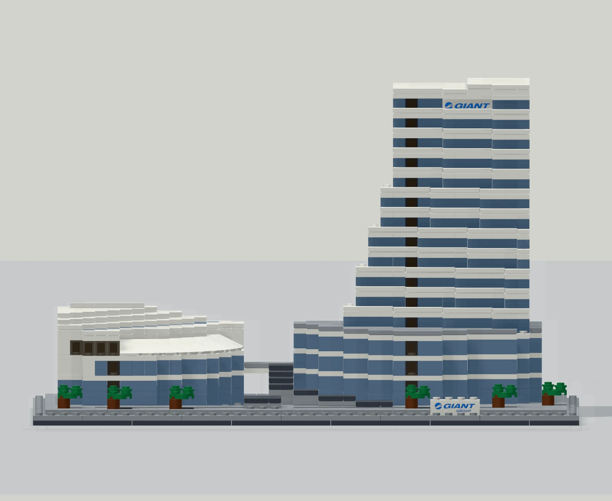
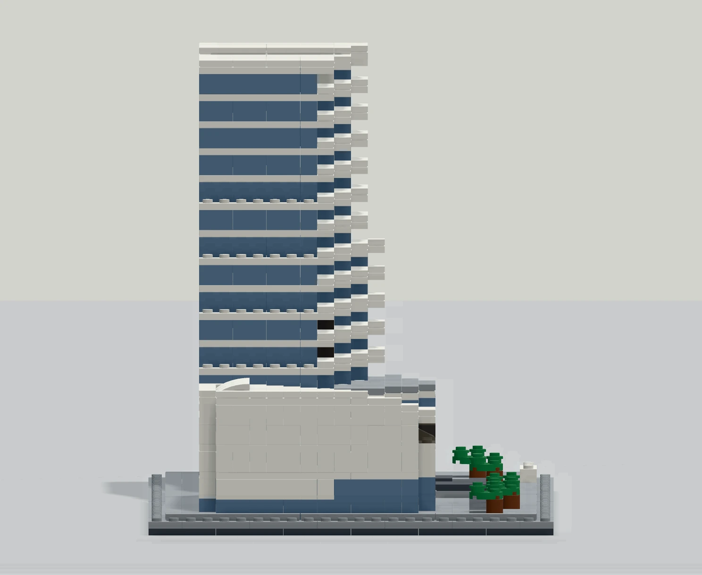
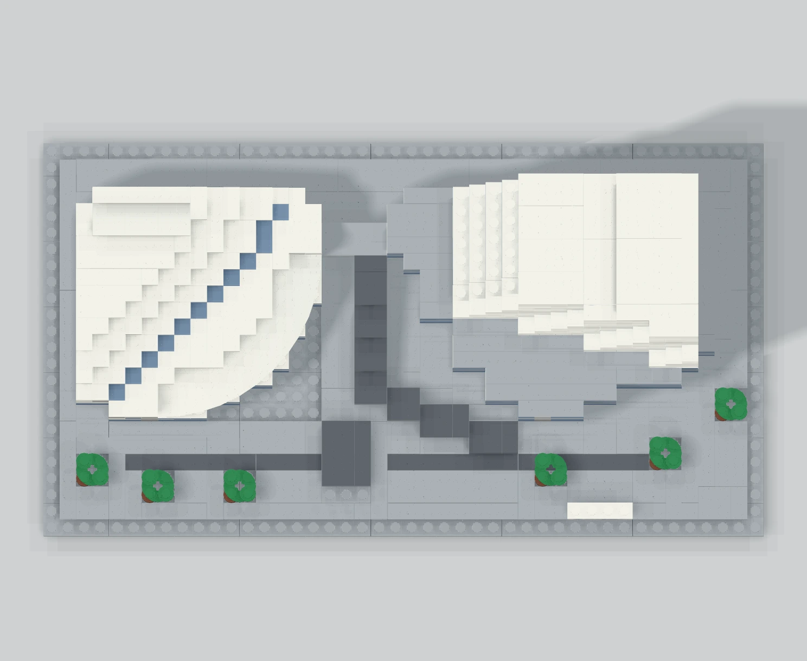

# 巨大集團全球營運總部｜組裝說明書

TC 04 · Giant Group Global Headquarters

面向兩棟之間的廣場，左側是自行車文化探索館的銀白薄殼，右側是逐層收窄的辦公塔樓。二樓短橋橫跨通道，塔樓裙房前方留有自行車坡道與露臺。

1247 件 · 5 袋 · 176 步

底座 44 × 24 凸點。

將底座較後的一側朝上，從左上角第 1 顆凸點開始數。X 由左向右，Z 由後向前。底高以薄板為單位，桌面是 0，一塊標準磚高 3 層薄板。每個位置均取零件佔地最左、最後的凸點。

圖號依每一步的安裝順序編列，回到下一個步驟時從 1 重新起算。[圖解說明書](manual.html) · [分袋 BOM](bom.csv) · [分步 LDraw 模型](model.ldr)

## 巨大集團・中科總部與文化館

從廣場看，三層自行車文化探索館與十五層辦公塔樓一低一高。建築師的二樓平面標示跨越廣場的短橋，地面保留通行空間。巨大集團 2020 年照片可見塔冠的藍色 GIANT 標誌。 文化館用十格半徑的大弧與分段屋板塑形，二樓用 2 × 8 薄板跨過地面通道。銀色外殼以白與淺藍灰代色，塔冠貼上 GIANT 藍色標誌，GIANT GROUP 全稱名牌另設於底座。

本版 1247 件，另附 2 枚貼紙。

[潘冀聯合建築師・設計說明](https://www.jjpan.com/project/culture/giant-group-global-headquarters) · [建築師提供・照片與各層平面](https://www.archdaily.com/939889/giant-group-global-headquarters-jj-pan-and-partners) · [巨大集團・進駐中科紀錄](https://www.giantgroup-cycling.com/history)

## 建築方位與配置

**正面**　廣場位於中央，三層文化館在左，十五層辦公塔樓位於右側的低裙房上。

**側面**　從文化館端看，屋面雙瓣在狹長深色採光帶旁錯開高度。塔樓每層都有向外伸出的白色簷帶。

**俯視**　中央路徑穿進兩棟之間，二樓短橋橫跨其上。塔樓層層退縮，文化館屋頂依平面曲線分成兩瓣。

## 原寸貼紙

本款有 2 張貼紙。請以 100% 列印原寸貼紙 PDF，依步驟中的 S 編號貼在指定磚面，再把該件扣入。

[下載 A4 可列印貼紙](stickers.pdf)

- S01　辦公塔冠正面的藍色 GIANT 標誌 · 袋 04／步驟 148 · 29 × 7 mm · 正面（朝前），面中央。
- S02　底座廣場側的巨大集團展示名牌 · 袋 05／步驟 167 · 26 × 7 mm · 正面（朝前），面中央。

## 第 01 袋　底座與定位

78 件，共 11 步。

| 顏色 | 零件 | 設計／庫號 | 數量 |
| --- | --- | --- | ---: |
| 淺藍灰 | 薄板 2×4 | 3020 | 2 |
| 淺藍灰 | 薄板 4×4 | 3031 | 5 |
| 淺藍灰 | 薄板 2×8 | 3034 | 10 |
| 淺藍灰 | 薄板 4×8 | 3035 | 25 |
| 深藍灰 | 薄板 4×4 | 3031 | 6 |
| 深藍灰 | 薄板 4×8 | 3035 | 30 |

### 步驟 01　併排底板（1/5）

將底板凸點朝上、長邊對齊排在平桌。下一層會跨接板縫。

**本步取件**

| 顏色 | 零件 | 設計／庫號 | 數量 |
| --- | --- | --- | ---: |
| 深藍灰 | 薄板 4×4 | 3031 | 1 |
| 深藍灰 | 薄板 4×8 | 3035 | 7 |

**安裝位置**

| 圖號 | 零件與顏色 | X | Z | 底高（薄板） | 方向 |
| ---: | --- | ---: | ---: | ---: | --- |
| 1 | 深藍灰 薄板 4×8（3035） | 1 | 1 | 0 | 沿 X |
| 2 | 深藍灰 薄板 4×8（3035） | 9 | 1 | 0 | 沿 X |
| 3 | 深藍灰 薄板 4×8（3035） | 17 | 1 | 0 | 沿 X |
| 4 | 深藍灰 薄板 4×8（3035） | 25 | 1 | 0 | 沿 X |
| 5 | 深藍灰 薄板 4×8（3035） | 33 | 1 | 0 | 沿 X |
| 6 | 深藍灰 薄板 4×4（3031） | 41 | 1 | 0 | — |
| 7 | 深藍灰 薄板 4×8（3035） | 1 | 5 | 0 | 沿 X |
| 8 | 深藍灰 薄板 4×8（3035） | 9 | 5 | 0 | 沿 X |

### 步驟 02　併排底板（2/5）

將底板凸點朝上、長邊對齊排在平桌。下一層會跨接板縫。

**本步取件**

| 顏色 | 零件 | 設計／庫號 | 數量 |
| --- | --- | --- | ---: |
| 深藍灰 | 薄板 4×4 | 3031 | 1 |
| 深藍灰 | 薄板 4×8 | 3035 | 7 |

**安裝位置**

| 圖號 | 零件與顏色 | X | Z | 底高（薄板） | 方向 |
| ---: | --- | ---: | ---: | ---: | --- |
| 1 | 深藍灰 薄板 4×8（3035） | 17 | 5 | 0 | 沿 X |
| 2 | 深藍灰 薄板 4×8（3035） | 25 | 5 | 0 | 沿 X |
| 3 | 深藍灰 薄板 4×8（3035） | 33 | 5 | 0 | 沿 X |
| 4 | 深藍灰 薄板 4×4（3031） | 41 | 5 | 0 | — |
| 5 | 深藍灰 薄板 4×8（3035） | 1 | 9 | 0 | 沿 X |
| 6 | 深藍灰 薄板 4×8（3035） | 9 | 9 | 0 | 沿 X |
| 7 | 深藍灰 薄板 4×8（3035） | 17 | 9 | 0 | 沿 X |
| 8 | 深藍灰 薄板 4×8（3035） | 25 | 9 | 0 | 沿 X |

### 步驟 03　併排底板（3/5）

將底板凸點朝上、長邊對齊排在平桌。下一層會跨接板縫。

**本步取件**

| 顏色 | 零件 | 設計／庫號 | 數量 |
| --- | --- | --- | ---: |
| 深藍灰 | 薄板 4×4 | 3031 | 2 |
| 深藍灰 | 薄板 4×8 | 3035 | 6 |

**安裝位置**

| 圖號 | 零件與顏色 | X | Z | 底高（薄板） | 方向 |
| ---: | --- | ---: | ---: | ---: | --- |
| 1 | 深藍灰 薄板 4×8（3035） | 33 | 9 | 0 | 沿 X |
| 2 | 深藍灰 薄板 4×4（3031） | 41 | 9 | 0 | — |
| 3 | 深藍灰 薄板 4×8（3035） | 1 | 13 | 0 | 沿 X |
| 4 | 深藍灰 薄板 4×8（3035） | 9 | 13 | 0 | 沿 X |
| 5 | 深藍灰 薄板 4×8（3035） | 17 | 13 | 0 | 沿 X |
| 6 | 深藍灰 薄板 4×8（3035） | 25 | 13 | 0 | 沿 X |
| 7 | 深藍灰 薄板 4×8（3035） | 33 | 13 | 0 | 沿 X |
| 8 | 深藍灰 薄板 4×4（3031） | 41 | 13 | 0 | — |

### 步驟 04　併排底板（4/5）

將底板凸點朝上、長邊對齊排在平桌。下一層會跨接板縫。

**本步取件**

| 顏色 | 零件 | 設計／庫號 | 數量 |
| --- | --- | --- | ---: |
| 深藍灰 | 薄板 4×4 | 3031 | 1 |
| 深藍灰 | 薄板 4×8 | 3035 | 7 |

**安裝位置**

| 圖號 | 零件與顏色 | X | Z | 底高（薄板） | 方向 |
| ---: | --- | ---: | ---: | ---: | --- |
| 1 | 深藍灰 薄板 4×8（3035） | 1 | 17 | 0 | 沿 X |
| 2 | 深藍灰 薄板 4×8（3035） | 9 | 17 | 0 | 沿 X |
| 3 | 深藍灰 薄板 4×8（3035） | 17 | 17 | 0 | 沿 X |
| 4 | 深藍灰 薄板 4×8（3035） | 25 | 17 | 0 | 沿 X |
| 5 | 深藍灰 薄板 4×8（3035） | 33 | 17 | 0 | 沿 X |
| 6 | 深藍灰 薄板 4×4（3031） | 41 | 17 | 0 | — |
| 7 | 深藍灰 薄板 4×8（3035） | 1 | 21 | 0 | 沿 X |
| 8 | 深藍灰 薄板 4×8（3035） | 9 | 21 | 0 | 沿 X |

### 步驟 05　併排底板（5/5）

將底板凸點朝上、長邊對齊排在平桌。下一層會跨接板縫。

**本步取件**

| 顏色 | 零件 | 設計／庫號 | 數量 |
| --- | --- | --- | ---: |
| 深藍灰 | 薄板 4×4 | 3031 | 1 |
| 深藍灰 | 薄板 4×8 | 3035 | 3 |

**安裝位置**

| 圖號 | 零件與顏色 | X | Z | 底高（薄板） | 方向 |
| ---: | --- | ---: | ---: | ---: | --- |
| 1 | 深藍灰 薄板 4×8（3035） | 17 | 21 | 0 | 沿 X |
| 2 | 深藍灰 薄板 4×8（3035） | 25 | 21 | 0 | 沿 X |
| 3 | 深藍灰 薄板 4×8（3035） | 33 | 21 | 0 | 沿 X |
| 4 | 深藍灰 薄板 4×4（3031） | 41 | 21 | 0 | — |

### 步驟 06　錯縫鎖底（1/6）

上層相對底板橫移四格、縱移兩格。逐排按緊後，底座可整片拿起。

**本步取件**

| 顏色 | 零件 | 設計／庫號 | 數量 |
| --- | --- | --- | ---: |
| 淺藍灰 | 薄板 2×4 | 3020 | 1 |
| 淺藍灰 | 薄板 4×4 | 3031 | 1 |
| 淺藍灰 | 薄板 2×8 | 3034 | 5 |
| 淺藍灰 | 薄板 4×8 | 3035 | 1 |

**安裝位置**

| 圖號 | 零件與顏色 | X | Z | 底高（薄板） | 方向 |
| ---: | --- | ---: | ---: | ---: | --- |
| 1 | 淺藍灰 薄板 2×4（3020） | 1 | 1 | 1 | 沿 X |
| 2 | 淺藍灰 薄板 2×8（3034） | 5 | 1 | 1 | 沿 X |
| 3 | 淺藍灰 薄板 2×8（3034） | 13 | 1 | 1 | 沿 X |
| 4 | 淺藍灰 薄板 2×8（3034） | 21 | 1 | 1 | 沿 X |
| 5 | 淺藍灰 薄板 2×8（3034） | 29 | 1 | 1 | 沿 X |
| 6 | 淺藍灰 薄板 2×8（3034） | 37 | 1 | 1 | 沿 X |
| 7 | 淺藍灰 薄板 4×4（3031） | 1 | 3 | 1 | — |
| 8 | 淺藍灰 薄板 4×8（3035） | 5 | 3 | 1 | 沿 X |

### 步驟 07　錯縫鎖底（2/6）

上層相對底板橫移四格、縱移兩格。逐排按緊後，底座可整片拿起。

**本步取件**

| 顏色 | 零件 | 設計／庫號 | 數量 |
| --- | --- | --- | ---: |
| 淺藍灰 | 薄板 4×4 | 3031 | 1 |
| 淺藍灰 | 薄板 4×8 | 3035 | 7 |

**安裝位置**

| 圖號 | 零件與顏色 | X | Z | 底高（薄板） | 方向 |
| ---: | --- | ---: | ---: | ---: | --- |
| 1 | 淺藍灰 薄板 4×8（3035） | 13 | 3 | 1 | 沿 X |
| 2 | 淺藍灰 薄板 4×8（3035） | 21 | 3 | 1 | 沿 X |
| 3 | 淺藍灰 薄板 4×8（3035） | 29 | 3 | 1 | 沿 X |
| 4 | 淺藍灰 薄板 4×8（3035） | 37 | 3 | 1 | 沿 X |
| 5 | 淺藍灰 薄板 4×4（3031） | 1 | 7 | 1 | — |
| 6 | 淺藍灰 薄板 4×8（3035） | 5 | 7 | 1 | 沿 X |
| 7 | 淺藍灰 薄板 4×8（3035） | 13 | 7 | 1 | 沿 X |
| 8 | 淺藍灰 薄板 4×8（3035） | 21 | 7 | 1 | 沿 X |

### 步驟 08　錯縫鎖底（3/6）

上層相對底板橫移四格、縱移兩格。逐排按緊後，底座可整片拿起。

**本步取件**

| 顏色 | 零件 | 設計／庫號 | 數量 |
| --- | --- | --- | ---: |
| 淺藍灰 | 薄板 4×4 | 3031 | 1 |
| 淺藍灰 | 薄板 4×8 | 3035 | 7 |

**安裝位置**

| 圖號 | 零件與顏色 | X | Z | 底高（薄板） | 方向 |
| ---: | --- | ---: | ---: | ---: | --- |
| 1 | 淺藍灰 薄板 4×8（3035） | 29 | 7 | 1 | 沿 X |
| 2 | 淺藍灰 薄板 4×8（3035） | 37 | 7 | 1 | 沿 X |
| 3 | 淺藍灰 薄板 4×4（3031） | 1 | 11 | 1 | — |
| 4 | 淺藍灰 薄板 4×8（3035） | 5 | 11 | 1 | 沿 X |
| 5 | 淺藍灰 薄板 4×8（3035） | 13 | 11 | 1 | 沿 X |
| 6 | 淺藍灰 薄板 4×8（3035） | 21 | 11 | 1 | 沿 X |
| 7 | 淺藍灰 薄板 4×8（3035） | 29 | 11 | 1 | 沿 X |
| 8 | 淺藍灰 薄板 4×8（3035） | 37 | 11 | 1 | 沿 X |

### 步驟 09　錯縫鎖底（4/6）

上層相對底板橫移四格、縱移兩格。逐排按緊後，底座可整片拿起。

**本步取件**

| 顏色 | 零件 | 設計／庫號 | 數量 |
| --- | --- | --- | ---: |
| 淺藍灰 | 薄板 4×4 | 3031 | 2 |
| 淺藍灰 | 薄板 4×8 | 3035 | 6 |

**安裝位置**

| 圖號 | 零件與顏色 | X | Z | 底高（薄板） | 方向 |
| ---: | --- | ---: | ---: | ---: | --- |
| 1 | 淺藍灰 薄板 4×4（3031） | 1 | 15 | 1 | — |
| 2 | 淺藍灰 薄板 4×8（3035） | 5 | 15 | 1 | 沿 X |
| 3 | 淺藍灰 薄板 4×8（3035） | 13 | 15 | 1 | 沿 X |
| 4 | 淺藍灰 薄板 4×8（3035） | 21 | 15 | 1 | 沿 X |
| 5 | 淺藍灰 薄板 4×8（3035） | 29 | 15 | 1 | 沿 X |
| 6 | 淺藍灰 薄板 4×8（3035） | 37 | 15 | 1 | 沿 X |
| 7 | 淺藍灰 薄板 4×4（3031） | 1 | 19 | 1 | — |
| 8 | 淺藍灰 薄板 4×8（3035） | 5 | 19 | 1 | 沿 X |

### 步驟 10　錯縫鎖底（5/6）

上層相對底板橫移四格、縱移兩格。逐排按緊後，底座可整片拿起。

**本步取件**

| 顏色 | 零件 | 設計／庫號 | 數量 |
| --- | --- | --- | ---: |
| 淺藍灰 | 薄板 2×4 | 3020 | 1 |
| 淺藍灰 | 薄板 2×8 | 3034 | 3 |
| 淺藍灰 | 薄板 4×8 | 3035 | 4 |

**安裝位置**

| 圖號 | 零件與顏色 | X | Z | 底高（薄板） | 方向 |
| ---: | --- | ---: | ---: | ---: | --- |
| 1 | 淺藍灰 薄板 4×8（3035） | 13 | 19 | 1 | 沿 X |
| 2 | 淺藍灰 薄板 4×8（3035） | 21 | 19 | 1 | 沿 X |
| 3 | 淺藍灰 薄板 4×8（3035） | 29 | 19 | 1 | 沿 X |
| 4 | 淺藍灰 薄板 4×8（3035） | 37 | 19 | 1 | 沿 X |
| 5 | 淺藍灰 薄板 2×4（3020） | 1 | 23 | 1 | 沿 X |
| 6 | 淺藍灰 薄板 2×8（3034） | 5 | 23 | 1 | 沿 X |
| 7 | 淺藍灰 薄板 2×8（3034） | 13 | 23 | 1 | 沿 X |
| 8 | 淺藍灰 薄板 2×8（3034） | 21 | 23 | 1 | 沿 X |

### 步驟 11　錯縫鎖底（6/6）

上層相對底板橫移四格、縱移兩格。逐排按緊後，底座可整片拿起。

**本步取件**

| 顏色 | 零件 | 設計／庫號 | 數量 |
| --- | --- | --- | ---: |
| 淺藍灰 | 薄板 2×8 | 3034 | 2 |

**安裝位置**

| 圖號 | 零件與顏色 | X | Z | 底高（薄板） | 方向 |
| ---: | --- | ---: | ---: | ---: | --- |
| 1 | 淺藍灰 薄板 2×8（3034） | 29 | 23 | 1 | 沿 X |
| 2 | 淺藍灰 薄板 2×8（3034） | 37 | 23 | 1 | 沿 X |

## 第 02 袋　兩座低棟與跨廣場短橋

301 件，共 40 步。

| 顏色 | 零件 | 設計／庫號 | 數量 |
| --- | --- | --- | ---: |
| 白色 | 磚 2×6 | 2456 | 2 |
| 白色 | 磚 1×4 | 3010 | 1 |
| 白色 | 薄板 2×4 | 3020 | 7 |
| 白色 | 薄板 2×3 | 3021 | 3 |
| 白色 | 薄板 1×2 | 3023 | 8 |
| 白色 | 薄板 1×1 | 3024 | 9 |
| 白色 | 薄板 4×4 | 3031 | 2 |
| 白色 | 薄板 4×6 | 3032 | 3 |
| 白色 | 薄板 2×8 | 3034 | 17 |
| 白色 | 薄板 4×8 | 3035 | 4 |
| 白色 | 薄板 6×8 | 3036 | 1 |
| 白色 | 薄板 1×8 | 3460 | 18 |
| 白色 | 磚 1×3 | 3622 | 1 |
| 白色 | 薄板 1×3 | 3623 | 6 |
| 白色 | 薄板 1×6 | 3666 | 1 |
| 白色 | 薄板 1×4 | 3710 | 7 |
| 白色 | 薄板 2×6 | 3795 | 1 |
| 透明煙棕 | 磚 1×1 | 3005 | 6 |
| 淺藍灰 | 光面板 2×4 | 87079 | 1 |
| 沙藍 | 磚 2×4 | 3001 | 91 |
| 沙藍 | 磚 2×3 | 3002 | 5 |
| 沙藍 | 磚 2×2 | 3003 | 5 |
| 沙藍 | 磚 1×2 | 3004 | 16 |
| 沙藍 | 磚 1×1 | 3005 | 13 |
| 沙藍 | 磚 1×6 | 3009 | 57 |
| 沙藍 | 磚 1×4 | 3010 | 8 |
| 沙藍 | 磚 1×3 | 3622 | 8 |

### 步驟 12　文化館玻璃基座（1/4）

由後側長直牆往廣場扣出圓弧前緣，以透明煙色小磚穿插沙藍玻璃。

**本步取件**

| 顏色 | 零件 | 設計／庫號 | 數量 |
| --- | --- | --- | ---: |
| 沙藍 | 磚 2×4 | 3001 | 3 |
| 沙藍 | 磚 1×2 | 3004 | 1 |
| 沙藍 | 磚 1×6 | 3009 | 3 |
| 沙藍 | 磚 1×4 | 3010 | 1 |

**安裝位置**

| 圖號 | 零件與顏色 | X | Z | 底高（薄板） | 方向 |
| ---: | --- | ---: | ---: | ---: | --- |
| 1 | 沙藍 磚 1×6（3009） | 3 | 16 | 2 | 沿 X |
| 2 | 沙藍 磚 1×4（3010） | 9 | 16 | 2 | 沿 X |
| 3 | 沙藍 磚 1×6（3009） | 3 | 15 | 2 | 沿 X |
| 4 | 沙藍 磚 1×6（3009） | 9 | 15 | 2 | 沿 X |
| 5 | 沙藍 磚 2×4（3001） | 3 | 13 | 2 | 沿 X |
| 6 | 沙藍 磚 2×4（3001） | 7 | 13 | 2 | 沿 X |
| 7 | 沙藍 磚 2×4（3001） | 11 | 13 | 2 | 沿 X |
| 8 | 沙藍 磚 1×2（3004） | 15 | 13 | 2 | 沿 Z |

### 步驟 13　文化館玻璃基座（2/4）

由後側長直牆往廣場扣出圓弧前緣，以透明煙色小磚穿插沙藍玻璃。

**本步取件**

| 顏色 | 零件 | 設計／庫號 | 數量 |
| --- | --- | --- | ---: |
| 沙藍 | 磚 2×4 | 3001 | 7 |
| 沙藍 | 磚 2×2 | 3003 | 1 |

**安裝位置**

| 圖號 | 零件與顏色 | X | Z | 底高（薄板） | 方向 |
| ---: | --- | ---: | ---: | ---: | --- |
| 1 | 沙藍 磚 2×4（3001） | 3 | 11 | 2 | 沿 X |
| 2 | 沙藍 磚 2×4（3001） | 7 | 11 | 2 | 沿 X |
| 3 | 沙藍 磚 2×4（3001） | 11 | 11 | 2 | 沿 X |
| 4 | 沙藍 磚 2×2（3003） | 15 | 11 | 2 | — |
| 5 | 沙藍 磚 2×4（3001） | 3 | 5 | 2 | 沿 X |
| 6 | 沙藍 磚 2×4（3001） | 7 | 5 | 2 | 沿 X |
| 7 | 沙藍 磚 2×4（3001） | 11 | 5 | 2 | 沿 X |
| 8 | 沙藍 磚 2×4（3001） | 15 | 5 | 2 | 沿 Z |

### 步驟 14　文化館玻璃基座（3/4）

由後側長直牆往廣場扣出圓弧前緣，以透明煙色小磚穿插沙藍玻璃。

**本步取件**

| 顏色 | 零件 | 設計／庫號 | 數量 |
| --- | --- | --- | ---: |
| 沙藍 | 磚 2×4 | 3001 | 6 |
| 沙藍 | 磚 2×2 | 3003 | 1 |
| 沙藍 | 磚 1×6 | 3009 | 1 |

**安裝位置**

| 圖號 | 零件與顏色 | X | Z | 底高（薄板） | 方向 |
| ---: | --- | ---: | ---: | ---: | --- |
| 1 | 沙藍 磚 1×6（3009） | 17 | 5 | 2 | 沿 Z |
| 2 | 沙藍 磚 2×4（3001） | 3 | 7 | 2 | 沿 X |
| 3 | 沙藍 磚 2×4（3001） | 7 | 7 | 2 | 沿 X |
| 4 | 沙藍 磚 2×4（3001） | 11 | 7 | 2 | 沿 X |
| 5 | 沙藍 磚 2×4（3001） | 3 | 9 | 2 | 沿 X |
| 6 | 沙藍 磚 2×4（3001） | 7 | 9 | 2 | 沿 X |
| 7 | 沙藍 磚 2×4（3001） | 11 | 9 | 2 | 沿 X |
| 8 | 沙藍 磚 2×2（3003） | 15 | 9 | 2 | — |

### 步驟 15　文化館玻璃基座（4/4）

由後側長直牆往廣場扣出圓弧前緣，以透明煙色小磚穿插沙藍玻璃。

**本步取件**

| 顏色 | 零件 | 設計／庫號 | 數量 |
| --- | --- | --- | ---: |
| 透明煙棕 | 磚 1×1 | 3005 | 1 |
| 沙藍 | 磚 1×2 | 3004 | 1 |
| 沙藍 | 磚 1×1 | 3005 | 1 |
| 沙藍 | 磚 1×6 | 3009 | 2 |
| 沙藍 | 磚 1×3 | 3622 | 1 |

**安裝位置**

| 圖號 | 零件與顏色 | X | Z | 底高（薄板） | 方向 |
| ---: | --- | ---: | ---: | ---: | --- |
| 1 | 沙藍 磚 1×6（3009） | 4 | 4 | 2 | 沿 X |
| 2 | 沙藍 磚 1×6（3009） | 10 | 4 | 2 | 沿 X |
| 3 | 沙藍 磚 1×1（3005） | 16 | 4 | 2 | — |
| 4 | 沙藍 磚 1×2（3004） | 5 | 17 | 2 | 沿 X |
| 5 | 沙藍 磚 1×3（3622） | 8 | 17 | 2 | 沿 X |
| 6 | 透明煙棕 磚 1×1（3005） | 7 | 17 | 2 | — |

### 步驟 16　辦公裙房與低窗帶（1/5）

沿廣場另一側扣上裙房首層。兩棟中間的空位供行人及自行車通過。

**本步取件**

| 顏色 | 零件 | 設計／庫號 | 數量 |
| --- | --- | --- | ---: |
| 沙藍 | 磚 2×4 | 3001 | 4 |
| 沙藍 | 磚 2×3 | 3002 | 1 |
| 沙藍 | 磚 1×1 | 3005 | 1 |
| 沙藍 | 磚 1×6 | 3009 | 1 |
| 沙藍 | 磚 1×4 | 3010 | 1 |

**安裝位置**

| 圖號 | 零件與顏色 | X | Z | 底高（薄板） | 方向 |
| ---: | --- | ---: | ---: | ---: | --- |
| 1 | 沙藍 磚 1×4（3010） | 23 | 4 | 2 | 沿 Z |
| 2 | 沙藍 磚 1×1（3005） | 23 | 8 | 2 | — |
| 3 | 沙藍 磚 2×4（3001） | 24 | 4 | 2 | 沿 Z |
| 4 | 沙藍 磚 2×4（3001） | 24 | 8 | 2 | 沿 Z |
| 5 | 沙藍 磚 2×4（3001） | 26 | 4 | 2 | 沿 Z |
| 6 | 沙藍 磚 2×4（3001） | 26 | 8 | 2 | 沿 Z |
| 7 | 沙藍 磚 2×3（3002） | 26 | 12 | 2 | 沿 Z |
| 8 | 沙藍 磚 1×6（3009） | 40 | 4 | 2 | 沿 Z |

### 步驟 17　辦公裙房與低窗帶（2/5）

沿廣場另一側扣上裙房首層。兩棟中間的空位供行人及自行車通過。

**本步取件**

| 顏色 | 零件 | 設計／庫號 | 數量 |
| --- | --- | --- | ---: |
| 沙藍 | 磚 2×4 | 3001 | 6 |
| 沙藍 | 磚 1×1 | 3005 | 1 |
| 沙藍 | 磚 1×4 | 3010 | 1 |

**安裝位置**

| 圖號 | 零件與顏色 | X | Z | 底高（薄板） | 方向 |
| ---: | --- | ---: | ---: | ---: | --- |
| 1 | 沙藍 磚 1×4（3010） | 40 | 10 | 2 | 沿 Z |
| 2 | 沙藍 磚 1×1（3005） | 40 | 14 | 2 | — |
| 3 | 沙藍 磚 2×4（3001） | 36 | 4 | 2 | 沿 X |
| 4 | 沙藍 磚 2×4（3001） | 36 | 6 | 2 | 沿 X |
| 5 | 沙藍 磚 2×4（3001） | 36 | 8 | 2 | 沿 X |
| 6 | 沙藍 磚 2×4（3001） | 36 | 10 | 2 | 沿 X |
| 7 | 沙藍 磚 2×4（3001） | 36 | 12 | 2 | 沿 X |
| 8 | 沙藍 磚 2×4（3001） | 36 | 14 | 2 | 沿 X |

### 步驟 18　辦公裙房與低窗帶（3/5）

沿廣場另一側扣上裙房首層。兩棟中間的空位供行人及自行車通過。

**本步取件**

| 顏色 | 零件 | 設計／庫號 | 數量 |
| --- | --- | --- | ---: |
| 沙藍 | 磚 2×4 | 3001 | 4 |
| 沙藍 | 磚 1×2 | 3004 | 1 |
| 沙藍 | 磚 1×1 | 3005 | 1 |
| 沙藍 | 磚 1×6 | 3009 | 2 |

**安裝位置**

| 圖號 | 零件與顏色 | X | Z | 底高（薄板） | 方向 |
| ---: | --- | ---: | ---: | ---: | --- |
| 1 | 沙藍 磚 2×4（3001） | 28 | 4 | 2 | 沿 Z |
| 2 | 沙藍 磚 2×4（3001） | 28 | 8 | 2 | 沿 Z |
| 3 | 沙藍 磚 2×4（3001） | 28 | 12 | 2 | 沿 Z |
| 4 | 沙藍 磚 1×2（3004） | 28 | 16 | 2 | 沿 X |
| 5 | 沙藍 磚 1×6（3009） | 31 | 4 | 2 | 沿 Z |
| 6 | 沙藍 磚 1×6（3009） | 31 | 10 | 2 | 沿 Z |
| 7 | 沙藍 磚 1×1（3005） | 31 | 16 | 2 | — |
| 8 | 沙藍 磚 2×4（3001） | 34 | 4 | 2 | 沿 Z |

### 步驟 19　辦公裙房與低窗帶（4/5）

沿廣場另一側扣上裙房首層。兩棟中間的空位供行人及自行車通過。

**本步取件**

| 顏色 | 零件 | 設計／庫號 | 數量 |
| --- | --- | --- | ---: |
| 沙藍 | 磚 2×4 | 3001 | 4 |
| 沙藍 | 磚 1×2 | 3004 | 2 |
| 沙藍 | 磚 1×6 | 3009 | 2 |

**安裝位置**

| 圖號 | 零件與顏色 | X | Z | 底高（薄板） | 方向 |
| ---: | --- | ---: | ---: | ---: | --- |
| 1 | 沙藍 磚 2×4（3001） | 34 | 8 | 2 | 沿 Z |
| 2 | 沙藍 磚 2×4（3001） | 34 | 12 | 2 | 沿 Z |
| 3 | 沙藍 磚 1×2（3004） | 34 | 16 | 2 | 沿 X |
| 4 | 沙藍 磚 1×6（3009） | 30 | 4 | 2 | 沿 Z |
| 5 | 沙藍 磚 1×6（3009） | 30 | 10 | 2 | 沿 Z |
| 6 | 沙藍 磚 1×2（3004） | 30 | 16 | 2 | 沿 Z |
| 7 | 沙藍 磚 2×4（3001） | 32 | 4 | 2 | 沿 Z |
| 8 | 沙藍 磚 2×4（3001） | 32 | 8 | 2 | 沿 Z |

### 步驟 20　辦公裙房與低窗帶（5/5）

沿廣場另一側扣上裙房首層。兩棟中間的空位供行人及自行車通過。

**本步取件**

| 顏色 | 零件 | 設計／庫號 | 數量 |
| --- | --- | --- | ---: |
| 透明煙棕 | 磚 1×1 | 3005 | 1 |
| 沙藍 | 磚 2×4 | 3001 | 1 |
| 沙藍 | 磚 2×2 | 3003 | 1 |
| 沙藍 | 磚 1×6 | 3009 | 1 |
| 沙藍 | 磚 1×3 | 3622 | 2 |

**安裝位置**

| 圖號 | 零件與顏色 | X | Z | 底高（薄板） | 方向 |
| ---: | --- | ---: | ---: | ---: | --- |
| 1 | 沙藍 磚 2×4（3001） | 32 | 12 | 2 | 沿 Z |
| 2 | 沙藍 磚 2×2（3003） | 32 | 16 | 2 | — |
| 3 | 沙藍 磚 1×3（3622） | 22 | 5 | 2 | 沿 Z |
| 4 | 沙藍 磚 1×6（3009） | 41 | 5 | 2 | 沿 Z |
| 5 | 沙藍 磚 1×3（3622） | 41 | 11 | 2 | 沿 Z |
| 6 | 透明煙棕 磚 1×1（3005） | 31 | 17 | 2 | — |

### 步驟 21　展廳下帶與門廳上窗（1/9）

展廳外殼較厚的一端露出白色帶狀牆面；將門廳靠廣場的一排上窗對正下層。

**本步取件**

| 顏色 | 零件 | 設計／庫號 | 數量 |
| --- | --- | --- | ---: |
| 沙藍 | 磚 2×4 | 3001 | 3 |
| 沙藍 | 磚 1×1 | 3005 | 1 |
| 沙藍 | 磚 1×6 | 3009 | 2 |
| 沙藍 | 磚 1×4 | 3010 | 1 |
| 沙藍 | 磚 1×3 | 3622 | 1 |

**安裝位置**

| 圖號 | 零件與顏色 | X | Z | 底高（薄板） | 方向 |
| ---: | --- | ---: | ---: | ---: | --- |
| 1 | 沙藍 磚 1×6（3009） | 16 | 4 | 5 | 沿 Z |
| 2 | 沙藍 磚 1×3（3622） | 16 | 10 | 5 | 沿 Z |
| 3 | 沙藍 磚 1×6（3009） | 15 | 4 | 5 | 沿 Z |
| 4 | 沙藍 磚 1×4（3010） | 15 | 10 | 5 | 沿 Z |
| 5 | 沙藍 磚 1×1（3005） | 15 | 14 | 5 | — |
| 6 | 沙藍 磚 2×4（3001） | 13 | 4 | 5 | 沿 Z |
| 7 | 沙藍 磚 2×4（3001） | 13 | 8 | 5 | 沿 Z |
| 8 | 沙藍 磚 2×4（3001） | 13 | 12 | 5 | 沿 Z |

### 步驟 22　展廳下帶與門廳上窗（2/9）

展廳外殼較厚的一端露出白色帶狀牆面；將門廳靠廣場的一排上窗對正下層。

**本步取件**

| 顏色 | 零件 | 設計／庫號 | 數量 |
| --- | --- | --- | ---: |
| 沙藍 | 磚 2×4 | 3001 | 4 |
| 沙藍 | 磚 1×2 | 3004 | 1 |
| 沙藍 | 磚 1×1 | 3005 | 1 |
| 沙藍 | 磚 1×6 | 3009 | 2 |

**安裝位置**

| 圖號 | 零件與顏色 | X | Z | 底高（薄板） | 方向 |
| ---: | --- | ---: | ---: | ---: | --- |
| 1 | 沙藍 磚 1×6（3009） | 7 | 4 | 5 | 沿 Z |
| 2 | 沙藍 磚 1×6（3009） | 7 | 10 | 5 | 沿 Z |
| 3 | 沙藍 磚 1×1（3005） | 7 | 16 | 5 | — |
| 4 | 沙藍 磚 2×4（3001） | 11 | 4 | 5 | 沿 Z |
| 5 | 沙藍 磚 2×4（3001） | 11 | 8 | 5 | 沿 Z |
| 6 | 沙藍 磚 2×4（3001） | 11 | 12 | 5 | 沿 Z |
| 7 | 沙藍 磚 1×2（3004） | 11 | 16 | 5 | 沿 X |
| 8 | 沙藍 磚 2×4（3001） | 8 | 4 | 5 | 沿 Z |

### 步驟 23　展廳下帶與門廳上窗（3/9）

展廳外殼較厚的一端露出白色帶狀牆面；將門廳靠廣場的一排上窗對正下層。

**本步取件**

| 顏色 | 零件 | 設計／庫號 | 數量 |
| --- | --- | --- | ---: |
| 沙藍 | 磚 2×4 | 3001 | 3 |
| 沙藍 | 磚 2×3 | 3002 | 1 |
| 沙藍 | 磚 1×2 | 3004 | 1 |
| 沙藍 | 磚 1×6 | 3009 | 3 |

**安裝位置**

| 圖號 | 零件與顏色 | X | Z | 底高（薄板） | 方向 |
| ---: | --- | ---: | ---: | ---: | --- |
| 1 | 沙藍 磚 1×6（3009） | 10 | 4 | 5 | 沿 Z |
| 2 | 沙藍 磚 2×4（3001） | 8 | 8 | 5 | 沿 Z |
| 3 | 沙藍 磚 1×6（3009） | 10 | 10 | 5 | 沿 Z |
| 4 | 沙藍 磚 2×4（3001） | 8 | 12 | 5 | 沿 Z |
| 5 | 沙藍 磚 2×3（3002） | 8 | 16 | 5 | 沿 X |
| 6 | 沙藍 磚 1×6（3009） | 17 | 5 | 5 | 沿 Z |
| 7 | 沙藍 磚 2×4（3001） | 3 | 12 | 5 | 沿 Z |
| 8 | 沙藍 磚 1×2（3004） | 3 | 16 | 5 | 沿 X |

### 步驟 24　展廳下帶與門廳上窗（4/9）

展廳外殼較厚的一端露出白色帶狀牆面；將門廳靠廣場的一排上窗對正下層。

**本步取件**

| 顏色 | 零件 | 設計／庫號 | 數量 |
| --- | --- | --- | ---: |
| 白色 | 磚 2×6 | 2456 | 2 |
| 白色 | 磚 1×4 | 3010 | 1 |
| 白色 | 磚 1×3 | 3622 | 1 |
| 透明煙棕 | 磚 1×1 | 3005 | 1 |
| 沙藍 | 磚 2×4 | 3001 | 2 |
| 沙藍 | 磚 2×2 | 3003 | 1 |

**安裝位置**

| 圖號 | 零件與顏色 | X | Z | 底高（薄板） | 方向 |
| ---: | --- | ---: | ---: | ---: | --- |
| 1 | 沙藍 磚 2×4（3001） | 5 | 12 | 5 | 沿 Z |
| 2 | 沙藍 磚 2×2（3003） | 5 | 16 | 5 | — |
| 3 | 透明煙棕 磚 1×1（3005） | 7 | 17 | 5 | — |
| 4 | 白色 磚 2×6（2456） | 3 | 5 | 5 | 沿 Z |
| 5 | 白色 磚 2×6（2456） | 5 | 5 | 5 | 沿 Z |
| 6 | 白色 磚 1×4（3010） | 3 | 11 | 5 | 沿 X |
| 7 | 白色 磚 1×3（3622） | 4 | 4 | 5 | 沿 X |
| 8 | 沙藍 磚 2×4（3001） | 22 | 5 | 5 | 沿 X |

### 步驟 25　展廳下帶與門廳上窗（5/9）

展廳外殼較厚的一端露出白色帶狀牆面；將門廳靠廣場的一排上窗對正下層。

**本步取件**

| 顏色 | 零件 | 設計／庫號 | 數量 |
| --- | --- | --- | ---: |
| 沙藍 | 磚 2×4 | 3001 | 4 |
| 沙藍 | 磚 1×2 | 3004 | 1 |
| 沙藍 | 磚 1×6 | 3009 | 3 |

**安裝位置**

| 圖號 | 零件與顏色 | X | Z | 底高（薄板） | 方向 |
| ---: | --- | ---: | ---: | ---: | --- |
| 1 | 沙藍 磚 2×4（3001） | 26 | 5 | 5 | 沿 X |
| 2 | 沙藍 磚 2×4（3001） | 30 | 5 | 5 | 沿 X |
| 3 | 沙藍 磚 2×4（3001） | 34 | 5 | 5 | 沿 X |
| 4 | 沙藍 磚 2×4（3001） | 38 | 5 | 5 | 沿 X |
| 5 | 沙藍 磚 1×6（3009） | 22 | 7 | 5 | 沿 X |
| 6 | 沙藍 磚 1×6（3009） | 28 | 7 | 5 | 沿 X |
| 7 | 沙藍 磚 1×6（3009） | 34 | 7 | 5 | 沿 X |
| 8 | 沙藍 磚 1×2（3004） | 40 | 7 | 5 | 沿 X |

### 步驟 26　展廳下帶與門廳上窗（6/9）

展廳外殼較厚的一端露出白色帶狀牆面；將門廳靠廣場的一排上窗對正下層。

**本步取件**

| 顏色 | 零件 | 設計／庫號 | 數量 |
| --- | --- | --- | ---: |
| 沙藍 | 磚 2×4 | 3001 | 1 |
| 沙藍 | 磚 1×1 | 3005 | 1 |
| 沙藍 | 磚 1×6 | 3009 | 6 |

**安裝位置**

| 圖號 | 零件與顏色 | X | Z | 底高（薄板） | 方向 |
| ---: | --- | ---: | ---: | ---: | --- |
| 1 | 沙藍 磚 1×6（3009） | 23 | 4 | 5 | 沿 X |
| 2 | 沙藍 磚 1×6（3009） | 29 | 4 | 5 | 沿 X |
| 3 | 沙藍 磚 1×6（3009） | 35 | 4 | 5 | 沿 X |
| 4 | 沙藍 磚 1×6（3009） | 23 | 8 | 5 | 沿 X |
| 5 | 沙藍 磚 1×6（3009） | 29 | 8 | 5 | 沿 X |
| 6 | 沙藍 磚 1×6（3009） | 35 | 8 | 5 | 沿 X |
| 7 | 沙藍 磚 1×1（3005） | 41 | 8 | 5 | — |
| 8 | 沙藍 磚 2×4（3001） | 24 | 9 | 5 | 沿 X |

### 步驟 27　展廳下帶與門廳上窗（7/9）

展廳外殼較厚的一端露出白色帶狀牆面；將門廳靠廣場的一排上窗對正下層。

**本步取件**

| 顏色 | 零件 | 設計／庫號 | 數量 |
| --- | --- | --- | ---: |
| 沙藍 | 磚 2×4 | 3001 | 3 |
| 沙藍 | 磚 2×3 | 3002 | 1 |
| 沙藍 | 磚 1×6 | 3009 | 3 |
| 沙藍 | 磚 1×4 | 3010 | 1 |

**安裝位置**

| 圖號 | 零件與顏色 | X | Z | 底高（薄板） | 方向 |
| ---: | --- | ---: | ---: | ---: | --- |
| 1 | 沙藍 磚 2×4（3001） | 28 | 9 | 5 | 沿 X |
| 2 | 沙藍 磚 2×4（3001） | 32 | 9 | 5 | 沿 X |
| 3 | 沙藍 磚 2×4（3001） | 36 | 9 | 5 | 沿 X |
| 4 | 沙藍 磚 2×3（3002） | 40 | 9 | 5 | 沿 Z |
| 5 | 沙藍 磚 1×6（3009） | 24 | 11 | 5 | 沿 X |
| 6 | 沙藍 磚 1×6（3009） | 30 | 11 | 5 | 沿 X |
| 7 | 沙藍 磚 1×4（3010） | 36 | 11 | 5 | 沿 X |
| 8 | 沙藍 磚 1×6（3009） | 26 | 14 | 5 | 沿 X |

### 步驟 28　展廳下帶與門廳上窗（8/9）

展廳外殼較厚的一端露出白色帶狀牆面；將門廳靠廣場的一排上窗對正下層。

**本步取件**

| 顏色 | 零件 | 設計／庫號 | 數量 |
| --- | --- | --- | ---: |
| 沙藍 | 磚 2×4 | 3001 | 4 |
| 沙藍 | 磚 1×2 | 3004 | 1 |
| 沙藍 | 磚 1×6 | 3009 | 2 |
| 沙藍 | 磚 1×3 | 3622 | 1 |

**安裝位置**

| 圖號 | 零件與顏色 | X | Z | 底高（薄板） | 方向 |
| ---: | --- | ---: | ---: | ---: | --- |
| 1 | 沙藍 磚 1×6（3009） | 32 | 14 | 5 | 沿 X |
| 2 | 沙藍 磚 1×3（3622） | 38 | 14 | 5 | 沿 X |
| 3 | 沙藍 磚 2×4（3001） | 26 | 12 | 5 | 沿 X |
| 4 | 沙藍 磚 2×4（3001） | 30 | 12 | 5 | 沿 X |
| 5 | 沙藍 磚 2×4（3001） | 34 | 12 | 5 | 沿 X |
| 6 | 沙藍 磚 2×4（3001） | 38 | 12 | 5 | 沿 X |
| 7 | 沙藍 磚 1×6（3009） | 28 | 16 | 5 | 沿 X |
| 8 | 沙藍 磚 1×2（3004） | 34 | 16 | 5 | 沿 X |

### 步驟 29　展廳下帶與門廳上窗（9/9）

展廳外殼較厚的一端露出白色帶狀牆面；將門廳靠廣場的一排上窗對正下層。

**本步取件**

| 顏色 | 零件 | 設計／庫號 | 數量 |
| --- | --- | --- | ---: |
| 透明煙棕 | 磚 1×1 | 3005 | 1 |
| 沙藍 | 磚 1×2 | 3004 | 1 |
| 沙藍 | 磚 1×1 | 3005 | 1 |
| 沙藍 | 磚 1×6 | 3009 | 2 |

**安裝位置**

| 圖號 | 零件與顏色 | X | Z | 底高（薄板） | 方向 |
| ---: | --- | ---: | ---: | ---: | --- |
| 1 | 沙藍 磚 1×6（3009） | 28 | 15 | 5 | 沿 X |
| 2 | 沙藍 磚 1×6（3009） | 34 | 15 | 5 | 沿 X |
| 3 | 沙藍 磚 1×1（3005） | 30 | 17 | 5 | — |
| 4 | 沙藍 磚 1×2（3004） | 32 | 17 | 5 | 沿 X |
| 5 | 透明煙棕 磚 1×1（3005） | 31 | 17 | 5 | — |

### 步驟 30　二樓樓板預留短橋接點（1/5）

由兩座建築外緣鋪向中央。在靠廣場的兩端預留接點，供下一片長板同時扣入。

**本步取件**

| 顏色 | 零件 | 設計／庫號 | 數量 |
| --- | --- | --- | ---: |
| 白色 | 薄板 2×4 | 3020 | 1 |
| 白色 | 薄板 1×2 | 3023 | 1 |
| 白色 | 薄板 1×1 | 3024 | 1 |
| 白色 | 薄板 2×8 | 3034 | 1 |
| 白色 | 薄板 1×8 | 3460 | 2 |
| 白色 | 薄板 1×3 | 3623 | 1 |
| 白色 | 薄板 1×4 | 3710 | 1 |

**安裝位置**

| 圖號 | 零件與顏色 | X | Z | 底高（薄板） | 方向 |
| ---: | --- | ---: | ---: | ---: | --- |
| 1 | 白色 薄板 1×2（3023） | 16 | 4 | 8 | 沿 Z |
| 2 | 白色 薄板 1×8（3460） | 15 | 4 | 8 | 沿 Z |
| 3 | 白色 薄板 1×3（3623） | 15 | 12 | 8 | 沿 Z |
| 4 | 白色 薄板 2×8（3034） | 13 | 4 | 8 | 沿 Z |
| 5 | 白色 薄板 2×4（3020） | 13 | 12 | 8 | 沿 Z |
| 6 | 白色 薄板 1×8（3460） | 4 | 4 | 8 | 沿 Z |
| 7 | 白色 薄板 1×4（3710） | 4 | 12 | 8 | 沿 Z |
| 8 | 白色 薄板 1×1（3024） | 4 | 16 | 8 | — |

### 步驟 31　二樓樓板預留短橋接點（2/5）

由兩座建築外緣鋪向中央。在靠廣場的兩端預留接點，供下一片長板同時扣入。

**本步取件**

| 顏色 | 零件 | 設計／庫號 | 數量 |
| --- | --- | --- | ---: |
| 白色 | 薄板 2×4 | 3020 | 1 |
| 白色 | 薄板 1×2 | 3023 | 1 |
| 白色 | 薄板 1×1 | 3024 | 1 |
| 白色 | 薄板 4×6 | 3032 | 1 |
| 白色 | 薄板 2×8 | 3034 | 1 |
| 白色 | 薄板 6×8 | 3036 | 1 |
| 白色 | 薄板 1×8 | 3460 | 1 |
| 白色 | 薄板 2×6 | 3795 | 1 |

**安裝位置**

| 圖號 | 零件與顏色 | X | Z | 底高（薄板） | 方向 |
| ---: | --- | ---: | ---: | ---: | --- |
| 1 | 白色 薄板 2×8（3034） | 11 | 4 | 8 | 沿 Z |
| 2 | 白色 薄板 2×4（3020） | 11 | 12 | 8 | 沿 Z |
| 3 | 白色 薄板 1×2（3023） | 11 | 16 | 8 | 沿 X |
| 4 | 白色 薄板 6×8（3036） | 5 | 4 | 8 | 沿 Z |
| 5 | 白色 薄板 4×6（3032） | 5 | 12 | 8 | 沿 X |
| 6 | 白色 薄板 2×6（3795） | 5 | 16 | 8 | 沿 X |
| 7 | 白色 薄板 1×1（3024） | 17 | 5 | 8 | — |
| 8 | 白色 薄板 1×8（3460） | 3 | 5 | 8 | 沿 Z |

### 步驟 32　二樓樓板預留短橋接點（3/5）

由兩座建築外緣鋪向中央。在靠廣場的兩端預留接點，供下一片長板同時扣入。

**本步取件**

| 顏色 | 零件 | 設計／庫號 | 數量 |
| --- | --- | --- | ---: |
| 白色 | 薄板 2×3 | 3021 | 1 |
| 白色 | 薄板 1×2 | 3023 | 1 |
| 白色 | 薄板 1×1 | 3024 | 1 |
| 白色 | 薄板 2×8 | 3034 | 2 |
| 白色 | 薄板 1×3 | 3623 | 1 |
| 白色 | 薄板 1×4 | 3710 | 2 |

**安裝位置**

| 圖號 | 零件與顏色 | X | Z | 底高（薄板） | 方向 |
| ---: | --- | ---: | ---: | ---: | --- |
| 1 | 白色 薄板 1×4（3710） | 3 | 13 | 8 | 沿 Z |
| 2 | 白色 薄板 1×3（3623） | 17 | 8 | 8 | 沿 Z |
| 3 | 白色 薄板 1×4（3710） | 16 | 8 | 8 | 沿 Z |
| 4 | 白色 薄板 1×1（3024） | 16 | 12 | 8 | — |
| 5 | 白色 薄板 1×2（3023） | 23 | 4 | 8 | 沿 Z |
| 6 | 白色 薄板 2×8（3034） | 24 | 4 | 8 | 沿 Z |
| 7 | 白色 薄板 2×8（3034） | 26 | 4 | 8 | 沿 Z |
| 8 | 白色 薄板 2×3（3021） | 26 | 12 | 8 | 沿 Z |

### 步驟 33　二樓樓板預留短橋接點（4/5）

由兩座建築外緣鋪向中央。在靠廣場的兩端預留接點，供下一片長板同時扣入。

**本步取件**

| 顏色 | 零件 | 設計／庫號 | 數量 |
| --- | --- | --- | ---: |
| 白色 | 薄板 2×4 | 3020 | 1 |
| 白色 | 薄板 1×2 | 3023 | 1 |
| 白色 | 薄板 4×4 | 3031 | 1 |
| 白色 | 薄板 2×8 | 3034 | 2 |
| 白色 | 薄板 4×8 | 3035 | 1 |
| 白色 | 薄板 1×8 | 3460 | 1 |
| 白色 | 薄板 1×3 | 3623 | 1 |

**安裝位置**

| 圖號 | 零件與顏色 | X | Z | 底高（薄板） | 方向 |
| ---: | --- | ---: | ---: | ---: | --- |
| 1 | 白色 薄板 1×8（3460） | 40 | 4 | 8 | 沿 Z |
| 2 | 白色 薄板 1×3（3623） | 40 | 12 | 8 | 沿 Z |
| 3 | 白色 薄板 4×8（3035） | 36 | 4 | 8 | 沿 Z |
| 4 | 白色 薄板 4×4（3031） | 36 | 12 | 8 | — |
| 5 | 白色 薄板 2×8（3034） | 28 | 4 | 8 | 沿 Z |
| 6 | 白色 薄板 2×4（3020） | 28 | 12 | 8 | 沿 Z |
| 7 | 白色 薄板 1×2（3023） | 28 | 16 | 8 | 沿 X |
| 8 | 白色 薄板 2×8（3034） | 34 | 4 | 8 | 沿 Z |

### 步驟 34　二樓樓板預留短橋接點（5/5）

由兩座建築外緣鋪向中央。在靠廣場的兩端預留接點，供下一片長板同時扣入。

**本步取件**

| 顏色 | 零件 | 設計／庫號 | 數量 |
| --- | --- | --- | ---: |
| 白色 | 薄板 2×4 | 3020 | 1 |
| 白色 | 薄板 1×2 | 3023 | 1 |
| 白色 | 薄板 1×1 | 3024 | 3 |
| 白色 | 薄板 4×6 | 3032 | 1 |
| 白色 | 薄板 4×8 | 3035 | 1 |
| 白色 | 薄板 1×8 | 3460 | 1 |

**安裝位置**

| 圖號 | 零件與顏色 | X | Z | 底高（薄板） | 方向 |
| ---: | --- | ---: | ---: | ---: | --- |
| 1 | 白色 薄板 2×4（3020） | 34 | 12 | 8 | 沿 Z |
| 2 | 白色 薄板 1×2（3023） | 34 | 16 | 8 | 沿 X |
| 3 | 白色 薄板 4×8（3035） | 30 | 4 | 8 | 沿 Z |
| 4 | 白色 薄板 4×6（3032） | 30 | 12 | 8 | 沿 Z |
| 5 | 白色 薄板 1×1（3024） | 22 | 5 | 8 | — |
| 6 | 白色 薄板 1×8（3460） | 41 | 5 | 8 | 沿 Z |
| 7 | 白色 薄板 1×1（3024） | 41 | 13 | 8 | — |
| 8 | 白色 薄板 1×1（3024） | 23 | 8 | 8 | — |

### 步驟 35　二樓短橋扣入兩棟

將一塊白色 2 × 8 長板扣在兩側窗牆凸點上。中間四格跨過廣場，在橋面鋪淺灰光面。

**本步取件**

| 顏色 | 零件 | 設計／庫號 | 數量 |
| --- | --- | --- | ---: |
| 白色 | 薄板 2×8 | 3034 | 1 |
| 淺藍灰 | 光面板 2×4 | 87079 | 1 |

**安裝位置**

| 圖號 | 零件與顏色 | X | Z | 底高（薄板） | 方向 |
| ---: | --- | ---: | ---: | ---: | --- |
| 1 | 白色 薄板 2×8（3034） | 16 | 6 | 8 | 沿 X |
| 2 | 淺藍灰 光面板 2×4（87079） | 18 | 6 | 9 | 沿 X |

### 步驟 36　裙房窗帶與三樓銀邊（1/8）

沿曲面窗線向兩端延伸。廣場側窗帶在兩層之間留出清楚的白色樓板。

**本步取件**

| 顏色 | 零件 | 設計／庫號 | 數量 |
| --- | --- | --- | ---: |
| 沙藍 | 磚 2×4 | 3001 | 4 |
| 沙藍 | 磚 2×3 | 3002 | 1 |
| 沙藍 | 磚 1×1 | 3005 | 1 |
| 沙藍 | 磚 1×6 | 3009 | 1 |
| 沙藍 | 磚 1×4 | 3010 | 1 |

**安裝位置**

| 圖號 | 零件與顏色 | X | Z | 底高（薄板） | 方向 |
| ---: | --- | ---: | ---: | ---: | --- |
| 1 | 沙藍 磚 1×4（3010） | 23 | 4 | 9 | 沿 Z |
| 2 | 沙藍 磚 1×1（3005） | 23 | 8 | 9 | — |
| 3 | 沙藍 磚 2×4（3001） | 24 | 4 | 9 | 沿 Z |
| 4 | 沙藍 磚 2×4（3001） | 24 | 8 | 9 | 沿 Z |
| 5 | 沙藍 磚 2×4（3001） | 26 | 4 | 9 | 沿 Z |
| 6 | 沙藍 磚 2×4（3001） | 26 | 8 | 9 | 沿 Z |
| 7 | 沙藍 磚 2×3（3002） | 26 | 12 | 9 | 沿 Z |
| 8 | 沙藍 磚 1×6（3009） | 40 | 4 | 9 | 沿 Z |

### 步驟 37　裙房窗帶與三樓銀邊（2/8）

沿曲面窗線向兩端延伸。廣場側窗帶在兩層之間留出清楚的白色樓板。

**本步取件**

| 顏色 | 零件 | 設計／庫號 | 數量 |
| --- | --- | --- | ---: |
| 沙藍 | 磚 2×4 | 3001 | 6 |
| 沙藍 | 磚 1×1 | 3005 | 1 |
| 沙藍 | 磚 1×4 | 3010 | 1 |

**安裝位置**

| 圖號 | 零件與顏色 | X | Z | 底高（薄板） | 方向 |
| ---: | --- | ---: | ---: | ---: | --- |
| 1 | 沙藍 磚 1×4（3010） | 40 | 10 | 9 | 沿 Z |
| 2 | 沙藍 磚 1×1（3005） | 40 | 14 | 9 | — |
| 3 | 沙藍 磚 2×4（3001） | 36 | 4 | 9 | 沿 X |
| 4 | 沙藍 磚 2×4（3001） | 36 | 6 | 9 | 沿 X |
| 5 | 沙藍 磚 2×4（3001） | 36 | 8 | 9 | 沿 X |
| 6 | 沙藍 磚 2×4（3001） | 36 | 10 | 9 | 沿 X |
| 7 | 沙藍 磚 2×4（3001） | 36 | 12 | 9 | 沿 X |
| 8 | 沙藍 磚 2×4（3001） | 36 | 14 | 9 | 沿 X |

### 步驟 38　裙房窗帶與三樓銀邊（3/8）

沿曲面窗線向兩端延伸。廣場側窗帶在兩層之間留出清楚的白色樓板。

**本步取件**

| 顏色 | 零件 | 設計／庫號 | 數量 |
| --- | --- | --- | ---: |
| 沙藍 | 磚 2×4 | 3001 | 4 |
| 沙藍 | 磚 1×2 | 3004 | 1 |
| 沙藍 | 磚 1×1 | 3005 | 1 |
| 沙藍 | 磚 1×6 | 3009 | 2 |

**安裝位置**

| 圖號 | 零件與顏色 | X | Z | 底高（薄板） | 方向 |
| ---: | --- | ---: | ---: | ---: | --- |
| 1 | 沙藍 磚 2×4（3001） | 28 | 4 | 9 | 沿 Z |
| 2 | 沙藍 磚 2×4（3001） | 28 | 8 | 9 | 沿 Z |
| 3 | 沙藍 磚 2×4（3001） | 28 | 12 | 9 | 沿 Z |
| 4 | 沙藍 磚 1×2（3004） | 28 | 16 | 9 | 沿 X |
| 5 | 沙藍 磚 1×6（3009） | 31 | 4 | 9 | 沿 Z |
| 6 | 沙藍 磚 1×6（3009） | 31 | 10 | 9 | 沿 Z |
| 7 | 沙藍 磚 1×1（3005） | 31 | 16 | 9 | — |
| 8 | 沙藍 磚 2×4（3001） | 34 | 4 | 9 | 沿 Z |

### 步驟 39　裙房窗帶與三樓銀邊（4/8）

沿曲面窗線向兩端延伸。廣場側窗帶在兩層之間留出清楚的白色樓板。

**本步取件**

| 顏色 | 零件 | 設計／庫號 | 數量 |
| --- | --- | --- | ---: |
| 沙藍 | 磚 2×4 | 3001 | 4 |
| 沙藍 | 磚 1×2 | 3004 | 2 |
| 沙藍 | 磚 1×6 | 3009 | 2 |

**安裝位置**

| 圖號 | 零件與顏色 | X | Z | 底高（薄板） | 方向 |
| ---: | --- | ---: | ---: | ---: | --- |
| 1 | 沙藍 磚 2×4（3001） | 34 | 8 | 9 | 沿 Z |
| 2 | 沙藍 磚 2×4（3001） | 34 | 12 | 9 | 沿 Z |
| 3 | 沙藍 磚 1×2（3004） | 34 | 16 | 9 | 沿 X |
| 4 | 沙藍 磚 1×6（3009） | 30 | 4 | 9 | 沿 Z |
| 5 | 沙藍 磚 1×6（3009） | 30 | 10 | 9 | 沿 Z |
| 6 | 沙藍 磚 1×2（3004） | 30 | 16 | 9 | 沿 Z |
| 7 | 沙藍 磚 2×4（3001） | 32 | 4 | 9 | 沿 Z |
| 8 | 沙藍 磚 2×4（3001） | 32 | 8 | 9 | 沿 Z |

### 步驟 40　裙房窗帶與三樓銀邊（5/8）

沿曲面窗線向兩端延伸。廣場側窗帶在兩層之間留出清楚的白色樓板。

**本步取件**

| 顏色 | 零件 | 設計／庫號 | 數量 |
| --- | --- | --- | ---: |
| 白色 | 薄板 2×8 | 3034 | 2 |
| 透明煙棕 | 磚 1×1 | 3005 | 1 |
| 沙藍 | 磚 2×4 | 3001 | 1 |
| 沙藍 | 磚 2×2 | 3003 | 1 |
| 沙藍 | 磚 1×6 | 3009 | 1 |
| 沙藍 | 磚 1×3 | 3622 | 2 |

**安裝位置**

| 圖號 | 零件與顏色 | X | Z | 底高（薄板） | 方向 |
| ---: | --- | ---: | ---: | ---: | --- |
| 1 | 沙藍 磚 2×4（3001） | 32 | 12 | 9 | 沿 Z |
| 2 | 沙藍 磚 2×2（3003） | 32 | 16 | 9 | — |
| 3 | 沙藍 磚 1×3（3622） | 22 | 5 | 9 | 沿 Z |
| 4 | 沙藍 磚 1×6（3009） | 41 | 5 | 9 | 沿 Z |
| 5 | 沙藍 磚 1×3（3622） | 41 | 11 | 9 | 沿 Z |
| 6 | 透明煙棕 磚 1×1（3005） | 31 | 17 | 9 | — |
| 7 | 白色 薄板 2×8（3034） | 22 | 5 | 12 | 沿 X |
| 8 | 白色 薄板 2×8（3034） | 30 | 5 | 12 | 沿 X |

### 步驟 41　裙房窗帶與三樓銀邊（6/8）

沿曲面窗線向兩端延伸。廣場側窗帶在兩層之間留出清楚的白色樓板。

**本步取件**

| 顏色 | 零件 | 設計／庫號 | 數量 |
| --- | --- | --- | ---: |
| 白色 | 薄板 2×4 | 3020 | 1 |
| 白色 | 薄板 1×2 | 3023 | 1 |
| 白色 | 薄板 1×8 | 3460 | 5 |
| 白色 | 薄板 1×4 | 3710 | 1 |

**安裝位置**

| 圖號 | 零件與顏色 | X | Z | 底高（薄板） | 方向 |
| ---: | --- | ---: | ---: | ---: | --- |
| 1 | 白色 薄板 2×4（3020） | 38 | 5 | 12 | 沿 X |
| 2 | 白色 薄板 1×8（3460） | 22 | 7 | 12 | 沿 X |
| 3 | 白色 薄板 1×8（3460） | 30 | 7 | 12 | 沿 X |
| 4 | 白色 薄板 1×4（3710） | 38 | 7 | 12 | 沿 X |
| 5 | 白色 薄板 1×8（3460） | 23 | 4 | 12 | 沿 X |
| 6 | 白色 薄板 1×8（3460） | 31 | 4 | 12 | 沿 X |
| 7 | 白色 薄板 1×2（3023） | 39 | 4 | 12 | 沿 X |
| 8 | 白色 薄板 1×8（3460） | 23 | 8 | 12 | 沿 X |

### 步驟 42　裙房窗帶與三樓銀邊（7/8）

沿曲面窗線向兩端延伸。廣場側窗帶在兩層之間留出清楚的白色樓板。

**本步取件**

| 顏色 | 零件 | 設計／庫號 | 數量 |
| --- | --- | --- | ---: |
| 白色 | 薄板 2×3 | 3021 | 1 |
| 白色 | 薄板 2×8 | 3034 | 2 |
| 白色 | 薄板 1×8 | 3460 | 4 |
| 白色 | 薄板 1×3 | 3623 | 1 |

**安裝位置**

| 圖號 | 零件與顏色 | X | Z | 底高（薄板） | 方向 |
| ---: | --- | ---: | ---: | ---: | --- |
| 1 | 白色 薄板 1×8（3460） | 31 | 8 | 12 | 沿 X |
| 2 | 白色 薄板 1×3（3623） | 39 | 8 | 12 | 沿 X |
| 3 | 白色 薄板 2×8（3034） | 24 | 9 | 12 | 沿 X |
| 4 | 白色 薄板 2×8（3034） | 32 | 9 | 12 | 沿 X |
| 5 | 白色 薄板 2×3（3021） | 40 | 9 | 12 | 沿 Z |
| 6 | 白色 薄板 1×8（3460） | 24 | 11 | 12 | 沿 X |
| 7 | 白色 薄板 1×8（3460） | 32 | 11 | 12 | 沿 X |
| 8 | 白色 薄板 1×8（3460） | 26 | 14 | 12 | 沿 X |

### 步驟 43　裙房窗帶與三樓銀邊（8/8）

沿曲面窗線向兩端延伸。廣場側窗帶在兩層之間留出清楚的白色樓板。

**本步取件**

| 顏色 | 零件 | 設計／庫號 | 數量 |
| --- | --- | --- | ---: |
| 白色 | 薄板 1×1 | 3024 | 1 |
| 白色 | 薄板 2×8 | 3034 | 2 |
| 白色 | 薄板 1×8 | 3460 | 2 |
| 白色 | 薄板 1×6 | 3666 | 1 |
| 白色 | 薄板 1×4 | 3710 | 2 |

**安裝位置**

| 圖號 | 零件與顏色 | X | Z | 底高（薄板） | 方向 |
| ---: | --- | ---: | ---: | ---: | --- |
| 1 | 白色 薄板 1×6（3666） | 34 | 14 | 12 | 沿 X |
| 2 | 白色 薄板 1×1（3024） | 40 | 14 | 12 | — |
| 3 | 白色 薄板 2×8（3034） | 26 | 12 | 12 | 沿 X |
| 4 | 白色 薄板 2×8（3034） | 34 | 12 | 12 | 沿 X |
| 5 | 白色 薄板 1×8（3460） | 28 | 16 | 12 | 沿 X |
| 6 | 白色 薄板 1×8（3460） | 28 | 15 | 12 | 沿 X |
| 7 | 白色 薄板 1×4（3710） | 36 | 15 | 12 | 沿 X |
| 8 | 白色 薄板 1×4（3710） | 30 | 17 | 12 | 沿 X |

### 步驟 44　三樓玻璃與露臺樓板（1/8）

透明上層由白板蓋住。右半部將承托辦公塔樓，左側的寬闊平台成為露臺。

**本步取件**

| 顏色 | 零件 | 設計／庫號 | 數量 |
| --- | --- | --- | ---: |
| 沙藍 | 磚 2×4 | 3001 | 5 |
| 沙藍 | 磚 1×6 | 3009 | 3 |

**安裝位置**

| 圖號 | 零件與顏色 | X | Z | 底高（薄板） | 方向 |
| ---: | --- | ---: | ---: | ---: | --- |
| 1 | 沙藍 磚 2×4（3001） | 22 | 5 | 13 | 沿 X |
| 2 | 沙藍 磚 2×4（3001） | 26 | 5 | 13 | 沿 X |
| 3 | 沙藍 磚 2×4（3001） | 30 | 5 | 13 | 沿 X |
| 4 | 沙藍 磚 2×4（3001） | 34 | 5 | 13 | 沿 X |
| 5 | 沙藍 磚 2×4（3001） | 38 | 5 | 13 | 沿 X |
| 6 | 沙藍 磚 1×6（3009） | 22 | 7 | 13 | 沿 X |
| 7 | 沙藍 磚 1×6（3009） | 28 | 7 | 13 | 沿 X |
| 8 | 沙藍 磚 1×6（3009） | 34 | 7 | 13 | 沿 X |

### 步驟 45　三樓玻璃與露臺樓板（2/8）

透明上層由白板蓋住。右半部將承托辦公塔樓，左側的寬闊平台成為露臺。

**本步取件**

| 顏色 | 零件 | 設計／庫號 | 數量 |
| --- | --- | --- | ---: |
| 沙藍 | 磚 1×2 | 3004 | 1 |
| 沙藍 | 磚 1×1 | 3005 | 1 |
| 沙藍 | 磚 1×6 | 3009 | 6 |

**安裝位置**

| 圖號 | 零件與顏色 | X | Z | 底高（薄板） | 方向 |
| ---: | --- | ---: | ---: | ---: | --- |
| 1 | 沙藍 磚 1×2（3004） | 40 | 7 | 13 | 沿 X |
| 2 | 沙藍 磚 1×6（3009） | 23 | 4 | 13 | 沿 X |
| 3 | 沙藍 磚 1×6（3009） | 29 | 4 | 13 | 沿 X |
| 4 | 沙藍 磚 1×6（3009） | 35 | 4 | 13 | 沿 X |
| 5 | 沙藍 磚 1×6（3009） | 23 | 8 | 13 | 沿 X |
| 6 | 沙藍 磚 1×6（3009） | 29 | 8 | 13 | 沿 X |
| 7 | 沙藍 磚 1×6（3009） | 35 | 8 | 13 | 沿 X |
| 8 | 沙藍 磚 1×1（3005） | 41 | 8 | 13 | — |

### 步驟 46　三樓玻璃與露臺樓板（3/8）

透明上層由白板蓋住。右半部將承托辦公塔樓，左側的寬闊平台成為露臺。

**本步取件**

| 顏色 | 零件 | 設計／庫號 | 數量 |
| --- | --- | --- | ---: |
| 沙藍 | 磚 2×4 | 3001 | 4 |
| 沙藍 | 磚 2×3 | 3002 | 1 |
| 沙藍 | 磚 1×6 | 3009 | 2 |
| 沙藍 | 磚 1×4 | 3010 | 1 |

**安裝位置**

| 圖號 | 零件與顏色 | X | Z | 底高（薄板） | 方向 |
| ---: | --- | ---: | ---: | ---: | --- |
| 1 | 沙藍 磚 2×4（3001） | 24 | 9 | 13 | 沿 X |
| 2 | 沙藍 磚 2×4（3001） | 28 | 9 | 13 | 沿 X |
| 3 | 沙藍 磚 2×4（3001） | 32 | 9 | 13 | 沿 X |
| 4 | 沙藍 磚 2×4（3001） | 36 | 9 | 13 | 沿 X |
| 5 | 沙藍 磚 2×3（3002） | 40 | 9 | 13 | 沿 Z |
| 6 | 沙藍 磚 1×6（3009） | 24 | 11 | 13 | 沿 X |
| 7 | 沙藍 磚 1×6（3009） | 30 | 11 | 13 | 沿 X |
| 8 | 沙藍 磚 1×4（3010） | 36 | 11 | 13 | 沿 X |

### 步驟 47　三樓玻璃與露臺樓板（4/8）

透明上層由白板蓋住。右半部將承托辦公塔樓，左側的寬闊平台成為露臺。

**本步取件**

| 顏色 | 零件 | 設計／庫號 | 數量 |
| --- | --- | --- | ---: |
| 沙藍 | 磚 2×4 | 3001 | 4 |
| 沙藍 | 磚 1×6 | 3009 | 3 |
| 沙藍 | 磚 1×3 | 3622 | 1 |

**安裝位置**

| 圖號 | 零件與顏色 | X | Z | 底高（薄板） | 方向 |
| ---: | --- | ---: | ---: | ---: | --- |
| 1 | 沙藍 磚 1×6（3009） | 26 | 14 | 13 | 沿 X |
| 2 | 沙藍 磚 1×6（3009） | 32 | 14 | 13 | 沿 X |
| 3 | 沙藍 磚 1×3（3622） | 38 | 14 | 13 | 沿 X |
| 4 | 沙藍 磚 2×4（3001） | 26 | 12 | 13 | 沿 X |
| 5 | 沙藍 磚 2×4（3001） | 30 | 12 | 13 | 沿 X |
| 6 | 沙藍 磚 2×4（3001） | 34 | 12 | 13 | 沿 X |
| 7 | 沙藍 磚 2×4（3001） | 38 | 12 | 13 | 沿 X |
| 8 | 沙藍 磚 1×6（3009） | 28 | 16 | 13 | 沿 X |

### 步驟 48　三樓玻璃與露臺樓板（5/8）

透明上層由白板蓋住。右半部將承托辦公塔樓，左側的寬闊平台成為露臺。

**本步取件**

| 顏色 | 零件 | 設計／庫號 | 數量 |
| --- | --- | --- | ---: |
| 白色 | 薄板 1×1 | 3024 | 1 |
| 白色 | 薄板 1×4 | 3710 | 1 |
| 透明煙棕 | 磚 1×1 | 3005 | 1 |
| 沙藍 | 磚 1×2 | 3004 | 2 |
| 沙藍 | 磚 1×1 | 3005 | 1 |
| 沙藍 | 磚 1×6 | 3009 | 2 |

**安裝位置**

| 圖號 | 零件與顏色 | X | Z | 底高（薄板） | 方向 |
| ---: | --- | ---: | ---: | ---: | --- |
| 1 | 沙藍 磚 1×2（3004） | 34 | 16 | 13 | 沿 X |
| 2 | 沙藍 磚 1×6（3009） | 28 | 15 | 13 | 沿 X |
| 3 | 沙藍 磚 1×6（3009） | 34 | 15 | 13 | 沿 X |
| 4 | 沙藍 磚 1×1（3005） | 30 | 17 | 13 | — |
| 5 | 沙藍 磚 1×2（3004） | 32 | 17 | 13 | 沿 X |
| 6 | 透明煙棕 磚 1×1（3005） | 31 | 17 | 13 | — |
| 7 | 白色 薄板 1×4（3710） | 23 | 4 | 16 | 沿 Z |
| 8 | 白色 薄板 1×1（3024） | 23 | 8 | 16 | — |

### 步驟 49　三樓玻璃與露臺樓板（6/8）

透明上層由白板蓋住。右半部將承托辦公塔樓，左側的寬闊平台成為露臺。

**本步取件**

| 顏色 | 零件 | 設計／庫號 | 數量 |
| --- | --- | --- | ---: |
| 白色 | 薄板 2×3 | 3021 | 1 |
| 白色 | 薄板 4×4 | 3031 | 1 |
| 白色 | 薄板 2×8 | 3034 | 3 |
| 白色 | 薄板 4×8 | 3035 | 1 |
| 白色 | 薄板 1×8 | 3460 | 1 |
| 白色 | 薄板 1×3 | 3623 | 1 |

**安裝位置**

| 圖號 | 零件與顏色 | X | Z | 底高（薄板） | 方向 |
| ---: | --- | ---: | ---: | ---: | --- |
| 1 | 白色 薄板 2×8（3034） | 24 | 4 | 16 | 沿 Z |
| 2 | 白色 薄板 2×8（3034） | 26 | 4 | 16 | 沿 Z |
| 3 | 白色 薄板 2×3（3021） | 26 | 12 | 16 | 沿 Z |
| 4 | 白色 薄板 1×8（3460） | 40 | 4 | 16 | 沿 Z |
| 5 | 白色 薄板 1×3（3623） | 40 | 12 | 16 | 沿 Z |
| 6 | 白色 薄板 4×8（3035） | 36 | 4 | 16 | 沿 Z |
| 7 | 白色 薄板 4×4（3031） | 36 | 12 | 16 | — |
| 8 | 白色 薄板 2×8（3034） | 28 | 4 | 16 | 沿 Z |

### 步驟 50　三樓玻璃與露臺樓板（7/8）

透明上層由白板蓋住。右半部將承托辦公塔樓，左側的寬闊平台成為露臺。

**本步取件**

| 顏色 | 零件 | 設計／庫號 | 數量 |
| --- | --- | --- | ---: |
| 白色 | 薄板 2×4 | 3020 | 2 |
| 白色 | 薄板 1×2 | 3023 | 2 |
| 白色 | 薄板 4×6 | 3032 | 1 |
| 白色 | 薄板 2×8 | 3034 | 1 |
| 白色 | 薄板 4×8 | 3035 | 1 |
| 白色 | 薄板 1×3 | 3623 | 1 |

**安裝位置**

| 圖號 | 零件與顏色 | X | Z | 底高（薄板） | 方向 |
| ---: | --- | ---: | ---: | ---: | --- |
| 1 | 白色 薄板 2×4（3020） | 28 | 12 | 16 | 沿 Z |
| 2 | 白色 薄板 1×2（3023） | 28 | 16 | 16 | 沿 X |
| 3 | 白色 薄板 2×8（3034） | 34 | 4 | 16 | 沿 Z |
| 4 | 白色 薄板 2×4（3020） | 34 | 12 | 16 | 沿 Z |
| 5 | 白色 薄板 1×2（3023） | 34 | 16 | 16 | 沿 X |
| 6 | 白色 薄板 4×8（3035） | 30 | 4 | 16 | 沿 Z |
| 7 | 白色 薄板 4×6（3032） | 30 | 12 | 16 | 沿 Z |
| 8 | 白色 薄板 1×3（3623） | 22 | 5 | 16 | 沿 Z |

### 步驟 51　三樓玻璃與露臺樓板（8/8）

透明上層由白板蓋住。右半部將承托辦公塔樓，左側的寬闊平台成為露臺。

**本步取件**

| 顏色 | 零件 | 設計／庫號 | 數量 |
| --- | --- | --- | ---: |
| 白色 | 薄板 1×1 | 3024 | 1 |
| 白色 | 薄板 1×8 | 3460 | 1 |

**安裝位置**

| 圖號 | 零件與顏色 | X | Z | 底高（薄板） | 方向 |
| ---: | --- | ---: | ---: | ---: | --- |
| 1 | 白色 薄板 1×8（3460） | 41 | 5 | 16 | 沿 Z |
| 2 | 白色 薄板 1×1（3024） | 41 | 13 | 16 | — |

## 第 03 袋　探索館的銀白薄殼與天窗

221 件，共 32 步。

| 顏色 | 零件 | 設計／庫號 | 數量 |
| --- | --- | --- | ---: |
| 白色 | 弧面斜磚 2×2 | 15068 | 3 |
| 白色 | 光面板 1×4 | 2431 | 8 |
| 白色 | 磚 2×6 | 2456 | 4 |
| 白色 | 磚 2×4 | 3001 | 2 |
| 白色 | 磚 2×3 | 3002 | 3 |
| 白色 | 磚 1×2 | 3004 | 3 |
| 白色 | 磚 1×1 | 3005 | 7 |
| 白色 | 磚 1×8 | 3008 | 9 |
| 白色 | 磚 1×6 | 3009 | 4 |
| 白色 | 磚 1×4 | 3010 | 5 |
| 白色 | 薄板 2×4 | 3020 | 3 |
| 白色 | 薄板 1×2 | 3023 | 8 |
| 白色 | 薄板 1×1 | 3024 | 18 |
| 白色 | 薄板 4×6 | 3032 | 1 |
| 白色 | 薄板 2×8 | 3034 | 5 |
| 白色 | 薄板 6×8 | 3036 | 1 |
| 白色 | 光面板 2×2 | 3068b | 2 |
| 白色 | 光面板 1×2 | 3069b | 22 |
| 白色 | 光面板 1×1 | 3070b | 7 |
| 白色 | 薄板 1×8 | 3460 | 24 |
| 白色 | 磚 1×3 | 3622 | 4 |
| 白色 | 薄板 1×3 | 3623 | 6 |
| 白色 | 薄板 1×6 | 3666 | 9 |
| 白色 | 薄板 1×4 | 3710 | 15 |
| 白色 | 薄板 2×6 | 3795 | 2 |
| 白色 | 弧形牆磚 10×10 | 58846 | 1 |
| 白色 | 光面板 1×3 | 63864 | 6 |
| 白色 | 光面板 1×6 | 6636 | 3 |
| 透明煙棕 | 磚 1×1 | 3005 | 5 |
| 沙藍 | 磚 1×2 | 3004 | 2 |
| 沙藍 | 磚 1×1 | 3005 | 1 |
| 沙藍 | 磚 1×6 | 3009 | 10 |
| 沙藍 | 磚 1×4 | 3010 | 4 |
| 沙藍 | 光面板 1×2 | 3069b | 1 |
| 沙藍 | 光面板 1×1 | 3070b | 10 |
| 沙藍 | 磚 1×3 | 3622 | 3 |

### 步驟 52　彎曲的展示面（1/6）

依展館弧線先排玻璃，再從左後方扣上逐列拉長的銀白色側殼。

**本步取件**

| 顏色 | 零件 | 設計／庫號 | 數量 |
| --- | --- | --- | ---: |
| 沙藍 | 磚 1×6 | 3009 | 5 |
| 沙藍 | 磚 1×4 | 3010 | 2 |
| 沙藍 | 磚 1×3 | 3622 | 1 |

**安裝位置**

| 圖號 | 零件與顏色 | X | Z | 底高（薄板） | 方向 |
| ---: | --- | ---: | ---: | ---: | --- |
| 1 | 沙藍 磚 1×6（3009） | 16 | 4 | 9 | 沿 Z |
| 2 | 沙藍 磚 1×3（3622） | 16 | 10 | 9 | 沿 Z |
| 3 | 沙藍 磚 1×6（3009） | 17 | 5 | 9 | 沿 Z |
| 4 | 沙藍 磚 1×6（3009） | 15 | 5 | 9 | 沿 Z |
| 5 | 沙藍 磚 1×4（3010） | 15 | 11 | 9 | 沿 Z |
| 6 | 沙藍 磚 1×6（3009） | 14 | 6 | 9 | 沿 Z |
| 7 | 沙藍 磚 1×4（3010） | 14 | 12 | 9 | 沿 Z |
| 8 | 沙藍 磚 1×6（3009） | 13 | 7 | 9 | 沿 Z |

### 步驟 53　彎曲的展示面（2/6）

依展館弧線先排玻璃，再從左後方扣上逐列拉長的銀白色側殼。

**本步取件**

| 顏色 | 零件 | 設計／庫號 | 數量 |
| --- | --- | --- | ---: |
| 沙藍 | 磚 1×2 | 3004 | 2 |
| 沙藍 | 磚 1×6 | 3009 | 4 |
| 沙藍 | 磚 1×3 | 3622 | 2 |

**安裝位置**

| 圖號 | 零件與顏色 | X | Z | 底高（薄板） | 方向 |
| ---: | --- | ---: | ---: | ---: | --- |
| 1 | 沙藍 磚 1×3（3622） | 13 | 13 | 9 | 沿 Z |
| 2 | 沙藍 磚 1×6（3009） | 12 | 8 | 9 | 沿 Z |
| 3 | 沙藍 磚 1×3（3622） | 12 | 14 | 9 | 沿 Z |
| 4 | 沙藍 磚 1×6（3009） | 11 | 9 | 9 | 沿 Z |
| 5 | 沙藍 磚 1×2（3004） | 11 | 15 | 9 | 沿 Z |
| 6 | 沙藍 磚 1×6（3009） | 10 | 10 | 9 | 沿 Z |
| 7 | 沙藍 磚 1×2（3004） | 10 | 16 | 9 | 沿 Z |
| 8 | 沙藍 磚 1×6（3009） | 9 | 11 | 9 | 沿 Z |

### 步驟 54　彎曲的展示面（3/6）

依展館弧線先排玻璃，再從左後方扣上逐列拉長的銀白色側殼。

**本步取件**

| 顏色 | 零件 | 設計／庫號 | 數量 |
| --- | --- | --- | ---: |
| 白色 | 磚 2×3 | 3002 | 1 |
| 白色 | 磚 1×4 | 3010 | 1 |
| 白色 | 磚 1×3 | 3622 | 1 |
| 透明煙棕 | 磚 1×1 | 3005 | 1 |
| 沙藍 | 磚 1×1 | 3005 | 1 |
| 沙藍 | 磚 1×6 | 3009 | 1 |
| 沙藍 | 磚 1×4 | 3010 | 2 |

**安裝位置**

| 圖號 | 零件與顏色 | X | Z | 底高（薄板） | 方向 |
| ---: | --- | ---: | ---: | ---: | --- |
| 1 | 沙藍 磚 1×1（3005） | 9 | 17 | 9 | — |
| 2 | 沙藍 磚 1×6（3009） | 8 | 12 | 9 | 沿 Z |
| 3 | 沙藍 磚 1×4（3010） | 7 | 13 | 9 | 沿 Z |
| 4 | 沙藍 磚 1×4（3010） | 6 | 14 | 9 | 沿 Z |
| 5 | 透明煙棕 磚 1×1（3005） | 7 | 17 | 9 | — |
| 6 | 白色 磚 2×3（3002） | 3 | 14 | 9 | 沿 X |
| 7 | 白色 磚 1×3（3622） | 3 | 16 | 9 | 沿 X |
| 8 | 白色 磚 1×4（3010） | 3 | 13 | 9 | 沿 X |

### 步驟 55　彎曲的展示面（4/6）

依展館弧線先排玻璃，再從左後方扣上逐列拉長的銀白色側殼。

**本步取件**

| 顏色 | 零件 | 設計／庫號 | 數量 |
| --- | --- | --- | ---: |
| 白色 | 磚 1×1 | 3005 | 3 |
| 白色 | 磚 1×8 | 3008 | 2 |
| 白色 | 磚 1×6 | 3009 | 2 |
| 白色 | 磚 1×4 | 3010 | 1 |

**安裝位置**

| 圖號 | 零件與顏色 | X | Z | 底高（薄板） | 方向 |
| ---: | --- | ---: | ---: | ---: | --- |
| 1 | 白色 磚 1×4（3010） | 3 | 12 | 9 | 沿 X |
| 2 | 白色 磚 1×1（3005） | 7 | 12 | 9 | — |
| 3 | 白色 磚 1×6（3009） | 3 | 11 | 9 | 沿 X |
| 4 | 白色 磚 1×6（3009） | 3 | 10 | 9 | 沿 X |
| 5 | 白色 磚 1×1（3005） | 9 | 10 | 9 | — |
| 6 | 白色 磚 1×8（3008） | 3 | 9 | 9 | 沿 X |
| 7 | 白色 磚 1×8（3008） | 3 | 8 | 9 | 沿 X |
| 8 | 白色 磚 1×1（3005） | 11 | 8 | 9 | — |

### 步驟 56　彎曲的展示面（5/6）

依展館弧線先排玻璃，再從左後方扣上逐列拉長的銀白色側殼。

**本步取件**

| 顏色 | 零件 | 設計／庫號 | 數量 |
| --- | --- | --- | ---: |
| 白色 | 磚 1×2 | 3004 | 1 |
| 白色 | 磚 1×8 | 3008 | 4 |
| 白色 | 磚 1×4 | 3010 | 2 |
| 白色 | 磚 1×3 | 3622 | 1 |

**安裝位置**

| 圖號 | 零件與顏色 | X | Z | 底高（薄板） | 方向 |
| ---: | --- | ---: | ---: | ---: | --- |
| 1 | 白色 磚 1×8（3008） | 3 | 7 | 9 | 沿 X |
| 2 | 白色 磚 1×2（3004） | 11 | 7 | 9 | 沿 X |
| 3 | 白色 磚 1×8（3008） | 3 | 6 | 9 | 沿 X |
| 4 | 白色 磚 1×3（3622） | 11 | 6 | 9 | 沿 X |
| 5 | 白色 磚 1×8（3008） | 3 | 5 | 9 | 沿 X |
| 6 | 白色 磚 1×4（3010） | 11 | 5 | 9 | 沿 X |
| 7 | 白色 磚 1×8（3008） | 4 | 4 | 9 | 沿 X |
| 8 | 白色 磚 1×4（3010） | 12 | 4 | 9 | 沿 X |

### 步驟 57　彎曲的展示面（6/6）

依展館弧線先排玻璃，再從左後方扣上逐列拉長的銀白色側殼。

**本步取件**

| 顏色 | 零件 | 設計／庫號 | 數量 |
| --- | --- | --- | ---: |
| 白色 | 磚 1×1 | 3005 | 1 |

**安裝位置**

| 圖號 | 零件與顏色 | X | Z | 底高（薄板） | 方向 |
| ---: | --- | ---: | ---: | ---: | --- |
| 1 | 白色 磚 1×1（3005） | 5 | 17 | 9 | — |

### 步驟 58　探索館三樓白色薄簷（1/3）

弧形外殼向廣場延伸，邊緣留一圈明亮的簷口。

**本步取件**

| 顏色 | 零件 | 設計／庫號 | 數量 |
| --- | --- | --- | ---: |
| 白色 | 薄板 2×4 | 3020 | 1 |
| 白色 | 薄板 1×1 | 3024 | 1 |
| 白色 | 薄板 2×8 | 3034 | 1 |
| 白色 | 薄板 1×8 | 3460 | 3 |
| 白色 | 薄板 1×3 | 3623 | 1 |
| 白色 | 薄板 1×4 | 3710 | 1 |

**安裝位置**

| 圖號 | 零件與顏色 | X | Z | 底高（薄板） | 方向 |
| ---: | --- | ---: | ---: | ---: | --- |
| 1 | 白色 薄板 1×8（3460） | 16 | 4 | 12 | 沿 Z |
| 2 | 白色 薄板 1×1（3024） | 16 | 12 | 12 | — |
| 3 | 白色 薄板 1×8（3460） | 15 | 4 | 12 | 沿 Z |
| 4 | 白色 薄板 1×3（3623） | 15 | 12 | 12 | 沿 Z |
| 5 | 白色 薄板 2×8（3034） | 13 | 4 | 12 | 沿 Z |
| 6 | 白色 薄板 2×4（3020） | 13 | 12 | 12 | 沿 Z |
| 7 | 白色 薄板 1×8（3460） | 4 | 4 | 12 | 沿 Z |
| 8 | 白色 薄板 1×4（3710） | 4 | 12 | 12 | 沿 Z |

### 步驟 59　探索館三樓白色薄簷（2/3）

弧形外殼向廣場延伸，邊緣留一圈明亮的簷口。

**本步取件**

| 顏色 | 零件 | 設計／庫號 | 數量 |
| --- | --- | --- | ---: |
| 白色 | 薄板 2×4 | 3020 | 1 |
| 白色 | 薄板 1×2 | 3023 | 1 |
| 白色 | 薄板 1×1 | 3024 | 1 |
| 白色 | 薄板 4×6 | 3032 | 1 |
| 白色 | 薄板 2×8 | 3034 | 1 |
| 白色 | 薄板 6×8 | 3036 | 1 |
| 白色 | 薄板 1×6 | 3666 | 1 |
| 白色 | 薄板 2×6 | 3795 | 1 |

**安裝位置**

| 圖號 | 零件與顏色 | X | Z | 底高（薄板） | 方向 |
| ---: | --- | ---: | ---: | ---: | --- |
| 1 | 白色 薄板 1×1（3024） | 4 | 16 | 12 | — |
| 2 | 白色 薄板 2×8（3034） | 11 | 4 | 12 | 沿 Z |
| 3 | 白色 薄板 2×4（3020） | 11 | 12 | 12 | 沿 Z |
| 4 | 白色 薄板 1×2（3023） | 11 | 16 | 12 | 沿 X |
| 5 | 白色 薄板 6×8（3036） | 5 | 4 | 12 | 沿 Z |
| 6 | 白色 薄板 4×6（3032） | 5 | 12 | 12 | 沿 X |
| 7 | 白色 薄板 2×6（3795） | 5 | 16 | 12 | 沿 X |
| 8 | 白色 薄板 1×6（3666） | 17 | 5 | 12 | 沿 Z |

### 步驟 60　探索館三樓白色薄簷（3/3）

弧形外殼向廣場延伸，邊緣留一圈明亮的簷口。

**本步取件**

| 顏色 | 零件 | 設計／庫號 | 數量 |
| --- | --- | --- | ---: |
| 白色 | 薄板 1×8 | 3460 | 1 |
| 白色 | 薄板 1×4 | 3710 | 1 |

**安裝位置**

| 圖號 | 零件與顏色 | X | Z | 底高（薄板） | 方向 |
| ---: | --- | ---: | ---: | ---: | --- |
| 1 | 白色 薄板 1×8（3460） | 3 | 5 | 12 | 沿 Z |
| 2 | 白色 薄板 1×4（3710） | 3 | 13 | 12 | 沿 Z |

### 步驟 61　上窗沿弧線沒入薄殼（1/4）

將狹長的玻璃帶穿插進白色三樓外殼，靠廣場處保留斜收的窗尾。

**本步取件**

| 顏色 | 零件 | 設計／庫號 | 數量 |
| --- | --- | --- | ---: |
| 白色 | 磚 2×4 | 3001 | 1 |
| 白色 | 磚 1×2 | 3004 | 1 |
| 白色 | 磚 1×1 | 3005 | 1 |
| 白色 | 弧形牆磚 10×10 | 58846 | 1 |
| 透明煙棕 | 磚 1×1 | 3005 | 4 |

**安裝位置**

| 圖號 | 零件與顏色 | X | Z | 底高（薄板） | 方向 |
| ---: | --- | ---: | ---: | ---: | --- |
| 1 | 白色 弧形牆磚 10×10（58846） | 8 | 8 | 13 | 圓心左後 |
| 2 | 透明煙棕 磚 1×1（3005） | 4 | 16 | 13 | — |
| 3 | 透明煙棕 磚 1×1（3005） | 5 | 17 | 13 | — |
| 4 | 透明煙棕 磚 1×1（3005） | 6 | 17 | 13 | — |
| 5 | 透明煙棕 磚 1×1（3005） | 7 | 17 | 13 | — |
| 6 | 白色 磚 1×1（3005） | 3 | 16 | 13 | — |
| 7 | 白色 磚 2×4（3001） | 3 | 14 | 13 | 沿 X |
| 8 | 白色 磚 1×2（3004） | 7 | 14 | 13 | 沿 Z |

### 步驟 62　上窗沿弧線沒入薄殼（2/4）

將狹長的玻璃帶穿插進白色三樓外殼，靠廣場處保留斜收的窗尾。

**本步取件**

| 顏色 | 零件 | 設計／庫號 | 數量 |
| --- | --- | --- | ---: |
| 白色 | 磚 2×6 | 2456 | 2 |
| 白色 | 磚 2×4 | 3001 | 1 |
| 白色 | 磚 2×3 | 3002 | 1 |
| 白色 | 磚 1×2 | 3004 | 1 |
| 白色 | 磚 1×8 | 3008 | 1 |
| 白色 | 磚 1×6 | 3009 | 1 |
| 白色 | 磚 1×3 | 3622 | 1 |

**安裝位置**

| 圖號 | 零件與顏色 | X | Z | 底高（薄板） | 方向 |
| ---: | --- | ---: | ---: | ---: | --- |
| 1 | 白色 磚 2×6（2456） | 3 | 11 | 13 | 沿 X |
| 2 | 白色 磚 2×3（3002） | 9 | 11 | 13 | 沿 Z |
| 3 | 白色 磚 1×6（3009） | 3 | 13 | 13 | 沿 X |
| 4 | 白色 磚 2×6（2456） | 3 | 8 | 13 | 沿 X |
| 5 | 白色 磚 2×4（3001） | 9 | 8 | 13 | 沿 X |
| 6 | 白色 磚 1×3（3622） | 13 | 8 | 13 | 沿 Z |
| 7 | 白色 磚 1×8（3008） | 3 | 10 | 13 | 沿 X |
| 8 | 白色 磚 1×2（3004） | 11 | 10 | 13 | 沿 X |

### 步驟 63　上窗沿弧線沒入薄殼（3/4）

將狹長的玻璃帶穿插進白色三樓外殼，靠廣場處保留斜收的窗尾。

**本步取件**

| 顏色 | 零件 | 設計／庫號 | 數量 |
| --- | --- | --- | ---: |
| 白色 | 磚 2×6 | 2456 | 2 |
| 白色 | 磚 2×3 | 3002 | 1 |
| 白色 | 磚 1×1 | 3005 | 1 |
| 白色 | 磚 1×8 | 3008 | 2 |
| 白色 | 磚 1×6 | 3009 | 1 |
| 白色 | 磚 1×4 | 3010 | 1 |

**安裝位置**

| 圖號 | 零件與顏色 | X | Z | 底高（薄板） | 方向 |
| ---: | --- | ---: | ---: | ---: | --- |
| 1 | 白色 磚 2×6（2456） | 3 | 5 | 13 | 沿 X |
| 2 | 白色 磚 2×6（2456） | 9 | 5 | 13 | 沿 X |
| 3 | 白色 磚 2×3（3002） | 15 | 5 | 13 | 沿 X |
| 4 | 白色 磚 1×8（3008） | 3 | 7 | 13 | 沿 X |
| 5 | 白色 磚 1×6（3009） | 11 | 7 | 13 | 沿 X |
| 6 | 白色 磚 1×1（3005） | 17 | 7 | 13 | — |
| 7 | 白色 磚 1×8（3008） | 4 | 4 | 13 | 沿 X |
| 8 | 白色 磚 1×4（3010） | 12 | 4 | 13 | 沿 X |

### 步驟 64　上窗沿弧線沒入薄殼（4/4）

將狹長的玻璃帶穿插進白色三樓外殼，靠廣場處保留斜收的窗尾。

**本步取件**

| 顏色 | 零件 | 設計／庫號 | 數量 |
| --- | --- | --- | ---: |
| 白色 | 磚 1×1 | 3005 | 1 |
| 白色 | 磚 1×3 | 3622 | 1 |

**安裝位置**

| 圖號 | 零件與顏色 | X | Z | 底高（薄板） | 方向 |
| ---: | --- | ---: | ---: | ---: | --- |
| 1 | 白色 磚 1×1（3005） | 16 | 4 | 13 | — |
| 2 | 白色 磚 1×3（3622） | 5 | 16 | 13 | 沿 X |

### 步驟 65　兩瓣錯層的屋面（1/4）

鋪設連續白色承板。中央採光縫沿前後方向轉彎，兩側屋面有不同高度。

**本步取件**

| 顏色 | 零件 | 設計／庫號 | 數量 |
| --- | --- | --- | ---: |
| 白色 | 薄板 1×2 | 3023 | 1 |
| 白色 | 薄板 1×1 | 3024 | 2 |
| 白色 | 薄板 1×8 | 3460 | 3 |
| 白色 | 薄板 1×6 | 3666 | 1 |
| 白色 | 薄板 1×4 | 3710 | 1 |

**安裝位置**

| 圖號 | 零件與顏色 | X | Z | 底高（薄板） | 方向 |
| ---: | --- | ---: | ---: | ---: | --- |
| 1 | 白色 薄板 1×4（3710） | 3 | 16 | 16 | 沿 X |
| 2 | 白色 薄板 1×1（3024） | 7 | 16 | 16 | — |
| 3 | 白色 薄板 1×6（3666） | 3 | 15 | 16 | 沿 X |
| 4 | 白色 薄板 1×8（3460） | 3 | 14 | 16 | 沿 X |
| 5 | 白色 薄板 1×1（3024） | 11 | 14 | 16 | — |
| 6 | 白色 薄板 1×8（3460） | 3 | 13 | 16 | 沿 X |
| 7 | 白色 薄板 1×2（3023） | 11 | 13 | 16 | 沿 X |
| 8 | 白色 薄板 1×8（3460） | 3 | 12 | 16 | 沿 X |

### 步驟 66　兩瓣錯層的屋面（2/4）

鋪設連續白色承板。中央採光縫沿前後方向轉彎，兩側屋面有不同高度。

**本步取件**

| 顏色 | 零件 | 設計／庫號 | 數量 |
| --- | --- | --- | ---: |
| 白色 | 薄板 2×4 | 3020 | 1 |
| 白色 | 薄板 1×1 | 3024 | 1 |
| 白色 | 薄板 2×8 | 3034 | 1 |
| 白色 | 薄板 1×8 | 3460 | 2 |
| 白色 | 薄板 1×3 | 3623 | 1 |
| 白色 | 薄板 1×4 | 3710 | 2 |

**安裝位置**

| 圖號 | 零件與顏色 | X | Z | 底高（薄板） | 方向 |
| ---: | --- | ---: | ---: | ---: | --- |
| 1 | 白色 薄板 1×3（3623） | 11 | 12 | 16 | 沿 X |
| 2 | 白色 薄板 2×8（3034） | 3 | 9 | 16 | 沿 X |
| 3 | 白色 薄板 2×4（3020） | 11 | 9 | 16 | 沿 X |
| 4 | 白色 薄板 1×8（3460） | 3 | 11 | 16 | 沿 X |
| 5 | 白色 薄板 1×4（3710） | 11 | 11 | 16 | 沿 X |
| 6 | 白色 薄板 1×8（3460） | 3 | 8 | 16 | 沿 X |
| 7 | 白色 薄板 1×4（3710） | 11 | 8 | 16 | 沿 X |
| 8 | 白色 薄板 1×1（3024） | 15 | 8 | 16 | — |

### 步驟 67　兩瓣錯層的屋面（3/4）

鋪設連續白色承板。中央採光縫沿前後方向轉彎，兩側屋面有不同高度。

**本步取件**

| 顏色 | 零件 | 設計／庫號 | 數量 |
| --- | --- | --- | ---: |
| 白色 | 薄板 1×1 | 3024 | 1 |
| 白色 | 薄板 2×8 | 3034 | 1 |
| 白色 | 薄板 1×8 | 3460 | 2 |
| 白色 | 薄板 1×3 | 3623 | 1 |
| 白色 | 薄板 1×6 | 3666 | 1 |
| 白色 | 薄板 1×4 | 3710 | 1 |
| 白色 | 薄板 2×6 | 3795 | 1 |

**安裝位置**

| 圖號 | 零件與顏色 | X | Z | 底高（薄板） | 方向 |
| ---: | --- | ---: | ---: | ---: | --- |
| 1 | 白色 薄板 2×8（3034） | 3 | 5 | 16 | 沿 X |
| 2 | 白色 薄板 2×6（3795） | 11 | 5 | 16 | 沿 X |
| 3 | 白色 薄板 1×3（3623） | 17 | 5 | 16 | 沿 Z |
| 4 | 白色 薄板 1×8（3460） | 3 | 7 | 16 | 沿 X |
| 5 | 白色 薄板 1×6（3666） | 11 | 7 | 16 | 沿 X |
| 6 | 白色 薄板 1×8（3460） | 4 | 4 | 16 | 沿 X |
| 7 | 白色 薄板 1×4（3710） | 12 | 4 | 16 | 沿 X |
| 8 | 白色 薄板 1×1（3024） | 16 | 4 | 16 | — |

### 步驟 68　兩瓣錯層的屋面（4/4）

鋪設連續白色承板。中央採光縫沿前後方向轉彎，兩側屋面有不同高度。

**本步取件**

| 顏色 | 零件 | 設計／庫號 | 數量 |
| --- | --- | --- | ---: |
| 白色 | 薄板 1×3 | 3623 | 1 |

**安裝位置**

| 圖號 | 零件與顏色 | X | Z | 底高（薄板） | 方向 |
| ---: | --- | ---: | ---: | ---: | --- |
| 1 | 白色 薄板 1×3（3623） | 5 | 17 | 16 | 沿 X |

### 步驟 69　弧形採光縫與低屋瓣（1/6）

用沙藍和深色小片沿中央排出漸彎的細縫，白色平板包住靠廣場的低屋瓣。

**本步取件**

| 顏色 | 零件 | 設計／庫號 | 數量 |
| --- | --- | --- | ---: |
| 沙藍 | 光面板 1×1 | 3070b | 8 |

**安裝位置**

| 圖號 | 零件與顏色 | X | Z | 底高（薄板） | 方向 |
| ---: | --- | ---: | ---: | ---: | --- |
| 1 | 沙藍 光面板 1×1（3070b） | 5 | 16 | 17 | — |
| 2 | 沙藍 光面板 1×1（3070b） | 6 | 15 | 17 | — |
| 3 | 沙藍 光面板 1×1（3070b） | 7 | 14 | 17 | — |
| 4 | 沙藍 光面板 1×1（3070b） | 8 | 13 | 17 | — |
| 5 | 沙藍 光面板 1×1（3070b） | 9 | 12 | 17 | — |
| 6 | 沙藍 光面板 1×1（3070b） | 10 | 11 | 17 | — |
| 7 | 沙藍 光面板 1×1（3070b） | 11 | 10 | 17 | — |
| 8 | 沙藍 光面板 1×1（3070b） | 12 | 9 | 17 | — |

### 步驟 70　弧形採光縫與低屋瓣（2/6）

用沙藍和深色小片沿中央排出漸彎的細縫，白色平板包住靠廣場的低屋瓣。

**本步取件**

| 顏色 | 零件 | 設計／庫號 | 數量 |
| --- | --- | --- | ---: |
| 白色 | 光面板 1×4 | 2431 | 2 |
| 白色 | 光面板 1×1 | 3070b | 1 |
| 白色 | 光面板 1×3 | 63864 | 2 |
| 沙藍 | 光面板 1×2 | 3069b | 1 |
| 沙藍 | 光面板 1×1 | 3070b | 2 |

**安裝位置**

| 圖號 | 零件與顏色 | X | Z | 底高（薄板） | 方向 |
| ---: | --- | ---: | ---: | ---: | --- |
| 1 | 沙藍 光面板 1×1（3070b） | 13 | 8 | 17 | — |
| 2 | 沙藍 光面板 1×2（3069b） | 14 | 6 | 17 | 沿 Z |
| 3 | 沙藍 光面板 1×1（3070b） | 15 | 5 | 17 | — |
| 4 | 白色 光面板 1×1（3070b） | 15 | 4 | 17 | — |
| 5 | 白色 光面板 1×4（2431） | 16 | 4 | 17 | 沿 Z |
| 6 | 白色 光面板 1×3（63864） | 17 | 5 | 17 | 沿 Z |
| 7 | 白色 光面板 1×3（63864） | 15 | 6 | 17 | 沿 Z |
| 8 | 白色 光面板 1×4（2431） | 14 | 8 | 17 | 沿 Z |

### 步驟 71　弧形採光縫與低屋瓣（3/6）

用沙藍和深色小片沿中央排出漸彎的細縫，白色平板包住靠廣場的低屋瓣。

**本步取件**

| 顏色 | 零件 | 設計／庫號 | 數量 |
| --- | --- | --- | ---: |
| 白色 | 光面板 1×4 | 2431 | 3 |
| 白色 | 光面板 1×2 | 3069b | 3 |
| 白色 | 光面板 1×3 | 63864 | 2 |

**安裝位置**

| 圖號 | 零件與顏色 | X | Z | 底高（薄板） | 方向 |
| ---: | --- | ---: | ---: | ---: | --- |
| 1 | 白色 光面板 1×4（2431） | 13 | 9 | 17 | 沿 Z |
| 2 | 白色 光面板 1×4（2431） | 12 | 10 | 17 | 沿 Z |
| 3 | 白色 光面板 1×4（2431） | 11 | 11 | 17 | 沿 Z |
| 4 | 白色 光面板 1×3（63864） | 10 | 12 | 17 | 沿 Z |
| 5 | 白色 光面板 1×2（3069b） | 9 | 13 | 17 | 沿 Z |
| 6 | 白色 光面板 1×2（3069b） | 8 | 14 | 17 | 沿 Z |
| 7 | 白色 光面板 1×3（63864） | 7 | 15 | 17 | 沿 Z |
| 8 | 白色 光面板 1×2（3069b） | 6 | 16 | 17 | 沿 Z |

### 步驟 72　弧形採光縫與低屋瓣（4/6）

用沙藍和深色小片沿中央排出漸彎的細縫，白色平板包住靠廣場的低屋瓣。

**本步取件**

| 顏色 | 零件 | 設計／庫號 | 數量 |
| --- | --- | --- | ---: |
| 白色 | 薄板 1×2 | 3023 | 1 |
| 白色 | 薄板 1×1 | 3024 | 2 |
| 白色 | 光面板 1×1 | 3070b | 1 |
| 白色 | 薄板 1×6 | 3666 | 2 |
| 白色 | 薄板 1×4 | 3710 | 2 |

**安裝位置**

| 圖號 | 零件與顏色 | X | Z | 底高（薄板） | 方向 |
| ---: | --- | ---: | ---: | ---: | --- |
| 1 | 白色 光面板 1×1（3070b） | 5 | 17 | 17 | — |
| 2 | 白色 薄板 1×2（3023） | 14 | 4 | 17 | 沿 Z |
| 3 | 白色 薄板 1×4（3710） | 13 | 4 | 17 | 沿 Z |
| 4 | 白色 薄板 1×4（3710） | 12 | 4 | 17 | 沿 Z |
| 5 | 白色 薄板 1×1（3024） | 12 | 8 | 17 | — |
| 6 | 白色 薄板 1×6（3666） | 11 | 4 | 17 | 沿 Z |
| 7 | 白色 薄板 1×6（3666） | 10 | 4 | 17 | 沿 Z |
| 8 | 白色 薄板 1×1（3024） | 10 | 10 | 17 | — |

### 步驟 73　弧形採光縫與低屋瓣（5/6）

用沙藍和深色小片沿中央排出漸彎的細縫，白色平板包住靠廣場的低屋瓣。

**本步取件**

| 顏色 | 零件 | 設計／庫號 | 數量 |
| --- | --- | --- | ---: |
| 白色 | 薄板 1×2 | 3023 | 1 |
| 白色 | 薄板 1×1 | 3024 | 1 |
| 白色 | 薄板 1×8 | 3460 | 5 |
| 白色 | 薄板 1×3 | 3623 | 1 |

**安裝位置**

| 圖號 | 零件與顏色 | X | Z | 底高（薄板） | 方向 |
| ---: | --- | ---: | ---: | ---: | --- |
| 1 | 白色 薄板 1×8（3460） | 9 | 4 | 17 | 沿 Z |
| 2 | 白色 薄板 1×8（3460） | 8 | 4 | 17 | 沿 Z |
| 3 | 白色 薄板 1×1（3024） | 8 | 12 | 17 | — |
| 4 | 白色 薄板 1×8（3460） | 7 | 4 | 17 | 沿 Z |
| 5 | 白色 薄板 1×2（3023） | 7 | 12 | 17 | 沿 Z |
| 6 | 白色 薄板 1×8（3460） | 6 | 4 | 17 | 沿 Z |
| 7 | 白色 薄板 1×3（3623） | 6 | 12 | 17 | 沿 Z |
| 8 | 白色 薄板 1×8（3460） | 5 | 4 | 17 | 沿 Z |

### 步驟 74　弧形採光縫與低屋瓣（6/6）

用沙藍和深色小片沿中央排出漸彎的細縫，白色平板包住靠廣場的低屋瓣。

**本步取件**

| 顏色 | 零件 | 設計／庫號 | 數量 |
| --- | --- | --- | ---: |
| 白色 | 薄板 1×1 | 3024 | 1 |
| 白色 | 薄板 1×8 | 3460 | 2 |
| 白色 | 薄板 1×4 | 3710 | 3 |

**安裝位置**

| 圖號 | 零件與顏色 | X | Z | 底高（薄板） | 方向 |
| ---: | --- | ---: | ---: | ---: | --- |
| 1 | 白色 薄板 1×4（3710） | 5 | 12 | 17 | 沿 Z |
| 2 | 白色 薄板 1×8（3460） | 4 | 4 | 17 | 沿 Z |
| 3 | 白色 薄板 1×4（3710） | 4 | 12 | 17 | 沿 Z |
| 4 | 白色 薄板 1×1（3024） | 4 | 16 | 17 | — |
| 5 | 白色 薄板 1×8（3460） | 3 | 5 | 17 | 沿 Z |
| 6 | 白色 薄板 1×4（3710） | 3 | 13 | 17 | 沿 Z |

### 步驟 75　高屋瓣與柔和弧頂（1/9）

在採光縫另一側墊起高屋瓣；弧面斜磚順著屋頂長向排，光面白板封其餘平面。

**本步取件**

| 顏色 | 零件 | 設計／庫號 | 數量 |
| --- | --- | --- | ---: |
| 白色 | 光面板 1×2 | 3069b | 8 |

**安裝位置**

| 圖號 | 零件與顏色 | X | Z | 底高（薄板） | 方向 |
| ---: | --- | ---: | ---: | ---: | --- |
| 1 | 白色 光面板 1×2（3069b） | 3 | 16 | 18 | 沿 X |
| 2 | 白色 光面板 1×2（3069b） | 4 | 15 | 18 | 沿 X |
| 3 | 白色 光面板 1×2（3069b） | 5 | 14 | 18 | 沿 X |
| 4 | 白色 光面板 1×2（3069b） | 6 | 13 | 18 | 沿 X |
| 5 | 白色 光面板 1×2（3069b） | 7 | 12 | 18 | 沿 X |
| 6 | 白色 光面板 1×2（3069b） | 8 | 11 | 18 | 沿 X |
| 7 | 白色 光面板 1×2（3069b） | 9 | 10 | 18 | 沿 X |
| 8 | 白色 光面板 1×2（3069b） | 10 | 9 | 18 | 沿 X |

### 步驟 76　高屋瓣與柔和弧頂（2/9）

在採光縫另一側墊起高屋瓣；弧面斜磚順著屋頂長向排，光面白板封其餘平面。

**本步取件**

| 顏色 | 零件 | 設計／庫號 | 數量 |
| --- | --- | --- | ---: |
| 白色 | 薄板 1×2 | 3023 | 1 |
| 白色 | 薄板 1×1 | 3024 | 1 |
| 白色 | 光面板 2×2 | 3068b | 2 |
| 白色 | 光面板 1×2 | 3069b | 1 |
| 白色 | 薄板 1×3 | 3623 | 1 |
| 白色 | 薄板 1×4 | 3710 | 2 |

**安裝位置**

| 圖號 | 零件與顏色 | X | Z | 底高（薄板） | 方向 |
| ---: | --- | ---: | ---: | ---: | --- |
| 1 | 白色 光面板 1×2（3069b） | 11 | 8 | 18 | 沿 X |
| 2 | 白色 光面板 2×2（3068b） | 12 | 6 | 18 | — |
| 3 | 白色 光面板 2×2（3068b） | 13 | 4 | 18 | — |
| 4 | 白色 薄板 1×1（3024） | 3 | 15 | 18 | — |
| 5 | 白色 薄板 1×2（3023） | 3 | 14 | 18 | 沿 X |
| 6 | 白色 薄板 1×3（3623） | 3 | 13 | 18 | 沿 X |
| 7 | 白色 薄板 1×4（3710） | 3 | 12 | 18 | 沿 X |
| 8 | 白色 薄板 1×4（3710） | 3 | 11 | 18 | 沿 X |

### 步驟 77　高屋瓣與柔和弧頂（3/9）

在採光縫另一側墊起高屋瓣；弧面斜磚順著屋頂長向排，光面白板封其餘平面。

**本步取件**

| 顏色 | 零件 | 設計／庫號 | 數量 |
| --- | --- | --- | ---: |
| 白色 | 薄板 1×2 | 3023 | 1 |
| 白色 | 薄板 1×1 | 3024 | 2 |
| 白色 | 薄板 2×8 | 3034 | 1 |
| 白色 | 薄板 1×8 | 3460 | 2 |
| 白色 | 薄板 1×6 | 3666 | 2 |

**安裝位置**

| 圖號 | 零件與顏色 | X | Z | 底高（薄板） | 方向 |
| ---: | --- | ---: | ---: | ---: | --- |
| 1 | 白色 薄板 1×1（3024） | 7 | 11 | 18 | — |
| 2 | 白色 薄板 1×6（3666） | 3 | 10 | 18 | 沿 X |
| 3 | 白色 薄板 1×6（3666） | 3 | 9 | 18 | 沿 X |
| 4 | 白色 薄板 1×1（3024） | 9 | 9 | 18 | — |
| 5 | 白色 薄板 1×8（3460） | 3 | 8 | 18 | 沿 X |
| 6 | 白色 薄板 2×8（3034） | 3 | 6 | 18 | 沿 X |
| 7 | 白色 薄板 1×2（3023） | 11 | 6 | 18 | 沿 Z |
| 8 | 白色 薄板 1×8（3460） | 3 | 5 | 18 | 沿 X |

### 步驟 78　高屋瓣與柔和弧頂（4/9）

在採光縫另一側墊起高屋瓣；弧面斜磚順著屋頂長向排，光面白板封其餘平面。

**本步取件**

| 顏色 | 零件 | 設計／庫號 | 數量 |
| --- | --- | --- | ---: |
| 白色 | 光面板 1×4 | 2431 | 1 |
| 白色 | 薄板 1×2 | 3023 | 1 |
| 白色 | 薄板 1×1 | 3024 | 1 |
| 白色 | 光面板 1×2 | 3069b | 3 |
| 白色 | 薄板 1×8 | 3460 | 1 |
| 白色 | 光面板 1×3 | 63864 | 1 |

**安裝位置**

| 圖號 | 零件與顏色 | X | Z | 底高（薄板） | 方向 |
| ---: | --- | ---: | ---: | ---: | --- |
| 1 | 白色 薄板 1×2（3023） | 11 | 5 | 18 | 沿 X |
| 2 | 白色 薄板 1×8（3460） | 4 | 4 | 18 | 沿 X |
| 3 | 白色 薄板 1×1（3024） | 12 | 4 | 18 | — |
| 4 | 白色 光面板 1×2（3069b） | 12 | 4 | 19 | 沿 Z |
| 5 | 白色 光面板 1×4（2431） | 11 | 4 | 19 | 沿 Z |
| 6 | 白色 光面板 1×3（63864） | 10 | 6 | 19 | 沿 Z |
| 7 | 白色 光面板 1×2（3069b） | 9 | 8 | 19 | 沿 Z |
| 8 | 白色 光面板 1×2（3069b） | 8 | 9 | 19 | 沿 Z |

### 步驟 79　高屋瓣與柔和弧頂（5/9）

在採光縫另一側墊起高屋瓣；弧面斜磚順著屋頂長向排，光面白板封其餘平面。

**本步取件**

| 顏色 | 零件 | 設計／庫號 | 數量 |
| --- | --- | --- | ---: |
| 白色 | 薄板 1×2 | 3023 | 1 |
| 白色 | 光面板 1×2 | 3069b | 5 |
| 白色 | 薄板 1×4 | 3710 | 2 |

**安裝位置**

| 圖號 | 零件與顏色 | X | Z | 底高（薄板） | 方向 |
| ---: | --- | ---: | ---: | ---: | --- |
| 1 | 白色 光面板 1×2（3069b） | 7 | 10 | 19 | 沿 Z |
| 2 | 白色 光面板 1×2（3069b） | 6 | 11 | 19 | 沿 Z |
| 3 | 白色 光面板 1×2（3069b） | 5 | 12 | 19 | 沿 Z |
| 4 | 白色 光面板 1×2（3069b） | 4 | 13 | 19 | 沿 Z |
| 5 | 白色 光面板 1×2（3069b） | 3 | 14 | 19 | 沿 Z |
| 6 | 白色 薄板 1×2（3023） | 10 | 4 | 19 | 沿 Z |
| 7 | 白色 薄板 1×4（3710） | 9 | 4 | 19 | 沿 Z |
| 8 | 白色 薄板 1×4（3710） | 8 | 4 | 19 | 沿 Z |

### 步驟 80　高屋瓣與柔和弧頂（6/9）

在採光縫另一側墊起高屋瓣；弧面斜磚順著屋頂長向排，光面白板封其餘平面。

**本步取件**

| 顏色 | 零件 | 設計／庫號 | 數量 |
| --- | --- | --- | ---: |
| 白色 | 薄板 1×1 | 3024 | 3 |
| 白色 | 薄板 1×8 | 3460 | 3 |
| 白色 | 薄板 1×6 | 3666 | 2 |

**安裝位置**

| 圖號 | 零件與顏色 | X | Z | 底高（薄板） | 方向 |
| ---: | --- | ---: | ---: | ---: | --- |
| 1 | 白色 薄板 1×1（3024） | 8 | 8 | 19 | — |
| 2 | 白色 薄板 1×6（3666） | 7 | 4 | 19 | 沿 Z |
| 3 | 白色 薄板 1×6（3666） | 6 | 4 | 19 | 沿 Z |
| 4 | 白色 薄板 1×1（3024） | 6 | 10 | 19 | — |
| 5 | 白色 薄板 1×8（3460） | 5 | 4 | 19 | 沿 Z |
| 6 | 白色 薄板 1×8（3460） | 4 | 4 | 19 | 沿 Z |
| 7 | 白色 薄板 1×1（3024） | 4 | 12 | 19 | — |
| 8 | 白色 薄板 1×8（3460） | 3 | 5 | 19 | 沿 Z |

### 步驟 81　高屋瓣與柔和弧頂（7/9）

在採光縫另一側墊起高屋瓣；弧面斜磚順著屋頂長向排，光面白板封其餘平面。

**本步取件**

| 顏色 | 零件 | 設計／庫號 | 數量 |
| --- | --- | --- | ---: |
| 白色 | 弧面斜磚 2×2 | 15068 | 3 |
| 白色 | 薄板 1×1 | 3024 | 1 |
| 白色 | 光面板 1×2 | 3069b | 2 |
| 白色 | 光面板 1×1 | 3070b | 1 |
| 白色 | 光面板 1×3 | 63864 | 1 |

**安裝位置**

| 圖號 | 零件與顏色 | X | Z | 底高（薄板） | 方向 |
| ---: | --- | ---: | ---: | ---: | --- |
| 1 | 白色 薄板 1×1（3024） | 3 | 13 | 19 | — |
| 2 | 白色 弧面斜磚 2×2（15068） | 4 | 5 | 20 | 高肩朝前 |
| 3 | 白色 弧面斜磚 2×2（15068） | 6 | 5 | 20 | 高肩朝前 |
| 4 | 白色 弧面斜磚 2×2（15068） | 8 | 5 | 20 | 高肩朝前 |
| 5 | 白色 光面板 1×2（3069b） | 3 | 5 | 20 | 沿 Z |
| 6 | 白色 光面板 1×1（3070b） | 3 | 13 | 20 | — |
| 7 | 白色 光面板 1×2（3069b） | 3 | 12 | 20 | 沿 X |
| 8 | 白色 光面板 1×3（63864） | 3 | 11 | 20 | 沿 X |

### 步驟 82　高屋瓣與柔和弧頂（8/9）

在採光縫另一側墊起高屋瓣；弧面斜磚順著屋頂長向排，光面白板封其餘平面。

**本步取件**

| 顏色 | 零件 | 設計／庫號 | 數量 |
| --- | --- | --- | ---: |
| 白色 | 光面板 1×4 | 2431 | 2 |
| 白色 | 光面板 1×1 | 3070b | 3 |
| 白色 | 光面板 1×6 | 6636 | 3 |

**安裝位置**

| 圖號 | 零件與顏色 | X | Z | 底高（薄板） | 方向 |
| ---: | --- | ---: | ---: | ---: | --- |
| 1 | 白色 光面板 1×4（2431） | 3 | 10 | 20 | 沿 X |
| 2 | 白色 光面板 1×4（2431） | 3 | 9 | 20 | 沿 X |
| 3 | 白色 光面板 1×1（3070b） | 7 | 9 | 20 | — |
| 4 | 白色 光面板 1×6（6636） | 3 | 8 | 20 | 沿 X |
| 5 | 白色 光面板 1×6（6636） | 3 | 7 | 20 | 沿 X |
| 6 | 白色 光面板 1×1（3070b） | 9 | 7 | 20 | — |
| 7 | 白色 光面板 1×6（6636） | 4 | 4 | 20 | 沿 X |
| 8 | 白色 光面板 1×1（3070b） | 10 | 4 | 20 | — |

### 步驟 83　高屋瓣與柔和弧頂（9/9）

在採光縫另一側墊起高屋瓣；弧面斜磚順著屋頂長向排，光面白板封其餘平面。

**本步取件**

| 顏色 | 零件 | 設計／庫號 | 數量 |
| --- | --- | --- | ---: |
| 白色 | 光面板 1×1 | 3070b | 1 |

**安裝位置**

| 圖號 | 零件與顏色 | X | Z | 底高（薄板） | 方向 |
| ---: | --- | ---: | ---: | ---: | --- |
| 1 | 白色 光面板 1×1（3070b） | 10 | 5 | 20 | — |

## 第 04 袋　辦公塔樓、波紋挑簷與斜冠

479 件，共 70 步。

| 顏色 | 零件 | 設計／庫號 | 數量 |
| --- | --- | --- | ---: |
| 白色 | 光面板 1×4 | 2431 | 29 |
| 白色 | 磚 2×4 | 3001 | 1 |
| 白色 | 薄板 1×2 | 3023 | 151 |
| 白色 | 薄板 1×1 | 3024 | 8 |
| 白色 | 薄板 4×6 | 3032 | 16 |
| 白色 | 薄板 2×8 | 3034 | 4 |
| 白色 | 薄板 4×8 | 3035 | 4 |
| 白色 | 薄板 6×8 | 3036 | 6 |
| 白色 | 光面板 2×2 | 3068b | 1 |
| 白色 | 光面板 1×2 | 3069b | 5 |
| 白色 | 光面板 1×1 | 3070b | 2 |
| 白色 | 薄板 1×8 | 3460 | 9 |
| 白色 | 薄板 1×3 | 3623 | 5 |
| 白色 | 薄板 1×6 | 3666 | 8 |
| 白色 | 薄板 1×4 | 3710 | 9 |
| 白色 | 薄板 2×6 | 3795 | 4 |
| 白色 | 光面板 1×8 | 4162 | 1 |
| 白色 | 光面板 1×3 | 63864 | 5 |
| 白色 | 光面板 2×4 | 87079 | 10 |
| 透明煙棕 | 磚 1×1 | 3005 | 12 |
| 沙藍 | 磚 2×4 | 3001 | 103 |
| 沙藍 | 磚 2×3 | 3002 | 7 |
| 沙藍 | 磚 2×2 | 3003 | 3 |
| 沙藍 | 磚 1×2 | 3004 | 8 |
| 沙藍 | 磚 1×1 | 3005 | 15 |
| 沙藍 | 磚 1×6 | 3009 | 34 |
| 沙藍 | 磚 1×4 | 3010 | 7 |
| 沙藍 | 磚 1×3 | 3622 | 12 |

### 步驟 84　第 4 層 · 向內收的帷幕（1/3）

先扣沙藍玻璃及深色窗豎框。塔樓後側保持對齊，面對文化館的一側分段內收。

**本步取件**

| 顏色 | 零件 | 設計／庫號 | 數量 |
| --- | --- | --- | ---: |
| 沙藍 | 磚 2×4 | 3001 | 7 |
| 沙藍 | 磚 1×6 | 3009 | 1 |

**安裝位置**

| 圖號 | 零件與顏色 | X | Z | 底高（薄板） | 方向 |
| ---: | --- | ---: | ---: | ---: | --- |
| 1 | 沙藍 磚 2×4（3001） | 26 | 4 | 17 | 沿 X |
| 2 | 沙藍 磚 2×4（3001） | 30 | 4 | 17 | 沿 X |
| 3 | 沙藍 磚 2×4（3001） | 34 | 4 | 17 | 沿 X |
| 4 | 沙藍 磚 2×4（3001） | 38 | 4 | 17 | 沿 Z |
| 5 | 沙藍 磚 1×6（3009） | 40 | 4 | 17 | 沿 Z |
| 6 | 沙藍 磚 2×4（3001） | 26 | 6 | 17 | 沿 X |
| 7 | 沙藍 磚 2×4（3001） | 30 | 6 | 17 | 沿 X |
| 8 | 沙藍 磚 2×4（3001） | 34 | 6 | 17 | 沿 X |

### 步驟 85　第 4 層 · 向內收的帷幕（2/3）

先扣沙藍玻璃及深色窗豎框。塔樓後側保持對齊，面對文化館的一側分段內收。

**本步取件**

| 顏色 | 零件 | 設計／庫號 | 數量 |
| --- | --- | --- | ---: |
| 沙藍 | 磚 2×4 | 3001 | 3 |
| 沙藍 | 磚 2×3 | 3002 | 1 |
| 沙藍 | 磚 1×1 | 3005 | 2 |
| 沙藍 | 磚 1×6 | 3009 | 2 |

**安裝位置**

| 圖號 | 零件與顏色 | X | Z | 底高（薄板） | 方向 |
| ---: | --- | ---: | ---: | ---: | --- |
| 1 | 沙藍 磚 2×4（3001） | 26 | 8 | 17 | 沿 X |
| 2 | 沙藍 磚 2×4（3001） | 30 | 8 | 17 | 沿 X |
| 3 | 沙藍 磚 2×4（3001） | 34 | 8 | 17 | 沿 X |
| 4 | 沙藍 磚 2×3（3002） | 38 | 8 | 17 | 沿 Z |
| 5 | 沙藍 磚 1×6（3009） | 26 | 10 | 17 | 沿 X |
| 6 | 沙藍 磚 1×6（3009） | 32 | 10 | 17 | 沿 X |
| 7 | 沙藍 磚 1×1（3005） | 40 | 10 | 17 | — |
| 8 | 沙藍 磚 1×1（3005） | 30 | 11 | 17 | — |

### 步驟 86　第 4 層 · 向內收的帷幕（3/3）

先扣沙藍玻璃及深色窗豎框。塔樓後側保持對齊，面對文化館的一側分段內收。

**本步取件**

| 顏色 | 零件 | 設計／庫號 | 數量 |
| --- | --- | --- | ---: |
| 透明煙棕 | 磚 1×1 | 3005 | 1 |
| 沙藍 | 磚 1×1 | 3005 | 1 |
| 沙藍 | 磚 1×6 | 3009 | 2 |
| 沙藍 | 磚 1×3 | 3622 | 2 |

**安裝位置**

| 圖號 | 零件與顏色 | X | Z | 底高（薄板） | 方向 |
| ---: | --- | ---: | ---: | ---: | --- |
| 1 | 沙藍 磚 1×6（3009） | 32 | 11 | 17 | 沿 X |
| 2 | 沙藍 磚 1×3（3622） | 38 | 11 | 17 | 沿 X |
| 3 | 沙藍 磚 1×6（3009） | 34 | 12 | 17 | 沿 X |
| 4 | 沙藍 磚 1×1（3005） | 40 | 12 | 17 | — |
| 5 | 沙藍 磚 1×3（3622） | 38 | 13 | 17 | 沿 X |
| 6 | 透明煙棕 磚 1×1（3005） | 31 | 11 | 17 | — |

### 步驟 87　第 4 層 · 白色挑簷（1/4）

白色薄板前緣挑出一格。從每組前端往後跨接，連成有轉折的陽台邊帶。

**本步取件**

| 顏色 | 零件 | 設計／庫號 | 數量 |
| --- | --- | --- | ---: |
| 白色 | 薄板 1×2 | 3023 | 8 |

**安裝位置**

| 圖號 | 零件與顏色 | X | Z | 底高（薄板） | 方向 |
| ---: | --- | ---: | ---: | ---: | --- |
| 1 | 白色 薄板 1×2（3023） | 26 | 10 | 20 | 沿 Z |
| 2 | 白色 薄板 1×2（3023） | 27 | 10 | 20 | 沿 Z |
| 3 | 白色 薄板 1×2（3023） | 28 | 10 | 20 | 沿 Z |
| 4 | 白色 薄板 1×2（3023） | 29 | 10 | 20 | 沿 Z |
| 5 | 白色 薄板 1×2（3023） | 30 | 11 | 20 | 沿 Z |
| 6 | 白色 薄板 1×2（3023） | 31 | 11 | 20 | 沿 Z |
| 7 | 白色 薄板 1×2（3023） | 32 | 11 | 20 | 沿 Z |
| 8 | 白色 薄板 1×2（3023） | 33 | 11 | 20 | 沿 Z |

### 步驟 88　第 4 層 · 白色挑簷（2/4）

白色薄板前緣挑出一格。從每組前端往後跨接，連成有轉折的陽台邊帶。

**本步取件**

| 顏色 | 零件 | 設計／庫號 | 數量 |
| --- | --- | --- | ---: |
| 白色 | 薄板 1×2 | 3023 | 7 |
| 白色 | 薄板 6×8 | 3036 | 1 |

**安裝位置**

| 圖號 | 零件與顏色 | X | Z | 底高（薄板） | 方向 |
| ---: | --- | ---: | ---: | ---: | --- |
| 1 | 白色 薄板 1×2（3023） | 34 | 12 | 20 | 沿 Z |
| 2 | 白色 薄板 1×2（3023） | 35 | 12 | 20 | 沿 Z |
| 3 | 白色 薄板 1×2（3023） | 36 | 12 | 20 | 沿 Z |
| 4 | 白色 薄板 1×2（3023） | 37 | 12 | 20 | 沿 Z |
| 5 | 白色 薄板 1×2（3023） | 38 | 13 | 20 | 沿 Z |
| 6 | 白色 薄板 1×2（3023） | 39 | 13 | 20 | 沿 Z |
| 7 | 白色 薄板 1×2（3023） | 40 | 13 | 20 | 沿 Z |
| 8 | 白色 薄板 6×8（3036） | 26 | 4 | 20 | 沿 X |

### 步驟 89　第 4 層 · 白色挑簷（3/4）

白色薄板前緣挑出一格。從每組前端往後跨接，連成有轉折的陽台邊帶。

**本步取件**

| 顏色 | 零件 | 設計／庫號 | 數量 |
| --- | --- | --- | ---: |
| 白色 | 薄板 1×1 | 3024 | 1 |
| 白色 | 薄板 4×6 | 3032 | 1 |
| 白色 | 薄板 1×8 | 3460 | 1 |
| 白色 | 薄板 1×3 | 3623 | 2 |
| 白色 | 薄板 1×6 | 3666 | 2 |
| 白色 | 薄板 2×6 | 3795 | 1 |

**安裝位置**

| 圖號 | 零件與顏色 | X | Z | 底高（薄板） | 方向 |
| ---: | --- | ---: | ---: | ---: | --- |
| 1 | 白色 薄板 4×6（3032） | 34 | 4 | 20 | 沿 X |
| 2 | 白色 薄板 1×6（3666） | 40 | 4 | 20 | 沿 Z |
| 3 | 白色 薄板 2×6（3795） | 34 | 8 | 20 | 沿 X |
| 4 | 白色 薄板 1×8（3460） | 30 | 10 | 20 | 沿 X |
| 5 | 白色 薄板 1×3（3623） | 38 | 10 | 20 | 沿 X |
| 6 | 白色 薄板 1×6（3666） | 34 | 11 | 20 | 沿 X |
| 7 | 白色 薄板 1×1（3024） | 40 | 11 | 20 | — |
| 8 | 白色 薄板 1×3（3623） | 38 | 12 | 20 | 沿 X |

### 步驟 90　第 4 層 · 白色挑簷（4/4）

白色薄板前緣挑出一格。從每組前端往後跨接，連成有轉折的陽台邊帶。

**本步取件**

| 顏色 | 零件 | 設計／庫號 | 數量 |
| --- | --- | --- | ---: |
| 白色 | 光面板 1×4 | 2431 | 3 |
| 白色 | 光面板 1×3 | 63864 | 1 |

**安裝位置**

| 圖號 | 零件與顏色 | X | Z | 底高（薄板） | 方向 |
| ---: | --- | ---: | ---: | ---: | --- |
| 1 | 白色 光面板 1×4（2431） | 26 | 11 | 21 | 沿 X |
| 2 | 白色 光面板 1×4（2431） | 30 | 12 | 21 | 沿 X |
| 3 | 白色 光面板 1×4（2431） | 34 | 13 | 21 | 沿 X |
| 4 | 白色 光面板 1×3（63864） | 38 | 14 | 21 | 沿 X |

### 步驟 91　第 5 層 · 向內收的帷幕（1/3）

先扣沙藍玻璃及深色窗豎框。塔樓後側保持對齊，面對文化館的一側分段內收。

**本步取件**

| 顏色 | 零件 | 設計／庫號 | 數量 |
| --- | --- | --- | ---: |
| 沙藍 | 磚 2×4 | 3001 | 4 |
| 沙藍 | 磚 1×1 | 3005 | 1 |
| 沙藍 | 磚 1×6 | 3009 | 2 |
| 沙藍 | 磚 1×4 | 3010 | 1 |

**安裝位置**

| 圖號 | 零件與顏色 | X | Z | 底高（薄板） | 方向 |
| ---: | --- | ---: | ---: | ---: | --- |
| 1 | 沙藍 磚 2×4（3001） | 27 | 4 | 21 | 沿 X |
| 2 | 沙藍 磚 1×6（3009） | 31 | 4 | 21 | 沿 Z |
| 3 | 沙藍 磚 2×4（3001） | 27 | 6 | 21 | 沿 X |
| 4 | 沙藍 磚 2×4（3001） | 27 | 8 | 21 | 沿 X |
| 5 | 沙藍 磚 1×4（3010） | 27 | 10 | 21 | 沿 X |
| 6 | 沙藍 磚 1×1（3005） | 31 | 10 | 21 | — |
| 7 | 沙藍 磚 2×4（3001） | 32 | 4 | 21 | 沿 Z |
| 8 | 沙藍 磚 1×6（3009） | 34 | 4 | 21 | 沿 Z |

### 步驟 92　第 5 層 · 向內收的帷幕（2/3）

先扣沙藍玻璃及深色窗豎框。塔樓後側保持對齊，面對文化館的一側分段內收。

**本步取件**

| 顏色 | 零件 | 設計／庫號 | 數量 |
| --- | --- | --- | ---: |
| 沙藍 | 磚 2×4 | 3001 | 6 |
| 沙藍 | 磚 1×2 | 3004 | 1 |
| 沙藍 | 磚 1×4 | 3010 | 1 |

**安裝位置**

| 圖號 | 零件與顏色 | X | Z | 底高（薄板） | 方向 |
| ---: | --- | ---: | ---: | ---: | --- |
| 1 | 沙藍 磚 2×4（3001） | 32 | 8 | 21 | 沿 Z |
| 2 | 沙藍 磚 1×2（3004） | 34 | 10 | 21 | 沿 Z |
| 3 | 沙藍 磚 2×4（3001） | 35 | 4 | 21 | 沿 X |
| 4 | 沙藍 磚 2×4（3001） | 35 | 6 | 21 | 沿 X |
| 5 | 沙藍 磚 2×4（3001） | 35 | 8 | 21 | 沿 X |
| 6 | 沙藍 磚 2×4（3001） | 35 | 10 | 21 | 沿 X |
| 7 | 沙藍 磚 1×4（3010） | 35 | 12 | 21 | 沿 X |
| 8 | 沙藍 磚 2×4（3001） | 39 | 4 | 21 | 沿 Z |

### 步驟 93　第 5 層 · 向內收的帷幕（3/3）

先扣沙藍玻璃及深色窗豎框。塔樓後側保持對齊，面對文化館的一側分段內收。

**本步取件**

| 顏色 | 零件 | 設計／庫號 | 數量 |
| --- | --- | --- | ---: |
| 透明煙棕 | 磚 1×1 | 3005 | 1 |
| 沙藍 | 磚 2×4 | 3001 | 1 |
| 沙藍 | 磚 2×2 | 3003 | 1 |

**安裝位置**

| 圖號 | 零件與顏色 | X | Z | 底高（薄板） | 方向 |
| ---: | --- | ---: | ---: | ---: | --- |
| 1 | 沙藍 磚 2×4（3001） | 39 | 8 | 21 | 沿 Z |
| 2 | 沙藍 磚 2×2（3003） | 39 | 12 | 21 | — |
| 3 | 透明煙棕 磚 1×1（3005） | 31 | 11 | 21 | — |

### 步驟 94　第 5 層 · 白色挑簷（1/3）

白色薄板前緣挑出一格。從每組前端往後跨接，連成有轉折的陽台邊帶。

**本步取件**

| 顏色 | 零件 | 設計／庫號 | 數量 |
| --- | --- | --- | ---: |
| 白色 | 薄板 1×2 | 3023 | 8 |

**安裝位置**

| 圖號 | 零件與顏色 | X | Z | 底高（薄板） | 方向 |
| ---: | --- | ---: | ---: | ---: | --- |
| 1 | 白色 薄板 1×2（3023） | 27 | 10 | 24 | 沿 Z |
| 2 | 白色 薄板 1×2（3023） | 28 | 10 | 24 | 沿 Z |
| 3 | 白色 薄板 1×2（3023） | 29 | 10 | 24 | 沿 Z |
| 4 | 白色 薄板 1×2（3023） | 30 | 10 | 24 | 沿 Z |
| 5 | 白色 薄板 1×2（3023） | 31 | 11 | 24 | 沿 Z |
| 6 | 白色 薄板 1×2（3023） | 32 | 11 | 24 | 沿 Z |
| 7 | 白色 薄板 1×2（3023） | 33 | 11 | 24 | 沿 Z |
| 8 | 白色 薄板 1×2（3023） | 34 | 11 | 24 | 沿 Z |

### 步驟 95　第 5 層 · 白色挑簷（2/3）

白色薄板前緣挑出一格。從每組前端往後跨接，連成有轉折的陽台邊帶。

**本步取件**

| 顏色 | 零件 | 設計／庫號 | 數量 |
| --- | --- | --- | ---: |
| 白色 | 薄板 1×2 | 3023 | 6 |
| 白色 | 薄板 4×6 | 3032 | 2 |

**安裝位置**

| 圖號 | 零件與顏色 | X | Z | 底高（薄板） | 方向 |
| ---: | --- | ---: | ---: | ---: | --- |
| 1 | 白色 薄板 1×2（3023） | 35 | 12 | 24 | 沿 Z |
| 2 | 白色 薄板 1×2（3023） | 36 | 12 | 24 | 沿 Z |
| 3 | 白色 薄板 1×2（3023） | 37 | 12 | 24 | 沿 Z |
| 4 | 白色 薄板 1×2（3023） | 38 | 12 | 24 | 沿 Z |
| 5 | 白色 薄板 1×2（3023） | 39 | 13 | 24 | 沿 Z |
| 6 | 白色 薄板 1×2（3023） | 40 | 13 | 24 | 沿 Z |
| 7 | 白色 薄板 4×6（3032） | 27 | 4 | 24 | 沿 Z |
| 8 | 白色 薄板 4×6（3032） | 31 | 4 | 24 | 沿 Z |

### 步驟 96　第 5 層 · 白色挑簷（3/3）

白色薄板前緣挑出一格。從每組前端往後跨接，連成有轉折的陽台邊帶。

**本步取件**

| 顏色 | 零件 | 設計／庫號 | 數量 |
| --- | --- | --- | ---: |
| 白色 | 光面板 1×4 | 2431 | 3 |
| 白色 | 薄板 1×2 | 3023 | 1 |
| 白色 | 薄板 2×8 | 3034 | 1 |
| 白色 | 薄板 4×8 | 3035 | 1 |
| 白色 | 光面板 1×2 | 3069b | 1 |
| 白色 | 薄板 1×4 | 3710 | 1 |

**安裝位置**

| 圖號 | 零件與顏色 | X | Z | 底高（薄板） | 方向 |
| ---: | --- | ---: | ---: | ---: | --- |
| 1 | 白色 薄板 1×4（3710） | 31 | 10 | 24 | 沿 X |
| 2 | 白色 薄板 4×8（3035） | 35 | 4 | 24 | 沿 Z |
| 3 | 白色 薄板 2×8（3034） | 39 | 4 | 24 | 沿 Z |
| 4 | 白色 薄板 1×2（3023） | 39 | 12 | 24 | 沿 X |
| 5 | 白色 光面板 1×4（2431） | 27 | 11 | 25 | 沿 X |
| 6 | 白色 光面板 1×4（2431） | 31 | 12 | 25 | 沿 X |
| 7 | 白色 光面板 1×4（2431） | 35 | 13 | 25 | 沿 X |
| 8 | 白色 光面板 1×2（3069b） | 39 | 14 | 25 | 沿 X |

### 步驟 97　第 6 層 · 向內收的帷幕（1/3）

先扣沙藍玻璃及深色窗豎框。塔樓後側保持對齊，面對文化館的一側分段內收。

**本步取件**

| 顏色 | 零件 | 設計／庫號 | 數量 |
| --- | --- | --- | ---: |
| 沙藍 | 磚 2×4 | 3001 | 8 |

**安裝位置**

| 圖號 | 零件與顏色 | X | Z | 底高（薄板） | 方向 |
| ---: | --- | ---: | ---: | ---: | --- |
| 1 | 沙藍 磚 2×4（3001） | 27 | 4 | 25 | 沿 X |
| 2 | 沙藍 磚 2×4（3001） | 31 | 4 | 25 | 沿 X |
| 3 | 沙藍 磚 2×4（3001） | 35 | 4 | 25 | 沿 X |
| 4 | 沙藍 磚 2×4（3001） | 39 | 4 | 25 | 沿 Z |
| 5 | 沙藍 磚 2×4（3001） | 27 | 6 | 25 | 沿 X |
| 6 | 沙藍 磚 2×4（3001） | 31 | 6 | 25 | 沿 X |
| 7 | 沙藍 磚 2×4（3001） | 35 | 6 | 25 | 沿 X |
| 8 | 沙藍 磚 2×4（3001） | 27 | 8 | 25 | 沿 X |

### 步驟 98　第 6 層 · 向內收的帷幕（2/3）

先扣沙藍玻璃及深色窗豎框。塔樓後側保持對齊，面對文化館的一側分段內收。

**本步取件**

| 顏色 | 零件 | 設計／庫號 | 數量 |
| --- | --- | --- | ---: |
| 沙藍 | 磚 2×4 | 3001 | 2 |
| 沙藍 | 磚 2×3 | 3002 | 1 |
| 沙藍 | 磚 1×6 | 3009 | 4 |
| 沙藍 | 磚 1×3 | 3622 | 1 |

**安裝位置**

| 圖號 | 零件與顏色 | X | Z | 底高（薄板） | 方向 |
| ---: | --- | ---: | ---: | ---: | --- |
| 1 | 沙藍 磚 2×4（3001） | 31 | 8 | 25 | 沿 X |
| 2 | 沙藍 磚 2×4（3001） | 35 | 8 | 25 | 沿 X |
| 3 | 沙藍 磚 2×3（3002） | 39 | 8 | 25 | 沿 Z |
| 4 | 沙藍 磚 1×6（3009） | 27 | 10 | 25 | 沿 X |
| 5 | 沙藍 磚 1×6（3009） | 33 | 10 | 25 | 沿 X |
| 6 | 沙藍 磚 1×6（3009） | 32 | 11 | 25 | 沿 X |
| 7 | 沙藍 磚 1×3（3622） | 38 | 11 | 25 | 沿 X |
| 8 | 沙藍 磚 1×6（3009） | 35 | 12 | 25 | 沿 X |

### 步驟 99　第 6 層 · 向內收的帷幕（3/3）

先扣沙藍玻璃及深色窗豎框。塔樓後側保持對齊，面對文化館的一側分段內收。

**本步取件**

| 顏色 | 零件 | 設計／庫號 | 數量 |
| --- | --- | --- | ---: |
| 透明煙棕 | 磚 1×1 | 3005 | 1 |
| 沙藍 | 磚 1×2 | 3004 | 1 |

**安裝位置**

| 圖號 | 零件與顏色 | X | Z | 底高（薄板） | 方向 |
| ---: | --- | ---: | ---: | ---: | --- |
| 1 | 沙藍 磚 1×2（3004） | 39 | 13 | 25 | 沿 X |
| 2 | 透明煙棕 磚 1×1（3005） | 31 | 11 | 25 | — |

### 步驟 100　第 6 層 · 白色挑簷（1/4）

白色薄板前緣挑出一格。從每組前端往後跨接，連成有轉折的陽台邊帶。

**本步取件**

| 顏色 | 零件 | 設計／庫號 | 數量 |
| --- | --- | --- | ---: |
| 白色 | 薄板 1×2 | 3023 | 8 |

**安裝位置**

| 圖號 | 零件與顏色 | X | Z | 底高（薄板） | 方向 |
| ---: | --- | ---: | ---: | ---: | --- |
| 1 | 白色 薄板 1×2（3023） | 27 | 10 | 28 | 沿 Z |
| 2 | 白色 薄板 1×2（3023） | 28 | 10 | 28 | 沿 Z |
| 3 | 白色 薄板 1×2（3023） | 29 | 10 | 28 | 沿 Z |
| 4 | 白色 薄板 1×2（3023） | 30 | 10 | 28 | 沿 Z |
| 5 | 白色 薄板 1×2（3023） | 31 | 11 | 28 | 沿 Z |
| 6 | 白色 薄板 1×2（3023） | 32 | 11 | 28 | 沿 Z |
| 7 | 白色 薄板 1×2（3023） | 33 | 11 | 28 | 沿 Z |
| 8 | 白色 薄板 1×2（3023） | 34 | 11 | 28 | 沿 Z |

### 步驟 101　第 6 層 · 白色挑簷（2/4）

白色薄板前緣挑出一格。從每組前端往後跨接，連成有轉折的陽台邊帶。

**本步取件**

| 顏色 | 零件 | 設計／庫號 | 數量 |
| --- | --- | --- | ---: |
| 白色 | 薄板 1×2 | 3023 | 6 |
| 白色 | 薄板 4×6 | 3032 | 1 |
| 白色 | 薄板 6×8 | 3036 | 1 |

**安裝位置**

| 圖號 | 零件與顏色 | X | Z | 底高（薄板） | 方向 |
| ---: | --- | ---: | ---: | ---: | --- |
| 1 | 白色 薄板 1×2（3023） | 35 | 12 | 28 | 沿 Z |
| 2 | 白色 薄板 1×2（3023） | 36 | 12 | 28 | 沿 Z |
| 3 | 白色 薄板 1×2（3023） | 37 | 12 | 28 | 沿 Z |
| 4 | 白色 薄板 1×2（3023） | 38 | 12 | 28 | 沿 Z |
| 5 | 白色 薄板 1×2（3023） | 39 | 13 | 28 | 沿 Z |
| 6 | 白色 薄板 1×2（3023） | 40 | 13 | 28 | 沿 Z |
| 7 | 白色 薄板 6×8（3036） | 27 | 4 | 28 | 沿 X |
| 8 | 白色 薄板 4×6（3032） | 35 | 4 | 28 | 沿 X |

### 步驟 102　第 6 層 · 白色挑簷（3/4）

白色薄板前緣挑出一格。從每組前端往後跨接，連成有轉折的陽台邊帶。

**本步取件**

| 顏色 | 零件 | 設計／庫號 | 數量 |
| --- | --- | --- | ---: |
| 白色 | 光面板 1×4 | 2431 | 3 |
| 白色 | 薄板 1×2 | 3023 | 2 |
| 白色 | 薄板 1×8 | 3460 | 1 |
| 白色 | 薄板 1×6 | 3666 | 1 |
| 白色 | 薄板 2×6 | 3795 | 1 |

**安裝位置**

| 圖號 | 零件與顏色 | X | Z | 底高（薄板） | 方向 |
| ---: | --- | ---: | ---: | ---: | --- |
| 1 | 白色 薄板 2×6（3795） | 35 | 8 | 28 | 沿 X |
| 2 | 白色 薄板 1×8（3460） | 31 | 10 | 28 | 沿 X |
| 3 | 白色 薄板 1×2（3023） | 39 | 10 | 28 | 沿 X |
| 4 | 白色 薄板 1×6（3666） | 35 | 11 | 28 | 沿 X |
| 5 | 白色 薄板 1×2（3023） | 39 | 12 | 28 | 沿 X |
| 6 | 白色 光面板 1×4（2431） | 27 | 11 | 29 | 沿 X |
| 7 | 白色 光面板 1×4（2431） | 31 | 12 | 29 | 沿 X |
| 8 | 白色 光面板 1×4（2431） | 35 | 13 | 29 | 沿 X |

### 步驟 103　第 6 層 · 白色挑簷（4/4）

白色薄板前緣挑出一格。從每組前端往後跨接，連成有轉折的陽台邊帶。

**本步取件**

| 顏色 | 零件 | 設計／庫號 | 數量 |
| --- | --- | --- | ---: |
| 白色 | 光面板 1×2 | 3069b | 1 |

**安裝位置**

| 圖號 | 零件與顏色 | X | Z | 底高（薄板） | 方向 |
| ---: | --- | ---: | ---: | ---: | --- |
| 1 | 白色 光面板 1×2（3069b） | 39 | 14 | 29 | 沿 X |

### 步驟 104　第 7 層 · 向內收的帷幕（1/3）

先扣沙藍玻璃及深色窗豎框。塔樓後側保持對齊，面對文化館的一側分段內收。

**本步取件**

| 顏色 | 零件 | 設計／庫號 | 數量 |
| --- | --- | --- | ---: |
| 沙藍 | 磚 2×4 | 3001 | 4 |
| 沙藍 | 磚 2×3 | 3002 | 1 |
| 沙藍 | 磚 1×1 | 3005 | 1 |
| 沙藍 | 磚 1×6 | 3009 | 2 |

**安裝位置**

| 圖號 | 零件與顏色 | X | Z | 底高（薄板） | 方向 |
| ---: | --- | ---: | ---: | ---: | --- |
| 1 | 沙藍 磚 1×6（3009） | 31 | 4 | 29 | 沿 Z |
| 2 | 沙藍 磚 2×4（3001） | 28 | 4 | 29 | 沿 Z |
| 3 | 沙藍 磚 1×6（3009） | 30 | 4 | 29 | 沿 Z |
| 4 | 沙藍 磚 2×3（3002） | 28 | 8 | 29 | 沿 Z |
| 5 | 沙藍 磚 1×1（3005） | 30 | 10 | 29 | — |
| 6 | 沙藍 磚 2×4（3001） | 32 | 4 | 29 | 沿 X |
| 7 | 沙藍 磚 2×4（3001） | 32 | 6 | 29 | 沿 X |
| 8 | 沙藍 磚 2×4（3001） | 32 | 8 | 29 | 沿 X |

### 步驟 105　第 7 層 · 向內收的帷幕（2/3）

先扣沙藍玻璃及深色窗豎框。塔樓後側保持對齊，面對文化館的一側分段內收。

**本步取件**

| 顏色 | 零件 | 設計／庫號 | 數量 |
| --- | --- | --- | ---: |
| 沙藍 | 磚 2×4 | 3001 | 5 |
| 沙藍 | 磚 1×6 | 3009 | 1 |
| 沙藍 | 磚 1×4 | 3010 | 2 |

**安裝位置**

| 圖號 | 零件與顏色 | X | Z | 底高（薄板） | 方向 |
| ---: | --- | ---: | ---: | ---: | --- |
| 1 | 沙藍 磚 2×4（3001） | 32 | 10 | 29 | 沿 X |
| 2 | 沙藍 磚 2×4（3001） | 36 | 4 | 29 | 沿 X |
| 3 | 沙藍 磚 2×4（3001） | 36 | 6 | 29 | 沿 X |
| 4 | 沙藍 磚 2×4（3001） | 36 | 8 | 29 | 沿 X |
| 5 | 沙藍 磚 2×4（3001） | 36 | 10 | 29 | 沿 X |
| 6 | 沙藍 磚 1×4（3010） | 36 | 12 | 29 | 沿 X |
| 7 | 沙藍 磚 1×6（3009） | 40 | 4 | 29 | 沿 Z |
| 8 | 沙藍 磚 1×4（3010） | 40 | 10 | 29 | 沿 Z |

### 步驟 106　第 7 層 · 向內收的帷幕（3/3）

先扣沙藍玻璃及深色窗豎框。塔樓後側保持對齊，面對文化館的一側分段內收。

**本步取件**

| 顏色 | 零件 | 設計／庫號 | 數量 |
| --- | --- | --- | ---: |
| 透明煙棕 | 磚 1×1 | 3005 | 1 |

**安裝位置**

| 圖號 | 零件與顏色 | X | Z | 底高（薄板） | 方向 |
| ---: | --- | ---: | ---: | ---: | --- |
| 1 | 透明煙棕 磚 1×1（3005） | 31 | 10 | 29 | — |

### 步驟 107　第 7 層 · 白色挑簷（1/3）

白色薄板前緣挑出一格。從每組前端往後跨接，連成有轉折的陽台邊帶。

**本步取件**

| 顏色 | 零件 | 設計／庫號 | 數量 |
| --- | --- | --- | ---: |
| 白色 | 薄板 1×2 | 3023 | 8 |

**安裝位置**

| 圖號 | 零件與顏色 | X | Z | 底高（薄板） | 方向 |
| ---: | --- | ---: | ---: | ---: | --- |
| 1 | 白色 薄板 1×2（3023） | 28 | 10 | 32 | 沿 Z |
| 2 | 白色 薄板 1×2（3023） | 29 | 10 | 32 | 沿 Z |
| 3 | 白色 薄板 1×2（3023） | 30 | 10 | 32 | 沿 Z |
| 4 | 白色 薄板 1×2（3023） | 31 | 10 | 32 | 沿 Z |
| 5 | 白色 薄板 1×2（3023） | 32 | 11 | 32 | 沿 Z |
| 6 | 白色 薄板 1×2（3023） | 33 | 11 | 32 | 沿 Z |
| 7 | 白色 薄板 1×2（3023） | 34 | 11 | 32 | 沿 Z |
| 8 | 白色 薄板 1×2（3023） | 35 | 11 | 32 | 沿 Z |

### 步驟 108　第 7 層 · 白色挑簷（2/3）

白色薄板前緣挑出一格。從每組前端往後跨接，連成有轉折的陽台邊帶。

**本步取件**

| 顏色 | 零件 | 設計／庫號 | 數量 |
| --- | --- | --- | ---: |
| 白色 | 薄板 1×2 | 3023 | 5 |
| 白色 | 薄板 4×6 | 3032 | 2 |
| 白色 | 薄板 1×4 | 3710 | 1 |

**安裝位置**

| 圖號 | 零件與顏色 | X | Z | 底高（薄板） | 方向 |
| ---: | --- | ---: | ---: | ---: | --- |
| 1 | 白色 薄板 1×2（3023） | 36 | 12 | 32 | 沿 Z |
| 2 | 白色 薄板 1×2（3023） | 37 | 12 | 32 | 沿 Z |
| 3 | 白色 薄板 1×2（3023） | 38 | 12 | 32 | 沿 Z |
| 4 | 白色 薄板 1×2（3023） | 39 | 12 | 32 | 沿 Z |
| 5 | 白色 薄板 1×2（3023） | 40 | 13 | 32 | 沿 Z |
| 6 | 白色 薄板 4×6（3032） | 28 | 4 | 32 | 沿 Z |
| 7 | 白色 薄板 4×6（3032） | 32 | 4 | 32 | 沿 Z |
| 8 | 白色 薄板 1×4（3710） | 32 | 10 | 32 | 沿 X |

### 步驟 109　第 7 層 · 白色挑簷（3/3）

白色薄板前緣挑出一格。從每組前端往後跨接，連成有轉折的陽台邊帶。

**本步取件**

| 顏色 | 零件 | 設計／庫號 | 數量 |
| --- | --- | --- | ---: |
| 白色 | 光面板 1×4 | 2431 | 3 |
| 白色 | 薄板 1×1 | 3024 | 1 |
| 白色 | 薄板 4×8 | 3035 | 1 |
| 白色 | 光面板 1×1 | 3070b | 1 |
| 白色 | 薄板 1×8 | 3460 | 1 |

**安裝位置**

| 圖號 | 零件與顏色 | X | Z | 底高（薄板） | 方向 |
| ---: | --- | ---: | ---: | ---: | --- |
| 1 | 白色 薄板 4×8（3035） | 36 | 4 | 32 | 沿 Z |
| 2 | 白色 薄板 1×8（3460） | 40 | 4 | 32 | 沿 Z |
| 3 | 白色 薄板 1×1（3024） | 40 | 12 | 32 | — |
| 4 | 白色 光面板 1×4（2431） | 28 | 11 | 33 | 沿 X |
| 5 | 白色 光面板 1×4（2431） | 32 | 12 | 33 | 沿 X |
| 6 | 白色 光面板 1×4（2431） | 36 | 13 | 33 | 沿 X |
| 7 | 白色 光面板 1×1（3070b） | 40 | 14 | 33 | — |

### 步驟 110　第 8 層 · 向內收的帷幕（1/3）

先扣沙藍玻璃及深色窗豎框。塔樓後側保持對齊，面對文化館的一側分段內收。

**本步取件**

| 顏色 | 零件 | 設計／庫號 | 數量 |
| --- | --- | --- | ---: |
| 沙藍 | 磚 2×4 | 3001 | 6 |
| 沙藍 | 磚 1×6 | 3009 | 1 |
| 沙藍 | 磚 1×3 | 3622 | 1 |

**安裝位置**

| 圖號 | 零件與顏色 | X | Z | 底高（薄板） | 方向 |
| ---: | --- | ---: | ---: | ---: | --- |
| 1 | 沙藍 磚 1×3（3622） | 28 | 10 | 33 | 沿 X |
| 2 | 沙藍 磚 2×4（3001） | 28 | 4 | 33 | 沿 X |
| 3 | 沙藍 磚 2×4（3001） | 32 | 4 | 33 | 沿 X |
| 4 | 沙藍 磚 2×4（3001） | 36 | 4 | 33 | 沿 X |
| 5 | 沙藍 磚 1×6（3009） | 40 | 4 | 33 | 沿 Z |
| 6 | 沙藍 磚 2×4（3001） | 28 | 6 | 33 | 沿 X |
| 7 | 沙藍 磚 2×4（3001） | 32 | 6 | 33 | 沿 X |
| 8 | 沙藍 磚 2×4（3001） | 36 | 6 | 33 | 沿 X |

### 步驟 111　第 8 層 · 向內收的帷幕（2/3）

先扣沙藍玻璃及深色窗豎框。塔樓後側保持對齊，面對文化館的一側分段內收。

**本步取件**

| 顏色 | 零件 | 設計／庫號 | 數量 |
| --- | --- | --- | ---: |
| 沙藍 | 磚 2×4 | 3001 | 5 |
| 沙藍 | 磚 1×2 | 3004 | 1 |
| 沙藍 | 磚 1×1 | 3005 | 1 |
| 沙藍 | 磚 1×4 | 3010 | 1 |

**安裝位置**

| 圖號 | 零件與顏色 | X | Z | 底高（薄板） | 方向 |
| ---: | --- | ---: | ---: | ---: | --- |
| 1 | 沙藍 磚 2×4（3001） | 28 | 8 | 33 | 沿 X |
| 2 | 沙藍 磚 2×4（3001） | 32 | 8 | 33 | 沿 X |
| 3 | 沙藍 磚 2×4（3001） | 36 | 8 | 33 | 沿 X |
| 4 | 沙藍 磚 2×4（3001） | 32 | 10 | 33 | 沿 X |
| 5 | 沙藍 磚 2×4（3001） | 36 | 10 | 33 | 沿 X |
| 6 | 沙藍 磚 1×2（3004） | 40 | 10 | 33 | 沿 Z |
| 7 | 沙藍 磚 1×4（3010） | 36 | 12 | 33 | 沿 X |
| 8 | 沙藍 磚 1×1（3005） | 40 | 12 | 33 | — |

### 步驟 112　第 8 層 · 向內收的帷幕（3/3）

先扣沙藍玻璃及深色窗豎框。塔樓後側保持對齊，面對文化館的一側分段內收。

**本步取件**

| 顏色 | 零件 | 設計／庫號 | 數量 |
| --- | --- | --- | ---: |
| 透明煙棕 | 磚 1×1 | 3005 | 1 |
| 沙藍 | 磚 1×1 | 3005 | 1 |

**安裝位置**

| 圖號 | 零件與顏色 | X | Z | 底高（薄板） | 方向 |
| ---: | --- | ---: | ---: | ---: | --- |
| 1 | 沙藍 磚 1×1（3005） | 40 | 13 | 33 | — |
| 2 | 透明煙棕 磚 1×1（3005） | 31 | 10 | 33 | — |

### 步驟 113　第 8 層 · 白色挑簷（1/4）

白色薄板前緣挑出一格。從每組前端往後跨接，連成有轉折的陽台邊帶。

**本步取件**

| 顏色 | 零件 | 設計／庫號 | 數量 |
| --- | --- | --- | ---: |
| 白色 | 薄板 1×2 | 3023 | 8 |

**安裝位置**

| 圖號 | 零件與顏色 | X | Z | 底高（薄板） | 方向 |
| ---: | --- | ---: | ---: | ---: | --- |
| 1 | 白色 薄板 1×2（3023） | 28 | 10 | 36 | 沿 Z |
| 2 | 白色 薄板 1×2（3023） | 29 | 10 | 36 | 沿 Z |
| 3 | 白色 薄板 1×2（3023） | 30 | 10 | 36 | 沿 Z |
| 4 | 白色 薄板 1×2（3023） | 31 | 10 | 36 | 沿 Z |
| 5 | 白色 薄板 1×2（3023） | 32 | 11 | 36 | 沿 Z |
| 6 | 白色 薄板 1×2（3023） | 33 | 11 | 36 | 沿 Z |
| 7 | 白色 薄板 1×2（3023） | 34 | 11 | 36 | 沿 Z |
| 8 | 白色 薄板 1×2（3023） | 35 | 11 | 36 | 沿 Z |

### 步驟 114　第 8 層 · 白色挑簷（2/4）

白色薄板前緣挑出一格。從每組前端往後跨接，連成有轉折的陽台邊帶。

**本步取件**

| 顏色 | 零件 | 設計／庫號 | 數量 |
| --- | --- | --- | ---: |
| 白色 | 薄板 1×2 | 3023 | 5 |
| 白色 | 薄板 4×6 | 3032 | 1 |
| 白色 | 薄板 6×8 | 3036 | 1 |
| 白色 | 薄板 1×6 | 3666 | 1 |

**安裝位置**

| 圖號 | 零件與顏色 | X | Z | 底高（薄板） | 方向 |
| ---: | --- | ---: | ---: | ---: | --- |
| 1 | 白色 薄板 1×2（3023） | 36 | 12 | 36 | 沿 Z |
| 2 | 白色 薄板 1×2（3023） | 37 | 12 | 36 | 沿 Z |
| 3 | 白色 薄板 1×2（3023） | 38 | 12 | 36 | 沿 Z |
| 4 | 白色 薄板 1×2（3023） | 39 | 12 | 36 | 沿 Z |
| 5 | 白色 薄板 1×2（3023） | 40 | 13 | 36 | 沿 Z |
| 6 | 白色 薄板 6×8（3036） | 28 | 4 | 36 | 沿 X |
| 7 | 白色 薄板 4×6（3032） | 36 | 4 | 36 | 沿 Z |
| 8 | 白色 薄板 1×6（3666） | 40 | 4 | 36 | 沿 Z |

### 步驟 115　第 8 層 · 白色挑簷（3/4）

白色薄板前緣挑出一格。從每組前端往後跨接，連成有轉折的陽台邊帶。

**本步取件**

| 顏色 | 零件 | 設計／庫號 | 數量 |
| --- | --- | --- | ---: |
| 白色 | 光面板 1×4 | 2431 | 3 |
| 白色 | 薄板 1×1 | 3024 | 3 |
| 白色 | 薄板 1×8 | 3460 | 1 |
| 白色 | 薄板 1×4 | 3710 | 1 |

**安裝位置**

| 圖號 | 零件與顏色 | X | Z | 底高（薄板） | 方向 |
| ---: | --- | ---: | ---: | ---: | --- |
| 1 | 白色 薄板 1×8（3460） | 32 | 10 | 36 | 沿 X |
| 2 | 白色 薄板 1×1（3024） | 40 | 10 | 36 | — |
| 3 | 白色 薄板 1×4（3710） | 36 | 11 | 36 | 沿 X |
| 4 | 白色 薄板 1×1（3024） | 40 | 11 | 36 | — |
| 5 | 白色 薄板 1×1（3024） | 40 | 12 | 36 | — |
| 6 | 白色 光面板 1×4（2431） | 28 | 11 | 37 | 沿 X |
| 7 | 白色 光面板 1×4（2431） | 32 | 12 | 37 | 沿 X |
| 8 | 白色 光面板 1×4（2431） | 36 | 13 | 37 | 沿 X |

### 步驟 116　第 8 層 · 白色挑簷（4/4）

白色薄板前緣挑出一格。從每組前端往後跨接，連成有轉折的陽台邊帶。

**本步取件**

| 顏色 | 零件 | 設計／庫號 | 數量 |
| --- | --- | --- | ---: |
| 白色 | 光面板 1×1 | 3070b | 1 |

**安裝位置**

| 圖號 | 零件與顏色 | X | Z | 底高（薄板） | 方向 |
| ---: | --- | ---: | ---: | ---: | --- |
| 1 | 白色 光面板 1×1（3070b） | 40 | 14 | 37 | — |

### 步驟 117　第 9 層 · 向內收的帷幕（1/2）

先扣沙藍玻璃及深色窗豎框。塔樓後側保持對齊，面對文化館的一側分段內收。

**本步取件**

| 顏色 | 零件 | 設計／庫號 | 數量 |
| --- | --- | --- | ---: |
| 沙藍 | 磚 2×4 | 3001 | 4 |
| 沙藍 | 磚 2×3 | 3002 | 1 |
| 沙藍 | 磚 1×1 | 3005 | 1 |
| 沙藍 | 磚 1×6 | 3009 | 2 |

**安裝位置**

| 圖號 | 零件與顏色 | X | Z | 底高（薄板） | 方向 |
| ---: | --- | ---: | ---: | ---: | --- |
| 1 | 沙藍 磚 1×6（3009） | 31 | 4 | 37 | 沿 Z |
| 2 | 沙藍 磚 2×4（3001） | 29 | 4 | 37 | 沿 Z |
| 3 | 沙藍 磚 2×3（3002） | 29 | 8 | 37 | 沿 Z |
| 4 | 沙藍 磚 1×6（3009） | 32 | 4 | 37 | 沿 Z |
| 5 | 沙藍 磚 1×1（3005） | 32 | 10 | 37 | — |
| 6 | 沙藍 磚 2×4（3001） | 33 | 4 | 37 | 沿 X |
| 7 | 沙藍 磚 2×4（3001） | 33 | 6 | 37 | 沿 X |
| 8 | 沙藍 磚 2×4（3001） | 33 | 8 | 37 | 沿 X |

### 步驟 118　第 9 層 · 向內收的帷幕（2/2）

先扣沙藍玻璃及深色窗豎框。塔樓後側保持對齊，面對文化館的一側分段內收。

**本步取件**

| 顏色 | 零件 | 設計／庫號 | 數量 |
| --- | --- | --- | ---: |
| 透明煙棕 | 磚 1×1 | 3005 | 1 |
| 沙藍 | 磚 2×4 | 3001 | 5 |
| 沙藍 | 磚 1×4 | 3010 | 1 |

**安裝位置**

| 圖號 | 零件與顏色 | X | Z | 底高（薄板） | 方向 |
| ---: | --- | ---: | ---: | ---: | --- |
| 1 | 沙藍 磚 2×4（3001） | 33 | 10 | 37 | 沿 X |
| 2 | 沙藍 磚 2×4（3001） | 37 | 4 | 37 | 沿 X |
| 3 | 沙藍 磚 2×4（3001） | 37 | 6 | 37 | 沿 X |
| 4 | 沙藍 磚 2×4（3001） | 37 | 8 | 37 | 沿 X |
| 5 | 沙藍 磚 2×4（3001） | 37 | 10 | 37 | 沿 X |
| 6 | 沙藍 磚 1×4（3010） | 37 | 12 | 37 | 沿 X |
| 7 | 透明煙棕 磚 1×1（3005） | 31 | 10 | 37 | — |

### 步驟 119　第 9 層 · 白色挑簷（1/3）

白色薄板前緣挑出一格。從每組前端往後跨接，連成有轉折的陽台邊帶。

**本步取件**

| 顏色 | 零件 | 設計／庫號 | 數量 |
| --- | --- | --- | ---: |
| 白色 | 薄板 1×2 | 3023 | 8 |

**安裝位置**

| 圖號 | 零件與顏色 | X | Z | 底高（薄板） | 方向 |
| ---: | --- | ---: | ---: | ---: | --- |
| 1 | 白色 薄板 1×2（3023） | 29 | 10 | 40 | 沿 Z |
| 2 | 白色 薄板 1×2（3023） | 30 | 10 | 40 | 沿 Z |
| 3 | 白色 薄板 1×2（3023） | 31 | 10 | 40 | 沿 Z |
| 4 | 白色 薄板 1×2（3023） | 32 | 10 | 40 | 沿 Z |
| 5 | 白色 薄板 1×2（3023） | 33 | 11 | 40 | 沿 Z |
| 6 | 白色 薄板 1×2（3023） | 34 | 11 | 40 | 沿 Z |
| 7 | 白色 薄板 1×2（3023） | 35 | 11 | 40 | 沿 Z |
| 8 | 白色 薄板 1×2（3023） | 36 | 11 | 40 | 沿 Z |

### 步驟 120　第 9 層 · 白色挑簷（2/3）

白色薄板前緣挑出一格。從每組前端往後跨接，連成有轉折的陽台邊帶。

**本步取件**

| 顏色 | 零件 | 設計／庫號 | 數量 |
| --- | --- | --- | ---: |
| 白色 | 薄板 1×2 | 3023 | 4 |
| 白色 | 薄板 4×6 | 3032 | 2 |
| 白色 | 薄板 4×8 | 3035 | 1 |
| 白色 | 薄板 1×4 | 3710 | 1 |

**安裝位置**

| 圖號 | 零件與顏色 | X | Z | 底高（薄板） | 方向 |
| ---: | --- | ---: | ---: | ---: | --- |
| 1 | 白色 薄板 1×2（3023） | 37 | 12 | 40 | 沿 Z |
| 2 | 白色 薄板 1×2（3023） | 38 | 12 | 40 | 沿 Z |
| 3 | 白色 薄板 1×2（3023） | 39 | 12 | 40 | 沿 Z |
| 4 | 白色 薄板 1×2（3023） | 40 | 12 | 40 | 沿 Z |
| 5 | 白色 薄板 4×6（3032） | 29 | 4 | 40 | 沿 Z |
| 6 | 白色 薄板 4×6（3032） | 33 | 4 | 40 | 沿 Z |
| 7 | 白色 薄板 1×4（3710） | 33 | 10 | 40 | 沿 X |
| 8 | 白色 薄板 4×8（3035） | 37 | 4 | 40 | 沿 Z |

### 步驟 121　第 9 層 · 白色挑簷（3/3）

白色薄板前緣挑出一格。從每組前端往後跨接，連成有轉折的陽台邊帶。

**本步取件**

| 顏色 | 零件 | 設計／庫號 | 數量 |
| --- | --- | --- | ---: |
| 白色 | 光面板 1×4 | 2431 | 3 |

**安裝位置**

| 圖號 | 零件與顏色 | X | Z | 底高（薄板） | 方向 |
| ---: | --- | ---: | ---: | ---: | --- |
| 1 | 白色 光面板 1×4（2431） | 29 | 11 | 41 | 沿 X |
| 2 | 白色 光面板 1×4（2431） | 33 | 12 | 41 | 沿 X |
| 3 | 白色 光面板 1×4（2431） | 37 | 13 | 41 | 沿 X |

### 步驟 122　第 10 層 · 向內收的帷幕（1/2）

先扣沙藍玻璃及深色窗豎框。塔樓後側保持對齊，面對文化館的一側分段內收。

**本步取件**

| 顏色 | 零件 | 設計／庫號 | 數量 |
| --- | --- | --- | ---: |
| 沙藍 | 磚 2×4 | 3001 | 7 |
| 沙藍 | 磚 1×2 | 3004 | 1 |

**安裝位置**

| 圖號 | 零件與顏色 | X | Z | 底高（薄板） | 方向 |
| ---: | --- | ---: | ---: | ---: | --- |
| 1 | 沙藍 磚 1×2（3004） | 29 | 10 | 41 | 沿 X |
| 2 | 沙藍 磚 2×4（3001） | 29 | 4 | 41 | 沿 X |
| 3 | 沙藍 磚 2×4（3001） | 33 | 4 | 41 | 沿 X |
| 4 | 沙藍 磚 2×4（3001） | 37 | 4 | 41 | 沿 X |
| 5 | 沙藍 磚 2×4（3001） | 29 | 6 | 41 | 沿 X |
| 6 | 沙藍 磚 2×4（3001） | 33 | 6 | 41 | 沿 X |
| 7 | 沙藍 磚 2×4（3001） | 37 | 6 | 41 | 沿 X |
| 8 | 沙藍 磚 2×4（3001） | 29 | 8 | 41 | 沿 X |

### 步驟 123　第 10 層 · 向內收的帷幕（2/2）

先扣沙藍玻璃及深色窗豎框。塔樓後側保持對齊，面對文化館的一側分段內收。

**本步取件**

| 顏色 | 零件 | 設計／庫號 | 數量 |
| --- | --- | --- | ---: |
| 透明煙棕 | 磚 1×1 | 3005 | 1 |
| 沙藍 | 磚 2×4 | 3001 | 2 |
| 沙藍 | 磚 1×2 | 3004 | 1 |
| 沙藍 | 磚 1×6 | 3009 | 2 |
| 沙藍 | 磚 1×4 | 3010 | 1 |
| 沙藍 | 磚 1×3 | 3622 | 1 |

**安裝位置**

| 圖號 | 零件與顏色 | X | Z | 底高（薄板） | 方向 |
| ---: | --- | ---: | ---: | ---: | --- |
| 1 | 沙藍 磚 2×4（3001） | 33 | 8 | 41 | 沿 X |
| 2 | 沙藍 磚 2×4（3001） | 37 | 8 | 41 | 沿 X |
| 3 | 沙藍 磚 1×6（3009） | 32 | 10 | 41 | 沿 X |
| 4 | 沙藍 磚 1×3（3622） | 38 | 10 | 41 | 沿 X |
| 5 | 沙藍 磚 1×6（3009） | 33 | 11 | 41 | 沿 X |
| 6 | 沙藍 磚 1×2（3004） | 39 | 11 | 41 | 沿 X |
| 7 | 沙藍 磚 1×4（3010） | 37 | 12 | 41 | 沿 X |
| 8 | 透明煙棕 磚 1×1（3005） | 31 | 10 | 41 | — |

### 步驟 124　第 10 層 · 白色挑簷（1/3）

白色薄板前緣挑出一格。從每組前端往後跨接，連成有轉折的陽台邊帶。

**本步取件**

| 顏色 | 零件 | 設計／庫號 | 數量 |
| --- | --- | --- | ---: |
| 白色 | 薄板 1×2 | 3023 | 8 |

**安裝位置**

| 圖號 | 零件與顏色 | X | Z | 底高（薄板） | 方向 |
| ---: | --- | ---: | ---: | ---: | --- |
| 1 | 白色 薄板 1×2（3023） | 29 | 10 | 44 | 沿 Z |
| 2 | 白色 薄板 1×2（3023） | 30 | 10 | 44 | 沿 Z |
| 3 | 白色 薄板 1×2（3023） | 31 | 10 | 44 | 沿 Z |
| 4 | 白色 薄板 1×2（3023） | 32 | 10 | 44 | 沿 Z |
| 5 | 白色 薄板 1×2（3023） | 33 | 11 | 44 | 沿 Z |
| 6 | 白色 薄板 1×2（3023） | 34 | 11 | 44 | 沿 Z |
| 7 | 白色 薄板 1×2（3023） | 35 | 11 | 44 | 沿 Z |
| 8 | 白色 薄板 1×2（3023） | 36 | 11 | 44 | 沿 Z |

### 步驟 125　第 10 層 · 白色挑簷（2/3）

白色薄板前緣挑出一格。從每組前端往後跨接，連成有轉折的陽台邊帶。

**本步取件**

| 顏色 | 零件 | 設計／庫號 | 數量 |
| --- | --- | --- | ---: |
| 白色 | 薄板 1×2 | 3023 | 4 |
| 白色 | 薄板 4×6 | 3032 | 1 |
| 白色 | 薄板 6×8 | 3036 | 1 |
| 白色 | 薄板 1×8 | 3460 | 1 |
| 白色 | 薄板 1×4 | 3710 | 1 |

**安裝位置**

| 圖號 | 零件與顏色 | X | Z | 底高（薄板） | 方向 |
| ---: | --- | ---: | ---: | ---: | --- |
| 1 | 白色 薄板 1×2（3023） | 37 | 12 | 44 | 沿 Z |
| 2 | 白色 薄板 1×2（3023） | 38 | 12 | 44 | 沿 Z |
| 3 | 白色 薄板 1×2（3023） | 39 | 12 | 44 | 沿 Z |
| 4 | 白色 薄板 1×2（3023） | 40 | 12 | 44 | 沿 Z |
| 5 | 白色 薄板 6×8（3036） | 29 | 4 | 44 | 沿 X |
| 6 | 白色 薄板 4×6（3032） | 37 | 4 | 44 | 沿 Z |
| 7 | 白色 薄板 1×8（3460） | 33 | 10 | 44 | 沿 X |
| 8 | 白色 薄板 1×4（3710） | 37 | 11 | 44 | 沿 X |

### 步驟 126　第 10 層 · 白色挑簷（3/3）

白色薄板前緣挑出一格。從每組前端往後跨接，連成有轉折的陽台邊帶。

**本步取件**

| 顏色 | 零件 | 設計／庫號 | 數量 |
| --- | --- | --- | ---: |
| 白色 | 光面板 1×4 | 2431 | 3 |

**安裝位置**

| 圖號 | 零件與顏色 | X | Z | 底高（薄板） | 方向 |
| ---: | --- | ---: | ---: | ---: | --- |
| 1 | 白色 光面板 1×4（2431） | 29 | 11 | 45 | 沿 X |
| 2 | 白色 光面板 1×4（2431） | 33 | 12 | 45 | 沿 X |
| 3 | 白色 光面板 1×4（2431） | 37 | 13 | 45 | 沿 X |

### 步驟 127　第 11 層 · 向內收的帷幕（1/2）

先扣沙藍玻璃及深色窗豎框。塔樓後側保持對齊，面對文化館的一側分段內收。

**本步取件**

| 顏色 | 零件 | 設計／庫號 | 數量 |
| --- | --- | --- | ---: |
| 沙藍 | 磚 2×4 | 3001 | 4 |
| 沙藍 | 磚 2×3 | 3002 | 1 |
| 沙藍 | 磚 1×1 | 3005 | 1 |
| 沙藍 | 磚 1×6 | 3009 | 2 |

**安裝位置**

| 圖號 | 零件與顏色 | X | Z | 底高（薄板） | 方向 |
| ---: | --- | ---: | ---: | ---: | --- |
| 1 | 沙藍 磚 1×6（3009） | 31 | 4 | 45 | 沿 Z |
| 2 | 沙藍 磚 1×6（3009） | 30 | 4 | 45 | 沿 Z |
| 3 | 沙藍 磚 1×1（3005） | 30 | 10 | 45 | — |
| 4 | 沙藍 磚 2×4（3001） | 32 | 4 | 45 | 沿 Z |
| 5 | 沙藍 磚 2×3（3002） | 32 | 8 | 45 | 沿 Z |
| 6 | 沙藍 磚 2×4（3001） | 34 | 4 | 45 | 沿 X |
| 7 | 沙藍 磚 2×4（3001） | 34 | 6 | 45 | 沿 X |
| 8 | 沙藍 磚 2×4（3001） | 34 | 8 | 45 | 沿 X |

### 步驟 128　第 11 層 · 向內收的帷幕（2/2）

先扣沙藍玻璃及深色窗豎框。塔樓後側保持對齊，面對文化館的一側分段內收。

**本步取件**

| 顏色 | 零件 | 設計／庫號 | 數量 |
| --- | --- | --- | ---: |
| 透明煙棕 | 磚 1×1 | 3005 | 1 |
| 沙藍 | 磚 2×4 | 3001 | 3 |
| 沙藍 | 磚 1×2 | 3004 | 1 |
| 沙藍 | 磚 1×6 | 3009 | 1 |
| 沙藍 | 磚 1×3 | 3622 | 1 |

**安裝位置**

| 圖號 | 零件與顏色 | X | Z | 底高（薄板） | 方向 |
| ---: | --- | ---: | ---: | ---: | --- |
| 1 | 沙藍 磚 2×4（3001） | 34 | 10 | 45 | 沿 X |
| 2 | 沙藍 磚 2×4（3001） | 38 | 4 | 45 | 沿 Z |
| 3 | 沙藍 磚 1×6（3009） | 40 | 4 | 45 | 沿 Z |
| 4 | 沙藍 磚 2×4（3001） | 38 | 8 | 45 | 沿 Z |
| 5 | 沙藍 磚 1×3（3622） | 40 | 10 | 45 | 沿 Z |
| 6 | 沙藍 磚 1×2（3004） | 38 | 12 | 45 | 沿 X |
| 7 | 透明煙棕 磚 1×1（3005） | 31 | 10 | 45 | — |

### 步驟 129　第 11 層 · 白色挑簷（1/3）

白色薄板前緣挑出一格。從每組前端往後跨接，連成有轉折的陽台邊帶。

**本步取件**

| 顏色 | 零件 | 設計／庫號 | 數量 |
| --- | --- | --- | ---: |
| 白色 | 薄板 1×2 | 3023 | 8 |

**安裝位置**

| 圖號 | 零件與顏色 | X | Z | 底高（薄板） | 方向 |
| ---: | --- | ---: | ---: | ---: | --- |
| 1 | 白色 薄板 1×2（3023） | 30 | 10 | 48 | 沿 Z |
| 2 | 白色 薄板 1×2（3023） | 31 | 10 | 48 | 沿 Z |
| 3 | 白色 薄板 1×2（3023） | 32 | 10 | 48 | 沿 Z |
| 4 | 白色 薄板 1×2（3023） | 33 | 10 | 48 | 沿 Z |
| 5 | 白色 薄板 1×2（3023） | 34 | 11 | 48 | 沿 Z |
| 6 | 白色 薄板 1×2（3023） | 35 | 11 | 48 | 沿 Z |
| 7 | 白色 薄板 1×2（3023） | 36 | 11 | 48 | 沿 Z |
| 8 | 白色 薄板 1×2（3023） | 37 | 11 | 48 | 沿 Z |

### 步驟 130　第 11 層 · 白色挑簷（2/3）

白色薄板前緣挑出一格。從每組前端往後跨接，連成有轉折的陽台邊帶。

**本步取件**

| 顏色 | 零件 | 設計／庫號 | 數量 |
| --- | --- | --- | ---: |
| 白色 | 薄板 1×2 | 3023 | 3 |
| 白色 | 薄板 4×6 | 3032 | 2 |
| 白色 | 薄板 2×8 | 3034 | 1 |
| 白色 | 薄板 1×8 | 3460 | 1 |
| 白色 | 薄板 1×4 | 3710 | 1 |

**安裝位置**

| 圖號 | 零件與顏色 | X | Z | 底高（薄板） | 方向 |
| ---: | --- | ---: | ---: | ---: | --- |
| 1 | 白色 薄板 1×2（3023） | 38 | 12 | 48 | 沿 Z |
| 2 | 白色 薄板 1×2（3023） | 39 | 12 | 48 | 沿 Z |
| 3 | 白色 薄板 1×2（3023） | 40 | 12 | 48 | 沿 Z |
| 4 | 白色 薄板 4×6（3032） | 30 | 4 | 48 | 沿 Z |
| 5 | 白色 薄板 4×6（3032） | 34 | 4 | 48 | 沿 Z |
| 6 | 白色 薄板 1×4（3710） | 34 | 10 | 48 | 沿 X |
| 7 | 白色 薄板 2×8（3034） | 38 | 4 | 48 | 沿 Z |
| 8 | 白色 薄板 1×8（3460） | 40 | 4 | 48 | 沿 Z |

### 步驟 131　第 11 層 · 白色挑簷（3/3）

白色薄板前緣挑出一格。從每組前端往後跨接，連成有轉折的陽台邊帶。

**本步取件**

| 顏色 | 零件 | 設計／庫號 | 數量 |
| --- | --- | --- | ---: |
| 白色 | 光面板 1×4 | 2431 | 2 |
| 白色 | 光面板 1×3 | 63864 | 1 |

**安裝位置**

| 圖號 | 零件與顏色 | X | Z | 底高（薄板） | 方向 |
| ---: | --- | ---: | ---: | ---: | --- |
| 1 | 白色 光面板 1×4（2431） | 30 | 11 | 49 | 沿 X |
| 2 | 白色 光面板 1×4（2431） | 34 | 12 | 49 | 沿 X |
| 3 | 白色 光面板 1×3（63864） | 38 | 13 | 49 | 沿 X |

### 步驟 132　第 12 層 · 向內收的帷幕（1/2）

先扣沙藍玻璃及深色窗豎框。塔樓後側保持對齊，面對文化館的一側分段內收。

**本步取件**

| 顏色 | 零件 | 設計／庫號 | 數量 |
| --- | --- | --- | ---: |
| 沙藍 | 磚 2×4 | 3001 | 6 |
| 沙藍 | 磚 1×1 | 3005 | 1 |
| 沙藍 | 磚 1×6 | 3009 | 1 |

**安裝位置**

| 圖號 | 零件與顏色 | X | Z | 底高（薄板） | 方向 |
| ---: | --- | ---: | ---: | ---: | --- |
| 1 | 沙藍 磚 1×1（3005） | 30 | 10 | 49 | — |
| 2 | 沙藍 磚 2×4（3001） | 30 | 4 | 49 | 沿 X |
| 3 | 沙藍 磚 2×4（3001） | 34 | 4 | 49 | 沿 X |
| 4 | 沙藍 磚 2×4（3001） | 38 | 4 | 49 | 沿 Z |
| 5 | 沙藍 磚 1×6（3009） | 40 | 4 | 49 | 沿 Z |
| 6 | 沙藍 磚 2×4（3001） | 30 | 6 | 49 | 沿 X |
| 7 | 沙藍 磚 2×4（3001） | 34 | 6 | 49 | 沿 X |
| 8 | 沙藍 磚 2×4（3001） | 30 | 8 | 49 | 沿 X |

### 步驟 133　第 12 層 · 向內收的帷幕（2/2）

先扣沙藍玻璃及深色窗豎框。塔樓後側保持對齊，面對文化館的一側分段內收。

**本步取件**

| 顏色 | 零件 | 設計／庫號 | 數量 |
| --- | --- | --- | ---: |
| 透明煙棕 | 磚 1×1 | 3005 | 1 |
| 沙藍 | 磚 2×4 | 3001 | 1 |
| 沙藍 | 磚 2×2 | 3003 | 1 |
| 沙藍 | 磚 1×1 | 3005 | 1 |
| 沙藍 | 磚 1×6 | 3009 | 2 |
| 沙藍 | 磚 1×3 | 3622 | 2 |

**安裝位置**

| 圖號 | 零件與顏色 | X | Z | 底高（薄板） | 方向 |
| ---: | --- | ---: | ---: | ---: | --- |
| 1 | 沙藍 磚 2×4（3001） | 34 | 8 | 49 | 沿 X |
| 2 | 沙藍 磚 2×2（3003） | 38 | 8 | 49 | — |
| 3 | 沙藍 磚 1×6（3009） | 32 | 10 | 49 | 沿 X |
| 4 | 沙藍 磚 1×3（3622） | 38 | 10 | 49 | 沿 X |
| 5 | 沙藍 磚 1×6（3009） | 34 | 11 | 49 | 沿 X |
| 6 | 沙藍 磚 1×1（3005） | 40 | 11 | 49 | — |
| 7 | 沙藍 磚 1×3（3622） | 38 | 12 | 49 | 沿 X |
| 8 | 透明煙棕 磚 1×1（3005） | 31 | 10 | 49 | — |

### 步驟 134　第 12 層 · 白色挑簷（1/3）

白色薄板前緣挑出一格。從每組前端往後跨接，連成有轉折的陽台邊帶。

**本步取件**

| 顏色 | 零件 | 設計／庫號 | 數量 |
| --- | --- | --- | ---: |
| 白色 | 薄板 1×2 | 3023 | 8 |

**安裝位置**

| 圖號 | 零件與顏色 | X | Z | 底高（薄板） | 方向 |
| ---: | --- | ---: | ---: | ---: | --- |
| 1 | 白色 薄板 1×2（3023） | 30 | 10 | 52 | 沿 Z |
| 2 | 白色 薄板 1×2（3023） | 31 | 10 | 52 | 沿 Z |
| 3 | 白色 薄板 1×2（3023） | 32 | 10 | 52 | 沿 Z |
| 4 | 白色 薄板 1×2（3023） | 33 | 10 | 52 | 沿 Z |
| 5 | 白色 薄板 1×2（3023） | 34 | 11 | 52 | 沿 Z |
| 6 | 白色 薄板 1×2（3023） | 35 | 11 | 52 | 沿 Z |
| 7 | 白色 薄板 1×2（3023） | 36 | 11 | 52 | 沿 Z |
| 8 | 白色 薄板 1×2（3023） | 37 | 11 | 52 | 沿 Z |

### 步驟 135　第 12 層 · 白色挑簷（2/3）

白色薄板前緣挑出一格。從每組前端往後跨接，連成有轉折的陽台邊帶。

**本步取件**

| 顏色 | 零件 | 設計／庫號 | 數量 |
| --- | --- | --- | ---: |
| 白色 | 薄板 1×2 | 3023 | 3 |
| 白色 | 薄板 1×1 | 3024 | 1 |
| 白色 | 薄板 6×8 | 3036 | 1 |
| 白色 | 薄板 1×6 | 3666 | 2 |
| 白色 | 薄板 2×6 | 3795 | 1 |

**安裝位置**

| 圖號 | 零件與顏色 | X | Z | 底高（薄板） | 方向 |
| ---: | --- | ---: | ---: | ---: | --- |
| 1 | 白色 薄板 1×2（3023） | 38 | 12 | 52 | 沿 Z |
| 2 | 白色 薄板 1×2（3023） | 39 | 12 | 52 | 沿 Z |
| 3 | 白色 薄板 1×2（3023） | 40 | 12 | 52 | 沿 Z |
| 4 | 白色 薄板 6×8（3036） | 30 | 4 | 52 | 沿 X |
| 5 | 白色 薄板 2×6（3795） | 38 | 4 | 52 | 沿 Z |
| 6 | 白色 薄板 1×6（3666） | 40 | 4 | 52 | 沿 Z |
| 7 | 白色 薄板 1×6（3666） | 34 | 10 | 52 | 沿 X |
| 8 | 白色 薄板 1×1（3024） | 40 | 10 | 52 | — |

### 步驟 136　第 12 層 · 白色挑簷（3/3）

白色薄板前緣挑出一格。從每組前端往後跨接，連成有轉折的陽台邊帶。

**本步取件**

| 顏色 | 零件 | 設計／庫號 | 數量 |
| --- | --- | --- | ---: |
| 白色 | 光面板 1×4 | 2431 | 2 |
| 白色 | 薄板 1×3 | 3623 | 1 |
| 白色 | 光面板 1×3 | 63864 | 1 |

**安裝位置**

| 圖號 | 零件與顏色 | X | Z | 底高（薄板） | 方向 |
| ---: | --- | ---: | ---: | ---: | --- |
| 1 | 白色 薄板 1×3（3623） | 38 | 11 | 52 | 沿 X |
| 2 | 白色 光面板 1×4（2431） | 30 | 11 | 53 | 沿 X |
| 3 | 白色 光面板 1×4（2431） | 34 | 12 | 53 | 沿 X |
| 4 | 白色 光面板 1×3（63864） | 38 | 13 | 53 | 沿 X |

### 步驟 137　第 13 層 · 向內收的帷幕（1/2）

先扣沙藍玻璃及深色窗豎框。塔樓後側保持對齊，面對文化館的一側分段內收。

**本步取件**

| 顏色 | 零件 | 設計／庫號 | 數量 |
| --- | --- | --- | ---: |
| 沙藍 | 磚 2×4 | 3001 | 4 |
| 沙藍 | 磚 2×3 | 3002 | 1 |
| 沙藍 | 磚 1×1 | 3005 | 1 |
| 沙藍 | 磚 1×6 | 3009 | 2 |

**安裝位置**

| 圖號 | 零件與顏色 | X | Z | 底高（薄板） | 方向 |
| ---: | --- | ---: | ---: | ---: | --- |
| 1 | 沙藍 磚 1×6（3009） | 31 | 4 | 53 | 沿 Z |
| 2 | 沙藍 磚 1×6（3009） | 30 | 4 | 53 | 沿 Z |
| 3 | 沙藍 磚 1×1（3005） | 30 | 10 | 53 | — |
| 4 | 沙藍 磚 2×4（3001） | 32 | 4 | 53 | 沿 Z |
| 5 | 沙藍 磚 2×3（3002） | 32 | 8 | 53 | 沿 Z |
| 6 | 沙藍 磚 2×4（3001） | 34 | 4 | 53 | 沿 X |
| 7 | 沙藍 磚 2×4（3001） | 34 | 6 | 53 | 沿 X |
| 8 | 沙藍 磚 2×4（3001） | 34 | 8 | 53 | 沿 X |

### 步驟 138　第 13 層 · 向內收的帷幕（2/2）

先扣沙藍玻璃及深色窗豎框。塔樓後側保持對齊，面對文化館的一側分段內收。

**本步取件**

| 顏色 | 零件 | 設計／庫號 | 數量 |
| --- | --- | --- | ---: |
| 透明煙棕 | 磚 1×1 | 3005 | 1 |
| 沙藍 | 磚 2×4 | 3001 | 3 |
| 沙藍 | 磚 1×2 | 3004 | 1 |
| 沙藍 | 磚 1×6 | 3009 | 1 |
| 沙藍 | 磚 1×3 | 3622 | 1 |

**安裝位置**

| 圖號 | 零件與顏色 | X | Z | 底高（薄板） | 方向 |
| ---: | --- | ---: | ---: | ---: | --- |
| 1 | 沙藍 磚 2×4（3001） | 34 | 10 | 53 | 沿 X |
| 2 | 沙藍 磚 2×4（3001） | 38 | 4 | 53 | 沿 Z |
| 3 | 沙藍 磚 1×6（3009） | 40 | 4 | 53 | 沿 Z |
| 4 | 沙藍 磚 2×4（3001） | 38 | 8 | 53 | 沿 Z |
| 5 | 沙藍 磚 1×3（3622） | 40 | 10 | 53 | 沿 Z |
| 6 | 沙藍 磚 1×2（3004） | 38 | 12 | 53 | 沿 X |
| 7 | 透明煙棕 磚 1×1（3005） | 31 | 10 | 53 | — |

### 步驟 139　第 13 層 · 白色挑簷（1/3）

白色薄板前緣挑出一格。從每組前端往後跨接，連成有轉折的陽台邊帶。

**本步取件**

| 顏色 | 零件 | 設計／庫號 | 數量 |
| --- | --- | --- | ---: |
| 白色 | 薄板 1×2 | 3023 | 8 |

**安裝位置**

| 圖號 | 零件與顏色 | X | Z | 底高（薄板） | 方向 |
| ---: | --- | ---: | ---: | ---: | --- |
| 1 | 白色 薄板 1×2（3023） | 30 | 10 | 56 | 沿 Z |
| 2 | 白色 薄板 1×2（3023） | 31 | 10 | 56 | 沿 Z |
| 3 | 白色 薄板 1×2（3023） | 32 | 10 | 56 | 沿 Z |
| 4 | 白色 薄板 1×2（3023） | 33 | 10 | 56 | 沿 Z |
| 5 | 白色 薄板 1×2（3023） | 34 | 11 | 56 | 沿 Z |
| 6 | 白色 薄板 1×2（3023） | 35 | 11 | 56 | 沿 Z |
| 7 | 白色 薄板 1×2（3023） | 36 | 11 | 56 | 沿 Z |
| 8 | 白色 薄板 1×2（3023） | 37 | 11 | 56 | 沿 Z |

### 步驟 140　第 13 層 · 白色挑簷（2/3）

白色薄板前緣挑出一格。從每組前端往後跨接，連成有轉折的陽台邊帶。

**本步取件**

| 顏色 | 零件 | 設計／庫號 | 數量 |
| --- | --- | --- | ---: |
| 白色 | 薄板 1×2 | 3023 | 3 |
| 白色 | 薄板 4×6 | 3032 | 2 |
| 白色 | 薄板 2×8 | 3034 | 1 |
| 白色 | 薄板 1×8 | 3460 | 1 |
| 白色 | 薄板 1×4 | 3710 | 1 |

**安裝位置**

| 圖號 | 零件與顏色 | X | Z | 底高（薄板） | 方向 |
| ---: | --- | ---: | ---: | ---: | --- |
| 1 | 白色 薄板 1×2（3023） | 38 | 12 | 56 | 沿 Z |
| 2 | 白色 薄板 1×2（3023） | 39 | 12 | 56 | 沿 Z |
| 3 | 白色 薄板 1×2（3023） | 40 | 12 | 56 | 沿 Z |
| 4 | 白色 薄板 4×6（3032） | 30 | 4 | 56 | 沿 Z |
| 5 | 白色 薄板 4×6（3032） | 34 | 4 | 56 | 沿 Z |
| 6 | 白色 薄板 1×4（3710） | 34 | 10 | 56 | 沿 X |
| 7 | 白色 薄板 2×8（3034） | 38 | 4 | 56 | 沿 Z |
| 8 | 白色 薄板 1×8（3460） | 40 | 4 | 56 | 沿 Z |

### 步驟 141　第 13 層 · 白色挑簷（3/3）

白色薄板前緣挑出一格。從每組前端往後跨接，連成有轉折的陽台邊帶。

**本步取件**

| 顏色 | 零件 | 設計／庫號 | 數量 |
| --- | --- | --- | ---: |
| 白色 | 光面板 1×4 | 2431 | 2 |
| 白色 | 光面板 1×3 | 63864 | 1 |

**安裝位置**

| 圖號 | 零件與顏色 | X | Z | 底高（薄板） | 方向 |
| ---: | --- | ---: | ---: | ---: | --- |
| 1 | 白色 光面板 1×4（2431） | 30 | 11 | 57 | 沿 X |
| 2 | 白色 光面板 1×4（2431） | 34 | 12 | 57 | 沿 X |
| 3 | 白色 光面板 1×3（63864） | 38 | 13 | 57 | 沿 X |

### 步驟 142　第 14 層 · 向內收的帷幕（1/2）

先扣沙藍玻璃及深色窗豎框。塔樓後側保持對齊，面對文化館的一側分段內收。

**本步取件**

| 顏色 | 零件 | 設計／庫號 | 數量 |
| --- | --- | --- | ---: |
| 沙藍 | 磚 2×4 | 3001 | 6 |
| 沙藍 | 磚 1×1 | 3005 | 1 |
| 沙藍 | 磚 1×6 | 3009 | 1 |

**安裝位置**

| 圖號 | 零件與顏色 | X | Z | 底高（薄板） | 方向 |
| ---: | --- | ---: | ---: | ---: | --- |
| 1 | 沙藍 磚 1×1（3005） | 30 | 10 | 57 | — |
| 2 | 沙藍 磚 2×4（3001） | 30 | 4 | 57 | 沿 X |
| 3 | 沙藍 磚 2×4（3001） | 34 | 4 | 57 | 沿 X |
| 4 | 沙藍 磚 2×4（3001） | 38 | 4 | 57 | 沿 Z |
| 5 | 沙藍 磚 1×6（3009） | 40 | 4 | 57 | 沿 Z |
| 6 | 沙藍 磚 2×4（3001） | 30 | 6 | 57 | 沿 X |
| 7 | 沙藍 磚 2×4（3001） | 34 | 6 | 57 | 沿 X |
| 8 | 沙藍 磚 2×4（3001） | 30 | 8 | 57 | 沿 X |

### 步驟 143　第 14 層 · 向內收的帷幕（2/2）

先扣沙藍玻璃及深色窗豎框。塔樓後側保持對齊，面對文化館的一側分段內收。

**本步取件**

| 顏色 | 零件 | 設計／庫號 | 數量 |
| --- | --- | --- | ---: |
| 透明煙棕 | 磚 1×1 | 3005 | 1 |
| 沙藍 | 磚 2×4 | 3001 | 1 |
| 沙藍 | 磚 2×2 | 3003 | 1 |
| 沙藍 | 磚 1×1 | 3005 | 1 |
| 沙藍 | 磚 1×6 | 3009 | 2 |
| 沙藍 | 磚 1×3 | 3622 | 2 |

**安裝位置**

| 圖號 | 零件與顏色 | X | Z | 底高（薄板） | 方向 |
| ---: | --- | ---: | ---: | ---: | --- |
| 1 | 沙藍 磚 2×4（3001） | 34 | 8 | 57 | 沿 X |
| 2 | 沙藍 磚 2×2（3003） | 38 | 8 | 57 | — |
| 3 | 沙藍 磚 1×6（3009） | 32 | 10 | 57 | 沿 X |
| 4 | 沙藍 磚 1×3（3622） | 38 | 10 | 57 | 沿 X |
| 5 | 沙藍 磚 1×6（3009） | 34 | 11 | 57 | 沿 X |
| 6 | 沙藍 磚 1×1（3005） | 40 | 11 | 57 | — |
| 7 | 沙藍 磚 1×3（3622） | 38 | 12 | 57 | 沿 X |
| 8 | 透明煙棕 磚 1×1（3005） | 31 | 10 | 57 | — |

### 步驟 144　第 14 層 · 白色挑簷（1/3）

白色薄板前緣挑出一格。從每組前端往後跨接，連成有轉折的陽台邊帶。

**本步取件**

| 顏色 | 零件 | 設計／庫號 | 數量 |
| --- | --- | --- | ---: |
| 白色 | 薄板 1×2 | 3023 | 8 |

**安裝位置**

| 圖號 | 零件與顏色 | X | Z | 底高（薄板） | 方向 |
| ---: | --- | ---: | ---: | ---: | --- |
| 1 | 白色 薄板 1×2（3023） | 30 | 10 | 60 | 沿 Z |
| 2 | 白色 薄板 1×2（3023） | 31 | 10 | 60 | 沿 Z |
| 3 | 白色 薄板 1×2（3023） | 32 | 10 | 60 | 沿 Z |
| 4 | 白色 薄板 1×2（3023） | 33 | 10 | 60 | 沿 Z |
| 5 | 白色 薄板 1×2（3023） | 34 | 11 | 60 | 沿 Z |
| 6 | 白色 薄板 1×2（3023） | 35 | 11 | 60 | 沿 Z |
| 7 | 白色 薄板 1×2（3023） | 36 | 11 | 60 | 沿 Z |
| 8 | 白色 薄板 1×2（3023） | 37 | 11 | 60 | 沿 Z |

### 步驟 145　第 14 層 · 白色挑簷（2/3）

白色薄板前緣挑出一格。從每組前端往後跨接，連成有轉折的陽台邊帶。

**本步取件**

| 顏色 | 零件 | 設計／庫號 | 數量 |
| --- | --- | --- | ---: |
| 白色 | 薄板 1×2 | 3023 | 3 |
| 白色 | 薄板 1×1 | 3024 | 1 |
| 白色 | 薄板 6×8 | 3036 | 1 |
| 白色 | 薄板 1×6 | 3666 | 2 |
| 白色 | 薄板 2×6 | 3795 | 1 |

**安裝位置**

| 圖號 | 零件與顏色 | X | Z | 底高（薄板） | 方向 |
| ---: | --- | ---: | ---: | ---: | --- |
| 1 | 白色 薄板 1×2（3023） | 38 | 12 | 60 | 沿 Z |
| 2 | 白色 薄板 1×2（3023） | 39 | 12 | 60 | 沿 Z |
| 3 | 白色 薄板 1×2（3023） | 40 | 12 | 60 | 沿 Z |
| 4 | 白色 薄板 6×8（3036） | 30 | 4 | 60 | 沿 X |
| 5 | 白色 薄板 2×6（3795） | 38 | 4 | 60 | 沿 Z |
| 6 | 白色 薄板 1×6（3666） | 40 | 4 | 60 | 沿 Z |
| 7 | 白色 薄板 1×6（3666） | 34 | 10 | 60 | 沿 X |
| 8 | 白色 薄板 1×1（3024） | 40 | 10 | 60 | — |

### 步驟 146　第 14 層 · 白色挑簷（3/3）

白色薄板前緣挑出一格。從每組前端往後跨接，連成有轉折的陽台邊帶。

**本步取件**

| 顏色 | 零件 | 設計／庫號 | 數量 |
| --- | --- | --- | ---: |
| 白色 | 光面板 1×4 | 2431 | 2 |
| 白色 | 薄板 1×3 | 3623 | 1 |
| 白色 | 光面板 1×3 | 63864 | 1 |

**安裝位置**

| 圖號 | 零件與顏色 | X | Z | 底高（薄板） | 方向 |
| ---: | --- | ---: | ---: | ---: | --- |
| 1 | 白色 薄板 1×3（3623） | 38 | 11 | 60 | 沿 X |
| 2 | 白色 光面板 1×4（2431） | 30 | 11 | 61 | 沿 X |
| 3 | 白色 光面板 1×4（2431） | 34 | 12 | 61 | 沿 X |
| 4 | 白色 光面板 1×3（63864） | 38 | 13 | 61 | 沿 X |

### 步驟 147　第 15 層 · 向內收的帷幕（1/2）

先扣沙藍玻璃及深色窗豎框。塔樓後側保持對齊，面對文化館的一側分段內收。

**本步取件**

| 顏色 | 零件 | 設計／庫號 | 數量 |
| --- | --- | --- | ---: |
| 沙藍 | 磚 2×4 | 3001 | 4 |
| 沙藍 | 磚 2×3 | 3002 | 1 |
| 沙藍 | 磚 1×1 | 3005 | 1 |
| 沙藍 | 磚 1×6 | 3009 | 2 |

**安裝位置**

| 圖號 | 零件與顏色 | X | Z | 底高（薄板） | 方向 |
| ---: | --- | ---: | ---: | ---: | --- |
| 1 | 沙藍 磚 1×6（3009） | 31 | 4 | 61 | 沿 Z |
| 2 | 沙藍 磚 2×4（3001） | 34 | 4 | 61 | 沿 X |
| 3 | 沙藍 磚 2×4（3001） | 34 | 6 | 61 | 沿 X |
| 4 | 沙藍 磚 2×4（3001） | 34 | 8 | 61 | 沿 X |
| 5 | 沙藍 磚 1×6（3009） | 30 | 4 | 61 | 沿 Z |
| 6 | 沙藍 磚 1×1（3005） | 30 | 10 | 61 | — |
| 7 | 沙藍 磚 2×4（3001） | 32 | 4 | 61 | 沿 Z |
| 8 | 沙藍 磚 2×3（3002） | 32 | 8 | 61 | 沿 Z |

### 步驟 148　第 15 層 · 向內收的帷幕（2/2）

先扣沙藍玻璃及深色窗豎框。塔樓後側保持對齊，面對文化館的一側分段內收。

**本步取件**

| 顏色 | 零件 | 設計／庫號 | 數量 |
| --- | --- | --- | ---: |
| 白色 | 磚 2×4 | 3001 | 1 |
| 透明煙棕 | 磚 1×1 | 3005 | 1 |
| 沙藍 | 磚 2×4 | 3001 | 2 |
| 沙藍 | 磚 1×2 | 3004 | 1 |
| 沙藍 | 磚 1×6 | 3009 | 1 |
| 沙藍 | 磚 1×3 | 3622 | 1 |

**安裝位置**

| 圖號 | 零件與顏色 | X | Z | 底高（薄板） | 方向 |
| ---: | --- | ---: | ---: | ---: | --- |
| 1 | 沙藍 磚 2×4（3001） | 38 | 4 | 61 | 沿 Z |
| 2 | 沙藍 磚 1×6（3009） | 40 | 4 | 61 | 沿 Z |
| 3 | 沙藍 磚 2×4（3001） | 38 | 8 | 61 | 沿 Z |
| 4 | 沙藍 磚 1×3（3622） | 40 | 10 | 61 | 沿 Z |
| 5 | 沙藍 磚 1×2（3004） | 38 | 12 | 61 | 沿 X |
| 6 | 透明煙棕 磚 1×1（3005） | 31 | 10 | 61 | — |
| 7 | 白色 磚 2×4（3001） | 34 | 10 | 61 | 沿 X |

**貼紙 S01**　辦公塔冠正面的藍色 GIANT 標誌。圖號 7，正面（朝前），面中央。貼好再扣入。尺寸 29 × 7 mm。

### 步驟 149　第 15 層 · 白色挑簷（1/2）

白色薄板前緣挑出一格。從每組前端往後跨接，連成有轉折的陽台邊帶。

**本步取件**

| 顏色 | 零件 | 設計／庫號 | 數量 |
| --- | --- | --- | ---: |
| 白色 | 薄板 1×2 | 3023 | 8 |

**安裝位置**

| 圖號 | 零件與顏色 | X | Z | 底高（薄板） | 方向 |
| ---: | --- | ---: | ---: | ---: | --- |
| 1 | 白色 薄板 1×2（3023） | 30 | 10 | 64 | 沿 Z |
| 2 | 白色 薄板 1×2（3023） | 31 | 10 | 64 | 沿 Z |
| 3 | 白色 薄板 1×2（3023） | 32 | 10 | 64 | 沿 Z |
| 4 | 白色 薄板 1×2（3023） | 33 | 10 | 64 | 沿 Z |
| 5 | 白色 薄板 1×2（3023） | 34 | 11 | 64 | 沿 Z |
| 6 | 白色 薄板 1×2（3023） | 35 | 11 | 64 | 沿 Z |
| 7 | 白色 薄板 1×2（3023） | 36 | 11 | 64 | 沿 Z |
| 8 | 白色 薄板 1×2（3023） | 37 | 11 | 64 | 沿 Z |

### 步驟 150　第 15 層 · 白色挑簷（2/2）

白色薄板前緣挑出一格。從每組前端往後跨接，連成有轉折的陽台邊帶。

**本步取件**

| 顏色 | 零件 | 設計／庫號 | 數量 |
| --- | --- | --- | ---: |
| 白色 | 薄板 1×2 | 3023 | 3 |
| 白色 | 薄板 4×6 | 3032 | 2 |
| 白色 | 薄板 2×8 | 3034 | 1 |
| 白色 | 薄板 1×8 | 3460 | 1 |
| 白色 | 薄板 1×4 | 3710 | 1 |

**安裝位置**

| 圖號 | 零件與顏色 | X | Z | 底高（薄板） | 方向 |
| ---: | --- | ---: | ---: | ---: | --- |
| 1 | 白色 薄板 1×2（3023） | 38 | 12 | 64 | 沿 Z |
| 2 | 白色 薄板 1×2（3023） | 39 | 12 | 64 | 沿 Z |
| 3 | 白色 薄板 1×2（3023） | 40 | 12 | 64 | 沿 Z |
| 4 | 白色 薄板 4×6（3032） | 30 | 4 | 64 | 沿 Z |
| 5 | 白色 薄板 4×6（3032） | 34 | 4 | 64 | 沿 Z |
| 6 | 白色 薄板 1×4（3710） | 34 | 10 | 64 | 沿 X |
| 7 | 白色 薄板 2×8（3034） | 38 | 4 | 64 | 沿 Z |
| 8 | 白色 薄板 1×8（3460） | 40 | 4 | 64 | 沿 Z |

### 步驟 151　順斜冠收頂（1/3）

屋頂高側加一道墊層，與低側形成兩段屋冠。細弧面磚柔化轉折，白色光面收齊頂緣。

**本步取件**

| 顏色 | 零件 | 設計／庫號 | 數量 |
| --- | --- | --- | ---: |
| 白色 | 薄板 1×1 | 3024 | 1 |
| 白色 | 薄板 4×8 | 3035 | 1 |
| 白色 | 薄板 1×8 | 3460 | 1 |
| 白色 | 薄板 1×3 | 3623 | 1 |
| 白色 | 薄板 1×4 | 3710 | 1 |
| 白色 | 光面板 2×4 | 87079 | 3 |

**安裝位置**

| 圖號 | 零件與顏色 | X | Z | 底高（薄板） | 方向 |
| ---: | --- | ---: | ---: | ---: | --- |
| 1 | 白色 薄板 4×8（3035） | 36 | 4 | 65 | 沿 Z |
| 2 | 白色 薄板 1×8（3460） | 40 | 4 | 65 | 沿 Z |
| 3 | 白色 薄板 1×4（3710） | 36 | 12 | 65 | 沿 X |
| 4 | 白色 薄板 1×1（3024） | 40 | 12 | 65 | — |
| 5 | 白色 薄板 1×3（3623） | 38 | 13 | 65 | 沿 X |
| 6 | 白色 光面板 2×4（87079） | 30 | 4 | 65 | 沿 X |
| 7 | 白色 光面板 2×4（87079） | 34 | 4 | 65 | 沿 Z |
| 8 | 白色 光面板 2×4（87079） | 30 | 6 | 65 | 沿 X |

### 步驟 152　順斜冠收頂（2/3）

屋頂高側加一道墊層，與低側形成兩段屋冠。細弧面磚柔化轉折，白色光面收齊頂緣。

**本步取件**

| 顏色 | 零件 | 設計／庫號 | 數量 |
| --- | --- | --- | ---: |
| 白色 | 光面板 1×2 | 3069b | 2 |
| 白色 | 光面板 2×4 | 87079 | 6 |

**安裝位置**

| 圖號 | 零件與顏色 | X | Z | 底高（薄板） | 方向 |
| ---: | --- | ---: | ---: | ---: | --- |
| 1 | 白色 光面板 2×4（87079） | 30 | 8 | 65 | 沿 X |
| 2 | 白色 光面板 2×4（87079） | 34 | 8 | 65 | 沿 Z |
| 3 | 白色 光面板 2×4（87079） | 30 | 10 | 65 | 沿 X |
| 4 | 白色 光面板 1×2（3069b） | 34 | 12 | 65 | 沿 X |
| 5 | 白色 光面板 2×4（87079） | 36 | 4 | 66 | 沿 Z |
| 6 | 白色 光面板 2×4（87079） | 36 | 8 | 66 | 沿 Z |
| 7 | 白色 光面板 1×2（3069b） | 36 | 12 | 66 | 沿 X |
| 8 | 白色 光面板 2×4（87079） | 38 | 4 | 66 | 沿 Z |

### 步驟 153　順斜冠收頂（3/3）

屋頂高側加一道墊層，與低側形成兩段屋冠。細弧面磚柔化轉折，白色光面收齊頂緣。

**本步取件**

| 顏色 | 零件 | 設計／庫號 | 數量 |
| --- | --- | --- | ---: |
| 白色 | 光面板 2×2 | 3068b | 1 |
| 白色 | 光面板 1×2 | 3069b | 1 |
| 白色 | 光面板 1×8 | 4162 | 1 |
| 白色 | 光面板 2×4 | 87079 | 1 |

**安裝位置**

| 圖號 | 零件與顏色 | X | Z | 底高（薄板） | 方向 |
| ---: | --- | ---: | ---: | ---: | --- |
| 1 | 白色 光面板 1×8（4162） | 40 | 4 | 66 | 沿 Z |
| 2 | 白色 光面板 2×4（87079） | 38 | 8 | 66 | 沿 Z |
| 3 | 白色 光面板 2×2（3068b） | 38 | 12 | 66 | — |
| 4 | 白色 光面板 1×2（3069b） | 40 | 12 | 66 | 沿 Z |

## 第 05 袋　廣場、折返坡道與展示名牌

168 件，共 23 步。

| 顏色 | 零件 | 設計／庫號 | 數量 |
| --- | --- | --- | ---: |
| 綠色 | 圓薄板 2×2 | 4032a | 6 |
| 綠色 | 圓薄板 1×1 | 4073 | 12 |
| 白色 | 磚 1×4 | 3010 | 1 |
| 紅棕 | 圓磚 1×1 | 3062b | 6 |
| 淺藍灰 | 光面板 1×4 | 2431 | 8 |
| 淺藍灰 | 薄板 2×3 | 3021 | 5 |
| 淺藍灰 | 薄板 2×2 | 3022 | 25 |
| 淺藍灰 | 薄板 1×2 | 3023 | 7 |
| 淺藍灰 | 光面板 2×2 | 3068b | 12 |
| 淺藍灰 | 光面板 1×2 | 3069b | 10 |
| 淺藍灰 | 光面板 1×1 | 3070b | 5 |
| 淺藍灰 | 薄板 1×4 | 3710 | 3 |
| 淺藍灰 | 光面板 1×8 | 4162 | 30 |
| 淺藍灰 | 光面板 1×3 | 63864 | 9 |
| 淺藍灰 | 光面板 1×6 | 6636 | 5 |
| 淺藍灰 | 光面板 2×4 | 87079 | 8 |
| 深藍灰 | 光面板 1×4 | 2431 | 2 |
| 深藍灰 | 光面板 2×2 | 3068b | 7 |
| 深藍灰 | 光面板 1×2 | 3069b | 3 |
| 深藍灰 | 光面板 1×8 | 4162 | 3 |
| 深藍灰 | 光面板 2×4 | 87079 | 1 |

### 步驟 154　裙房露臺與自行車坡道（1/8）

在塔樓旁的低樓頂鋪設淺灰露臺；分段臺階沿裙房前方折返，表現自行車坡道的走向。

**本步取件**

| 顏色 | 零件 | 設計／庫號 | 數量 |
| --- | --- | --- | ---: |
| 淺藍灰 | 光面板 1×4 | 2431 | 2 |
| 淺藍灰 | 光面板 2×2 | 3068b | 1 |
| 淺藍灰 | 光面板 1×2 | 3069b | 1 |
| 淺藍灰 | 光面板 1×8 | 4162 | 1 |
| 淺藍灰 | 光面板 1×3 | 63864 | 2 |
| 淺藍灰 | 光面板 2×4 | 87079 | 1 |

**安裝位置**

| 圖號 | 零件與顏色 | X | Z | 底高（薄板） | 方向 |
| ---: | --- | ---: | ---: | ---: | --- |
| 1 | 淺藍灰 光面板 2×4（87079） | 22 | 5 | 17 | 沿 X |
| 2 | 淺藍灰 光面板 1×4（2431） | 22 | 7 | 17 | 沿 X |
| 3 | 淺藍灰 光面板 1×3（63864） | 23 | 4 | 17 | 沿 X |
| 4 | 淺藍灰 光面板 1×3（63864） | 23 | 8 | 17 | 沿 X |
| 5 | 淺藍灰 光面板 2×2（3068b） | 24 | 9 | 17 | — |
| 6 | 淺藍灰 光面板 1×2（3069b） | 24 | 11 | 17 | 沿 X |
| 7 | 淺藍灰 光面板 1×4（2431） | 26 | 12 | 17 | 沿 X |
| 8 | 淺藍灰 光面板 1×8（4162） | 26 | 13 | 17 | 沿 X |

### 步驟 155　裙房露臺與自行車坡道（2/8）

在塔樓旁的低樓頂鋪設淺灰露臺；分段臺階沿裙房前方折返，表現自行車坡道的走向。

**本步取件**

| 顏色 | 零件 | 設計／庫號 | 數量 |
| --- | --- | --- | ---: |
| 淺藍灰 | 光面板 1×4 | 2431 | 3 |
| 淺藍灰 | 光面板 1×1 | 3070b | 1 |
| 淺藍灰 | 光面板 1×8 | 4162 | 4 |

**安裝位置**

| 圖號 | 零件與顏色 | X | Z | 底高（薄板） | 方向 |
| ---: | --- | ---: | ---: | ---: | --- |
| 1 | 淺藍灰 光面板 1×8（4162） | 26 | 14 | 17 | 沿 X |
| 2 | 淺藍灰 光面板 1×4（2431） | 34 | 14 | 17 | 沿 X |
| 3 | 淺藍灰 光面板 1×8（4162） | 28 | 16 | 17 | 沿 X |
| 4 | 淺藍灰 光面板 1×8（4162） | 28 | 15 | 17 | 沿 X |
| 5 | 淺藍灰 光面板 1×4（2431） | 36 | 15 | 17 | 沿 X |
| 6 | 淺藍灰 光面板 1×4（2431） | 30 | 17 | 17 | 沿 X |
| 7 | 淺藍灰 光面板 1×8（4162） | 41 | 5 | 17 | 沿 Z |
| 8 | 淺藍灰 光面板 1×1（3070b） | 41 | 13 | 17 | — |

### 步驟 156　裙房露臺與自行車坡道（3/8）

在塔樓旁的低樓頂鋪設淺灰露臺；分段臺階沿裙房前方折返，表現自行車坡道的走向。

**本步取件**

| 顏色 | 零件 | 設計／庫號 | 數量 |
| --- | --- | --- | ---: |
| 淺藍灰 | 薄板 2×3 | 3021 | 3 |
| 淺藍灰 | 薄板 2×2 | 3022 | 1 |
| 深藍灰 | 光面板 2×2 | 3068b | 2 |
| 深藍灰 | 光面板 1×2 | 3069b | 2 |

**安裝位置**

| 圖號 | 零件與顏色 | X | Z | 底高（薄板） | 方向 |
| ---: | --- | ---: | ---: | ---: | --- |
| 1 | 淺藍灰 薄板 2×3（3021） | 27 | 18 | 2 | 沿 X |
| 2 | 深藍灰 光面板 2×2（3068b） | 27 | 18 | 3 | — |
| 3 | 深藍灰 光面板 1×2（3069b） | 29 | 18 | 3 | 沿 Z |
| 4 | 淺藍灰 薄板 2×3（3021） | 24 | 17 | 2 | 沿 X |
| 5 | 淺藍灰 薄板 2×3（3021） | 24 | 17 | 3 | 沿 X |
| 6 | 深藍灰 光面板 2×2（3068b） | 24 | 17 | 4 | — |
| 7 | 深藍灰 光面板 1×2（3069b） | 26 | 17 | 4 | 沿 Z |
| 8 | 淺藍灰 薄板 2×2（3022） | 22 | 16 | 2 | — |

### 步驟 157　裙房露臺與自行車坡道（4/8）

在塔樓旁的低樓頂鋪設淺灰露臺；分段臺階沿裙房前方折返，表現自行車坡道的走向。

**本步取件**

| 顏色 | 零件 | 設計／庫號 | 數量 |
| --- | --- | --- | ---: |
| 淺藍灰 | 薄板 2×2 | 3022 | 6 |
| 深藍灰 | 光面板 2×2 | 3068b | 2 |

**安裝位置**

| 圖號 | 零件與顏色 | X | Z | 底高（薄板） | 方向 |
| ---: | --- | ---: | ---: | ---: | --- |
| 1 | 淺藍灰 薄板 2×2（3022） | 22 | 16 | 3 | — |
| 2 | 淺藍灰 薄板 2×2（3022） | 22 | 16 | 4 | — |
| 3 | 深藍灰 光面板 2×2（3068b） | 22 | 16 | 5 | — |
| 4 | 淺藍灰 薄板 2×2（3022） | 20 | 15 | 2 | — |
| 5 | 淺藍灰 薄板 2×2（3022） | 20 | 15 | 3 | — |
| 6 | 淺藍灰 薄板 2×2（3022） | 20 | 15 | 4 | — |
| 7 | 淺藍灰 薄板 2×2（3022） | 20 | 15 | 5 | — |
| 8 | 深藍灰 光面板 2×2（3068b） | 20 | 15 | 6 | — |

### 步驟 158　裙房露臺與自行車坡道（5/8）

在塔樓旁的低樓頂鋪設淺灰露臺；分段臺階沿裙房前方折返，表現自行車坡道的走向。

**本步取件**

| 顏色 | 零件 | 設計／庫號 | 數量 |
| --- | --- | --- | ---: |
| 淺藍灰 | 薄板 2×2 | 3022 | 7 |
| 深藍灰 | 光面板 2×2 | 3068b | 1 |

**安裝位置**

| 圖號 | 零件與顏色 | X | Z | 底高（薄板） | 方向 |
| ---: | --- | ---: | ---: | ---: | --- |
| 1 | 淺藍灰 薄板 2×2（3022） | 20 | 13 | 2 | — |
| 2 | 淺藍灰 薄板 2×2（3022） | 20 | 13 | 3 | — |
| 3 | 淺藍灰 薄板 2×2（3022） | 20 | 13 | 4 | — |
| 4 | 淺藍灰 薄板 2×2（3022） | 20 | 13 | 5 | — |
| 5 | 淺藍灰 薄板 2×2（3022） | 20 | 13 | 6 | — |
| 6 | 深藍灰 光面板 2×2（3068b） | 20 | 13 | 7 | — |
| 7 | 淺藍灰 薄板 2×2（3022） | 20 | 11 | 2 | — |
| 8 | 淺藍灰 薄板 2×2（3022） | 20 | 11 | 3 | — |

### 步驟 159　裙房露臺與自行車坡道（6/8）

在塔樓旁的低樓頂鋪設淺灰露臺；分段臺階沿裙房前方折返，表現自行車坡道的走向。

**本步取件**

| 顏色 | 零件 | 設計／庫號 | 數量 |
| --- | --- | --- | ---: |
| 淺藍灰 | 薄板 2×2 | 3022 | 7 |
| 深藍灰 | 光面板 2×2 | 3068b | 1 |

**安裝位置**

| 圖號 | 零件與顏色 | X | Z | 底高（薄板） | 方向 |
| ---: | --- | ---: | ---: | ---: | --- |
| 1 | 淺藍灰 薄板 2×2（3022） | 20 | 11 | 4 | — |
| 2 | 淺藍灰 薄板 2×2（3022） | 20 | 11 | 5 | — |
| 3 | 淺藍灰 薄板 2×2（3022） | 20 | 11 | 6 | — |
| 4 | 淺藍灰 薄板 2×2（3022） | 20 | 11 | 7 | — |
| 5 | 深藍灰 光面板 2×2（3068b） | 20 | 11 | 8 | — |
| 6 | 淺藍灰 薄板 2×2（3022） | 20 | 9 | 2 | — |
| 7 | 淺藍灰 薄板 2×2（3022） | 20 | 9 | 3 | — |
| 8 | 淺藍灰 薄板 2×2（3022） | 20 | 9 | 4 | — |

### 步驟 160　裙房露臺與自行車坡道（7/8）

在塔樓旁的低樓頂鋪設淺灰露臺；分段臺階沿裙房前方折返，表現自行車坡道的走向。

**本步取件**

| 顏色 | 零件 | 設計／庫號 | 數量 |
| --- | --- | --- | ---: |
| 淺藍灰 | 薄板 2×2 | 3022 | 4 |
| 淺藍灰 | 薄板 1×2 | 3023 | 3 |
| 深藍灰 | 光面板 2×2 | 3068b | 1 |

**安裝位置**

| 圖號 | 零件與顏色 | X | Z | 底高（薄板） | 方向 |
| ---: | --- | ---: | ---: | ---: | --- |
| 1 | 淺藍灰 薄板 2×2（3022） | 20 | 9 | 5 | — |
| 2 | 淺藍灰 薄板 2×2（3022） | 20 | 9 | 6 | — |
| 3 | 淺藍灰 薄板 2×2（3022） | 20 | 9 | 7 | — |
| 4 | 淺藍灰 薄板 2×2（3022） | 20 | 9 | 8 | — |
| 5 | 深藍灰 光面板 2×2（3068b） | 20 | 9 | 9 | — |
| 6 | 淺藍灰 薄板 1×2（3023） | 20 | 8 | 2 | 沿 X |
| 7 | 淺藍灰 薄板 1×2（3023） | 20 | 8 | 3 | 沿 X |
| 8 | 淺藍灰 薄板 1×2（3023） | 20 | 8 | 4 | 沿 X |

### 步驟 161　裙房露臺與自行車坡道（8/8）

在塔樓旁的低樓頂鋪設淺灰露臺；分段臺階沿裙房前方折返，表現自行車坡道的走向。

**本步取件**

| 顏色 | 零件 | 設計／庫號 | 數量 |
| --- | --- | --- | ---: |
| 淺藍灰 | 薄板 1×2 | 3023 | 4 |
| 深藍灰 | 光面板 1×2 | 3069b | 1 |

**安裝位置**

| 圖號 | 零件與顏色 | X | Z | 底高（薄板） | 方向 |
| ---: | --- | ---: | ---: | ---: | --- |
| 1 | 淺藍灰 薄板 1×2（3023） | 20 | 8 | 5 | 沿 X |
| 2 | 淺藍灰 薄板 1×2（3023） | 20 | 8 | 6 | 沿 X |
| 3 | 淺藍灰 薄板 1×2（3023） | 20 | 8 | 7 | 沿 X |
| 4 | 淺藍灰 薄板 1×2（3023） | 20 | 8 | 8 | 沿 X |
| 5 | 深藍灰 光面板 1×2（3069b） | 20 | 8 | 9 | 沿 X |

### 步驟 162　廣場的入口橋（1/2）

從街道側向廣場鋪平面步橋。橋下的深色溝帶沿街延伸，兩頭扣在矮墩上。

**本步取件**

| 顏色 | 零件 | 設計／庫號 | 數量 |
| --- | --- | --- | ---: |
| 淺藍灰 | 薄板 2×3 | 3021 | 2 |
| 淺藍灰 | 薄板 1×4 | 3710 | 2 |
| 深藍灰 | 光面板 1×4 | 2431 | 1 |
| 深藍灰 | 光面板 1×8 | 4162 | 3 |

**安裝位置**

| 圖號 | 零件與顏色 | X | Z | 底高（薄板） | 方向 |
| ---: | --- | ---: | ---: | ---: | --- |
| 1 | 深藍灰 光面板 1×8（4162） | 6 | 20 | 2 | 沿 X |
| 2 | 深藍灰 光面板 1×4（2431） | 14 | 20 | 2 | 沿 X |
| 3 | 深藍灰 光面板 1×8（4162） | 22 | 20 | 2 | 沿 X |
| 4 | 深藍灰 光面板 1×8（4162） | 30 | 20 | 2 | 沿 X |
| 5 | 淺藍灰 薄板 2×3（3021） | 18 | 18 | 2 | 沿 X |
| 6 | 淺藍灰 薄板 2×3（3021） | 18 | 21 | 2 | 沿 X |
| 7 | 淺藍灰 薄板 1×4（3710） | 18 | 18 | 3 | 沿 Z |
| 8 | 淺藍灰 薄板 1×4（3710） | 19 | 18 | 3 | 沿 Z |

### 步驟 163　廣場的入口橋（2/2）

從街道側向廣場鋪平面步橋。橋下的深色溝帶沿街延伸，兩頭扣在矮墩上。

**本步取件**

| 顏色 | 零件 | 設計／庫號 | 數量 |
| --- | --- | --- | ---: |
| 淺藍灰 | 薄板 1×4 | 3710 | 1 |
| 深藍灰 | 光面板 1×4 | 2431 | 1 |
| 深藍灰 | 光面板 2×4 | 87079 | 1 |

**安裝位置**

| 圖號 | 零件與顏色 | X | Z | 底高（薄板） | 方向 |
| ---: | --- | ---: | ---: | ---: | --- |
| 1 | 淺藍灰 薄板 1×4（3710） | 20 | 18 | 3 | 沿 Z |
| 2 | 深藍灰 光面板 2×4（87079） | 18 | 18 | 4 | 沿 Z |
| 3 | 深藍灰 光面板 1×4（2431） | 20 | 18 | 4 | 沿 Z |

### 步驟 164　廣場樹列與巨大展示牌（1/4）

在廣場邊沿種下樹列，保留橋下通道。GIANT GROUP 貼紙置於本款前緣的獨立展示名牌。

**本步取件**

| 顏色 | 零件 | 設計／庫號 | 數量 |
| --- | --- | --- | ---: |
| 綠色 | 圓薄板 2×2 | 4032a | 2 |
| 綠色 | 圓薄板 1×1 | 4073 | 4 |
| 紅棕 | 圓磚 1×1 | 3062b | 2 |

**安裝位置**

| 圖號 | 零件與顏色 | X | Z | 底高（薄板） | 方向 |
| ---: | --- | ---: | ---: | ---: | --- |
| 1 | 紅棕 圓磚 1×1（3062b） | 3 | 21 | 2 | — |
| 2 | 綠色 圓薄板 2×2（4032a） | 3 | 20 | 5 | — |
| 3 | 綠色 圓薄板 1×1（4073） | 3 | 20 | 6 | — |
| 4 | 綠色 圓薄板 1×1（4073） | 4 | 21 | 6 | — |
| 5 | 紅棕 圓磚 1×1（3062b） | 7 | 22 | 2 | — |
| 6 | 綠色 圓薄板 2×2（4032a） | 7 | 21 | 5 | — |
| 7 | 綠色 圓薄板 1×1（4073） | 7 | 21 | 6 | — |
| 8 | 綠色 圓薄板 1×1（4073） | 8 | 22 | 6 | — |

### 步驟 165　廣場樹列與巨大展示牌（2/4）

在廣場邊沿種下樹列，保留橋下通道。GIANT GROUP 貼紙置於本款前緣的獨立展示名牌。

**本步取件**

| 顏色 | 零件 | 設計／庫號 | 數量 |
| --- | --- | --- | ---: |
| 綠色 | 圓薄板 2×2 | 4032a | 2 |
| 綠色 | 圓薄板 1×1 | 4073 | 4 |
| 紅棕 | 圓磚 1×1 | 3062b | 2 |

**安裝位置**

| 圖號 | 零件與顏色 | X | Z | 底高（薄板） | 方向 |
| ---: | --- | ---: | ---: | ---: | --- |
| 1 | 紅棕 圓磚 1×1（3062b） | 12 | 22 | 2 | — |
| 2 | 綠色 圓薄板 2×2（4032a） | 12 | 21 | 5 | — |
| 3 | 綠色 圓薄板 1×1（4073） | 12 | 21 | 6 | — |
| 4 | 綠色 圓薄板 1×1（4073） | 13 | 22 | 6 | — |
| 5 | 紅棕 圓磚 1×1（3062b） | 31 | 21 | 2 | — |
| 6 | 綠色 圓薄板 2×2（4032a） | 31 | 20 | 5 | — |
| 7 | 綠色 圓薄板 1×1（4073） | 31 | 20 | 6 | — |
| 8 | 綠色 圓薄板 1×1（4073） | 32 | 21 | 6 | — |

### 步驟 166　廣場樹列與巨大展示牌（3/4）

在廣場邊沿種下樹列，保留橋下通道。GIANT GROUP 貼紙置於本款前緣的獨立展示名牌。

**本步取件**

| 顏色 | 零件 | 設計／庫號 | 數量 |
| --- | --- | --- | ---: |
| 綠色 | 圓薄板 2×2 | 4032a | 2 |
| 綠色 | 圓薄板 1×1 | 4073 | 4 |
| 紅棕 | 圓磚 1×1 | 3062b | 2 |

**安裝位置**

| 圖號 | 零件與顏色 | X | Z | 底高（薄板） | 方向 |
| ---: | --- | ---: | ---: | ---: | --- |
| 1 | 紅棕 圓磚 1×1（3062b） | 38 | 20 | 2 | — |
| 2 | 綠色 圓薄板 2×2（4032a） | 38 | 19 | 5 | — |
| 3 | 綠色 圓薄板 1×1（4073） | 38 | 19 | 6 | — |
| 4 | 綠色 圓薄板 1×1（4073） | 39 | 20 | 6 | — |
| 5 | 紅棕 圓磚 1×1（3062b） | 42 | 17 | 2 | — |
| 6 | 綠色 圓薄板 2×2（4032a） | 42 | 16 | 5 | — |
| 7 | 綠色 圓薄板 1×1（4073） | 42 | 16 | 6 | — |
| 8 | 綠色 圓薄板 1×1（4073） | 43 | 17 | 6 | — |

### 步驟 167　廣場樹列與巨大展示牌（4/4）

在廣場邊沿種下樹列，保留橋下通道。GIANT GROUP 貼紙置於本款前緣的獨立展示名牌。

**本步取件**

| 顏色 | 零件 | 設計／庫號 | 數量 |
| --- | --- | --- | ---: |
| 白色 | 磚 1×4 | 3010 | 1 |

**安裝位置**

| 圖號 | 零件與顏色 | X | Z | 底高（薄板） | 方向 |
| ---: | --- | ---: | ---: | ---: | --- |
| 1 | 白色 磚 1×4（3010） | 33 | 23 | 2 | 沿 X |

**貼紙 S02**　底座廣場側的巨大集團展示名牌。圖號 1，正面（朝前），面中央。貼好再扣入。尺寸 26 × 7 mm。

### 步驟 168　廣場鋪面收尾（1/9）

沿建築外圍鋪設光面板，由後向前填滿步道，底座邊緣保留一格凸點。

**本步取件**

| 顏色 | 零件 | 設計／庫號 | 數量 |
| --- | --- | --- | ---: |
| 淺藍灰 | 光面板 1×8 | 4162 | 8 |

**安裝位置**

| 圖號 | 零件與顏色 | X | Z | 底高（薄板） | 方向 |
| ---: | --- | ---: | ---: | ---: | --- |
| 1 | 淺藍灰 光面板 1×8（4162） | 2 | 2 | 2 | 沿 Z |
| 2 | 淺藍灰 光面板 1×8（4162） | 3 | 2 | 2 | 沿 X |
| 3 | 淺藍灰 光面板 1×8（4162） | 11 | 2 | 2 | 沿 X |
| 4 | 淺藍灰 光面板 1×8（4162） | 19 | 2 | 2 | 沿 X |
| 5 | 淺藍灰 光面板 1×8（4162） | 27 | 2 | 2 | 沿 X |
| 6 | 淺藍灰 光面板 1×8（4162） | 35 | 2 | 2 | 沿 X |
| 7 | 淺藍灰 光面板 1×8（4162） | 43 | 2 | 2 | 沿 Z |
| 8 | 淺藍灰 光面板 1×8（4162） | 3 | 3 | 2 | 沿 X |

### 步驟 169　廣場鋪面收尾（2/9）

沿建築外圍鋪設光面板，由後向前填滿步道，底座邊緣保留一格凸點。

**本步取件**

| 顏色 | 零件 | 設計／庫號 | 數量 |
| --- | --- | --- | ---: |
| 淺藍灰 | 光面板 1×4 | 2431 | 1 |
| 淺藍灰 | 光面板 1×2 | 3069b | 1 |
| 淺藍灰 | 光面板 1×1 | 3070b | 1 |
| 淺藍灰 | 光面板 1×8 | 4162 | 4 |
| 淺藍灰 | 光面板 1×6 | 6636 | 1 |

**安裝位置**

| 圖號 | 零件與顏色 | X | Z | 底高（薄板） | 方向 |
| ---: | --- | ---: | ---: | ---: | --- |
| 1 | 淺藍灰 光面板 1×8（4162） | 11 | 3 | 2 | 沿 X |
| 2 | 淺藍灰 光面板 1×8（4162） | 19 | 3 | 2 | 沿 X |
| 3 | 淺藍灰 光面板 1×8（4162） | 27 | 3 | 2 | 沿 X |
| 4 | 淺藍灰 光面板 1×8（4162） | 35 | 3 | 2 | 沿 X |
| 5 | 淺藍灰 光面板 1×1（3070b） | 3 | 4 | 2 | — |
| 6 | 淺藍灰 光面板 1×6（6636） | 17 | 4 | 2 | 沿 X |
| 7 | 淺藍灰 光面板 1×2（3069b） | 41 | 4 | 2 | 沿 X |
| 8 | 淺藍灰 光面板 1×4（2431） | 18 | 5 | 2 | 沿 X |

### 步驟 170　廣場鋪面收尾（3/9）

沿建築外圍鋪設光面板，由後向前填滿步道，底座邊緣保留一格凸點。

**本步取件**

| 顏色 | 零件 | 設計／庫號 | 數量 |
| --- | --- | --- | ---: |
| 淺藍灰 | 光面板 1×8 | 4162 | 5 |
| 淺藍灰 | 光面板 1×6 | 6636 | 2 |
| 淺藍灰 | 光面板 2×4 | 87079 | 1 |

**安裝位置**

| 圖號 | 零件與顏色 | X | Z | 底高（薄板） | 方向 |
| ---: | --- | ---: | ---: | ---: | --- |
| 1 | 淺藍灰 光面板 1×8（4162） | 42 | 5 | 2 | 沿 Z |
| 2 | 淺藍灰 光面板 1×8（4162） | 18 | 8 | 2 | 沿 Z |
| 3 | 淺藍灰 光面板 1×8（4162） | 19 | 8 | 2 | 沿 Z |
| 4 | 淺藍灰 光面板 1×8（4162） | 22 | 8 | 2 | 沿 Z |
| 5 | 淺藍灰 光面板 1×6（6636） | 23 | 9 | 2 | 沿 Z |
| 6 | 淺藍灰 光面板 1×8（4162） | 2 | 10 | 2 | 沿 Z |
| 7 | 淺藍灰 光面板 1×6（6636） | 43 | 10 | 2 | 沿 Z |
| 8 | 淺藍灰 光面板 2×4（87079） | 24 | 12 | 2 | 沿 Z |

### 步驟 171　廣場鋪面收尾（4/9）

沿建築外圍鋪設光面板，由後向前填滿步道，底座邊緣保留一格凸點。

**本步取件**

| 顏色 | 零件 | 設計／庫號 | 數量 |
| --- | --- | --- | ---: |
| 淺藍灰 | 光面板 2×2 | 3068b | 2 |
| 淺藍灰 | 光面板 1×2 | 3069b | 1 |
| 淺藍灰 | 光面板 1×1 | 3070b | 1 |
| 淺藍灰 | 光面板 1×8 | 4162 | 2 |
| 淺藍灰 | 光面板 1×3 | 63864 | 1 |
| 淺藍灰 | 光面板 2×4 | 87079 | 1 |

**安裝位置**

| 圖號 | 零件與顏色 | X | Z | 底高（薄板） | 方向 |
| ---: | --- | ---: | ---: | ---: | --- |
| 1 | 淺藍灰 光面板 1×3（63864） | 42 | 13 | 2 | 沿 Z |
| 2 | 淺藍灰 光面板 1×8（4162） | 41 | 14 | 2 | 沿 Z |
| 3 | 淺藍灰 光面板 1×1（3070b） | 23 | 15 | 2 | — |
| 4 | 淺藍灰 光面板 2×2（3068b） | 26 | 15 | 2 | — |
| 5 | 淺藍灰 光面板 1×8（4162） | 40 | 15 | 2 | 沿 Z |
| 6 | 淺藍灰 光面板 2×2（3068b） | 18 | 16 | 2 | — |
| 7 | 淺藍灰 光面板 1×2（3069b） | 24 | 16 | 2 | 沿 X |
| 8 | 淺藍灰 光面板 2×4（87079） | 36 | 16 | 2 | 沿 Z |

### 步驟 172　廣場鋪面收尾（5/9）

沿建築外圍鋪設光面板，由後向前填滿步道，底座邊緣保留一格凸點。

**本步取件**

| 顏色 | 零件 | 設計／庫號 | 數量 |
| --- | --- | --- | ---: |
| 淺藍灰 | 光面板 2×2 | 3068b | 3 |
| 淺藍灰 | 光面板 1×2 | 3069b | 1 |
| 淺藍灰 | 光面板 1×8 | 4162 | 1 |
| 淺藍灰 | 光面板 1×3 | 63864 | 1 |
| 淺藍灰 | 光面板 1×6 | 6636 | 1 |
| 淺藍灰 | 光面板 2×4 | 87079 | 1 |

**安裝位置**

| 圖號 | 零件與顏色 | X | Z | 底高（薄板） | 方向 |
| ---: | --- | ---: | ---: | ---: | --- |
| 1 | 淺藍灰 光面板 2×2（3068b） | 38 | 16 | 2 | — |
| 2 | 淺藍灰 光面板 2×2（3068b） | 3 | 17 | 2 | — |
| 3 | 淺藍灰 光面板 1×2（3069b） | 20 | 17 | 2 | 沿 X |
| 4 | 淺藍灰 光面板 1×3（63864） | 27 | 17 | 2 | 沿 X |
| 5 | 淺藍灰 光面板 2×2（3068b） | 34 | 17 | 2 | — |
| 6 | 淺藍灰 光面板 1×6（6636） | 2 | 18 | 2 | 沿 Z |
| 7 | 淺藍灰 光面板 1×8（4162） | 5 | 18 | 2 | 沿 X |
| 8 | 淺藍灰 光面板 2×4（87079） | 13 | 18 | 2 | 沿 X |

### 步驟 173　廣場鋪面收尾（6/9）

沿建築外圍鋪設光面板，由後向前填滿步道，底座邊緣保留一格凸點。

**本步取件**

| 顏色 | 零件 | 設計／庫號 | 數量 |
| --- | --- | --- | ---: |
| 淺藍灰 | 光面板 2×2 | 3068b | 1 |
| 淺藍灰 | 光面板 1×2 | 3069b | 3 |
| 淺藍灰 | 光面板 1×8 | 4162 | 1 |
| 淺藍灰 | 光面板 1×6 | 6636 | 1 |
| 淺藍灰 | 光面板 2×4 | 87079 | 2 |

**安裝位置**

| 圖號 | 零件與顏色 | X | Z | 底高（薄板） | 方向 |
| ---: | --- | ---: | ---: | ---: | --- |
| 1 | 淺藍灰 光面板 1×2（3069b） | 17 | 18 | 2 | 沿 Z |
| 2 | 淺藍灰 光面板 1×6（6636） | 21 | 18 | 2 | 沿 Z |
| 3 | 淺藍灰 光面板 2×2（3068b） | 22 | 18 | 2 | — |
| 4 | 淺藍灰 光面板 2×4（87079） | 30 | 18 | 2 | 沿 X |
| 5 | 淺藍灰 光面板 1×2（3069b） | 38 | 18 | 2 | 沿 X |
| 6 | 淺藍灰 光面板 2×4（87079） | 42 | 18 | 2 | 沿 Z |
| 7 | 淺藍灰 光面板 1×8（4162） | 3 | 19 | 2 | 沿 X |
| 8 | 淺藍灰 光面板 1×2（3069b） | 11 | 19 | 2 | 沿 X |

### 步驟 174　廣場鋪面收尾（7/9）

沿建築外圍鋪設光面板，由後向前填滿步道，底座邊緣保留一格凸點。

**本步取件**

| 顏色 | 零件 | 設計／庫號 | 數量 |
| --- | --- | --- | ---: |
| 淺藍灰 | 光面板 1×4 | 2431 | 1 |
| 淺藍灰 | 光面板 2×2 | 3068b | 1 |
| 淺藍灰 | 光面板 1×2 | 3069b | 1 |
| 淺藍灰 | 光面板 1×8 | 4162 | 1 |
| 淺藍灰 | 光面板 1×3 | 63864 | 3 |
| 淺藍灰 | 光面板 2×4 | 87079 | 1 |

**安裝位置**

| 圖號 | 零件與顏色 | X | Z | 底高（薄板） | 方向 |
| ---: | --- | ---: | ---: | ---: | --- |
| 1 | 淺藍灰 光面板 1×3（63864） | 24 | 19 | 2 | 沿 X |
| 2 | 淺藍灰 光面板 1×2（3069b） | 34 | 19 | 2 | 沿 X |
| 3 | 淺藍灰 光面板 1×4（2431） | 5 | 20 | 2 | 沿 Z |
| 4 | 淺藍灰 光面板 1×3（63864） | 6 | 21 | 2 | 沿 Z |
| 5 | 淺藍灰 光面板 2×2（3068b） | 9 | 21 | 2 | — |
| 6 | 淺藍灰 光面板 1×3（63864） | 11 | 21 | 2 | 沿 Z |
| 7 | 淺藍灰 光面板 2×4（87079） | 14 | 21 | 2 | 沿 X |
| 8 | 淺藍灰 光面板 1×8（4162） | 22 | 21 | 2 | 沿 X |

### 步驟 175　廣場鋪面收尾（8/9）

沿建築外圍鋪設光面板，由後向前填滿步道，底座邊緣保留一格凸點。

**本步取件**

| 顏色 | 零件 | 設計／庫號 | 數量 |
| --- | --- | --- | ---: |
| 淺藍灰 | 光面板 2×2 | 3068b | 4 |
| 淺藍灰 | 光面板 1×8 | 4162 | 1 |
| 淺藍灰 | 光面板 1×3 | 63864 | 2 |
| 淺藍灰 | 光面板 2×4 | 87079 | 1 |

**安裝位置**

| 圖號 | 零件與顏色 | X | Z | 底高（薄板） | 方向 |
| ---: | --- | ---: | ---: | ---: | --- |
| 1 | 淺藍灰 光面板 1×3（63864） | 30 | 21 | 2 | 沿 Z |
| 2 | 淺藍灰 光面板 2×4（87079） | 33 | 21 | 2 | 沿 X |
| 3 | 淺藍灰 光面板 2×2（3068b） | 37 | 21 | 2 | — |
| 4 | 淺藍灰 光面板 1×3（63864） | 39 | 21 | 2 | 沿 Z |
| 5 | 淺藍灰 光面板 2×2（3068b） | 3 | 22 | 2 | — |
| 6 | 淺藍灰 光面板 1×8（4162） | 22 | 22 | 2 | 沿 X |
| 7 | 淺藍灰 光面板 2×2（3068b） | 31 | 22 | 2 | — |
| 8 | 淺藍灰 光面板 2×2（3068b） | 41 | 22 | 2 | — |

### 步驟 176　廣場鋪面收尾（9/9）

沿建築外圍鋪設光面板，由後向前填滿步道，底座邊緣保留一格凸點。

**本步取件**

| 顏色 | 零件 | 設計／庫號 | 數量 |
| --- | --- | --- | ---: |
| 淺藍灰 | 光面板 1×4 | 2431 | 1 |
| 淺藍灰 | 光面板 1×2 | 3069b | 2 |
| 淺藍灰 | 光面板 1×1 | 3070b | 2 |
| 淺藍灰 | 光面板 1×8 | 4162 | 2 |

**安裝位置**

| 圖號 | 零件與顏色 | X | Z | 底高（薄板） | 方向 |
| ---: | --- | ---: | ---: | ---: | --- |
| 1 | 淺藍灰 光面板 1×2（3069b） | 43 | 22 | 2 | 沿 Z |
| 2 | 淺藍灰 光面板 1×4（2431） | 7 | 23 | 2 | 沿 X |
| 3 | 淺藍灰 光面板 1×8（4162） | 12 | 23 | 2 | 沿 X |
| 4 | 淺藍灰 光面板 1×1（3070b） | 20 | 23 | 2 | — |
| 5 | 淺藍灰 光面板 1×8（4162） | 22 | 23 | 2 | 沿 X |
| 6 | 淺藍灰 光面板 1×2（3069b） | 37 | 23 | 2 | 沿 X |
| 7 | 淺藍灰 光面板 1×1（3070b） | 40 | 23 | 2 | — |

## 全套零件表

| 顏色 | 零件 | 設計／庫號 | 數量 |
| --- | --- | --- | ---: |
| 綠色 | 圓薄板 2×2 | 4032a | 6 |
| 綠色 | 圓薄板 1×1 | 4073 | 12 |
| 白色 | 弧面斜磚 2×2 | 15068 | 3 |
| 白色 | 光面板 1×4 | 2431 | 37 |
| 白色 | 磚 2×6 | 2456 | 6 |
| 白色 | 磚 2×4 | 3001 | 3 |
| 白色 | 磚 2×3 | 3002 | 3 |
| 白色 | 磚 1×2 | 3004 | 3 |
| 白色 | 磚 1×1 | 3005 | 7 |
| 白色 | 磚 1×8 | 3008 | 9 |
| 白色 | 磚 1×6 | 3009 | 4 |
| 白色 | 磚 1×4 | 3010 | 7 |
| 白色 | 薄板 2×4 | 3020 | 10 |
| 白色 | 薄板 2×3 | 3021 | 3 |
| 白色 | 薄板 1×2 | 3023 | 167 |
| 白色 | 薄板 1×1 | 3024 | 35 |
| 白色 | 薄板 4×4 | 3031 | 2 |
| 白色 | 薄板 4×6 | 3032 | 20 |
| 白色 | 薄板 2×8 | 3034 | 26 |
| 白色 | 薄板 4×8 | 3035 | 8 |
| 白色 | 薄板 6×8 | 3036 | 8 |
| 白色 | 光面板 2×2 | 3068b | 3 |
| 白色 | 光面板 1×2 | 3069b | 27 |
| 白色 | 光面板 1×1 | 3070b | 9 |
| 白色 | 薄板 1×8 | 3460 | 51 |
| 白色 | 磚 1×3 | 3622 | 5 |
| 白色 | 薄板 1×3 | 3623 | 17 |
| 白色 | 薄板 1×6 | 3666 | 18 |
| 白色 | 薄板 1×4 | 3710 | 31 |
| 白色 | 薄板 2×6 | 3795 | 7 |
| 白色 | 光面板 1×8 | 4162 | 1 |
| 白色 | 弧形牆磚 10×10 | 58846 | 1 |
| 白色 | 光面板 1×3 | 63864 | 11 |
| 白色 | 光面板 1×6 | 6636 | 3 |
| 白色 | 光面板 2×4 | 87079 | 10 |
| 透明煙棕 | 磚 1×1 | 3005 | 23 |
| 紅棕 | 圓磚 1×1 | 3062b | 6 |
| 淺藍灰 | 光面板 1×4 | 2431 | 8 |
| 淺藍灰 | 薄板 2×4 | 3020 | 2 |
| 淺藍灰 | 薄板 2×3 | 3021 | 5 |
| 淺藍灰 | 薄板 2×2 | 3022 | 25 |
| 淺藍灰 | 薄板 1×2 | 3023 | 7 |
| 淺藍灰 | 薄板 4×4 | 3031 | 5 |
| 淺藍灰 | 薄板 2×8 | 3034 | 10 |
| 淺藍灰 | 薄板 4×8 | 3035 | 25 |
| 淺藍灰 | 光面板 2×2 | 3068b | 12 |
| 淺藍灰 | 光面板 1×2 | 3069b | 10 |
| 淺藍灰 | 光面板 1×1 | 3070b | 5 |
| 淺藍灰 | 薄板 1×4 | 3710 | 3 |
| 淺藍灰 | 光面板 1×8 | 4162 | 30 |
| 淺藍灰 | 光面板 1×3 | 63864 | 9 |
| 淺藍灰 | 光面板 1×6 | 6636 | 5 |
| 淺藍灰 | 光面板 2×4 | 87079 | 9 |
| 深藍灰 | 光面板 1×4 | 2431 | 2 |
| 深藍灰 | 薄板 4×4 | 3031 | 6 |
| 深藍灰 | 薄板 4×8 | 3035 | 30 |
| 深藍灰 | 光面板 2×2 | 3068b | 7 |
| 深藍灰 | 光面板 1×2 | 3069b | 3 |
| 深藍灰 | 光面板 1×8 | 4162 | 3 |
| 深藍灰 | 光面板 2×4 | 87079 | 1 |
| 沙藍 | 磚 2×4 | 3001 | 194 |
| 沙藍 | 磚 2×3 | 3002 | 12 |
| 沙藍 | 磚 2×2 | 3003 | 8 |
| 沙藍 | 磚 1×2 | 3004 | 26 |
| 沙藍 | 磚 1×1 | 3005 | 29 |
| 沙藍 | 磚 1×6 | 3009 | 101 |
| 沙藍 | 磚 1×4 | 3010 | 19 |
| 沙藍 | 光面板 1×2 | 3069b | 1 |
| 沙藍 | 光面板 1×1 | 3070b | 10 |
| 沙藍 | 磚 1×3 | 3622 | 23 |
