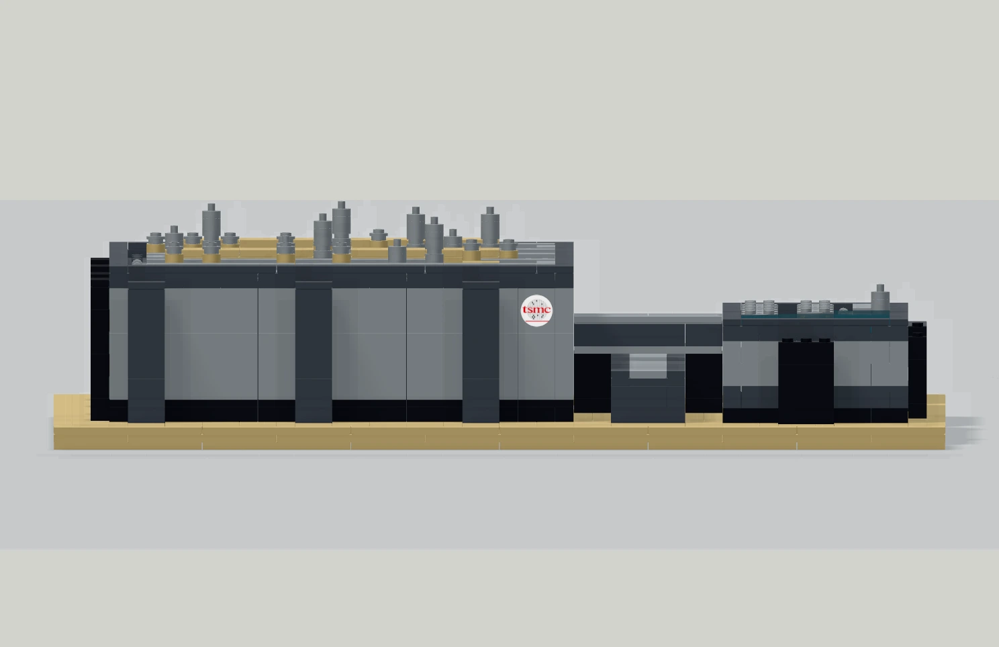
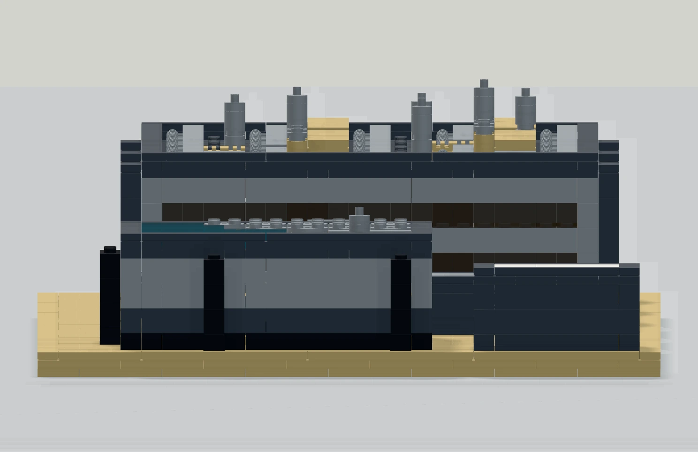
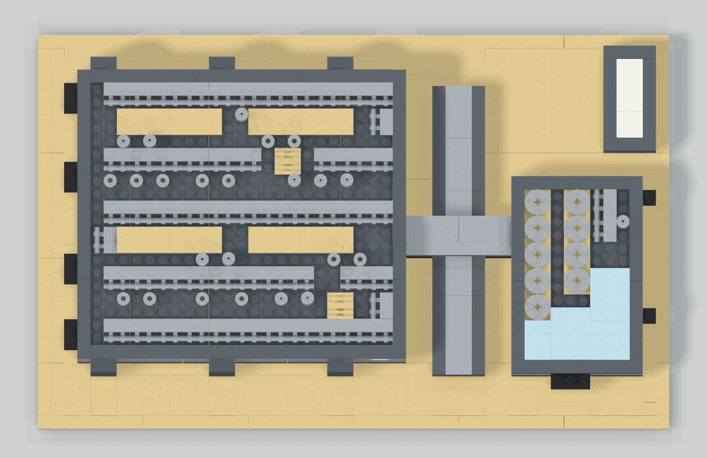

# 亞利桑那晶圓廠｜組裝說明書

FAB 04 · Arizona Fab

黑色基座與三道厚扶壁托住內凹的機電屋頂，沙金色設備列穿插銀灰管路。右側冷卻棟有雙列風扇及藍色冷卻槽，晶圓標誌位於主樓右前角。

992 件 · 4 袋 · 140 步

底座 48 × 30 凸點。

將底座較後的一側朝上，從左上角第 1 顆凸點開始數。X 由左向右，Z 由後向前。底高以薄板為單位，桌面是 0，一塊標準磚高 3 層薄板。每個位置均取零件佔地最左、最後的凸點。

圖號依每一步的安裝順序編列，回到下一個步驟時從 1 重新起算。[圖解說明書](manual.html) · [分袋 BOM](bom.csv) · [分步 LDraw 模型](model.ldr)

## 原盒資料與本版用量

主廠右前側是露天冷卻翼樓，右後側另有白頂長棟。中央長棟、跨棟橫廊與兩者間的留隙可在俯視圖辨認。

TShop 原盒 F010030101 標示 795 件，商品尺寸 19.2 × 30.4 × 8.0 公分。本版使用 992 件標準積木，另有 1 枚貼紙。採購請依本版分袋 BOM。

[原盒與尺寸](https://www.tshop.life/zh-hant/products/micro-brick-series-tsmc-arizona-corporation-pre-order) · [商品三視圖](https://shoplineimg.com/64c760de75653b004eb51fc9/6ae460b175703ed9ded0b463/original.jpg) · [姚仁喜｜大元建築工場・鳳凰城廠區](https://www.krisyaoartech.com/zh-tw/projects/corporate/Tsmc-Phoenix)

## 建築方位與配置

**正面**　三道深色扶壁分割主樓立面，晶圓圓徽位在右上角。

**側面**　較矮的冷卻棟在前，白頂設備間退到後方，中間留出一段沙色場坪。

**俯視**　兩座設備棟之間有縱向窄棟。架高的橫廊從主樓跨過窄棟，通向右前冷卻棟。

## 原寸貼紙

本款有 1 張貼紙。請以 100% 列印原寸貼紙 PDF，依步驟中的 S 編號貼在指定磚面，再把該件扣入。

[下載 A4 可列印貼紙](stickers.pdf)

- S01　主廠房正面右上晶圓圓徽 · 袋 02／步驟 52 · 14 × 14 mm · 正面（朝前），面中央。

## 第 01 袋　底座與定位

104 件，共 13 步。

| 顏色 | 零件 | 設計／庫號 | 數量 |
| --- | --- | --- | ---: |
| 沙色 | 薄板 2×4 | 3020 | 2 |
| 沙色 | 薄板 4×4 | 3031 | 14 |
| 沙色 | 薄板 2×8 | 3034 | 11 |
| 沙色 | 薄板 4×8 | 3035 | 77 |

### 步驟 01　併排底板（1/6）

將底板凸點朝上、長邊對齊排在平桌。下一層會跨接板縫。

**本步取件**

| 顏色 | 零件 | 設計／庫號 | 數量 |
| --- | --- | --- | ---: |
| 沙色 | 薄板 4×8 | 3035 | 8 |

**安裝位置**

| 圖號 | 零件與顏色 | X | Z | 底高（薄板） | 方向 |
| ---: | --- | ---: | ---: | ---: | --- |
| 1 | 沙色 薄板 4×8（3035） | 1 | 1 | 0 | 沿 X |
| 2 | 沙色 薄板 4×8（3035） | 9 | 1 | 0 | 沿 X |
| 3 | 沙色 薄板 4×8（3035） | 17 | 1 | 0 | 沿 X |
| 4 | 沙色 薄板 4×8（3035） | 25 | 1 | 0 | 沿 X |
| 5 | 沙色 薄板 4×8（3035） | 33 | 1 | 0 | 沿 X |
| 6 | 沙色 薄板 4×8（3035） | 41 | 1 | 0 | 沿 X |
| 7 | 沙色 薄板 4×8（3035） | 1 | 5 | 0 | 沿 X |
| 8 | 沙色 薄板 4×8（3035） | 9 | 5 | 0 | 沿 X |

### 步驟 02　併排底板（2/6）

將底板凸點朝上、長邊對齊排在平桌。下一層會跨接板縫。

**本步取件**

| 顏色 | 零件 | 設計／庫號 | 數量 |
| --- | --- | --- | ---: |
| 沙色 | 薄板 4×8 | 3035 | 8 |

**安裝位置**

| 圖號 | 零件與顏色 | X | Z | 底高（薄板） | 方向 |
| ---: | --- | ---: | ---: | ---: | --- |
| 1 | 沙色 薄板 4×8（3035） | 17 | 5 | 0 | 沿 X |
| 2 | 沙色 薄板 4×8（3035） | 25 | 5 | 0 | 沿 X |
| 3 | 沙色 薄板 4×8（3035） | 33 | 5 | 0 | 沿 X |
| 4 | 沙色 薄板 4×8（3035） | 41 | 5 | 0 | 沿 X |
| 5 | 沙色 薄板 4×8（3035） | 1 | 9 | 0 | 沿 X |
| 6 | 沙色 薄板 4×8（3035） | 9 | 9 | 0 | 沿 X |
| 7 | 沙色 薄板 4×8（3035） | 17 | 9 | 0 | 沿 X |
| 8 | 沙色 薄板 4×8（3035） | 25 | 9 | 0 | 沿 X |

### 步驟 03　併排底板（3/6）

將底板凸點朝上、長邊對齊排在平桌。下一層會跨接板縫。

**本步取件**

| 顏色 | 零件 | 設計／庫號 | 數量 |
| --- | --- | --- | ---: |
| 沙色 | 薄板 4×8 | 3035 | 8 |

**安裝位置**

| 圖號 | 零件與顏色 | X | Z | 底高（薄板） | 方向 |
| ---: | --- | ---: | ---: | ---: | --- |
| 1 | 沙色 薄板 4×8（3035） | 33 | 9 | 0 | 沿 X |
| 2 | 沙色 薄板 4×8（3035） | 41 | 9 | 0 | 沿 X |
| 3 | 沙色 薄板 4×8（3035） | 1 | 13 | 0 | 沿 X |
| 4 | 沙色 薄板 4×8（3035） | 9 | 13 | 0 | 沿 X |
| 5 | 沙色 薄板 4×8（3035） | 17 | 13 | 0 | 沿 X |
| 6 | 沙色 薄板 4×8（3035） | 25 | 13 | 0 | 沿 X |
| 7 | 沙色 薄板 4×8（3035） | 33 | 13 | 0 | 沿 X |
| 8 | 沙色 薄板 4×8（3035） | 41 | 13 | 0 | 沿 X |

### 步驟 04　併排底板（4/6）

將底板凸點朝上、長邊對齊排在平桌。下一層會跨接板縫。

**本步取件**

| 顏色 | 零件 | 設計／庫號 | 數量 |
| --- | --- | --- | ---: |
| 沙色 | 薄板 4×8 | 3035 | 8 |

**安裝位置**

| 圖號 | 零件與顏色 | X | Z | 底高（薄板） | 方向 |
| ---: | --- | ---: | ---: | ---: | --- |
| 1 | 沙色 薄板 4×8（3035） | 1 | 17 | 0 | 沿 X |
| 2 | 沙色 薄板 4×8（3035） | 9 | 17 | 0 | 沿 X |
| 3 | 沙色 薄板 4×8（3035） | 17 | 17 | 0 | 沿 X |
| 4 | 沙色 薄板 4×8（3035） | 25 | 17 | 0 | 沿 X |
| 5 | 沙色 薄板 4×8（3035） | 33 | 17 | 0 | 沿 X |
| 6 | 沙色 薄板 4×8（3035） | 41 | 17 | 0 | 沿 X |
| 7 | 沙色 薄板 4×8（3035） | 1 | 21 | 0 | 沿 X |
| 8 | 沙色 薄板 4×8（3035） | 9 | 21 | 0 | 沿 X |

### 步驟 05　併排底板（5/6）

將底板凸點朝上、長邊對齊排在平桌。下一層會跨接板縫。

**本步取件**

| 顏色 | 零件 | 設計／庫號 | 數量 |
| --- | --- | --- | ---: |
| 沙色 | 薄板 4×8 | 3035 | 8 |

**安裝位置**

| 圖號 | 零件與顏色 | X | Z | 底高（薄板） | 方向 |
| ---: | --- | ---: | ---: | ---: | --- |
| 1 | 沙色 薄板 4×8（3035） | 17 | 21 | 0 | 沿 X |
| 2 | 沙色 薄板 4×8（3035） | 25 | 21 | 0 | 沿 X |
| 3 | 沙色 薄板 4×8（3035） | 33 | 21 | 0 | 沿 X |
| 4 | 沙色 薄板 4×8（3035） | 41 | 21 | 0 | 沿 X |
| 5 | 沙色 薄板 4×8（3035） | 1 | 25 | 0 | 沿 X |
| 6 | 沙色 薄板 4×8（3035） | 9 | 25 | 0 | 沿 X |
| 7 | 沙色 薄板 4×8（3035） | 17 | 25 | 0 | 沿 X |
| 8 | 沙色 薄板 4×8（3035） | 25 | 25 | 0 | 沿 X |

### 步驟 06　併排底板（6/6）

將底板凸點朝上、長邊對齊排在平桌。下一層會跨接板縫。

**本步取件**

| 顏色 | 零件 | 設計／庫號 | 數量 |
| --- | --- | --- | ---: |
| 沙色 | 薄板 2×8 | 3034 | 6 |
| 沙色 | 薄板 4×8 | 3035 | 2 |

**安裝位置**

| 圖號 | 零件與顏色 | X | Z | 底高（薄板） | 方向 |
| ---: | --- | ---: | ---: | ---: | --- |
| 1 | 沙色 薄板 4×8（3035） | 33 | 25 | 0 | 沿 X |
| 2 | 沙色 薄板 4×8（3035） | 41 | 25 | 0 | 沿 X |
| 3 | 沙色 薄板 2×8（3034） | 1 | 29 | 0 | 沿 X |
| 4 | 沙色 薄板 2×8（3034） | 9 | 29 | 0 | 沿 X |
| 5 | 沙色 薄板 2×8（3034） | 17 | 29 | 0 | 沿 X |
| 6 | 沙色 薄板 2×8（3034） | 25 | 29 | 0 | 沿 X |
| 7 | 沙色 薄板 2×8（3034） | 33 | 29 | 0 | 沿 X |
| 8 | 沙色 薄板 2×8（3034） | 41 | 29 | 0 | 沿 X |

### 步驟 07　錯縫鎖底（1/7）

上層相對底板橫移四格、縱移兩格。逐排按緊後，底座可整片拿起。

**本步取件**

| 顏色 | 零件 | 設計／庫號 | 數量 |
| --- | --- | --- | ---: |
| 沙色 | 薄板 2×4 | 3020 | 2 |
| 沙色 | 薄板 4×4 | 3031 | 1 |
| 沙色 | 薄板 2×8 | 3034 | 5 |

**安裝位置**

| 圖號 | 零件與顏色 | X | Z | 底高（薄板） | 方向 |
| ---: | --- | ---: | ---: | ---: | --- |
| 1 | 沙色 薄板 2×4（3020） | 1 | 1 | 1 | 沿 X |
| 2 | 沙色 薄板 2×8（3034） | 5 | 1 | 1 | 沿 X |
| 3 | 沙色 薄板 2×8（3034） | 13 | 1 | 1 | 沿 X |
| 4 | 沙色 薄板 2×8（3034） | 21 | 1 | 1 | 沿 X |
| 5 | 沙色 薄板 2×8（3034） | 29 | 1 | 1 | 沿 X |
| 6 | 沙色 薄板 2×8（3034） | 37 | 1 | 1 | 沿 X |
| 7 | 沙色 薄板 2×4（3020） | 45 | 1 | 1 | 沿 X |
| 8 | 沙色 薄板 4×4（3031） | 1 | 3 | 1 | — |

### 步驟 08　錯縫鎖底（2/7）

上層相對底板橫移四格、縱移兩格。逐排按緊後，底座可整片拿起。

**本步取件**

| 顏色 | 零件 | 設計／庫號 | 數量 |
| --- | --- | --- | ---: |
| 沙色 | 薄板 4×4 | 3031 | 2 |
| 沙色 | 薄板 4×8 | 3035 | 6 |

**安裝位置**

| 圖號 | 零件與顏色 | X | Z | 底高（薄板） | 方向 |
| ---: | --- | ---: | ---: | ---: | --- |
| 1 | 沙色 薄板 4×8（3035） | 5 | 3 | 1 | 沿 X |
| 2 | 沙色 薄板 4×8（3035） | 13 | 3 | 1 | 沿 X |
| 3 | 沙色 薄板 4×8（3035） | 21 | 3 | 1 | 沿 X |
| 4 | 沙色 薄板 4×8（3035） | 29 | 3 | 1 | 沿 X |
| 5 | 沙色 薄板 4×8（3035） | 37 | 3 | 1 | 沿 X |
| 6 | 沙色 薄板 4×4（3031） | 45 | 3 | 1 | — |
| 7 | 沙色 薄板 4×4（3031） | 1 | 7 | 1 | — |
| 8 | 沙色 薄板 4×8（3035） | 5 | 7 | 1 | 沿 X |

### 步驟 09　錯縫鎖底（3/7）

上層相對底板橫移四格、縱移兩格。逐排按緊後，底座可整片拿起。

**本步取件**

| 顏色 | 零件 | 設計／庫號 | 數量 |
| --- | --- | --- | ---: |
| 沙色 | 薄板 4×4 | 3031 | 2 |
| 沙色 | 薄板 4×8 | 3035 | 6 |

**安裝位置**

| 圖號 | 零件與顏色 | X | Z | 底高（薄板） | 方向 |
| ---: | --- | ---: | ---: | ---: | --- |
| 1 | 沙色 薄板 4×8（3035） | 13 | 7 | 1 | 沿 X |
| 2 | 沙色 薄板 4×8（3035） | 21 | 7 | 1 | 沿 X |
| 3 | 沙色 薄板 4×8（3035） | 29 | 7 | 1 | 沿 X |
| 4 | 沙色 薄板 4×8（3035） | 37 | 7 | 1 | 沿 X |
| 5 | 沙色 薄板 4×4（3031） | 45 | 7 | 1 | — |
| 6 | 沙色 薄板 4×4（3031） | 1 | 11 | 1 | — |
| 7 | 沙色 薄板 4×8（3035） | 5 | 11 | 1 | 沿 X |
| 8 | 沙色 薄板 4×8（3035） | 13 | 11 | 1 | 沿 X |

### 步驟 10　錯縫鎖底（4/7）

上層相對底板橫移四格、縱移兩格。逐排按緊後，底座可整片拿起。

**本步取件**

| 顏色 | 零件 | 設計／庫號 | 數量 |
| --- | --- | --- | ---: |
| 沙色 | 薄板 4×4 | 3031 | 2 |
| 沙色 | 薄板 4×8 | 3035 | 6 |

**安裝位置**

| 圖號 | 零件與顏色 | X | Z | 底高（薄板） | 方向 |
| ---: | --- | ---: | ---: | ---: | --- |
| 1 | 沙色 薄板 4×8（3035） | 21 | 11 | 1 | 沿 X |
| 2 | 沙色 薄板 4×8（3035） | 29 | 11 | 1 | 沿 X |
| 3 | 沙色 薄板 4×8（3035） | 37 | 11 | 1 | 沿 X |
| 4 | 沙色 薄板 4×4（3031） | 45 | 11 | 1 | — |
| 5 | 沙色 薄板 4×4（3031） | 1 | 15 | 1 | — |
| 6 | 沙色 薄板 4×8（3035） | 5 | 15 | 1 | 沿 X |
| 7 | 沙色 薄板 4×8（3035） | 13 | 15 | 1 | 沿 X |
| 8 | 沙色 薄板 4×8（3035） | 21 | 15 | 1 | 沿 X |

### 步驟 11　錯縫鎖底（5/7）

上層相對底板橫移四格、縱移兩格。逐排按緊後，底座可整片拿起。

**本步取件**

| 顏色 | 零件 | 設計／庫號 | 數量 |
| --- | --- | --- | ---: |
| 沙色 | 薄板 4×4 | 3031 | 2 |
| 沙色 | 薄板 4×8 | 3035 | 6 |

**安裝位置**

| 圖號 | 零件與顏色 | X | Z | 底高（薄板） | 方向 |
| ---: | --- | ---: | ---: | ---: | --- |
| 1 | 沙色 薄板 4×8（3035） | 29 | 15 | 1 | 沿 X |
| 2 | 沙色 薄板 4×8（3035） | 37 | 15 | 1 | 沿 X |
| 3 | 沙色 薄板 4×4（3031） | 45 | 15 | 1 | — |
| 4 | 沙色 薄板 4×4（3031） | 1 | 19 | 1 | — |
| 5 | 沙色 薄板 4×8（3035） | 5 | 19 | 1 | 沿 X |
| 6 | 沙色 薄板 4×8（3035） | 13 | 19 | 1 | 沿 X |
| 7 | 沙色 薄板 4×8（3035） | 21 | 19 | 1 | 沿 X |
| 8 | 沙色 薄板 4×8（3035） | 29 | 19 | 1 | 沿 X |

### 步驟 12　錯縫鎖底（6/7）

上層相對底板橫移四格、縱移兩格。逐排按緊後，底座可整片拿起。

**本步取件**

| 顏色 | 零件 | 設計／庫號 | 數量 |
| --- | --- | --- | ---: |
| 沙色 | 薄板 4×4 | 3031 | 2 |
| 沙色 | 薄板 4×8 | 3035 | 6 |

**安裝位置**

| 圖號 | 零件與顏色 | X | Z | 底高（薄板） | 方向 |
| ---: | --- | ---: | ---: | ---: | --- |
| 1 | 沙色 薄板 4×8（3035） | 37 | 19 | 1 | 沿 X |
| 2 | 沙色 薄板 4×4（3031） | 45 | 19 | 1 | — |
| 3 | 沙色 薄板 4×4（3031） | 1 | 23 | 1 | — |
| 4 | 沙色 薄板 4×8（3035） | 5 | 23 | 1 | 沿 X |
| 5 | 沙色 薄板 4×8（3035） | 13 | 23 | 1 | 沿 X |
| 6 | 沙色 薄板 4×8（3035） | 21 | 23 | 1 | 沿 X |
| 7 | 沙色 薄板 4×8（3035） | 29 | 23 | 1 | 沿 X |
| 8 | 沙色 薄板 4×8（3035） | 37 | 23 | 1 | 沿 X |

### 步驟 13　錯縫鎖底（7/7）

上層相對底板橫移四格、縱移兩格。逐排按緊後，底座可整片拿起。

**本步取件**

| 顏色 | 零件 | 設計／庫號 | 數量 |
| --- | --- | --- | ---: |
| 沙色 | 薄板 4×4 | 3031 | 3 |
| 沙色 | 薄板 4×8 | 3035 | 5 |

**安裝位置**

| 圖號 | 零件與顏色 | X | Z | 底高（薄板） | 方向 |
| ---: | --- | ---: | ---: | ---: | --- |
| 1 | 沙色 薄板 4×4（3031） | 45 | 23 | 1 | — |
| 2 | 沙色 薄板 4×4（3031） | 1 | 27 | 1 | — |
| 3 | 沙色 薄板 4×8（3035） | 5 | 27 | 1 | 沿 X |
| 4 | 沙色 薄板 4×8（3035） | 13 | 27 | 1 | 沿 X |
| 5 | 沙色 薄板 4×8（3035） | 21 | 27 | 1 | 沿 X |
| 6 | 沙色 薄板 4×8（3035） | 29 | 27 | 1 | 沿 X |
| 7 | 沙色 薄板 4×8（3035） | 37 | 27 | 1 | 沿 X |
| 8 | 沙色 薄板 4×4（3031） | 45 | 27 | 1 | — |

## 第 02 袋　主樓、立柱與晶圓銘牌

412 件，共 61 步。

| 顏色 | 零件 | 設計／庫號 | 數量 |
| --- | --- | --- | ---: |
| 黑色 | 磚 1×2 | 3004 | 25 |
| 黑色 | 磚 1×1 | 3005 | 2 |
| 黑色 | 磚 1×8 | 3008 | 9 |
| 黑色 | 磚 1×6 | 3009 | 1 |
| 黑色 | 磚 1×4 | 3010 | 2 |
| 黑色 | 薄板 1×2 | 3023 | 4 |
| 黑色 | 薄板 1×1 | 3024 | 1 |
| 黑色 | 光面板 1×2 | 3069b | 4 |
| 黑色 | 薄板 1×8 | 3460 | 9 |
| 黑色 | 薄板 1×3 | 3623 | 1 |
| 黑色 | 薄板 1×6 | 3666 | 1 |
| 黑色 | 薄板 1×4 | 3710 | 2 |
| 透明煙棕 | 磚 1×1 | 3005 | 80 |
| 淺藍灰 | 磚 1×2 | 3004 | 3 |
| 淺藍灰 | 磚 1×1 | 3005 | 10 |
| 淺藍灰 | 磚 1×8 | 3008 | 37 |
| 淺藍灰 | 磚 1×6 | 3009 | 5 |
| 淺藍灰 | 磚 1×4 | 3010 | 6 |
| 淺藍灰 | 雙層磚 1×2 | 3245c | 1 |
| 深藍灰 | 磚 2×6 | 2456 | 36 |
| 深藍灰 | 磚 2×4 | 3001 | 12 |
| 深藍灰 | 磚 1×2 | 3004 | 48 |
| 深藍灰 | 薄板 1×2 | 3023 | 32 |
| 深藍灰 | 薄板 1×1 | 3024 | 4 |
| 深藍灰 | 薄板 2×8 | 3034 | 16 |
| 深藍灰 | 光面板 1×2 | 3069b | 6 |
| 深藍灰 | 光面板 1×1 | 3070b | 2 |
| 深藍灰 | 薄板 1×8 | 3460 | 11 |
| 深藍灰 | 薄板 1×6 | 3666 | 2 |
| 深藍灰 | 薄板 1×4 | 3710 | 2 |
| 深藍灰 | 薄板 2×6 | 3795 | 26 |
| 深藍灰 | 光面板 1×8 | 4162 | 8 |
| 深藍灰 | 光面板 1×6 | 6636 | 4 |

### 步驟 14　外牆與屋頂承重帶 1（1/4）

灰牆退入深色扶壁後方，中央兩道橫牆承托頂部設備層。

**本步取件**

| 顏色 | 零件 | 設計／庫號 | 數量 |
| --- | --- | --- | ---: |
| 黑色 | 磚 1×1 | 3005 | 1 |
| 黑色 | 磚 1×8 | 3008 | 6 |
| 黑色 | 磚 1×4 | 3010 | 1 |

**安裝位置**

| 圖號 | 零件與顏色 | X | Z | 底高（薄板） | 方向 |
| ---: | --- | ---: | ---: | ---: | --- |
| 1 | 黑色 磚 1×8（3008） | 4 | 4 | 2 | 沿 X |
| 2 | 黑色 磚 1×8（3008） | 12 | 4 | 2 | 沿 X |
| 3 | 黑色 磚 1×8（3008） | 20 | 4 | 2 | 沿 X |
| 4 | 黑色 磚 1×1（3005） | 28 | 4 | 2 | — |
| 5 | 黑色 磚 1×8（3008） | 4 | 5 | 2 | 沿 Z |
| 6 | 黑色 磚 1×8（3008） | 4 | 13 | 2 | 沿 Z |
| 7 | 黑色 磚 1×4（3010） | 4 | 21 | 2 | 沿 Z |
| 8 | 黑色 磚 1×8（3008） | 28 | 5 | 2 | 沿 Z |

### 步驟 15　外牆與屋頂承重帶 1（2/4）

灰牆退入深色扶壁後方，中央兩道橫牆承托頂部設備層。

**本步取件**

| 顏色 | 零件 | 設計／庫號 | 數量 |
| --- | --- | --- | ---: |
| 黑色 | 磚 1×2 | 3004 | 1 |
| 黑色 | 磚 1×1 | 3005 | 1 |
| 黑色 | 磚 1×8 | 3008 | 3 |
| 黑色 | 磚 1×6 | 3009 | 1 |
| 黑色 | 磚 1×4 | 3010 | 1 |
| 深藍灰 | 磚 2×6 | 2456 | 1 |

**安裝位置**

| 圖號 | 零件與顏色 | X | Z | 底高（薄板） | 方向 |
| ---: | --- | ---: | ---: | ---: | --- |
| 1 | 黑色 磚 1×8（3008） | 28 | 13 | 2 | 沿 Z |
| 2 | 黑色 磚 1×4（3010） | 28 | 21 | 2 | 沿 Z |
| 3 | 黑色 磚 1×8（3008） | 4 | 25 | 2 | 沿 X |
| 4 | 黑色 磚 1×8（3008） | 12 | 25 | 2 | 沿 X |
| 5 | 黑色 磚 1×6（3009） | 20 | 25 | 2 | 沿 X |
| 6 | 黑色 磚 1×2（3004） | 26 | 25 | 2 | 沿 X |
| 7 | 黑色 磚 1×1（3005） | 28 | 25 | 2 | — |
| 8 | 深藍灰 磚 2×6（2456） | 5 | 10 | 2 | 沿 X |

### 步驟 16　外牆與屋頂承重帶 1（3/4）

灰牆退入深色扶壁後方，中央兩道橫牆承托頂部設備層。

**本步取件**

| 顏色 | 零件 | 設計／庫號 | 數量 |
| --- | --- | --- | ---: |
| 深藍灰 | 磚 2×6 | 2456 | 5 |
| 深藍灰 | 磚 2×4 | 3001 | 2 |
| 深藍灰 | 磚 1×2 | 3004 | 1 |

**安裝位置**

| 圖號 | 零件與顏色 | X | Z | 底高（薄板） | 方向 |
| ---: | --- | ---: | ---: | ---: | --- |
| 1 | 深藍灰 磚 2×6（2456） | 11 | 10 | 2 | 沿 X |
| 2 | 深藍灰 磚 2×6（2456） | 17 | 10 | 2 | 沿 X |
| 3 | 深藍灰 磚 2×4（3001） | 23 | 10 | 2 | 沿 X |
| 4 | 深藍灰 磚 1×2（3004） | 27 | 10 | 2 | 沿 Z |
| 5 | 深藍灰 磚 2×6（2456） | 5 | 17 | 2 | 沿 X |
| 6 | 深藍灰 磚 2×6（2456） | 11 | 17 | 2 | 沿 X |
| 7 | 深藍灰 磚 2×6（2456） | 17 | 17 | 2 | 沿 X |
| 8 | 深藍灰 磚 2×4（3001） | 23 | 17 | 2 | 沿 X |

### 步驟 17　外牆與屋頂承重帶 1（4/4）

灰牆退入深色扶壁後方，中央兩道橫牆承托頂部設備層。

**本步取件**

| 顏色 | 零件 | 設計／庫號 | 數量 |
| --- | --- | --- | ---: |
| 深藍灰 | 磚 1×2 | 3004 | 1 |

**安裝位置**

| 圖號 | 零件與顏色 | X | Z | 底高（薄板） | 方向 |
| ---: | --- | ---: | ---: | ---: | --- |
| 1 | 深藍灰 磚 1×2（3004） | 27 | 17 | 2 | 沿 Z |

### 步驟 18　三道前扶壁與西側黑柱 1（1/2）

正面三道厚扶壁各寬兩格，側邊深色立柱向外凸出一格。

**本步取件**

| 顏色 | 零件 | 設計／庫號 | 數量 |
| --- | --- | --- | ---: |
| 黑色 | 磚 1×2 | 3004 | 4 |
| 深藍灰 | 磚 1×2 | 3004 | 4 |

**安裝位置**

| 圖號 | 零件與顏色 | X | Z | 底高（薄板） | 方向 |
| ---: | --- | ---: | ---: | ---: | --- |
| 1 | 深藍灰 磚 1×2（3004） | 5 | 26 | 2 | 沿 X |
| 2 | 深藍灰 磚 1×2（3004） | 14 | 26 | 2 | 沿 X |
| 3 | 深藍灰 磚 1×2（3004） | 23 | 26 | 2 | 沿 X |
| 4 | 黑色 磚 1×2（3004） | 3 | 5 | 2 | 沿 Z |
| 5 | 黑色 磚 1×2（3004） | 3 | 11 | 2 | 沿 Z |
| 6 | 黑色 磚 1×2（3004） | 3 | 18 | 2 | 沿 Z |
| 7 | 黑色 磚 1×2（3004） | 3 | 23 | 2 | 沿 Z |
| 8 | 深藍灰 磚 1×2（3004） | 5 | 3 | 2 | 沿 X |

### 步驟 19　三道前扶壁與西側黑柱 1（2/2）

正面三道厚扶壁各寬兩格，側邊深色立柱向外凸出一格。

**本步取件**

| 顏色 | 零件 | 設計／庫號 | 數量 |
| --- | --- | --- | ---: |
| 深藍灰 | 磚 1×2 | 3004 | 2 |

**安裝位置**

| 圖號 | 零件與顏色 | X | Z | 底高（薄板） | 方向 |
| ---: | --- | ---: | ---: | ---: | --- |
| 1 | 深藍灰 磚 1×2（3004） | 14 | 3 | 2 | 沿 X |
| 2 | 深藍灰 磚 1×2（3004） | 23 | 3 | 2 | 沿 X |

### 步驟 20　外牆與屋頂承重帶 2（1/3）

灰牆退入深色扶壁後方，中央兩道橫牆承托頂部設備層。

**本步取件**

| 顏色 | 零件 | 設計／庫號 | 數量 |
| --- | --- | --- | ---: |
| 黑色 | 薄板 1×1 | 3024 | 1 |
| 黑色 | 薄板 1×8 | 3460 | 6 |
| 黑色 | 薄板 1×4 | 3710 | 1 |

**安裝位置**

| 圖號 | 零件與顏色 | X | Z | 底高（薄板） | 方向 |
| ---: | --- | ---: | ---: | ---: | --- |
| 1 | 黑色 薄板 1×8（3460） | 4 | 4 | 5 | 沿 X |
| 2 | 黑色 薄板 1×8（3460） | 12 | 4 | 5 | 沿 X |
| 3 | 黑色 薄板 1×8（3460） | 20 | 4 | 5 | 沿 X |
| 4 | 黑色 薄板 1×1（3024） | 28 | 4 | 5 | — |
| 5 | 黑色 薄板 1×8（3460） | 4 | 5 | 5 | 沿 Z |
| 6 | 黑色 薄板 1×8（3460） | 4 | 13 | 5 | 沿 Z |
| 7 | 黑色 薄板 1×4（3710） | 4 | 21 | 5 | 沿 Z |
| 8 | 黑色 薄板 1×8（3460） | 28 | 5 | 5 | 沿 Z |

### 步驟 21　外牆與屋頂承重帶 2（2/3）

灰牆退入深色扶壁後方，中央兩道橫牆承托頂部設備層。

**本步取件**

| 顏色 | 零件 | 設計／庫號 | 數量 |
| --- | --- | --- | ---: |
| 黑色 | 薄板 1×8 | 3460 | 3 |
| 黑色 | 薄板 1×3 | 3623 | 1 |
| 黑色 | 薄板 1×6 | 3666 | 1 |
| 黑色 | 薄板 1×4 | 3710 | 1 |
| 深藍灰 | 薄板 2×8 | 3034 | 2 |

**安裝位置**

| 圖號 | 零件與顏色 | X | Z | 底高（薄板） | 方向 |
| ---: | --- | ---: | ---: | ---: | --- |
| 1 | 黑色 薄板 1×8（3460） | 28 | 13 | 5 | 沿 Z |
| 2 | 黑色 薄板 1×4（3710） | 28 | 21 | 5 | 沿 Z |
| 3 | 黑色 薄板 1×8（3460） | 4 | 25 | 5 | 沿 X |
| 4 | 黑色 薄板 1×8（3460） | 12 | 25 | 5 | 沿 X |
| 5 | 黑色 薄板 1×6（3666） | 20 | 25 | 5 | 沿 X |
| 6 | 黑色 薄板 1×3（3623） | 26 | 25 | 5 | 沿 X |
| 7 | 深藍灰 薄板 2×8（3034） | 5 | 10 | 5 | 沿 X |
| 8 | 深藍灰 薄板 2×8（3034） | 13 | 10 | 5 | 沿 X |

### 步驟 22　外牆與屋頂承重帶 2（3/3）

灰牆退入深色扶壁後方，中央兩道橫牆承托頂部設備層。

**本步取件**

| 顏色 | 零件 | 設計／庫號 | 數量 |
| --- | --- | --- | ---: |
| 深藍灰 | 薄板 1×2 | 3023 | 2 |
| 深藍灰 | 薄板 2×8 | 3034 | 2 |
| 深藍灰 | 薄板 2×6 | 3795 | 2 |

**安裝位置**

| 圖號 | 零件與顏色 | X | Z | 底高（薄板） | 方向 |
| ---: | --- | ---: | ---: | ---: | --- |
| 1 | 深藍灰 薄板 2×6（3795） | 21 | 10 | 5 | 沿 X |
| 2 | 深藍灰 薄板 1×2（3023） | 27 | 10 | 5 | 沿 Z |
| 3 | 深藍灰 薄板 2×8（3034） | 5 | 17 | 5 | 沿 X |
| 4 | 深藍灰 薄板 2×8（3034） | 13 | 17 | 5 | 沿 X |
| 5 | 深藍灰 薄板 2×6（3795） | 21 | 17 | 5 | 沿 X |
| 6 | 深藍灰 薄板 1×2（3023） | 27 | 17 | 5 | 沿 Z |

### 步驟 23　三道前扶壁與西側黑柱 2（1/2）

正面三道厚扶壁各寬兩格，側邊深色立柱向外凸出一格。

**本步取件**

| 顏色 | 零件 | 設計／庫號 | 數量 |
| --- | --- | --- | ---: |
| 黑色 | 薄板 1×2 | 3023 | 4 |
| 深藍灰 | 薄板 1×2 | 3023 | 4 |

**安裝位置**

| 圖號 | 零件與顏色 | X | Z | 底高（薄板） | 方向 |
| ---: | --- | ---: | ---: | ---: | --- |
| 1 | 深藍灰 薄板 1×2（3023） | 5 | 26 | 5 | 沿 X |
| 2 | 深藍灰 薄板 1×2（3023） | 14 | 26 | 5 | 沿 X |
| 3 | 深藍灰 薄板 1×2（3023） | 23 | 26 | 5 | 沿 X |
| 4 | 黑色 薄板 1×2（3023） | 3 | 5 | 5 | 沿 Z |
| 5 | 黑色 薄板 1×2（3023） | 3 | 11 | 5 | 沿 Z |
| 6 | 黑色 薄板 1×2（3023） | 3 | 18 | 5 | 沿 Z |
| 7 | 黑色 薄板 1×2（3023） | 3 | 23 | 5 | 沿 Z |
| 8 | 深藍灰 薄板 1×2（3023） | 5 | 3 | 5 | 沿 X |

### 步驟 24　三道前扶壁與西側黑柱 2（2/2）

正面三道厚扶壁各寬兩格，側邊深色立柱向外凸出一格。

**本步取件**

| 顏色 | 零件 | 設計／庫號 | 數量 |
| --- | --- | --- | ---: |
| 深藍灰 | 薄板 1×2 | 3023 | 2 |

**安裝位置**

| 圖號 | 零件與顏色 | X | Z | 底高（薄板） | 方向 |
| ---: | --- | ---: | ---: | ---: | --- |
| 1 | 深藍灰 薄板 1×2（3023） | 14 | 3 | 5 | 沿 X |
| 2 | 深藍灰 薄板 1×2（3023） | 23 | 3 | 5 | 沿 X |

### 步驟 25　外牆與屋頂承重帶 3（1/4）

灰牆退入深色扶壁後方，中央兩道橫牆承托頂部設備層。

**本步取件**

| 顏色 | 零件 | 設計／庫號 | 數量 |
| --- | --- | --- | ---: |
| 淺藍灰 | 磚 1×1 | 3005 | 1 |
| 淺藍灰 | 磚 1×8 | 3008 | 6 |
| 淺藍灰 | 磚 1×4 | 3010 | 1 |

**安裝位置**

| 圖號 | 零件與顏色 | X | Z | 底高（薄板） | 方向 |
| ---: | --- | ---: | ---: | ---: | --- |
| 1 | 淺藍灰 磚 1×8（3008） | 4 | 4 | 6 | 沿 X |
| 2 | 淺藍灰 磚 1×8（3008） | 12 | 4 | 6 | 沿 X |
| 3 | 淺藍灰 磚 1×8（3008） | 20 | 4 | 6 | 沿 X |
| 4 | 淺藍灰 磚 1×1（3005） | 28 | 4 | 6 | — |
| 5 | 淺藍灰 磚 1×8（3008） | 4 | 5 | 6 | 沿 Z |
| 6 | 淺藍灰 磚 1×8（3008） | 4 | 13 | 6 | 沿 Z |
| 7 | 淺藍灰 磚 1×4（3010） | 4 | 21 | 6 | 沿 Z |
| 8 | 淺藍灰 磚 1×8（3008） | 28 | 5 | 6 | 沿 Z |

### 步驟 26　外牆與屋頂承重帶 3（2/4）

灰牆退入深色扶壁後方，中央兩道橫牆承托頂部設備層。

**本步取件**

| 顏色 | 零件 | 設計／庫號 | 數量 |
| --- | --- | --- | ---: |
| 淺藍灰 | 磚 1×2 | 3004 | 1 |
| 淺藍灰 | 磚 1×1 | 3005 | 1 |
| 淺藍灰 | 磚 1×8 | 3008 | 3 |
| 淺藍灰 | 磚 1×6 | 3009 | 1 |
| 淺藍灰 | 磚 1×4 | 3010 | 1 |
| 深藍灰 | 磚 2×6 | 2456 | 1 |

**安裝位置**

| 圖號 | 零件與顏色 | X | Z | 底高（薄板） | 方向 |
| ---: | --- | ---: | ---: | ---: | --- |
| 1 | 淺藍灰 磚 1×8（3008） | 28 | 13 | 6 | 沿 Z |
| 2 | 淺藍灰 磚 1×4（3010） | 28 | 21 | 6 | 沿 Z |
| 3 | 淺藍灰 磚 1×8（3008） | 4 | 25 | 6 | 沿 X |
| 4 | 淺藍灰 磚 1×8（3008） | 12 | 25 | 6 | 沿 X |
| 5 | 淺藍灰 磚 1×6（3009） | 20 | 25 | 6 | 沿 X |
| 6 | 淺藍灰 磚 1×2（3004） | 26 | 25 | 6 | 沿 X |
| 7 | 淺藍灰 磚 1×1（3005） | 28 | 25 | 6 | — |
| 8 | 深藍灰 磚 2×6（2456） | 5 | 10 | 6 | 沿 X |

### 步驟 27　外牆與屋頂承重帶 3（3/4）

灰牆退入深色扶壁後方，中央兩道橫牆承托頂部設備層。

**本步取件**

| 顏色 | 零件 | 設計／庫號 | 數量 |
| --- | --- | --- | ---: |
| 深藍灰 | 磚 2×6 | 2456 | 5 |
| 深藍灰 | 磚 2×4 | 3001 | 2 |
| 深藍灰 | 磚 1×2 | 3004 | 1 |

**安裝位置**

| 圖號 | 零件與顏色 | X | Z | 底高（薄板） | 方向 |
| ---: | --- | ---: | ---: | ---: | --- |
| 1 | 深藍灰 磚 2×6（2456） | 11 | 10 | 6 | 沿 X |
| 2 | 深藍灰 磚 2×6（2456） | 17 | 10 | 6 | 沿 X |
| 3 | 深藍灰 磚 2×4（3001） | 23 | 10 | 6 | 沿 X |
| 4 | 深藍灰 磚 1×2（3004） | 27 | 10 | 6 | 沿 Z |
| 5 | 深藍灰 磚 2×6（2456） | 5 | 17 | 6 | 沿 X |
| 6 | 深藍灰 磚 2×6（2456） | 11 | 17 | 6 | 沿 X |
| 7 | 深藍灰 磚 2×6（2456） | 17 | 17 | 6 | 沿 X |
| 8 | 深藍灰 磚 2×4（3001） | 23 | 17 | 6 | 沿 X |

### 步驟 28　外牆與屋頂承重帶 3（4/4）

灰牆退入深色扶壁後方，中央兩道橫牆承托頂部設備層。

**本步取件**

| 顏色 | 零件 | 設計／庫號 | 數量 |
| --- | --- | --- | ---: |
| 深藍灰 | 磚 1×2 | 3004 | 1 |

**安裝位置**

| 圖號 | 零件與顏色 | X | Z | 底高（薄板） | 方向 |
| ---: | --- | ---: | ---: | ---: | --- |
| 1 | 深藍灰 磚 1×2（3004） | 27 | 17 | 6 | 沿 Z |

### 步驟 29　三道前扶壁與西側黑柱 3（1/2）

正面三道厚扶壁各寬兩格，側邊深色立柱向外凸出一格。

**本步取件**

| 顏色 | 零件 | 設計／庫號 | 數量 |
| --- | --- | --- | ---: |
| 黑色 | 磚 1×2 | 3004 | 4 |
| 深藍灰 | 磚 1×2 | 3004 | 4 |

**安裝位置**

| 圖號 | 零件與顏色 | X | Z | 底高（薄板） | 方向 |
| ---: | --- | ---: | ---: | ---: | --- |
| 1 | 深藍灰 磚 1×2（3004） | 5 | 26 | 6 | 沿 X |
| 2 | 深藍灰 磚 1×2（3004） | 14 | 26 | 6 | 沿 X |
| 3 | 深藍灰 磚 1×2（3004） | 23 | 26 | 6 | 沿 X |
| 4 | 黑色 磚 1×2（3004） | 3 | 5 | 6 | 沿 Z |
| 5 | 黑色 磚 1×2（3004） | 3 | 11 | 6 | 沿 Z |
| 6 | 黑色 磚 1×2（3004） | 3 | 18 | 6 | 沿 Z |
| 7 | 黑色 磚 1×2（3004） | 3 | 23 | 6 | 沿 Z |
| 8 | 深藍灰 磚 1×2（3004） | 5 | 3 | 6 | 沿 X |

### 步驟 30　三道前扶壁與西側黑柱 3（2/2）

正面三道厚扶壁各寬兩格，側邊深色立柱向外凸出一格。

**本步取件**

| 顏色 | 零件 | 設計／庫號 | 數量 |
| --- | --- | --- | ---: |
| 深藍灰 | 磚 1×2 | 3004 | 2 |

**安裝位置**

| 圖號 | 零件與顏色 | X | Z | 底高（薄板） | 方向 |
| ---: | --- | ---: | ---: | ---: | --- |
| 1 | 深藍灰 磚 1×2（3004） | 14 | 3 | 6 | 沿 X |
| 2 | 深藍灰 磚 1×2（3004） | 23 | 3 | 6 | 沿 X |

### 步驟 31　外牆與屋頂承重帶 4（1/8）

灰牆退入深色扶壁後方，中央兩道橫牆承托頂部設備層。

**本步取件**

| 顏色 | 零件 | 設計／庫號 | 數量 |
| --- | --- | --- | ---: |
| 透明煙棕 | 磚 1×1 | 3005 | 4 |
| 淺藍灰 | 磚 1×1 | 3005 | 1 |
| 淺藍灰 | 磚 1×8 | 3008 | 3 |

**安裝位置**

| 圖號 | 零件與顏色 | X | Z | 底高（薄板） | 方向 |
| ---: | --- | ---: | ---: | ---: | --- |
| 1 | 淺藍灰 磚 1×8（3008） | 4 | 4 | 9 | 沿 X |
| 2 | 淺藍灰 磚 1×8（3008） | 12 | 4 | 9 | 沿 X |
| 3 | 淺藍灰 磚 1×8（3008） | 20 | 4 | 9 | 沿 X |
| 4 | 淺藍灰 磚 1×1（3005） | 28 | 4 | 9 | — |
| 5 | 透明煙棕 磚 1×1（3005） | 4 | 5 | 9 | — |
| 6 | 透明煙棕 磚 1×1（3005） | 4 | 6 | 9 | — |
| 7 | 透明煙棕 磚 1×1（3005） | 4 | 7 | 9 | — |
| 8 | 透明煙棕 磚 1×1（3005） | 4 | 8 | 9 | — |

### 步驟 32　外牆與屋頂承重帶 4（2/8）

灰牆退入深色扶壁後方，中央兩道橫牆承托頂部設備層。

**本步取件**

| 顏色 | 零件 | 設計／庫號 | 數量 |
| --- | --- | --- | ---: |
| 透明煙棕 | 磚 1×1 | 3005 | 8 |

**安裝位置**

| 圖號 | 零件與顏色 | X | Z | 底高（薄板） | 方向 |
| ---: | --- | ---: | ---: | ---: | --- |
| 1 | 透明煙棕 磚 1×1（3005） | 4 | 9 | 9 | — |
| 2 | 透明煙棕 磚 1×1（3005） | 4 | 10 | 9 | — |
| 3 | 透明煙棕 磚 1×1（3005） | 4 | 11 | 9 | — |
| 4 | 透明煙棕 磚 1×1（3005） | 4 | 12 | 9 | — |
| 5 | 透明煙棕 磚 1×1（3005） | 4 | 13 | 9 | — |
| 6 | 透明煙棕 磚 1×1（3005） | 4 | 14 | 9 | — |
| 7 | 透明煙棕 磚 1×1（3005） | 4 | 15 | 9 | — |
| 8 | 透明煙棕 磚 1×1（3005） | 4 | 16 | 9 | — |

### 步驟 33　外牆與屋頂承重帶 4（3/8）

灰牆退入深色扶壁後方，中央兩道橫牆承托頂部設備層。

**本步取件**

| 顏色 | 零件 | 設計／庫號 | 數量 |
| --- | --- | --- | ---: |
| 透明煙棕 | 磚 1×1 | 3005 | 8 |

**安裝位置**

| 圖號 | 零件與顏色 | X | Z | 底高（薄板） | 方向 |
| ---: | --- | ---: | ---: | ---: | --- |
| 1 | 透明煙棕 磚 1×1（3005） | 4 | 17 | 9 | — |
| 2 | 透明煙棕 磚 1×1（3005） | 4 | 18 | 9 | — |
| 3 | 透明煙棕 磚 1×1（3005） | 4 | 19 | 9 | — |
| 4 | 透明煙棕 磚 1×1（3005） | 4 | 20 | 9 | — |
| 5 | 透明煙棕 磚 1×1（3005） | 4 | 21 | 9 | — |
| 6 | 透明煙棕 磚 1×1（3005） | 4 | 22 | 9 | — |
| 7 | 透明煙棕 磚 1×1（3005） | 4 | 23 | 9 | — |
| 8 | 透明煙棕 磚 1×1（3005） | 4 | 24 | 9 | — |

### 步驟 34　外牆與屋頂承重帶 4（4/8）

灰牆退入深色扶壁後方，中央兩道橫牆承托頂部設備層。

**本步取件**

| 顏色 | 零件 | 設計／庫號 | 數量 |
| --- | --- | --- | ---: |
| 透明煙棕 | 磚 1×1 | 3005 | 8 |

**安裝位置**

| 圖號 | 零件與顏色 | X | Z | 底高（薄板） | 方向 |
| ---: | --- | ---: | ---: | ---: | --- |
| 1 | 透明煙棕 磚 1×1（3005） | 28 | 5 | 9 | — |
| 2 | 透明煙棕 磚 1×1（3005） | 28 | 6 | 9 | — |
| 3 | 透明煙棕 磚 1×1（3005） | 28 | 7 | 9 | — |
| 4 | 透明煙棕 磚 1×1（3005） | 28 | 8 | 9 | — |
| 5 | 透明煙棕 磚 1×1（3005） | 28 | 9 | 9 | — |
| 6 | 透明煙棕 磚 1×1（3005） | 28 | 10 | 9 | — |
| 7 | 透明煙棕 磚 1×1（3005） | 28 | 11 | 9 | — |
| 8 | 透明煙棕 磚 1×1（3005） | 28 | 12 | 9 | — |

### 步驟 35　外牆與屋頂承重帶 4（5/8）

灰牆退入深色扶壁後方，中央兩道橫牆承托頂部設備層。

**本步取件**

| 顏色 | 零件 | 設計／庫號 | 數量 |
| --- | --- | --- | ---: |
| 透明煙棕 | 磚 1×1 | 3005 | 8 |

**安裝位置**

| 圖號 | 零件與顏色 | X | Z | 底高（薄板） | 方向 |
| ---: | --- | ---: | ---: | ---: | --- |
| 1 | 透明煙棕 磚 1×1（3005） | 28 | 13 | 9 | — |
| 2 | 透明煙棕 磚 1×1（3005） | 28 | 14 | 9 | — |
| 3 | 透明煙棕 磚 1×1（3005） | 28 | 15 | 9 | — |
| 4 | 透明煙棕 磚 1×1（3005） | 28 | 16 | 9 | — |
| 5 | 透明煙棕 磚 1×1（3005） | 28 | 17 | 9 | — |
| 6 | 透明煙棕 磚 1×1（3005） | 28 | 18 | 9 | — |
| 7 | 透明煙棕 磚 1×1（3005） | 28 | 19 | 9 | — |
| 8 | 透明煙棕 磚 1×1（3005） | 28 | 20 | 9 | — |

### 步驟 36　外牆與屋頂承重帶 4（6/8）

灰牆退入深色扶壁後方，中央兩道橫牆承托頂部設備層。

**本步取件**

| 顏色 | 零件 | 設計／庫號 | 數量 |
| --- | --- | --- | ---: |
| 透明煙棕 | 磚 1×1 | 3005 | 4 |
| 淺藍灰 | 磚 1×2 | 3004 | 1 |
| 淺藍灰 | 磚 1×8 | 3008 | 2 |
| 淺藍灰 | 磚 1×6 | 3009 | 1 |

**安裝位置**

| 圖號 | 零件與顏色 | X | Z | 底高（薄板） | 方向 |
| ---: | --- | ---: | ---: | ---: | --- |
| 1 | 透明煙棕 磚 1×1（3005） | 28 | 21 | 9 | — |
| 2 | 透明煙棕 磚 1×1（3005） | 28 | 22 | 9 | — |
| 3 | 透明煙棕 磚 1×1（3005） | 28 | 23 | 9 | — |
| 4 | 透明煙棕 磚 1×1（3005） | 28 | 24 | 9 | — |
| 5 | 淺藍灰 磚 1×8（3008） | 4 | 25 | 9 | 沿 X |
| 6 | 淺藍灰 磚 1×8（3008） | 12 | 25 | 9 | 沿 X |
| 7 | 淺藍灰 磚 1×6（3009） | 20 | 25 | 9 | 沿 X |
| 8 | 淺藍灰 磚 1×2（3004） | 26 | 25 | 9 | 沿 X |

### 步驟 37　外牆與屋頂承重帶 4（7/8）

灰牆退入深色扶壁後方，中央兩道橫牆承托頂部設備層。

**本步取件**

| 顏色 | 零件 | 設計／庫號 | 數量 |
| --- | --- | --- | ---: |
| 淺藍灰 | 磚 1×1 | 3005 | 1 |
| 深藍灰 | 磚 2×6 | 2456 | 5 |
| 深藍灰 | 磚 2×4 | 3001 | 1 |
| 深藍灰 | 磚 1×2 | 3004 | 1 |

**安裝位置**

| 圖號 | 零件與顏色 | X | Z | 底高（薄板） | 方向 |
| ---: | --- | ---: | ---: | ---: | --- |
| 1 | 淺藍灰 磚 1×1（3005） | 28 | 25 | 9 | — |
| 2 | 深藍灰 磚 2×6（2456） | 5 | 10 | 9 | 沿 X |
| 3 | 深藍灰 磚 2×6（2456） | 11 | 10 | 9 | 沿 X |
| 4 | 深藍灰 磚 2×6（2456） | 17 | 10 | 9 | 沿 X |
| 5 | 深藍灰 磚 2×4（3001） | 23 | 10 | 9 | 沿 X |
| 6 | 深藍灰 磚 1×2（3004） | 27 | 10 | 9 | 沿 Z |
| 7 | 深藍灰 磚 2×6（2456） | 5 | 17 | 9 | 沿 X |
| 8 | 深藍灰 磚 2×6（2456） | 11 | 17 | 9 | 沿 X |

### 步驟 38　外牆與屋頂承重帶 4（8/8）

灰牆退入深色扶壁後方，中央兩道橫牆承托頂部設備層。

**本步取件**

| 顏色 | 零件 | 設計／庫號 | 數量 |
| --- | --- | --- | ---: |
| 深藍灰 | 磚 2×6 | 2456 | 1 |
| 深藍灰 | 磚 2×4 | 3001 | 1 |
| 深藍灰 | 磚 1×2 | 3004 | 1 |

**安裝位置**

| 圖號 | 零件與顏色 | X | Z | 底高（薄板） | 方向 |
| ---: | --- | ---: | ---: | ---: | --- |
| 1 | 深藍灰 磚 2×6（2456） | 17 | 17 | 9 | 沿 X |
| 2 | 深藍灰 磚 2×4（3001） | 23 | 17 | 9 | 沿 X |
| 3 | 深藍灰 磚 1×2（3004） | 27 | 17 | 9 | 沿 Z |

### 步驟 39　三道前扶壁與西側黑柱 4（1/2）

正面三道厚扶壁各寬兩格，側邊深色立柱向外凸出一格。

**本步取件**

| 顏色 | 零件 | 設計／庫號 | 數量 |
| --- | --- | --- | ---: |
| 黑色 | 磚 1×2 | 3004 | 4 |
| 深藍灰 | 磚 1×2 | 3004 | 4 |

**安裝位置**

| 圖號 | 零件與顏色 | X | Z | 底高（薄板） | 方向 |
| ---: | --- | ---: | ---: | ---: | --- |
| 1 | 深藍灰 磚 1×2（3004） | 5 | 26 | 9 | 沿 X |
| 2 | 深藍灰 磚 1×2（3004） | 14 | 26 | 9 | 沿 X |
| 3 | 深藍灰 磚 1×2（3004） | 23 | 26 | 9 | 沿 X |
| 4 | 黑色 磚 1×2（3004） | 3 | 5 | 9 | 沿 Z |
| 5 | 黑色 磚 1×2（3004） | 3 | 11 | 9 | 沿 Z |
| 6 | 黑色 磚 1×2（3004） | 3 | 18 | 9 | 沿 Z |
| 7 | 黑色 磚 1×2（3004） | 3 | 23 | 9 | 沿 Z |
| 8 | 深藍灰 磚 1×2（3004） | 5 | 3 | 9 | 沿 X |

### 步驟 40　三道前扶壁與西側黑柱 4（2/2）

正面三道厚扶壁各寬兩格，側邊深色立柱向外凸出一格。

**本步取件**

| 顏色 | 零件 | 設計／庫號 | 數量 |
| --- | --- | --- | ---: |
| 深藍灰 | 磚 1×2 | 3004 | 2 |

**安裝位置**

| 圖號 | 零件與顏色 | X | Z | 底高（薄板） | 方向 |
| ---: | --- | ---: | ---: | ---: | --- |
| 1 | 深藍灰 磚 1×2（3004） | 14 | 3 | 9 | 沿 X |
| 2 | 深藍灰 磚 1×2（3004） | 23 | 3 | 9 | 沿 X |

### 步驟 41　外牆與屋頂承重帶 5（1/4）

灰牆退入深色扶壁後方，中央兩道橫牆承托頂部設備層。

**本步取件**

| 顏色 | 零件 | 設計／庫號 | 數量 |
| --- | --- | --- | ---: |
| 淺藍灰 | 磚 1×1 | 3005 | 1 |
| 淺藍灰 | 磚 1×8 | 3008 | 6 |
| 淺藍灰 | 磚 1×4 | 3010 | 1 |

**安裝位置**

| 圖號 | 零件與顏色 | X | Z | 底高（薄板） | 方向 |
| ---: | --- | ---: | ---: | ---: | --- |
| 1 | 淺藍灰 磚 1×8（3008） | 4 | 4 | 12 | 沿 X |
| 2 | 淺藍灰 磚 1×8（3008） | 12 | 4 | 12 | 沿 X |
| 3 | 淺藍灰 磚 1×8（3008） | 20 | 4 | 12 | 沿 X |
| 4 | 淺藍灰 磚 1×1（3005） | 28 | 4 | 12 | — |
| 5 | 淺藍灰 磚 1×8（3008） | 4 | 5 | 12 | 沿 Z |
| 6 | 淺藍灰 磚 1×8（3008） | 4 | 13 | 12 | 沿 Z |
| 7 | 淺藍灰 磚 1×4（3010） | 4 | 21 | 12 | 沿 Z |
| 8 | 淺藍灰 磚 1×8（3008） | 28 | 5 | 12 | 沿 Z |

### 步驟 42　外牆與屋頂承重帶 5（2/4）

灰牆退入深色扶壁後方，中央兩道橫牆承托頂部設備層。

**本步取件**

| 顏色 | 零件 | 設計／庫號 | 數量 |
| --- | --- | --- | ---: |
| 淺藍灰 | 磚 1×2 | 3004 | 1 |
| 淺藍灰 | 磚 1×1 | 3005 | 1 |
| 淺藍灰 | 磚 1×8 | 3008 | 3 |
| 淺藍灰 | 磚 1×6 | 3009 | 1 |
| 淺藍灰 | 磚 1×4 | 3010 | 1 |
| 深藍灰 | 磚 2×6 | 2456 | 1 |

**安裝位置**

| 圖號 | 零件與顏色 | X | Z | 底高（薄板） | 方向 |
| ---: | --- | ---: | ---: | ---: | --- |
| 1 | 淺藍灰 磚 1×8（3008） | 28 | 13 | 12 | 沿 Z |
| 2 | 淺藍灰 磚 1×4（3010） | 28 | 21 | 12 | 沿 Z |
| 3 | 淺藍灰 磚 1×8（3008） | 4 | 25 | 12 | 沿 X |
| 4 | 淺藍灰 磚 1×8（3008） | 12 | 25 | 12 | 沿 X |
| 5 | 淺藍灰 磚 1×6（3009） | 20 | 25 | 12 | 沿 X |
| 6 | 淺藍灰 磚 1×2（3004） | 26 | 25 | 12 | 沿 X |
| 7 | 淺藍灰 磚 1×1（3005） | 28 | 25 | 12 | — |
| 8 | 深藍灰 磚 2×6（2456） | 5 | 10 | 12 | 沿 X |

### 步驟 43　外牆與屋頂承重帶 5（3/4）

灰牆退入深色扶壁後方，中央兩道橫牆承托頂部設備層。

**本步取件**

| 顏色 | 零件 | 設計／庫號 | 數量 |
| --- | --- | --- | ---: |
| 深藍灰 | 磚 2×6 | 2456 | 5 |
| 深藍灰 | 磚 2×4 | 3001 | 2 |
| 深藍灰 | 磚 1×2 | 3004 | 1 |

**安裝位置**

| 圖號 | 零件與顏色 | X | Z | 底高（薄板） | 方向 |
| ---: | --- | ---: | ---: | ---: | --- |
| 1 | 深藍灰 磚 2×6（2456） | 11 | 10 | 12 | 沿 X |
| 2 | 深藍灰 磚 2×6（2456） | 17 | 10 | 12 | 沿 X |
| 3 | 深藍灰 磚 2×4（3001） | 23 | 10 | 12 | 沿 X |
| 4 | 深藍灰 磚 1×2（3004） | 27 | 10 | 12 | 沿 Z |
| 5 | 深藍灰 磚 2×6（2456） | 5 | 17 | 12 | 沿 X |
| 6 | 深藍灰 磚 2×6（2456） | 11 | 17 | 12 | 沿 X |
| 7 | 深藍灰 磚 2×6（2456） | 17 | 17 | 12 | 沿 X |
| 8 | 深藍灰 磚 2×4（3001） | 23 | 17 | 12 | 沿 X |

### 步驟 44　外牆與屋頂承重帶 5（4/4）

灰牆退入深色扶壁後方，中央兩道橫牆承托頂部設備層。

**本步取件**

| 顏色 | 零件 | 設計／庫號 | 數量 |
| --- | --- | --- | ---: |
| 深藍灰 | 磚 1×2 | 3004 | 1 |

**安裝位置**

| 圖號 | 零件與顏色 | X | Z | 底高（薄板） | 方向 |
| ---: | --- | ---: | ---: | ---: | --- |
| 1 | 深藍灰 磚 1×2（3004） | 27 | 17 | 12 | 沿 Z |

### 步驟 45　三道前扶壁與西側黑柱 5（1/2）

正面三道厚扶壁各寬兩格，側邊深色立柱向外凸出一格。

**本步取件**

| 顏色 | 零件 | 設計／庫號 | 數量 |
| --- | --- | --- | ---: |
| 黑色 | 磚 1×2 | 3004 | 4 |
| 深藍灰 | 磚 1×2 | 3004 | 4 |

**安裝位置**

| 圖號 | 零件與顏色 | X | Z | 底高（薄板） | 方向 |
| ---: | --- | ---: | ---: | ---: | --- |
| 1 | 深藍灰 磚 1×2（3004） | 5 | 26 | 12 | 沿 X |
| 2 | 深藍灰 磚 1×2（3004） | 14 | 26 | 12 | 沿 X |
| 3 | 深藍灰 磚 1×2（3004） | 23 | 26 | 12 | 沿 X |
| 4 | 黑色 磚 1×2（3004） | 3 | 5 | 12 | 沿 Z |
| 5 | 黑色 磚 1×2（3004） | 3 | 11 | 12 | 沿 Z |
| 6 | 黑色 磚 1×2（3004） | 3 | 18 | 12 | 沿 Z |
| 7 | 黑色 磚 1×2（3004） | 3 | 23 | 12 | 沿 Z |
| 8 | 深藍灰 磚 1×2（3004） | 5 | 3 | 12 | 沿 X |

### 步驟 46　三道前扶壁與西側黑柱 5（2/2）

正面三道厚扶壁各寬兩格，側邊深色立柱向外凸出一格。

**本步取件**

| 顏色 | 零件 | 設計／庫號 | 數量 |
| --- | --- | --- | ---: |
| 深藍灰 | 磚 1×2 | 3004 | 2 |

**安裝位置**

| 圖號 | 零件與顏色 | X | Z | 底高（薄板） | 方向 |
| ---: | --- | ---: | ---: | ---: | --- |
| 1 | 深藍灰 磚 1×2（3004） | 14 | 3 | 12 | 沿 X |
| 2 | 深藍灰 磚 1×2（3004） | 23 | 3 | 12 | 沿 X |

### 步驟 47　外牆與屋頂承重帶 6（1/8）

灰牆退入深色扶壁後方，中央兩道橫牆承托頂部設備層。

**本步取件**

| 顏色 | 零件 | 設計／庫號 | 數量 |
| --- | --- | --- | ---: |
| 透明煙棕 | 磚 1×1 | 3005 | 4 |
| 淺藍灰 | 磚 1×1 | 3005 | 1 |
| 淺藍灰 | 磚 1×8 | 3008 | 3 |

**安裝位置**

| 圖號 | 零件與顏色 | X | Z | 底高（薄板） | 方向 |
| ---: | --- | ---: | ---: | ---: | --- |
| 1 | 淺藍灰 磚 1×8（3008） | 4 | 4 | 15 | 沿 X |
| 2 | 淺藍灰 磚 1×8（3008） | 12 | 4 | 15 | 沿 X |
| 3 | 淺藍灰 磚 1×8（3008） | 20 | 4 | 15 | 沿 X |
| 4 | 淺藍灰 磚 1×1（3005） | 28 | 4 | 15 | — |
| 5 | 透明煙棕 磚 1×1（3005） | 4 | 5 | 15 | — |
| 6 | 透明煙棕 磚 1×1（3005） | 4 | 6 | 15 | — |
| 7 | 透明煙棕 磚 1×1（3005） | 4 | 7 | 15 | — |
| 8 | 透明煙棕 磚 1×1（3005） | 4 | 8 | 15 | — |

### 步驟 48　外牆與屋頂承重帶 6（2/8）

灰牆退入深色扶壁後方，中央兩道橫牆承托頂部設備層。

**本步取件**

| 顏色 | 零件 | 設計／庫號 | 數量 |
| --- | --- | --- | ---: |
| 透明煙棕 | 磚 1×1 | 3005 | 8 |

**安裝位置**

| 圖號 | 零件與顏色 | X | Z | 底高（薄板） | 方向 |
| ---: | --- | ---: | ---: | ---: | --- |
| 1 | 透明煙棕 磚 1×1（3005） | 4 | 9 | 15 | — |
| 2 | 透明煙棕 磚 1×1（3005） | 4 | 10 | 15 | — |
| 3 | 透明煙棕 磚 1×1（3005） | 4 | 11 | 15 | — |
| 4 | 透明煙棕 磚 1×1（3005） | 4 | 12 | 15 | — |
| 5 | 透明煙棕 磚 1×1（3005） | 4 | 13 | 15 | — |
| 6 | 透明煙棕 磚 1×1（3005） | 4 | 14 | 15 | — |
| 7 | 透明煙棕 磚 1×1（3005） | 4 | 15 | 15 | — |
| 8 | 透明煙棕 磚 1×1（3005） | 4 | 16 | 15 | — |

### 步驟 49　外牆與屋頂承重帶 6（3/8）

灰牆退入深色扶壁後方，中央兩道橫牆承托頂部設備層。

**本步取件**

| 顏色 | 零件 | 設計／庫號 | 數量 |
| --- | --- | --- | ---: |
| 透明煙棕 | 磚 1×1 | 3005 | 8 |

**安裝位置**

| 圖號 | 零件與顏色 | X | Z | 底高（薄板） | 方向 |
| ---: | --- | ---: | ---: | ---: | --- |
| 1 | 透明煙棕 磚 1×1（3005） | 4 | 17 | 15 | — |
| 2 | 透明煙棕 磚 1×1（3005） | 4 | 18 | 15 | — |
| 3 | 透明煙棕 磚 1×1（3005） | 4 | 19 | 15 | — |
| 4 | 透明煙棕 磚 1×1（3005） | 4 | 20 | 15 | — |
| 5 | 透明煙棕 磚 1×1（3005） | 4 | 21 | 15 | — |
| 6 | 透明煙棕 磚 1×1（3005） | 4 | 22 | 15 | — |
| 7 | 透明煙棕 磚 1×1（3005） | 4 | 23 | 15 | — |
| 8 | 透明煙棕 磚 1×1（3005） | 4 | 24 | 15 | — |

### 步驟 50　外牆與屋頂承重帶 6（4/8）

灰牆退入深色扶壁後方，中央兩道橫牆承托頂部設備層。

**本步取件**

| 顏色 | 零件 | 設計／庫號 | 數量 |
| --- | --- | --- | ---: |
| 透明煙棕 | 磚 1×1 | 3005 | 8 |

**安裝位置**

| 圖號 | 零件與顏色 | X | Z | 底高（薄板） | 方向 |
| ---: | --- | ---: | ---: | ---: | --- |
| 1 | 透明煙棕 磚 1×1（3005） | 28 | 5 | 15 | — |
| 2 | 透明煙棕 磚 1×1（3005） | 28 | 6 | 15 | — |
| 3 | 透明煙棕 磚 1×1（3005） | 28 | 7 | 15 | — |
| 4 | 透明煙棕 磚 1×1（3005） | 28 | 8 | 15 | — |
| 5 | 透明煙棕 磚 1×1（3005） | 28 | 9 | 15 | — |
| 6 | 透明煙棕 磚 1×1（3005） | 28 | 10 | 15 | — |
| 7 | 透明煙棕 磚 1×1（3005） | 28 | 11 | 15 | — |
| 8 | 透明煙棕 磚 1×1（3005） | 28 | 12 | 15 | — |

### 步驟 51　外牆與屋頂承重帶 6（5/8）

灰牆退入深色扶壁後方，中央兩道橫牆承托頂部設備層。

**本步取件**

| 顏色 | 零件 | 設計／庫號 | 數量 |
| --- | --- | --- | ---: |
| 透明煙棕 | 磚 1×1 | 3005 | 8 |

**安裝位置**

| 圖號 | 零件與顏色 | X | Z | 底高（薄板） | 方向 |
| ---: | --- | ---: | ---: | ---: | --- |
| 1 | 透明煙棕 磚 1×1（3005） | 28 | 13 | 15 | — |
| 2 | 透明煙棕 磚 1×1（3005） | 28 | 14 | 15 | — |
| 3 | 透明煙棕 磚 1×1（3005） | 28 | 15 | 15 | — |
| 4 | 透明煙棕 磚 1×1（3005） | 28 | 16 | 15 | — |
| 5 | 透明煙棕 磚 1×1（3005） | 28 | 17 | 15 | — |
| 6 | 透明煙棕 磚 1×1（3005） | 28 | 18 | 15 | — |
| 7 | 透明煙棕 磚 1×1（3005） | 28 | 19 | 15 | — |
| 8 | 透明煙棕 磚 1×1（3005） | 28 | 20 | 15 | — |

### 步驟 52　外牆與屋頂承重帶 6（6/8）

灰牆退入深色扶壁後方，中央兩道橫牆承托頂部設備層。

**本步取件**

| 顏色 | 零件 | 設計／庫號 | 數量 |
| --- | --- | --- | ---: |
| 透明煙棕 | 磚 1×1 | 3005 | 4 |
| 淺藍灰 | 磚 1×8 | 3008 | 2 |
| 淺藍灰 | 磚 1×6 | 3009 | 1 |
| 淺藍灰 | 雙層磚 1×2 | 3245c | 1 |

**安裝位置**

| 圖號 | 零件與顏色 | X | Z | 底高（薄板） | 方向 |
| ---: | --- | ---: | ---: | ---: | --- |
| 1 | 透明煙棕 磚 1×1（3005） | 28 | 21 | 15 | — |
| 2 | 透明煙棕 磚 1×1（3005） | 28 | 22 | 15 | — |
| 3 | 透明煙棕 磚 1×1（3005） | 28 | 23 | 15 | — |
| 4 | 透明煙棕 磚 1×1（3005） | 28 | 24 | 15 | — |
| 5 | 淺藍灰 磚 1×8（3008） | 4 | 25 | 15 | 沿 X |
| 6 | 淺藍灰 磚 1×8（3008） | 12 | 25 | 15 | 沿 X |
| 7 | 淺藍灰 磚 1×6（3009） | 20 | 25 | 15 | 沿 X |
| 8 | 淺藍灰 雙層磚 1×2（3245c） | 26 | 25 | 15 | 沿 X |

**貼紙 S01**　主廠房正面右上晶圓圓徽。圖號 8，正面（朝前），面中央。貼好再扣入。尺寸 14 × 14 mm。

### 步驟 53　外牆與屋頂承重帶 6（7/8）

灰牆退入深色扶壁後方，中央兩道橫牆承托頂部設備層。

**本步取件**

| 顏色 | 零件 | 設計／庫號 | 數量 |
| --- | --- | --- | ---: |
| 淺藍灰 | 磚 1×1 | 3005 | 1 |
| 深藍灰 | 磚 2×6 | 2456 | 5 |
| 深藍灰 | 磚 2×4 | 3001 | 1 |
| 深藍灰 | 磚 1×2 | 3004 | 1 |

**安裝位置**

| 圖號 | 零件與顏色 | X | Z | 底高（薄板） | 方向 |
| ---: | --- | ---: | ---: | ---: | --- |
| 1 | 淺藍灰 磚 1×1（3005） | 28 | 25 | 15 | — |
| 2 | 深藍灰 磚 2×6（2456） | 5 | 10 | 15 | 沿 X |
| 3 | 深藍灰 磚 2×6（2456） | 11 | 10 | 15 | 沿 X |
| 4 | 深藍灰 磚 2×6（2456） | 17 | 10 | 15 | 沿 X |
| 5 | 深藍灰 磚 2×4（3001） | 23 | 10 | 15 | 沿 X |
| 6 | 深藍灰 磚 1×2（3004） | 27 | 10 | 15 | 沿 Z |
| 7 | 深藍灰 磚 2×6（2456） | 5 | 17 | 15 | 沿 X |
| 8 | 深藍灰 磚 2×6（2456） | 11 | 17 | 15 | 沿 X |

### 步驟 54　外牆與屋頂承重帶 6（8/8）

灰牆退入深色扶壁後方，中央兩道橫牆承托頂部設備層。

**本步取件**

| 顏色 | 零件 | 設計／庫號 | 數量 |
| --- | --- | --- | ---: |
| 深藍灰 | 磚 2×6 | 2456 | 1 |
| 深藍灰 | 磚 2×4 | 3001 | 1 |
| 深藍灰 | 磚 1×2 | 3004 | 1 |

**安裝位置**

| 圖號 | 零件與顏色 | X | Z | 底高（薄板） | 方向 |
| ---: | --- | ---: | ---: | ---: | --- |
| 1 | 深藍灰 磚 2×6（2456） | 17 | 17 | 15 | 沿 X |
| 2 | 深藍灰 磚 2×4（3001） | 23 | 17 | 15 | 沿 X |
| 3 | 深藍灰 磚 1×2（3004） | 27 | 17 | 15 | 沿 Z |

### 步驟 55　三道前扶壁與西側黑柱 6（1/2）

正面三道厚扶壁各寬兩格，側邊深色立柱向外凸出一格。

**本步取件**

| 顏色 | 零件 | 設計／庫號 | 數量 |
| --- | --- | --- | ---: |
| 黑色 | 磚 1×2 | 3004 | 4 |
| 深藍灰 | 磚 1×2 | 3004 | 4 |

**安裝位置**

| 圖號 | 零件與顏色 | X | Z | 底高（薄板） | 方向 |
| ---: | --- | ---: | ---: | ---: | --- |
| 1 | 深藍灰 磚 1×2（3004） | 5 | 26 | 15 | 沿 X |
| 2 | 深藍灰 磚 1×2（3004） | 14 | 26 | 15 | 沿 X |
| 3 | 深藍灰 磚 1×2（3004） | 23 | 26 | 15 | 沿 X |
| 4 | 黑色 磚 1×2（3004） | 3 | 5 | 15 | 沿 Z |
| 5 | 黑色 磚 1×2（3004） | 3 | 11 | 15 | 沿 Z |
| 6 | 黑色 磚 1×2（3004） | 3 | 18 | 15 | 沿 Z |
| 7 | 黑色 磚 1×2（3004） | 3 | 23 | 15 | 沿 Z |
| 8 | 深藍灰 磚 1×2（3004） | 5 | 3 | 15 | 沿 X |

### 步驟 56　三道前扶壁與西側黑柱 6（2/2）

正面三道厚扶壁各寬兩格，側邊深色立柱向外凸出一格。

**本步取件**

| 顏色 | 零件 | 設計／庫號 | 數量 |
| --- | --- | --- | ---: |
| 深藍灰 | 磚 1×2 | 3004 | 2 |

**安裝位置**

| 圖號 | 零件與顏色 | X | Z | 底高（薄板） | 方向 |
| ---: | --- | ---: | ---: | ---: | --- |
| 1 | 深藍灰 磚 1×2（3004） | 14 | 3 | 15 | 沿 X |
| 2 | 深藍灰 磚 1×2（3004） | 23 | 3 | 15 | 沿 X |

### 步驟 57　外牆與屋頂承重帶 7（1/3）

灰牆退入深色扶壁後方，中央兩道橫牆承托頂部設備層。

**本步取件**

| 顏色 | 零件 | 設計／庫號 | 數量 |
| --- | --- | --- | ---: |
| 淺藍灰 | 磚 1×1 | 3005 | 1 |
| 淺藍灰 | 磚 1×8 | 3008 | 6 |
| 淺藍灰 | 磚 1×4 | 3010 | 1 |

**安裝位置**

| 圖號 | 零件與顏色 | X | Z | 底高（薄板） | 方向 |
| ---: | --- | ---: | ---: | ---: | --- |
| 1 | 淺藍灰 磚 1×8（3008） | 4 | 4 | 18 | 沿 X |
| 2 | 淺藍灰 磚 1×8（3008） | 12 | 4 | 18 | 沿 X |
| 3 | 淺藍灰 磚 1×8（3008） | 20 | 4 | 18 | 沿 X |
| 4 | 淺藍灰 磚 1×1（3005） | 28 | 4 | 18 | — |
| 5 | 淺藍灰 磚 1×8（3008） | 4 | 5 | 18 | 沿 Z |
| 6 | 淺藍灰 磚 1×8（3008） | 4 | 13 | 18 | 沿 Z |
| 7 | 淺藍灰 磚 1×4（3010） | 4 | 21 | 18 | 沿 Z |
| 8 | 淺藍灰 磚 1×8（3008） | 28 | 5 | 18 | 沿 Z |

### 步驟 58　外牆與屋頂承重帶 7（2/3）

灰牆退入深色扶壁後方，中央兩道橫牆承托頂部設備層。

**本步取件**

| 顏色 | 零件 | 設計／庫號 | 數量 |
| --- | --- | --- | ---: |
| 淺藍灰 | 磚 1×1 | 3005 | 1 |
| 淺藍灰 | 磚 1×8 | 3008 | 3 |
| 淺藍灰 | 磚 1×6 | 3009 | 1 |
| 淺藍灰 | 磚 1×4 | 3010 | 1 |
| 深藍灰 | 磚 2×6 | 2456 | 2 |

**安裝位置**

| 圖號 | 零件與顏色 | X | Z | 底高（薄板） | 方向 |
| ---: | --- | ---: | ---: | ---: | --- |
| 1 | 淺藍灰 磚 1×8（3008） | 28 | 13 | 18 | 沿 Z |
| 2 | 淺藍灰 磚 1×4（3010） | 28 | 21 | 18 | 沿 Z |
| 3 | 淺藍灰 磚 1×8（3008） | 4 | 25 | 18 | 沿 X |
| 4 | 淺藍灰 磚 1×8（3008） | 12 | 25 | 18 | 沿 X |
| 5 | 淺藍灰 磚 1×6（3009） | 20 | 25 | 18 | 沿 X |
| 6 | 淺藍灰 磚 1×1（3005） | 28 | 25 | 18 | — |
| 7 | 深藍灰 磚 2×6（2456） | 5 | 10 | 18 | 沿 X |
| 8 | 深藍灰 磚 2×6（2456） | 11 | 10 | 18 | 沿 X |

### 步驟 59　外牆與屋頂承重帶 7（3/3）

灰牆退入深色扶壁後方，中央兩道橫牆承托頂部設備層。

**本步取件**

| 顏色 | 零件 | 設計／庫號 | 數量 |
| --- | --- | --- | ---: |
| 深藍灰 | 磚 2×6 | 2456 | 4 |
| 深藍灰 | 磚 2×4 | 3001 | 2 |
| 深藍灰 | 磚 1×2 | 3004 | 2 |

**安裝位置**

| 圖號 | 零件與顏色 | X | Z | 底高（薄板） | 方向 |
| ---: | --- | ---: | ---: | ---: | --- |
| 1 | 深藍灰 磚 2×6（2456） | 17 | 10 | 18 | 沿 X |
| 2 | 深藍灰 磚 2×4（3001） | 23 | 10 | 18 | 沿 X |
| 3 | 深藍灰 磚 1×2（3004） | 27 | 10 | 18 | 沿 Z |
| 4 | 深藍灰 磚 2×6（2456） | 5 | 17 | 18 | 沿 X |
| 5 | 深藍灰 磚 2×6（2456） | 11 | 17 | 18 | 沿 X |
| 6 | 深藍灰 磚 2×6（2456） | 17 | 17 | 18 | 沿 X |
| 7 | 深藍灰 磚 2×4（3001） | 23 | 17 | 18 | 沿 X |
| 8 | 深藍灰 磚 1×2（3004） | 27 | 17 | 18 | 沿 Z |

### 步驟 60　三道前扶壁與西側黑柱 7（1/2）

正面三道厚扶壁各寬兩格，側邊深色立柱向外凸出一格。

**本步取件**

| 顏色 | 零件 | 設計／庫號 | 數量 |
| --- | --- | --- | ---: |
| 黑色 | 磚 1×2 | 3004 | 4 |
| 深藍灰 | 磚 1×2 | 3004 | 4 |

**安裝位置**

| 圖號 | 零件與顏色 | X | Z | 底高（薄板） | 方向 |
| ---: | --- | ---: | ---: | ---: | --- |
| 1 | 深藍灰 磚 1×2（3004） | 5 | 26 | 18 | 沿 X |
| 2 | 深藍灰 磚 1×2（3004） | 14 | 26 | 18 | 沿 X |
| 3 | 深藍灰 磚 1×2（3004） | 23 | 26 | 18 | 沿 X |
| 4 | 黑色 磚 1×2（3004） | 3 | 5 | 18 | 沿 Z |
| 5 | 黑色 磚 1×2（3004） | 3 | 11 | 18 | 沿 Z |
| 6 | 黑色 磚 1×2（3004） | 3 | 18 | 18 | 沿 Z |
| 7 | 黑色 磚 1×2（3004） | 3 | 23 | 18 | 沿 Z |
| 8 | 深藍灰 磚 1×2（3004） | 5 | 3 | 18 | 沿 X |

### 步驟 61　三道前扶壁與西側黑柱 7（2/2）

正面三道厚扶壁各寬兩格，側邊深色立柱向外凸出一格。

**本步取件**

| 顏色 | 零件 | 設計／庫號 | 數量 |
| --- | --- | --- | ---: |
| 深藍灰 | 磚 1×2 | 3004 | 2 |

**安裝位置**

| 圖號 | 零件與顏色 | X | Z | 底高（薄板） | 方向 |
| ---: | --- | ---: | ---: | ---: | --- |
| 1 | 深藍灰 磚 1×2（3004） | 14 | 3 | 18 | 沿 X |
| 2 | 深藍灰 磚 1×2（3004） | 23 | 3 | 18 | 沿 X |

### 步驟 62　設備井托板（1/13）

三列托板分跨外牆和橫向承重帶；深灰壓頂比機電面高出兩層薄板。

**本步取件**

| 顏色 | 零件 | 設計／庫號 | 數量 |
| --- | --- | --- | ---: |
| 深藍灰 | 薄板 1×2 | 3023 | 4 |
| 深藍灰 | 薄板 2×6 | 3795 | 4 |

**安裝位置**

| 圖號 | 零件與顏色 | X | Z | 底高（薄板） | 方向 |
| ---: | --- | ---: | ---: | ---: | --- |
| 1 | 深藍灰 薄板 2×6（3795） | 4 | 4 | 21 | 沿 Z |
| 2 | 深藍灰 薄板 1×2（3023） | 4 | 10 | 21 | 沿 X |
| 3 | 深藍灰 薄板 2×6（3795） | 6 | 4 | 21 | 沿 Z |
| 4 | 深藍灰 薄板 1×2（3023） | 6 | 10 | 21 | 沿 X |
| 5 | 深藍灰 薄板 2×6（3795） | 8 | 4 | 21 | 沿 Z |
| 6 | 深藍灰 薄板 1×2（3023） | 8 | 10 | 21 | 沿 X |
| 7 | 深藍灰 薄板 2×6（3795） | 10 | 4 | 21 | 沿 Z |
| 8 | 深藍灰 薄板 1×2（3023） | 10 | 10 | 21 | 沿 X |

### 步驟 63　設備井托板（2/13）

三列托板分跨外牆和橫向承重帶；深灰壓頂比機電面高出兩層薄板。

**本步取件**

| 顏色 | 零件 | 設計／庫號 | 數量 |
| --- | --- | --- | ---: |
| 深藍灰 | 薄板 1×2 | 3023 | 4 |
| 深藍灰 | 薄板 2×6 | 3795 | 4 |

**安裝位置**

| 圖號 | 零件與顏色 | X | Z | 底高（薄板） | 方向 |
| ---: | --- | ---: | ---: | ---: | --- |
| 1 | 深藍灰 薄板 2×6（3795） | 12 | 4 | 21 | 沿 Z |
| 2 | 深藍灰 薄板 1×2（3023） | 12 | 10 | 21 | 沿 X |
| 3 | 深藍灰 薄板 2×6（3795） | 14 | 4 | 21 | 沿 Z |
| 4 | 深藍灰 薄板 1×2（3023） | 14 | 10 | 21 | 沿 X |
| 5 | 深藍灰 薄板 2×6（3795） | 16 | 4 | 21 | 沿 Z |
| 6 | 深藍灰 薄板 1×2（3023） | 16 | 10 | 21 | 沿 X |
| 7 | 深藍灰 薄板 2×6（3795） | 18 | 4 | 21 | 沿 Z |
| 8 | 深藍灰 薄板 1×2（3023） | 18 | 10 | 21 | 沿 X |

### 步驟 64　設備井托板（3/13）

三列托板分跨外牆和橫向承重帶；深灰壓頂比機電面高出兩層薄板。

**本步取件**

| 顏色 | 零件 | 設計／庫號 | 數量 |
| --- | --- | --- | ---: |
| 深藍灰 | 薄板 1×2 | 3023 | 4 |
| 深藍灰 | 薄板 2×6 | 3795 | 4 |

**安裝位置**

| 圖號 | 零件與顏色 | X | Z | 底高（薄板） | 方向 |
| ---: | --- | ---: | ---: | ---: | --- |
| 1 | 深藍灰 薄板 2×6（3795） | 20 | 4 | 21 | 沿 Z |
| 2 | 深藍灰 薄板 1×2（3023） | 20 | 10 | 21 | 沿 X |
| 3 | 深藍灰 薄板 2×6（3795） | 22 | 4 | 21 | 沿 Z |
| 4 | 深藍灰 薄板 1×2（3023） | 22 | 10 | 21 | 沿 X |
| 5 | 深藍灰 薄板 2×6（3795） | 24 | 4 | 21 | 沿 Z |
| 6 | 深藍灰 薄板 1×2（3023） | 24 | 10 | 21 | 沿 X |
| 7 | 深藍灰 薄板 2×6（3795） | 26 | 4 | 21 | 沿 Z |
| 8 | 深藍灰 薄板 1×2（3023） | 26 | 10 | 21 | 沿 X |

### 步驟 65　設備井托板（4/13）

三列托板分跨外牆和橫向承重帶；深灰壓頂比機電面高出兩層薄板。

**本步取件**

| 顏色 | 零件 | 設計／庫號 | 數量 |
| --- | --- | --- | ---: |
| 深藍灰 | 薄板 1×2 | 3023 | 3 |
| 深藍灰 | 薄板 1×1 | 3024 | 1 |
| 深藍灰 | 薄板 1×6 | 3666 | 1 |
| 深藍灰 | 薄板 2×6 | 3795 | 3 |

**安裝位置**

| 圖號 | 零件與顏色 | X | Z | 底高（薄板） | 方向 |
| ---: | --- | ---: | ---: | ---: | --- |
| 1 | 深藍灰 薄板 1×6（3666） | 28 | 4 | 21 | 沿 Z |
| 2 | 深藍灰 薄板 1×1（3024） | 28 | 10 | 21 | — |
| 3 | 深藍灰 薄板 2×6（3795） | 4 | 11 | 21 | 沿 Z |
| 4 | 深藍灰 薄板 1×2（3023） | 4 | 17 | 21 | 沿 X |
| 5 | 深藍灰 薄板 2×6（3795） | 6 | 11 | 21 | 沿 Z |
| 6 | 深藍灰 薄板 1×2（3023） | 6 | 17 | 21 | 沿 X |
| 7 | 深藍灰 薄板 2×6（3795） | 8 | 11 | 21 | 沿 Z |
| 8 | 深藍灰 薄板 1×2（3023） | 8 | 17 | 21 | 沿 X |

### 步驟 66　設備井托板（5/13）

三列托板分跨外牆和橫向承重帶；深灰壓頂比機電面高出兩層薄板。

**本步取件**

| 顏色 | 零件 | 設計／庫號 | 數量 |
| --- | --- | --- | ---: |
| 深藍灰 | 薄板 1×2 | 3023 | 4 |
| 深藍灰 | 薄板 2×6 | 3795 | 4 |

**安裝位置**

| 圖號 | 零件與顏色 | X | Z | 底高（薄板） | 方向 |
| ---: | --- | ---: | ---: | ---: | --- |
| 1 | 深藍灰 薄板 2×6（3795） | 10 | 11 | 21 | 沿 Z |
| 2 | 深藍灰 薄板 1×2（3023） | 10 | 17 | 21 | 沿 X |
| 3 | 深藍灰 薄板 2×6（3795） | 12 | 11 | 21 | 沿 Z |
| 4 | 深藍灰 薄板 1×2（3023） | 12 | 17 | 21 | 沿 X |
| 5 | 深藍灰 薄板 2×6（3795） | 14 | 11 | 21 | 沿 Z |
| 6 | 深藍灰 薄板 1×2（3023） | 14 | 17 | 21 | 沿 X |
| 7 | 深藍灰 薄板 2×6（3795） | 16 | 11 | 21 | 沿 Z |
| 8 | 深藍灰 薄板 1×2（3023） | 16 | 17 | 21 | 沿 X |

### 步驟 67　設備井托板（6/13）

三列托板分跨外牆和橫向承重帶；深灰壓頂比機電面高出兩層薄板。

**本步取件**

| 顏色 | 零件 | 設計／庫號 | 數量 |
| --- | --- | --- | ---: |
| 深藍灰 | 薄板 1×2 | 3023 | 4 |
| 深藍灰 | 薄板 2×6 | 3795 | 4 |

**安裝位置**

| 圖號 | 零件與顏色 | X | Z | 底高（薄板） | 方向 |
| ---: | --- | ---: | ---: | ---: | --- |
| 1 | 深藍灰 薄板 2×6（3795） | 18 | 11 | 21 | 沿 Z |
| 2 | 深藍灰 薄板 1×2（3023） | 18 | 17 | 21 | 沿 X |
| 3 | 深藍灰 薄板 2×6（3795） | 20 | 11 | 21 | 沿 Z |
| 4 | 深藍灰 薄板 1×2（3023） | 20 | 17 | 21 | 沿 X |
| 5 | 深藍灰 薄板 2×6（3795） | 22 | 11 | 21 | 沿 Z |
| 6 | 深藍灰 薄板 1×2（3023） | 22 | 17 | 21 | 沿 X |
| 7 | 深藍灰 薄板 2×6（3795） | 24 | 11 | 21 | 沿 Z |
| 8 | 深藍灰 薄板 1×2（3023） | 24 | 17 | 21 | 沿 X |

### 步驟 68　設備井托板（7/13）

三列托板分跨外牆和橫向承重帶；深灰壓頂比機電面高出兩層薄板。

**本步取件**

| 顏色 | 零件 | 設計／庫號 | 數量 |
| --- | --- | --- | ---: |
| 深藍灰 | 薄板 1×2 | 3023 | 1 |
| 深藍灰 | 薄板 1×1 | 3024 | 1 |
| 深藍灰 | 薄板 2×8 | 3034 | 4 |
| 深藍灰 | 薄板 1×6 | 3666 | 1 |
| 深藍灰 | 薄板 2×6 | 3795 | 1 |

**安裝位置**

| 圖號 | 零件與顏色 | X | Z | 底高（薄板） | 方向 |
| ---: | --- | ---: | ---: | ---: | --- |
| 1 | 深藍灰 薄板 2×6（3795） | 26 | 11 | 21 | 沿 Z |
| 2 | 深藍灰 薄板 1×2（3023） | 26 | 17 | 21 | 沿 X |
| 3 | 深藍灰 薄板 1×6（3666） | 28 | 11 | 21 | 沿 Z |
| 4 | 深藍灰 薄板 1×1（3024） | 28 | 17 | 21 | — |
| 5 | 深藍灰 薄板 2×8（3034） | 4 | 18 | 21 | 沿 Z |
| 6 | 深藍灰 薄板 2×8（3034） | 6 | 18 | 21 | 沿 Z |
| 7 | 深藍灰 薄板 2×8（3034） | 8 | 18 | 21 | 沿 Z |
| 8 | 深藍灰 薄板 2×8（3034） | 10 | 18 | 21 | 沿 Z |

### 步驟 69　設備井托板（8/13）

三列托板分跨外牆和橫向承重帶；深灰壓頂比機電面高出兩層薄板。

**本步取件**

| 顏色 | 零件 | 設計／庫號 | 數量 |
| --- | --- | --- | ---: |
| 深藍灰 | 薄板 2×8 | 3034 | 8 |

**安裝位置**

| 圖號 | 零件與顏色 | X | Z | 底高（薄板） | 方向 |
| ---: | --- | ---: | ---: | ---: | --- |
| 1 | 深藍灰 薄板 2×8（3034） | 12 | 18 | 21 | 沿 Z |
| 2 | 深藍灰 薄板 2×8（3034） | 14 | 18 | 21 | 沿 Z |
| 3 | 深藍灰 薄板 2×8（3034） | 16 | 18 | 21 | 沿 Z |
| 4 | 深藍灰 薄板 2×8（3034） | 18 | 18 | 21 | 沿 Z |
| 5 | 深藍灰 薄板 2×8（3034） | 20 | 18 | 21 | 沿 Z |
| 6 | 深藍灰 薄板 2×8（3034） | 22 | 18 | 21 | 沿 Z |
| 7 | 深藍灰 薄板 2×8（3034） | 24 | 18 | 21 | 沿 Z |
| 8 | 深藍灰 薄板 2×8（3034） | 26 | 18 | 21 | 沿 Z |

### 步驟 70　設備井托板（9/13）

三列托板分跨外牆和橫向承重帶；深灰壓頂比機電面高出兩層薄板。

**本步取件**

| 顏色 | 零件 | 設計／庫號 | 數量 |
| --- | --- | --- | ---: |
| 深藍灰 | 薄板 1×1 | 3024 | 1 |
| 深藍灰 | 薄板 1×8 | 3460 | 7 |

**安裝位置**

| 圖號 | 零件與顏色 | X | Z | 底高（薄板） | 方向 |
| ---: | --- | ---: | ---: | ---: | --- |
| 1 | 深藍灰 薄板 1×8（3460） | 28 | 18 | 21 | 沿 Z |
| 2 | 深藍灰 薄板 1×8（3460） | 4 | 4 | 22 | 沿 X |
| 3 | 深藍灰 薄板 1×8（3460） | 12 | 4 | 22 | 沿 X |
| 4 | 深藍灰 薄板 1×8（3460） | 20 | 4 | 22 | 沿 X |
| 5 | 深藍灰 薄板 1×1（3024） | 28 | 4 | 22 | — |
| 6 | 深藍灰 薄板 1×8（3460） | 4 | 25 | 22 | 沿 X |
| 7 | 深藍灰 薄板 1×8（3460） | 12 | 25 | 22 | 沿 X |
| 8 | 深藍灰 薄板 1×8（3460） | 20 | 25 | 22 | 沿 X |

### 步驟 71　設備井托板（10/13）

三列托板分跨外牆和橫向承重帶；深灰壓頂比機電面高出兩層薄板。

**本步取件**

| 顏色 | 零件 | 設計／庫號 | 數量 |
| --- | --- | --- | ---: |
| 深藍灰 | 薄板 1×1 | 3024 | 1 |
| 深藍灰 | 薄板 1×8 | 3460 | 4 |
| 深藍灰 | 薄板 1×4 | 3710 | 2 |
| 深藍灰 | 光面板 1×8 | 4162 | 1 |

**安裝位置**

| 圖號 | 零件與顏色 | X | Z | 底高（薄板） | 方向 |
| ---: | --- | ---: | ---: | ---: | --- |
| 1 | 深藍灰 薄板 1×1（3024） | 28 | 25 | 22 | — |
| 2 | 深藍灰 薄板 1×8（3460） | 4 | 5 | 22 | 沿 Z |
| 3 | 深藍灰 薄板 1×8（3460） | 4 | 13 | 22 | 沿 Z |
| 4 | 深藍灰 薄板 1×4（3710） | 4 | 21 | 22 | 沿 Z |
| 5 | 深藍灰 薄板 1×8（3460） | 28 | 5 | 22 | 沿 Z |
| 6 | 深藍灰 薄板 1×8（3460） | 28 | 13 | 22 | 沿 Z |
| 7 | 深藍灰 薄板 1×4（3710） | 28 | 21 | 22 | 沿 Z |
| 8 | 深藍灰 光面板 1×8（4162） | 4 | 4 | 23 | 沿 Z |

### 步驟 72　設備井托板（11/13）

三列托板分跨外牆和橫向承重帶；深灰壓頂比機電面高出兩層薄板。

**本步取件**

| 顏色 | 零件 | 設計／庫號 | 數量 |
| --- | --- | --- | ---: |
| 深藍灰 | 光面板 1×8 | 4162 | 5 |
| 深藍灰 | 光面板 1×6 | 6636 | 3 |

**安裝位置**

| 圖號 | 零件與顏色 | X | Z | 底高（薄板） | 方向 |
| ---: | --- | ---: | ---: | ---: | --- |
| 1 | 深藍灰 光面板 1×8（4162） | 4 | 12 | 23 | 沿 Z |
| 2 | 深藍灰 光面板 1×6（6636） | 4 | 20 | 23 | 沿 Z |
| 3 | 深藍灰 光面板 1×8（4162） | 28 | 4 | 23 | 沿 Z |
| 4 | 深藍灰 光面板 1×8（4162） | 28 | 12 | 23 | 沿 Z |
| 5 | 深藍灰 光面板 1×6（6636） | 28 | 20 | 23 | 沿 Z |
| 6 | 深藍灰 光面板 1×8（4162） | 5 | 4 | 23 | 沿 X |
| 7 | 深藍灰 光面板 1×8（4162） | 13 | 4 | 23 | 沿 X |
| 8 | 深藍灰 光面板 1×6（6636） | 21 | 4 | 23 | 沿 X |

### 步驟 73　設備井托板（12/13）

三列托板分跨外牆和橫向承重帶；深灰壓頂比機電面高出兩層薄板。

**本步取件**

| 顏色 | 零件 | 設計／庫號 | 數量 |
| --- | --- | --- | ---: |
| 深藍灰 | 光面板 1×2 | 3069b | 3 |
| 深藍灰 | 光面板 1×1 | 3070b | 2 |
| 深藍灰 | 光面板 1×8 | 4162 | 2 |
| 深藍灰 | 光面板 1×6 | 6636 | 1 |

**安裝位置**

| 圖號 | 零件與顏色 | X | Z | 底高（薄板） | 方向 |
| ---: | --- | ---: | ---: | ---: | --- |
| 1 | 深藍灰 光面板 1×1（3070b） | 27 | 4 | 23 | — |
| 2 | 深藍灰 光面板 1×8（4162） | 5 | 25 | 23 | 沿 X |
| 3 | 深藍灰 光面板 1×8（4162） | 13 | 25 | 23 | 沿 X |
| 4 | 深藍灰 光面板 1×6（6636） | 21 | 25 | 23 | 沿 X |
| 5 | 深藍灰 光面板 1×1（3070b） | 27 | 25 | 23 | — |
| 6 | 深藍灰 光面板 1×2（3069b） | 5 | 26 | 21 | 沿 X |
| 7 | 深藍灰 光面板 1×2（3069b） | 14 | 26 | 21 | 沿 X |
| 8 | 深藍灰 光面板 1×2（3069b） | 23 | 26 | 21 | 沿 X |

### 步驟 74　設備井托板（13/13）

三列托板分跨外牆和橫向承重帶；深灰壓頂比機電面高出兩層薄板。

**本步取件**

| 顏色 | 零件 | 設計／庫號 | 數量 |
| --- | --- | --- | ---: |
| 黑色 | 光面板 1×2 | 3069b | 4 |
| 深藍灰 | 光面板 1×2 | 3069b | 3 |

**安裝位置**

| 圖號 | 零件與顏色 | X | Z | 底高（薄板） | 方向 |
| ---: | --- | ---: | ---: | ---: | --- |
| 1 | 黑色 光面板 1×2（3069b） | 3 | 5 | 21 | 沿 Z |
| 2 | 黑色 光面板 1×2（3069b） | 3 | 11 | 21 | 沿 Z |
| 3 | 黑色 光面板 1×2（3069b） | 3 | 18 | 21 | 沿 Z |
| 4 | 黑色 光面板 1×2（3069b） | 3 | 23 | 21 | 沿 Z |
| 5 | 深藍灰 光面板 1×2（3069b） | 5 | 3 | 21 | 沿 X |
| 6 | 深藍灰 光面板 1×2（3069b） | 14 | 3 | 21 | 沿 X |
| 7 | 深藍灰 光面板 1×2（3069b） | 23 | 3 | 21 | 沿 X |

## 第 03 袋　沙金空調箱與銀灰工藝管網

147 件，共 20 步。

| 顏色 | 零件 | 設計／庫號 | 數量 |
| --- | --- | --- | ---: |
| 沙色 | 格柵板 1×2 | 2412b | 4 |
| 沙色 | 薄板 2×2 | 3022 | 2 |
| 沙色 | 薄板 2×8 | 3034 | 4 |
| 沙色 | 圓磚 1×1 | 3062b | 13 |
| 沙色 | 光面板 2×4 | 87079 | 8 |
| 淺藍灰 | 中空立管圓板 1×1 | 20482 | 10 |
| 淺藍灰 | 光面板 1×4 | 2431 | 2 |
| 淺藍灰 | 側把手薄板 1×2 | 2540 | 55 |
| 淺藍灰 | 圓磚 1×1 | 3062b | 16 |
| 淺藍灰 | 光面板 1×2 | 3069b | 3 |
| 淺藍灰 | 光面板 1×8 | 4162 | 9 |
| 淺藍灰 | 光面板 1×6 | 6636 | 4 |
| 淺藍灰 | 開孔圓薄板 1×1 | 85861 | 13 |
| 深藍灰 | 薄板 2×8 | 3034 | 4 |

### 步驟 75　五道主幹管（1/9）

從井的後側往前組裝，讓圓桿對準下一段管端。第二和第四列留下中段支線空間。

**本步取件**

| 顏色 | 零件 | 設計／庫號 | 數量 |
| --- | --- | --- | ---: |
| 淺藍灰 | 側把手薄板 1×2 | 2540 | 8 |

**安裝位置**

| 圖號 | 零件與顏色 | X | Z | 底高（薄板） | 方向 |
| ---: | --- | ---: | ---: | ---: | --- |
| 1 | 淺藍灰 側把手薄板 1×2（2540） | 6 | 5 | 22 | 依圖 0° |
| 2 | 淺藍灰 側把手薄板 1×2（2540） | 8 | 5 | 22 | 依圖 0° |
| 3 | 淺藍灰 側把手薄板 1×2（2540） | 10 | 5 | 22 | 依圖 0° |
| 4 | 淺藍灰 側把手薄板 1×2（2540） | 12 | 5 | 22 | 依圖 0° |
| 5 | 淺藍灰 側把手薄板 1×2（2540） | 14 | 5 | 22 | 依圖 0° |
| 6 | 淺藍灰 側把手薄板 1×2（2540） | 16 | 5 | 22 | 依圖 0° |
| 7 | 淺藍灰 側把手薄板 1×2（2540） | 18 | 5 | 22 | 依圖 0° |
| 8 | 淺藍灰 側把手薄板 1×2（2540） | 20 | 5 | 22 | 依圖 0° |

### 步驟 76　五道主幹管（2/9）

從井的後側往前組裝，讓圓桿對準下一段管端。第二和第四列留下中段支線空間。

**本步取件**

| 顏色 | 零件 | 設計／庫號 | 數量 |
| --- | --- | --- | ---: |
| 淺藍灰 | 側把手薄板 1×2 | 2540 | 5 |
| 淺藍灰 | 光面板 1×8 | 4162 | 2 |
| 淺藍灰 | 光面板 1×6 | 6636 | 1 |

**安裝位置**

| 圖號 | 零件與顏色 | X | Z | 底高（薄板） | 方向 |
| ---: | --- | ---: | ---: | ---: | --- |
| 1 | 淺藍灰 側把手薄板 1×2（2540） | 22 | 5 | 22 | 依圖 0° |
| 2 | 淺藍灰 側把手薄板 1×2（2540） | 24 | 5 | 22 | 依圖 0° |
| 3 | 淺藍灰 側把手薄板 1×2（2540） | 26 | 5 | 22 | 依圖 0° |
| 4 | 淺藍灰 光面板 1×8（4162） | 6 | 5 | 23 | 沿 X |
| 5 | 淺藍灰 光面板 1×8（4162） | 14 | 5 | 23 | 沿 X |
| 6 | 淺藍灰 光面板 1×6（6636） | 22 | 5 | 23 | 沿 X |
| 7 | 淺藍灰 側把手薄板 1×2（2540） | 6 | 10 | 22 | 依圖 0° |
| 8 | 淺藍灰 側把手薄板 1×2（2540） | 8 | 10 | 22 | 依圖 0° |

### 步驟 77　五道主幹管（3/9）

從井的後側往前組裝，讓圓桿對準下一段管端。第二和第四列留下中段支線空間。

**本步取件**

| 顏色 | 零件 | 設計／庫號 | 數量 |
| --- | --- | --- | ---: |
| 淺藍灰 | 光面板 1×4 | 2431 | 1 |
| 淺藍灰 | 側把手薄板 1×2 | 2540 | 6 |
| 淺藍灰 | 光面板 1×8 | 4162 | 1 |

**安裝位置**

| 圖號 | 零件與顏色 | X | Z | 底高（薄板） | 方向 |
| ---: | --- | ---: | ---: | ---: | --- |
| 1 | 淺藍灰 側把手薄板 1×2（2540） | 10 | 10 | 22 | 依圖 0° |
| 2 | 淺藍灰 側把手薄板 1×2（2540） | 12 | 10 | 22 | 依圖 0° |
| 3 | 淺藍灰 側把手薄板 1×2（2540） | 14 | 10 | 22 | 依圖 0° |
| 4 | 淺藍灰 側把手薄板 1×2（2540） | 16 | 10 | 22 | 依圖 0° |
| 5 | 淺藍灰 光面板 1×8（4162） | 6 | 10 | 23 | 沿 X |
| 6 | 淺藍灰 光面板 1×4（2431） | 14 | 10 | 23 | 沿 X |
| 7 | 淺藍灰 側把手薄板 1×2（2540） | 22 | 10 | 22 | 依圖 0° |
| 8 | 淺藍灰 側把手薄板 1×2（2540） | 24 | 10 | 22 | 依圖 0° |

### 步驟 78　五道主幹管（4/9）

從井的後側往前組裝，讓圓桿對準下一段管端。第二和第四列留下中段支線空間。

**本步取件**

| 顏色 | 零件 | 設計／庫號 | 數量 |
| --- | --- | --- | ---: |
| 淺藍灰 | 側把手薄板 1×2 | 2540 | 7 |
| 淺藍灰 | 光面板 1×6 | 6636 | 1 |

**安裝位置**

| 圖號 | 零件與顏色 | X | Z | 底高（薄板） | 方向 |
| ---: | --- | ---: | ---: | ---: | --- |
| 1 | 淺藍灰 側把手薄板 1×2（2540） | 26 | 10 | 22 | 依圖 0° |
| 2 | 淺藍灰 光面板 1×6（6636） | 22 | 10 | 23 | 沿 X |
| 3 | 淺藍灰 側把手薄板 1×2（2540） | 6 | 14 | 22 | 依圖 0° |
| 4 | 淺藍灰 側把手薄板 1×2（2540） | 8 | 14 | 22 | 依圖 0° |
| 5 | 淺藍灰 側把手薄板 1×2（2540） | 10 | 14 | 22 | 依圖 0° |
| 6 | 淺藍灰 側把手薄板 1×2（2540） | 12 | 14 | 22 | 依圖 0° |
| 7 | 淺藍灰 側把手薄板 1×2（2540） | 14 | 14 | 22 | 依圖 0° |
| 8 | 淺藍灰 側把手薄板 1×2（2540） | 16 | 14 | 22 | 依圖 0° |

### 步驟 79　五道主幹管（5/9）

從井的後側往前組裝，讓圓桿對準下一段管端。第二和第四列留下中段支線空間。

**本步取件**

| 顏色 | 零件 | 設計／庫號 | 數量 |
| --- | --- | --- | ---: |
| 淺藍灰 | 側把手薄板 1×2 | 2540 | 5 |
| 淺藍灰 | 光面板 1×8 | 4162 | 2 |
| 淺藍灰 | 光面板 1×6 | 6636 | 1 |

**安裝位置**

| 圖號 | 零件與顏色 | X | Z | 底高（薄板） | 方向 |
| ---: | --- | ---: | ---: | ---: | --- |
| 1 | 淺藍灰 側把手薄板 1×2（2540） | 18 | 14 | 22 | 依圖 0° |
| 2 | 淺藍灰 側把手薄板 1×2（2540） | 20 | 14 | 22 | 依圖 0° |
| 3 | 淺藍灰 側把手薄板 1×2（2540） | 22 | 14 | 22 | 依圖 0° |
| 4 | 淺藍灰 側把手薄板 1×2（2540） | 24 | 14 | 22 | 依圖 0° |
| 5 | 淺藍灰 側把手薄板 1×2（2540） | 26 | 14 | 22 | 依圖 0° |
| 6 | 淺藍灰 光面板 1×8（4162） | 6 | 14 | 23 | 沿 X |
| 7 | 淺藍灰 光面板 1×8（4162） | 14 | 14 | 23 | 沿 X |
| 8 | 淺藍灰 光面板 1×6（6636） | 22 | 14 | 23 | 沿 X |

### 步驟 80　五道主幹管（6/9）

從井的後側往前組裝，讓圓桿對準下一段管端。第二和第四列留下中段支線空間。

**本步取件**

| 顏色 | 零件 | 設計／庫號 | 數量 |
| --- | --- | --- | ---: |
| 淺藍灰 | 側把手薄板 1×2 | 2540 | 8 |

**安裝位置**

| 圖號 | 零件與顏色 | X | Z | 底高（薄板） | 方向 |
| ---: | --- | ---: | ---: | ---: | --- |
| 1 | 淺藍灰 側把手薄板 1×2（2540） | 6 | 19 | 22 | 依圖 0° |
| 2 | 淺藍灰 側把手薄板 1×2（2540） | 8 | 19 | 22 | 依圖 0° |
| 3 | 淺藍灰 側把手薄板 1×2（2540） | 10 | 19 | 22 | 依圖 0° |
| 4 | 淺藍灰 側把手薄板 1×2（2540） | 12 | 19 | 22 | 依圖 0° |
| 5 | 淺藍灰 側把手薄板 1×2（2540） | 14 | 19 | 22 | 依圖 0° |
| 6 | 淺藍灰 側把手薄板 1×2（2540） | 16 | 19 | 22 | 依圖 0° |
| 7 | 淺藍灰 側把手薄板 1×2（2540） | 18 | 19 | 22 | 依圖 0° |
| 8 | 淺藍灰 側把手薄板 1×2（2540） | 20 | 19 | 22 | 依圖 0° |

### 步驟 81　五道主幹管（7/9）

從井的後側往前組裝，讓圓桿對準下一段管端。第二和第四列留下中段支線空間。

**本步取件**

| 顏色 | 零件 | 設計／庫號 | 數量 |
| --- | --- | --- | ---: |
| 淺藍灰 | 光面板 1×4 | 2431 | 1 |
| 淺藍灰 | 側把手薄板 1×2 | 2540 | 5 |
| 淺藍灰 | 光面板 1×8 | 4162 | 2 |

**安裝位置**

| 圖號 | 零件與顏色 | X | Z | 底高（薄板） | 方向 |
| ---: | --- | ---: | ---: | ---: | --- |
| 1 | 淺藍灰 光面板 1×8（4162） | 6 | 19 | 23 | 沿 X |
| 2 | 淺藍灰 光面板 1×8（4162） | 14 | 19 | 23 | 沿 X |
| 3 | 淺藍灰 側把手薄板 1×2（2540） | 24 | 19 | 22 | 依圖 0° |
| 4 | 淺藍灰 側把手薄板 1×2（2540） | 26 | 19 | 22 | 依圖 0° |
| 5 | 淺藍灰 光面板 1×4（2431） | 24 | 19 | 23 | 沿 X |
| 6 | 淺藍灰 側把手薄板 1×2（2540） | 6 | 23 | 22 | 依圖 0° |
| 7 | 淺藍灰 側把手薄板 1×2（2540） | 8 | 23 | 22 | 依圖 0° |
| 8 | 淺藍灰 側把手薄板 1×2（2540） | 10 | 23 | 22 | 依圖 0° |

### 步驟 82　五道主幹管（8/9）

從井的後側往前組裝，讓圓桿對準下一段管端。第二和第四列留下中段支線空間。

**本步取件**

| 顏色 | 零件 | 設計／庫號 | 數量 |
| --- | --- | --- | ---: |
| 淺藍灰 | 側把手薄板 1×2 | 2540 | 8 |

**安裝位置**

| 圖號 | 零件與顏色 | X | Z | 底高（薄板） | 方向 |
| ---: | --- | ---: | ---: | ---: | --- |
| 1 | 淺藍灰 側把手薄板 1×2（2540） | 12 | 23 | 22 | 依圖 0° |
| 2 | 淺藍灰 側把手薄板 1×2（2540） | 14 | 23 | 22 | 依圖 0° |
| 3 | 淺藍灰 側把手薄板 1×2（2540） | 16 | 23 | 22 | 依圖 0° |
| 4 | 淺藍灰 側把手薄板 1×2（2540） | 18 | 23 | 22 | 依圖 0° |
| 5 | 淺藍灰 側把手薄板 1×2（2540） | 20 | 23 | 22 | 依圖 0° |
| 6 | 淺藍灰 側把手薄板 1×2（2540） | 22 | 23 | 22 | 依圖 0° |
| 7 | 淺藍灰 側把手薄板 1×2（2540） | 24 | 23 | 22 | 依圖 0° |
| 8 | 淺藍灰 側把手薄板 1×2（2540） | 26 | 23 | 22 | 依圖 0° |

### 步驟 83　五道主幹管（9/9）

從井的後側往前組裝，讓圓桿對準下一段管端。第二和第四列留下中段支線空間。

**本步取件**

| 顏色 | 零件 | 設計／庫號 | 數量 |
| --- | --- | --- | ---: |
| 淺藍灰 | 光面板 1×8 | 4162 | 2 |
| 淺藍灰 | 光面板 1×6 | 6636 | 1 |

**安裝位置**

| 圖號 | 零件與顏色 | X | Z | 底高（薄板） | 方向 |
| ---: | --- | ---: | ---: | ---: | --- |
| 1 | 淺藍灰 光面板 1×8（4162） | 6 | 23 | 23 | 沿 X |
| 2 | 淺藍灰 光面板 1×8（4162） | 14 | 23 | 23 | 沿 X |
| 3 | 淺藍灰 光面板 1×6（6636） | 22 | 23 | 23 | 沿 X |

### 步驟 84　橫向回管及集管器

窄端的回管轉九十度，管線高低差由旁邊的圓筒集管器表示。

**本步取件**

| 顏色 | 零件 | 設計／庫號 | 數量 |
| --- | --- | --- | ---: |
| 淺藍灰 | 側把手薄板 1×2 | 2540 | 3 |
| 淺藍灰 | 光面板 1×2 | 3069b | 3 |

**安裝位置**

| 圖號 | 零件與顏色 | X | Z | 底高（薄板） | 方向 |
| ---: | --- | ---: | ---: | ---: | --- |
| 1 | 淺藍灰 側把手薄板 1×2（2540） | 27 | 7 | 22 | 依圖 90° |
| 2 | 淺藍灰 光面板 1×2（3069b） | 27 | 7 | 23 | 沿 Z |
| 3 | 淺藍灰 側把手薄板 1×2（2540） | 6 | 16 | 22 | 依圖 90° |
| 4 | 淺藍灰 光面板 1×2（3069b） | 6 | 16 | 23 | 沿 Z |
| 5 | 淺藍灰 側把手薄板 1×2（2540） | 27 | 21 | 22 | 依圖 90° |
| 6 | 淺藍灰 光面板 1×2（3069b） | 27 | 21 | 23 | 沿 Z |

### 步驟 85　兩排沙金熱交換箱（1/2）

每列由兩具長形設備組成，淺灰底、沙色機身和光面箱蓋都可逐件拆卸。

**本步取件**

| 顏色 | 零件 | 設計／庫號 | 數量 |
| --- | --- | --- | ---: |
| 沙色 | 薄板 2×8 | 3034 | 2 |
| 沙色 | 光面板 2×4 | 87079 | 4 |
| 深藍灰 | 薄板 2×8 | 3034 | 2 |

**安裝位置**

| 圖號 | 零件與顏色 | X | Z | 底高（薄板） | 方向 |
| ---: | --- | ---: | ---: | ---: | --- |
| 1 | 深藍灰 薄板 2×8（3034） | 7 | 7 | 22 | 沿 X |
| 2 | 沙色 薄板 2×8（3034） | 7 | 7 | 23 | 沿 X |
| 3 | 沙色 光面板 2×4（87079） | 7 | 7 | 24 | 沿 X |
| 4 | 沙色 光面板 2×4（87079） | 11 | 7 | 24 | 沿 X |
| 5 | 深藍灰 薄板 2×8（3034） | 17 | 7 | 22 | 沿 X |
| 6 | 沙色 薄板 2×8（3034） | 17 | 7 | 23 | 沿 X |
| 7 | 沙色 光面板 2×4（87079） | 17 | 7 | 24 | 沿 X |
| 8 | 沙色 光面板 2×4（87079） | 21 | 7 | 24 | 沿 X |

### 步驟 86　兩排沙金熱交換箱（2/2）

每列由兩具長形設備組成，淺灰底、沙色機身和光面箱蓋都可逐件拆卸。

**本步取件**

| 顏色 | 零件 | 設計／庫號 | 數量 |
| --- | --- | --- | ---: |
| 沙色 | 薄板 2×8 | 3034 | 2 |
| 沙色 | 光面板 2×4 | 87079 | 4 |
| 深藍灰 | 薄板 2×8 | 3034 | 2 |

**安裝位置**

| 圖號 | 零件與顏色 | X | Z | 底高（薄板） | 方向 |
| ---: | --- | ---: | ---: | ---: | --- |
| 1 | 深藍灰 薄板 2×8（3034） | 7 | 16 | 22 | 沿 X |
| 2 | 沙色 薄板 2×8（3034） | 7 | 16 | 23 | 沿 X |
| 3 | 沙色 光面板 2×4（87079） | 7 | 16 | 24 | 沿 X |
| 4 | 沙色 光面板 2×4（87079） | 11 | 16 | 24 | 沿 X |
| 5 | 深藍灰 薄板 2×8（3034） | 17 | 16 | 22 | 沿 X |
| 6 | 沙色 薄板 2×8（3034） | 17 | 16 | 23 | 沿 X |
| 7 | 沙色 光面板 2×4（87079） | 17 | 16 | 24 | 沿 X |
| 8 | 沙色 光面板 2×4（87079） | 21 | 16 | 24 | 沿 X |

### 步驟 87　直立煙管與排氣肩圈（1/4）

設備長邊排列粗細不同的煙管，較高的立管放在後方。

**本步取件**

| 顏色 | 零件 | 設計／庫號 | 數量 |
| --- | --- | --- | ---: |
| 淺藍灰 | 中空立管圓板 1×1 | 20482 | 3 |
| 淺藍灰 | 圓磚 1×1 | 3062b | 5 |

**安裝位置**

| 圖號 | 零件與顏色 | X | Z | 底高（薄板） | 方向 |
| ---: | --- | ---: | ---: | ---: | --- |
| 1 | 淺藍灰 圓磚 1×1（3062b） | 7 | 9 | 22 | — |
| 2 | 淺藍灰 中空立管圓板 1×1（20482） | 7 | 9 | 25 | — |
| 3 | 淺藍灰 圓磚 1×1（3062b） | 9 | 9 | 22 | — |
| 4 | 淺藍灰 圓磚 1×1（3062b） | 9 | 9 | 25 | — |
| 5 | 淺藍灰 中空立管圓板 1×1（20482） | 9 | 9 | 28 | — |
| 6 | 淺藍灰 圓磚 1×1（3062b） | 16 | 7 | 22 | — |
| 7 | 淺藍灰 圓磚 1×1（3062b） | 16 | 7 | 25 | — |
| 8 | 淺藍灰 中空立管圓板 1×1（20482） | 16 | 7 | 28 | — |

### 步驟 88　直立煙管與排氣肩圈（2/4）

設備長邊排列粗細不同的煙管，較高的立管放在後方。

**本步取件**

| 顏色 | 零件 | 設計／庫號 | 數量 |
| --- | --- | --- | ---: |
| 淺藍灰 | 中空立管圓板 1×1 | 20482 | 3 |
| 淺藍灰 | 圓磚 1×1 | 3062b | 5 |

**安裝位置**

| 圖號 | 零件與顏色 | X | Z | 底高（薄板） | 方向 |
| ---: | --- | ---: | ---: | ---: | --- |
| 1 | 淺藍灰 圓磚 1×1（3062b） | 20 | 12 | 22 | — |
| 2 | 淺藍灰 圓磚 1×1（3062b） | 20 | 12 | 25 | — |
| 3 | 淺藍灰 中空立管圓板 1×1（20482） | 20 | 12 | 28 | — |
| 4 | 淺藍灰 圓磚 1×1（3062b） | 22 | 12 | 22 | — |
| 5 | 淺藍灰 中空立管圓板 1×1（20482） | 22 | 12 | 25 | — |
| 6 | 淺藍灰 圓磚 1×1（3062b） | 24 | 12 | 22 | — |
| 7 | 淺藍灰 圓磚 1×1（3062b） | 24 | 12 | 25 | — |
| 8 | 淺藍灰 中空立管圓板 1×1（20482） | 24 | 12 | 28 | — |

### 步驟 89　直立煙管與排氣肩圈（3/4）

設備長邊排列粗細不同的煙管，較高的立管放在後方。

**本步取件**

| 顏色 | 零件 | 設計／庫號 | 數量 |
| --- | --- | --- | ---: |
| 淺藍灰 | 中空立管圓板 1×1 | 20482 | 3 |
| 淺藍灰 | 圓磚 1×1 | 3062b | 5 |

**安裝位置**

| 圖號 | 零件與顏色 | X | Z | 底高（薄板） | 方向 |
| ---: | --- | ---: | ---: | ---: | --- |
| 1 | 淺藍灰 圓磚 1×1（3062b） | 13 | 18 | 22 | — |
| 2 | 淺藍灰 中空立管圓板 1×1（20482） | 13 | 18 | 25 | — |
| 3 | 淺藍灰 圓磚 1×1（3062b） | 15 | 18 | 22 | — |
| 4 | 淺藍灰 圓磚 1×1（3062b） | 15 | 18 | 25 | — |
| 5 | 淺藍灰 中空立管圓板 1×1（20482） | 15 | 18 | 28 | — |
| 6 | 淺藍灰 圓磚 1×1（3062b） | 19 | 21 | 22 | — |
| 7 | 淺藍灰 中空立管圓板 1×1（20482） | 19 | 21 | 25 | — |
| 8 | 淺藍灰 圓磚 1×1（3062b） | 21 | 21 | 22 | — |

### 步驟 90　直立煙管與排氣肩圈（4/4）

設備長邊排列粗細不同的煙管，較高的立管放在後方。

**本步取件**

| 顏色 | 零件 | 設計／庫號 | 數量 |
| --- | --- | --- | ---: |
| 淺藍灰 | 中空立管圓板 1×1 | 20482 | 1 |
| 淺藍灰 | 圓磚 1×1 | 3062b | 1 |

**安裝位置**

| 圖號 | 零件與顏色 | X | Z | 底高（薄板） | 方向 |
| ---: | --- | ---: | ---: | ---: | --- |
| 1 | 淺藍灰 圓磚 1×1（3062b） | 21 | 21 | 25 | — |
| 2 | 淺藍灰 中空立管圓板 1×1（20482） | 21 | 21 | 28 | — |

### 步驟 91　圓罐群與風機格柵（1/4）

在管束之間補入短罐、開口端蓋及低矮的沙色散熱機組。

**本步取件**

| 顏色 | 零件 | 設計／庫號 | 數量 |
| --- | --- | --- | ---: |
| 沙色 | 圓磚 1×1 | 3062b | 4 |
| 淺藍灰 | 開孔圓薄板 1×1 | 85861 | 4 |

**安裝位置**

| 圖號 | 零件與顏色 | X | Z | 底高（薄板） | 方向 |
| ---: | --- | ---: | ---: | ---: | --- |
| 1 | 沙色 圓磚 1×1（3062b） | 6 | 12 | 22 | — |
| 2 | 淺藍灰 開孔圓薄板 1×1（85861） | 6 | 12 | 25 | — |
| 3 | 沙色 圓磚 1×1（3062b） | 8 | 12 | 22 | — |
| 4 | 淺藍灰 開孔圓薄板 1×1（85861） | 8 | 12 | 25 | — |
| 5 | 沙色 圓磚 1×1（3062b） | 10 | 12 | 22 | — |
| 6 | 淺藍灰 開孔圓薄板 1×1（85861） | 10 | 12 | 25 | — |
| 7 | 沙色 圓磚 1×1（3062b） | 13 | 12 | 22 | — |
| 8 | 淺藍灰 開孔圓薄板 1×1（85861） | 13 | 12 | 25 | — |

### 步驟 92　圓罐群與風機格柵（2/4）

在管束之間補入短罐、開口端蓋及低矮的沙色散熱機組。

**本步取件**

| 顏色 | 零件 | 設計／庫號 | 數量 |
| --- | --- | --- | ---: |
| 沙色 | 圓磚 1×1 | 3062b | 4 |
| 淺藍灰 | 開孔圓薄板 1×1 | 85861 | 4 |

**安裝位置**

| 圖號 | 零件與顏色 | X | Z | 底高（薄板） | 方向 |
| ---: | --- | ---: | ---: | ---: | --- |
| 1 | 沙色 圓磚 1×1（3062b） | 15 | 12 | 22 | — |
| 2 | 淺藍灰 開孔圓薄板 1×1（85861） | 15 | 12 | 25 | — |
| 3 | 沙色 圓磚 1×1（3062b） | 18 | 9 | 22 | — |
| 4 | 淺藍灰 開孔圓薄板 1×1（85861） | 18 | 9 | 25 | — |
| 5 | 沙色 圓磚 1×1（3062b） | 20 | 9 | 22 | — |
| 6 | 淺藍灰 開孔圓薄板 1×1（85861） | 20 | 9 | 25 | — |
| 7 | 沙色 圓磚 1×1（3062b） | 23 | 18 | 22 | — |
| 8 | 淺藍灰 開孔圓薄板 1×1（85861） | 23 | 18 | 25 | — |

### 步驟 93　圓罐群與風機格柵（3/4）

在管束之間補入短罐、開口端蓋及低矮的沙色散熱機組。

**本步取件**

| 顏色 | 零件 | 設計／庫號 | 數量 |
| --- | --- | --- | ---: |
| 沙色 | 圓磚 1×1 | 3062b | 4 |
| 淺藍灰 | 開孔圓薄板 1×1 | 85861 | 4 |

**安裝位置**

| 圖號 | 零件與顏色 | X | Z | 底高（薄板） | 方向 |
| ---: | --- | ---: | ---: | ---: | --- |
| 1 | 沙色 圓磚 1×1（3062b） | 25 | 18 | 22 | — |
| 2 | 淺藍灰 開孔圓薄板 1×1（85861） | 25 | 18 | 25 | — |
| 3 | 沙色 圓磚 1×1（3062b） | 7 | 21 | 22 | — |
| 4 | 淺藍灰 開孔圓薄板 1×1（85861） | 7 | 21 | 25 | — |
| 5 | 沙色 圓磚 1×1（3062b） | 9 | 21 | 22 | — |
| 6 | 淺藍灰 開孔圓薄板 1×1（85861） | 9 | 21 | 25 | — |
| 7 | 沙色 圓磚 1×1（3062b） | 13 | 21 | 22 | — |
| 8 | 淺藍灰 開孔圓薄板 1×1（85861） | 13 | 21 | 25 | — |

### 步驟 94　圓罐群與風機格柵（4/4）

在管束之間補入短罐、開口端蓋及低矮的沙色散熱機組。

**本步取件**

| 顏色 | 零件 | 設計／庫號 | 數量 |
| --- | --- | --- | ---: |
| 沙色 | 格柵板 1×2 | 2412b | 4 |
| 沙色 | 薄板 2×2 | 3022 | 2 |
| 沙色 | 圓磚 1×1 | 3062b | 1 |
| 淺藍灰 | 開孔圓薄板 1×1 | 85861 | 1 |

**安裝位置**

| 圖號 | 零件與顏色 | X | Z | 底高（薄板） | 方向 |
| ---: | --- | ---: | ---: | ---: | --- |
| 1 | 沙色 圓磚 1×1（3062b） | 16 | 21 | 22 | — |
| 2 | 淺藍灰 開孔圓薄板 1×1（85861） | 16 | 21 | 25 | — |
| 3 | 沙色 薄板 2×2（3022） | 19 | 10 | 22 | — |
| 4 | 沙色 格柵板 1×2（2412b） | 19 | 10 | 23 | 沿 X |
| 5 | 沙色 格柵板 1×2（2412b） | 19 | 11 | 23 | 沿 X |
| 6 | 沙色 薄板 2×2（3022） | 23 | 21 | 22 | — |
| 7 | 沙色 格柵板 1×2（2412b） | 23 | 21 | 23 | 沿 X |
| 8 | 沙色 格柵板 1×2（2412b） | 23 | 22 | 23 | 沿 X |

## 第 04 袋　冷卻翼樓、風扇與連廊

329 件，共 46 步。

| 顏色 | 零件 | 設計／庫號 | 數量 |
| --- | --- | --- | ---: |
| 黑色 | 磚 2×3 | 3002 | 6 |
| 黑色 | 磚 1×2 | 3004 | 2 |
| 黑色 | 磚 1×1 | 3005 | 10 |
| 黑色 | 磚 1×8 | 3008 | 4 |
| 黑色 | 磚 1×4 | 3010 | 2 |
| 黑色 | 磚 1×3 | 3622 | 4 |
| 白色 | 光面板 2×2 | 3068b | 1 |
| 白色 | 光面板 2×4 | 87079 | 1 |
| 沙色 | 光面板 1×4 | 2431 | 11 |
| 沙色 | 薄板 2×2 | 3022 | 1 |
| 沙色 | 薄板 2×8 | 3034 | 2 |
| 沙色 | 光面板 2×2 | 3068b | 8 |
| 沙色 | 光面板 1×2 | 3069b | 9 |
| 沙色 | 光面板 1×1 | 3070b | 6 |
| 沙色 | 光面板 1×8 | 4162 | 44 |
| 沙色 | 光面板 1×3 | 63864 | 3 |
| 沙色 | 光面板 1×6 | 6636 | 3 |
| 沙色 | 光面板 2×4 | 87079 | 13 |
| 透明淺藍 | 光面板 1×4 | 2431 | 6 |
| 透明淺藍 | 薄板 2×4 | 3020 | 2 |
| 透明淺藍 | 薄板 1×2 | 3023 | 11 |
| 透明淺藍 | 薄板 1×1 | 3024 | 1 |
| 透明淺藍 | 光面板 1×2 | 3069b | 7 |
| 透明淺藍 | 光面板 1×1 | 3070b | 1 |
| 淺藍灰 | 中空立管圓板 1×1 | 20482 | 1 |
| 淺藍灰 | 光面板 1×4 | 2431 | 1 |
| 淺藍灰 | 側把手薄板 1×2 | 2540 | 2 |
| 淺藍灰 | 磚 1×2 | 3004 | 2 |
| 淺藍灰 | 磚 1×1 | 3005 | 4 |
| 淺藍灰 | 磚 1×8 | 3008 | 8 |
| 淺藍灰 | 磚 1×6 | 3009 | 2 |
| 淺藍灰 | 磚 1×4 | 3010 | 2 |
| 淺藍灰 | 薄板 2×8 | 3034 | 1 |
| 淺藍灰 | 圓磚 1×1 | 3062b | 1 |
| 淺藍灰 | 光面板 2×2 | 3068b | 1 |
| 淺藍灰 | 薄板 1×8 | 3460 | 1 |
| 淺藍灰 | 圓薄板 2×2 | 4032a | 9 |
| 淺藍灰 | 光面板 1×8 | 4162 | 1 |
| 淺藍灰 | 光面板 2×4 | 87079 | 7 |
| 深藍灰 | 光面板 1×4 | 2431 | 2 |
| 深藍灰 | 磚 2×6 | 2456 | 9 |
| 深藍灰 | 磚 2×3 | 3002 | 1 |
| 深藍灰 | 磚 2×2 | 3003 | 8 |
| 深藍灰 | 磚 1×2 | 3004 | 4 |
| 深藍灰 | 磚 1×1 | 3005 | 2 |
| 深藍灰 | 磚 1×8 | 3008 | 14 |
| 深藍灰 | 磚 1×6 | 3009 | 9 |
| 深藍灰 | 磚 1×4 | 3010 | 8 |
| 深藍灰 | 薄板 2×4 | 3020 | 30 |
| 深藍灰 | 薄板 1×2 | 3023 | 17 |
| 深藍灰 | 薄板 1×1 | 3024 | 2 |
| 深藍灰 | 光面板 1×1 | 3070b | 2 |
| 深藍灰 | 薄板 1×8 | 3460 | 4 |
| 深藍灰 | 薄板 1×4 | 3710 | 2 |
| 深藍灰 | 光面板 1×8 | 4162 | 8 |
| 深藍灰 | 光面板 1×6 | 6636 | 6 |

### 步驟 95　右前冷卻翼樓 1（1/3）

先組裝較矮的右前機房，中央黑柱略為凸出淺灰前牆。

**本步取件**

| 顏色 | 零件 | 設計／庫號 | 數量 |
| --- | --- | --- | ---: |
| 黑色 | 磚 1×2 | 3004 | 2 |
| 黑色 | 磚 1×1 | 3005 | 1 |
| 黑色 | 磚 1×8 | 3008 | 4 |
| 黑色 | 磚 1×4 | 3010 | 1 |

**安裝位置**

| 圖號 | 零件與顏色 | X | Z | 底高（薄板） | 方向 |
| ---: | --- | ---: | ---: | ---: | --- |
| 1 | 黑色 磚 1×8（3008） | 37 | 12 | 2 | 沿 X |
| 2 | 黑色 磚 1×2（3004） | 45 | 12 | 2 | 沿 X |
| 3 | 黑色 磚 1×8（3008） | 37 | 26 | 2 | 沿 X |
| 4 | 黑色 磚 1×2（3004） | 45 | 26 | 2 | 沿 X |
| 5 | 黑色 磚 1×8（3008） | 37 | 13 | 2 | 沿 Z |
| 6 | 黑色 磚 1×4（3010） | 37 | 21 | 2 | 沿 Z |
| 7 | 黑色 磚 1×1（3005） | 37 | 25 | 2 | — |
| 8 | 黑色 磚 1×8（3008） | 46 | 13 | 2 | 沿 Z |

### 步驟 96　右前冷卻翼樓 1（2/3）

先組裝較矮的右前機房，中央黑柱略為凸出淺灰前牆。

**本步取件**

| 顏色 | 零件 | 設計／庫號 | 數量 |
| --- | --- | --- | ---: |
| 黑色 | 磚 1×1 | 3005 | 2 |
| 黑色 | 磚 1×4 | 3010 | 1 |
| 黑色 | 磚 1×3 | 3622 | 1 |
| 深藍灰 | 磚 2×6 | 2456 | 2 |
| 深藍灰 | 磚 2×2 | 3003 | 2 |

**安裝位置**

| 圖號 | 零件與顏色 | X | Z | 底高（薄板） | 方向 |
| ---: | --- | ---: | ---: | ---: | --- |
| 1 | 黑色 磚 1×4（3010） | 46 | 21 | 2 | 沿 Z |
| 2 | 黑色 磚 1×1（3005） | 46 | 25 | 2 | — |
| 3 | 深藍灰 磚 2×6（2456） | 38 | 16 | 2 | 沿 X |
| 4 | 深藍灰 磚 2×2（3003） | 44 | 16 | 2 | — |
| 5 | 深藍灰 磚 2×6（2456） | 38 | 21 | 2 | 沿 X |
| 6 | 深藍灰 磚 2×2（3003） | 44 | 21 | 2 | — |
| 7 | 黑色 磚 1×3（3622） | 40 | 27 | 2 | 沿 X |
| 8 | 黑色 磚 1×1（3005） | 47 | 13 | 2 | — |

### 步驟 97　右前冷卻翼樓 1（3/3）

先組裝較矮的右前機房，中央黑柱略為凸出淺灰前牆。

**本步取件**

| 顏色 | 零件 | 設計／庫號 | 數量 |
| --- | --- | --- | ---: |
| 黑色 | 磚 1×1 | 3005 | 1 |

**安裝位置**

| 圖號 | 零件與顏色 | X | Z | 底高（薄板） | 方向 |
| ---: | --- | ---: | ---: | ---: | --- |
| 1 | 黑色 磚 1×1（3005） | 47 | 22 | 2 | — |

### 步驟 98　右前冷卻翼樓 2（1/2）

先組裝較矮的右前機房，中央黑柱略為凸出淺灰前牆。

**本步取件**

| 顏色 | 零件 | 設計／庫號 | 數量 |
| --- | --- | --- | ---: |
| 深藍灰 | 磚 1×1 | 3005 | 2 |
| 深藍灰 | 磚 1×8 | 3008 | 4 |
| 深藍灰 | 磚 1×6 | 3009 | 2 |

**安裝位置**

| 圖號 | 零件與顏色 | X | Z | 底高（薄板） | 方向 |
| ---: | --- | ---: | ---: | ---: | --- |
| 1 | 深藍灰 磚 1×8（3008） | 37 | 12 | 5 | 沿 Z |
| 2 | 深藍灰 磚 1×6（3009） | 37 | 20 | 5 | 沿 Z |
| 3 | 深藍灰 磚 1×1（3005） | 37 | 26 | 5 | — |
| 4 | 深藍灰 磚 1×8（3008） | 46 | 12 | 5 | 沿 Z |
| 5 | 深藍灰 磚 1×6（3009） | 46 | 20 | 5 | 沿 Z |
| 6 | 深藍灰 磚 1×1（3005） | 46 | 26 | 5 | — |
| 7 | 深藍灰 磚 1×8（3008） | 38 | 12 | 5 | 沿 X |
| 8 | 深藍灰 磚 1×8（3008） | 38 | 26 | 5 | 沿 X |

### 步驟 99　右前冷卻翼樓 2（2/2）

先組裝較矮的右前機房，中央黑柱略為凸出淺灰前牆。

**本步取件**

| 顏色 | 零件 | 設計／庫號 | 數量 |
| --- | --- | --- | ---: |
| 黑色 | 磚 1×1 | 3005 | 2 |
| 黑色 | 磚 1×3 | 3622 | 1 |
| 深藍灰 | 磚 2×6 | 2456 | 2 |
| 深藍灰 | 磚 2×2 | 3003 | 2 |

**安裝位置**

| 圖號 | 零件與顏色 | X | Z | 底高（薄板） | 方向 |
| ---: | --- | ---: | ---: | ---: | --- |
| 1 | 深藍灰 磚 2×6（2456） | 38 | 16 | 5 | 沿 X |
| 2 | 深藍灰 磚 2×2（3003） | 44 | 16 | 5 | — |
| 3 | 深藍灰 磚 2×6（2456） | 38 | 21 | 5 | 沿 X |
| 4 | 深藍灰 磚 2×2（3003） | 44 | 21 | 5 | — |
| 5 | 黑色 磚 1×3（3622） | 40 | 27 | 5 | 沿 X |
| 6 | 黑色 磚 1×1（3005） | 47 | 13 | 5 | — |
| 7 | 黑色 磚 1×1（3005） | 47 | 22 | 5 | — |

### 步驟 100　右前冷卻翼樓 3（1/3）

先組裝較矮的右前機房，中央黑柱略為凸出淺灰前牆。

**本步取件**

| 顏色 | 零件 | 設計／庫號 | 數量 |
| --- | --- | --- | ---: |
| 淺藍灰 | 磚 1×2 | 3004 | 2 |
| 淺藍灰 | 磚 1×1 | 3005 | 1 |
| 淺藍灰 | 磚 1×8 | 3008 | 4 |
| 淺藍灰 | 磚 1×4 | 3010 | 1 |

**安裝位置**

| 圖號 | 零件與顏色 | X | Z | 底高（薄板） | 方向 |
| ---: | --- | ---: | ---: | ---: | --- |
| 1 | 淺藍灰 磚 1×8（3008） | 37 | 12 | 8 | 沿 X |
| 2 | 淺藍灰 磚 1×2（3004） | 45 | 12 | 8 | 沿 X |
| 3 | 淺藍灰 磚 1×8（3008） | 37 | 26 | 8 | 沿 X |
| 4 | 淺藍灰 磚 1×2（3004） | 45 | 26 | 8 | 沿 X |
| 5 | 淺藍灰 磚 1×8（3008） | 37 | 13 | 8 | 沿 Z |
| 6 | 淺藍灰 磚 1×4（3010） | 37 | 21 | 8 | 沿 Z |
| 7 | 淺藍灰 磚 1×1（3005） | 37 | 25 | 8 | — |
| 8 | 淺藍灰 磚 1×8（3008） | 46 | 13 | 8 | 沿 Z |

### 步驟 101　右前冷卻翼樓 3（2/3）

先組裝較矮的右前機房，中央黑柱略為凸出淺灰前牆。

**本步取件**

| 顏色 | 零件 | 設計／庫號 | 數量 |
| --- | --- | --- | ---: |
| 黑色 | 磚 1×1 | 3005 | 1 |
| 黑色 | 磚 1×3 | 3622 | 1 |
| 淺藍灰 | 磚 1×1 | 3005 | 1 |
| 淺藍灰 | 磚 1×4 | 3010 | 1 |
| 深藍灰 | 磚 2×6 | 2456 | 2 |
| 深藍灰 | 磚 2×2 | 3003 | 2 |

**安裝位置**

| 圖號 | 零件與顏色 | X | Z | 底高（薄板） | 方向 |
| ---: | --- | ---: | ---: | ---: | --- |
| 1 | 淺藍灰 磚 1×4（3010） | 46 | 21 | 8 | 沿 Z |
| 2 | 淺藍灰 磚 1×1（3005） | 46 | 25 | 8 | — |
| 3 | 深藍灰 磚 2×6（2456） | 38 | 16 | 8 | 沿 X |
| 4 | 深藍灰 磚 2×2（3003） | 44 | 16 | 8 | — |
| 5 | 深藍灰 磚 2×6（2456） | 38 | 21 | 8 | 沿 X |
| 6 | 深藍灰 磚 2×2（3003） | 44 | 21 | 8 | — |
| 7 | 黑色 磚 1×3（3622） | 40 | 27 | 8 | 沿 X |
| 8 | 黑色 磚 1×1（3005） | 47 | 13 | 8 | — |

### 步驟 102　右前冷卻翼樓 3（3/3）

先組裝較矮的右前機房，中央黑柱略為凸出淺灰前牆。

**本步取件**

| 顏色 | 零件 | 設計／庫號 | 數量 |
| --- | --- | --- | ---: |
| 黑色 | 磚 1×1 | 3005 | 1 |

**安裝位置**

| 圖號 | 零件與顏色 | X | Z | 底高（薄板） | 方向 |
| ---: | --- | ---: | ---: | ---: | --- |
| 1 | 黑色 磚 1×1（3005） | 47 | 22 | 8 | — |

### 步驟 103　右前冷卻翼樓 4（1/2）

先組裝較矮的右前機房，中央黑柱略為凸出淺灰前牆。

**本步取件**

| 顏色 | 零件 | 設計／庫號 | 數量 |
| --- | --- | --- | ---: |
| 淺藍灰 | 磚 1×1 | 3005 | 2 |
| 淺藍灰 | 磚 1×8 | 3008 | 4 |
| 淺藍灰 | 磚 1×6 | 3009 | 2 |

**安裝位置**

| 圖號 | 零件與顏色 | X | Z | 底高（薄板） | 方向 |
| ---: | --- | ---: | ---: | ---: | --- |
| 1 | 淺藍灰 磚 1×8（3008） | 37 | 12 | 11 | 沿 Z |
| 2 | 淺藍灰 磚 1×6（3009） | 37 | 20 | 11 | 沿 Z |
| 3 | 淺藍灰 磚 1×1（3005） | 37 | 26 | 11 | — |
| 4 | 淺藍灰 磚 1×8（3008） | 46 | 12 | 11 | 沿 Z |
| 5 | 淺藍灰 磚 1×6（3009） | 46 | 20 | 11 | 沿 Z |
| 6 | 淺藍灰 磚 1×1（3005） | 46 | 26 | 11 | — |
| 7 | 淺藍灰 磚 1×8（3008） | 38 | 12 | 11 | 沿 X |
| 8 | 淺藍灰 磚 1×8（3008） | 38 | 26 | 11 | 沿 X |

### 步驟 104　右前冷卻翼樓 4（2/2）

先組裝較矮的右前機房，中央黑柱略為凸出淺灰前牆。

**本步取件**

| 顏色 | 零件 | 設計／庫號 | 數量 |
| --- | --- | --- | ---: |
| 黑色 | 磚 1×1 | 3005 | 2 |
| 黑色 | 磚 1×3 | 3622 | 1 |
| 深藍灰 | 磚 2×6 | 2456 | 2 |
| 深藍灰 | 磚 2×2 | 3003 | 2 |

**安裝位置**

| 圖號 | 零件與顏色 | X | Z | 底高（薄板） | 方向 |
| ---: | --- | ---: | ---: | ---: | --- |
| 1 | 深藍灰 磚 2×6（2456） | 38 | 16 | 11 | 沿 X |
| 2 | 深藍灰 磚 2×2（3003） | 44 | 16 | 11 | — |
| 3 | 深藍灰 磚 2×6（2456） | 38 | 21 | 11 | 沿 X |
| 4 | 深藍灰 磚 2×2（3003） | 44 | 21 | 11 | — |
| 5 | 黑色 磚 1×3（3622） | 40 | 27 | 11 | 沿 X |
| 6 | 黑色 磚 1×1（3005） | 47 | 13 | 11 | — |
| 7 | 黑色 磚 1×1（3005） | 47 | 22 | 11 | — |

### 步驟 105　冷卻井板面與外框（1/6）

翼樓頂板分三跨扣上，深灰邊框圍住設備並留下內凹槽。

**本步取件**

| 顏色 | 零件 | 設計／庫號 | 數量 |
| --- | --- | --- | ---: |
| 深藍灰 | 薄板 2×4 | 3020 | 4 |
| 深藍灰 | 薄板 1×2 | 3023 | 4 |

**安裝位置**

| 圖號 | 零件與顏色 | X | Z | 底高（薄板） | 方向 |
| ---: | --- | ---: | ---: | ---: | --- |
| 1 | 深藍灰 薄板 2×4（3020） | 37 | 12 | 14 | 沿 Z |
| 2 | 深藍灰 薄板 1×2（3023） | 37 | 16 | 14 | 沿 X |
| 3 | 深藍灰 薄板 2×4（3020） | 39 | 12 | 14 | 沿 Z |
| 4 | 深藍灰 薄板 1×2（3023） | 39 | 16 | 14 | 沿 X |
| 5 | 深藍灰 薄板 2×4（3020） | 41 | 12 | 14 | 沿 Z |
| 6 | 深藍灰 薄板 1×2（3023） | 41 | 16 | 14 | 沿 X |
| 7 | 深藍灰 薄板 2×4（3020） | 43 | 12 | 14 | 沿 Z |
| 8 | 深藍灰 薄板 1×2（3023） | 43 | 16 | 14 | 沿 X |

### 步驟 106　冷卻井板面與外框（2/6）

翼樓頂板分三跨扣上，深灰邊框圍住設備並留下內凹槽。

**本步取件**

| 顏色 | 零件 | 設計／庫號 | 數量 |
| --- | --- | --- | ---: |
| 深藍灰 | 薄板 2×4 | 3020 | 4 |
| 深藍灰 | 薄板 1×2 | 3023 | 4 |

**安裝位置**

| 圖號 | 零件與顏色 | X | Z | 底高（薄板） | 方向 |
| ---: | --- | ---: | ---: | ---: | --- |
| 1 | 深藍灰 薄板 2×4（3020） | 45 | 12 | 14 | 沿 Z |
| 2 | 深藍灰 薄板 1×2（3023） | 45 | 16 | 14 | 沿 X |
| 3 | 深藍灰 薄板 2×4（3020） | 37 | 17 | 14 | 沿 Z |
| 4 | 深藍灰 薄板 1×2（3023） | 37 | 21 | 14 | 沿 X |
| 5 | 深藍灰 薄板 2×4（3020） | 39 | 17 | 14 | 沿 Z |
| 6 | 深藍灰 薄板 1×2（3023） | 39 | 21 | 14 | 沿 X |
| 7 | 深藍灰 薄板 2×4（3020） | 41 | 17 | 14 | 沿 Z |
| 8 | 深藍灰 薄板 1×2（3023） | 41 | 21 | 14 | 沿 X |

### 步驟 107　冷卻井板面與外框（3/6）

翼樓頂板分三跨扣上，深灰邊框圍住設備並留下內凹槽。

**本步取件**

| 顏色 | 零件 | 設計／庫號 | 數量 |
| --- | --- | --- | ---: |
| 深藍灰 | 薄板 2×4 | 3020 | 4 |
| 深藍灰 | 薄板 1×2 | 3023 | 4 |

**安裝位置**

| 圖號 | 零件與顏色 | X | Z | 底高（薄板） | 方向 |
| ---: | --- | ---: | ---: | ---: | --- |
| 1 | 深藍灰 薄板 2×4（3020） | 43 | 17 | 14 | 沿 Z |
| 2 | 深藍灰 薄板 1×2（3023） | 43 | 21 | 14 | 沿 X |
| 3 | 深藍灰 薄板 2×4（3020） | 45 | 17 | 14 | 沿 Z |
| 4 | 深藍灰 薄板 1×2（3023） | 45 | 21 | 14 | 沿 X |
| 5 | 深藍灰 薄板 2×4（3020） | 37 | 22 | 14 | 沿 Z |
| 6 | 深藍灰 薄板 1×2（3023） | 37 | 26 | 14 | 沿 X |
| 7 | 深藍灰 薄板 2×4（3020） | 39 | 22 | 14 | 沿 Z |
| 8 | 深藍灰 薄板 1×2（3023） | 39 | 26 | 14 | 沿 X |

### 步驟 108　冷卻井板面與外框（4/6）

翼樓頂板分三跨扣上，深灰邊框圍住設備並留下內凹槽。

**本步取件**

| 顏色 | 零件 | 設計／庫號 | 數量 |
| --- | --- | --- | ---: |
| 深藍灰 | 薄板 2×4 | 3020 | 3 |
| 深藍灰 | 薄板 1×2 | 3023 | 4 |
| 深藍灰 | 薄板 1×8 | 3460 | 1 |

**安裝位置**

| 圖號 | 零件與顏色 | X | Z | 底高（薄板） | 方向 |
| ---: | --- | ---: | ---: | ---: | --- |
| 1 | 深藍灰 薄板 2×4（3020） | 41 | 22 | 14 | 沿 Z |
| 2 | 深藍灰 薄板 1×2（3023） | 41 | 26 | 14 | 沿 X |
| 3 | 深藍灰 薄板 2×4（3020） | 43 | 22 | 14 | 沿 Z |
| 4 | 深藍灰 薄板 1×2（3023） | 43 | 26 | 14 | 沿 X |
| 5 | 深藍灰 薄板 2×4（3020） | 45 | 22 | 14 | 沿 Z |
| 6 | 深藍灰 薄板 1×2（3023） | 45 | 26 | 14 | 沿 X |
| 7 | 深藍灰 薄板 1×8（3460） | 37 | 12 | 15 | 沿 X |
| 8 | 深藍灰 薄板 1×2（3023） | 45 | 12 | 15 | 沿 X |

### 步驟 109　冷卻井板面與外框（5/6）

翼樓頂板分三跨扣上，深灰邊框圍住設備並留下內凹槽。

**本步取件**

| 顏色 | 零件 | 設計／庫號 | 數量 |
| --- | --- | --- | ---: |
| 深藍灰 | 薄板 1×2 | 3023 | 1 |
| 深藍灰 | 薄板 1×1 | 3024 | 2 |
| 深藍灰 | 薄板 1×8 | 3460 | 3 |
| 深藍灰 | 薄板 1×4 | 3710 | 2 |

**安裝位置**

| 圖號 | 零件與顏色 | X | Z | 底高（薄板） | 方向 |
| ---: | --- | ---: | ---: | ---: | --- |
| 1 | 深藍灰 薄板 1×8（3460） | 37 | 26 | 15 | 沿 X |
| 2 | 深藍灰 薄板 1×2（3023） | 45 | 26 | 15 | 沿 X |
| 3 | 深藍灰 薄板 1×8（3460） | 37 | 13 | 15 | 沿 Z |
| 4 | 深藍灰 薄板 1×4（3710） | 37 | 21 | 15 | 沿 Z |
| 5 | 深藍灰 薄板 1×1（3024） | 37 | 25 | 15 | — |
| 6 | 深藍灰 薄板 1×8（3460） | 46 | 13 | 15 | 沿 Z |
| 7 | 深藍灰 薄板 1×4（3710） | 46 | 21 | 15 | 沿 Z |
| 8 | 深藍灰 薄板 1×1（3024） | 46 | 25 | 15 | — |

### 步驟 110　冷卻井板面與外框（6/6）

翼樓頂板分三跨扣上，深灰邊框圍住設備並留下內凹槽。

**本步取件**

| 顏色 | 零件 | 設計／庫號 | 數量 |
| --- | --- | --- | ---: |
| 深藍灰 | 光面板 1×1 | 3070b | 2 |
| 深藍灰 | 光面板 1×8 | 4162 | 4 |
| 深藍灰 | 光面板 1×6 | 6636 | 2 |

**安裝位置**

| 圖號 | 零件與顏色 | X | Z | 底高（薄板） | 方向 |
| ---: | --- | ---: | ---: | ---: | --- |
| 1 | 深藍灰 光面板 1×8（4162） | 37 | 12 | 16 | 沿 Z |
| 2 | 深藍灰 光面板 1×6（6636） | 37 | 20 | 16 | 沿 Z |
| 3 | 深藍灰 光面板 1×1（3070b） | 37 | 26 | 16 | — |
| 4 | 深藍灰 光面板 1×8（4162） | 46 | 12 | 16 | 沿 Z |
| 5 | 深藍灰 光面板 1×6（6636） | 46 | 20 | 16 | 沿 Z |
| 6 | 深藍灰 光面板 1×1（3070b） | 46 | 26 | 16 | — |
| 7 | 深藍灰 光面板 1×8（4162） | 38 | 12 | 16 | 沿 X |
| 8 | 深藍灰 光面板 1×8（4162） | 38 | 26 | 16 | 沿 X |

### 步驟 111　冷卻井內的兩列風扇（1/2）

左列風扇向前多延伸兩格。右列前端銜接階梯狀的冷卻槽。

**本步取件**

| 顏色 | 零件 | 設計／庫號 | 數量 |
| --- | --- | --- | ---: |
| 沙色 | 薄板 2×2 | 3022 | 1 |
| 沙色 | 薄板 2×8 | 3034 | 2 |
| 淺藍灰 | 圓薄板 2×2 | 4032a | 5 |

**安裝位置**

| 圖號 | 零件與顏色 | X | Z | 底高（薄板） | 方向 |
| ---: | --- | ---: | ---: | ---: | --- |
| 1 | 沙色 薄板 2×8（3034） | 38 | 13 | 15 | 沿 Z |
| 2 | 沙色 薄板 2×2（3022） | 38 | 21 | 15 | — |
| 3 | 淺藍灰 圓薄板 2×2（4032a） | 38 | 13 | 16 | — |
| 4 | 淺藍灰 圓薄板 2×2（4032a） | 38 | 15 | 16 | — |
| 5 | 淺藍灰 圓薄板 2×2（4032a） | 38 | 17 | 16 | — |
| 6 | 淺藍灰 圓薄板 2×2（4032a） | 38 | 19 | 16 | — |
| 7 | 淺藍灰 圓薄板 2×2（4032a） | 38 | 21 | 16 | — |
| 8 | 沙色 薄板 2×8（3034） | 41 | 13 | 15 | 沿 Z |

### 步驟 112　冷卻井內的兩列風扇（2/2）

左列風扇向前多延伸兩格。右列前端銜接階梯狀的冷卻槽。

**本步取件**

| 顏色 | 零件 | 設計／庫號 | 數量 |
| --- | --- | --- | ---: |
| 淺藍灰 | 圓薄板 2×2 | 4032a | 4 |

**安裝位置**

| 圖號 | 零件與顏色 | X | Z | 底高（薄板） | 方向 |
| ---: | --- | ---: | ---: | ---: | --- |
| 1 | 淺藍灰 圓薄板 2×2（4032a） | 41 | 13 | 16 | — |
| 2 | 淺藍灰 圓薄板 2×2（4032a） | 41 | 15 | 16 | — |
| 3 | 淺藍灰 圓薄板 2×2（4032a） | 41 | 17 | 16 | — |
| 4 | 淺藍灰 圓薄板 2×2（4032a） | 41 | 19 | 16 | — |

### 步驟 113　階梯形冷卻槽及泵管（1/5）

透明藍槽從前端左側逐段向右後方延伸，右後的短泵管突出屋框。

**本步取件**

| 顏色 | 零件 | 設計／庫號 | 數量 |
| --- | --- | --- | ---: |
| 透明淺藍 | 薄板 2×4 | 3020 | 1 |
| 透明淺藍 | 薄板 1×2 | 3023 | 4 |
| 透明淺藍 | 光面板 1×2 | 3069b | 3 |

**安裝位置**

| 圖號 | 零件與顏色 | X | Z | 底高（薄板） | 方向 |
| ---: | --- | ---: | ---: | ---: | --- |
| 1 | 透明淺藍 薄板 1×2（3023） | 38 | 23 | 15 | 沿 X |
| 2 | 透明淺藍 薄板 1×2（3023） | 38 | 24 | 15 | 沿 X |
| 3 | 透明淺藍 薄板 1×2（3023） | 38 | 25 | 15 | 沿 X |
| 4 | 透明淺藍 光面板 1×2（3069b） | 38 | 23 | 16 | 沿 X |
| 5 | 透明淺藍 光面板 1×2（3069b） | 38 | 24 | 16 | 沿 X |
| 6 | 透明淺藍 光面板 1×2（3069b） | 38 | 25 | 16 | 沿 X |
| 7 | 透明淺藍 薄板 2×4（3020） | 40 | 22 | 15 | 沿 Z |
| 8 | 透明淺藍 薄板 1×2（3023） | 42 | 22 | 15 | 沿 Z |

### 步驟 114　階梯形冷卻槽及泵管（2/5）

透明藍槽從前端左側逐段向右後方延伸，右後的短泵管突出屋框。

**本步取件**

| 顏色 | 零件 | 設計／庫號 | 數量 |
| --- | --- | --- | ---: |
| 透明淺藍 | 光面板 1×4 | 2431 | 3 |
| 透明淺藍 | 薄板 2×4 | 3020 | 1 |
| 透明淺藍 | 薄板 1×2 | 3023 | 4 |

**安裝位置**

| 圖號 | 零件與顏色 | X | Z | 底高（薄板） | 方向 |
| ---: | --- | ---: | ---: | ---: | --- |
| 1 | 透明淺藍 薄板 1×2（3023） | 42 | 24 | 15 | 沿 Z |
| 2 | 透明淺藍 光面板 1×4（2431） | 40 | 22 | 16 | 沿 Z |
| 3 | 透明淺藍 光面板 1×4（2431） | 41 | 22 | 16 | 沿 Z |
| 4 | 透明淺藍 光面板 1×4（2431） | 42 | 22 | 16 | 沿 Z |
| 5 | 透明淺藍 薄板 2×4（3020） | 43 | 19 | 15 | 沿 Z |
| 6 | 透明淺藍 薄板 1×2（3023） | 45 | 19 | 15 | 沿 Z |
| 7 | 透明淺藍 薄板 1×2（3023） | 45 | 21 | 15 | 沿 Z |
| 8 | 透明淺藍 薄板 1×2（3023） | 43 | 23 | 15 | 沿 X |

### 步驟 115　階梯形冷卻槽及泵管（3/5）

透明藍槽從前端左側逐段向右後方延伸，右後的短泵管突出屋框。

**本步取件**

| 顏色 | 零件 | 設計／庫號 | 數量 |
| --- | --- | --- | ---: |
| 透明淺藍 | 光面板 1×4 | 2431 | 3 |
| 透明淺藍 | 薄板 1×2 | 3023 | 3 |
| 透明淺藍 | 薄板 1×1 | 3024 | 1 |
| 透明淺藍 | 光面板 1×2 | 3069b | 1 |

**安裝位置**

| 圖號 | 零件與顏色 | X | Z | 底高（薄板） | 方向 |
| ---: | --- | ---: | ---: | ---: | --- |
| 1 | 透明淺藍 薄板 1×2（3023） | 45 | 23 | 15 | 沿 Z |
| 2 | 透明淺藍 薄板 1×2（3023） | 43 | 24 | 15 | 沿 X |
| 3 | 透明淺藍 薄板 1×2（3023） | 43 | 25 | 15 | 沿 X |
| 4 | 透明淺藍 薄板 1×1（3024） | 45 | 25 | 15 | — |
| 5 | 透明淺藍 光面板 1×4（2431） | 43 | 19 | 16 | 沿 Z |
| 6 | 透明淺藍 光面板 1×4（2431） | 44 | 19 | 16 | 沿 Z |
| 7 | 透明淺藍 光面板 1×4（2431） | 45 | 19 | 16 | 沿 Z |
| 8 | 透明淺藍 光面板 1×2（3069b） | 43 | 23 | 16 | 沿 X |

### 步驟 116　階梯形冷卻槽及泵管（4/5）

透明藍槽從前端左側逐段向右後方延伸，右後的短泵管突出屋框。

**本步取件**

| 顏色 | 零件 | 設計／庫號 | 數量 |
| --- | --- | --- | ---: |
| 透明淺藍 | 光面板 1×2 | 3069b | 3 |
| 透明淺藍 | 光面板 1×1 | 3070b | 1 |
| 淺藍灰 | 光面板 1×4 | 2431 | 1 |
| 淺藍灰 | 側把手薄板 1×2 | 2540 | 2 |
| 淺藍灰 | 圓磚 1×1 | 3062b | 1 |

**安裝位置**

| 圖號 | 零件與顏色 | X | Z | 底高（薄板） | 方向 |
| ---: | --- | ---: | ---: | ---: | --- |
| 1 | 透明淺藍 光面板 1×2（3069b） | 45 | 23 | 16 | 沿 Z |
| 2 | 透明淺藍 光面板 1×2（3069b） | 43 | 24 | 16 | 沿 X |
| 3 | 透明淺藍 光面板 1×2（3069b） | 43 | 25 | 16 | 沿 X |
| 4 | 透明淺藍 光面板 1×1（3070b） | 45 | 25 | 16 | — |
| 5 | 淺藍灰 側把手薄板 1×2（2540） | 44 | 13 | 15 | 依圖 90° |
| 6 | 淺藍灰 側把手薄板 1×2（2540） | 44 | 15 | 15 | 依圖 90° |
| 7 | 淺藍灰 光面板 1×4（2431） | 44 | 13 | 16 | 沿 Z |
| 8 | 淺藍灰 圓磚 1×1（3062b） | 45 | 15 | 15 | — |

### 步驟 117　階梯形冷卻槽及泵管（5/5）

透明藍槽從前端左側逐段向右後方延伸，右後的短泵管突出屋框。

**本步取件**

| 顏色 | 零件 | 設計／庫號 | 數量 |
| --- | --- | --- | ---: |
| 淺藍灰 | 中空立管圓板 1×1 | 20482 | 1 |

**安裝位置**

| 圖號 | 零件與顏色 | X | Z | 底高（薄板） | 方向 |
| ---: | --- | ---: | ---: | ---: | --- |
| 1 | 淺藍灰 中空立管圓板 1×1（20482） | 45 | 15 | 18 | — |

### 步驟 118　右後獨立白頂設備間（1/3）

沿右後角砌起狹長的深灰機房，長軸朝前後，與右前冷卻棟之間留出場坪。

**本步取件**

| 顏色 | 零件 | 設計／庫號 | 數量 |
| --- | --- | --- | ---: |
| 深藍灰 | 磚 1×2 | 3004 | 2 |
| 深藍灰 | 磚 1×8 | 3008 | 2 |
| 深藍灰 | 磚 1×6 | 3009 | 2 |
| 深藍灰 | 磚 1×4 | 3010 | 2 |

**安裝位置**

| 圖號 | 零件與顏色 | X | Z | 底高（薄板） | 方向 |
| ---: | --- | ---: | ---: | ---: | --- |
| 1 | 深藍灰 磚 1×4（3010） | 44 | 2 | 2 | 沿 X |
| 2 | 深藍灰 磚 1×4（3010） | 44 | 9 | 2 | 沿 X |
| 3 | 深藍灰 磚 1×6（3009） | 44 | 3 | 2 | 沿 Z |
| 4 | 深藍灰 磚 1×6（3009） | 47 | 3 | 2 | 沿 Z |
| 5 | 深藍灰 磚 1×8（3008） | 44 | 2 | 5 | 沿 Z |
| 6 | 深藍灰 磚 1×8（3008） | 47 | 2 | 5 | 沿 Z |
| 7 | 深藍灰 磚 1×2（3004） | 45 | 2 | 5 | 沿 X |
| 8 | 深藍灰 磚 1×2（3004） | 45 | 9 | 5 | 沿 X |

### 步驟 119　右後獨立白頂設備間（2/3）

沿右後角砌起狹長的深灰機房，長軸朝前後，與右前冷卻棟之間留出場坪。

**本步取件**

| 顏色 | 零件 | 設計／庫號 | 數量 |
| --- | --- | --- | ---: |
| 深藍灰 | 磚 1×6 | 3009 | 2 |
| 深藍灰 | 磚 1×4 | 3010 | 2 |
| 深藍灰 | 薄板 2×4 | 3020 | 4 |

**安裝位置**

| 圖號 | 零件與顏色 | X | Z | 底高（薄板） | 方向 |
| ---: | --- | ---: | ---: | ---: | --- |
| 1 | 深藍灰 磚 1×4（3010） | 44 | 2 | 8 | 沿 X |
| 2 | 深藍灰 磚 1×4（3010） | 44 | 9 | 8 | 沿 X |
| 3 | 深藍灰 磚 1×6（3009） | 44 | 3 | 8 | 沿 Z |
| 4 | 深藍灰 磚 1×6（3009） | 47 | 3 | 8 | 沿 Z |
| 5 | 深藍灰 薄板 2×4（3020） | 44 | 2 | 11 | 沿 X |
| 6 | 深藍灰 薄板 2×4（3020） | 44 | 4 | 11 | 沿 X |
| 7 | 深藍灰 薄板 2×4（3020） | 44 | 6 | 11 | 沿 X |
| 8 | 深藍灰 薄板 2×4（3020） | 44 | 8 | 11 | 沿 X |

### 步驟 120　右後獨立白頂設備間（3/3）

沿右後角砌起狹長的深灰機房，長軸朝前後，與右前冷卻棟之間留出場坪。

**本步取件**

| 顏色 | 零件 | 設計／庫號 | 數量 |
| --- | --- | --- | ---: |
| 白色 | 光面板 2×2 | 3068b | 1 |
| 白色 | 光面板 2×4 | 87079 | 1 |
| 深藍灰 | 光面板 1×4 | 2431 | 2 |
| 深藍灰 | 光面板 1×6 | 6636 | 2 |

**安裝位置**

| 圖號 | 零件與顏色 | X | Z | 底高（薄板） | 方向 |
| ---: | --- | ---: | ---: | ---: | --- |
| 1 | 深藍灰 光面板 1×4（2431） | 44 | 2 | 12 | 沿 X |
| 2 | 深藍灰 光面板 1×4（2431） | 44 | 9 | 12 | 沿 X |
| 3 | 深藍灰 光面板 1×6（6636） | 44 | 3 | 12 | 沿 Z |
| 4 | 深藍灰 光面板 1×6（6636） | 47 | 3 | 12 | 沿 Z |
| 5 | 白色 光面板 2×4（87079） | 45 | 3 | 12 | 沿 Z |
| 6 | 白色 光面板 2×2（3068b） | 45 | 7 | 12 | — |

### 步驟 121　中央縱向低棟（1/5）

從後方沿縱軸連續砌至主廠房前端，左右深色牆包著淺灰屋面。

**本步取件**

| 顏色 | 零件 | 設計／庫號 | 數量 |
| --- | --- | --- | ---: |
| 深藍灰 | 磚 1×8 | 3008 | 4 |
| 深藍灰 | 磚 1×4 | 3010 | 4 |

**安裝位置**

| 圖號 | 零件與顏色 | X | Z | 底高（薄板） | 方向 |
| ---: | --- | ---: | ---: | ---: | --- |
| 1 | 深藍灰 磚 1×4（3010） | 31 | 5 | 2 | 沿 X |
| 2 | 深藍灰 磚 1×4（3010） | 31 | 26 | 2 | 沿 X |
| 3 | 深藍灰 磚 1×8（3008） | 31 | 6 | 2 | 沿 Z |
| 4 | 深藍灰 磚 1×8（3008） | 31 | 14 | 2 | 沿 Z |
| 5 | 深藍灰 磚 1×4（3010） | 31 | 22 | 2 | 沿 Z |
| 6 | 深藍灰 磚 1×8（3008） | 34 | 6 | 2 | 沿 Z |
| 7 | 深藍灰 磚 1×8（3008） | 34 | 14 | 2 | 沿 Z |
| 8 | 深藍灰 磚 1×4（3010） | 34 | 22 | 2 | 沿 Z |

### 步驟 122　中央縱向低棟（2/5）

從後方沿縱軸連續砌至主廠房前端，左右深色牆包著淺灰屋面。

**本步取件**

| 顏色 | 零件 | 設計／庫號 | 數量 |
| --- | --- | --- | ---: |
| 深藍灰 | 磚 1×2 | 3004 | 2 |
| 深藍灰 | 磚 1×8 | 3008 | 4 |
| 深藍灰 | 磚 1×6 | 3009 | 2 |

**安裝位置**

| 圖號 | 零件與顏色 | X | Z | 底高（薄板） | 方向 |
| ---: | --- | ---: | ---: | ---: | --- |
| 1 | 深藍灰 磚 1×8（3008） | 31 | 5 | 5 | 沿 Z |
| 2 | 深藍灰 磚 1×8（3008） | 31 | 13 | 5 | 沿 Z |
| 3 | 深藍灰 磚 1×6（3009） | 31 | 21 | 5 | 沿 Z |
| 4 | 深藍灰 磚 1×8（3008） | 34 | 5 | 5 | 沿 Z |
| 5 | 深藍灰 磚 1×8（3008） | 34 | 13 | 5 | 沿 Z |
| 6 | 深藍灰 磚 1×6（3009） | 34 | 21 | 5 | 沿 Z |
| 7 | 深藍灰 磚 1×2（3004） | 32 | 5 | 5 | 沿 X |
| 8 | 深藍灰 磚 1×2（3004） | 32 | 26 | 5 | 沿 X |

### 步驟 123　中央縱向低棟（3/5）

從後方沿縱軸連續砌至主廠房前端，左右深色牆包著淺灰屋面。

**本步取件**

| 顏色 | 零件 | 設計／庫號 | 數量 |
| --- | --- | --- | ---: |
| 深藍灰 | 薄板 2×4 | 3020 | 8 |

**安裝位置**

| 圖號 | 零件與顏色 | X | Z | 底高（薄板） | 方向 |
| ---: | --- | ---: | ---: | ---: | --- |
| 1 | 深藍灰 薄板 2×4（3020） | 31 | 5 | 8 | 沿 X |
| 2 | 深藍灰 薄板 2×4（3020） | 31 | 7 | 8 | 沿 X |
| 3 | 深藍灰 薄板 2×4（3020） | 31 | 9 | 8 | 沿 X |
| 4 | 深藍灰 薄板 2×4（3020） | 31 | 11 | 8 | 沿 X |
| 5 | 深藍灰 薄板 2×4（3020） | 31 | 13 | 8 | 沿 X |
| 6 | 深藍灰 薄板 2×4（3020） | 31 | 15 | 8 | 沿 X |
| 7 | 深藍灰 薄板 2×4（3020） | 31 | 17 | 8 | 沿 X |
| 8 | 深藍灰 薄板 2×4（3020） | 31 | 19 | 8 | 沿 X |

### 步驟 124　中央縱向低棟（4/5）

從後方沿縱軸連續砌至主廠房前端，左右深色牆包著淺灰屋面。

**本步取件**

| 顏色 | 零件 | 設計／庫號 | 數量 |
| --- | --- | --- | ---: |
| 淺藍灰 | 光面板 2×4 | 87079 | 2 |
| 深藍灰 | 薄板 2×4 | 3020 | 3 |
| 深藍灰 | 光面板 1×8 | 4162 | 2 |
| 深藍灰 | 光面板 1×6 | 6636 | 1 |

**安裝位置**

| 圖號 | 零件與顏色 | X | Z | 底高（薄板） | 方向 |
| ---: | --- | ---: | ---: | ---: | --- |
| 1 | 深藍灰 薄板 2×4（3020） | 31 | 21 | 8 | 沿 X |
| 2 | 深藍灰 薄板 2×4（3020） | 31 | 23 | 8 | 沿 X |
| 3 | 深藍灰 薄板 2×4（3020） | 31 | 25 | 8 | 沿 X |
| 4 | 深藍灰 光面板 1×8（4162） | 31 | 5 | 9 | 沿 Z |
| 5 | 深藍灰 光面板 1×8（4162） | 31 | 13 | 9 | 沿 Z |
| 6 | 深藍灰 光面板 1×6（6636） | 31 | 21 | 9 | 沿 Z |
| 7 | 淺藍灰 光面板 2×4（87079） | 32 | 5 | 9 | 沿 Z |
| 8 | 淺藍灰 光面板 2×4（87079） | 32 | 9 | 9 | 沿 Z |

### 步驟 125　中央縱向低棟（5/5）

從後方沿縱軸連續砌至主廠房前端，左右深色牆包著淺灰屋面。

**本步取件**

| 顏色 | 零件 | 設計／庫號 | 數量 |
| --- | --- | --- | ---: |
| 淺藍灰 | 光面板 2×2 | 3068b | 1 |
| 淺藍灰 | 光面板 2×4 | 87079 | 3 |
| 深藍灰 | 光面板 1×8 | 4162 | 2 |
| 深藍灰 | 光面板 1×6 | 6636 | 1 |

**安裝位置**

| 圖號 | 零件與顏色 | X | Z | 底高（薄板） | 方向 |
| ---: | --- | ---: | ---: | ---: | --- |
| 1 | 淺藍灰 光面板 2×4（87079） | 32 | 13 | 9 | 沿 Z |
| 2 | 淺藍灰 光面板 2×4（87079） | 32 | 17 | 9 | 沿 Z |
| 3 | 淺藍灰 光面板 2×4（87079） | 32 | 21 | 9 | 沿 Z |
| 4 | 淺藍灰 光面板 2×2（3068b） | 32 | 25 | 9 | — |
| 5 | 深藍灰 光面板 1×8（4162） | 34 | 5 | 9 | 沿 Z |
| 6 | 深藍灰 光面板 1×8（4162） | 34 | 13 | 9 | 沿 Z |
| 7 | 深藍灰 光面板 1×6（6636） | 34 | 21 | 9 | 沿 Z |

### 步驟 126　架高的橫向連廊（1/2）

架起位於縱棟兩旁的橋腳，再以八格長板跨過低棟，在機房之間形成十字交會。

**本步取件**

| 顏色 | 零件 | 設計／庫號 | 數量 |
| --- | --- | --- | ---: |
| 黑色 | 磚 2×3 | 3002 | 6 |
| 淺藍灰 | 薄板 2×8 | 3034 | 1 |
| 淺藍灰 | 薄板 1×8 | 3460 | 1 |

**安裝位置**

| 圖號 | 零件與顏色 | X | Z | 底高（薄板） | 方向 |
| ---: | --- | ---: | ---: | ---: | --- |
| 1 | 黑色 磚 2×3（3002） | 29 | 15 | 2 | 沿 Z |
| 2 | 黑色 磚 2×3（3002） | 29 | 15 | 5 | 沿 Z |
| 3 | 黑色 磚 2×3（3002） | 29 | 15 | 8 | 沿 Z |
| 4 | 黑色 磚 2×3（3002） | 35 | 15 | 2 | 沿 Z |
| 5 | 黑色 磚 2×3（3002） | 35 | 15 | 5 | 沿 Z |
| 6 | 黑色 磚 2×3（3002） | 35 | 15 | 8 | 沿 Z |
| 7 | 淺藍灰 薄板 2×8（3034） | 29 | 15 | 11 | 沿 X |
| 8 | 淺藍灰 薄板 1×8（3460） | 29 | 17 | 11 | 沿 X |

### 步驟 127　架高的橫向連廊（2/2）

架起位於縱棟兩旁的橋腳，再以八格長板跨過低棟，在機房之間形成十字交會。

**本步取件**

| 顏色 | 零件 | 設計／庫號 | 數量 |
| --- | --- | --- | ---: |
| 淺藍灰 | 光面板 1×8 | 4162 | 1 |
| 淺藍灰 | 光面板 2×4 | 87079 | 2 |
| 深藍灰 | 磚 2×6 | 2456 | 1 |
| 深藍灰 | 磚 2×3 | 3002 | 1 |
| 深藍灰 | 磚 1×6 | 3009 | 1 |

**安裝位置**

| 圖號 | 零件與顏色 | X | Z | 底高（薄板） | 方向 |
| ---: | --- | ---: | ---: | ---: | --- |
| 1 | 深藍灰 磚 2×6（2456） | 29 | 15 | 12 | 沿 X |
| 2 | 深藍灰 磚 2×3（3002） | 35 | 15 | 12 | 沿 Z |
| 3 | 深藍灰 磚 1×6（3009） | 29 | 17 | 12 | 沿 X |
| 4 | 淺藍灰 光面板 2×4（87079） | 29 | 15 | 15 | 沿 X |
| 5 | 淺藍灰 光面板 2×4（87079） | 33 | 15 | 15 | 沿 X |
| 6 | 淺藍灰 光面板 1×8（4162） | 29 | 17 | 15 | 沿 X |

### 步驟 128　展示底座封邊（1/3）

光面板沿底座四邊首尾相接，將草帶及廠房場坪收進同一個框內。

**本步取件**

| 顏色 | 零件 | 設計／庫號 | 數量 |
| --- | --- | --- | ---: |
| 沙色 | 光面板 1×8 | 4162 | 8 |

**安裝位置**

| 圖號 | 零件與顏色 | X | Z | 底高（薄板） | 方向 |
| ---: | --- | ---: | ---: | ---: | --- |
| 1 | 沙色 光面板 1×8（4162） | 1 | 1 | 2 | 沿 X |
| 2 | 沙色 光面板 1×8（4162） | 9 | 1 | 2 | 沿 X |
| 3 | 沙色 光面板 1×8（4162） | 17 | 1 | 2 | 沿 X |
| 4 | 沙色 光面板 1×8（4162） | 25 | 1 | 2 | 沿 X |
| 5 | 沙色 光面板 1×8（4162） | 33 | 1 | 2 | 沿 X |
| 6 | 沙色 光面板 1×8（4162） | 41 | 1 | 2 | 沿 X |
| 7 | 沙色 光面板 1×8（4162） | 1 | 30 | 2 | 沿 X |
| 8 | 沙色 光面板 1×8（4162） | 9 | 30 | 2 | 沿 X |

### 步驟 129　展示底座封邊（2/3）

光面板沿底座四邊首尾相接，將草帶及廠房場坪收進同一個框內。

**本步取件**

| 顏色 | 零件 | 設計／庫號 | 數量 |
| --- | --- | --- | ---: |
| 沙色 | 光面板 1×4 | 2431 | 1 |
| 沙色 | 光面板 1×8 | 4162 | 7 |

**安裝位置**

| 圖號 | 零件與顏色 | X | Z | 底高（薄板） | 方向 |
| ---: | --- | ---: | ---: | ---: | --- |
| 1 | 沙色 光面板 1×8（4162） | 17 | 30 | 2 | 沿 X |
| 2 | 沙色 光面板 1×8（4162） | 25 | 30 | 2 | 沿 X |
| 3 | 沙色 光面板 1×8（4162） | 33 | 30 | 2 | 沿 X |
| 4 | 沙色 光面板 1×8（4162） | 41 | 30 | 2 | 沿 X |
| 5 | 沙色 光面板 1×8（4162） | 1 | 2 | 2 | 沿 Z |
| 6 | 沙色 光面板 1×8（4162） | 1 | 10 | 2 | 沿 Z |
| 7 | 沙色 光面板 1×8（4162） | 1 | 18 | 2 | 沿 Z |
| 8 | 沙色 光面板 1×4（2431） | 1 | 26 | 2 | 沿 Z |

### 步驟 130　展示底座封邊（3/3）

光面板沿底座四邊首尾相接，將草帶及廠房場坪收進同一個框內。

**本步取件**

| 顏色 | 零件 | 設計／庫號 | 數量 |
| --- | --- | --- | ---: |
| 沙色 | 光面板 1×4 | 2431 | 1 |
| 沙色 | 光面板 1×8 | 4162 | 3 |

**安裝位置**

| 圖號 | 零件與顏色 | X | Z | 底高（薄板） | 方向 |
| ---: | --- | ---: | ---: | ---: | --- |
| 1 | 沙色 光面板 1×8（4162） | 48 | 2 | 2 | 沿 Z |
| 2 | 沙色 光面板 1×8（4162） | 48 | 10 | 2 | 沿 Z |
| 3 | 沙色 光面板 1×8（4162） | 48 | 18 | 2 | 沿 Z |
| 4 | 沙色 光面板 1×4（2431） | 48 | 26 | 2 | 沿 Z |

### 步驟 131　廣場鋪面收尾（1/10）

沿建築外圍鋪設光面板，由後向前填滿步道，底座邊緣保留一格凸點。

**本步取件**

| 顏色 | 零件 | 設計／庫號 | 數量 |
| --- | --- | --- | ---: |
| 沙色 | 光面板 1×8 | 4162 | 8 |

**安裝位置**

| 圖號 | 零件與顏色 | X | Z | 底高（薄板） | 方向 |
| ---: | --- | ---: | ---: | ---: | --- |
| 1 | 沙色 光面板 1×8（4162） | 2 | 2 | 2 | 沿 Z |
| 2 | 沙色 光面板 1×8（4162） | 3 | 2 | 2 | 沿 X |
| 3 | 沙色 光面板 1×8（4162） | 11 | 2 | 2 | 沿 X |
| 4 | 沙色 光面板 1×8（4162） | 19 | 2 | 2 | 沿 X |
| 5 | 沙色 光面板 1×8（4162） | 27 | 2 | 2 | 沿 X |
| 6 | 沙色 光面板 1×8（4162） | 35 | 2 | 2 | 沿 Z |
| 7 | 沙色 光面板 1×8（4162） | 36 | 2 | 2 | 沿 Z |
| 8 | 沙色 光面板 1×8（4162） | 37 | 2 | 2 | 沿 Z |

### 步驟 132　廣場鋪面收尾（2/10）

沿建築外圍鋪設光面板，由後向前填滿步道，底座邊緣保留一格凸點。

**本步取件**

| 顏色 | 零件 | 設計／庫號 | 數量 |
| --- | --- | --- | ---: |
| 沙色 | 光面板 1×2 | 3069b | 1 |
| 沙色 | 光面板 1×1 | 3070b | 1 |
| 沙色 | 光面板 1×8 | 4162 | 6 |

**安裝位置**

| 圖號 | 零件與顏色 | X | Z | 底高（薄板） | 方向 |
| ---: | --- | ---: | ---: | ---: | --- |
| 1 | 沙色 光面板 1×8（4162） | 38 | 2 | 2 | 沿 Z |
| 2 | 沙色 光面板 1×8（4162） | 39 | 2 | 2 | 沿 Z |
| 3 | 沙色 光面板 1×8（4162） | 40 | 2 | 2 | 沿 Z |
| 4 | 沙色 光面板 1×8（4162） | 41 | 2 | 2 | 沿 Z |
| 5 | 沙色 光面板 1×8（4162） | 42 | 2 | 2 | 沿 Z |
| 6 | 沙色 光面板 1×8（4162） | 43 | 2 | 2 | 沿 Z |
| 7 | 沙色 光面板 1×2（3069b） | 3 | 3 | 2 | 沿 Z |
| 8 | 沙色 光面板 1×1（3070b） | 4 | 3 | 2 | — |

### 步驟 133　廣場鋪面收尾（3/10）

沿建築外圍鋪設光面板，由後向前填滿步道，底座邊緣保留一格凸點。

**本步取件**

| 顏色 | 零件 | 設計／庫號 | 數量 |
| --- | --- | --- | ---: |
| 沙色 | 光面板 2×2 | 3068b | 1 |
| 沙色 | 光面板 1×1 | 3070b | 2 |
| 沙色 | 光面板 1×8 | 4162 | 3 |
| 沙色 | 光面板 1×6 | 6636 | 2 |

**安裝位置**

| 圖號 | 零件與顏色 | X | Z | 底高（薄板） | 方向 |
| ---: | --- | ---: | ---: | ---: | --- |
| 1 | 沙色 光面板 1×6（6636） | 7 | 3 | 2 | 沿 X |
| 2 | 沙色 光面板 1×1（3070b） | 13 | 3 | 2 | — |
| 3 | 沙色 光面板 1×6（6636） | 16 | 3 | 2 | 沿 X |
| 4 | 沙色 光面板 1×1（3070b） | 22 | 3 | 2 | — |
| 5 | 沙色 光面板 1×8（4162） | 25 | 3 | 2 | 沿 X |
| 6 | 沙色 光面板 2×2（3068b） | 33 | 3 | 2 | — |
| 7 | 沙色 光面板 1×8（4162） | 29 | 4 | 2 | 沿 Z |
| 8 | 沙色 光面板 1×8（4162） | 30 | 4 | 2 | 沿 Z |

### 步驟 134　廣場鋪面收尾（4/10）

沿建築外圍鋪設光面板，由後向前填滿步道，底座邊緣保留一格凸點。

**本步取件**

| 顏色 | 零件 | 設計／庫號 | 數量 |
| --- | --- | --- | ---: |
| 沙色 | 光面板 1×4 | 2431 | 1 |
| 沙色 | 光面板 2×2 | 3068b | 1 |
| 沙色 | 光面板 1×2 | 3069b | 1 |
| 沙色 | 光面板 1×8 | 4162 | 3 |
| 沙色 | 光面板 1×3 | 63864 | 1 |
| 沙色 | 光面板 2×4 | 87079 | 1 |

**安裝位置**

| 圖號 | 零件與顏色 | X | Z | 底高（薄板） | 方向 |
| ---: | --- | ---: | ---: | ---: | --- |
| 1 | 沙色 光面板 1×2（3069b） | 31 | 4 | 2 | 沿 X |
| 2 | 沙色 光面板 1×4（2431） | 3 | 7 | 2 | 沿 Z |
| 3 | 沙色 光面板 1×8（4162） | 2 | 10 | 2 | 沿 Z |
| 4 | 沙色 光面板 1×8（4162） | 35 | 10 | 2 | 沿 X |
| 5 | 沙色 光面板 2×4（87079） | 43 | 10 | 2 | 沿 X |
| 6 | 沙色 光面板 1×3（63864） | 47 | 10 | 2 | 沿 Z |
| 7 | 沙色 光面板 1×8（4162） | 35 | 11 | 2 | 沿 X |
| 8 | 沙色 光面板 2×2（3068b） | 29 | 12 | 2 | — |

### 步驟 135　廣場鋪面收尾（5/10）

沿建築外圍鋪設光面板，由後向前填滿步道，底座邊緣保留一格凸點。

**本步取件**

| 顏色 | 零件 | 設計／庫號 | 數量 |
| --- | --- | --- | ---: |
| 沙色 | 光面板 1×4 | 2431 | 1 |
| 沙色 | 光面板 2×2 | 3068b | 1 |
| 沙色 | 光面板 1×2 | 3069b | 2 |
| 沙色 | 光面板 1×1 | 3070b | 1 |
| 沙色 | 光面板 1×8 | 4162 | 3 |

**安裝位置**

| 圖號 | 零件與顏色 | X | Z | 底高（薄板） | 方向 |
| ---: | --- | ---: | ---: | ---: | --- |
| 1 | 沙色 光面板 2×2（3068b） | 35 | 12 | 2 | — |
| 2 | 沙色 光面板 1×4（2431） | 3 | 13 | 2 | 沿 Z |
| 3 | 沙色 光面板 1×2（3069b） | 29 | 14 | 2 | 沿 X |
| 4 | 沙色 光面板 1×2（3069b） | 35 | 14 | 2 | 沿 X |
| 5 | 沙色 光面板 1×8（4162） | 47 | 14 | 2 | 沿 Z |
| 6 | 沙色 光面板 1×1（3070b） | 3 | 17 | 2 | — |
| 7 | 沙色 光面板 1×8（4162） | 2 | 18 | 2 | 沿 Z |
| 8 | 沙色 光面板 1×8（4162） | 29 | 18 | 2 | 沿 Z |

### 步驟 136　廣場鋪面收尾（6/10）

沿建築外圍鋪設光面板，由後向前填滿步道，底座邊緣保留一格凸點。

**本步取件**

| 顏色 | 零件 | 設計／庫號 | 數量 |
| --- | --- | --- | ---: |
| 沙色 | 光面板 1×4 | 2431 | 3 |
| 沙色 | 光面板 1×8 | 4162 | 3 |
| 沙色 | 光面板 1×3 | 63864 | 1 |
| 沙色 | 光面板 1×6 | 6636 | 1 |

**安裝位置**

| 圖號 | 零件與顏色 | X | Z | 底高（薄板） | 方向 |
| ---: | --- | ---: | ---: | ---: | --- |
| 1 | 沙色 光面板 1×8（4162） | 30 | 18 | 2 | 沿 Z |
| 2 | 沙色 光面板 1×8（4162） | 35 | 18 | 2 | 沿 Z |
| 3 | 沙色 光面板 1×8（4162） | 36 | 18 | 2 | 沿 Z |
| 4 | 沙色 光面板 1×3（63864） | 3 | 20 | 2 | 沿 Z |
| 5 | 沙色 光面板 1×6（6636） | 47 | 23 | 2 | 沿 Z |
| 6 | 沙色 光面板 1×4（2431） | 3 | 25 | 2 | 沿 Z |
| 7 | 沙色 光面板 1×4（2431） | 2 | 26 | 2 | 沿 Z |
| 8 | 沙色 光面板 1×4（2431） | 4 | 26 | 2 | 沿 Z |

### 步驟 137　廣場鋪面收尾（7/10）

沿建築外圍鋪設光面板，由後向前填滿步道，底座邊緣保留一格凸點。

**本步取件**

| 顏色 | 零件 | 設計／庫號 | 數量 |
| --- | --- | --- | ---: |
| 沙色 | 光面板 1×4 | 2431 | 2 |
| 沙色 | 光面板 2×4 | 87079 | 6 |

**安裝位置**

| 圖號 | 零件與顏色 | X | Z | 底高（薄板） | 方向 |
| ---: | --- | ---: | ---: | ---: | --- |
| 1 | 沙色 光面板 2×4（87079） | 7 | 26 | 2 | 沿 Z |
| 2 | 沙色 光面板 2×4（87079） | 9 | 26 | 2 | 沿 Z |
| 3 | 沙色 光面板 2×4（87079） | 11 | 26 | 2 | 沿 Z |
| 4 | 沙色 光面板 1×4（2431） | 13 | 26 | 2 | 沿 Z |
| 5 | 沙色 光面板 2×4（87079） | 16 | 26 | 2 | 沿 Z |
| 6 | 沙色 光面板 2×4（87079） | 18 | 26 | 2 | 沿 Z |
| 7 | 沙色 光面板 2×4（87079） | 20 | 26 | 2 | 沿 Z |
| 8 | 沙色 光面板 1×4（2431） | 22 | 26 | 2 | 沿 Z |

### 步驟 138　廣場鋪面收尾（8/10）

沿建築外圍鋪設光面板，由後向前填滿步道，底座邊緣保留一格凸點。

**本步取件**

| 顏色 | 零件 | 設計／庫號 | 數量 |
| --- | --- | --- | ---: |
| 沙色 | 光面板 2×2 | 3068b | 3 |
| 沙色 | 光面板 2×4 | 87079 | 5 |

**安裝位置**

| 圖號 | 零件與顏色 | X | Z | 底高（薄板） | 方向 |
| ---: | --- | ---: | ---: | ---: | --- |
| 1 | 沙色 光面板 2×4（87079） | 25 | 26 | 2 | 沿 Z |
| 2 | 沙色 光面板 2×4（87079） | 27 | 26 | 2 | 沿 Z |
| 3 | 沙色 光面板 2×4（87079） | 29 | 26 | 2 | 沿 Z |
| 4 | 沙色 光面板 2×4（87079） | 35 | 26 | 2 | 沿 Z |
| 5 | 沙色 光面板 2×2（3068b） | 5 | 27 | 2 | — |
| 6 | 沙色 光面板 2×2（3068b） | 14 | 27 | 2 | — |
| 7 | 沙色 光面板 2×2（3068b） | 23 | 27 | 2 | — |
| 8 | 沙色 光面板 2×4（87079） | 31 | 27 | 2 | 沿 X |

### 步驟 139　廣場鋪面收尾（9/10）

沿建築外圍鋪設光面板，由後向前填滿步道，底座邊緣保留一格凸點。

**本步取件**

| 顏色 | 零件 | 設計／庫號 | 數量 |
| --- | --- | --- | ---: |
| 沙色 | 光面板 2×2 | 3068b | 2 |
| 沙色 | 光面板 1×2 | 3069b | 3 |
| 沙色 | 光面板 1×1 | 3070b | 1 |
| 沙色 | 光面板 1×3 | 63864 | 1 |
| 沙色 | 光面板 2×4 | 87079 | 1 |

**安裝位置**

| 圖號 | 零件與顏色 | X | Z | 底高（薄板） | 方向 |
| ---: | --- | ---: | ---: | ---: | --- |
| 1 | 沙色 光面板 2×2（3068b） | 37 | 27 | 2 | — |
| 2 | 沙色 光面板 1×3（63864） | 39 | 27 | 2 | 沿 Z |
| 3 | 沙色 光面板 2×4（87079） | 43 | 27 | 2 | 沿 X |
| 4 | 沙色 光面板 2×2（3068b） | 40 | 28 | 2 | — |
| 5 | 沙色 光面板 1×2（3069b） | 42 | 28 | 2 | 沿 Z |
| 6 | 沙色 光面板 1×1（3070b） | 3 | 29 | 2 | — |
| 7 | 沙色 光面板 1×2（3069b） | 5 | 29 | 2 | 沿 X |
| 8 | 沙色 光面板 1×2（3069b） | 14 | 29 | 2 | 沿 X |

### 步驟 140　廣場鋪面收尾（10/10）

沿建築外圍鋪設光面板，由後向前填滿步道，底座邊緣保留一格凸點。

**本步取件**

| 顏色 | 零件 | 設計／庫號 | 數量 |
| --- | --- | --- | ---: |
| 沙色 | 光面板 1×4 | 2431 | 2 |
| 沙色 | 光面板 1×2 | 3069b | 2 |
| 沙色 | 光面板 1×1 | 3070b | 1 |

**安裝位置**

| 圖號 | 零件與顏色 | X | Z | 底高（薄板） | 方向 |
| ---: | --- | ---: | ---: | ---: | --- |
| 1 | 沙色 光面板 1×2（3069b） | 23 | 29 | 2 | 沿 X |
| 2 | 沙色 光面板 1×4（2431） | 31 | 29 | 2 | 沿 X |
| 3 | 沙色 光面板 1×2（3069b） | 37 | 29 | 2 | 沿 X |
| 4 | 沙色 光面板 1×4（2431） | 43 | 29 | 2 | 沿 X |
| 5 | 沙色 光面板 1×1（3070b） | 47 | 29 | 2 | — |

## 全套零件表

| 顏色 | 零件 | 設計／庫號 | 數量 |
| --- | --- | --- | ---: |
| 黑色 | 磚 2×3 | 3002 | 6 |
| 黑色 | 磚 1×2 | 3004 | 27 |
| 黑色 | 磚 1×1 | 3005 | 12 |
| 黑色 | 磚 1×8 | 3008 | 13 |
| 黑色 | 磚 1×6 | 3009 | 1 |
| 黑色 | 磚 1×4 | 3010 | 4 |
| 黑色 | 薄板 1×2 | 3023 | 4 |
| 黑色 | 薄板 1×1 | 3024 | 1 |
| 黑色 | 光面板 1×2 | 3069b | 4 |
| 黑色 | 薄板 1×8 | 3460 | 9 |
| 黑色 | 磚 1×3 | 3622 | 4 |
| 黑色 | 薄板 1×3 | 3623 | 1 |
| 黑色 | 薄板 1×6 | 3666 | 1 |
| 黑色 | 薄板 1×4 | 3710 | 2 |
| 白色 | 光面板 2×2 | 3068b | 1 |
| 白色 | 光面板 2×4 | 87079 | 1 |
| 沙色 | 格柵板 1×2 | 2412b | 4 |
| 沙色 | 光面板 1×4 | 2431 | 11 |
| 沙色 | 薄板 2×4 | 3020 | 2 |
| 沙色 | 薄板 2×2 | 3022 | 3 |
| 沙色 | 薄板 4×4 | 3031 | 14 |
| 沙色 | 薄板 2×8 | 3034 | 17 |
| 沙色 | 薄板 4×8 | 3035 | 77 |
| 沙色 | 圓磚 1×1 | 3062b | 13 |
| 沙色 | 光面板 2×2 | 3068b | 8 |
| 沙色 | 光面板 1×2 | 3069b | 9 |
| 沙色 | 光面板 1×1 | 3070b | 6 |
| 沙色 | 光面板 1×8 | 4162 | 44 |
| 沙色 | 光面板 1×3 | 63864 | 3 |
| 沙色 | 光面板 1×6 | 6636 | 3 |
| 沙色 | 光面板 2×4 | 87079 | 21 |
| 透明煙棕 | 磚 1×1 | 3005 | 80 |
| 透明淺藍 | 光面板 1×4 | 2431 | 6 |
| 透明淺藍 | 薄板 2×4 | 3020 | 2 |
| 透明淺藍 | 薄板 1×2 | 3023 | 11 |
| 透明淺藍 | 薄板 1×1 | 3024 | 1 |
| 透明淺藍 | 光面板 1×2 | 3069b | 7 |
| 透明淺藍 | 光面板 1×1 | 3070b | 1 |
| 淺藍灰 | 中空立管圓板 1×1 | 20482 | 11 |
| 淺藍灰 | 光面板 1×4 | 2431 | 3 |
| 淺藍灰 | 側把手薄板 1×2 | 2540 | 57 |
| 淺藍灰 | 磚 1×2 | 3004 | 5 |
| 淺藍灰 | 磚 1×1 | 3005 | 14 |
| 淺藍灰 | 磚 1×8 | 3008 | 45 |
| 淺藍灰 | 磚 1×6 | 3009 | 7 |
| 淺藍灰 | 磚 1×4 | 3010 | 8 |
| 淺藍灰 | 薄板 2×8 | 3034 | 1 |
| 淺藍灰 | 圓磚 1×1 | 3062b | 17 |
| 淺藍灰 | 光面板 2×2 | 3068b | 1 |
| 淺藍灰 | 光面板 1×2 | 3069b | 3 |
| 淺藍灰 | 雙層磚 1×2 | 3245c | 1 |
| 淺藍灰 | 薄板 1×8 | 3460 | 1 |
| 淺藍灰 | 圓薄板 2×2 | 4032a | 9 |
| 淺藍灰 | 光面板 1×8 | 4162 | 10 |
| 淺藍灰 | 光面板 1×6 | 6636 | 4 |
| 淺藍灰 | 開孔圓薄板 1×1 | 85861 | 13 |
| 淺藍灰 | 光面板 2×4 | 87079 | 7 |
| 深藍灰 | 光面板 1×4 | 2431 | 2 |
| 深藍灰 | 磚 2×6 | 2456 | 45 |
| 深藍灰 | 磚 2×4 | 3001 | 12 |
| 深藍灰 | 磚 2×3 | 3002 | 1 |
| 深藍灰 | 磚 2×2 | 3003 | 8 |
| 深藍灰 | 磚 1×2 | 3004 | 52 |
| 深藍灰 | 磚 1×1 | 3005 | 2 |
| 深藍灰 | 磚 1×8 | 3008 | 14 |
| 深藍灰 | 磚 1×6 | 3009 | 9 |
| 深藍灰 | 磚 1×4 | 3010 | 8 |
| 深藍灰 | 薄板 2×4 | 3020 | 30 |
| 深藍灰 | 薄板 1×2 | 3023 | 49 |
| 深藍灰 | 薄板 1×1 | 3024 | 6 |
| 深藍灰 | 薄板 2×8 | 3034 | 20 |
| 深藍灰 | 光面板 1×2 | 3069b | 6 |
| 深藍灰 | 光面板 1×1 | 3070b | 4 |
| 深藍灰 | 薄板 1×8 | 3460 | 15 |
| 深藍灰 | 薄板 1×6 | 3666 | 2 |
| 深藍灰 | 薄板 1×4 | 3710 | 4 |
| 深藍灰 | 薄板 2×6 | 3795 | 26 |
| 深藍灰 | 光面板 1×8 | 4162 | 16 |
| 深藍灰 | 光面板 1×6 | 6636 | 10 |
