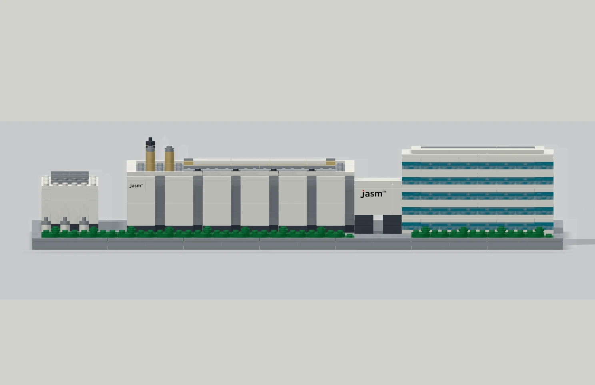
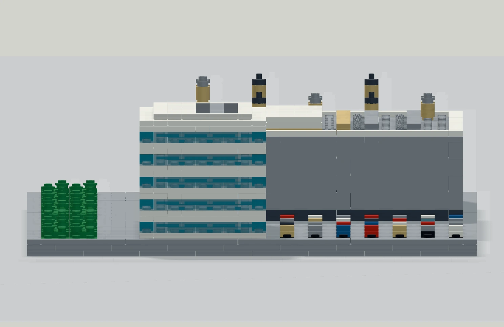
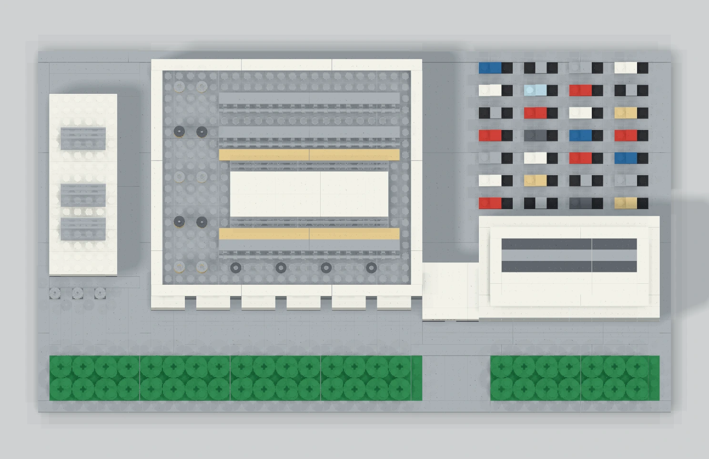

# JASM 熊本廠｜組裝說明書

FAB 03 · JASM Kumamoto Fab

白色生產棟屋頂的銀色管線與沙金風道平行排列。沿前庭走到 JASM 連廊，可看見五層藍白玻璃辦公棟及後方停車場。

1216 件 · 5 袋 · 164 步

底座 56 × 32 凸點。

將底座較後的一側朝上，從左上角第 1 顆凸點開始數。X 由左向右，Z 由後向前。底高以薄板為單位，桌面是 0，一塊標準磚高 3 層薄板。每個位置均取零件佔地最左、最後的凸點。

圖號依每一步的安裝順序編列，回到下一個步驟時從 1 重新起算。[圖解說明書](manual.html) · [分袋 BOM](bom.csv) · [分步 LDraw 模型](model.ldr)

## 原盒資料與本版用量

窄深的五層辦公棟位於右前，空橋通往白色生產棟。停車列在辦公棟後方，建築左側另有低矮後勤房。

TShop 原盒 F010020101 標示 738 件，商品尺寸 16.3 × 29.2 × 6.7 公分。本版使用 1216 件標準積木，另有 2 枚貼紙。採購請依本版分袋 BOM。

[原盒與尺寸](https://www.tshop.life/zh-hant/products/micro-brick-series-japan-advanced-semiconductor-manufacturing-inc-pre-order) · [商品三視圖](https://shoplineimg.com/64c760de75653b004eb51fc9/6ae460ea45a8bcbe65cde274/original.jpg) · [鹿島建設・熊本廠空拍（報告第 48 頁）](https://www.kajima.co.jp/english/sustainability/report/2024/pdf/ir_e_p45-58.pdf#page=4)

## 建築方位與配置

**正面**　左側六道白色廠房面板經有招牌的連廊接到右側五層藍窗辦公棟。

**側面**　辦公棟貼近前庭，停車位緊接在它的後方。

**俯視**　右後方車輛排成四列，車場和右前辦公樓共用一條地塊。

## 原寸貼紙

本款有 2 張貼紙。請以 100% 列印原寸貼紙 PDF，依步驟中的 S 編號貼在指定磚面，再把該件扣入。

[下載 A4 可列印貼紙](stickers.pdf)

- S01　生產棟最左白色面板上方 · 袋 02／步驟 36 · 12 × 5 mm · 正面（朝前），面中央。
- S02　連廊正面上方白色銘板 · 袋 05／步驟 124 · 23 × 8 mm · 正面（朝前），面中央。

## 第 01 袋　底座與定位

128 件，共 16 步。

| 顏色 | 零件 | 設計／庫號 | 數量 |
| --- | --- | --- | ---: |
| 淺藍灰 | 薄板 2×4 | 3020 | 4 |
| 淺藍灰 | 薄板 4×4 | 3031 | 14 |
| 淺藍灰 | 薄板 2×8 | 3034 | 12 |
| 淺藍灰 | 薄板 4×8 | 3035 | 98 |

### 步驟 01　併排底板（1/7）

將底板凸點朝上、長邊對齊排在平桌。下一層會跨接板縫。

**本步取件**

| 顏色 | 零件 | 設計／庫號 | 數量 |
| --- | --- | --- | ---: |
| 淺藍灰 | 薄板 4×8 | 3035 | 8 |

**安裝位置**

| 圖號 | 零件與顏色 | X | Z | 底高（薄板） | 方向 |
| ---: | --- | ---: | ---: | ---: | --- |
| 1 | 淺藍灰 薄板 4×8（3035） | 1 | 1 | 0 | 沿 X |
| 2 | 淺藍灰 薄板 4×8（3035） | 9 | 1 | 0 | 沿 X |
| 3 | 淺藍灰 薄板 4×8（3035） | 17 | 1 | 0 | 沿 X |
| 4 | 淺藍灰 薄板 4×8（3035） | 25 | 1 | 0 | 沿 X |
| 5 | 淺藍灰 薄板 4×8（3035） | 33 | 1 | 0 | 沿 X |
| 6 | 淺藍灰 薄板 4×8（3035） | 41 | 1 | 0 | 沿 X |
| 7 | 淺藍灰 薄板 4×8（3035） | 49 | 1 | 0 | 沿 X |
| 8 | 淺藍灰 薄板 4×8（3035） | 1 | 5 | 0 | 沿 X |

### 步驟 02　併排底板（2/7）

將底板凸點朝上、長邊對齊排在平桌。下一層會跨接板縫。

**本步取件**

| 顏色 | 零件 | 設計／庫號 | 數量 |
| --- | --- | --- | ---: |
| 淺藍灰 | 薄板 4×8 | 3035 | 8 |

**安裝位置**

| 圖號 | 零件與顏色 | X | Z | 底高（薄板） | 方向 |
| ---: | --- | ---: | ---: | ---: | --- |
| 1 | 淺藍灰 薄板 4×8（3035） | 9 | 5 | 0 | 沿 X |
| 2 | 淺藍灰 薄板 4×8（3035） | 17 | 5 | 0 | 沿 X |
| 3 | 淺藍灰 薄板 4×8（3035） | 25 | 5 | 0 | 沿 X |
| 4 | 淺藍灰 薄板 4×8（3035） | 33 | 5 | 0 | 沿 X |
| 5 | 淺藍灰 薄板 4×8（3035） | 41 | 5 | 0 | 沿 X |
| 6 | 淺藍灰 薄板 4×8（3035） | 49 | 5 | 0 | 沿 X |
| 7 | 淺藍灰 薄板 4×8（3035） | 1 | 9 | 0 | 沿 X |
| 8 | 淺藍灰 薄板 4×8（3035） | 9 | 9 | 0 | 沿 X |

### 步驟 03　併排底板（3/7）

將底板凸點朝上、長邊對齊排在平桌。下一層會跨接板縫。

**本步取件**

| 顏色 | 零件 | 設計／庫號 | 數量 |
| --- | --- | --- | ---: |
| 淺藍灰 | 薄板 4×8 | 3035 | 8 |

**安裝位置**

| 圖號 | 零件與顏色 | X | Z | 底高（薄板） | 方向 |
| ---: | --- | ---: | ---: | ---: | --- |
| 1 | 淺藍灰 薄板 4×8（3035） | 17 | 9 | 0 | 沿 X |
| 2 | 淺藍灰 薄板 4×8（3035） | 25 | 9 | 0 | 沿 X |
| 3 | 淺藍灰 薄板 4×8（3035） | 33 | 9 | 0 | 沿 X |
| 4 | 淺藍灰 薄板 4×8（3035） | 41 | 9 | 0 | 沿 X |
| 5 | 淺藍灰 薄板 4×8（3035） | 49 | 9 | 0 | 沿 X |
| 6 | 淺藍灰 薄板 4×8（3035） | 1 | 13 | 0 | 沿 X |
| 7 | 淺藍灰 薄板 4×8（3035） | 9 | 13 | 0 | 沿 X |
| 8 | 淺藍灰 薄板 4×8（3035） | 17 | 13 | 0 | 沿 X |

### 步驟 04　併排底板（4/7）

將底板凸點朝上、長邊對齊排在平桌。下一層會跨接板縫。

**本步取件**

| 顏色 | 零件 | 設計／庫號 | 數量 |
| --- | --- | --- | ---: |
| 淺藍灰 | 薄板 4×8 | 3035 | 8 |

**安裝位置**

| 圖號 | 零件與顏色 | X | Z | 底高（薄板） | 方向 |
| ---: | --- | ---: | ---: | ---: | --- |
| 1 | 淺藍灰 薄板 4×8（3035） | 25 | 13 | 0 | 沿 X |
| 2 | 淺藍灰 薄板 4×8（3035） | 33 | 13 | 0 | 沿 X |
| 3 | 淺藍灰 薄板 4×8（3035） | 41 | 13 | 0 | 沿 X |
| 4 | 淺藍灰 薄板 4×8（3035） | 49 | 13 | 0 | 沿 X |
| 5 | 淺藍灰 薄板 4×8（3035） | 1 | 17 | 0 | 沿 X |
| 6 | 淺藍灰 薄板 4×8（3035） | 9 | 17 | 0 | 沿 X |
| 7 | 淺藍灰 薄板 4×8（3035） | 17 | 17 | 0 | 沿 X |
| 8 | 淺藍灰 薄板 4×8（3035） | 25 | 17 | 0 | 沿 X |

### 步驟 05　併排底板（5/7）

將底板凸點朝上、長邊對齊排在平桌。下一層會跨接板縫。

**本步取件**

| 顏色 | 零件 | 設計／庫號 | 數量 |
| --- | --- | --- | ---: |
| 淺藍灰 | 薄板 4×8 | 3035 | 8 |

**安裝位置**

| 圖號 | 零件與顏色 | X | Z | 底高（薄板） | 方向 |
| ---: | --- | ---: | ---: | ---: | --- |
| 1 | 淺藍灰 薄板 4×8（3035） | 33 | 17 | 0 | 沿 X |
| 2 | 淺藍灰 薄板 4×8（3035） | 41 | 17 | 0 | 沿 X |
| 3 | 淺藍灰 薄板 4×8（3035） | 49 | 17 | 0 | 沿 X |
| 4 | 淺藍灰 薄板 4×8（3035） | 1 | 21 | 0 | 沿 X |
| 5 | 淺藍灰 薄板 4×8（3035） | 9 | 21 | 0 | 沿 X |
| 6 | 淺藍灰 薄板 4×8（3035） | 17 | 21 | 0 | 沿 X |
| 7 | 淺藍灰 薄板 4×8（3035） | 25 | 21 | 0 | 沿 X |
| 8 | 淺藍灰 薄板 4×8（3035） | 33 | 21 | 0 | 沿 X |

### 步驟 06　併排底板（6/7）

將底板凸點朝上、長邊對齊排在平桌。下一層會跨接板縫。

**本步取件**

| 顏色 | 零件 | 設計／庫號 | 數量 |
| --- | --- | --- | ---: |
| 淺藍灰 | 薄板 4×8 | 3035 | 8 |

**安裝位置**

| 圖號 | 零件與顏色 | X | Z | 底高（薄板） | 方向 |
| ---: | --- | ---: | ---: | ---: | --- |
| 1 | 淺藍灰 薄板 4×8（3035） | 41 | 21 | 0 | 沿 X |
| 2 | 淺藍灰 薄板 4×8（3035） | 49 | 21 | 0 | 沿 X |
| 3 | 淺藍灰 薄板 4×8（3035） | 1 | 25 | 0 | 沿 X |
| 4 | 淺藍灰 薄板 4×8（3035） | 9 | 25 | 0 | 沿 X |
| 5 | 淺藍灰 薄板 4×8（3035） | 17 | 25 | 0 | 沿 X |
| 6 | 淺藍灰 薄板 4×8（3035） | 25 | 25 | 0 | 沿 X |
| 7 | 淺藍灰 薄板 4×8（3035） | 33 | 25 | 0 | 沿 X |
| 8 | 淺藍灰 薄板 4×8（3035） | 41 | 25 | 0 | 沿 X |

### 步驟 07　併排底板（7/7）

將底板凸點朝上、長邊對齊排在平桌。下一層會跨接板縫。

**本步取件**

| 顏色 | 零件 | 設計／庫號 | 數量 |
| --- | --- | --- | ---: |
| 淺藍灰 | 薄板 4×8 | 3035 | 8 |

**安裝位置**

| 圖號 | 零件與顏色 | X | Z | 底高（薄板） | 方向 |
| ---: | --- | ---: | ---: | ---: | --- |
| 1 | 淺藍灰 薄板 4×8（3035） | 49 | 25 | 0 | 沿 X |
| 2 | 淺藍灰 薄板 4×8（3035） | 1 | 29 | 0 | 沿 X |
| 3 | 淺藍灰 薄板 4×8（3035） | 9 | 29 | 0 | 沿 X |
| 4 | 淺藍灰 薄板 4×8（3035） | 17 | 29 | 0 | 沿 X |
| 5 | 淺藍灰 薄板 4×8（3035） | 25 | 29 | 0 | 沿 X |
| 6 | 淺藍灰 薄板 4×8（3035） | 33 | 29 | 0 | 沿 X |
| 7 | 淺藍灰 薄板 4×8（3035） | 41 | 29 | 0 | 沿 X |
| 8 | 淺藍灰 薄板 4×8（3035） | 49 | 29 | 0 | 沿 X |

### 步驟 08　錯縫鎖底（1/9）

上層相對底板橫移四格、縱移兩格。逐排按緊後，底座可整片拿起。

**本步取件**

| 顏色 | 零件 | 設計／庫號 | 數量 |
| --- | --- | --- | ---: |
| 淺藍灰 | 薄板 2×4 | 3020 | 2 |
| 淺藍灰 | 薄板 2×8 | 3034 | 6 |

**安裝位置**

| 圖號 | 零件與顏色 | X | Z | 底高（薄板） | 方向 |
| ---: | --- | ---: | ---: | ---: | --- |
| 1 | 淺藍灰 薄板 2×4（3020） | 1 | 1 | 1 | 沿 X |
| 2 | 淺藍灰 薄板 2×8（3034） | 5 | 1 | 1 | 沿 X |
| 3 | 淺藍灰 薄板 2×8（3034） | 13 | 1 | 1 | 沿 X |
| 4 | 淺藍灰 薄板 2×8（3034） | 21 | 1 | 1 | 沿 X |
| 5 | 淺藍灰 薄板 2×8（3034） | 29 | 1 | 1 | 沿 X |
| 6 | 淺藍灰 薄板 2×8（3034） | 37 | 1 | 1 | 沿 X |
| 7 | 淺藍灰 薄板 2×8（3034） | 45 | 1 | 1 | 沿 X |
| 8 | 淺藍灰 薄板 2×4（3020） | 53 | 1 | 1 | 沿 X |

### 步驟 09　錯縫鎖底（2/9）

上層相對底板橫移四格、縱移兩格。逐排按緊後，底座可整片拿起。

**本步取件**

| 顏色 | 零件 | 設計／庫號 | 數量 |
| --- | --- | --- | ---: |
| 淺藍灰 | 薄板 4×4 | 3031 | 2 |
| 淺藍灰 | 薄板 4×8 | 3035 | 6 |

**安裝位置**

| 圖號 | 零件與顏色 | X | Z | 底高（薄板） | 方向 |
| ---: | --- | ---: | ---: | ---: | --- |
| 1 | 淺藍灰 薄板 4×4（3031） | 1 | 3 | 1 | — |
| 2 | 淺藍灰 薄板 4×8（3035） | 5 | 3 | 1 | 沿 X |
| 3 | 淺藍灰 薄板 4×8（3035） | 13 | 3 | 1 | 沿 X |
| 4 | 淺藍灰 薄板 4×8（3035） | 21 | 3 | 1 | 沿 X |
| 5 | 淺藍灰 薄板 4×8（3035） | 29 | 3 | 1 | 沿 X |
| 6 | 淺藍灰 薄板 4×8（3035） | 37 | 3 | 1 | 沿 X |
| 7 | 淺藍灰 薄板 4×8（3035） | 45 | 3 | 1 | 沿 X |
| 8 | 淺藍灰 薄板 4×4（3031） | 53 | 3 | 1 | — |

### 步驟 10　錯縫鎖底（3/9）

上層相對底板橫移四格、縱移兩格。逐排按緊後，底座可整片拿起。

**本步取件**

| 顏色 | 零件 | 設計／庫號 | 數量 |
| --- | --- | --- | ---: |
| 淺藍灰 | 薄板 4×4 | 3031 | 2 |
| 淺藍灰 | 薄板 4×8 | 3035 | 6 |

**安裝位置**

| 圖號 | 零件與顏色 | X | Z | 底高（薄板） | 方向 |
| ---: | --- | ---: | ---: | ---: | --- |
| 1 | 淺藍灰 薄板 4×4（3031） | 1 | 7 | 1 | — |
| 2 | 淺藍灰 薄板 4×8（3035） | 5 | 7 | 1 | 沿 X |
| 3 | 淺藍灰 薄板 4×8（3035） | 13 | 7 | 1 | 沿 X |
| 4 | 淺藍灰 薄板 4×8（3035） | 21 | 7 | 1 | 沿 X |
| 5 | 淺藍灰 薄板 4×8（3035） | 29 | 7 | 1 | 沿 X |
| 6 | 淺藍灰 薄板 4×8（3035） | 37 | 7 | 1 | 沿 X |
| 7 | 淺藍灰 薄板 4×8（3035） | 45 | 7 | 1 | 沿 X |
| 8 | 淺藍灰 薄板 4×4（3031） | 53 | 7 | 1 | — |

### 步驟 11　錯縫鎖底（4/9）

上層相對底板橫移四格、縱移兩格。逐排按緊後，底座可整片拿起。

**本步取件**

| 顏色 | 零件 | 設計／庫號 | 數量 |
| --- | --- | --- | ---: |
| 淺藍灰 | 薄板 4×4 | 3031 | 2 |
| 淺藍灰 | 薄板 4×8 | 3035 | 6 |

**安裝位置**

| 圖號 | 零件與顏色 | X | Z | 底高（薄板） | 方向 |
| ---: | --- | ---: | ---: | ---: | --- |
| 1 | 淺藍灰 薄板 4×4（3031） | 1 | 11 | 1 | — |
| 2 | 淺藍灰 薄板 4×8（3035） | 5 | 11 | 1 | 沿 X |
| 3 | 淺藍灰 薄板 4×8（3035） | 13 | 11 | 1 | 沿 X |
| 4 | 淺藍灰 薄板 4×8（3035） | 21 | 11 | 1 | 沿 X |
| 5 | 淺藍灰 薄板 4×8（3035） | 29 | 11 | 1 | 沿 X |
| 6 | 淺藍灰 薄板 4×8（3035） | 37 | 11 | 1 | 沿 X |
| 7 | 淺藍灰 薄板 4×8（3035） | 45 | 11 | 1 | 沿 X |
| 8 | 淺藍灰 薄板 4×4（3031） | 53 | 11 | 1 | — |

### 步驟 12　錯縫鎖底（5/9）

上層相對底板橫移四格、縱移兩格。逐排按緊後，底座可整片拿起。

**本步取件**

| 顏色 | 零件 | 設計／庫號 | 數量 |
| --- | --- | --- | ---: |
| 淺藍灰 | 薄板 4×4 | 3031 | 2 |
| 淺藍灰 | 薄板 4×8 | 3035 | 6 |

**安裝位置**

| 圖號 | 零件與顏色 | X | Z | 底高（薄板） | 方向 |
| ---: | --- | ---: | ---: | ---: | --- |
| 1 | 淺藍灰 薄板 4×4（3031） | 1 | 15 | 1 | — |
| 2 | 淺藍灰 薄板 4×8（3035） | 5 | 15 | 1 | 沿 X |
| 3 | 淺藍灰 薄板 4×8（3035） | 13 | 15 | 1 | 沿 X |
| 4 | 淺藍灰 薄板 4×8（3035） | 21 | 15 | 1 | 沿 X |
| 5 | 淺藍灰 薄板 4×8（3035） | 29 | 15 | 1 | 沿 X |
| 6 | 淺藍灰 薄板 4×8（3035） | 37 | 15 | 1 | 沿 X |
| 7 | 淺藍灰 薄板 4×8（3035） | 45 | 15 | 1 | 沿 X |
| 8 | 淺藍灰 薄板 4×4（3031） | 53 | 15 | 1 | — |

### 步驟 13　錯縫鎖底（6/9）

上層相對底板橫移四格、縱移兩格。逐排按緊後，底座可整片拿起。

**本步取件**

| 顏色 | 零件 | 設計／庫號 | 數量 |
| --- | --- | --- | ---: |
| 淺藍灰 | 薄板 4×4 | 3031 | 2 |
| 淺藍灰 | 薄板 4×8 | 3035 | 6 |

**安裝位置**

| 圖號 | 零件與顏色 | X | Z | 底高（薄板） | 方向 |
| ---: | --- | ---: | ---: | ---: | --- |
| 1 | 淺藍灰 薄板 4×4（3031） | 1 | 19 | 1 | — |
| 2 | 淺藍灰 薄板 4×8（3035） | 5 | 19 | 1 | 沿 X |
| 3 | 淺藍灰 薄板 4×8（3035） | 13 | 19 | 1 | 沿 X |
| 4 | 淺藍灰 薄板 4×8（3035） | 21 | 19 | 1 | 沿 X |
| 5 | 淺藍灰 薄板 4×8（3035） | 29 | 19 | 1 | 沿 X |
| 6 | 淺藍灰 薄板 4×8（3035） | 37 | 19 | 1 | 沿 X |
| 7 | 淺藍灰 薄板 4×8（3035） | 45 | 19 | 1 | 沿 X |
| 8 | 淺藍灰 薄板 4×4（3031） | 53 | 19 | 1 | — |

### 步驟 14　錯縫鎖底（7/9）

上層相對底板橫移四格、縱移兩格。逐排按緊後，底座可整片拿起。

**本步取件**

| 顏色 | 零件 | 設計／庫號 | 數量 |
| --- | --- | --- | ---: |
| 淺藍灰 | 薄板 4×4 | 3031 | 2 |
| 淺藍灰 | 薄板 4×8 | 3035 | 6 |

**安裝位置**

| 圖號 | 零件與顏色 | X | Z | 底高（薄板） | 方向 |
| ---: | --- | ---: | ---: | ---: | --- |
| 1 | 淺藍灰 薄板 4×4（3031） | 1 | 23 | 1 | — |
| 2 | 淺藍灰 薄板 4×8（3035） | 5 | 23 | 1 | 沿 X |
| 3 | 淺藍灰 薄板 4×8（3035） | 13 | 23 | 1 | 沿 X |
| 4 | 淺藍灰 薄板 4×8（3035） | 21 | 23 | 1 | 沿 X |
| 5 | 淺藍灰 薄板 4×8（3035） | 29 | 23 | 1 | 沿 X |
| 6 | 淺藍灰 薄板 4×8（3035） | 37 | 23 | 1 | 沿 X |
| 7 | 淺藍灰 薄板 4×8（3035） | 45 | 23 | 1 | 沿 X |
| 8 | 淺藍灰 薄板 4×4（3031） | 53 | 23 | 1 | — |

### 步驟 15　錯縫鎖底（8/9）

上層相對底板橫移四格、縱移兩格。逐排按緊後，底座可整片拿起。

**本步取件**

| 顏色 | 零件 | 設計／庫號 | 數量 |
| --- | --- | --- | ---: |
| 淺藍灰 | 薄板 4×4 | 3031 | 2 |
| 淺藍灰 | 薄板 4×8 | 3035 | 6 |

**安裝位置**

| 圖號 | 零件與顏色 | X | Z | 底高（薄板） | 方向 |
| ---: | --- | ---: | ---: | ---: | --- |
| 1 | 淺藍灰 薄板 4×4（3031） | 1 | 27 | 1 | — |
| 2 | 淺藍灰 薄板 4×8（3035） | 5 | 27 | 1 | 沿 X |
| 3 | 淺藍灰 薄板 4×8（3035） | 13 | 27 | 1 | 沿 X |
| 4 | 淺藍灰 薄板 4×8（3035） | 21 | 27 | 1 | 沿 X |
| 5 | 淺藍灰 薄板 4×8（3035） | 29 | 27 | 1 | 沿 X |
| 6 | 淺藍灰 薄板 4×8（3035） | 37 | 27 | 1 | 沿 X |
| 7 | 淺藍灰 薄板 4×8（3035） | 45 | 27 | 1 | 沿 X |
| 8 | 淺藍灰 薄板 4×4（3031） | 53 | 27 | 1 | — |

### 步驟 16　錯縫鎖底（9/9）

上層相對底板橫移四格、縱移兩格。逐排按緊後，底座可整片拿起。

**本步取件**

| 顏色 | 零件 | 設計／庫號 | 數量 |
| --- | --- | --- | ---: |
| 淺藍灰 | 薄板 2×4 | 3020 | 2 |
| 淺藍灰 | 薄板 2×8 | 3034 | 6 |

**安裝位置**

| 圖號 | 零件與顏色 | X | Z | 底高（薄板） | 方向 |
| ---: | --- | ---: | ---: | ---: | --- |
| 1 | 淺藍灰 薄板 2×4（3020） | 1 | 31 | 1 | 沿 X |
| 2 | 淺藍灰 薄板 2×8（3034） | 5 | 31 | 1 | 沿 X |
| 3 | 淺藍灰 薄板 2×8（3034） | 13 | 31 | 1 | 沿 X |
| 4 | 淺藍灰 薄板 2×8（3034） | 21 | 31 | 1 | 沿 X |
| 5 | 淺藍灰 薄板 2×8（3034） | 29 | 31 | 1 | 沿 X |
| 6 | 淺藍灰 薄板 2×8（3034） | 37 | 31 | 1 | 沿 X |
| 7 | 淺藍灰 薄板 2×8（3034） | 45 | 31 | 1 | 沿 X |
| 8 | 淺藍灰 薄板 2×4（3020） | 53 | 31 | 1 | 沿 X |

## 第 02 袋　白色廠務棟及分段立面

272 件，共 38 步。

| 顏色 | 零件 | 設計／庫號 | 數量 |
| --- | --- | --- | ---: |
| 白色 | 磚 1×2 | 3004 | 1 |
| 白色 | 磚 1×1 | 3005 | 1 |
| 白色 | 磚 1×8 | 3008 | 10 |
| 白色 | 磚 1×6 | 3009 | 4 |
| 白色 | 磚 1×4 | 3010 | 4 |
| 白色 | 圓磚 1×1 | 3062b | 3 |
| 白色 | 磚 1×3 | 3622 | 23 |
| 白色 | 薄板 2×6 | 3795 | 8 |
| 白色 | 光面板 1×8 | 4162 | 10 |
| 白色 | 光面板 1×3 | 63864 | 8 |
| 淺藍灰 | 中空立管圓板 1×1 | 20482 | 3 |
| 淺藍灰 | 格柵板 1×2 | 2412b | 6 |
| 淺藍灰 | 磚 2×6 | 2456 | 30 |
| 淺藍灰 | 磚 2×4 | 3001 | 10 |
| 淺藍灰 | 磚 1×1 | 3005 | 4 |
| 淺藍灰 | 磚 1×8 | 3008 | 36 |
| 淺藍灰 | 磚 1×6 | 3009 | 4 |
| 淺藍灰 | 磚 1×4 | 3010 | 4 |
| 淺藍灰 | 薄板 2×4 | 3020 | 3 |
| 淺藍灰 | 薄板 1×2 | 3023 | 36 |
| 淺藍灰 | 磚 1×3 | 3622 | 4 |
| 淺藍灰 | 薄板 2×6 | 3795 | 36 |
| 深藍灰 | 磚 1×8 | 3008 | 12 |
| 深藍灰 | 磚 1×6 | 3009 | 4 |
| 深藍灰 | 磚 1×3 | 3622 | 8 |

### 步驟 17　生產棟外殼 1（1/3）

外牆與兩道承重牆逐層交疊，在寬白面板間留出凹縫。

**本步取件**

| 顏色 | 零件 | 設計／庫號 | 數量 |
| --- | --- | --- | ---: |
| 深藍灰 | 磚 1×8 | 3008 | 8 |

**安裝位置**

| 圖號 | 零件與顏色 | X | Z | 底高（薄板） | 方向 |
| ---: | --- | ---: | ---: | ---: | --- |
| 1 | 深藍灰 磚 1×8（3008） | 11 | 2 | 2 | 沿 X |
| 2 | 深藍灰 磚 1×8（3008） | 19 | 2 | 2 | 沿 X |
| 3 | 深藍灰 磚 1×8（3008） | 27 | 2 | 2 | 沿 X |
| 4 | 深藍灰 磚 1×8（3008） | 11 | 22 | 2 | 沿 X |
| 5 | 深藍灰 磚 1×8（3008） | 19 | 22 | 2 | 沿 X |
| 6 | 深藍灰 磚 1×8（3008） | 27 | 22 | 2 | 沿 X |
| 7 | 深藍灰 磚 1×8（3008） | 11 | 3 | 2 | 沿 Z |
| 8 | 深藍灰 磚 1×8（3008） | 11 | 11 | 2 | 沿 Z |

### 步驟 18　生產棟外殼 1（2/3）

外牆與兩道承重牆逐層交疊，在寬白面板間留出凹縫。

**本步取件**

| 顏色 | 零件 | 設計／庫號 | 數量 |
| --- | --- | --- | ---: |
| 淺藍灰 | 磚 2×6 | 2456 | 3 |
| 淺藍灰 | 磚 2×4 | 3001 | 1 |
| 深藍灰 | 磚 1×8 | 3008 | 2 |
| 深藍灰 | 磚 1×3 | 3622 | 2 |

**安裝位置**

| 圖號 | 零件與顏色 | X | Z | 底高（薄板） | 方向 |
| ---: | --- | ---: | ---: | ---: | --- |
| 1 | 深藍灰 磚 1×3（3622） | 11 | 19 | 2 | 沿 Z |
| 2 | 深藍灰 磚 1×8（3008） | 34 | 3 | 2 | 沿 Z |
| 3 | 深藍灰 磚 1×8（3008） | 34 | 11 | 2 | 沿 Z |
| 4 | 深藍灰 磚 1×3（3622） | 34 | 19 | 2 | 沿 Z |
| 5 | 淺藍灰 磚 2×6（2456） | 12 | 8 | 2 | 沿 X |
| 6 | 淺藍灰 磚 2×6（2456） | 18 | 8 | 2 | 沿 X |
| 7 | 淺藍灰 磚 2×6（2456） | 24 | 8 | 2 | 沿 X |
| 8 | 淺藍灰 磚 2×4（3001） | 30 | 8 | 2 | 沿 X |

### 步驟 19　生產棟外殼 1（3/3）

外牆與兩道承重牆逐層交疊，在寬白面板間留出凹縫。

**本步取件**

| 顏色 | 零件 | 設計／庫號 | 數量 |
| --- | --- | --- | ---: |
| 淺藍灰 | 磚 2×6 | 2456 | 3 |
| 淺藍灰 | 磚 2×4 | 3001 | 1 |

**安裝位置**

| 圖號 | 零件與顏色 | X | Z | 底高（薄板） | 方向 |
| ---: | --- | ---: | ---: | ---: | --- |
| 1 | 淺藍灰 磚 2×6（2456） | 12 | 15 | 2 | 沿 X |
| 2 | 淺藍灰 磚 2×6（2456） | 18 | 15 | 2 | 沿 X |
| 3 | 淺藍灰 磚 2×6（2456） | 24 | 15 | 2 | 沿 X |
| 4 | 淺藍灰 磚 2×4（3001） | 30 | 15 | 2 | 沿 X |

### 步驟 20　寬白立面板 1

六面牆板朝向前庭。首片上端的 JASM 小字標貼在靠左的位置。

**本步取件**

| 顏色 | 零件 | 設計／庫號 | 數量 |
| --- | --- | --- | ---: |
| 深藍灰 | 磚 1×3 | 3622 | 6 |

**安裝位置**

| 圖號 | 零件與顏色 | X | Z | 底高（薄板） | 方向 |
| ---: | --- | ---: | ---: | ---: | --- |
| 1 | 深藍灰 磚 1×3（3622） | 11 | 23 | 2 | 沿 X |
| 2 | 深藍灰 磚 1×3（3622） | 15 | 23 | 2 | 沿 X |
| 3 | 深藍灰 磚 1×3（3622） | 19 | 23 | 2 | 沿 X |
| 4 | 深藍灰 磚 1×3（3622） | 23 | 23 | 2 | 沿 X |
| 5 | 深藍灰 磚 1×3（3622） | 27 | 23 | 2 | 沿 X |
| 6 | 深藍灰 磚 1×3（3622） | 31 | 23 | 2 | 沿 X |

### 步驟 21　生產棟外殼 2（1/3）

外牆與兩道承重牆逐層交疊，在寬白面板間留出凹縫。

**本步取件**

| 顏色 | 零件 | 設計／庫號 | 數量 |
| --- | --- | --- | ---: |
| 淺藍灰 | 磚 1×1 | 3005 | 2 |
| 淺藍灰 | 磚 1×8 | 3008 | 4 |
| 淺藍灰 | 磚 1×4 | 3010 | 2 |

**安裝位置**

| 圖號 | 零件與顏色 | X | Z | 底高（薄板） | 方向 |
| ---: | --- | ---: | ---: | ---: | --- |
| 1 | 淺藍灰 磚 1×8（3008） | 11 | 2 | 5 | 沿 Z |
| 2 | 淺藍灰 磚 1×8（3008） | 11 | 10 | 5 | 沿 Z |
| 3 | 淺藍灰 磚 1×4（3010） | 11 | 18 | 5 | 沿 Z |
| 4 | 淺藍灰 磚 1×1（3005） | 11 | 22 | 5 | — |
| 5 | 淺藍灰 磚 1×8（3008） | 34 | 2 | 5 | 沿 Z |
| 6 | 淺藍灰 磚 1×8（3008） | 34 | 10 | 5 | 沿 Z |
| 7 | 淺藍灰 磚 1×4（3010） | 34 | 18 | 5 | 沿 Z |
| 8 | 淺藍灰 磚 1×1（3005） | 34 | 22 | 5 | — |

### 步驟 22　生產棟外殼 2（2/3）

外牆與兩道承重牆逐層交疊，在寬白面板間留出凹縫。

**本步取件**

| 顏色 | 零件 | 設計／庫號 | 數量 |
| --- | --- | --- | ---: |
| 淺藍灰 | 磚 2×6 | 2456 | 2 |
| 淺藍灰 | 磚 1×8 | 3008 | 4 |
| 淺藍灰 | 磚 1×6 | 3009 | 2 |

**安裝位置**

| 圖號 | 零件與顏色 | X | Z | 底高（薄板） | 方向 |
| ---: | --- | ---: | ---: | ---: | --- |
| 1 | 淺藍灰 磚 1×8（3008） | 12 | 2 | 5 | 沿 X |
| 2 | 淺藍灰 磚 1×8（3008） | 20 | 2 | 5 | 沿 X |
| 3 | 淺藍灰 磚 1×6（3009） | 28 | 2 | 5 | 沿 X |
| 4 | 淺藍灰 磚 1×8（3008） | 12 | 22 | 5 | 沿 X |
| 5 | 淺藍灰 磚 1×8（3008） | 20 | 22 | 5 | 沿 X |
| 6 | 淺藍灰 磚 1×6（3009） | 28 | 22 | 5 | 沿 X |
| 7 | 淺藍灰 磚 2×6（2456） | 12 | 8 | 5 | 沿 X |
| 8 | 淺藍灰 磚 2×6（2456） | 18 | 8 | 5 | 沿 X |

### 步驟 23　生產棟外殼 2（3/3）

外牆與兩道承重牆逐層交疊，在寬白面板間留出凹縫。

**本步取件**

| 顏色 | 零件 | 設計／庫號 | 數量 |
| --- | --- | --- | ---: |
| 淺藍灰 | 磚 2×6 | 2456 | 4 |
| 淺藍灰 | 磚 2×4 | 3001 | 2 |

**安裝位置**

| 圖號 | 零件與顏色 | X | Z | 底高（薄板） | 方向 |
| ---: | --- | ---: | ---: | ---: | --- |
| 1 | 淺藍灰 磚 2×6（2456） | 24 | 8 | 5 | 沿 X |
| 2 | 淺藍灰 磚 2×4（3001） | 30 | 8 | 5 | 沿 X |
| 3 | 淺藍灰 磚 2×6（2456） | 12 | 15 | 5 | 沿 X |
| 4 | 淺藍灰 磚 2×6（2456） | 18 | 15 | 5 | 沿 X |
| 5 | 淺藍灰 磚 2×6（2456） | 24 | 15 | 5 | 沿 X |
| 6 | 淺藍灰 磚 2×4（3001） | 30 | 15 | 5 | 沿 X |

### 步驟 24　寬白立面板 2

六面牆板朝向前庭。首片上端的 JASM 小字標貼在靠左的位置。

**本步取件**

| 顏色 | 零件 | 設計／庫號 | 數量 |
| --- | --- | --- | ---: |
| 白色 | 磚 1×3 | 3622 | 6 |

**安裝位置**

| 圖號 | 零件與顏色 | X | Z | 底高（薄板） | 方向 |
| ---: | --- | ---: | ---: | ---: | --- |
| 1 | 白色 磚 1×3（3622） | 11 | 23 | 5 | 沿 X |
| 2 | 白色 磚 1×3（3622） | 15 | 23 | 5 | 沿 X |
| 3 | 白色 磚 1×3（3622） | 19 | 23 | 5 | 沿 X |
| 4 | 白色 磚 1×3（3622） | 23 | 23 | 5 | 沿 X |
| 5 | 白色 磚 1×3（3622） | 27 | 23 | 5 | 沿 X |
| 6 | 白色 磚 1×3（3622） | 31 | 23 | 5 | 沿 X |

### 步驟 25　生產棟外殼 3（1/3）

外牆與兩道承重牆逐層交疊，在寬白面板間留出凹縫。

**本步取件**

| 顏色 | 零件 | 設計／庫號 | 數量 |
| --- | --- | --- | ---: |
| 淺藍灰 | 磚 1×8 | 3008 | 8 |

**安裝位置**

| 圖號 | 零件與顏色 | X | Z | 底高（薄板） | 方向 |
| ---: | --- | ---: | ---: | ---: | --- |
| 1 | 淺藍灰 磚 1×8（3008） | 11 | 2 | 8 | 沿 X |
| 2 | 淺藍灰 磚 1×8（3008） | 19 | 2 | 8 | 沿 X |
| 3 | 淺藍灰 磚 1×8（3008） | 27 | 2 | 8 | 沿 X |
| 4 | 淺藍灰 磚 1×8（3008） | 11 | 22 | 8 | 沿 X |
| 5 | 淺藍灰 磚 1×8（3008） | 19 | 22 | 8 | 沿 X |
| 6 | 淺藍灰 磚 1×8（3008） | 27 | 22 | 8 | 沿 X |
| 7 | 淺藍灰 磚 1×8（3008） | 11 | 3 | 8 | 沿 Z |
| 8 | 淺藍灰 磚 1×8（3008） | 11 | 11 | 8 | 沿 Z |

### 步驟 26　生產棟外殼 3（2/3）

外牆與兩道承重牆逐層交疊，在寬白面板間留出凹縫。

**本步取件**

| 顏色 | 零件 | 設計／庫號 | 數量 |
| --- | --- | --- | ---: |
| 淺藍灰 | 磚 2×6 | 2456 | 3 |
| 淺藍灰 | 磚 2×4 | 3001 | 1 |
| 淺藍灰 | 磚 1×8 | 3008 | 2 |
| 淺藍灰 | 磚 1×3 | 3622 | 2 |

**安裝位置**

| 圖號 | 零件與顏色 | X | Z | 底高（薄板） | 方向 |
| ---: | --- | ---: | ---: | ---: | --- |
| 1 | 淺藍灰 磚 1×3（3622） | 11 | 19 | 8 | 沿 Z |
| 2 | 淺藍灰 磚 1×8（3008） | 34 | 3 | 8 | 沿 Z |
| 3 | 淺藍灰 磚 1×8（3008） | 34 | 11 | 8 | 沿 Z |
| 4 | 淺藍灰 磚 1×3（3622） | 34 | 19 | 8 | 沿 Z |
| 5 | 淺藍灰 磚 2×6（2456） | 12 | 8 | 8 | 沿 X |
| 6 | 淺藍灰 磚 2×6（2456） | 18 | 8 | 8 | 沿 X |
| 7 | 淺藍灰 磚 2×6（2456） | 24 | 8 | 8 | 沿 X |
| 8 | 淺藍灰 磚 2×4（3001） | 30 | 8 | 8 | 沿 X |

### 步驟 27　生產棟外殼 3（3/3）

外牆與兩道承重牆逐層交疊，在寬白面板間留出凹縫。

**本步取件**

| 顏色 | 零件 | 設計／庫號 | 數量 |
| --- | --- | --- | ---: |
| 淺藍灰 | 磚 2×6 | 2456 | 3 |
| 淺藍灰 | 磚 2×4 | 3001 | 1 |

**安裝位置**

| 圖號 | 零件與顏色 | X | Z | 底高（薄板） | 方向 |
| ---: | --- | ---: | ---: | ---: | --- |
| 1 | 淺藍灰 磚 2×6（2456） | 12 | 15 | 8 | 沿 X |
| 2 | 淺藍灰 磚 2×6（2456） | 18 | 15 | 8 | 沿 X |
| 3 | 淺藍灰 磚 2×6（2456） | 24 | 15 | 8 | 沿 X |
| 4 | 淺藍灰 磚 2×4（3001） | 30 | 15 | 8 | 沿 X |

### 步驟 28　寬白立面板 3

六面牆板朝向前庭。首片上端的 JASM 小字標貼在靠左的位置。

**本步取件**

| 顏色 | 零件 | 設計／庫號 | 數量 |
| --- | --- | --- | ---: |
| 白色 | 磚 1×3 | 3622 | 6 |

**安裝位置**

| 圖號 | 零件與顏色 | X | Z | 底高（薄板） | 方向 |
| ---: | --- | ---: | ---: | ---: | --- |
| 1 | 白色 磚 1×3（3622） | 11 | 23 | 8 | 沿 X |
| 2 | 白色 磚 1×3（3622） | 15 | 23 | 8 | 沿 X |
| 3 | 白色 磚 1×3（3622） | 19 | 23 | 8 | 沿 X |
| 4 | 白色 磚 1×3（3622） | 23 | 23 | 8 | 沿 X |
| 5 | 白色 磚 1×3（3622） | 27 | 23 | 8 | 沿 X |
| 6 | 白色 磚 1×3（3622） | 31 | 23 | 8 | 沿 X |

### 步驟 29　生產棟外殼 4（1/3）

外牆與兩道承重牆逐層交疊，在寬白面板間留出凹縫。

**本步取件**

| 顏色 | 零件 | 設計／庫號 | 數量 |
| --- | --- | --- | ---: |
| 淺藍灰 | 磚 1×1 | 3005 | 2 |
| 淺藍灰 | 磚 1×8 | 3008 | 4 |
| 淺藍灰 | 磚 1×4 | 3010 | 2 |

**安裝位置**

| 圖號 | 零件與顏色 | X | Z | 底高（薄板） | 方向 |
| ---: | --- | ---: | ---: | ---: | --- |
| 1 | 淺藍灰 磚 1×8（3008） | 11 | 2 | 11 | 沿 Z |
| 2 | 淺藍灰 磚 1×8（3008） | 11 | 10 | 11 | 沿 Z |
| 3 | 淺藍灰 磚 1×4（3010） | 11 | 18 | 11 | 沿 Z |
| 4 | 淺藍灰 磚 1×1（3005） | 11 | 22 | 11 | — |
| 5 | 淺藍灰 磚 1×8（3008） | 34 | 2 | 11 | 沿 Z |
| 6 | 淺藍灰 磚 1×8（3008） | 34 | 10 | 11 | 沿 Z |
| 7 | 淺藍灰 磚 1×4（3010） | 34 | 18 | 11 | 沿 Z |
| 8 | 淺藍灰 磚 1×1（3005） | 34 | 22 | 11 | — |

### 步驟 30　生產棟外殼 4（2/3）

外牆與兩道承重牆逐層交疊，在寬白面板間留出凹縫。

**本步取件**

| 顏色 | 零件 | 設計／庫號 | 數量 |
| --- | --- | --- | ---: |
| 淺藍灰 | 磚 2×6 | 2456 | 2 |
| 淺藍灰 | 磚 1×8 | 3008 | 4 |
| 淺藍灰 | 磚 1×6 | 3009 | 2 |

**安裝位置**

| 圖號 | 零件與顏色 | X | Z | 底高（薄板） | 方向 |
| ---: | --- | ---: | ---: | ---: | --- |
| 1 | 淺藍灰 磚 1×8（3008） | 12 | 2 | 11 | 沿 X |
| 2 | 淺藍灰 磚 1×8（3008） | 20 | 2 | 11 | 沿 X |
| 3 | 淺藍灰 磚 1×6（3009） | 28 | 2 | 11 | 沿 X |
| 4 | 淺藍灰 磚 1×8（3008） | 12 | 22 | 11 | 沿 X |
| 5 | 淺藍灰 磚 1×8（3008） | 20 | 22 | 11 | 沿 X |
| 6 | 淺藍灰 磚 1×6（3009） | 28 | 22 | 11 | 沿 X |
| 7 | 淺藍灰 磚 2×6（2456） | 12 | 8 | 11 | 沿 X |
| 8 | 淺藍灰 磚 2×6（2456） | 18 | 8 | 11 | 沿 X |

### 步驟 31　生產棟外殼 4（3/3）

外牆與兩道承重牆逐層交疊，在寬白面板間留出凹縫。

**本步取件**

| 顏色 | 零件 | 設計／庫號 | 數量 |
| --- | --- | --- | ---: |
| 淺藍灰 | 磚 2×6 | 2456 | 4 |
| 淺藍灰 | 磚 2×4 | 3001 | 2 |

**安裝位置**

| 圖號 | 零件與顏色 | X | Z | 底高（薄板） | 方向 |
| ---: | --- | ---: | ---: | ---: | --- |
| 1 | 淺藍灰 磚 2×6（2456） | 24 | 8 | 11 | 沿 X |
| 2 | 淺藍灰 磚 2×4（3001） | 30 | 8 | 11 | 沿 X |
| 3 | 淺藍灰 磚 2×6（2456） | 12 | 15 | 11 | 沿 X |
| 4 | 淺藍灰 磚 2×6（2456） | 18 | 15 | 11 | 沿 X |
| 5 | 淺藍灰 磚 2×6（2456） | 24 | 15 | 11 | 沿 X |
| 6 | 淺藍灰 磚 2×4（3001） | 30 | 15 | 11 | 沿 X |

### 步驟 32　寬白立面板 4

六面牆板朝向前庭。首片上端的 JASM 小字標貼在靠左的位置。

**本步取件**

| 顏色 | 零件 | 設計／庫號 | 數量 |
| --- | --- | --- | ---: |
| 白色 | 磚 1×3 | 3622 | 6 |

**安裝位置**

| 圖號 | 零件與顏色 | X | Z | 底高（薄板） | 方向 |
| ---: | --- | ---: | ---: | ---: | --- |
| 1 | 白色 磚 1×3（3622） | 11 | 23 | 11 | 沿 X |
| 2 | 白色 磚 1×3（3622） | 15 | 23 | 11 | 沿 X |
| 3 | 白色 磚 1×3（3622） | 19 | 23 | 11 | 沿 X |
| 4 | 白色 磚 1×3（3622） | 23 | 23 | 11 | 沿 X |
| 5 | 白色 磚 1×3（3622） | 27 | 23 | 11 | 沿 X |
| 6 | 白色 磚 1×3（3622） | 31 | 23 | 11 | 沿 X |

### 步驟 33　生產棟外殼 5（1/3）

外牆與兩道承重牆逐層交疊，在寬白面板間留出凹縫。

**本步取件**

| 顏色 | 零件 | 設計／庫號 | 數量 |
| --- | --- | --- | ---: |
| 淺藍灰 | 磚 1×8 | 3008 | 8 |

**安裝位置**

| 圖號 | 零件與顏色 | X | Z | 底高（薄板） | 方向 |
| ---: | --- | ---: | ---: | ---: | --- |
| 1 | 淺藍灰 磚 1×8（3008） | 11 | 2 | 14 | 沿 X |
| 2 | 淺藍灰 磚 1×8（3008） | 19 | 2 | 14 | 沿 X |
| 3 | 淺藍灰 磚 1×8（3008） | 27 | 2 | 14 | 沿 X |
| 4 | 淺藍灰 磚 1×8（3008） | 11 | 22 | 14 | 沿 X |
| 5 | 淺藍灰 磚 1×8（3008） | 19 | 22 | 14 | 沿 X |
| 6 | 淺藍灰 磚 1×8（3008） | 27 | 22 | 14 | 沿 X |
| 7 | 淺藍灰 磚 1×8（3008） | 11 | 3 | 14 | 沿 Z |
| 8 | 淺藍灰 磚 1×8（3008） | 11 | 11 | 14 | 沿 Z |

### 步驟 34　生產棟外殼 5（2/3）

外牆與兩道承重牆逐層交疊，在寬白面板間留出凹縫。

**本步取件**

| 顏色 | 零件 | 設計／庫號 | 數量 |
| --- | --- | --- | ---: |
| 淺藍灰 | 磚 2×6 | 2456 | 3 |
| 淺藍灰 | 磚 2×4 | 3001 | 1 |
| 淺藍灰 | 磚 1×8 | 3008 | 2 |
| 淺藍灰 | 磚 1×3 | 3622 | 2 |

**安裝位置**

| 圖號 | 零件與顏色 | X | Z | 底高（薄板） | 方向 |
| ---: | --- | ---: | ---: | ---: | --- |
| 1 | 淺藍灰 磚 1×3（3622） | 11 | 19 | 14 | 沿 Z |
| 2 | 淺藍灰 磚 1×8（3008） | 34 | 3 | 14 | 沿 Z |
| 3 | 淺藍灰 磚 1×8（3008） | 34 | 11 | 14 | 沿 Z |
| 4 | 淺藍灰 磚 1×3（3622） | 34 | 19 | 14 | 沿 Z |
| 5 | 淺藍灰 磚 2×6（2456） | 12 | 8 | 14 | 沿 X |
| 6 | 淺藍灰 磚 2×6（2456） | 18 | 8 | 14 | 沿 X |
| 7 | 淺藍灰 磚 2×6（2456） | 24 | 8 | 14 | 沿 X |
| 8 | 淺藍灰 磚 2×4（3001） | 30 | 8 | 14 | 沿 X |

### 步驟 35　生產棟外殼 5（3/3）

外牆與兩道承重牆逐層交疊，在寬白面板間留出凹縫。

**本步取件**

| 顏色 | 零件 | 設計／庫號 | 數量 |
| --- | --- | --- | ---: |
| 淺藍灰 | 磚 2×6 | 2456 | 3 |
| 淺藍灰 | 磚 2×4 | 3001 | 1 |

**安裝位置**

| 圖號 | 零件與顏色 | X | Z | 底高（薄板） | 方向 |
| ---: | --- | ---: | ---: | ---: | --- |
| 1 | 淺藍灰 磚 2×6（2456） | 12 | 15 | 14 | 沿 X |
| 2 | 淺藍灰 磚 2×6（2456） | 18 | 15 | 14 | 沿 X |
| 3 | 淺藍灰 磚 2×6（2456） | 24 | 15 | 14 | 沿 X |
| 4 | 淺藍灰 磚 2×4（3001） | 30 | 15 | 14 | 沿 X |

### 步驟 36　寬白立面板 5

六面牆板朝向前庭。首片上端的 JASM 小字標貼在靠左的位置。

**本步取件**

| 顏色 | 零件 | 設計／庫號 | 數量 |
| --- | --- | --- | ---: |
| 白色 | 磚 1×2 | 3004 | 1 |
| 白色 | 磚 1×1 | 3005 | 1 |
| 白色 | 磚 1×3 | 3622 | 5 |

**安裝位置**

| 圖號 | 零件與顏色 | X | Z | 底高（薄板） | 方向 |
| ---: | --- | ---: | ---: | ---: | --- |
| 1 | 白色 磚 1×2（3004） | 11 | 23 | 14 | 沿 X |
| 2 | 白色 磚 1×1（3005） | 13 | 23 | 14 | — |
| 3 | 白色 磚 1×3（3622） | 15 | 23 | 14 | 沿 X |
| 4 | 白色 磚 1×3（3622） | 19 | 23 | 14 | 沿 X |
| 5 | 白色 磚 1×3（3622） | 23 | 23 | 14 | 沿 X |
| 6 | 白色 磚 1×3（3622） | 27 | 23 | 14 | 沿 X |
| 7 | 白色 磚 1×3（3622） | 31 | 23 | 14 | 沿 X |

**貼紙 S01**　生產棟最左白色面板上方。圖號 1，正面（朝前），面中央。貼好再扣入。尺寸 12 × 5 mm。

### 步驟 37　後勤附屬建築（1/7）

獨立的白色設備間位於主廠左側，前端並排放置三支排氣筒。

**本步取件**

| 顏色 | 零件 | 設計／庫號 | 數量 |
| --- | --- | --- | ---: |
| 白色 | 磚 1×8 | 3008 | 2 |
| 深藍灰 | 磚 1×8 | 3008 | 2 |
| 深藍灰 | 磚 1×6 | 3009 | 4 |

**安裝位置**

| 圖號 | 零件與顏色 | X | Z | 底高（薄板） | 方向 |
| ---: | --- | ---: | ---: | ---: | --- |
| 1 | 深藍灰 磚 1×6（3009） | 2 | 5 | 2 | 沿 X |
| 2 | 深藍灰 磚 1×6（3009） | 2 | 20 | 2 | 沿 X |
| 3 | 深藍灰 磚 1×8（3008） | 2 | 6 | 2 | 沿 Z |
| 4 | 深藍灰 磚 1×6（3009） | 2 | 14 | 2 | 沿 Z |
| 5 | 深藍灰 磚 1×8（3008） | 7 | 6 | 2 | 沿 Z |
| 6 | 深藍灰 磚 1×6（3009） | 7 | 14 | 2 | 沿 Z |
| 7 | 白色 磚 1×8（3008） | 2 | 5 | 5 | 沿 Z |
| 8 | 白色 磚 1×8（3008） | 2 | 13 | 5 | 沿 Z |

### 步驟 38　後勤附屬建築（2/7）

獨立的白色設備間位於主廠左側，前端並排放置三支排氣筒。

**本步取件**

| 顏色 | 零件 | 設計／庫號 | 數量 |
| --- | --- | --- | ---: |
| 白色 | 磚 1×8 | 3008 | 3 |
| 白色 | 磚 1×6 | 3009 | 3 |
| 白色 | 磚 1×4 | 3010 | 2 |

**安裝位置**

| 圖號 | 零件與顏色 | X | Z | 底高（薄板） | 方向 |
| ---: | --- | ---: | ---: | ---: | --- |
| 1 | 白色 磚 1×8（3008） | 7 | 5 | 5 | 沿 Z |
| 2 | 白色 磚 1×8（3008） | 7 | 13 | 5 | 沿 Z |
| 3 | 白色 磚 1×4（3010） | 3 | 5 | 5 | 沿 X |
| 4 | 白色 磚 1×4（3010） | 3 | 20 | 5 | 沿 X |
| 5 | 白色 磚 1×6（3009） | 2 | 5 | 8 | 沿 X |
| 6 | 白色 磚 1×6（3009） | 2 | 20 | 8 | 沿 X |
| 7 | 白色 磚 1×8（3008） | 2 | 6 | 8 | 沿 Z |
| 8 | 白色 磚 1×6（3009） | 2 | 14 | 8 | 沿 Z |

### 步驟 39　後勤附屬建築（3/7）

獨立的白色設備間位於主廠左側，前端並排放置三支排氣筒。

**本步取件**

| 顏色 | 零件 | 設計／庫號 | 數量 |
| --- | --- | --- | ---: |
| 白色 | 磚 1×8 | 3008 | 5 |
| 白色 | 磚 1×6 | 3009 | 1 |
| 白色 | 磚 1×4 | 3010 | 2 |

**安裝位置**

| 圖號 | 零件與顏色 | X | Z | 底高（薄板） | 方向 |
| ---: | --- | ---: | ---: | ---: | --- |
| 1 | 白色 磚 1×8（3008） | 7 | 6 | 8 | 沿 Z |
| 2 | 白色 磚 1×6（3009） | 7 | 14 | 8 | 沿 Z |
| 3 | 白色 磚 1×8（3008） | 2 | 5 | 11 | 沿 Z |
| 4 | 白色 磚 1×8（3008） | 2 | 13 | 11 | 沿 Z |
| 5 | 白色 磚 1×8（3008） | 7 | 5 | 11 | 沿 Z |
| 6 | 白色 磚 1×8（3008） | 7 | 13 | 11 | 沿 Z |
| 7 | 白色 磚 1×4（3010） | 3 | 5 | 11 | 沿 X |
| 8 | 白色 磚 1×4（3010） | 3 | 20 | 11 | 沿 X |

### 步驟 40　後勤附屬建築（4/7）

獨立的白色設備間位於主廠左側，前端並排放置三支排氣筒。

**本步取件**

| 顏色 | 零件 | 設計／庫號 | 數量 |
| --- | --- | --- | ---: |
| 白色 | 薄板 2×6 | 3795 | 8 |

**安裝位置**

| 圖號 | 零件與顏色 | X | Z | 底高（薄板） | 方向 |
| ---: | --- | ---: | ---: | ---: | --- |
| 1 | 白色 薄板 2×6（3795） | 2 | 5 | 14 | 沿 X |
| 2 | 白色 薄板 2×6（3795） | 2 | 7 | 14 | 沿 X |
| 3 | 白色 薄板 2×6（3795） | 2 | 9 | 14 | 沿 X |
| 4 | 白色 薄板 2×6（3795） | 2 | 11 | 14 | 沿 X |
| 5 | 白色 薄板 2×6（3795） | 2 | 13 | 14 | 沿 X |
| 6 | 白色 薄板 2×6（3795） | 2 | 15 | 14 | 沿 X |
| 7 | 白色 薄板 2×6（3795） | 2 | 17 | 14 | 沿 X |
| 8 | 白色 薄板 2×6（3795） | 2 | 19 | 14 | 沿 X |

### 步驟 41　後勤附屬建築（5/7）

獨立的白色設備間位於主廠左側，前端並排放置三支排氣筒。

**本步取件**

| 顏色 | 零件 | 設計／庫號 | 數量 |
| --- | --- | --- | ---: |
| 淺藍灰 | 格柵板 1×2 | 2412b | 5 |
| 淺藍灰 | 薄板 2×4 | 3020 | 3 |

**安裝位置**

| 圖號 | 零件與顏色 | X | Z | 底高（薄板） | 方向 |
| ---: | --- | ---: | ---: | ---: | --- |
| 1 | 淺藍灰 薄板 2×4（3020） | 3 | 8 | 15 | 沿 X |
| 2 | 淺藍灰 格柵板 1×2（2412b） | 3 | 8 | 16 | 沿 X |
| 3 | 淺藍灰 格柵板 1×2（2412b） | 5 | 8 | 16 | 沿 X |
| 4 | 淺藍灰 薄板 2×4（3020） | 3 | 13 | 15 | 沿 X |
| 5 | 淺藍灰 格柵板 1×2（2412b） | 3 | 13 | 16 | 沿 X |
| 6 | 淺藍灰 格柵板 1×2（2412b） | 5 | 13 | 16 | 沿 X |
| 7 | 淺藍灰 薄板 2×4（3020） | 3 | 16 | 15 | 沿 X |
| 8 | 淺藍灰 格柵板 1×2（2412b） | 3 | 16 | 16 | 沿 X |

### 步驟 42　後勤附屬建築（6/7）

獨立的白色設備間位於主廠左側，前端並排放置三支排氣筒。

**本步取件**

| 顏色 | 零件 | 設計／庫號 | 數量 |
| --- | --- | --- | ---: |
| 白色 | 圓磚 1×1 | 3062b | 3 |
| 白色 | 光面板 1×3 | 63864 | 1 |
| 淺藍灰 | 中空立管圓板 1×1 | 20482 | 3 |
| 淺藍灰 | 格柵板 1×2 | 2412b | 1 |

**安裝位置**

| 圖號 | 零件與顏色 | X | Z | 底高（薄板） | 方向 |
| ---: | --- | ---: | ---: | ---: | --- |
| 1 | 淺藍灰 格柵板 1×2（2412b） | 5 | 16 | 16 | 沿 X |
| 2 | 白色 圓磚 1×1（3062b） | 2 | 22 | 2 | — |
| 3 | 淺藍灰 中空立管圓板 1×1（20482） | 2 | 22 | 5 | — |
| 4 | 白色 圓磚 1×1（3062b） | 4 | 22 | 2 | — |
| 5 | 淺藍灰 中空立管圓板 1×1（20482） | 4 | 22 | 5 | — |
| 6 | 白色 圓磚 1×1（3062b） | 6 | 22 | 2 | — |
| 7 | 淺藍灰 中空立管圓板 1×1（20482） | 6 | 22 | 5 | — |
| 8 | 白色 光面板 1×3（63864） | 11 | 23 | 17 | 沿 X |

### 步驟 43　後勤附屬建築（7/7）

獨立的白色設備間位於主廠左側，前端並排放置三支排氣筒。

**本步取件**

| 顏色 | 零件 | 設計／庫號 | 數量 |
| --- | --- | --- | ---: |
| 白色 | 光面板 1×3 | 63864 | 5 |

**安裝位置**

| 圖號 | 零件與顏色 | X | Z | 底高（薄板） | 方向 |
| ---: | --- | ---: | ---: | ---: | --- |
| 1 | 白色 光面板 1×3（63864） | 15 | 23 | 17 | 沿 X |
| 2 | 白色 光面板 1×3（63864） | 19 | 23 | 17 | 沿 X |
| 3 | 白色 光面板 1×3（63864） | 23 | 23 | 17 | 沿 X |
| 4 | 白色 光面板 1×3（63864） | 27 | 23 | 17 | 沿 X |
| 5 | 白色 光面板 1×3（63864） | 31 | 23 | 17 | 沿 X |

### 步驟 44　機電層板面（1/11）

三排托板橫跨外牆和承重帶，讓每列接縫落在支撐牆上。

**本步取件**

| 顏色 | 零件 | 設計／庫號 | 數量 |
| --- | --- | --- | ---: |
| 淺藍灰 | 薄板 1×2 | 3023 | 4 |
| 淺藍灰 | 薄板 2×6 | 3795 | 4 |

**安裝位置**

| 圖號 | 零件與顏色 | X | Z | 底高（薄板） | 方向 |
| ---: | --- | ---: | ---: | ---: | --- |
| 1 | 淺藍灰 薄板 2×6（3795） | 11 | 2 | 17 | 沿 Z |
| 2 | 淺藍灰 薄板 1×2（3023） | 11 | 8 | 17 | 沿 X |
| 3 | 淺藍灰 薄板 2×6（3795） | 13 | 2 | 17 | 沿 Z |
| 4 | 淺藍灰 薄板 1×2（3023） | 13 | 8 | 17 | 沿 X |
| 5 | 淺藍灰 薄板 2×6（3795） | 15 | 2 | 17 | 沿 Z |
| 6 | 淺藍灰 薄板 1×2（3023） | 15 | 8 | 17 | 沿 X |
| 7 | 淺藍灰 薄板 2×6（3795） | 17 | 2 | 17 | 沿 Z |
| 8 | 淺藍灰 薄板 1×2（3023） | 17 | 8 | 17 | 沿 X |

### 步驟 45　機電層板面（2/11）

三排托板橫跨外牆和承重帶，讓每列接縫落在支撐牆上。

**本步取件**

| 顏色 | 零件 | 設計／庫號 | 數量 |
| --- | --- | --- | ---: |
| 淺藍灰 | 薄板 1×2 | 3023 | 4 |
| 淺藍灰 | 薄板 2×6 | 3795 | 4 |

**安裝位置**

| 圖號 | 零件與顏色 | X | Z | 底高（薄板） | 方向 |
| ---: | --- | ---: | ---: | ---: | --- |
| 1 | 淺藍灰 薄板 2×6（3795） | 19 | 2 | 17 | 沿 Z |
| 2 | 淺藍灰 薄板 1×2（3023） | 19 | 8 | 17 | 沿 X |
| 3 | 淺藍灰 薄板 2×6（3795） | 21 | 2 | 17 | 沿 Z |
| 4 | 淺藍灰 薄板 1×2（3023） | 21 | 8 | 17 | 沿 X |
| 5 | 淺藍灰 薄板 2×6（3795） | 23 | 2 | 17 | 沿 Z |
| 6 | 淺藍灰 薄板 1×2（3023） | 23 | 8 | 17 | 沿 X |
| 7 | 淺藍灰 薄板 2×6（3795） | 25 | 2 | 17 | 沿 Z |
| 8 | 淺藍灰 薄板 1×2（3023） | 25 | 8 | 17 | 沿 X |

### 步驟 46　機電層板面（3/11）

三排托板橫跨外牆和承重帶，讓每列接縫落在支撐牆上。

**本步取件**

| 顏色 | 零件 | 設計／庫號 | 數量 |
| --- | --- | --- | ---: |
| 淺藍灰 | 薄板 1×2 | 3023 | 4 |
| 淺藍灰 | 薄板 2×6 | 3795 | 4 |

**安裝位置**

| 圖號 | 零件與顏色 | X | Z | 底高（薄板） | 方向 |
| ---: | --- | ---: | ---: | ---: | --- |
| 1 | 淺藍灰 薄板 2×6（3795） | 27 | 2 | 17 | 沿 Z |
| 2 | 淺藍灰 薄板 1×2（3023） | 27 | 8 | 17 | 沿 X |
| 3 | 淺藍灰 薄板 2×6（3795） | 29 | 2 | 17 | 沿 Z |
| 4 | 淺藍灰 薄板 1×2（3023） | 29 | 8 | 17 | 沿 X |
| 5 | 淺藍灰 薄板 2×6（3795） | 31 | 2 | 17 | 沿 Z |
| 6 | 淺藍灰 薄板 1×2（3023） | 31 | 8 | 17 | 沿 X |
| 7 | 淺藍灰 薄板 2×6（3795） | 33 | 2 | 17 | 沿 Z |
| 8 | 淺藍灰 薄板 1×2（3023） | 33 | 8 | 17 | 沿 X |

### 步驟 47　機電層板面（4/11）

三排托板橫跨外牆和承重帶，讓每列接縫落在支撐牆上。

**本步取件**

| 顏色 | 零件 | 設計／庫號 | 數量 |
| --- | --- | --- | ---: |
| 淺藍灰 | 薄板 1×2 | 3023 | 4 |
| 淺藍灰 | 薄板 2×6 | 3795 | 4 |

**安裝位置**

| 圖號 | 零件與顏色 | X | Z | 底高（薄板） | 方向 |
| ---: | --- | ---: | ---: | ---: | --- |
| 1 | 淺藍灰 薄板 2×6（3795） | 11 | 9 | 17 | 沿 Z |
| 2 | 淺藍灰 薄板 1×2（3023） | 11 | 15 | 17 | 沿 X |
| 3 | 淺藍灰 薄板 2×6（3795） | 13 | 9 | 17 | 沿 Z |
| 4 | 淺藍灰 薄板 1×2（3023） | 13 | 15 | 17 | 沿 X |
| 5 | 淺藍灰 薄板 2×6（3795） | 15 | 9 | 17 | 沿 Z |
| 6 | 淺藍灰 薄板 1×2（3023） | 15 | 15 | 17 | 沿 X |
| 7 | 淺藍灰 薄板 2×6（3795） | 17 | 9 | 17 | 沿 Z |
| 8 | 淺藍灰 薄板 1×2（3023） | 17 | 15 | 17 | 沿 X |

### 步驟 48　機電層板面（5/11）

三排托板橫跨外牆和承重帶，讓每列接縫落在支撐牆上。

**本步取件**

| 顏色 | 零件 | 設計／庫號 | 數量 |
| --- | --- | --- | ---: |
| 淺藍灰 | 薄板 1×2 | 3023 | 4 |
| 淺藍灰 | 薄板 2×6 | 3795 | 4 |

**安裝位置**

| 圖號 | 零件與顏色 | X | Z | 底高（薄板） | 方向 |
| ---: | --- | ---: | ---: | ---: | --- |
| 1 | 淺藍灰 薄板 2×6（3795） | 19 | 9 | 17 | 沿 Z |
| 2 | 淺藍灰 薄板 1×2（3023） | 19 | 15 | 17 | 沿 X |
| 3 | 淺藍灰 薄板 2×6（3795） | 21 | 9 | 17 | 沿 Z |
| 4 | 淺藍灰 薄板 1×2（3023） | 21 | 15 | 17 | 沿 X |
| 5 | 淺藍灰 薄板 2×6（3795） | 23 | 9 | 17 | 沿 Z |
| 6 | 淺藍灰 薄板 1×2（3023） | 23 | 15 | 17 | 沿 X |
| 7 | 淺藍灰 薄板 2×6（3795） | 25 | 9 | 17 | 沿 Z |
| 8 | 淺藍灰 薄板 1×2（3023） | 25 | 15 | 17 | 沿 X |

### 步驟 49　機電層板面（6/11）

三排托板橫跨外牆和承重帶，讓每列接縫落在支撐牆上。

**本步取件**

| 顏色 | 零件 | 設計／庫號 | 數量 |
| --- | --- | --- | ---: |
| 淺藍灰 | 薄板 1×2 | 3023 | 4 |
| 淺藍灰 | 薄板 2×6 | 3795 | 4 |

**安裝位置**

| 圖號 | 零件與顏色 | X | Z | 底高（薄板） | 方向 |
| ---: | --- | ---: | ---: | ---: | --- |
| 1 | 淺藍灰 薄板 2×6（3795） | 27 | 9 | 17 | 沿 Z |
| 2 | 淺藍灰 薄板 1×2（3023） | 27 | 15 | 17 | 沿 X |
| 3 | 淺藍灰 薄板 2×6（3795） | 29 | 9 | 17 | 沿 Z |
| 4 | 淺藍灰 薄板 1×2（3023） | 29 | 15 | 17 | 沿 X |
| 5 | 淺藍灰 薄板 2×6（3795） | 31 | 9 | 17 | 沿 Z |
| 6 | 淺藍灰 薄板 1×2（3023） | 31 | 15 | 17 | 沿 X |
| 7 | 淺藍灰 薄板 2×6（3795） | 33 | 9 | 17 | 沿 Z |
| 8 | 淺藍灰 薄板 1×2（3023） | 33 | 15 | 17 | 沿 X |

### 步驟 50　機電層板面（7/11）

三排托板橫跨外牆和承重帶，讓每列接縫落在支撐牆上。

**本步取件**

| 顏色 | 零件 | 設計／庫號 | 數量 |
| --- | --- | --- | ---: |
| 淺藍灰 | 薄板 1×2 | 3023 | 4 |
| 淺藍灰 | 薄板 2×6 | 3795 | 4 |

**安裝位置**

| 圖號 | 零件與顏色 | X | Z | 底高（薄板） | 方向 |
| ---: | --- | ---: | ---: | ---: | --- |
| 1 | 淺藍灰 薄板 2×6（3795） | 11 | 16 | 17 | 沿 Z |
| 2 | 淺藍灰 薄板 1×2（3023） | 11 | 22 | 17 | 沿 X |
| 3 | 淺藍灰 薄板 2×6（3795） | 13 | 16 | 17 | 沿 Z |
| 4 | 淺藍灰 薄板 1×2（3023） | 13 | 22 | 17 | 沿 X |
| 5 | 淺藍灰 薄板 2×6（3795） | 15 | 16 | 17 | 沿 Z |
| 6 | 淺藍灰 薄板 1×2（3023） | 15 | 22 | 17 | 沿 X |
| 7 | 淺藍灰 薄板 2×6（3795） | 17 | 16 | 17 | 沿 Z |
| 8 | 淺藍灰 薄板 1×2（3023） | 17 | 22 | 17 | 沿 X |

### 步驟 51　機電層板面（8/11）

三排托板橫跨外牆和承重帶，讓每列接縫落在支撐牆上。

**本步取件**

| 顏色 | 零件 | 設計／庫號 | 數量 |
| --- | --- | --- | ---: |
| 淺藍灰 | 薄板 1×2 | 3023 | 4 |
| 淺藍灰 | 薄板 2×6 | 3795 | 4 |

**安裝位置**

| 圖號 | 零件與顏色 | X | Z | 底高（薄板） | 方向 |
| ---: | --- | ---: | ---: | ---: | --- |
| 1 | 淺藍灰 薄板 2×6（3795） | 19 | 16 | 17 | 沿 Z |
| 2 | 淺藍灰 薄板 1×2（3023） | 19 | 22 | 17 | 沿 X |
| 3 | 淺藍灰 薄板 2×6（3795） | 21 | 16 | 17 | 沿 Z |
| 4 | 淺藍灰 薄板 1×2（3023） | 21 | 22 | 17 | 沿 X |
| 5 | 淺藍灰 薄板 2×6（3795） | 23 | 16 | 17 | 沿 Z |
| 6 | 淺藍灰 薄板 1×2（3023） | 23 | 22 | 17 | 沿 X |
| 7 | 淺藍灰 薄板 2×6（3795） | 25 | 16 | 17 | 沿 Z |
| 8 | 淺藍灰 薄板 1×2（3023） | 25 | 22 | 17 | 沿 X |

### 步驟 52　機電層板面（9/11）

三排托板橫跨外牆和承重帶，讓每列接縫落在支撐牆上。

**本步取件**

| 顏色 | 零件 | 設計／庫號 | 數量 |
| --- | --- | --- | ---: |
| 淺藍灰 | 薄板 1×2 | 3023 | 4 |
| 淺藍灰 | 薄板 2×6 | 3795 | 4 |

**安裝位置**

| 圖號 | 零件與顏色 | X | Z | 底高（薄板） | 方向 |
| ---: | --- | ---: | ---: | ---: | --- |
| 1 | 淺藍灰 薄板 2×6（3795） | 27 | 16 | 17 | 沿 Z |
| 2 | 淺藍灰 薄板 1×2（3023） | 27 | 22 | 17 | 沿 X |
| 3 | 淺藍灰 薄板 2×6（3795） | 29 | 16 | 17 | 沿 Z |
| 4 | 淺藍灰 薄板 1×2（3023） | 29 | 22 | 17 | 沿 X |
| 5 | 淺藍灰 薄板 2×6（3795） | 31 | 16 | 17 | 沿 Z |
| 6 | 淺藍灰 薄板 1×2（3023） | 31 | 22 | 17 | 沿 X |
| 7 | 淺藍灰 薄板 2×6（3795） | 33 | 16 | 17 | 沿 Z |
| 8 | 淺藍灰 薄板 1×2（3023） | 33 | 22 | 17 | 沿 X |

### 步驟 53　機電層板面（10/11）

三排托板橫跨外牆和承重帶，讓每列接縫落在支撐牆上。

**本步取件**

| 顏色 | 零件 | 設計／庫號 | 數量 |
| --- | --- | --- | ---: |
| 白色 | 光面板 1×8 | 4162 | 8 |

**安裝位置**

| 圖號 | 零件與顏色 | X | Z | 底高（薄板） | 方向 |
| ---: | --- | ---: | ---: | ---: | --- |
| 1 | 白色 光面板 1×8（4162） | 11 | 2 | 18 | 沿 X |
| 2 | 白色 光面板 1×8（4162） | 19 | 2 | 18 | 沿 X |
| 3 | 白色 光面板 1×8（4162） | 27 | 2 | 18 | 沿 X |
| 4 | 白色 光面板 1×8（4162） | 11 | 22 | 18 | 沿 X |
| 5 | 白色 光面板 1×8（4162） | 19 | 22 | 18 | 沿 X |
| 6 | 白色 光面板 1×8（4162） | 27 | 22 | 18 | 沿 X |
| 7 | 白色 光面板 1×8（4162） | 11 | 3 | 18 | 沿 Z |
| 8 | 白色 光面板 1×8（4162） | 11 | 11 | 18 | 沿 Z |

### 步驟 54　機電層板面（11/11）

三排托板橫跨外牆和承重帶，讓每列接縫落在支撐牆上。

**本步取件**

| 顏色 | 零件 | 設計／庫號 | 數量 |
| --- | --- | --- | ---: |
| 白色 | 光面板 1×8 | 4162 | 2 |
| 白色 | 光面板 1×3 | 63864 | 2 |

**安裝位置**

| 圖號 | 零件與顏色 | X | Z | 底高（薄板） | 方向 |
| ---: | --- | ---: | ---: | ---: | --- |
| 1 | 白色 光面板 1×3（63864） | 11 | 19 | 18 | 沿 Z |
| 2 | 白色 光面板 1×8（4162） | 34 | 3 | 18 | 沿 Z |
| 3 | 白色 光面板 1×8（4162） | 34 | 11 | 18 | 沿 Z |
| 4 | 白色 光面板 1×3（63864） | 34 | 19 | 18 | 沿 Z |

## 第 03 袋　成束管線與空調機組

91 件，共 13 步。

| 顏色 | 零件 | 設計／庫號 | 數量 |
| --- | --- | --- | ---: |
| 白色 | 薄板 4×6 | 3032 | 1 |
| 白色 | 薄板 4×8 | 3035 | 1 |
| 白色 | 光面板 2×4 | 87079 | 7 |
| 沙色 | 薄板 4×6 | 3032 | 1 |
| 沙色 | 薄板 4×8 | 3035 | 1 |
| 沙色 | 圓磚 1×1 | 3062b | 14 |
| 沙色 | 薄板 1×8 | 3460 | 4 |
| 沙色 | 光面板 1×8 | 4162 | 4 |
| 淺藍灰 | 格柵板 1×2 | 2412b | 14 |
| 淺藍灰 | 側把手薄板 1×2 | 2540 | 24 |
| 淺藍灰 | 光面板 1×8 | 4162 | 6 |
| 淺藍灰 | 開孔圓薄板 1×1 | 85861 | 6 |
| 深藍灰 | 中空立管圓板 1×1 | 20482 | 4 |
| 深藍灰 | 開孔圓薄板 1×1 | 85861 | 4 |

### 步驟 55　雙材質縱向母管（1/5）

銀色管束分布在前後兩側，沙金風道在白色送風箱的兩條長邊平行佈置。

**本步取件**

| 顏色 | 零件 | 設計／庫號 | 數量 |
| --- | --- | --- | ---: |
| 淺藍灰 | 側把手薄板 1×2 | 2540 | 8 |

**安裝位置**

| 圖號 | 零件與顏色 | X | Z | 底高（薄板） | 方向 |
| ---: | --- | ---: | ---: | ---: | --- |
| 1 | 淺藍灰 側把手薄板 1×2（2540） | 17 | 5 | 18 | 依圖 0° |
| 2 | 淺藍灰 側把手薄板 1×2（2540） | 19 | 5 | 18 | 依圖 0° |
| 3 | 淺藍灰 側把手薄板 1×2（2540） | 21 | 5 | 18 | 依圖 0° |
| 4 | 淺藍灰 側把手薄板 1×2（2540） | 23 | 5 | 18 | 依圖 0° |
| 5 | 淺藍灰 側把手薄板 1×2（2540） | 25 | 5 | 18 | 依圖 0° |
| 6 | 淺藍灰 側把手薄板 1×2（2540） | 27 | 5 | 18 | 依圖 0° |
| 7 | 淺藍灰 側把手薄板 1×2（2540） | 29 | 5 | 18 | 依圖 0° |
| 8 | 淺藍灰 側把手薄板 1×2（2540） | 31 | 5 | 18 | 依圖 0° |

### 步驟 56　雙材質縱向母管（2/5）

銀色管束分布在前後兩側，沙金風道在白色送風箱的兩條長邊平行佈置。

**本步取件**

| 顏色 | 零件 | 設計／庫號 | 數量 |
| --- | --- | --- | ---: |
| 淺藍灰 | 側把手薄板 1×2 | 2540 | 6 |
| 淺藍灰 | 光面板 1×8 | 4162 | 2 |

**安裝位置**

| 圖號 | 零件與顏色 | X | Z | 底高（薄板） | 方向 |
| ---: | --- | ---: | ---: | ---: | --- |
| 1 | 淺藍灰 光面板 1×8（4162） | 17 | 5 | 19 | 沿 X |
| 2 | 淺藍灰 光面板 1×8（4162） | 25 | 5 | 19 | 沿 X |
| 3 | 淺藍灰 側把手薄板 1×2（2540） | 17 | 8 | 18 | 依圖 0° |
| 4 | 淺藍灰 側把手薄板 1×2（2540） | 19 | 8 | 18 | 依圖 0° |
| 5 | 淺藍灰 側把手薄板 1×2（2540） | 21 | 8 | 18 | 依圖 0° |
| 6 | 淺藍灰 側把手薄板 1×2（2540） | 23 | 8 | 18 | 依圖 0° |
| 7 | 淺藍灰 側把手薄板 1×2（2540） | 25 | 8 | 18 | 依圖 0° |
| 8 | 淺藍灰 側把手薄板 1×2（2540） | 27 | 8 | 18 | 依圖 0° |

### 步驟 57　雙材質縱向母管（3/5）

銀色管束分布在前後兩側，沙金風道在白色送風箱的兩條長邊平行佈置。

**本步取件**

| 顏色 | 零件 | 設計／庫號 | 數量 |
| --- | --- | --- | ---: |
| 淺藍灰 | 側把手薄板 1×2 | 2540 | 6 |
| 淺藍灰 | 光面板 1×8 | 4162 | 2 |

**安裝位置**

| 圖號 | 零件與顏色 | X | Z | 底高（薄板） | 方向 |
| ---: | --- | ---: | ---: | ---: | --- |
| 1 | 淺藍灰 側把手薄板 1×2（2540） | 29 | 8 | 18 | 依圖 0° |
| 2 | 淺藍灰 側把手薄板 1×2（2540） | 31 | 8 | 18 | 依圖 0° |
| 3 | 淺藍灰 光面板 1×8（4162） | 17 | 8 | 19 | 沿 X |
| 4 | 淺藍灰 光面板 1×8（4162） | 25 | 8 | 19 | 沿 X |
| 5 | 淺藍灰 側把手薄板 1×2（2540） | 17 | 18 | 18 | 依圖 0° |
| 6 | 淺藍灰 側把手薄板 1×2（2540） | 19 | 18 | 18 | 依圖 0° |
| 7 | 淺藍灰 側把手薄板 1×2（2540） | 21 | 18 | 18 | 依圖 0° |
| 8 | 淺藍灰 側把手薄板 1×2（2540） | 23 | 18 | 18 | 依圖 0° |

### 步驟 58　雙材質縱向母管（4/5）

銀色管束分布在前後兩側，沙金風道在白色送風箱的兩條長邊平行佈置。

**本步取件**

| 顏色 | 零件 | 設計／庫號 | 數量 |
| --- | --- | --- | ---: |
| 沙色 | 薄板 1×8 | 3460 | 2 |
| 淺藍灰 | 側把手薄板 1×2 | 2540 | 4 |
| 淺藍灰 | 光面板 1×8 | 4162 | 2 |

**安裝位置**

| 圖號 | 零件與顏色 | X | Z | 底高（薄板） | 方向 |
| ---: | --- | ---: | ---: | ---: | --- |
| 1 | 淺藍灰 側把手薄板 1×2（2540） | 25 | 18 | 18 | 依圖 0° |
| 2 | 淺藍灰 側把手薄板 1×2（2540） | 27 | 18 | 18 | 依圖 0° |
| 3 | 淺藍灰 側把手薄板 1×2（2540） | 29 | 18 | 18 | 依圖 0° |
| 4 | 淺藍灰 側把手薄板 1×2（2540） | 31 | 18 | 18 | 依圖 0° |
| 5 | 淺藍灰 光面板 1×8（4162） | 17 | 18 | 19 | 沿 X |
| 6 | 淺藍灰 光面板 1×8（4162） | 25 | 18 | 19 | 沿 X |
| 7 | 沙色 薄板 1×8（3460） | 17 | 10 | 18 | 沿 X |
| 8 | 沙色 薄板 1×8（3460） | 25 | 10 | 18 | 沿 X |

### 步驟 59　雙材質縱向母管（5/5）

銀色管束分布在前後兩側，沙金風道在白色送風箱的兩條長邊平行佈置。

**本步取件**

| 顏色 | 零件 | 設計／庫號 | 數量 |
| --- | --- | --- | ---: |
| 沙色 | 薄板 1×8 | 3460 | 2 |
| 沙色 | 光面板 1×8 | 4162 | 4 |

**安裝位置**

| 圖號 | 零件與顏色 | X | Z | 底高（薄板） | 方向 |
| ---: | --- | ---: | ---: | ---: | --- |
| 1 | 沙色 光面板 1×8（4162） | 17 | 10 | 19 | 沿 X |
| 2 | 沙色 光面板 1×8（4162） | 25 | 10 | 19 | 沿 X |
| 3 | 沙色 薄板 1×8（3460） | 17 | 17 | 18 | 沿 X |
| 4 | 沙色 薄板 1×8（3460） | 25 | 17 | 18 | 沿 X |
| 5 | 沙色 光面板 1×8（4162） | 17 | 17 | 19 | 沿 X |
| 6 | 沙色 光面板 1×8（4162） | 25 | 17 | 19 | 沿 X |

### 步驟 60　主送風箱與百葉（1/4）

長條白箱位於屋面中央偏前，兩側的金屬百葉面向風道。

**本步取件**

| 顏色 | 零件 | 設計／庫號 | 數量 |
| --- | --- | --- | ---: |
| 白色 | 薄板 4×6 | 3032 | 1 |
| 白色 | 薄板 4×8 | 3035 | 1 |
| 白色 | 光面板 2×4 | 87079 | 4 |
| 沙色 | 薄板 4×6 | 3032 | 1 |
| 沙色 | 薄板 4×8 | 3035 | 1 |

**安裝位置**

| 圖號 | 零件與顏色 | X | Z | 底高（薄板） | 方向 |
| ---: | --- | ---: | ---: | ---: | --- |
| 1 | 沙色 薄板 4×8（3035） | 18 | 12 | 18 | 沿 X |
| 2 | 沙色 薄板 4×6（3032） | 26 | 12 | 18 | 沿 X |
| 3 | 白色 薄板 4×8（3035） | 18 | 12 | 19 | 沿 X |
| 4 | 白色 薄板 4×6（3032） | 26 | 12 | 19 | 沿 X |
| 5 | 白色 光面板 2×4（87079） | 18 | 12 | 20 | 沿 X |
| 6 | 白色 光面板 2×4（87079） | 22 | 12 | 20 | 沿 X |
| 7 | 白色 光面板 2×4（87079） | 26 | 12 | 20 | 沿 X |
| 8 | 白色 光面板 2×4（87079） | 30 | 12 | 20 | 沿 Z |

### 步驟 61　主送風箱與百葉（2/4）

長條白箱位於屋面中央偏前，兩側的金屬百葉面向風道。

**本步取件**

| 顏色 | 零件 | 設計／庫號 | 數量 |
| --- | --- | --- | ---: |
| 白色 | 光面板 2×4 | 87079 | 3 |
| 淺藍灰 | 格柵板 1×2 | 2412b | 5 |

**安裝位置**

| 圖號 | 零件與顏色 | X | Z | 底高（薄板） | 方向 |
| ---: | --- | ---: | ---: | ---: | --- |
| 1 | 白色 光面板 2×4（87079） | 18 | 14 | 20 | 沿 X |
| 2 | 白色 光面板 2×4（87079） | 22 | 14 | 20 | 沿 X |
| 3 | 白色 光面板 2×4（87079） | 26 | 14 | 20 | 沿 X |
| 4 | 淺藍灰 格柵板 1×2（2412b） | 18 | 11 | 18 | 沿 X |
| 5 | 淺藍灰 格柵板 1×2（2412b） | 20 | 11 | 18 | 沿 X |
| 6 | 淺藍灰 格柵板 1×2（2412b） | 22 | 11 | 18 | 沿 X |
| 7 | 淺藍灰 格柵板 1×2（2412b） | 24 | 11 | 18 | 沿 X |
| 8 | 淺藍灰 格柵板 1×2（2412b） | 26 | 11 | 18 | 沿 X |

### 步驟 62　主送風箱與百葉（3/4）

長條白箱位於屋面中央偏前，兩側的金屬百葉面向風道。

**本步取件**

| 顏色 | 零件 | 設計／庫號 | 數量 |
| --- | --- | --- | ---: |
| 淺藍灰 | 格柵板 1×2 | 2412b | 8 |

**安裝位置**

| 圖號 | 零件與顏色 | X | Z | 底高（薄板） | 方向 |
| ---: | --- | ---: | ---: | ---: | --- |
| 1 | 淺藍灰 格柵板 1×2（2412b） | 28 | 11 | 18 | 沿 X |
| 2 | 淺藍灰 格柵板 1×2（2412b） | 30 | 11 | 18 | 沿 X |
| 3 | 淺藍灰 格柵板 1×2（2412b） | 18 | 16 | 18 | 沿 X |
| 4 | 淺藍灰 格柵板 1×2（2412b） | 20 | 16 | 18 | 沿 X |
| 5 | 淺藍灰 格柵板 1×2（2412b） | 22 | 16 | 18 | 沿 X |
| 6 | 淺藍灰 格柵板 1×2（2412b） | 24 | 16 | 18 | 沿 X |
| 7 | 淺藍灰 格柵板 1×2（2412b） | 26 | 16 | 18 | 沿 X |
| 8 | 淺藍灰 格柵板 1×2（2412b） | 28 | 16 | 18 | 沿 X |

### 步驟 63　主送風箱與百葉（4/4）

長條白箱位於屋面中央偏前，兩側的金屬百葉面向風道。

**本步取件**

| 顏色 | 零件 | 設計／庫號 | 數量 |
| --- | --- | --- | ---: |
| 淺藍灰 | 格柵板 1×2 | 2412b | 1 |

**安裝位置**

| 圖號 | 零件與顏色 | X | Z | 底高（薄板） | 方向 |
| ---: | --- | ---: | ---: | ---: | --- |
| 1 | 淺藍灰 格柵板 1×2（2412b） | 30 | 16 | 18 | 沿 X |

### 步驟 64　儲罐與煙囪群（1/4）

機房左側是一整條儲罐和立管，能從建築側面看見高低錯落的管口。

**本步取件**

| 顏色 | 零件 | 設計／庫號 | 數量 |
| --- | --- | --- | ---: |
| 沙色 | 圓磚 1×1 | 3062b | 5 |
| 淺藍灰 | 開孔圓薄板 1×1 | 85861 | 2 |
| 深藍灰 | 中空立管圓板 1×1 | 20482 | 1 |

**安裝位置**

| 圖號 | 零件與顏色 | X | Z | 底高（薄板） | 方向 |
| ---: | --- | ---: | ---: | ---: | --- |
| 1 | 沙色 圓磚 1×1（3062b） | 13 | 4 | 18 | — |
| 2 | 淺藍灰 開孔圓薄板 1×1（85861） | 13 | 4 | 21 | — |
| 3 | 沙色 圓磚 1×1（3062b） | 15 | 4 | 18 | — |
| 4 | 淺藍灰 開孔圓薄板 1×1（85861） | 15 | 4 | 21 | — |
| 5 | 沙色 圓磚 1×1（3062b） | 13 | 8 | 18 | — |
| 6 | 沙色 圓磚 1×1（3062b） | 13 | 8 | 21 | — |
| 7 | 深藍灰 中空立管圓板 1×1（20482） | 13 | 8 | 24 | — |
| 8 | 沙色 圓磚 1×1（3062b） | 15 | 8 | 18 | — |

### 步驟 65　儲罐與煙囪群（2/4）

機房左側是一整條儲罐和立管，能從建築側面看見高低錯落的管口。

**本步取件**

| 顏色 | 零件 | 設計／庫號 | 數量 |
| --- | --- | --- | ---: |
| 沙色 | 圓磚 1×1 | 3062b | 4 |
| 淺藍灰 | 開孔圓薄板 1×1 | 85861 | 2 |
| 深藍灰 | 中空立管圓板 1×1 | 20482 | 2 |

**安裝位置**

| 圖號 | 零件與顏色 | X | Z | 底高（薄板） | 方向 |
| ---: | --- | ---: | ---: | ---: | --- |
| 1 | 深藍灰 中空立管圓板 1×1（20482） | 15 | 8 | 21 | — |
| 2 | 沙色 圓磚 1×1（3062b） | 13 | 12 | 18 | — |
| 3 | 淺藍灰 開孔圓薄板 1×1（85861） | 13 | 12 | 21 | — |
| 4 | 沙色 圓磚 1×1（3062b） | 15 | 12 | 18 | — |
| 5 | 淺藍灰 開孔圓薄板 1×1（85861） | 15 | 12 | 21 | — |
| 6 | 沙色 圓磚 1×1（3062b） | 13 | 16 | 18 | — |
| 7 | 沙色 圓磚 1×1（3062b） | 13 | 16 | 21 | — |
| 8 | 深藍灰 中空立管圓板 1×1（20482） | 13 | 16 | 24 | — |

### 步驟 66　儲罐與煙囪群（3/4）

機房左側是一整條儲罐和立管，能從建築側面看見高低錯落的管口。

**本步取件**

| 顏色 | 零件 | 設計／庫號 | 數量 |
| --- | --- | --- | ---: |
| 沙色 | 圓磚 1×1 | 3062b | 5 |
| 淺藍灰 | 開孔圓薄板 1×1 | 85861 | 2 |
| 深藍灰 | 中空立管圓板 1×1 | 20482 | 1 |

**安裝位置**

| 圖號 | 零件與顏色 | X | Z | 底高（薄板） | 方向 |
| ---: | --- | ---: | ---: | ---: | --- |
| 1 | 沙色 圓磚 1×1（3062b） | 15 | 16 | 18 | — |
| 2 | 深藍灰 中空立管圓板 1×1（20482） | 15 | 16 | 21 | — |
| 3 | 沙色 圓磚 1×1（3062b） | 13 | 20 | 18 | — |
| 4 | 沙色 圓磚 1×1（3062b） | 13 | 20 | 21 | — |
| 5 | 淺藍灰 開孔圓薄板 1×1（85861） | 13 | 20 | 24 | — |
| 6 | 沙色 圓磚 1×1（3062b） | 15 | 20 | 18 | — |
| 7 | 沙色 圓磚 1×1（3062b） | 15 | 20 | 21 | — |
| 8 | 淺藍灰 開孔圓薄板 1×1（85861） | 15 | 20 | 24 | — |

### 步驟 67　儲罐與煙囪群（4/4）

機房左側是一整條儲罐和立管，能從建築側面看見高低錯落的管口。

**本步取件**

| 顏色 | 零件 | 設計／庫號 | 數量 |
| --- | --- | --- | ---: |
| 深藍灰 | 開孔圓薄板 1×1 | 85861 | 4 |

**安裝位置**

| 圖號 | 零件與顏色 | X | Z | 底高（薄板） | 方向 |
| ---: | --- | ---: | ---: | ---: | --- |
| 1 | 深藍灰 開孔圓薄板 1×1（85861） | 18 | 20 | 18 | — |
| 2 | 深藍灰 開孔圓薄板 1×1（85861） | 22 | 20 | 18 | — |
| 3 | 深藍灰 開孔圓薄板 1×1（85861） | 26 | 20 | 18 | — |
| 4 | 深藍灰 開孔圓薄板 1×1（85861） | 30 | 20 | 18 | — |

## 第 04 袋　辦公棟的五道藍色窗帶

395 件，共 53 步。

| 顏色 | 零件 | 設計／庫號 | 數量 |
| --- | --- | --- | ---: |
| 白色 | 光面板 1×4 | 2431 | 4 |
| 白色 | 磚 2×6 | 2456 | 10 |
| 白色 | 薄板 2×4 | 3020 | 41 |
| 白色 | 薄板 1×2 | 3023 | 28 |
| 白色 | 薄板 4×6 | 3032 | 1 |
| 白色 | 薄板 2×8 | 3034 | 45 |
| 白色 | 薄板 6×8 | 3036 | 1 |
| 白色 | 光面板 1×1 | 3070b | 4 |
| 白色 | 薄板 1×8 | 3460 | 1 |
| 白色 | 薄板 1×6 | 3666 | 1 |
| 白色 | 薄板 2×6 | 3795 | 1 |
| 白色 | 光面板 1×8 | 4162 | 8 |
| 白色 | 光面板 1×6 | 6636 | 4 |
| 透明淺藍 | 薄板 1×2 | 3023 | 220 |
| 透明淺藍 | 薄板 1×1 | 3024 | 20 |
| 淺藍灰 | 光面板 1×4 | 2431 | 1 |
| 淺藍灰 | 光面板 1×8 | 4162 | 1 |
| 深藍灰 | 光面板 1×4 | 2431 | 2 |
| 深藍灰 | 光面板 1×8 | 4162 | 2 |

### 步驟 68　連續樓板 1（1/2）

右前角辦公棟的面寬是進深兩倍，兩層白板在四個角位交錯。

**本步取件**

| 顏色 | 零件 | 設計／庫號 | 數量 |
| --- | --- | --- | ---: |
| 白色 | 薄板 2×4 | 3020 | 2 |
| 白色 | 薄板 1×2 | 3023 | 2 |
| 白色 | 薄板 2×8 | 3034 | 4 |

**安裝位置**

| 圖號 | 零件與顏色 | X | Z | 底高（薄板） | 方向 |
| ---: | --- | ---: | ---: | ---: | --- |
| 1 | 白色 薄板 2×8（3034） | 40 | 16 | 2 | 沿 X |
| 2 | 白色 薄板 2×8（3034） | 48 | 16 | 2 | 沿 X |
| 3 | 白色 薄板 2×8（3034） | 40 | 23 | 2 | 沿 X |
| 4 | 白色 薄板 2×8（3034） | 48 | 23 | 2 | 沿 X |
| 5 | 白色 薄板 2×4（3020） | 40 | 18 | 2 | 沿 Z |
| 6 | 白色 薄板 1×2（3023） | 40 | 22 | 2 | 沿 X |
| 7 | 白色 薄板 2×4（3020） | 54 | 18 | 2 | 沿 Z |
| 8 | 白色 薄板 1×2（3023） | 54 | 22 | 2 | 沿 X |

### 步驟 69　連續樓板 1（2/2）

右前角辦公棟的面寬是進深兩倍，兩層白板在四個角位交錯。

**本步取件**

| 顏色 | 零件 | 設計／庫號 | 數量 |
| --- | --- | --- | ---: |
| 白色 | 薄板 2×4 | 3020 | 2 |
| 白色 | 薄板 1×2 | 3023 | 2 |
| 白色 | 薄板 2×8 | 3034 | 4 |

**安裝位置**

| 圖號 | 零件與顏色 | X | Z | 底高（薄板） | 方向 |
| ---: | --- | ---: | ---: | ---: | --- |
| 1 | 白色 薄板 2×8（3034） | 40 | 16 | 3 | 沿 Z |
| 2 | 白色 薄板 1×2（3023） | 40 | 24 | 3 | 沿 X |
| 3 | 白色 薄板 2×8（3034） | 54 | 16 | 3 | 沿 Z |
| 4 | 白色 薄板 1×2（3023） | 54 | 24 | 3 | 沿 X |
| 5 | 白色 薄板 2×8（3034） | 42 | 16 | 3 | 沿 X |
| 6 | 白色 薄板 2×4（3020） | 50 | 16 | 3 | 沿 X |
| 7 | 白色 薄板 2×8（3034） | 42 | 23 | 3 | 沿 X |
| 8 | 白色 薄板 2×4（3020） | 50 | 23 | 3 | 沿 X |

### 步驟 70　環繞淺藍窗 1（1/6）

每面以兩層透明薄板形成水平窗帶，背面的窗戶面向停車場。

**本步取件**

| 顏色 | 零件 | 設計／庫號 | 數量 |
| --- | --- | --- | ---: |
| 透明淺藍 | 薄板 1×2 | 3023 | 8 |

**安裝位置**

| 圖號 | 零件與顏色 | X | Z | 底高（薄板） | 方向 |
| ---: | --- | ---: | ---: | ---: | --- |
| 1 | 透明淺藍 薄板 1×2（3023） | 40 | 16 | 4 | 沿 X |
| 2 | 透明淺藍 薄板 1×2（3023） | 42 | 16 | 4 | 沿 X |
| 3 | 透明淺藍 薄板 1×2（3023） | 44 | 16 | 4 | 沿 X |
| 4 | 透明淺藍 薄板 1×2（3023） | 46 | 16 | 4 | 沿 X |
| 5 | 透明淺藍 薄板 1×2（3023） | 48 | 16 | 4 | 沿 X |
| 6 | 透明淺藍 薄板 1×2（3023） | 50 | 16 | 4 | 沿 X |
| 7 | 透明淺藍 薄板 1×2（3023） | 52 | 16 | 4 | 沿 X |
| 8 | 透明淺藍 薄板 1×2（3023） | 54 | 16 | 4 | 沿 X |

### 步驟 71　環繞淺藍窗 1（2/6）

每面以兩層透明薄板形成水平窗帶，背面的窗戶面向停車場。

**本步取件**

| 顏色 | 零件 | 設計／庫號 | 數量 |
| --- | --- | --- | ---: |
| 透明淺藍 | 薄板 1×2 | 3023 | 8 |

**安裝位置**

| 圖號 | 零件與顏色 | X | Z | 底高（薄板） | 方向 |
| ---: | --- | ---: | ---: | ---: | --- |
| 1 | 透明淺藍 薄板 1×2（3023） | 40 | 24 | 4 | 沿 X |
| 2 | 透明淺藍 薄板 1×2（3023） | 42 | 24 | 4 | 沿 X |
| 3 | 透明淺藍 薄板 1×2（3023） | 44 | 24 | 4 | 沿 X |
| 4 | 透明淺藍 薄板 1×2（3023） | 46 | 24 | 4 | 沿 X |
| 5 | 透明淺藍 薄板 1×2（3023） | 48 | 24 | 4 | 沿 X |
| 6 | 透明淺藍 薄板 1×2（3023） | 50 | 24 | 4 | 沿 X |
| 7 | 透明淺藍 薄板 1×2（3023） | 52 | 24 | 4 | 沿 X |
| 8 | 透明淺藍 薄板 1×2（3023） | 54 | 24 | 4 | 沿 X |

### 步驟 72　環繞淺藍窗 1（3/6）

每面以兩層透明薄板形成水平窗帶，背面的窗戶面向停車場。

**本步取件**

| 顏色 | 零件 | 設計／庫號 | 數量 |
| --- | --- | --- | ---: |
| 透明淺藍 | 薄板 1×2 | 3023 | 6 |
| 透明淺藍 | 薄板 1×1 | 3024 | 2 |

**安裝位置**

| 圖號 | 零件與顏色 | X | Z | 底高（薄板） | 方向 |
| ---: | --- | ---: | ---: | ---: | --- |
| 1 | 透明淺藍 薄板 1×2（3023） | 40 | 17 | 4 | 沿 Z |
| 2 | 透明淺藍 薄板 1×2（3023） | 40 | 19 | 4 | 沿 Z |
| 3 | 透明淺藍 薄板 1×2（3023） | 40 | 21 | 4 | 沿 Z |
| 4 | 透明淺藍 薄板 1×1（3024） | 40 | 23 | 4 | — |
| 5 | 透明淺藍 薄板 1×2（3023） | 55 | 17 | 4 | 沿 Z |
| 6 | 透明淺藍 薄板 1×2（3023） | 55 | 19 | 4 | 沿 Z |
| 7 | 透明淺藍 薄板 1×2（3023） | 55 | 21 | 4 | 沿 Z |
| 8 | 透明淺藍 薄板 1×1（3024） | 55 | 23 | 4 | — |

### 步驟 73　環繞淺藍窗 1（4/6）

每面以兩層透明薄板形成水平窗帶，背面的窗戶面向停車場。

**本步取件**

| 顏色 | 零件 | 設計／庫號 | 數量 |
| --- | --- | --- | ---: |
| 透明淺藍 | 薄板 1×2 | 3023 | 7 |
| 透明淺藍 | 薄板 1×1 | 3024 | 1 |

**安裝位置**

| 圖號 | 零件與顏色 | X | Z | 底高（薄板） | 方向 |
| ---: | --- | ---: | ---: | ---: | --- |
| 1 | 透明淺藍 薄板 1×2（3023） | 40 | 16 | 5 | 沿 Z |
| 2 | 透明淺藍 薄板 1×2（3023） | 40 | 18 | 5 | 沿 Z |
| 3 | 透明淺藍 薄板 1×2（3023） | 40 | 20 | 5 | 沿 Z |
| 4 | 透明淺藍 薄板 1×2（3023） | 40 | 22 | 5 | 沿 Z |
| 5 | 透明淺藍 薄板 1×1（3024） | 40 | 24 | 5 | — |
| 6 | 透明淺藍 薄板 1×2（3023） | 55 | 16 | 5 | 沿 Z |
| 7 | 透明淺藍 薄板 1×2（3023） | 55 | 18 | 5 | 沿 Z |
| 8 | 透明淺藍 薄板 1×2（3023） | 55 | 20 | 5 | 沿 Z |

### 步驟 74　環繞淺藍窗 1（5/6）

每面以兩層透明薄板形成水平窗帶，背面的窗戶面向停車場。

**本步取件**

| 顏色 | 零件 | 設計／庫號 | 數量 |
| --- | --- | --- | ---: |
| 透明淺藍 | 薄板 1×2 | 3023 | 7 |
| 透明淺藍 | 薄板 1×1 | 3024 | 1 |

**安裝位置**

| 圖號 | 零件與顏色 | X | Z | 底高（薄板） | 方向 |
| ---: | --- | ---: | ---: | ---: | --- |
| 1 | 透明淺藍 薄板 1×2（3023） | 55 | 22 | 5 | 沿 Z |
| 2 | 透明淺藍 薄板 1×1（3024） | 55 | 24 | 5 | — |
| 3 | 透明淺藍 薄板 1×2（3023） | 41 | 16 | 5 | 沿 X |
| 4 | 透明淺藍 薄板 1×2（3023） | 43 | 16 | 5 | 沿 X |
| 5 | 透明淺藍 薄板 1×2（3023） | 45 | 16 | 5 | 沿 X |
| 6 | 透明淺藍 薄板 1×2（3023） | 47 | 16 | 5 | 沿 X |
| 7 | 透明淺藍 薄板 1×2（3023） | 49 | 16 | 5 | 沿 X |
| 8 | 透明淺藍 薄板 1×2（3023） | 51 | 16 | 5 | 沿 X |

### 步驟 75　環繞淺藍窗 1（6/6）

每面以兩層透明薄板形成水平窗帶，背面的窗戶面向停車場。

**本步取件**

| 顏色 | 零件 | 設計／庫號 | 數量 |
| --- | --- | --- | ---: |
| 透明淺藍 | 薄板 1×2 | 3023 | 8 |

**安裝位置**

| 圖號 | 零件與顏色 | X | Z | 底高（薄板） | 方向 |
| ---: | --- | ---: | ---: | ---: | --- |
| 1 | 透明淺藍 薄板 1×2（3023） | 53 | 16 | 5 | 沿 X |
| 2 | 透明淺藍 薄板 1×2（3023） | 41 | 24 | 5 | 沿 X |
| 3 | 透明淺藍 薄板 1×2（3023） | 43 | 24 | 5 | 沿 X |
| 4 | 透明淺藍 薄板 1×2（3023） | 45 | 24 | 5 | 沿 X |
| 5 | 透明淺藍 薄板 1×2（3023） | 47 | 24 | 5 | 沿 X |
| 6 | 透明淺藍 薄板 1×2（3023） | 49 | 24 | 5 | 沿 X |
| 7 | 透明淺藍 薄板 1×2（3023） | 51 | 24 | 5 | 沿 X |
| 8 | 透明淺藍 薄板 1×2（3023） | 53 | 24 | 5 | 沿 X |

### 步驟 76　屋頂中梁 1

橫向承重牆與這層窗框等高，可承托前後兩跨的退台屋頂。

**本步取件**

| 顏色 | 零件 | 設計／庫號 | 數量 |
| --- | --- | --- | ---: |
| 白色 | 磚 2×6 | 2456 | 2 |
| 白色 | 薄板 2×4 | 3020 | 1 |
| 白色 | 薄板 2×8 | 3034 | 1 |

**安裝位置**

| 圖號 | 零件與顏色 | X | Z | 底高（薄板） | 方向 |
| ---: | --- | ---: | ---: | ---: | --- |
| 1 | 白色 磚 2×6（2456） | 42 | 20 | 2 | 沿 X |
| 2 | 白色 磚 2×6（2456） | 48 | 20 | 2 | 沿 X |
| 3 | 白色 薄板 2×8（3034） | 42 | 20 | 5 | 沿 X |
| 4 | 白色 薄板 2×4（3020） | 50 | 20 | 5 | 沿 X |

### 步驟 77　連續樓板 2（1/2）

右前角辦公棟的面寬是進深兩倍，兩層白板在四個角位交錯。

**本步取件**

| 顏色 | 零件 | 設計／庫號 | 數量 |
| --- | --- | --- | ---: |
| 白色 | 薄板 2×4 | 3020 | 2 |
| 白色 | 薄板 1×2 | 3023 | 2 |
| 白色 | 薄板 2×8 | 3034 | 4 |

**安裝位置**

| 圖號 | 零件與顏色 | X | Z | 底高（薄板） | 方向 |
| ---: | --- | ---: | ---: | ---: | --- |
| 1 | 白色 薄板 2×8（3034） | 40 | 16 | 6 | 沿 Z |
| 2 | 白色 薄板 1×2（3023） | 40 | 24 | 6 | 沿 X |
| 3 | 白色 薄板 2×8（3034） | 54 | 16 | 6 | 沿 Z |
| 4 | 白色 薄板 1×2（3023） | 54 | 24 | 6 | 沿 X |
| 5 | 白色 薄板 2×8（3034） | 42 | 16 | 6 | 沿 X |
| 6 | 白色 薄板 2×4（3020） | 50 | 16 | 6 | 沿 X |
| 7 | 白色 薄板 2×8（3034） | 42 | 23 | 6 | 沿 X |
| 8 | 白色 薄板 2×4（3020） | 50 | 23 | 6 | 沿 X |

### 步驟 78　連續樓板 2（2/2）

右前角辦公棟的面寬是進深兩倍，兩層白板在四個角位交錯。

**本步取件**

| 顏色 | 零件 | 設計／庫號 | 數量 |
| --- | --- | --- | ---: |
| 白色 | 薄板 2×4 | 3020 | 2 |
| 白色 | 薄板 1×2 | 3023 | 2 |
| 白色 | 薄板 2×8 | 3034 | 4 |

**安裝位置**

| 圖號 | 零件與顏色 | X | Z | 底高（薄板） | 方向 |
| ---: | --- | ---: | ---: | ---: | --- |
| 1 | 白色 薄板 2×8（3034） | 40 | 16 | 7 | 沿 X |
| 2 | 白色 薄板 2×8（3034） | 48 | 16 | 7 | 沿 X |
| 3 | 白色 薄板 2×8（3034） | 40 | 23 | 7 | 沿 X |
| 4 | 白色 薄板 2×8（3034） | 48 | 23 | 7 | 沿 X |
| 5 | 白色 薄板 2×4（3020） | 40 | 18 | 7 | 沿 Z |
| 6 | 白色 薄板 1×2（3023） | 40 | 22 | 7 | 沿 X |
| 7 | 白色 薄板 2×4（3020） | 54 | 18 | 7 | 沿 Z |
| 8 | 白色 薄板 1×2（3023） | 54 | 22 | 7 | 沿 X |

### 步驟 79　環繞淺藍窗 2（1/6）

每面以兩層透明薄板形成水平窗帶，背面的窗戶面向停車場。

**本步取件**

| 顏色 | 零件 | 設計／庫號 | 數量 |
| --- | --- | --- | ---: |
| 透明淺藍 | 薄板 1×2 | 3023 | 8 |

**安裝位置**

| 圖號 | 零件與顏色 | X | Z | 底高（薄板） | 方向 |
| ---: | --- | ---: | ---: | ---: | --- |
| 1 | 透明淺藍 薄板 1×2（3023） | 40 | 16 | 8 | 沿 X |
| 2 | 透明淺藍 薄板 1×2（3023） | 42 | 16 | 8 | 沿 X |
| 3 | 透明淺藍 薄板 1×2（3023） | 44 | 16 | 8 | 沿 X |
| 4 | 透明淺藍 薄板 1×2（3023） | 46 | 16 | 8 | 沿 X |
| 5 | 透明淺藍 薄板 1×2（3023） | 48 | 16 | 8 | 沿 X |
| 6 | 透明淺藍 薄板 1×2（3023） | 50 | 16 | 8 | 沿 X |
| 7 | 透明淺藍 薄板 1×2（3023） | 52 | 16 | 8 | 沿 X |
| 8 | 透明淺藍 薄板 1×2（3023） | 54 | 16 | 8 | 沿 X |

### 步驟 80　環繞淺藍窗 2（2/6）

每面以兩層透明薄板形成水平窗帶，背面的窗戶面向停車場。

**本步取件**

| 顏色 | 零件 | 設計／庫號 | 數量 |
| --- | --- | --- | ---: |
| 透明淺藍 | 薄板 1×2 | 3023 | 8 |

**安裝位置**

| 圖號 | 零件與顏色 | X | Z | 底高（薄板） | 方向 |
| ---: | --- | ---: | ---: | ---: | --- |
| 1 | 透明淺藍 薄板 1×2（3023） | 40 | 24 | 8 | 沿 X |
| 2 | 透明淺藍 薄板 1×2（3023） | 42 | 24 | 8 | 沿 X |
| 3 | 透明淺藍 薄板 1×2（3023） | 44 | 24 | 8 | 沿 X |
| 4 | 透明淺藍 薄板 1×2（3023） | 46 | 24 | 8 | 沿 X |
| 5 | 透明淺藍 薄板 1×2（3023） | 48 | 24 | 8 | 沿 X |
| 6 | 透明淺藍 薄板 1×2（3023） | 50 | 24 | 8 | 沿 X |
| 7 | 透明淺藍 薄板 1×2（3023） | 52 | 24 | 8 | 沿 X |
| 8 | 透明淺藍 薄板 1×2（3023） | 54 | 24 | 8 | 沿 X |

### 步驟 81　環繞淺藍窗 2（3/6）

每面以兩層透明薄板形成水平窗帶，背面的窗戶面向停車場。

**本步取件**

| 顏色 | 零件 | 設計／庫號 | 數量 |
| --- | --- | --- | ---: |
| 透明淺藍 | 薄板 1×2 | 3023 | 6 |
| 透明淺藍 | 薄板 1×1 | 3024 | 2 |

**安裝位置**

| 圖號 | 零件與顏色 | X | Z | 底高（薄板） | 方向 |
| ---: | --- | ---: | ---: | ---: | --- |
| 1 | 透明淺藍 薄板 1×2（3023） | 40 | 17 | 8 | 沿 Z |
| 2 | 透明淺藍 薄板 1×2（3023） | 40 | 19 | 8 | 沿 Z |
| 3 | 透明淺藍 薄板 1×2（3023） | 40 | 21 | 8 | 沿 Z |
| 4 | 透明淺藍 薄板 1×1（3024） | 40 | 23 | 8 | — |
| 5 | 透明淺藍 薄板 1×2（3023） | 55 | 17 | 8 | 沿 Z |
| 6 | 透明淺藍 薄板 1×2（3023） | 55 | 19 | 8 | 沿 Z |
| 7 | 透明淺藍 薄板 1×2（3023） | 55 | 21 | 8 | 沿 Z |
| 8 | 透明淺藍 薄板 1×1（3024） | 55 | 23 | 8 | — |

### 步驟 82　環繞淺藍窗 2（4/6）

每面以兩層透明薄板形成水平窗帶，背面的窗戶面向停車場。

**本步取件**

| 顏色 | 零件 | 設計／庫號 | 數量 |
| --- | --- | --- | ---: |
| 透明淺藍 | 薄板 1×2 | 3023 | 7 |
| 透明淺藍 | 薄板 1×1 | 3024 | 1 |

**安裝位置**

| 圖號 | 零件與顏色 | X | Z | 底高（薄板） | 方向 |
| ---: | --- | ---: | ---: | ---: | --- |
| 1 | 透明淺藍 薄板 1×2（3023） | 40 | 16 | 9 | 沿 Z |
| 2 | 透明淺藍 薄板 1×2（3023） | 40 | 18 | 9 | 沿 Z |
| 3 | 透明淺藍 薄板 1×2（3023） | 40 | 20 | 9 | 沿 Z |
| 4 | 透明淺藍 薄板 1×2（3023） | 40 | 22 | 9 | 沿 Z |
| 5 | 透明淺藍 薄板 1×1（3024） | 40 | 24 | 9 | — |
| 6 | 透明淺藍 薄板 1×2（3023） | 55 | 16 | 9 | 沿 Z |
| 7 | 透明淺藍 薄板 1×2（3023） | 55 | 18 | 9 | 沿 Z |
| 8 | 透明淺藍 薄板 1×2（3023） | 55 | 20 | 9 | 沿 Z |

### 步驟 83　環繞淺藍窗 2（5/6）

每面以兩層透明薄板形成水平窗帶，背面的窗戶面向停車場。

**本步取件**

| 顏色 | 零件 | 設計／庫號 | 數量 |
| --- | --- | --- | ---: |
| 透明淺藍 | 薄板 1×2 | 3023 | 7 |
| 透明淺藍 | 薄板 1×1 | 3024 | 1 |

**安裝位置**

| 圖號 | 零件與顏色 | X | Z | 底高（薄板） | 方向 |
| ---: | --- | ---: | ---: | ---: | --- |
| 1 | 透明淺藍 薄板 1×2（3023） | 55 | 22 | 9 | 沿 Z |
| 2 | 透明淺藍 薄板 1×1（3024） | 55 | 24 | 9 | — |
| 3 | 透明淺藍 薄板 1×2（3023） | 41 | 16 | 9 | 沿 X |
| 4 | 透明淺藍 薄板 1×2（3023） | 43 | 16 | 9 | 沿 X |
| 5 | 透明淺藍 薄板 1×2（3023） | 45 | 16 | 9 | 沿 X |
| 6 | 透明淺藍 薄板 1×2（3023） | 47 | 16 | 9 | 沿 X |
| 7 | 透明淺藍 薄板 1×2（3023） | 49 | 16 | 9 | 沿 X |
| 8 | 透明淺藍 薄板 1×2（3023） | 51 | 16 | 9 | 沿 X |

### 步驟 84　環繞淺藍窗 2（6/6）

每面以兩層透明薄板形成水平窗帶，背面的窗戶面向停車場。

**本步取件**

| 顏色 | 零件 | 設計／庫號 | 數量 |
| --- | --- | --- | ---: |
| 透明淺藍 | 薄板 1×2 | 3023 | 8 |

**安裝位置**

| 圖號 | 零件與顏色 | X | Z | 底高（薄板） | 方向 |
| ---: | --- | ---: | ---: | ---: | --- |
| 1 | 透明淺藍 薄板 1×2（3023） | 53 | 16 | 9 | 沿 X |
| 2 | 透明淺藍 薄板 1×2（3023） | 41 | 24 | 9 | 沿 X |
| 3 | 透明淺藍 薄板 1×2（3023） | 43 | 24 | 9 | 沿 X |
| 4 | 透明淺藍 薄板 1×2（3023） | 45 | 24 | 9 | 沿 X |
| 5 | 透明淺藍 薄板 1×2（3023） | 47 | 24 | 9 | 沿 X |
| 6 | 透明淺藍 薄板 1×2（3023） | 49 | 24 | 9 | 沿 X |
| 7 | 透明淺藍 薄板 1×2（3023） | 51 | 24 | 9 | 沿 X |
| 8 | 透明淺藍 薄板 1×2（3023） | 53 | 24 | 9 | 沿 X |

### 步驟 85　屋頂中梁 2

橫向承重牆與這層窗框等高，可承托前後兩跨的退台屋頂。

**本步取件**

| 顏色 | 零件 | 設計／庫號 | 數量 |
| --- | --- | --- | ---: |
| 白色 | 磚 2×6 | 2456 | 2 |
| 白色 | 薄板 2×4 | 3020 | 1 |
| 白色 | 薄板 2×8 | 3034 | 1 |

**安裝位置**

| 圖號 | 零件與顏色 | X | Z | 底高（薄板） | 方向 |
| ---: | --- | ---: | ---: | ---: | --- |
| 1 | 白色 磚 2×6（2456） | 42 | 20 | 6 | 沿 X |
| 2 | 白色 磚 2×6（2456） | 48 | 20 | 6 | 沿 X |
| 3 | 白色 薄板 2×8（3034） | 42 | 20 | 9 | 沿 X |
| 4 | 白色 薄板 2×4（3020） | 50 | 20 | 9 | 沿 X |

### 步驟 86　連續樓板 3（1/2）

右前角辦公棟的面寬是進深兩倍，兩層白板在四個角位交錯。

**本步取件**

| 顏色 | 零件 | 設計／庫號 | 數量 |
| --- | --- | --- | ---: |
| 白色 | 薄板 2×4 | 3020 | 2 |
| 白色 | 薄板 1×2 | 3023 | 2 |
| 白色 | 薄板 2×8 | 3034 | 4 |

**安裝位置**

| 圖號 | 零件與顏色 | X | Z | 底高（薄板） | 方向 |
| ---: | --- | ---: | ---: | ---: | --- |
| 1 | 白色 薄板 2×8（3034） | 40 | 16 | 10 | 沿 X |
| 2 | 白色 薄板 2×8（3034） | 48 | 16 | 10 | 沿 X |
| 3 | 白色 薄板 2×8（3034） | 40 | 23 | 10 | 沿 X |
| 4 | 白色 薄板 2×8（3034） | 48 | 23 | 10 | 沿 X |
| 5 | 白色 薄板 2×4（3020） | 40 | 18 | 10 | 沿 Z |
| 6 | 白色 薄板 1×2（3023） | 40 | 22 | 10 | 沿 X |
| 7 | 白色 薄板 2×4（3020） | 54 | 18 | 10 | 沿 Z |
| 8 | 白色 薄板 1×2（3023） | 54 | 22 | 10 | 沿 X |

### 步驟 87　連續樓板 3（2/2）

右前角辦公棟的面寬是進深兩倍，兩層白板在四個角位交錯。

**本步取件**

| 顏色 | 零件 | 設計／庫號 | 數量 |
| --- | --- | --- | ---: |
| 白色 | 薄板 2×4 | 3020 | 2 |
| 白色 | 薄板 1×2 | 3023 | 2 |
| 白色 | 薄板 2×8 | 3034 | 4 |

**安裝位置**

| 圖號 | 零件與顏色 | X | Z | 底高（薄板） | 方向 |
| ---: | --- | ---: | ---: | ---: | --- |
| 1 | 白色 薄板 2×8（3034） | 40 | 16 | 11 | 沿 Z |
| 2 | 白色 薄板 1×2（3023） | 40 | 24 | 11 | 沿 X |
| 3 | 白色 薄板 2×8（3034） | 54 | 16 | 11 | 沿 Z |
| 4 | 白色 薄板 1×2（3023） | 54 | 24 | 11 | 沿 X |
| 5 | 白色 薄板 2×8（3034） | 42 | 16 | 11 | 沿 X |
| 6 | 白色 薄板 2×4（3020） | 50 | 16 | 11 | 沿 X |
| 7 | 白色 薄板 2×8（3034） | 42 | 23 | 11 | 沿 X |
| 8 | 白色 薄板 2×4（3020） | 50 | 23 | 11 | 沿 X |

### 步驟 88　環繞淺藍窗 3（1/6）

每面以兩層透明薄板形成水平窗帶，背面的窗戶面向停車場。

**本步取件**

| 顏色 | 零件 | 設計／庫號 | 數量 |
| --- | --- | --- | ---: |
| 透明淺藍 | 薄板 1×2 | 3023 | 8 |

**安裝位置**

| 圖號 | 零件與顏色 | X | Z | 底高（薄板） | 方向 |
| ---: | --- | ---: | ---: | ---: | --- |
| 1 | 透明淺藍 薄板 1×2（3023） | 40 | 16 | 12 | 沿 X |
| 2 | 透明淺藍 薄板 1×2（3023） | 42 | 16 | 12 | 沿 X |
| 3 | 透明淺藍 薄板 1×2（3023） | 44 | 16 | 12 | 沿 X |
| 4 | 透明淺藍 薄板 1×2（3023） | 46 | 16 | 12 | 沿 X |
| 5 | 透明淺藍 薄板 1×2（3023） | 48 | 16 | 12 | 沿 X |
| 6 | 透明淺藍 薄板 1×2（3023） | 50 | 16 | 12 | 沿 X |
| 7 | 透明淺藍 薄板 1×2（3023） | 52 | 16 | 12 | 沿 X |
| 8 | 透明淺藍 薄板 1×2（3023） | 54 | 16 | 12 | 沿 X |

### 步驟 89　環繞淺藍窗 3（2/6）

每面以兩層透明薄板形成水平窗帶，背面的窗戶面向停車場。

**本步取件**

| 顏色 | 零件 | 設計／庫號 | 數量 |
| --- | --- | --- | ---: |
| 透明淺藍 | 薄板 1×2 | 3023 | 8 |

**安裝位置**

| 圖號 | 零件與顏色 | X | Z | 底高（薄板） | 方向 |
| ---: | --- | ---: | ---: | ---: | --- |
| 1 | 透明淺藍 薄板 1×2（3023） | 40 | 24 | 12 | 沿 X |
| 2 | 透明淺藍 薄板 1×2（3023） | 42 | 24 | 12 | 沿 X |
| 3 | 透明淺藍 薄板 1×2（3023） | 44 | 24 | 12 | 沿 X |
| 4 | 透明淺藍 薄板 1×2（3023） | 46 | 24 | 12 | 沿 X |
| 5 | 透明淺藍 薄板 1×2（3023） | 48 | 24 | 12 | 沿 X |
| 6 | 透明淺藍 薄板 1×2（3023） | 50 | 24 | 12 | 沿 X |
| 7 | 透明淺藍 薄板 1×2（3023） | 52 | 24 | 12 | 沿 X |
| 8 | 透明淺藍 薄板 1×2（3023） | 54 | 24 | 12 | 沿 X |

### 步驟 90　環繞淺藍窗 3（3/6）

每面以兩層透明薄板形成水平窗帶，背面的窗戶面向停車場。

**本步取件**

| 顏色 | 零件 | 設計／庫號 | 數量 |
| --- | --- | --- | ---: |
| 透明淺藍 | 薄板 1×2 | 3023 | 6 |
| 透明淺藍 | 薄板 1×1 | 3024 | 2 |

**安裝位置**

| 圖號 | 零件與顏色 | X | Z | 底高（薄板） | 方向 |
| ---: | --- | ---: | ---: | ---: | --- |
| 1 | 透明淺藍 薄板 1×2（3023） | 40 | 17 | 12 | 沿 Z |
| 2 | 透明淺藍 薄板 1×2（3023） | 40 | 19 | 12 | 沿 Z |
| 3 | 透明淺藍 薄板 1×2（3023） | 40 | 21 | 12 | 沿 Z |
| 4 | 透明淺藍 薄板 1×1（3024） | 40 | 23 | 12 | — |
| 5 | 透明淺藍 薄板 1×2（3023） | 55 | 17 | 12 | 沿 Z |
| 6 | 透明淺藍 薄板 1×2（3023） | 55 | 19 | 12 | 沿 Z |
| 7 | 透明淺藍 薄板 1×2（3023） | 55 | 21 | 12 | 沿 Z |
| 8 | 透明淺藍 薄板 1×1（3024） | 55 | 23 | 12 | — |

### 步驟 91　環繞淺藍窗 3（4/6）

每面以兩層透明薄板形成水平窗帶，背面的窗戶面向停車場。

**本步取件**

| 顏色 | 零件 | 設計／庫號 | 數量 |
| --- | --- | --- | ---: |
| 透明淺藍 | 薄板 1×2 | 3023 | 7 |
| 透明淺藍 | 薄板 1×1 | 3024 | 1 |

**安裝位置**

| 圖號 | 零件與顏色 | X | Z | 底高（薄板） | 方向 |
| ---: | --- | ---: | ---: | ---: | --- |
| 1 | 透明淺藍 薄板 1×2（3023） | 40 | 16 | 13 | 沿 Z |
| 2 | 透明淺藍 薄板 1×2（3023） | 40 | 18 | 13 | 沿 Z |
| 3 | 透明淺藍 薄板 1×2（3023） | 40 | 20 | 13 | 沿 Z |
| 4 | 透明淺藍 薄板 1×2（3023） | 40 | 22 | 13 | 沿 Z |
| 5 | 透明淺藍 薄板 1×1（3024） | 40 | 24 | 13 | — |
| 6 | 透明淺藍 薄板 1×2（3023） | 55 | 16 | 13 | 沿 Z |
| 7 | 透明淺藍 薄板 1×2（3023） | 55 | 18 | 13 | 沿 Z |
| 8 | 透明淺藍 薄板 1×2（3023） | 55 | 20 | 13 | 沿 Z |

### 步驟 92　環繞淺藍窗 3（5/6）

每面以兩層透明薄板形成水平窗帶，背面的窗戶面向停車場。

**本步取件**

| 顏色 | 零件 | 設計／庫號 | 數量 |
| --- | --- | --- | ---: |
| 透明淺藍 | 薄板 1×2 | 3023 | 7 |
| 透明淺藍 | 薄板 1×1 | 3024 | 1 |

**安裝位置**

| 圖號 | 零件與顏色 | X | Z | 底高（薄板） | 方向 |
| ---: | --- | ---: | ---: | ---: | --- |
| 1 | 透明淺藍 薄板 1×2（3023） | 55 | 22 | 13 | 沿 Z |
| 2 | 透明淺藍 薄板 1×1（3024） | 55 | 24 | 13 | — |
| 3 | 透明淺藍 薄板 1×2（3023） | 41 | 16 | 13 | 沿 X |
| 4 | 透明淺藍 薄板 1×2（3023） | 43 | 16 | 13 | 沿 X |
| 5 | 透明淺藍 薄板 1×2（3023） | 45 | 16 | 13 | 沿 X |
| 6 | 透明淺藍 薄板 1×2（3023） | 47 | 16 | 13 | 沿 X |
| 7 | 透明淺藍 薄板 1×2（3023） | 49 | 16 | 13 | 沿 X |
| 8 | 透明淺藍 薄板 1×2（3023） | 51 | 16 | 13 | 沿 X |

### 步驟 93　環繞淺藍窗 3（6/6）

每面以兩層透明薄板形成水平窗帶，背面的窗戶面向停車場。

**本步取件**

| 顏色 | 零件 | 設計／庫號 | 數量 |
| --- | --- | --- | ---: |
| 透明淺藍 | 薄板 1×2 | 3023 | 8 |

**安裝位置**

| 圖號 | 零件與顏色 | X | Z | 底高（薄板） | 方向 |
| ---: | --- | ---: | ---: | ---: | --- |
| 1 | 透明淺藍 薄板 1×2（3023） | 53 | 16 | 13 | 沿 X |
| 2 | 透明淺藍 薄板 1×2（3023） | 41 | 24 | 13 | 沿 X |
| 3 | 透明淺藍 薄板 1×2（3023） | 43 | 24 | 13 | 沿 X |
| 4 | 透明淺藍 薄板 1×2（3023） | 45 | 24 | 13 | 沿 X |
| 5 | 透明淺藍 薄板 1×2（3023） | 47 | 24 | 13 | 沿 X |
| 6 | 透明淺藍 薄板 1×2（3023） | 49 | 24 | 13 | 沿 X |
| 7 | 透明淺藍 薄板 1×2（3023） | 51 | 24 | 13 | 沿 X |
| 8 | 透明淺藍 薄板 1×2（3023） | 53 | 24 | 13 | 沿 X |

### 步驟 94　屋頂中梁 3

橫向承重牆與這層窗框等高，可承托前後兩跨的退台屋頂。

**本步取件**

| 顏色 | 零件 | 設計／庫號 | 數量 |
| --- | --- | --- | ---: |
| 白色 | 磚 2×6 | 2456 | 2 |
| 白色 | 薄板 2×4 | 3020 | 1 |
| 白色 | 薄板 2×8 | 3034 | 1 |

**安裝位置**

| 圖號 | 零件與顏色 | X | Z | 底高（薄板） | 方向 |
| ---: | --- | ---: | ---: | ---: | --- |
| 1 | 白色 磚 2×6（2456） | 42 | 20 | 10 | 沿 X |
| 2 | 白色 磚 2×6（2456） | 48 | 20 | 10 | 沿 X |
| 3 | 白色 薄板 2×8（3034） | 42 | 20 | 13 | 沿 X |
| 4 | 白色 薄板 2×4（3020） | 50 | 20 | 13 | 沿 X |

### 步驟 95　連續樓板 4（1/2）

右前角辦公棟的面寬是進深兩倍，兩層白板在四個角位交錯。

**本步取件**

| 顏色 | 零件 | 設計／庫號 | 數量 |
| --- | --- | --- | ---: |
| 白色 | 薄板 2×4 | 3020 | 2 |
| 白色 | 薄板 1×2 | 3023 | 2 |
| 白色 | 薄板 2×8 | 3034 | 4 |

**安裝位置**

| 圖號 | 零件與顏色 | X | Z | 底高（薄板） | 方向 |
| ---: | --- | ---: | ---: | ---: | --- |
| 1 | 白色 薄板 2×8（3034） | 40 | 16 | 14 | 沿 Z |
| 2 | 白色 薄板 1×2（3023） | 40 | 24 | 14 | 沿 X |
| 3 | 白色 薄板 2×8（3034） | 54 | 16 | 14 | 沿 Z |
| 4 | 白色 薄板 1×2（3023） | 54 | 24 | 14 | 沿 X |
| 5 | 白色 薄板 2×8（3034） | 42 | 16 | 14 | 沿 X |
| 6 | 白色 薄板 2×4（3020） | 50 | 16 | 14 | 沿 X |
| 7 | 白色 薄板 2×8（3034） | 42 | 23 | 14 | 沿 X |
| 8 | 白色 薄板 2×4（3020） | 50 | 23 | 14 | 沿 X |

### 步驟 96　連續樓板 4（2/2）

右前角辦公棟的面寬是進深兩倍，兩層白板在四個角位交錯。

**本步取件**

| 顏色 | 零件 | 設計／庫號 | 數量 |
| --- | --- | --- | ---: |
| 白色 | 薄板 2×4 | 3020 | 2 |
| 白色 | 薄板 1×2 | 3023 | 2 |
| 白色 | 薄板 2×8 | 3034 | 4 |

**安裝位置**

| 圖號 | 零件與顏色 | X | Z | 底高（薄板） | 方向 |
| ---: | --- | ---: | ---: | ---: | --- |
| 1 | 白色 薄板 2×8（3034） | 40 | 16 | 15 | 沿 X |
| 2 | 白色 薄板 2×8（3034） | 48 | 16 | 15 | 沿 X |
| 3 | 白色 薄板 2×8（3034） | 40 | 23 | 15 | 沿 X |
| 4 | 白色 薄板 2×8（3034） | 48 | 23 | 15 | 沿 X |
| 5 | 白色 薄板 2×4（3020） | 40 | 18 | 15 | 沿 Z |
| 6 | 白色 薄板 1×2（3023） | 40 | 22 | 15 | 沿 X |
| 7 | 白色 薄板 2×4（3020） | 54 | 18 | 15 | 沿 Z |
| 8 | 白色 薄板 1×2（3023） | 54 | 22 | 15 | 沿 X |

### 步驟 97　環繞淺藍窗 4（1/6）

每面以兩層透明薄板形成水平窗帶，背面的窗戶面向停車場。

**本步取件**

| 顏色 | 零件 | 設計／庫號 | 數量 |
| --- | --- | --- | ---: |
| 透明淺藍 | 薄板 1×2 | 3023 | 8 |

**安裝位置**

| 圖號 | 零件與顏色 | X | Z | 底高（薄板） | 方向 |
| ---: | --- | ---: | ---: | ---: | --- |
| 1 | 透明淺藍 薄板 1×2（3023） | 40 | 16 | 16 | 沿 X |
| 2 | 透明淺藍 薄板 1×2（3023） | 42 | 16 | 16 | 沿 X |
| 3 | 透明淺藍 薄板 1×2（3023） | 44 | 16 | 16 | 沿 X |
| 4 | 透明淺藍 薄板 1×2（3023） | 46 | 16 | 16 | 沿 X |
| 5 | 透明淺藍 薄板 1×2（3023） | 48 | 16 | 16 | 沿 X |
| 6 | 透明淺藍 薄板 1×2（3023） | 50 | 16 | 16 | 沿 X |
| 7 | 透明淺藍 薄板 1×2（3023） | 52 | 16 | 16 | 沿 X |
| 8 | 透明淺藍 薄板 1×2（3023） | 54 | 16 | 16 | 沿 X |

### 步驟 98　環繞淺藍窗 4（2/6）

每面以兩層透明薄板形成水平窗帶，背面的窗戶面向停車場。

**本步取件**

| 顏色 | 零件 | 設計／庫號 | 數量 |
| --- | --- | --- | ---: |
| 透明淺藍 | 薄板 1×2 | 3023 | 8 |

**安裝位置**

| 圖號 | 零件與顏色 | X | Z | 底高（薄板） | 方向 |
| ---: | --- | ---: | ---: | ---: | --- |
| 1 | 透明淺藍 薄板 1×2（3023） | 40 | 24 | 16 | 沿 X |
| 2 | 透明淺藍 薄板 1×2（3023） | 42 | 24 | 16 | 沿 X |
| 3 | 透明淺藍 薄板 1×2（3023） | 44 | 24 | 16 | 沿 X |
| 4 | 透明淺藍 薄板 1×2（3023） | 46 | 24 | 16 | 沿 X |
| 5 | 透明淺藍 薄板 1×2（3023） | 48 | 24 | 16 | 沿 X |
| 6 | 透明淺藍 薄板 1×2（3023） | 50 | 24 | 16 | 沿 X |
| 7 | 透明淺藍 薄板 1×2（3023） | 52 | 24 | 16 | 沿 X |
| 8 | 透明淺藍 薄板 1×2（3023） | 54 | 24 | 16 | 沿 X |

### 步驟 99　環繞淺藍窗 4（3/6）

每面以兩層透明薄板形成水平窗帶，背面的窗戶面向停車場。

**本步取件**

| 顏色 | 零件 | 設計／庫號 | 數量 |
| --- | --- | --- | ---: |
| 透明淺藍 | 薄板 1×2 | 3023 | 6 |
| 透明淺藍 | 薄板 1×1 | 3024 | 2 |

**安裝位置**

| 圖號 | 零件與顏色 | X | Z | 底高（薄板） | 方向 |
| ---: | --- | ---: | ---: | ---: | --- |
| 1 | 透明淺藍 薄板 1×2（3023） | 40 | 17 | 16 | 沿 Z |
| 2 | 透明淺藍 薄板 1×2（3023） | 40 | 19 | 16 | 沿 Z |
| 3 | 透明淺藍 薄板 1×2（3023） | 40 | 21 | 16 | 沿 Z |
| 4 | 透明淺藍 薄板 1×1（3024） | 40 | 23 | 16 | — |
| 5 | 透明淺藍 薄板 1×2（3023） | 55 | 17 | 16 | 沿 Z |
| 6 | 透明淺藍 薄板 1×2（3023） | 55 | 19 | 16 | 沿 Z |
| 7 | 透明淺藍 薄板 1×2（3023） | 55 | 21 | 16 | 沿 Z |
| 8 | 透明淺藍 薄板 1×1（3024） | 55 | 23 | 16 | — |

### 步驟 100　環繞淺藍窗 4（4/6）

每面以兩層透明薄板形成水平窗帶，背面的窗戶面向停車場。

**本步取件**

| 顏色 | 零件 | 設計／庫號 | 數量 |
| --- | --- | --- | ---: |
| 透明淺藍 | 薄板 1×2 | 3023 | 7 |
| 透明淺藍 | 薄板 1×1 | 3024 | 1 |

**安裝位置**

| 圖號 | 零件與顏色 | X | Z | 底高（薄板） | 方向 |
| ---: | --- | ---: | ---: | ---: | --- |
| 1 | 透明淺藍 薄板 1×2（3023） | 40 | 16 | 17 | 沿 Z |
| 2 | 透明淺藍 薄板 1×2（3023） | 40 | 18 | 17 | 沿 Z |
| 3 | 透明淺藍 薄板 1×2（3023） | 40 | 20 | 17 | 沿 Z |
| 4 | 透明淺藍 薄板 1×2（3023） | 40 | 22 | 17 | 沿 Z |
| 5 | 透明淺藍 薄板 1×1（3024） | 40 | 24 | 17 | — |
| 6 | 透明淺藍 薄板 1×2（3023） | 55 | 16 | 17 | 沿 Z |
| 7 | 透明淺藍 薄板 1×2（3023） | 55 | 18 | 17 | 沿 Z |
| 8 | 透明淺藍 薄板 1×2（3023） | 55 | 20 | 17 | 沿 Z |

### 步驟 101　環繞淺藍窗 4（5/6）

每面以兩層透明薄板形成水平窗帶，背面的窗戶面向停車場。

**本步取件**

| 顏色 | 零件 | 設計／庫號 | 數量 |
| --- | --- | --- | ---: |
| 透明淺藍 | 薄板 1×2 | 3023 | 7 |
| 透明淺藍 | 薄板 1×1 | 3024 | 1 |

**安裝位置**

| 圖號 | 零件與顏色 | X | Z | 底高（薄板） | 方向 |
| ---: | --- | ---: | ---: | ---: | --- |
| 1 | 透明淺藍 薄板 1×2（3023） | 55 | 22 | 17 | 沿 Z |
| 2 | 透明淺藍 薄板 1×1（3024） | 55 | 24 | 17 | — |
| 3 | 透明淺藍 薄板 1×2（3023） | 41 | 16 | 17 | 沿 X |
| 4 | 透明淺藍 薄板 1×2（3023） | 43 | 16 | 17 | 沿 X |
| 5 | 透明淺藍 薄板 1×2（3023） | 45 | 16 | 17 | 沿 X |
| 6 | 透明淺藍 薄板 1×2（3023） | 47 | 16 | 17 | 沿 X |
| 7 | 透明淺藍 薄板 1×2（3023） | 49 | 16 | 17 | 沿 X |
| 8 | 透明淺藍 薄板 1×2（3023） | 51 | 16 | 17 | 沿 X |

### 步驟 102　環繞淺藍窗 4（6/6）

每面以兩層透明薄板形成水平窗帶，背面的窗戶面向停車場。

**本步取件**

| 顏色 | 零件 | 設計／庫號 | 數量 |
| --- | --- | --- | ---: |
| 透明淺藍 | 薄板 1×2 | 3023 | 8 |

**安裝位置**

| 圖號 | 零件與顏色 | X | Z | 底高（薄板） | 方向 |
| ---: | --- | ---: | ---: | ---: | --- |
| 1 | 透明淺藍 薄板 1×2（3023） | 53 | 16 | 17 | 沿 X |
| 2 | 透明淺藍 薄板 1×2（3023） | 41 | 24 | 17 | 沿 X |
| 3 | 透明淺藍 薄板 1×2（3023） | 43 | 24 | 17 | 沿 X |
| 4 | 透明淺藍 薄板 1×2（3023） | 45 | 24 | 17 | 沿 X |
| 5 | 透明淺藍 薄板 1×2（3023） | 47 | 24 | 17 | 沿 X |
| 6 | 透明淺藍 薄板 1×2（3023） | 49 | 24 | 17 | 沿 X |
| 7 | 透明淺藍 薄板 1×2（3023） | 51 | 24 | 17 | 沿 X |
| 8 | 透明淺藍 薄板 1×2（3023） | 53 | 24 | 17 | 沿 X |

### 步驟 103　屋頂中梁 4

橫向承重牆與這層窗框等高，可承托前後兩跨的退台屋頂。

**本步取件**

| 顏色 | 零件 | 設計／庫號 | 數量 |
| --- | --- | --- | ---: |
| 白色 | 磚 2×6 | 2456 | 2 |
| 白色 | 薄板 2×4 | 3020 | 1 |
| 白色 | 薄板 2×8 | 3034 | 1 |

**安裝位置**

| 圖號 | 零件與顏色 | X | Z | 底高（薄板） | 方向 |
| ---: | --- | ---: | ---: | ---: | --- |
| 1 | 白色 磚 2×6（2456） | 42 | 20 | 14 | 沿 X |
| 2 | 白色 磚 2×6（2456） | 48 | 20 | 14 | 沿 X |
| 3 | 白色 薄板 2×8（3034） | 42 | 20 | 17 | 沿 X |
| 4 | 白色 薄板 2×4（3020） | 50 | 20 | 17 | 沿 X |

### 步驟 104　連續樓板 5（1/2）

右前角辦公棟的面寬是進深兩倍，兩層白板在四個角位交錯。

**本步取件**

| 顏色 | 零件 | 設計／庫號 | 數量 |
| --- | --- | --- | ---: |
| 白色 | 薄板 2×4 | 3020 | 2 |
| 白色 | 薄板 1×2 | 3023 | 2 |
| 白色 | 薄板 2×8 | 3034 | 4 |

**安裝位置**

| 圖號 | 零件與顏色 | X | Z | 底高（薄板） | 方向 |
| ---: | --- | ---: | ---: | ---: | --- |
| 1 | 白色 薄板 2×8（3034） | 40 | 16 | 18 | 沿 X |
| 2 | 白色 薄板 2×8（3034） | 48 | 16 | 18 | 沿 X |
| 3 | 白色 薄板 2×8（3034） | 40 | 23 | 18 | 沿 X |
| 4 | 白色 薄板 2×8（3034） | 48 | 23 | 18 | 沿 X |
| 5 | 白色 薄板 2×4（3020） | 40 | 18 | 18 | 沿 Z |
| 6 | 白色 薄板 1×2（3023） | 40 | 22 | 18 | 沿 X |
| 7 | 白色 薄板 2×4（3020） | 54 | 18 | 18 | 沿 Z |
| 8 | 白色 薄板 1×2（3023） | 54 | 22 | 18 | 沿 X |

### 步驟 105　連續樓板 5（2/2）

右前角辦公棟的面寬是進深兩倍，兩層白板在四個角位交錯。

**本步取件**

| 顏色 | 零件 | 設計／庫號 | 數量 |
| --- | --- | --- | ---: |
| 白色 | 薄板 2×4 | 3020 | 2 |
| 白色 | 薄板 1×2 | 3023 | 2 |
| 白色 | 薄板 2×8 | 3034 | 4 |

**安裝位置**

| 圖號 | 零件與顏色 | X | Z | 底高（薄板） | 方向 |
| ---: | --- | ---: | ---: | ---: | --- |
| 1 | 白色 薄板 2×8（3034） | 40 | 16 | 19 | 沿 Z |
| 2 | 白色 薄板 1×2（3023） | 40 | 24 | 19 | 沿 X |
| 3 | 白色 薄板 2×8（3034） | 54 | 16 | 19 | 沿 Z |
| 4 | 白色 薄板 1×2（3023） | 54 | 24 | 19 | 沿 X |
| 5 | 白色 薄板 2×8（3034） | 42 | 16 | 19 | 沿 X |
| 6 | 白色 薄板 2×4（3020） | 50 | 16 | 19 | 沿 X |
| 7 | 白色 薄板 2×8（3034） | 42 | 23 | 19 | 沿 X |
| 8 | 白色 薄板 2×4（3020） | 50 | 23 | 19 | 沿 X |

### 步驟 106　環繞淺藍窗 5（1/6）

每面以兩層透明薄板形成水平窗帶，背面的窗戶面向停車場。

**本步取件**

| 顏色 | 零件 | 設計／庫號 | 數量 |
| --- | --- | --- | ---: |
| 透明淺藍 | 薄板 1×2 | 3023 | 8 |

**安裝位置**

| 圖號 | 零件與顏色 | X | Z | 底高（薄板） | 方向 |
| ---: | --- | ---: | ---: | ---: | --- |
| 1 | 透明淺藍 薄板 1×2（3023） | 40 | 16 | 20 | 沿 X |
| 2 | 透明淺藍 薄板 1×2（3023） | 42 | 16 | 20 | 沿 X |
| 3 | 透明淺藍 薄板 1×2（3023） | 44 | 16 | 20 | 沿 X |
| 4 | 透明淺藍 薄板 1×2（3023） | 46 | 16 | 20 | 沿 X |
| 5 | 透明淺藍 薄板 1×2（3023） | 48 | 16 | 20 | 沿 X |
| 6 | 透明淺藍 薄板 1×2（3023） | 50 | 16 | 20 | 沿 X |
| 7 | 透明淺藍 薄板 1×2（3023） | 52 | 16 | 20 | 沿 X |
| 8 | 透明淺藍 薄板 1×2（3023） | 54 | 16 | 20 | 沿 X |

### 步驟 107　環繞淺藍窗 5（2/6）

每面以兩層透明薄板形成水平窗帶，背面的窗戶面向停車場。

**本步取件**

| 顏色 | 零件 | 設計／庫號 | 數量 |
| --- | --- | --- | ---: |
| 透明淺藍 | 薄板 1×2 | 3023 | 8 |

**安裝位置**

| 圖號 | 零件與顏色 | X | Z | 底高（薄板） | 方向 |
| ---: | --- | ---: | ---: | ---: | --- |
| 1 | 透明淺藍 薄板 1×2（3023） | 40 | 24 | 20 | 沿 X |
| 2 | 透明淺藍 薄板 1×2（3023） | 42 | 24 | 20 | 沿 X |
| 3 | 透明淺藍 薄板 1×2（3023） | 44 | 24 | 20 | 沿 X |
| 4 | 透明淺藍 薄板 1×2（3023） | 46 | 24 | 20 | 沿 X |
| 5 | 透明淺藍 薄板 1×2（3023） | 48 | 24 | 20 | 沿 X |
| 6 | 透明淺藍 薄板 1×2（3023） | 50 | 24 | 20 | 沿 X |
| 7 | 透明淺藍 薄板 1×2（3023） | 52 | 24 | 20 | 沿 X |
| 8 | 透明淺藍 薄板 1×2（3023） | 54 | 24 | 20 | 沿 X |

### 步驟 108　環繞淺藍窗 5（3/6）

每面以兩層透明薄板形成水平窗帶，背面的窗戶面向停車場。

**本步取件**

| 顏色 | 零件 | 設計／庫號 | 數量 |
| --- | --- | --- | ---: |
| 透明淺藍 | 薄板 1×2 | 3023 | 6 |
| 透明淺藍 | 薄板 1×1 | 3024 | 2 |

**安裝位置**

| 圖號 | 零件與顏色 | X | Z | 底高（薄板） | 方向 |
| ---: | --- | ---: | ---: | ---: | --- |
| 1 | 透明淺藍 薄板 1×2（3023） | 40 | 17 | 20 | 沿 Z |
| 2 | 透明淺藍 薄板 1×2（3023） | 40 | 19 | 20 | 沿 Z |
| 3 | 透明淺藍 薄板 1×2（3023） | 40 | 21 | 20 | 沿 Z |
| 4 | 透明淺藍 薄板 1×1（3024） | 40 | 23 | 20 | — |
| 5 | 透明淺藍 薄板 1×2（3023） | 55 | 17 | 20 | 沿 Z |
| 6 | 透明淺藍 薄板 1×2（3023） | 55 | 19 | 20 | 沿 Z |
| 7 | 透明淺藍 薄板 1×2（3023） | 55 | 21 | 20 | 沿 Z |
| 8 | 透明淺藍 薄板 1×1（3024） | 55 | 23 | 20 | — |

### 步驟 109　環繞淺藍窗 5（4/6）

每面以兩層透明薄板形成水平窗帶，背面的窗戶面向停車場。

**本步取件**

| 顏色 | 零件 | 設計／庫號 | 數量 |
| --- | --- | --- | ---: |
| 透明淺藍 | 薄板 1×2 | 3023 | 7 |
| 透明淺藍 | 薄板 1×1 | 3024 | 1 |

**安裝位置**

| 圖號 | 零件與顏色 | X | Z | 底高（薄板） | 方向 |
| ---: | --- | ---: | ---: | ---: | --- |
| 1 | 透明淺藍 薄板 1×2（3023） | 40 | 16 | 21 | 沿 Z |
| 2 | 透明淺藍 薄板 1×2（3023） | 40 | 18 | 21 | 沿 Z |
| 3 | 透明淺藍 薄板 1×2（3023） | 40 | 20 | 21 | 沿 Z |
| 4 | 透明淺藍 薄板 1×2（3023） | 40 | 22 | 21 | 沿 Z |
| 5 | 透明淺藍 薄板 1×1（3024） | 40 | 24 | 21 | — |
| 6 | 透明淺藍 薄板 1×2（3023） | 55 | 16 | 21 | 沿 Z |
| 7 | 透明淺藍 薄板 1×2（3023） | 55 | 18 | 21 | 沿 Z |
| 8 | 透明淺藍 薄板 1×2（3023） | 55 | 20 | 21 | 沿 Z |

### 步驟 110　環繞淺藍窗 5（5/6）

每面以兩層透明薄板形成水平窗帶，背面的窗戶面向停車場。

**本步取件**

| 顏色 | 零件 | 設計／庫號 | 數量 |
| --- | --- | --- | ---: |
| 透明淺藍 | 薄板 1×2 | 3023 | 7 |
| 透明淺藍 | 薄板 1×1 | 3024 | 1 |

**安裝位置**

| 圖號 | 零件與顏色 | X | Z | 底高（薄板） | 方向 |
| ---: | --- | ---: | ---: | ---: | --- |
| 1 | 透明淺藍 薄板 1×2（3023） | 55 | 22 | 21 | 沿 Z |
| 2 | 透明淺藍 薄板 1×1（3024） | 55 | 24 | 21 | — |
| 3 | 透明淺藍 薄板 1×2（3023） | 41 | 16 | 21 | 沿 X |
| 4 | 透明淺藍 薄板 1×2（3023） | 43 | 16 | 21 | 沿 X |
| 5 | 透明淺藍 薄板 1×2（3023） | 45 | 16 | 21 | 沿 X |
| 6 | 透明淺藍 薄板 1×2（3023） | 47 | 16 | 21 | 沿 X |
| 7 | 透明淺藍 薄板 1×2（3023） | 49 | 16 | 21 | 沿 X |
| 8 | 透明淺藍 薄板 1×2（3023） | 51 | 16 | 21 | 沿 X |

### 步驟 111　環繞淺藍窗 5（6/6）

每面以兩層透明薄板形成水平窗帶，背面的窗戶面向停車場。

**本步取件**

| 顏色 | 零件 | 設計／庫號 | 數量 |
| --- | --- | --- | ---: |
| 透明淺藍 | 薄板 1×2 | 3023 | 8 |

**安裝位置**

| 圖號 | 零件與顏色 | X | Z | 底高（薄板） | 方向 |
| ---: | --- | ---: | ---: | ---: | --- |
| 1 | 透明淺藍 薄板 1×2（3023） | 53 | 16 | 21 | 沿 X |
| 2 | 透明淺藍 薄板 1×2（3023） | 41 | 24 | 21 | 沿 X |
| 3 | 透明淺藍 薄板 1×2（3023） | 43 | 24 | 21 | 沿 X |
| 4 | 透明淺藍 薄板 1×2（3023） | 45 | 24 | 21 | 沿 X |
| 5 | 透明淺藍 薄板 1×2（3023） | 47 | 24 | 21 | 沿 X |
| 6 | 透明淺藍 薄板 1×2（3023） | 49 | 24 | 21 | 沿 X |
| 7 | 透明淺藍 薄板 1×2（3023） | 51 | 24 | 21 | 沿 X |
| 8 | 透明淺藍 薄板 1×2（3023） | 53 | 24 | 21 | 沿 X |

### 步驟 112　屋頂中梁 5

橫向承重牆與這層窗框等高，可承托前後兩跨的退台屋頂。

**本步取件**

| 顏色 | 零件 | 設計／庫號 | 數量 |
| --- | --- | --- | ---: |
| 白色 | 磚 2×6 | 2456 | 2 |
| 白色 | 薄板 2×4 | 3020 | 1 |
| 白色 | 薄板 2×8 | 3034 | 1 |

**安裝位置**

| 圖號 | 零件與顏色 | X | Z | 底高（薄板） | 方向 |
| ---: | --- | ---: | ---: | ---: | --- |
| 1 | 白色 磚 2×6（2456） | 42 | 20 | 18 | 沿 X |
| 2 | 白色 磚 2×6（2456） | 48 | 20 | 18 | 沿 X |
| 3 | 白色 薄板 2×8（3034） | 42 | 20 | 21 | 沿 X |
| 4 | 白色 薄板 2×4（3020） | 50 | 20 | 21 | 沿 X |

### 步驟 113　辦公棟退台屋頂（1/5）

兩列跨板扣在外牆和中梁上，邊緣用白色光面板收口。

**本步取件**

| 顏色 | 零件 | 設計／庫號 | 數量 |
| --- | --- | --- | ---: |
| 白色 | 薄板 2×4 | 3020 | 4 |
| 白色 | 薄板 1×2 | 3023 | 4 |

**安裝位置**

| 圖號 | 零件與顏色 | X | Z | 底高（薄板） | 方向 |
| ---: | --- | ---: | ---: | ---: | --- |
| 1 | 白色 薄板 2×4（3020） | 40 | 16 | 22 | 沿 Z |
| 2 | 白色 薄板 1×2（3023） | 40 | 20 | 22 | 沿 X |
| 3 | 白色 薄板 2×4（3020） | 42 | 16 | 22 | 沿 Z |
| 4 | 白色 薄板 1×2（3023） | 42 | 20 | 22 | 沿 X |
| 5 | 白色 薄板 2×4（3020） | 44 | 16 | 22 | 沿 Z |
| 6 | 白色 薄板 1×2（3023） | 44 | 20 | 22 | 沿 X |
| 7 | 白色 薄板 2×4（3020） | 46 | 16 | 22 | 沿 Z |
| 8 | 白色 薄板 1×2（3023） | 46 | 20 | 22 | 沿 X |

### 步驟 114　辦公棟退台屋頂（2/5）

兩列跨板扣在外牆和中梁上，邊緣用白色光面板收口。

**本步取件**

| 顏色 | 零件 | 設計／庫號 | 數量 |
| --- | --- | --- | ---: |
| 白色 | 薄板 2×4 | 3020 | 4 |
| 白色 | 薄板 1×2 | 3023 | 4 |

**安裝位置**

| 圖號 | 零件與顏色 | X | Z | 底高（薄板） | 方向 |
| ---: | --- | ---: | ---: | ---: | --- |
| 1 | 白色 薄板 2×4（3020） | 48 | 16 | 22 | 沿 Z |
| 2 | 白色 薄板 1×2（3023） | 48 | 20 | 22 | 沿 X |
| 3 | 白色 薄板 2×4（3020） | 50 | 16 | 22 | 沿 Z |
| 4 | 白色 薄板 1×2（3023） | 50 | 20 | 22 | 沿 X |
| 5 | 白色 薄板 2×4（3020） | 52 | 16 | 22 | 沿 Z |
| 6 | 白色 薄板 1×2（3023） | 52 | 20 | 22 | 沿 X |
| 7 | 白色 薄板 2×4（3020） | 54 | 16 | 22 | 沿 Z |
| 8 | 白色 薄板 1×2（3023） | 54 | 20 | 22 | 沿 X |

### 步驟 115　辦公棟退台屋頂（3/5）

兩列跨板扣在外牆和中梁上，邊緣用白色光面板收口。

**本步取件**

| 顏色 | 零件 | 設計／庫號 | 數量 |
| --- | --- | --- | ---: |
| 白色 | 薄板 2×4 | 3020 | 8 |

**安裝位置**

| 圖號 | 零件與顏色 | X | Z | 底高（薄板） | 方向 |
| ---: | --- | ---: | ---: | ---: | --- |
| 1 | 白色 薄板 2×4（3020） | 40 | 21 | 22 | 沿 Z |
| 2 | 白色 薄板 2×4（3020） | 42 | 21 | 22 | 沿 Z |
| 3 | 白色 薄板 2×4（3020） | 44 | 21 | 22 | 沿 Z |
| 4 | 白色 薄板 2×4（3020） | 46 | 21 | 22 | 沿 Z |
| 5 | 白色 薄板 2×4（3020） | 48 | 21 | 22 | 沿 Z |
| 6 | 白色 薄板 2×4（3020） | 50 | 21 | 22 | 沿 Z |
| 7 | 白色 薄板 2×4（3020） | 52 | 21 | 22 | 沿 Z |
| 8 | 白色 薄板 2×4（3020） | 54 | 21 | 22 | 沿 Z |

### 步驟 116　辦公棟退台屋頂（4/5）

兩列跨板扣在外牆和中梁上，邊緣用白色光面板收口。

**本步取件**

| 顏色 | 零件 | 設計／庫號 | 數量 |
| --- | --- | --- | ---: |
| 白色 | 光面板 1×1 | 3070b | 2 |
| 白色 | 光面板 1×8 | 4162 | 4 |
| 白色 | 光面板 1×6 | 6636 | 2 |

**安裝位置**

| 圖號 | 零件與顏色 | X | Z | 底高（薄板） | 方向 |
| ---: | --- | ---: | ---: | ---: | --- |
| 1 | 白色 光面板 1×8（4162） | 40 | 16 | 23 | 沿 X |
| 2 | 白色 光面板 1×8（4162） | 48 | 16 | 23 | 沿 X |
| 3 | 白色 光面板 1×8（4162） | 40 | 24 | 23 | 沿 X |
| 4 | 白色 光面板 1×8（4162） | 48 | 24 | 23 | 沿 X |
| 5 | 白色 光面板 1×6（6636） | 40 | 17 | 23 | 沿 Z |
| 6 | 白色 光面板 1×1（3070b） | 40 | 23 | 23 | — |
| 7 | 白色 光面板 1×6（6636） | 55 | 17 | 23 | 沿 Z |
| 8 | 白色 光面板 1×1（3070b） | 55 | 23 | 23 | — |

### 步驟 117　辦公棟退台屋頂（5/5）

兩列跨板扣在外牆和中梁上，邊緣用白色光面板收口。

**本步取件**

| 顏色 | 零件 | 設計／庫號 | 數量 |
| --- | --- | --- | ---: |
| 白色 | 薄板 4×6 | 3032 | 1 |
| 白色 | 薄板 6×8 | 3036 | 1 |
| 白色 | 薄板 1×8 | 3460 | 1 |
| 白色 | 薄板 1×6 | 3666 | 1 |
| 白色 | 薄板 2×6 | 3795 | 1 |

**安裝位置**

| 圖號 | 零件與顏色 | X | Z | 底高（薄板） | 方向 |
| ---: | --- | ---: | ---: | ---: | --- |
| 1 | 白色 薄板 6×8（3036） | 41 | 17 | 23 | 沿 X |
| 2 | 白色 薄板 4×6（3032） | 49 | 17 | 23 | 沿 X |
| 3 | 白色 薄板 2×6（3795） | 49 | 21 | 23 | 沿 X |
| 4 | 白色 薄板 1×8（3460） | 41 | 23 | 23 | 沿 X |
| 5 | 白色 薄板 1×6（3666） | 49 | 23 | 23 | 沿 X |

### 步驟 118　屋頂散熱縱條（1/3）

深色百葉偏向後側停車場，前半部屋頂保留大片白色。

**本步取件**

| 顏色 | 零件 | 設計／庫號 | 數量 |
| --- | --- | --- | ---: |
| 白色 | 光面板 1×4 | 2431 | 2 |
| 白色 | 光面板 1×1 | 3070b | 2 |
| 白色 | 光面板 1×8 | 4162 | 2 |
| 白色 | 光面板 1×6 | 6636 | 2 |

**安裝位置**

| 圖號 | 零件與顏色 | X | Z | 底高（薄板） | 方向 |
| ---: | --- | ---: | ---: | ---: | --- |
| 1 | 白色 光面板 1×8（4162） | 41 | 17 | 24 | 沿 X |
| 2 | 白色 光面板 1×6（6636） | 49 | 17 | 24 | 沿 X |
| 3 | 白色 光面板 1×8（4162） | 41 | 23 | 24 | 沿 X |
| 4 | 白色 光面板 1×6（6636） | 49 | 23 | 24 | 沿 X |
| 5 | 白色 光面板 1×4（2431） | 41 | 18 | 24 | 沿 Z |
| 6 | 白色 光面板 1×1（3070b） | 41 | 22 | 24 | — |
| 7 | 白色 光面板 1×4（2431） | 54 | 18 | 24 | 沿 Z |
| 8 | 白色 光面板 1×1（3070b） | 54 | 22 | 24 | — |

### 步驟 119　屋頂散熱縱條（2/3）

深色百葉偏向後側停車場，前半部屋頂保留大片白色。

**本步取件**

| 顏色 | 零件 | 設計／庫號 | 數量 |
| --- | --- | --- | ---: |
| 白色 | 光面板 1×4 | 2431 | 1 |
| 白色 | 光面板 1×8 | 4162 | 1 |
| 淺藍灰 | 光面板 1×4 | 2431 | 1 |
| 淺藍灰 | 光面板 1×8 | 4162 | 1 |
| 深藍灰 | 光面板 1×4 | 2431 | 2 |
| 深藍灰 | 光面板 1×8 | 4162 | 2 |

**安裝位置**

| 圖號 | 零件與顏色 | X | Z | 底高（薄板） | 方向 |
| ---: | --- | ---: | ---: | ---: | --- |
| 1 | 深藍灰 光面板 1×8（4162） | 42 | 18 | 24 | 沿 X |
| 2 | 深藍灰 光面板 1×4（2431） | 50 | 18 | 24 | 沿 X |
| 3 | 淺藍灰 光面板 1×8（4162） | 42 | 19 | 24 | 沿 X |
| 4 | 淺藍灰 光面板 1×4（2431） | 50 | 19 | 24 | 沿 X |
| 5 | 深藍灰 光面板 1×8（4162） | 42 | 20 | 24 | 沿 X |
| 6 | 深藍灰 光面板 1×4（2431） | 50 | 20 | 24 | 沿 X |
| 7 | 白色 光面板 1×8（4162） | 42 | 21 | 24 | 沿 X |
| 8 | 白色 光面板 1×4（2431） | 50 | 21 | 24 | 沿 X |

### 步驟 120　屋頂散熱縱條（3/3）

深色百葉偏向後側停車場，前半部屋頂保留大片白色。

**本步取件**

| 顏色 | 零件 | 設計／庫號 | 數量 |
| --- | --- | --- | ---: |
| 白色 | 光面板 1×4 | 2431 | 1 |
| 白色 | 光面板 1×8 | 4162 | 1 |

**安裝位置**

| 圖號 | 零件與顏色 | X | Z | 底高（薄板） | 方向 |
| ---: | --- | ---: | ---: | ---: | --- |
| 1 | 白色 光面板 1×8（4162） | 42 | 22 | 24 | 沿 X |
| 2 | 白色 光面板 1×4（2431） | 50 | 22 | 24 | 沿 X |

## 第 05 袋　空橋銘牌、車列與草坪

330 件，共 44 步。

| 顏色 | 零件 | 設計／庫號 | 數量 |
| --- | --- | --- | ---: |
| 黑色 | 薄板 1×2 | 3023 | 5 |
| 黑色 | 薄板 1×3 | 3623 | 28 |
| 藍色 | 薄板 1×2 | 3023 | 3 |
| 藍色 | 光面板 1×1 | 3070b | 3 |
| 綠色 | 薄板 1×2 | 3023 | 4 |
| 綠色 | 薄板 2×8 | 3034 | 10 |
| 綠色 | 薄板 2×6 | 3795 | 2 |
| 綠色 | 圓薄板 2×2 | 4032a | 46 |
| 綠色 | 圓薄板 1×1 | 4073 | 24 |
| 紅色 | 薄板 1×2 | 3023 | 6 |
| 紅色 | 光面板 1×1 | 3070b | 6 |
| 白色 | 光面板 1×4 | 2431 | 2 |
| 白色 | 磚 2×4 | 3001 | 4 |
| 白色 | 磚 1×1 | 3005 | 2 |
| 白色 | 磚 1×4 | 3010 | 4 |
| 白色 | 薄板 1×2 | 3023 | 5 |
| 白色 | 薄板 1×1 | 3024 | 2 |
| 白色 | 薄板 4×4 | 3031 | 2 |
| 白色 | 光面板 1×1 | 3070b | 6 |
| 白色 | 薄板 1×4 | 3710 | 4 |
| 白色 | 光面板 2×4 | 87079 | 2 |
| 沙色 | 薄板 1×2 | 3023 | 3 |
| 沙色 | 光面板 1×1 | 3070b | 3 |
| 透明淺藍 | 薄板 1×2 | 3023 | 1 |
| 透明淺藍 | 光面板 1×1 | 3070b | 1 |
| 淺藍灰 | 光面板 1×4 | 2431 | 16 |
| 淺藍灰 | 薄板 1×2 | 3023 | 3 |
| 淺藍灰 | 光面板 2×2 | 3068b | 1 |
| 淺藍灰 | 光面板 1×2 | 3069b | 2 |
| 淺藍灰 | 光面板 1×1 | 3070b | 17 |
| 淺藍灰 | 光面板 1×8 | 4162 | 51 |
| 淺藍灰 | 光面板 1×3 | 63864 | 29 |
| 淺藍灰 | 光面板 1×6 | 6636 | 9 |
| 淺藍灰 | 光面板 2×4 | 87079 | 12 |
| 深藍灰 | 磚 2×4 | 3001 | 4 |
| 深藍灰 | 磚 1×2 | 3004 | 4 |
| 深藍灰 | 薄板 1×2 | 3023 | 2 |
| 深藍灰 | 光面板 1×1 | 3070b | 2 |

### 步驟 121　連廊橋腳（1/3）

兩側灰柱托起白色連廊，橋下的開口對準前庭綠帶缺口。

**本步取件**

| 顏色 | 零件 | 設計／庫號 | 數量 |
| --- | --- | --- | ---: |
| 深藍灰 | 磚 2×4 | 3001 | 4 |
| 深藍灰 | 磚 1×2 | 3004 | 4 |

**安裝位置**

| 圖號 | 零件與顏色 | X | Z | 底高（薄板） | 方向 |
| ---: | --- | ---: | ---: | ---: | --- |
| 1 | 深藍灰 磚 2×4（3001） | 35 | 20 | 2 | 沿 Z |
| 2 | 深藍灰 磚 1×2（3004） | 35 | 24 | 2 | 沿 X |
| 3 | 深藍灰 磚 2×4（3001） | 35 | 20 | 5 | 沿 Z |
| 4 | 深藍灰 磚 1×2（3004） | 35 | 24 | 5 | 沿 X |
| 5 | 深藍灰 磚 2×4（3001） | 38 | 20 | 2 | 沿 Z |
| 6 | 深藍灰 磚 1×2（3004） | 38 | 24 | 2 | 沿 X |
| 7 | 深藍灰 磚 2×4（3001） | 38 | 20 | 5 | 沿 Z |
| 8 | 深藍灰 磚 1×2（3004） | 38 | 24 | 5 | 沿 X |

### 步驟 122　連廊橋腳（2/3）

兩側灰柱托起白色連廊，橋下的開口對準前庭綠帶缺口。

**本步取件**

| 顏色 | 零件 | 設計／庫號 | 數量 |
| --- | --- | --- | ---: |
| 白色 | 磚 2×4 | 3001 | 2 |
| 白色 | 磚 1×4 | 3010 | 2 |
| 白色 | 薄板 1×1 | 3024 | 1 |
| 白色 | 薄板 4×4 | 3031 | 1 |
| 白色 | 薄板 1×4 | 3710 | 2 |

**安裝位置**

| 圖號 | 零件與顏色 | X | Z | 底高（薄板） | 方向 |
| ---: | --- | ---: | ---: | ---: | --- |
| 1 | 白色 薄板 4×4（3031） | 35 | 20 | 8 | — |
| 2 | 白色 薄板 1×4（3710） | 39 | 20 | 8 | 沿 Z |
| 3 | 白色 薄板 1×4（3710） | 35 | 24 | 8 | 沿 X |
| 4 | 白色 薄板 1×1（3024） | 39 | 24 | 8 | — |
| 5 | 白色 磚 2×4（3001） | 35 | 20 | 9 | 沿 X |
| 6 | 白色 磚 1×4（3010） | 39 | 20 | 9 | 沿 Z |
| 7 | 白色 磚 2×4（3001） | 35 | 22 | 9 | 沿 X |
| 8 | 白色 磚 1×4（3010） | 35 | 24 | 9 | 沿 X |

### 步驟 123　連廊橋腳（3/3）

兩側灰柱托起白色連廊，橋下的開口對準前庭綠帶缺口。

**本步取件**

| 顏色 | 零件 | 設計／庫號 | 數量 |
| --- | --- | --- | ---: |
| 白色 | 磚 2×4 | 3001 | 2 |
| 白色 | 磚 1×1 | 3005 | 1 |
| 白色 | 磚 1×4 | 3010 | 1 |

**安裝位置**

| 圖號 | 零件與顏色 | X | Z | 底高（薄板） | 方向 |
| ---: | --- | ---: | ---: | ---: | --- |
| 1 | 白色 磚 1×1（3005） | 39 | 24 | 9 | — |
| 2 | 白色 磚 2×4（3001） | 35 | 20 | 12 | 沿 X |
| 3 | 白色 磚 1×4（3010） | 39 | 20 | 12 | 沿 Z |
| 4 | 白色 磚 2×4（3001） | 35 | 22 | 12 | 沿 X |

### 步驟 124　印有 JASM 的白色入口（1/2）

將入口字標貼在白色長磚的正面，再加上連廊天花與白色屋頂。

**本步取件**

| 顏色 | 零件 | 設計／庫號 | 數量 |
| --- | --- | --- | ---: |
| 白色 | 光面板 1×4 | 2431 | 1 |
| 白色 | 磚 1×1 | 3005 | 1 |
| 白色 | 磚 1×4 | 3010 | 1 |
| 白色 | 薄板 1×1 | 3024 | 1 |
| 白色 | 薄板 4×4 | 3031 | 1 |
| 白色 | 薄板 1×4 | 3710 | 2 |
| 白色 | 光面板 2×4 | 87079 | 1 |

**安裝位置**

| 圖號 | 零件與顏色 | X | Z | 底高（薄板） | 方向 |
| ---: | --- | ---: | ---: | ---: | --- |
| 1 | 白色 磚 1×4（3010） | 35 | 24 | 12 | 沿 X |
| 2 | 白色 磚 1×1（3005） | 39 | 24 | 12 | — |
| 3 | 白色 薄板 4×4（3031） | 35 | 20 | 15 | — |
| 4 | 白色 薄板 1×4（3710） | 39 | 20 | 15 | 沿 Z |
| 5 | 白色 薄板 1×4（3710） | 35 | 24 | 15 | 沿 X |
| 6 | 白色 薄板 1×1（3024） | 39 | 24 | 15 | — |
| 7 | 白色 光面板 2×4（87079） | 35 | 20 | 16 | 沿 X |
| 8 | 白色 光面板 1×4（2431） | 39 | 20 | 16 | 沿 Z |

**貼紙 S02**　連廊正面上方白色銘板。圖號 1，正面（朝前），面中央。貼好再扣入。尺寸 23 × 8 mm。

### 步驟 125　印有 JASM 的白色入口（2/2）

將入口字標貼在白色長磚的正面，再加上連廊天花與白色屋頂。

**本步取件**

| 顏色 | 零件 | 設計／庫號 | 數量 |
| --- | --- | --- | ---: |
| 白色 | 光面板 1×4 | 2431 | 1 |
| 白色 | 光面板 1×1 | 3070b | 1 |
| 白色 | 光面板 2×4 | 87079 | 1 |

**安裝位置**

| 圖號 | 零件與顏色 | X | Z | 底高（薄板） | 方向 |
| ---: | --- | ---: | ---: | ---: | --- |
| 1 | 白色 光面板 2×4（87079） | 35 | 22 | 16 | 沿 X |
| 2 | 白色 光面板 1×4（2431） | 35 | 24 | 16 | 沿 X |
| 3 | 白色 光面板 1×1（3070b） | 39 | 24 | 16 | — |

### 步驟 126　右後停車場及停車格（1/12）

按照俯視圖在辦公棟後側排出四列車位，車輛朝向側邊車道。

**本步取件**

| 顏色 | 零件 | 設計／庫號 | 數量 |
| --- | --- | --- | ---: |
| 黑色 | 薄板 1×2 | 3023 | 1 |
| 黑色 | 薄板 1×3 | 3623 | 3 |
| 藍色 | 薄板 1×2 | 3023 | 1 |
| 藍色 | 光面板 1×1 | 3070b | 1 |
| 白色 | 薄板 1×2 | 3023 | 1 |
| 白色 | 光面板 1×1 | 3070b | 1 |

**安裝位置**

| 圖號 | 零件與顏色 | X | Z | 底高（薄板） | 方向 |
| ---: | --- | ---: | ---: | ---: | --- |
| 1 | 黑色 薄板 1×3（3623） | 40 | 2 | 2 | 沿 X |
| 2 | 藍色 薄板 1×2（3023） | 40 | 2 | 3 | 沿 X |
| 3 | 藍色 光面板 1×1（3070b） | 41 | 2 | 4 | — |
| 4 | 黑色 薄板 1×3（3623） | 40 | 4 | 2 | 沿 X |
| 5 | 白色 薄板 1×2（3023） | 40 | 4 | 3 | 沿 X |
| 6 | 白色 光面板 1×1（3070b） | 41 | 4 | 4 | — |
| 7 | 黑色 薄板 1×3（3623） | 40 | 6 | 2 | 沿 X |
| 8 | 黑色 薄板 1×2（3023） | 40 | 6 | 3 | 沿 X |

### 步驟 127　右後停車場及停車格（2/12）

按照俯視圖在辦公棟後側排出四列車位，車輛朝向側邊車道。

**本步取件**

| 顏色 | 零件 | 設計／庫號 | 數量 |
| --- | --- | --- | ---: |
| 黑色 | 薄板 1×3 | 3623 | 3 |
| 紅色 | 薄板 1×2 | 3023 | 1 |
| 紅色 | 光面板 1×1 | 3070b | 1 |
| 淺藍灰 | 薄板 1×2 | 3023 | 1 |
| 淺藍灰 | 光面板 1×1 | 3070b | 2 |

**安裝位置**

| 圖號 | 零件與顏色 | X | Z | 底高（薄板） | 方向 |
| ---: | --- | ---: | ---: | ---: | --- |
| 1 | 淺藍灰 光面板 1×1（3070b） | 41 | 6 | 4 | — |
| 2 | 黑色 薄板 1×3（3623） | 40 | 8 | 2 | 沿 X |
| 3 | 紅色 薄板 1×2（3023） | 40 | 8 | 3 | 沿 X |
| 4 | 紅色 光面板 1×1（3070b） | 41 | 8 | 4 | — |
| 5 | 黑色 薄板 1×3（3623） | 40 | 10 | 2 | 沿 X |
| 6 | 淺藍灰 薄板 1×2（3023） | 40 | 10 | 3 | 沿 X |
| 7 | 淺藍灰 光面板 1×1（3070b） | 41 | 10 | 4 | — |
| 8 | 黑色 薄板 1×3（3623） | 40 | 12 | 2 | 沿 X |

### 步驟 128　右後停車場及停車格（3/12）

按照俯視圖在辦公棟後側排出四列車位，車輛朝向側邊車道。

**本步取件**

| 顏色 | 零件 | 設計／庫號 | 數量 |
| --- | --- | --- | ---: |
| 黑色 | 薄板 1×3 | 3623 | 2 |
| 紅色 | 薄板 1×2 | 3023 | 1 |
| 紅色 | 光面板 1×1 | 3070b | 1 |
| 白色 | 薄板 1×2 | 3023 | 1 |
| 白色 | 光面板 1×1 | 3070b | 1 |
| 淺藍灰 | 光面板 1×8 | 4162 | 1 |
| 淺藍灰 | 光面板 1×6 | 6636 | 1 |

**安裝位置**

| 圖號 | 零件與顏色 | X | Z | 底高（薄板） | 方向 |
| ---: | --- | ---: | ---: | ---: | --- |
| 1 | 白色 薄板 1×2（3023） | 40 | 12 | 3 | 沿 X |
| 2 | 白色 光面板 1×1（3070b） | 41 | 12 | 4 | — |
| 3 | 黑色 薄板 1×3（3623） | 40 | 14 | 2 | 沿 X |
| 4 | 紅色 薄板 1×2（3023） | 40 | 14 | 3 | 沿 X |
| 5 | 紅色 光面板 1×1（3070b） | 41 | 14 | 4 | — |
| 6 | 淺藍灰 光面板 1×8（4162） | 43 | 2 | 2 | 沿 Z |
| 7 | 淺藍灰 光面板 1×6（6636） | 43 | 10 | 2 | 沿 Z |
| 8 | 黑色 薄板 1×3（3623） | 44 | 2 | 2 | 沿 X |

### 步驟 129　右後停車場及停車格（4/12）

按照俯視圖在辦公棟後側排出四列車位，車輛朝向側邊車道。

**本步取件**

| 顏色 | 零件 | 設計／庫號 | 數量 |
| --- | --- | --- | ---: |
| 黑色 | 薄板 1×2 | 3023 | 1 |
| 黑色 | 薄板 1×3 | 3623 | 2 |
| 紅色 | 薄板 1×2 | 3023 | 1 |
| 紅色 | 光面板 1×1 | 3070b | 1 |
| 透明淺藍 | 薄板 1×2 | 3023 | 1 |
| 透明淺藍 | 光面板 1×1 | 3070b | 1 |
| 淺藍灰 | 光面板 1×1 | 3070b | 1 |

**安裝位置**

| 圖號 | 零件與顏色 | X | Z | 底高（薄板） | 方向 |
| ---: | --- | ---: | ---: | ---: | --- |
| 1 | 黑色 薄板 1×2（3023） | 44 | 2 | 3 | 沿 X |
| 2 | 淺藍灰 光面板 1×1（3070b） | 45 | 2 | 4 | — |
| 3 | 黑色 薄板 1×3（3623） | 44 | 4 | 2 | 沿 X |
| 4 | 透明淺藍 薄板 1×2（3023） | 44 | 4 | 3 | 沿 X |
| 5 | 透明淺藍 光面板 1×1（3070b） | 45 | 4 | 4 | — |
| 6 | 黑色 薄板 1×3（3623） | 44 | 6 | 2 | 沿 X |
| 7 | 紅色 薄板 1×2（3023） | 44 | 6 | 3 | 沿 X |
| 8 | 紅色 光面板 1×1（3070b） | 45 | 6 | 4 | — |

### 步驟 130　右後停車場及停車格（5/12）

按照俯視圖在辦公棟後側排出四列車位，車輛朝向側邊車道。

**本步取件**

| 顏色 | 零件 | 設計／庫號 | 數量 |
| --- | --- | --- | ---: |
| 黑色 | 薄板 1×3 | 3623 | 3 |
| 白色 | 薄板 1×2 | 3023 | 1 |
| 白色 | 光面板 1×1 | 3070b | 1 |
| 沙色 | 薄板 1×2 | 3023 | 1 |
| 深藍灰 | 薄板 1×2 | 3023 | 1 |
| 深藍灰 | 光面板 1×1 | 3070b | 1 |

**安裝位置**

| 圖號 | 零件與顏色 | X | Z | 底高（薄板） | 方向 |
| ---: | --- | ---: | ---: | ---: | --- |
| 1 | 黑色 薄板 1×3（3623） | 44 | 8 | 2 | 沿 X |
| 2 | 深藍灰 薄板 1×2（3023） | 44 | 8 | 3 | 沿 X |
| 3 | 深藍灰 光面板 1×1（3070b） | 45 | 8 | 4 | — |
| 4 | 黑色 薄板 1×3（3623） | 44 | 10 | 2 | 沿 X |
| 5 | 白色 薄板 1×2（3023） | 44 | 10 | 3 | 沿 X |
| 6 | 白色 光面板 1×1（3070b） | 45 | 10 | 4 | — |
| 7 | 黑色 薄板 1×3（3623） | 44 | 12 | 2 | 沿 X |
| 8 | 沙色 薄板 1×2（3023） | 44 | 12 | 3 | 沿 X |

### 步驟 131　右後停車場及停車格（6/12）

按照俯視圖在辦公棟後側排出四列車位，車輛朝向側邊車道。

**本步取件**

| 顏色 | 零件 | 設計／庫號 | 數量 |
| --- | --- | --- | ---: |
| 黑色 | 薄板 1×2 | 3023 | 1 |
| 黑色 | 薄板 1×3 | 3623 | 2 |
| 沙色 | 光面板 1×1 | 3070b | 1 |
| 淺藍灰 | 薄板 1×2 | 3023 | 1 |
| 淺藍灰 | 光面板 1×1 | 3070b | 1 |
| 淺藍灰 | 光面板 1×8 | 4162 | 1 |
| 淺藍灰 | 光面板 1×6 | 6636 | 1 |

**安裝位置**

| 圖號 | 零件與顏色 | X | Z | 底高（薄板） | 方向 |
| ---: | --- | ---: | ---: | ---: | --- |
| 1 | 沙色 光面板 1×1（3070b） | 45 | 12 | 4 | — |
| 2 | 黑色 薄板 1×3（3623） | 44 | 14 | 2 | 沿 X |
| 3 | 黑色 薄板 1×2（3023） | 44 | 14 | 3 | 沿 X |
| 4 | 淺藍灰 光面板 1×1（3070b） | 45 | 14 | 4 | — |
| 5 | 淺藍灰 光面板 1×8（4162） | 47 | 2 | 2 | 沿 Z |
| 6 | 淺藍灰 光面板 1×6（6636） | 47 | 10 | 2 | 沿 Z |
| 7 | 黑色 薄板 1×3（3623） | 48 | 2 | 2 | 沿 X |
| 8 | 淺藍灰 薄板 1×2（3023） | 48 | 2 | 3 | 沿 X |

### 步驟 132　右後停車場及停車格（7/12）

按照俯視圖在辦公棟後側排出四列車位，車輛朝向側邊車道。

**本步取件**

| 顏色 | 零件 | 設計／庫號 | 數量 |
| --- | --- | --- | ---: |
| 黑色 | 薄板 1×3 | 3623 | 3 |
| 紅色 | 薄板 1×2 | 3023 | 1 |
| 紅色 | 光面板 1×1 | 3070b | 1 |
| 白色 | 薄板 1×2 | 3023 | 1 |
| 白色 | 光面板 1×1 | 3070b | 1 |
| 淺藍灰 | 光面板 1×1 | 3070b | 1 |

**安裝位置**

| 圖號 | 零件與顏色 | X | Z | 底高（薄板） | 方向 |
| ---: | --- | ---: | ---: | ---: | --- |
| 1 | 淺藍灰 光面板 1×1（3070b） | 49 | 2 | 4 | — |
| 2 | 黑色 薄板 1×3（3623） | 48 | 4 | 2 | 沿 X |
| 3 | 紅色 薄板 1×2（3023） | 48 | 4 | 3 | 沿 X |
| 4 | 紅色 光面板 1×1（3070b） | 49 | 4 | 4 | — |
| 5 | 黑色 薄板 1×3（3623） | 48 | 6 | 2 | 沿 X |
| 6 | 白色 薄板 1×2（3023） | 48 | 6 | 3 | 沿 X |
| 7 | 白色 光面板 1×1（3070b） | 49 | 6 | 4 | — |
| 8 | 黑色 薄板 1×3（3623） | 48 | 8 | 2 | 沿 X |

### 步驟 133　右後停車場及停車格（8/12）

按照俯視圖在辦公棟後側排出四列車位，車輛朝向側邊車道。

**本步取件**

| 顏色 | 零件 | 設計／庫號 | 數量 |
| --- | --- | --- | ---: |
| 黑色 | 薄板 1×2 | 3023 | 1 |
| 黑色 | 薄板 1×3 | 3623 | 2 |
| 藍色 | 薄板 1×2 | 3023 | 1 |
| 藍色 | 光面板 1×1 | 3070b | 1 |
| 紅色 | 薄板 1×2 | 3023 | 1 |
| 紅色 | 光面板 1×1 | 3070b | 1 |
| 淺藍灰 | 光面板 1×1 | 3070b | 1 |

**安裝位置**

| 圖號 | 零件與顏色 | X | Z | 底高（薄板） | 方向 |
| ---: | --- | ---: | ---: | ---: | --- |
| 1 | 藍色 薄板 1×2（3023） | 48 | 8 | 3 | 沿 X |
| 2 | 藍色 光面板 1×1（3070b） | 49 | 8 | 4 | — |
| 3 | 黑色 薄板 1×3（3623） | 48 | 10 | 2 | 沿 X |
| 4 | 紅色 薄板 1×2（3023） | 48 | 10 | 3 | 沿 X |
| 5 | 紅色 光面板 1×1（3070b） | 49 | 10 | 4 | — |
| 6 | 黑色 薄板 1×3（3623） | 48 | 12 | 2 | 沿 X |
| 7 | 黑色 薄板 1×2（3023） | 48 | 12 | 3 | 沿 X |
| 8 | 淺藍灰 光面板 1×1（3070b） | 49 | 12 | 4 | — |

### 步驟 134　右後停車場及停車格（9/12）

按照俯視圖在辦公棟後側排出四列車位，車輛朝向側邊車道。

**本步取件**

| 顏色 | 零件 | 設計／庫號 | 數量 |
| --- | --- | --- | ---: |
| 黑色 | 薄板 1×3 | 3623 | 2 |
| 白色 | 薄板 1×2 | 3023 | 1 |
| 白色 | 光面板 1×1 | 3070b | 1 |
| 淺藍灰 | 光面板 1×8 | 4162 | 1 |
| 淺藍灰 | 光面板 1×6 | 6636 | 1 |
| 深藍灰 | 薄板 1×2 | 3023 | 1 |
| 深藍灰 | 光面板 1×1 | 3070b | 1 |

**安裝位置**

| 圖號 | 零件與顏色 | X | Z | 底高（薄板） | 方向 |
| ---: | --- | ---: | ---: | ---: | --- |
| 1 | 黑色 薄板 1×3（3623） | 48 | 14 | 2 | 沿 X |
| 2 | 深藍灰 薄板 1×2（3023） | 48 | 14 | 3 | 沿 X |
| 3 | 深藍灰 光面板 1×1（3070b） | 49 | 14 | 4 | — |
| 4 | 淺藍灰 光面板 1×8（4162） | 51 | 2 | 2 | 沿 Z |
| 5 | 淺藍灰 光面板 1×6（6636） | 51 | 10 | 2 | 沿 Z |
| 6 | 黑色 薄板 1×3（3623） | 52 | 2 | 2 | 沿 X |
| 7 | 白色 薄板 1×2（3023） | 52 | 2 | 3 | 沿 X |
| 8 | 白色 光面板 1×1（3070b） | 53 | 2 | 4 | — |

### 步驟 135　右後停車場及停車格（10/12）

按照俯視圖在辦公棟後側排出四列車位，車輛朝向側邊車道。

**本步取件**

| 顏色 | 零件 | 設計／庫號 | 數量 |
| --- | --- | --- | ---: |
| 黑色 | 薄板 1×2 | 3023 | 1 |
| 黑色 | 薄板 1×3 | 3623 | 3 |
| 紅色 | 薄板 1×2 | 3023 | 1 |
| 沙色 | 薄板 1×2 | 3023 | 1 |
| 沙色 | 光面板 1×1 | 3070b | 1 |
| 淺藍灰 | 光面板 1×1 | 3070b | 1 |

**安裝位置**

| 圖號 | 零件與顏色 | X | Z | 底高（薄板） | 方向 |
| ---: | --- | ---: | ---: | ---: | --- |
| 1 | 黑色 薄板 1×3（3623） | 52 | 4 | 2 | 沿 X |
| 2 | 黑色 薄板 1×2（3023） | 52 | 4 | 3 | 沿 X |
| 3 | 淺藍灰 光面板 1×1（3070b） | 53 | 4 | 4 | — |
| 4 | 黑色 薄板 1×3（3623） | 52 | 6 | 2 | 沿 X |
| 5 | 沙色 薄板 1×2（3023） | 52 | 6 | 3 | 沿 X |
| 6 | 沙色 光面板 1×1（3070b） | 53 | 6 | 4 | — |
| 7 | 黑色 薄板 1×3（3623） | 52 | 8 | 2 | 沿 X |
| 8 | 紅色 薄板 1×2（3023） | 52 | 8 | 3 | 沿 X |

### 步驟 136　右後停車場及停車格（11/12）

按照俯視圖在辦公棟後側排出四列車位，車輛朝向側邊車道。

**本步取件**

| 顏色 | 零件 | 設計／庫號 | 數量 |
| --- | --- | --- | ---: |
| 黑色 | 薄板 1×3 | 3623 | 3 |
| 藍色 | 薄板 1×2 | 3023 | 1 |
| 藍色 | 光面板 1×1 | 3070b | 1 |
| 紅色 | 光面板 1×1 | 3070b | 1 |
| 淺藍灰 | 薄板 1×2 | 3023 | 1 |
| 淺藍灰 | 光面板 1×1 | 3070b | 1 |

**安裝位置**

| 圖號 | 零件與顏色 | X | Z | 底高（薄板） | 方向 |
| ---: | --- | ---: | ---: | ---: | --- |
| 1 | 紅色 光面板 1×1（3070b） | 53 | 8 | 4 | — |
| 2 | 黑色 薄板 1×3（3623） | 52 | 10 | 2 | 沿 X |
| 3 | 藍色 薄板 1×2（3023） | 52 | 10 | 3 | 沿 X |
| 4 | 藍色 光面板 1×1（3070b） | 53 | 10 | 4 | — |
| 5 | 黑色 薄板 1×3（3623） | 52 | 12 | 2 | 沿 X |
| 6 | 淺藍灰 薄板 1×2（3023） | 52 | 12 | 3 | 沿 X |
| 7 | 淺藍灰 光面板 1×1（3070b） | 53 | 12 | 4 | — |
| 8 | 黑色 薄板 1×3（3623） | 52 | 14 | 2 | 沿 X |

### 步驟 137　右後停車場及停車格（12/12）

按照俯視圖在辦公棟後側排出四列車位，車輛朝向側邊車道。

**本步取件**

| 顏色 | 零件 | 設計／庫號 | 數量 |
| --- | --- | --- | ---: |
| 沙色 | 薄板 1×2 | 3023 | 1 |
| 沙色 | 光面板 1×1 | 3070b | 1 |
| 淺藍灰 | 光面板 1×8 | 4162 | 1 |
| 淺藍灰 | 光面板 1×6 | 6636 | 1 |

**安裝位置**

| 圖號 | 零件與顏色 | X | Z | 底高（薄板） | 方向 |
| ---: | --- | ---: | ---: | ---: | --- |
| 1 | 沙色 薄板 1×2（3023） | 52 | 14 | 3 | 沿 X |
| 2 | 沙色 光面板 1×1（3070b） | 53 | 14 | 4 | — |
| 3 | 淺藍灰 光面板 1×8（4162） | 55 | 2 | 2 | 沿 Z |
| 4 | 淺藍灰 光面板 1×6（6636） | 55 | 10 | 2 | 沿 Z |

### 步驟 138　草坪與步道缺口（1/11）

沿前緣鋪設兩段綠籬，留下對準 JASM 連廊的入口。

**本步取件**

| 顏色 | 零件 | 設計／庫號 | 數量 |
| --- | --- | --- | ---: |
| 綠色 | 薄板 1×2 | 3023 | 1 |
| 綠色 | 薄板 2×8 | 3034 | 4 |
| 綠色 | 圓薄板 2×2 | 4032a | 2 |
| 綠色 | 圓薄板 1×1 | 4073 | 1 |

**安裝位置**

| 圖號 | 零件與顏色 | X | Z | 底高（薄板） | 方向 |
| ---: | --- | ---: | ---: | ---: | --- |
| 1 | 綠色 薄板 2×8（3034） | 2 | 28 | 2 | 沿 X |
| 2 | 綠色 薄板 2×8（3034） | 10 | 28 | 2 | 沿 X |
| 3 | 綠色 薄板 2×8（3034） | 18 | 28 | 2 | 沿 X |
| 4 | 綠色 薄板 2×8（3034） | 26 | 28 | 2 | 沿 X |
| 5 | 綠色 薄板 1×2（3023） | 34 | 28 | 2 | 沿 Z |
| 6 | 綠色 圓薄板 2×2（4032a） | 2 | 28 | 3 | — |
| 7 | 綠色 圓薄板 1×1（4073） | 3 | 28 | 4 | — |
| 8 | 綠色 圓薄板 2×2（4032a） | 4 | 28 | 3 | — |

### 步驟 139　草坪與步道缺口（2/11）

沿前緣鋪設兩段綠籬，留下對準 JASM 連廊的入口。

**本步取件**

| 顏色 | 零件 | 設計／庫號 | 數量 |
| --- | --- | --- | ---: |
| 綠色 | 圓薄板 2×2 | 4032a | 5 |
| 綠色 | 圓薄板 1×1 | 4073 | 3 |

**安裝位置**

| 圖號 | 零件與顏色 | X | Z | 底高（薄板） | 方向 |
| ---: | --- | ---: | ---: | ---: | --- |
| 1 | 綠色 圓薄板 2×2（4032a） | 6 | 28 | 3 | — |
| 2 | 綠色 圓薄板 1×1（4073） | 7 | 29 | 4 | — |
| 3 | 綠色 圓薄板 2×2（4032a） | 8 | 28 | 3 | — |
| 4 | 綠色 圓薄板 2×2（4032a） | 10 | 28 | 3 | — |
| 5 | 綠色 圓薄板 1×1（4073） | 11 | 28 | 4 | — |
| 6 | 綠色 圓薄板 2×2（4032a） | 12 | 28 | 3 | — |
| 7 | 綠色 圓薄板 2×2（4032a） | 14 | 28 | 3 | — |
| 8 | 綠色 圓薄板 1×1（4073） | 15 | 29 | 4 | — |

### 步驟 140　草坪與步道缺口（3/11）

沿前緣鋪設兩段綠籬，留下對準 JASM 連廊的入口。

**本步取件**

| 顏色 | 零件 | 設計／庫號 | 數量 |
| --- | --- | --- | ---: |
| 綠色 | 圓薄板 2×2 | 4032a | 6 |
| 綠色 | 圓薄板 1×1 | 4073 | 2 |

**安裝位置**

| 圖號 | 零件與顏色 | X | Z | 底高（薄板） | 方向 |
| ---: | --- | ---: | ---: | ---: | --- |
| 1 | 綠色 圓薄板 2×2（4032a） | 16 | 28 | 3 | — |
| 2 | 綠色 圓薄板 2×2（4032a） | 18 | 28 | 3 | — |
| 3 | 綠色 圓薄板 1×1（4073） | 19 | 28 | 4 | — |
| 4 | 綠色 圓薄板 2×2（4032a） | 20 | 28 | 3 | — |
| 5 | 綠色 圓薄板 2×2（4032a） | 22 | 28 | 3 | — |
| 6 | 綠色 圓薄板 1×1（4073） | 23 | 29 | 4 | — |
| 7 | 綠色 圓薄板 2×2（4032a） | 24 | 28 | 3 | — |
| 8 | 綠色 圓薄板 2×2（4032a） | 26 | 28 | 3 | — |

### 步驟 141　草坪與步道缺口（4/11）

沿前緣鋪設兩段綠籬，留下對準 JASM 連廊的入口。

**本步取件**

| 顏色 | 零件 | 設計／庫號 | 數量 |
| --- | --- | --- | ---: |
| 綠色 | 薄板 1×2 | 3023 | 1 |
| 綠色 | 薄板 2×8 | 3034 | 1 |
| 綠色 | 薄板 2×6 | 3795 | 1 |
| 綠色 | 圓薄板 2×2 | 4032a | 3 |
| 綠色 | 圓薄板 1×1 | 4073 | 2 |

**安裝位置**

| 圖號 | 零件與顏色 | X | Z | 底高（薄板） | 方向 |
| ---: | --- | ---: | ---: | ---: | --- |
| 1 | 綠色 圓薄板 1×1（4073） | 27 | 28 | 4 | — |
| 2 | 綠色 圓薄板 2×2（4032a） | 28 | 28 | 3 | — |
| 3 | 綠色 圓薄板 2×2（4032a） | 30 | 28 | 3 | — |
| 4 | 綠色 圓薄板 1×1（4073） | 31 | 29 | 4 | — |
| 5 | 綠色 圓薄板 2×2（4032a） | 32 | 28 | 3 | — |
| 6 | 綠色 薄板 2×8（3034） | 41 | 28 | 2 | 沿 X |
| 7 | 綠色 薄板 2×6（3795） | 49 | 28 | 2 | 沿 X |
| 8 | 綠色 薄板 1×2（3023） | 55 | 28 | 2 | 沿 Z |

### 步驟 142　草坪與步道缺口（5/11）

沿前緣鋪設兩段綠籬，留下對準 JASM 連廊的入口。

**本步取件**

| 顏色 | 零件 | 設計／庫號 | 數量 |
| --- | --- | --- | ---: |
| 綠色 | 圓薄板 2×2 | 4032a | 5 |
| 綠色 | 圓薄板 1×1 | 4073 | 3 |

**安裝位置**

| 圖號 | 零件與顏色 | X | Z | 底高（薄板） | 方向 |
| ---: | --- | ---: | ---: | ---: | --- |
| 1 | 綠色 圓薄板 2×2（4032a） | 41 | 28 | 3 | — |
| 2 | 綠色 圓薄板 1×1（4073） | 42 | 28 | 4 | — |
| 3 | 綠色 圓薄板 2×2（4032a） | 43 | 28 | 3 | — |
| 4 | 綠色 圓薄板 2×2（4032a） | 45 | 28 | 3 | — |
| 5 | 綠色 圓薄板 1×1（4073） | 46 | 29 | 4 | — |
| 6 | 綠色 圓薄板 2×2（4032a） | 47 | 28 | 3 | — |
| 7 | 綠色 圓薄板 2×2（4032a） | 49 | 28 | 3 | — |
| 8 | 綠色 圓薄板 1×1（4073） | 50 | 28 | 4 | — |

### 步驟 143　草坪與步道缺口（6/11）

沿前緣鋪設兩段綠籬，留下對準 JASM 連廊的入口。

**本步取件**

| 顏色 | 零件 | 設計／庫號 | 數量 |
| --- | --- | --- | ---: |
| 綠色 | 薄板 1×2 | 3023 | 1 |
| 綠色 | 薄板 2×8 | 3034 | 4 |
| 綠色 | 圓薄板 2×2 | 4032a | 2 |
| 綠色 | 圓薄板 1×1 | 4073 | 1 |

**安裝位置**

| 圖號 | 零件與顏色 | X | Z | 底高（薄板） | 方向 |
| ---: | --- | ---: | ---: | ---: | --- |
| 1 | 綠色 圓薄板 2×2（4032a） | 51 | 28 | 3 | — |
| 2 | 綠色 圓薄板 2×2（4032a） | 53 | 28 | 3 | — |
| 3 | 綠色 圓薄板 1×1（4073） | 54 | 29 | 4 | — |
| 4 | 綠色 薄板 2×8（3034） | 2 | 30 | 2 | 沿 X |
| 5 | 綠色 薄板 2×8（3034） | 10 | 30 | 2 | 沿 X |
| 6 | 綠色 薄板 2×8（3034） | 18 | 30 | 2 | 沿 X |
| 7 | 綠色 薄板 2×8（3034） | 26 | 30 | 2 | 沿 X |
| 8 | 綠色 薄板 1×2（3023） | 34 | 30 | 2 | 沿 Z |

### 步驟 144　草坪與步道缺口（7/11）

沿前緣鋪設兩段綠籬，留下對準 JASM 連廊的入口。

**本步取件**

| 顏色 | 零件 | 設計／庫號 | 數量 |
| --- | --- | --- | ---: |
| 綠色 | 圓薄板 2×2 | 4032a | 5 |
| 綠色 | 圓薄板 1×1 | 4073 | 3 |

**安裝位置**

| 圖號 | 零件與顏色 | X | Z | 底高（薄板） | 方向 |
| ---: | --- | ---: | ---: | ---: | --- |
| 1 | 綠色 圓薄板 2×2（4032a） | 2 | 30 | 3 | — |
| 2 | 綠色 圓薄板 1×1（4073） | 3 | 30 | 4 | — |
| 3 | 綠色 圓薄板 2×2（4032a） | 4 | 30 | 3 | — |
| 4 | 綠色 圓薄板 2×2（4032a） | 6 | 30 | 3 | — |
| 5 | 綠色 圓薄板 1×1（4073） | 7 | 31 | 4 | — |
| 6 | 綠色 圓薄板 2×2（4032a） | 8 | 30 | 3 | — |
| 7 | 綠色 圓薄板 2×2（4032a） | 10 | 30 | 3 | — |
| 8 | 綠色 圓薄板 1×1（4073） | 11 | 30 | 4 | — |

### 步驟 145　草坪與步道缺口（8/11）

沿前緣鋪設兩段綠籬，留下對準 JASM 連廊的入口。

**本步取件**

| 顏色 | 零件 | 設計／庫號 | 數量 |
| --- | --- | --- | ---: |
| 綠色 | 圓薄板 2×2 | 4032a | 6 |
| 綠色 | 圓薄板 1×1 | 4073 | 2 |

**安裝位置**

| 圖號 | 零件與顏色 | X | Z | 底高（薄板） | 方向 |
| ---: | --- | ---: | ---: | ---: | --- |
| 1 | 綠色 圓薄板 2×2（4032a） | 12 | 30 | 3 | — |
| 2 | 綠色 圓薄板 2×2（4032a） | 14 | 30 | 3 | — |
| 3 | 綠色 圓薄板 1×1（4073） | 15 | 31 | 4 | — |
| 4 | 綠色 圓薄板 2×2（4032a） | 16 | 30 | 3 | — |
| 5 | 綠色 圓薄板 2×2（4032a） | 18 | 30 | 3 | — |
| 6 | 綠色 圓薄板 1×1（4073） | 19 | 30 | 4 | — |
| 7 | 綠色 圓薄板 2×2（4032a） | 20 | 30 | 3 | — |
| 8 | 綠色 圓薄板 2×2（4032a） | 22 | 30 | 3 | — |

### 步驟 146　草坪與步道缺口（9/11）

沿前緣鋪設兩段綠籬，留下對準 JASM 連廊的入口。

**本步取件**

| 顏色 | 零件 | 設計／庫號 | 數量 |
| --- | --- | --- | ---: |
| 綠色 | 圓薄板 2×2 | 4032a | 5 |
| 綠色 | 圓薄板 1×1 | 4073 | 3 |

**安裝位置**

| 圖號 | 零件與顏色 | X | Z | 底高（薄板） | 方向 |
| ---: | --- | ---: | ---: | ---: | --- |
| 1 | 綠色 圓薄板 1×1（4073） | 23 | 31 | 4 | — |
| 2 | 綠色 圓薄板 2×2（4032a） | 24 | 30 | 3 | — |
| 3 | 綠色 圓薄板 2×2（4032a） | 26 | 30 | 3 | — |
| 4 | 綠色 圓薄板 1×1（4073） | 27 | 30 | 4 | — |
| 5 | 綠色 圓薄板 2×2（4032a） | 28 | 30 | 3 | — |
| 6 | 綠色 圓薄板 2×2（4032a） | 30 | 30 | 3 | — |
| 7 | 綠色 圓薄板 1×1（4073） | 31 | 31 | 4 | — |
| 8 | 綠色 圓薄板 2×2（4032a） | 32 | 30 | 3 | — |

### 步驟 147　草坪與步道缺口（10/11）

沿前緣鋪設兩段綠籬，留下對準 JASM 連廊的入口。

**本步取件**

| 顏色 | 零件 | 設計／庫號 | 數量 |
| --- | --- | --- | ---: |
| 綠色 | 薄板 1×2 | 3023 | 1 |
| 綠色 | 薄板 2×8 | 3034 | 1 |
| 綠色 | 薄板 2×6 | 3795 | 1 |
| 綠色 | 圓薄板 2×2 | 4032a | 3 |
| 綠色 | 圓薄板 1×1 | 4073 | 2 |

**安裝位置**

| 圖號 | 零件與顏色 | X | Z | 底高（薄板） | 方向 |
| ---: | --- | ---: | ---: | ---: | --- |
| 1 | 綠色 薄板 2×8（3034） | 41 | 30 | 2 | 沿 X |
| 2 | 綠色 薄板 2×6（3795） | 49 | 30 | 2 | 沿 X |
| 3 | 綠色 薄板 1×2（3023） | 55 | 30 | 2 | 沿 Z |
| 4 | 綠色 圓薄板 2×2（4032a） | 41 | 30 | 3 | — |
| 5 | 綠色 圓薄板 1×1（4073） | 42 | 30 | 4 | — |
| 6 | 綠色 圓薄板 2×2（4032a） | 43 | 30 | 3 | — |
| 7 | 綠色 圓薄板 2×2（4032a） | 45 | 30 | 3 | — |
| 8 | 綠色 圓薄板 1×1（4073） | 46 | 31 | 4 | — |

### 步驟 148　草坪與步道缺口（11/11）

沿前緣鋪設兩段綠籬，留下對準 JASM 連廊的入口。

**本步取件**

| 顏色 | 零件 | 設計／庫號 | 數量 |
| --- | --- | --- | ---: |
| 綠色 | 圓薄板 2×2 | 4032a | 4 |
| 綠色 | 圓薄板 1×1 | 4073 | 2 |

**安裝位置**

| 圖號 | 零件與顏色 | X | Z | 底高（薄板） | 方向 |
| ---: | --- | ---: | ---: | ---: | --- |
| 1 | 綠色 圓薄板 2×2（4032a） | 47 | 30 | 3 | — |
| 2 | 綠色 圓薄板 2×2（4032a） | 49 | 30 | 3 | — |
| 3 | 綠色 圓薄板 1×1（4073） | 50 | 30 | 4 | — |
| 4 | 綠色 圓薄板 2×2（4032a） | 51 | 30 | 3 | — |
| 5 | 綠色 圓薄板 2×2（4032a） | 53 | 30 | 3 | — |
| 6 | 綠色 圓薄板 1×1（4073） | 54 | 31 | 4 | — |

### 步驟 149　展示底座封邊（1/3）

光面板沿底座四邊首尾相接，將草帶及廠房場坪收進同一個框內。

**本步取件**

| 顏色 | 零件 | 設計／庫號 | 數量 |
| --- | --- | --- | ---: |
| 淺藍灰 | 光面板 1×8 | 4162 | 8 |

**安裝位置**

| 圖號 | 零件與顏色 | X | Z | 底高（薄板） | 方向 |
| ---: | --- | ---: | ---: | ---: | --- |
| 1 | 淺藍灰 光面板 1×8（4162） | 1 | 1 | 2 | 沿 X |
| 2 | 淺藍灰 光面板 1×8（4162） | 9 | 1 | 2 | 沿 X |
| 3 | 淺藍灰 光面板 1×8（4162） | 17 | 1 | 2 | 沿 X |
| 4 | 淺藍灰 光面板 1×8（4162） | 25 | 1 | 2 | 沿 X |
| 5 | 淺藍灰 光面板 1×8（4162） | 33 | 1 | 2 | 沿 X |
| 6 | 淺藍灰 光面板 1×8（4162） | 41 | 1 | 2 | 沿 X |
| 7 | 淺藍灰 光面板 1×8（4162） | 49 | 1 | 2 | 沿 X |
| 8 | 淺藍灰 光面板 1×8（4162） | 1 | 32 | 2 | 沿 X |

### 步驟 150　展示底座封邊（2/3）

光面板沿底座四邊首尾相接，將草帶及廠房場坪收進同一個框內。

**本步取件**

| 顏色 | 零件 | 設計／庫號 | 數量 |
| --- | --- | --- | ---: |
| 淺藍灰 | 光面板 1×8 | 4162 | 8 |

**安裝位置**

| 圖號 | 零件與顏色 | X | Z | 底高（薄板） | 方向 |
| ---: | --- | ---: | ---: | ---: | --- |
| 1 | 淺藍灰 光面板 1×8（4162） | 9 | 32 | 2 | 沿 X |
| 2 | 淺藍灰 光面板 1×8（4162） | 17 | 32 | 2 | 沿 X |
| 3 | 淺藍灰 光面板 1×8（4162） | 25 | 32 | 2 | 沿 X |
| 4 | 淺藍灰 光面板 1×8（4162） | 33 | 32 | 2 | 沿 X |
| 5 | 淺藍灰 光面板 1×8（4162） | 41 | 32 | 2 | 沿 X |
| 6 | 淺藍灰 光面板 1×8（4162） | 49 | 32 | 2 | 沿 X |
| 7 | 淺藍灰 光面板 1×8（4162） | 1 | 2 | 2 | 沿 Z |
| 8 | 淺藍灰 光面板 1×8（4162） | 1 | 10 | 2 | 沿 Z |

### 步驟 151　展示底座封邊（3/3）

光面板沿底座四邊首尾相接，將草帶及廠房場坪收進同一個框內。

**本步取件**

| 顏色 | 零件 | 設計／庫號 | 數量 |
| --- | --- | --- | ---: |
| 淺藍灰 | 光面板 1×8 | 4162 | 4 |
| 淺藍灰 | 光面板 1×6 | 6636 | 2 |

**安裝位置**

| 圖號 | 零件與顏色 | X | Z | 底高（薄板） | 方向 |
| ---: | --- | ---: | ---: | ---: | --- |
| 1 | 淺藍灰 光面板 1×8（4162） | 1 | 18 | 2 | 沿 Z |
| 2 | 淺藍灰 光面板 1×6（6636） | 1 | 26 | 2 | 沿 Z |
| 3 | 淺藍灰 光面板 1×8（4162） | 56 | 2 | 2 | 沿 Z |
| 4 | 淺藍灰 光面板 1×8（4162） | 56 | 10 | 2 | 沿 Z |
| 5 | 淺藍灰 光面板 1×8（4162） | 56 | 18 | 2 | 沿 Z |
| 6 | 淺藍灰 光面板 1×6（6636） | 56 | 26 | 2 | 沿 Z |

### 步驟 152　廣場鋪面收尾（1/13）

沿建築外圍鋪設光面板，由後向前填滿步道，底座邊緣保留一格凸點。

**本步取件**

| 顏色 | 零件 | 設計／庫號 | 數量 |
| --- | --- | --- | ---: |
| 淺藍灰 | 光面板 1×8 | 4162 | 8 |

**安裝位置**

| 圖號 | 零件與顏色 | X | Z | 底高（薄板） | 方向 |
| ---: | --- | ---: | ---: | ---: | --- |
| 1 | 淺藍灰 光面板 1×8（4162） | 2 | 2 | 2 | 沿 X |
| 2 | 淺藍灰 光面板 1×8（4162） | 10 | 2 | 2 | 沿 Z |
| 3 | 淺藍灰 光面板 1×8（4162） | 35 | 2 | 2 | 沿 Z |
| 4 | 淺藍灰 光面板 1×8（4162） | 36 | 2 | 2 | 沿 Z |
| 5 | 淺藍灰 光面板 1×8（4162） | 37 | 2 | 2 | 沿 Z |
| 6 | 淺藍灰 光面板 1×8（4162） | 38 | 2 | 2 | 沿 Z |
| 7 | 淺藍灰 光面板 1×8（4162） | 39 | 2 | 2 | 沿 Z |
| 8 | 淺藍灰 光面板 1×8（4162） | 2 | 3 | 2 | 沿 X |

### 步驟 153　廣場鋪面收尾（2/13）

沿建築外圍鋪設光面板，由後向前填滿步道，底座邊緣保留一格凸點。

**本步取件**

| 顏色 | 零件 | 設計／庫號 | 數量 |
| --- | --- | --- | ---: |
| 淺藍灰 | 光面板 1×8 | 4162 | 3 |
| 淺藍灰 | 光面板 1×3 | 63864 | 5 |

**安裝位置**

| 圖號 | 零件與顏色 | X | Z | 底高（薄板） | 方向 |
| ---: | --- | ---: | ---: | ---: | --- |
| 1 | 淺藍灰 光面板 1×3（63864） | 40 | 3 | 2 | 沿 X |
| 2 | 淺藍灰 光面板 1×3（63864） | 44 | 3 | 2 | 沿 X |
| 3 | 淺藍灰 光面板 1×3（63864） | 48 | 3 | 2 | 沿 X |
| 4 | 淺藍灰 光面板 1×3（63864） | 52 | 3 | 2 | 沿 X |
| 5 | 淺藍灰 光面板 1×8（4162） | 2 | 4 | 2 | 沿 X |
| 6 | 淺藍灰 光面板 1×8（4162） | 8 | 5 | 2 | 沿 Z |
| 7 | 淺藍灰 光面板 1×8（4162） | 9 | 5 | 2 | 沿 Z |
| 8 | 淺藍灰 光面板 1×3（63864） | 40 | 5 | 2 | 沿 X |

### 步驟 154　廣場鋪面收尾（3/13）

沿建築外圍鋪設光面板，由後向前填滿步道，底座邊緣保留一格凸點。

**本步取件**

| 顏色 | 零件 | 設計／庫號 | 數量 |
| --- | --- | --- | ---: |
| 淺藍灰 | 光面板 1×3 | 63864 | 8 |

**安裝位置**

| 圖號 | 零件與顏色 | X | Z | 底高（薄板） | 方向 |
| ---: | --- | ---: | ---: | ---: | --- |
| 1 | 淺藍灰 光面板 1×3（63864） | 44 | 5 | 2 | 沿 X |
| 2 | 淺藍灰 光面板 1×3（63864） | 48 | 5 | 2 | 沿 X |
| 3 | 淺藍灰 光面板 1×3（63864） | 52 | 5 | 2 | 沿 X |
| 4 | 淺藍灰 光面板 1×3（63864） | 40 | 7 | 2 | 沿 X |
| 5 | 淺藍灰 光面板 1×3（63864） | 44 | 7 | 2 | 沿 X |
| 6 | 淺藍灰 光面板 1×3（63864） | 48 | 7 | 2 | 沿 X |
| 7 | 淺藍灰 光面板 1×3（63864） | 52 | 7 | 2 | 沿 X |
| 8 | 淺藍灰 光面板 1×3（63864） | 40 | 9 | 2 | 沿 X |

### 步驟 155　廣場鋪面收尾（4/13）

沿建築外圍鋪設光面板，由後向前填滿步道，底座邊緣保留一格凸點。

**本步取件**

| 顏色 | 零件 | 設計／庫號 | 數量 |
| --- | --- | --- | ---: |
| 淺藍灰 | 光面板 1×8 | 4162 | 5 |
| 淺藍灰 | 光面板 1×3 | 63864 | 3 |

**安裝位置**

| 圖號 | 零件與顏色 | X | Z | 底高（薄板） | 方向 |
| ---: | --- | ---: | ---: | ---: | --- |
| 1 | 淺藍灰 光面板 1×3（63864） | 44 | 9 | 2 | 沿 X |
| 2 | 淺藍灰 光面板 1×3（63864） | 48 | 9 | 2 | 沿 X |
| 3 | 淺藍灰 光面板 1×3（63864） | 52 | 9 | 2 | 沿 X |
| 4 | 淺藍灰 光面板 1×8（4162） | 10 | 10 | 2 | 沿 Z |
| 5 | 淺藍灰 光面板 1×8（4162） | 35 | 10 | 2 | 沿 Z |
| 6 | 淺藍灰 光面板 1×8（4162） | 36 | 10 | 2 | 沿 Z |
| 7 | 淺藍灰 光面板 1×8（4162） | 37 | 10 | 2 | 沿 Z |
| 8 | 淺藍灰 光面板 1×8（4162） | 38 | 10 | 2 | 沿 Z |

### 步驟 156　廣場鋪面收尾（5/13）

沿建築外圍鋪設光面板，由後向前填滿步道，底座邊緣保留一格凸點。

**本步取件**

| 顏色 | 零件 | 設計／庫號 | 數量 |
| --- | --- | --- | ---: |
| 淺藍灰 | 光面板 1×8 | 4162 | 3 |
| 淺藍灰 | 光面板 1×3 | 63864 | 5 |

**安裝位置**

| 圖號 | 零件與顏色 | X | Z | 底高（薄板） | 方向 |
| ---: | --- | ---: | ---: | ---: | --- |
| 1 | 淺藍灰 光面板 1×8（4162） | 39 | 10 | 2 | 沿 Z |
| 2 | 淺藍灰 光面板 1×3（63864） | 40 | 11 | 2 | 沿 X |
| 3 | 淺藍灰 光面板 1×3（63864） | 44 | 11 | 2 | 沿 X |
| 4 | 淺藍灰 光面板 1×3（63864） | 48 | 11 | 2 | 沿 X |
| 5 | 淺藍灰 光面板 1×3（63864） | 52 | 11 | 2 | 沿 X |
| 6 | 淺藍灰 光面板 1×8（4162） | 8 | 13 | 2 | 沿 Z |
| 7 | 淺藍灰 光面板 1×8（4162） | 9 | 13 | 2 | 沿 Z |
| 8 | 淺藍灰 光面板 1×3（63864） | 40 | 13 | 2 | 沿 X |

### 步驟 157　廣場鋪面收尾（6/13）

沿建築外圍鋪設光面板，由後向前填滿步道，底座邊緣保留一格凸點。

**本步取件**

| 顏色 | 零件 | 設計／庫號 | 數量 |
| --- | --- | --- | ---: |
| 淺藍灰 | 光面板 1×8 | 4162 | 1 |
| 淺藍灰 | 光面板 1×3 | 63864 | 7 |

**安裝位置**

| 圖號 | 零件與顏色 | X | Z | 底高（薄板） | 方向 |
| ---: | --- | ---: | ---: | ---: | --- |
| 1 | 淺藍灰 光面板 1×3（63864） | 44 | 13 | 2 | 沿 X |
| 2 | 淺藍灰 光面板 1×3（63864） | 48 | 13 | 2 | 沿 X |
| 3 | 淺藍灰 光面板 1×3（63864） | 52 | 13 | 2 | 沿 X |
| 4 | 淺藍灰 光面板 1×3（63864） | 40 | 15 | 2 | 沿 X |
| 5 | 淺藍灰 光面板 1×3（63864） | 44 | 15 | 2 | 沿 X |
| 6 | 淺藍灰 光面板 1×3（63864） | 48 | 15 | 2 | 沿 X |
| 7 | 淺藍灰 光面板 1×3（63864） | 52 | 15 | 2 | 沿 X |
| 8 | 淺藍灰 光面板 1×8（4162） | 10 | 18 | 2 | 沿 Z |

### 步驟 158　廣場鋪面收尾（7/13）

沿建築外圍鋪設光面板，由後向前填滿步道，底座邊緣保留一格凸點。

**本步取件**

| 顏色 | 零件 | 設計／庫號 | 數量 |
| --- | --- | --- | ---: |
| 淺藍灰 | 光面板 1×4 | 2431 | 1 |
| 淺藍灰 | 光面板 1×2 | 3069b | 1 |
| 淺藍灰 | 光面板 1×8 | 4162 | 1 |
| 淺藍灰 | 光面板 1×6 | 6636 | 3 |
| 淺藍灰 | 光面板 2×4 | 87079 | 2 |

**安裝位置**

| 圖號 | 零件與顏色 | X | Z | 底高（薄板） | 方向 |
| ---: | --- | ---: | ---: | ---: | --- |
| 1 | 淺藍灰 光面板 2×4（87079） | 35 | 18 | 2 | 沿 X |
| 2 | 淺藍灰 光面板 1×2（3069b） | 39 | 18 | 2 | 沿 Z |
| 3 | 淺藍灰 光面板 1×8（4162） | 2 | 21 | 2 | 沿 X |
| 4 | 淺藍灰 光面板 1×6（6636） | 3 | 22 | 2 | 沿 Z |
| 5 | 淺藍灰 光面板 1×6（6636） | 5 | 22 | 2 | 沿 Z |
| 6 | 淺藍灰 光面板 2×4（87079） | 7 | 22 | 2 | 沿 Z |
| 7 | 淺藍灰 光面板 1×6（6636） | 9 | 22 | 2 | 沿 Z |
| 8 | 淺藍灰 光面板 1×4（2431） | 2 | 23 | 2 | 沿 Z |

### 步驟 159　廣場鋪面收尾（8/13）

沿建築外圍鋪設光面板，由後向前填滿步道，底座邊緣保留一格凸點。

**本步取件**

| 顏色 | 零件 | 設計／庫號 | 數量 |
| --- | --- | --- | ---: |
| 淺藍灰 | 光面板 1×4 | 2431 | 8 |

**安裝位置**

| 圖號 | 零件與顏色 | X | Z | 底高（薄板） | 方向 |
| ---: | --- | ---: | ---: | ---: | --- |
| 1 | 淺藍灰 光面板 1×4（2431） | 4 | 23 | 2 | 沿 Z |
| 2 | 淺藍灰 光面板 1×4（2431） | 6 | 23 | 2 | 沿 Z |
| 3 | 淺藍灰 光面板 1×4（2431） | 14 | 23 | 2 | 沿 Z |
| 4 | 淺藍灰 光面板 1×4（2431） | 18 | 23 | 2 | 沿 Z |
| 5 | 淺藍灰 光面板 1×4（2431） | 22 | 23 | 2 | 沿 Z |
| 6 | 淺藍灰 光面板 1×4（2431） | 26 | 23 | 2 | 沿 Z |
| 7 | 淺藍灰 光面板 1×4（2431） | 30 | 23 | 2 | 沿 Z |
| 8 | 淺藍灰 光面板 1×4（2431） | 34 | 23 | 2 | 沿 Z |

### 步驟 160　廣場鋪面收尾（9/13）

沿建築外圍鋪設光面板，由後向前填滿步道，底座邊緣保留一格凸點。

**本步取件**

| 顏色 | 零件 | 設計／庫號 | 數量 |
| --- | --- | --- | ---: |
| 淺藍灰 | 光面板 1×4 | 2431 | 4 |
| 淺藍灰 | 光面板 2×4 | 87079 | 4 |

**安裝位置**

| 圖號 | 零件與顏色 | X | Z | 底高（薄板） | 方向 |
| ---: | --- | ---: | ---: | ---: | --- |
| 1 | 淺藍灰 光面板 2×4（87079） | 11 | 24 | 2 | 沿 Z |
| 2 | 淺藍灰 光面板 1×4（2431） | 13 | 24 | 2 | 沿 Z |
| 3 | 淺藍灰 光面板 2×4（87079） | 15 | 24 | 2 | 沿 Z |
| 4 | 淺藍灰 光面板 1×4（2431） | 17 | 24 | 2 | 沿 Z |
| 5 | 淺藍灰 光面板 2×4（87079） | 19 | 24 | 2 | 沿 Z |
| 6 | 淺藍灰 光面板 1×4（2431） | 21 | 24 | 2 | 沿 Z |
| 7 | 淺藍灰 光面板 2×4（87079） | 23 | 24 | 2 | 沿 Z |
| 8 | 淺藍灰 光面板 1×4（2431） | 25 | 24 | 2 | 沿 Z |

### 步驟 161　廣場鋪面收尾（10/13）

沿建築外圍鋪設光面板，由後向前填滿步道，底座邊緣保留一格凸點。

**本步取件**

| 顏色 | 零件 | 設計／庫號 | 數量 |
| --- | --- | --- | ---: |
| 淺藍灰 | 光面板 1×4 | 2431 | 2 |
| 淺藍灰 | 光面板 1×8 | 4162 | 2 |
| 淺藍灰 | 光面板 1×3 | 63864 | 1 |
| 淺藍灰 | 光面板 2×4 | 87079 | 3 |

**安裝位置**

| 圖號 | 零件與顏色 | X | Z | 底高（薄板） | 方向 |
| ---: | --- | ---: | ---: | ---: | --- |
| 1 | 淺藍灰 光面板 2×4（87079） | 27 | 24 | 2 | 沿 Z |
| 2 | 淺藍灰 光面板 1×4（2431） | 29 | 24 | 2 | 沿 Z |
| 3 | 淺藍灰 光面板 2×4（87079） | 31 | 24 | 2 | 沿 Z |
| 4 | 淺藍灰 光面板 1×4（2431） | 33 | 24 | 2 | 沿 Z |
| 5 | 淺藍灰 光面板 1×8（4162） | 35 | 25 | 2 | 沿 X |
| 6 | 淺藍灰 光面板 1×8（4162） | 43 | 25 | 2 | 沿 X |
| 7 | 淺藍灰 光面板 2×4（87079） | 51 | 25 | 2 | 沿 X |
| 8 | 淺藍灰 光面板 1×3（63864） | 55 | 25 | 2 | 沿 Z |

### 步驟 162　廣場鋪面收尾（11/13）

沿建築外圍鋪設光面板，由後向前填滿步道，底座邊緣保留一格凸點。

**本步取件**

| 顏色 | 零件 | 設計／庫號 | 數量 |
| --- | --- | --- | ---: |
| 淺藍灰 | 光面板 2×2 | 3068b | 1 |
| 淺藍灰 | 光面板 1×2 | 3069b | 1 |
| 淺藍灰 | 光面板 1×1 | 3070b | 4 |
| 淺藍灰 | 光面板 1×8 | 4162 | 2 |

**安裝位置**

| 圖號 | 零件與顏色 | X | Z | 底高（薄板） | 方向 |
| ---: | --- | ---: | ---: | ---: | --- |
| 1 | 淺藍灰 光面板 2×2（3068b） | 7 | 26 | 2 | — |
| 2 | 淺藍灰 光面板 1×2（3069b） | 10 | 26 | 2 | 沿 Z |
| 3 | 淺藍灰 光面板 1×8（4162） | 35 | 26 | 2 | 沿 X |
| 4 | 淺藍灰 光面板 1×8（4162） | 43 | 26 | 2 | 沿 X |
| 5 | 淺藍灰 光面板 1×1（3070b） | 2 | 27 | 2 | — |
| 6 | 淺藍灰 光面板 1×1（3070b） | 4 | 27 | 2 | — |
| 7 | 淺藍灰 光面板 1×1（3070b） | 6 | 27 | 2 | — |
| 8 | 淺藍灰 光面板 1×1（3070b） | 14 | 27 | 2 | — |

### 步驟 163　廣場鋪面收尾（12/13）

沿建築外圍鋪設光面板，由後向前填滿步道，底座邊緣保留一格凸點。

**本步取件**

| 顏色 | 零件 | 設計／庫號 | 數量 |
| --- | --- | --- | ---: |
| 淺藍灰 | 光面板 1×4 | 2431 | 1 |
| 淺藍灰 | 光面板 1×1 | 3070b | 5 |
| 淺藍灰 | 光面板 1×8 | 4162 | 2 |

**安裝位置**

| 圖號 | 零件與顏色 | X | Z | 底高（薄板） | 方向 |
| ---: | --- | ---: | ---: | ---: | --- |
| 1 | 淺藍灰 光面板 1×1（3070b） | 18 | 27 | 2 | — |
| 2 | 淺藍灰 光面板 1×1（3070b） | 22 | 27 | 2 | — |
| 3 | 淺藍灰 光面板 1×1（3070b） | 26 | 27 | 2 | — |
| 4 | 淺藍灰 光面板 1×1（3070b） | 30 | 27 | 2 | — |
| 5 | 淺藍灰 光面板 1×8（4162） | 34 | 27 | 2 | 沿 X |
| 6 | 淺藍灰 光面板 1×8（4162） | 42 | 27 | 2 | 沿 X |
| 7 | 淺藍灰 光面板 1×4（2431） | 50 | 27 | 2 | 沿 X |
| 8 | 淺藍灰 光面板 1×1（3070b） | 54 | 27 | 2 | — |

### 步驟 164　廣場鋪面收尾（13/13）

沿建築外圍鋪設光面板，由後向前填滿步道，底座邊緣保留一格凸點。

**本步取件**

| 顏色 | 零件 | 設計／庫號 | 數量 |
| --- | --- | --- | ---: |
| 淺藍灰 | 光面板 2×4 | 87079 | 3 |

**安裝位置**

| 圖號 | 零件與顏色 | X | Z | 底高（薄板） | 方向 |
| ---: | --- | ---: | ---: | ---: | --- |
| 1 | 淺藍灰 光面板 2×4（87079） | 35 | 28 | 2 | 沿 Z |
| 2 | 淺藍灰 光面板 2×4（87079） | 37 | 28 | 2 | 沿 Z |
| 3 | 淺藍灰 光面板 2×4（87079） | 39 | 28 | 2 | 沿 Z |

## 全套零件表

| 顏色 | 零件 | 設計／庫號 | 數量 |
| --- | --- | --- | ---: |
| 黑色 | 薄板 1×2 | 3023 | 5 |
| 黑色 | 薄板 1×3 | 3623 | 28 |
| 藍色 | 薄板 1×2 | 3023 | 3 |
| 藍色 | 光面板 1×1 | 3070b | 3 |
| 綠色 | 薄板 1×2 | 3023 | 4 |
| 綠色 | 薄板 2×8 | 3034 | 10 |
| 綠色 | 薄板 2×6 | 3795 | 2 |
| 綠色 | 圓薄板 2×2 | 4032a | 46 |
| 綠色 | 圓薄板 1×1 | 4073 | 24 |
| 紅色 | 薄板 1×2 | 3023 | 6 |
| 紅色 | 光面板 1×1 | 3070b | 6 |
| 白色 | 光面板 1×4 | 2431 | 6 |
| 白色 | 磚 2×6 | 2456 | 10 |
| 白色 | 磚 2×4 | 3001 | 4 |
| 白色 | 磚 1×2 | 3004 | 1 |
| 白色 | 磚 1×1 | 3005 | 3 |
| 白色 | 磚 1×8 | 3008 | 10 |
| 白色 | 磚 1×6 | 3009 | 4 |
| 白色 | 磚 1×4 | 3010 | 8 |
| 白色 | 薄板 2×4 | 3020 | 41 |
| 白色 | 薄板 1×2 | 3023 | 33 |
| 白色 | 薄板 1×1 | 3024 | 2 |
| 白色 | 薄板 4×4 | 3031 | 2 |
| 白色 | 薄板 4×6 | 3032 | 2 |
| 白色 | 薄板 2×8 | 3034 | 45 |
| 白色 | 薄板 4×8 | 3035 | 1 |
| 白色 | 薄板 6×8 | 3036 | 1 |
| 白色 | 圓磚 1×1 | 3062b | 3 |
| 白色 | 光面板 1×1 | 3070b | 10 |
| 白色 | 薄板 1×8 | 3460 | 1 |
| 白色 | 磚 1×3 | 3622 | 23 |
| 白色 | 薄板 1×6 | 3666 | 1 |
| 白色 | 薄板 1×4 | 3710 | 4 |
| 白色 | 薄板 2×6 | 3795 | 9 |
| 白色 | 光面板 1×8 | 4162 | 18 |
| 白色 | 光面板 1×3 | 63864 | 8 |
| 白色 | 光面板 1×6 | 6636 | 4 |
| 白色 | 光面板 2×4 | 87079 | 9 |
| 沙色 | 薄板 1×2 | 3023 | 3 |
| 沙色 | 薄板 4×6 | 3032 | 1 |
| 沙色 | 薄板 4×8 | 3035 | 1 |
| 沙色 | 圓磚 1×1 | 3062b | 14 |
| 沙色 | 光面板 1×1 | 3070b | 3 |
| 沙色 | 薄板 1×8 | 3460 | 4 |
| 沙色 | 光面板 1×8 | 4162 | 4 |
| 透明淺藍 | 薄板 1×2 | 3023 | 221 |
| 透明淺藍 | 薄板 1×1 | 3024 | 20 |
| 透明淺藍 | 光面板 1×1 | 3070b | 1 |
| 淺藍灰 | 中空立管圓板 1×1 | 20482 | 3 |
| 淺藍灰 | 格柵板 1×2 | 2412b | 20 |
| 淺藍灰 | 光面板 1×4 | 2431 | 17 |
| 淺藍灰 | 磚 2×6 | 2456 | 30 |
| 淺藍灰 | 側把手薄板 1×2 | 2540 | 24 |
| 淺藍灰 | 磚 2×4 | 3001 | 10 |
| 淺藍灰 | 磚 1×1 | 3005 | 4 |
| 淺藍灰 | 磚 1×8 | 3008 | 36 |
| 淺藍灰 | 磚 1×6 | 3009 | 4 |
| 淺藍灰 | 磚 1×4 | 3010 | 4 |
| 淺藍灰 | 薄板 2×4 | 3020 | 7 |
| 淺藍灰 | 薄板 1×2 | 3023 | 39 |
| 淺藍灰 | 薄板 4×4 | 3031 | 14 |
| 淺藍灰 | 薄板 2×8 | 3034 | 12 |
| 淺藍灰 | 薄板 4×8 | 3035 | 98 |
| 淺藍灰 | 光面板 2×2 | 3068b | 1 |
| 淺藍灰 | 光面板 1×2 | 3069b | 2 |
| 淺藍灰 | 光面板 1×1 | 3070b | 17 |
| 淺藍灰 | 磚 1×3 | 3622 | 4 |
| 淺藍灰 | 薄板 2×6 | 3795 | 36 |
| 淺藍灰 | 光面板 1×8 | 4162 | 58 |
| 淺藍灰 | 光面板 1×3 | 63864 | 29 |
| 淺藍灰 | 光面板 1×6 | 6636 | 9 |
| 淺藍灰 | 開孔圓薄板 1×1 | 85861 | 6 |
| 淺藍灰 | 光面板 2×4 | 87079 | 12 |
| 深藍灰 | 中空立管圓板 1×1 | 20482 | 4 |
| 深藍灰 | 光面板 1×4 | 2431 | 2 |
| 深藍灰 | 磚 2×4 | 3001 | 4 |
| 深藍灰 | 磚 1×2 | 3004 | 4 |
| 深藍灰 | 磚 1×8 | 3008 | 12 |
| 深藍灰 | 磚 1×6 | 3009 | 4 |
| 深藍灰 | 薄板 1×2 | 3023 | 2 |
| 深藍灰 | 光面板 1×1 | 3070b | 2 |
| 深藍灰 | 磚 1×3 | 3622 | 8 |
| 深藍灰 | 光面板 1×8 | 4162 | 2 |
| 深藍灰 | 開孔圓薄板 1×1 | 85861 | 4 |
