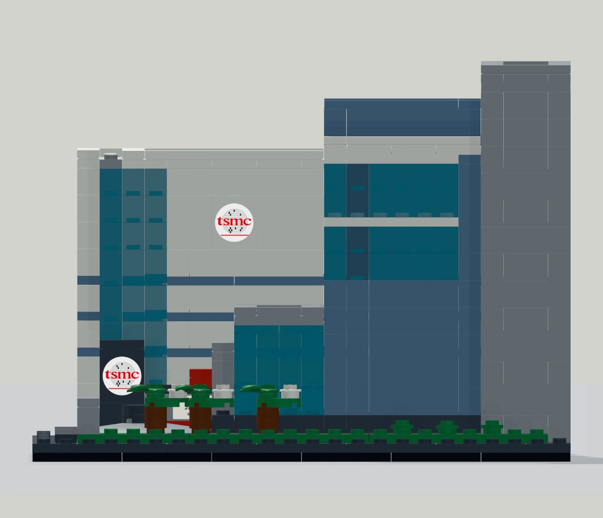

# 張忠謀大樓｜組裝說明書

FAB 01 · Morris Chang Building

從入口圓形水景望去，白色長棟在左側向後延伸，較高的灰棟橫列在後方。兩道沙藍跨框與透明門廳斜置在內角，紅色雨棚面向廣場。

633 件 · 4 袋 · 103 步

底座 24 × 24 凸點。

將底座較後的一側朝上，從左上角第 1 顆凸點開始數。X 由左向右，Z 由後向前。底高以薄板為單位，桌面是 0，一塊標準磚高 3 層薄板。每個位置均取零件佔地最左、最後的凸點。

圖號依每一步的安裝順序編列，回到下一個步驟時從 1 重新起算。[圖解說明書](manual.html) · [分袋 BOM](bom.csv) · [分步 LDraw 模型](model.ldr)

## 原盒資料與本版用量

從圓形廣場看，白棟在左邊向後延伸，灰色高棟橫列在後方。斜置的玻璃門廳落在 L 形內角，面向水景。

TShop 原盒 F010010101 標示 483 件，商品尺寸 19.2 × 19.2 × 14.1 公分。本版使用 633 件標準積木，另有 4 枚貼紙。採購請依本版分袋 BOM。

[原盒與尺寸](https://www.tshop.life/zh-hant/products/micro-brick-series-corporate-headquarters-fab-12a-pre-order) · [商品三視圖](https://shoplineimg.com/64c760de75653b004eb51fc9/6ae4613f06ec1604e6699e9d/original.jpg) · [台積電年報・張忠謀大樓入口實景](https://investor.tsmc.com/static/annualReports/2021/english/pdf/2021_tsmc_ar_e_ch1.pdf#page=1)

## 建築方位與配置

**廣場正面**　白棟的窄端在左，灰棟在後；兩道藍框之間可見玻璃、中段白簷及低門廳。

**綠帶側面**　由樹列向內看，白棟的三道腰線沿長牆伸展，灰棟只露出窄端。紅色晶圓徽章位於白棟靠入口的一端。

**建築俯視**　俯視時灰白兩棟成直角。斜置門廳前依序為紅色雨棚與圓形水景，樹帶位於右側。

## 原寸貼紙

本款有 4 張貼紙。請以 100% 列印原寸貼紙 PDF，依步驟中的 S 編號貼在指定磚面，再把該件扣入。

[下載 A4 可列印貼紙](stickers.pdf)

- S01　白棟內側長牆、轉角藍窗旁的晶圓徽章 · 袋 02／步驟 26 · 14 × 15 mm · 右側面，面中央。
- S02　中庭入口、紅色底座上方的中英文大樓銘牌 · 袋 04／步驟 96 · 34 × 8.4 mm · 右側面，面中央。
- S03　中庭入口深灰牆上的晶圓徽章 · 袋 04／步驟 96 · 14 × 15 mm · 右側面，面中央。
- S04　綠帶前端、靠近水景的張忠謀大樓名牌 · 袋 04／步驟 100 · 26 × 7.2 mm · 正面（朝前），面中央。

## 第 01 袋　底座與定位

46 件，共 7 步。

| 顏色 | 零件 | 設計／庫號 | 數量 |
| --- | --- | --- | ---: |
| 黑色 | 薄板 4×8 | 3035 | 18 |
| 深藍灰 | 薄板 2×4 | 3020 | 4 |
| 深藍灰 | 薄板 4×4 | 3031 | 10 |
| 深藍灰 | 薄板 2×8 | 3034 | 4 |
| 深藍灰 | 薄板 4×8 | 3035 | 10 |

### 步驟 01　併排底板（1/3）

將底板凸點朝上、長邊對齊排在平桌。下一層會跨接板縫。

**本步取件**

| 顏色 | 零件 | 設計／庫號 | 數量 |
| --- | --- | --- | ---: |
| 黑色 | 薄板 4×8 | 3035 | 8 |

**安裝位置**

| 圖號 | 零件與顏色 | X | Z | 底高（薄板） | 方向 |
| ---: | --- | ---: | ---: | ---: | --- |
| 1 | 黑色 薄板 4×8（3035） | 1 | 1 | 0 | 沿 X |
| 2 | 黑色 薄板 4×8（3035） | 9 | 1 | 0 | 沿 X |
| 3 | 黑色 薄板 4×8（3035） | 17 | 1 | 0 | 沿 X |
| 4 | 黑色 薄板 4×8（3035） | 1 | 5 | 0 | 沿 X |
| 5 | 黑色 薄板 4×8（3035） | 9 | 5 | 0 | 沿 X |
| 6 | 黑色 薄板 4×8（3035） | 17 | 5 | 0 | 沿 X |
| 7 | 黑色 薄板 4×8（3035） | 1 | 9 | 0 | 沿 X |
| 8 | 黑色 薄板 4×8（3035） | 9 | 9 | 0 | 沿 X |

### 步驟 02　併排底板（2/3）

將底板凸點朝上、長邊對齊排在平桌。下一層會跨接板縫。

**本步取件**

| 顏色 | 零件 | 設計／庫號 | 數量 |
| --- | --- | --- | ---: |
| 黑色 | 薄板 4×8 | 3035 | 8 |

**安裝位置**

| 圖號 | 零件與顏色 | X | Z | 底高（薄板） | 方向 |
| ---: | --- | ---: | ---: | ---: | --- |
| 1 | 黑色 薄板 4×8（3035） | 17 | 9 | 0 | 沿 X |
| 2 | 黑色 薄板 4×8（3035） | 1 | 13 | 0 | 沿 X |
| 3 | 黑色 薄板 4×8（3035） | 9 | 13 | 0 | 沿 X |
| 4 | 黑色 薄板 4×8（3035） | 17 | 13 | 0 | 沿 X |
| 5 | 黑色 薄板 4×8（3035） | 1 | 17 | 0 | 沿 X |
| 6 | 黑色 薄板 4×8（3035） | 9 | 17 | 0 | 沿 X |
| 7 | 黑色 薄板 4×8（3035） | 17 | 17 | 0 | 沿 X |
| 8 | 黑色 薄板 4×8（3035） | 1 | 21 | 0 | 沿 X |

### 步驟 03　併排底板（3/3）

將底板凸點朝上、長邊對齊排在平桌。下一層會跨接板縫。

**本步取件**

| 顏色 | 零件 | 設計／庫號 | 數量 |
| --- | --- | --- | ---: |
| 黑色 | 薄板 4×8 | 3035 | 2 |

**安裝位置**

| 圖號 | 零件與顏色 | X | Z | 底高（薄板） | 方向 |
| ---: | --- | ---: | ---: | ---: | --- |
| 1 | 黑色 薄板 4×8（3035） | 9 | 21 | 0 | 沿 X |
| 2 | 黑色 薄板 4×8（3035） | 17 | 21 | 0 | 沿 X |

### 步驟 04　錯縫鎖底（1/4）

上層相對底板橫移四格、縱移兩格。逐排按緊後，底座可整片拿起。

**本步取件**

| 顏色 | 零件 | 設計／庫號 | 數量 |
| --- | --- | --- | ---: |
| 深藍灰 | 薄板 2×4 | 3020 | 2 |
| 深藍灰 | 薄板 4×4 | 3031 | 2 |
| 深藍灰 | 薄板 2×8 | 3034 | 2 |
| 深藍灰 | 薄板 4×8 | 3035 | 2 |

**安裝位置**

| 圖號 | 零件與顏色 | X | Z | 底高（薄板） | 方向 |
| ---: | --- | ---: | ---: | ---: | --- |
| 1 | 深藍灰 薄板 2×4（3020） | 1 | 1 | 1 | 沿 X |
| 2 | 深藍灰 薄板 2×8（3034） | 5 | 1 | 1 | 沿 X |
| 3 | 深藍灰 薄板 2×8（3034） | 13 | 1 | 1 | 沿 X |
| 4 | 深藍灰 薄板 2×4（3020） | 21 | 1 | 1 | 沿 X |
| 5 | 深藍灰 薄板 4×4（3031） | 1 | 3 | 1 | — |
| 6 | 深藍灰 薄板 4×8（3035） | 5 | 3 | 1 | 沿 X |
| 7 | 深藍灰 薄板 4×8（3035） | 13 | 3 | 1 | 沿 X |
| 8 | 深藍灰 薄板 4×4（3031） | 21 | 3 | 1 | — |

### 步驟 05　錯縫鎖底（2/4）

上層相對底板橫移四格、縱移兩格。逐排按緊後，底座可整片拿起。

**本步取件**

| 顏色 | 零件 | 設計／庫號 | 數量 |
| --- | --- | --- | ---: |
| 深藍灰 | 薄板 4×4 | 3031 | 4 |
| 深藍灰 | 薄板 4×8 | 3035 | 4 |

**安裝位置**

| 圖號 | 零件與顏色 | X | Z | 底高（薄板） | 方向 |
| ---: | --- | ---: | ---: | ---: | --- |
| 1 | 深藍灰 薄板 4×4（3031） | 1 | 7 | 1 | — |
| 2 | 深藍灰 薄板 4×8（3035） | 5 | 7 | 1 | 沿 X |
| 3 | 深藍灰 薄板 4×8（3035） | 13 | 7 | 1 | 沿 X |
| 4 | 深藍灰 薄板 4×4（3031） | 21 | 7 | 1 | — |
| 5 | 深藍灰 薄板 4×4（3031） | 1 | 11 | 1 | — |
| 6 | 深藍灰 薄板 4×8（3035） | 5 | 11 | 1 | 沿 X |
| 7 | 深藍灰 薄板 4×8（3035） | 13 | 11 | 1 | 沿 X |
| 8 | 深藍灰 薄板 4×4（3031） | 21 | 11 | 1 | — |

### 步驟 06　錯縫鎖底（3/4）

上層相對底板橫移四格、縱移兩格。逐排按緊後，底座可整片拿起。

**本步取件**

| 顏色 | 零件 | 設計／庫號 | 數量 |
| --- | --- | --- | ---: |
| 深藍灰 | 薄板 4×4 | 3031 | 4 |
| 深藍灰 | 薄板 4×8 | 3035 | 4 |

**安裝位置**

| 圖號 | 零件與顏色 | X | Z | 底高（薄板） | 方向 |
| ---: | --- | ---: | ---: | ---: | --- |
| 1 | 深藍灰 薄板 4×4（3031） | 1 | 15 | 1 | — |
| 2 | 深藍灰 薄板 4×8（3035） | 5 | 15 | 1 | 沿 X |
| 3 | 深藍灰 薄板 4×8（3035） | 13 | 15 | 1 | 沿 X |
| 4 | 深藍灰 薄板 4×4（3031） | 21 | 15 | 1 | — |
| 5 | 深藍灰 薄板 4×4（3031） | 1 | 19 | 1 | — |
| 6 | 深藍灰 薄板 4×8（3035） | 5 | 19 | 1 | 沿 X |
| 7 | 深藍灰 薄板 4×8（3035） | 13 | 19 | 1 | 沿 X |
| 8 | 深藍灰 薄板 4×4（3031） | 21 | 19 | 1 | — |

### 步驟 07　錯縫鎖底（4/4）

上層相對底板橫移四格、縱移兩格。逐排按緊後，底座可整片拿起。

**本步取件**

| 顏色 | 零件 | 設計／庫號 | 數量 |
| --- | --- | --- | ---: |
| 深藍灰 | 薄板 2×4 | 3020 | 2 |
| 深藍灰 | 薄板 2×8 | 3034 | 2 |

**安裝位置**

| 圖號 | 零件與顏色 | X | Z | 底高（薄板） | 方向 |
| ---: | --- | ---: | ---: | ---: | --- |
| 1 | 深藍灰 薄板 2×4（3020） | 1 | 23 | 1 | 沿 X |
| 2 | 深藍灰 薄板 2×8（3034） | 5 | 23 | 1 | 沿 X |
| 3 | 深藍灰 薄板 2×8（3034） | 13 | 23 | 1 | 沿 X |
| 4 | 深藍灰 薄板 2×4（3020） | 21 | 23 | 1 | 沿 X |

## 第 02 袋　白色長棟、轉角玻璃與晶圓徽章

182 件，共 27 步。

| 顏色 | 零件 | 設計／庫號 | 數量 |
| --- | --- | --- | ---: |
| 白色 | 磚 2×6 | 2456 | 8 |
| 白色 | 磚 1×2 | 3004 | 2 |
| 白色 | 磚 1×1 | 3005 | 14 |
| 白色 | 磚 1×8 | 3008 | 32 |
| 白色 | 磚 1×6 | 3009 | 14 |
| 白色 | 薄板 2×8 | 3034 | 9 |
| 白色 | 光面板 1×1 | 3070b | 1 |
| 白色 | 雙層磚 1×2 | 3245c | 1 |
| 白色 | 磚 1×3 | 3622 | 2 |
| 白色 | 薄板 2×6 | 3795 | 1 |
| 白色 | 光面板 1×8 | 4162 | 6 |
| 白色 | 光面板 1×6 | 6636 | 1 |
| 透明淺藍 | 磚 1×1 | 3005 | 27 |
| 透明淺藍 | 薄板 1×2 | 3023 | 3 |
| 透明淺藍 | 薄板 1×1 | 3024 | 3 |
| 淺藍灰 | 磚 1×1 | 3005 | 9 |
| 淺藍灰 | 薄板 1×2 | 3023 | 1 |
| 淺藍灰 | 薄板 1×1 | 3024 | 3 |
| 沙藍 | 磚 2×4 | 3001 | 1 |
| 沙藍 | 磚 2×2 | 3003 | 1 |
| 沙藍 | 磚 1×2 | 3004 | 1 |
| 沙藍 | 磚 1×1 | 3005 | 1 |
| 沙藍 | 磚 1×6 | 3009 | 6 |
| 沙藍 | 磚 1×4 | 3010 | 1 |
| 沙藍 | 薄板 1×2 | 3023 | 3 |
| 沙藍 | 薄板 1×1 | 3024 | 3 |
| 沙藍 | 磚 1×3 | 3622 | 1 |
| 沙藍 | 薄板 1×3 | 3623 | 3 |
| 沙藍 | 薄板 1×6 | 3666 | 18 |
| 沙藍 | 薄板 1×4 | 3710 | 3 |
| 沙藍 | 薄板 2×6 | 3795 | 3 |

### 步驟 08　白棟外牆 · 1（1/2）

先扣後端與外側牆，再沿面向中庭的右牆接合。窄端白牆挑前兩格，透明直窗與灰色直柱在它的右側。

**本步取件**

| 顏色 | 零件 | 設計／庫號 | 數量 |
| --- | --- | --- | ---: |
| 沙藍 | 磚 1×2 | 3004 | 1 |
| 沙藍 | 磚 1×6 | 3009 | 5 |
| 沙藍 | 磚 1×4 | 3010 | 1 |
| 沙藍 | 磚 1×3 | 3622 | 1 |

**安裝位置**

| 圖號 | 零件與顏色 | X | Z | 底高（薄板） | 方向 |
| ---: | --- | ---: | ---: | ---: | --- |
| 1 | 沙藍 磚 1×6（3009） | 1 | 3 | 2 | 沿 X |
| 2 | 沙藍 磚 1×2（3004） | 7 | 3 | 2 | 沿 X |
| 3 | 沙藍 磚 1×6（3009） | 1 | 4 | 2 | 沿 Z |
| 4 | 沙藍 磚 1×6（3009） | 1 | 10 | 2 | 沿 Z |
| 5 | 沙藍 磚 1×4（3010） | 1 | 16 | 2 | 沿 Z |
| 6 | 沙藍 磚 1×6（3009） | 8 | 4 | 2 | 沿 Z |
| 7 | 沙藍 磚 1×6（3009） | 8 | 10 | 2 | 沿 Z |
| 8 | 沙藍 磚 1×3（3622） | 8 | 16 | 2 | 沿 Z |

### 步驟 09　白棟外牆 · 1（2/2）

先扣後端與外側牆，再沿面向中庭的右牆接合。窄端白牆挑前兩格，透明直窗與灰色直柱在它的右側。

**本步取件**

| 顏色 | 零件 | 設計／庫號 | 數量 |
| --- | --- | --- | ---: |
| 透明淺藍 | 磚 1×1 | 3005 | 3 |
| 淺藍灰 | 磚 1×1 | 3005 | 1 |
| 沙藍 | 磚 2×4 | 3001 | 1 |
| 沙藍 | 磚 2×2 | 3003 | 1 |
| 沙藍 | 磚 1×1 | 3005 | 1 |
| 沙藍 | 磚 1×6 | 3009 | 1 |

**安裝位置**

| 圖號 | 零件與顏色 | X | Z | 底高（薄板） | 方向 |
| ---: | --- | ---: | ---: | ---: | --- |
| 1 | 透明淺藍 磚 1×1（3005） | 8 | 19 | 2 | — |
| 2 | 透明淺藍 磚 1×1（3005） | 8 | 20 | 2 | — |
| 3 | 透明淺藍 磚 1×1（3005） | 8 | 21 | 2 | — |
| 4 | 沙藍 磚 1×6（3009） | 1 | 20 | 2 | 沿 X |
| 5 | 沙藍 磚 1×1（3005） | 7 | 20 | 2 | — |
| 6 | 沙藍 磚 2×4（3001） | 1 | 21 | 2 | 沿 X |
| 7 | 沙藍 磚 2×2（3003） | 5 | 21 | 2 | — |
| 8 | 淺藍灰 磚 1×1（3005） | 7 | 21 | 2 | — |

### 步驟 10　白棟外牆 · 2（1/2）

先扣後端與外側牆，再沿面向中庭的右牆接合。窄端白牆挑前兩格，透明直窗與灰色直柱在它的右側。

**本步取件**

| 顏色 | 零件 | 設計／庫號 | 數量 |
| --- | --- | --- | ---: |
| 白色 | 磚 1×1 | 3005 | 1 |
| 白色 | 磚 1×8 | 3008 | 4 |
| 白色 | 磚 1×6 | 3009 | 1 |
| 透明淺藍 | 磚 1×1 | 3005 | 2 |

**安裝位置**

| 圖號 | 零件與顏色 | X | Z | 底高（薄板） | 方向 |
| ---: | --- | ---: | ---: | ---: | --- |
| 1 | 白色 磚 1×8（3008） | 1 | 3 | 5 | 沿 X |
| 2 | 白色 磚 1×8（3008） | 1 | 4 | 5 | 沿 Z |
| 3 | 白色 磚 1×8（3008） | 1 | 12 | 5 | 沿 Z |
| 4 | 白色 磚 1×8（3008） | 8 | 4 | 5 | 沿 Z |
| 5 | 白色 磚 1×6（3009） | 8 | 12 | 5 | 沿 Z |
| 6 | 白色 磚 1×1（3005） | 8 | 18 | 5 | — |
| 7 | 透明淺藍 磚 1×1（3005） | 8 | 19 | 5 | — |
| 8 | 透明淺藍 磚 1×1（3005） | 8 | 20 | 5 | — |

### 步驟 11　白棟外牆 · 2（2/2）

先扣後端與外側牆，再沿面向中庭的右牆接合。窄端白牆挑前兩格，透明直窗與灰色直柱在它的右側。

**本步取件**

| 顏色 | 零件 | 設計／庫號 | 數量 |
| --- | --- | --- | ---: |
| 白色 | 磚 2×6 | 2456 | 1 |
| 白色 | 磚 1×1 | 3005 | 1 |
| 白色 | 磚 1×6 | 3009 | 1 |
| 透明淺藍 | 磚 1×1 | 3005 | 1 |
| 淺藍灰 | 磚 1×1 | 3005 | 1 |

**安裝位置**

| 圖號 | 零件與顏色 | X | Z | 底高（薄板） | 方向 |
| ---: | --- | ---: | ---: | ---: | --- |
| 1 | 透明淺藍 磚 1×1（3005） | 8 | 21 | 5 | — |
| 2 | 白色 磚 1×6（3009） | 1 | 20 | 5 | 沿 X |
| 3 | 白色 磚 1×1（3005） | 7 | 20 | 5 | — |
| 4 | 白色 磚 2×6（2456） | 1 | 21 | 5 | 沿 X |
| 5 | 淺藍灰 磚 1×1（3005） | 7 | 21 | 5 | — |

### 步驟 12　白棟外牆 · 3（1/2）

先扣後端與外側牆，再沿面向中庭的右牆接合。窄端白牆挑前兩格，透明直窗與灰色直柱在它的右側。

**本步取件**

| 顏色 | 零件 | 設計／庫號 | 數量 |
| --- | --- | --- | ---: |
| 白色 | 磚 1×1 | 3005 | 1 |
| 白色 | 磚 1×8 | 3008 | 4 |
| 白色 | 磚 1×6 | 3009 | 1 |
| 透明淺藍 | 磚 1×1 | 3005 | 2 |

**安裝位置**

| 圖號 | 零件與顏色 | X | Z | 底高（薄板） | 方向 |
| ---: | --- | ---: | ---: | ---: | --- |
| 1 | 白色 磚 1×8（3008） | 1 | 3 | 8 | 沿 X |
| 2 | 白色 磚 1×8（3008） | 1 | 4 | 8 | 沿 Z |
| 3 | 白色 磚 1×8（3008） | 1 | 12 | 8 | 沿 Z |
| 4 | 白色 磚 1×8（3008） | 8 | 4 | 8 | 沿 Z |
| 5 | 白色 磚 1×6（3009） | 8 | 12 | 8 | 沿 Z |
| 6 | 白色 磚 1×1（3005） | 8 | 18 | 8 | — |
| 7 | 透明淺藍 磚 1×1（3005） | 8 | 19 | 8 | — |
| 8 | 透明淺藍 磚 1×1（3005） | 8 | 20 | 8 | — |

### 步驟 13　白棟外牆 · 3（2/2）

先扣後端與外側牆，再沿面向中庭的右牆接合。窄端白牆挑前兩格，透明直窗與灰色直柱在它的右側。

**本步取件**

| 顏色 | 零件 | 設計／庫號 | 數量 |
| --- | --- | --- | ---: |
| 白色 | 磚 2×6 | 2456 | 1 |
| 白色 | 磚 1×1 | 3005 | 1 |
| 白色 | 磚 1×6 | 3009 | 1 |
| 透明淺藍 | 磚 1×1 | 3005 | 1 |
| 淺藍灰 | 磚 1×1 | 3005 | 1 |

**安裝位置**

| 圖號 | 零件與顏色 | X | Z | 底高（薄板） | 方向 |
| ---: | --- | ---: | ---: | ---: | --- |
| 1 | 透明淺藍 磚 1×1（3005） | 8 | 21 | 8 | — |
| 2 | 白色 磚 1×6（3009） | 1 | 20 | 8 | 沿 X |
| 3 | 白色 磚 1×1（3005） | 7 | 20 | 8 | — |
| 4 | 白色 磚 2×6（2456） | 1 | 21 | 8 | 沿 X |
| 5 | 淺藍灰 磚 1×1（3005） | 7 | 21 | 8 | — |

### 步驟 14　白棟外牆 · 4（1/2）

先扣後端與外側牆，再沿面向中庭的右牆接合。窄端白牆挑前兩格，透明直窗與灰色直柱在它的右側。

**本步取件**

| 顏色 | 零件 | 設計／庫號 | 數量 |
| --- | --- | --- | ---: |
| 沙藍 | 薄板 1×2 | 3023 | 1 |
| 沙藍 | 薄板 1×3 | 3623 | 1 |
| 沙藍 | 薄板 1×6 | 3666 | 5 |
| 沙藍 | 薄板 1×4 | 3710 | 1 |

**安裝位置**

| 圖號 | 零件與顏色 | X | Z | 底高（薄板） | 方向 |
| ---: | --- | ---: | ---: | ---: | --- |
| 1 | 沙藍 薄板 1×6（3666） | 1 | 3 | 11 | 沿 X |
| 2 | 沙藍 薄板 1×2（3023） | 7 | 3 | 11 | 沿 X |
| 3 | 沙藍 薄板 1×6（3666） | 1 | 4 | 11 | 沿 Z |
| 4 | 沙藍 薄板 1×6（3666） | 1 | 10 | 11 | 沿 Z |
| 5 | 沙藍 薄板 1×4（3710） | 1 | 16 | 11 | 沿 Z |
| 6 | 沙藍 薄板 1×6（3666） | 8 | 4 | 11 | 沿 Z |
| 7 | 沙藍 薄板 1×6（3666） | 8 | 10 | 11 | 沿 Z |
| 8 | 沙藍 薄板 1×3（3623） | 8 | 16 | 11 | 沿 Z |

### 步驟 15　白棟外牆 · 4（2/2）

先扣後端與外側牆，再沿面向中庭的右牆接合。窄端白牆挑前兩格，透明直窗與灰色直柱在它的右側。

**本步取件**

| 顏色 | 零件 | 設計／庫號 | 數量 |
| --- | --- | --- | ---: |
| 透明淺藍 | 薄板 1×2 | 3023 | 1 |
| 透明淺藍 | 薄板 1×1 | 3024 | 1 |
| 淺藍灰 | 薄板 1×1 | 3024 | 1 |
| 沙藍 | 薄板 1×1 | 3024 | 1 |
| 沙藍 | 薄板 1×6 | 3666 | 1 |
| 沙藍 | 薄板 2×6 | 3795 | 1 |

**安裝位置**

| 圖號 | 零件與顏色 | X | Z | 底高（薄板） | 方向 |
| ---: | --- | ---: | ---: | ---: | --- |
| 1 | 透明淺藍 薄板 1×2（3023） | 8 | 19 | 11 | 沿 Z |
| 2 | 透明淺藍 薄板 1×1（3024） | 8 | 21 | 11 | — |
| 3 | 沙藍 薄板 1×6（3666） | 1 | 20 | 11 | 沿 X |
| 4 | 沙藍 薄板 1×1（3024） | 7 | 20 | 11 | — |
| 5 | 沙藍 薄板 2×6（3795） | 1 | 21 | 11 | 沿 X |
| 6 | 淺藍灰 薄板 1×1（3024） | 7 | 21 | 11 | — |

### 步驟 16　白棟外牆 · 5（1/2）

先扣後端與外側牆，再沿面向中庭的右牆接合。窄端白牆挑前兩格，透明直窗與灰色直柱在它的右側。

**本步取件**

| 顏色 | 零件 | 設計／庫號 | 數量 |
| --- | --- | --- | ---: |
| 白色 | 磚 1×1 | 3005 | 1 |
| 白色 | 磚 1×8 | 3008 | 4 |
| 白色 | 磚 1×6 | 3009 | 1 |
| 透明淺藍 | 磚 1×1 | 3005 | 2 |

**安裝位置**

| 圖號 | 零件與顏色 | X | Z | 底高（薄板） | 方向 |
| ---: | --- | ---: | ---: | ---: | --- |
| 1 | 白色 磚 1×8（3008） | 1 | 3 | 12 | 沿 X |
| 2 | 白色 磚 1×8（3008） | 1 | 4 | 12 | 沿 Z |
| 3 | 白色 磚 1×8（3008） | 1 | 12 | 12 | 沿 Z |
| 4 | 白色 磚 1×8（3008） | 8 | 4 | 12 | 沿 Z |
| 5 | 白色 磚 1×6（3009） | 8 | 12 | 12 | 沿 Z |
| 6 | 白色 磚 1×1（3005） | 8 | 18 | 12 | — |
| 7 | 透明淺藍 磚 1×1（3005） | 8 | 19 | 12 | — |
| 8 | 透明淺藍 磚 1×1（3005） | 8 | 20 | 12 | — |

### 步驟 17　白棟外牆 · 5（2/2）

先扣後端與外側牆，再沿面向中庭的右牆接合。窄端白牆挑前兩格，透明直窗與灰色直柱在它的右側。

**本步取件**

| 顏色 | 零件 | 設計／庫號 | 數量 |
| --- | --- | --- | ---: |
| 白色 | 磚 2×6 | 2456 | 1 |
| 白色 | 磚 1×1 | 3005 | 1 |
| 白色 | 磚 1×6 | 3009 | 1 |
| 透明淺藍 | 磚 1×1 | 3005 | 1 |
| 淺藍灰 | 磚 1×1 | 3005 | 1 |

**安裝位置**

| 圖號 | 零件與顏色 | X | Z | 底高（薄板） | 方向 |
| ---: | --- | ---: | ---: | ---: | --- |
| 1 | 透明淺藍 磚 1×1（3005） | 8 | 21 | 12 | — |
| 2 | 白色 磚 1×6（3009） | 1 | 20 | 12 | 沿 X |
| 3 | 白色 磚 1×1（3005） | 7 | 20 | 12 | — |
| 4 | 白色 磚 2×6（2456） | 1 | 21 | 12 | 沿 X |
| 5 | 淺藍灰 磚 1×1（3005） | 7 | 21 | 12 | — |

### 步驟 18　白棟外牆 · 6（1/2）

先扣後端與外側牆，再沿面向中庭的右牆接合。窄端白牆挑前兩格，透明直窗與灰色直柱在它的右側。

**本步取件**

| 顏色 | 零件 | 設計／庫號 | 數量 |
| --- | --- | --- | ---: |
| 沙藍 | 薄板 1×2 | 3023 | 1 |
| 沙藍 | 薄板 1×3 | 3623 | 1 |
| 沙藍 | 薄板 1×6 | 3666 | 5 |
| 沙藍 | 薄板 1×4 | 3710 | 1 |

**安裝位置**

| 圖號 | 零件與顏色 | X | Z | 底高（薄板） | 方向 |
| ---: | --- | ---: | ---: | ---: | --- |
| 1 | 沙藍 薄板 1×6（3666） | 1 | 3 | 15 | 沿 X |
| 2 | 沙藍 薄板 1×2（3023） | 7 | 3 | 15 | 沿 X |
| 3 | 沙藍 薄板 1×6（3666） | 1 | 4 | 15 | 沿 Z |
| 4 | 沙藍 薄板 1×6（3666） | 1 | 10 | 15 | 沿 Z |
| 5 | 沙藍 薄板 1×4（3710） | 1 | 16 | 15 | 沿 Z |
| 6 | 沙藍 薄板 1×6（3666） | 8 | 4 | 15 | 沿 Z |
| 7 | 沙藍 薄板 1×6（3666） | 8 | 10 | 15 | 沿 Z |
| 8 | 沙藍 薄板 1×3（3623） | 8 | 16 | 15 | 沿 Z |

### 步驟 19　白棟外牆 · 6（2/2）

先扣後端與外側牆，再沿面向中庭的右牆接合。窄端白牆挑前兩格，透明直窗與灰色直柱在它的右側。

**本步取件**

| 顏色 | 零件 | 設計／庫號 | 數量 |
| --- | --- | --- | ---: |
| 透明淺藍 | 薄板 1×2 | 3023 | 1 |
| 透明淺藍 | 薄板 1×1 | 3024 | 1 |
| 淺藍灰 | 薄板 1×1 | 3024 | 1 |
| 沙藍 | 薄板 1×1 | 3024 | 1 |
| 沙藍 | 薄板 1×6 | 3666 | 1 |
| 沙藍 | 薄板 2×6 | 3795 | 1 |

**安裝位置**

| 圖號 | 零件與顏色 | X | Z | 底高（薄板） | 方向 |
| ---: | --- | ---: | ---: | ---: | --- |
| 1 | 透明淺藍 薄板 1×2（3023） | 8 | 19 | 15 | 沿 Z |
| 2 | 透明淺藍 薄板 1×1（3024） | 8 | 21 | 15 | — |
| 3 | 沙藍 薄板 1×6（3666） | 1 | 20 | 15 | 沿 X |
| 4 | 沙藍 薄板 1×1（3024） | 7 | 20 | 15 | — |
| 5 | 沙藍 薄板 2×6（3795） | 1 | 21 | 15 | 沿 X |
| 6 | 淺藍灰 薄板 1×1（3024） | 7 | 21 | 15 | — |

### 步驟 20　白棟外牆 · 7（1/2）

先扣後端與外側牆，再沿面向中庭的右牆接合。窄端白牆挑前兩格，透明直窗與灰色直柱在它的右側。

**本步取件**

| 顏色 | 零件 | 設計／庫號 | 數量 |
| --- | --- | --- | ---: |
| 白色 | 磚 1×1 | 3005 | 1 |
| 白色 | 磚 1×8 | 3008 | 4 |
| 白色 | 磚 1×6 | 3009 | 1 |
| 透明淺藍 | 磚 1×1 | 3005 | 2 |

**安裝位置**

| 圖號 | 零件與顏色 | X | Z | 底高（薄板） | 方向 |
| ---: | --- | ---: | ---: | ---: | --- |
| 1 | 白色 磚 1×8（3008） | 1 | 3 | 16 | 沿 X |
| 2 | 白色 磚 1×8（3008） | 1 | 4 | 16 | 沿 Z |
| 3 | 白色 磚 1×8（3008） | 1 | 12 | 16 | 沿 Z |
| 4 | 白色 磚 1×8（3008） | 8 | 4 | 16 | 沿 Z |
| 5 | 白色 磚 1×6（3009） | 8 | 12 | 16 | 沿 Z |
| 6 | 白色 磚 1×1（3005） | 8 | 18 | 16 | — |
| 7 | 透明淺藍 磚 1×1（3005） | 8 | 19 | 16 | — |
| 8 | 透明淺藍 磚 1×1（3005） | 8 | 20 | 16 | — |

### 步驟 21　白棟外牆 · 7（2/2）

先扣後端與外側牆，再沿面向中庭的右牆接合。窄端白牆挑前兩格，透明直窗與灰色直柱在它的右側。

**本步取件**

| 顏色 | 零件 | 設計／庫號 | 數量 |
| --- | --- | --- | ---: |
| 白色 | 磚 2×6 | 2456 | 1 |
| 白色 | 磚 1×1 | 3005 | 1 |
| 白色 | 磚 1×6 | 3009 | 1 |
| 透明淺藍 | 磚 1×1 | 3005 | 1 |
| 淺藍灰 | 磚 1×1 | 3005 | 1 |

**安裝位置**

| 圖號 | 零件與顏色 | X | Z | 底高（薄板） | 方向 |
| ---: | --- | ---: | ---: | ---: | --- |
| 1 | 透明淺藍 磚 1×1（3005） | 8 | 21 | 16 | — |
| 2 | 白色 磚 1×6（3009） | 1 | 20 | 16 | 沿 X |
| 3 | 白色 磚 1×1（3005） | 7 | 20 | 16 | — |
| 4 | 白色 磚 2×6（2456） | 1 | 21 | 16 | 沿 X |
| 5 | 淺藍灰 磚 1×1（3005） | 7 | 21 | 16 | — |

### 步驟 22　白棟外牆 · 8（1/2）

先扣後端與外側牆，再沿面向中庭的右牆接合。窄端白牆挑前兩格，透明直窗與灰色直柱在它的右側。

**本步取件**

| 顏色 | 零件 | 設計／庫號 | 數量 |
| --- | --- | --- | ---: |
| 沙藍 | 薄板 1×2 | 3023 | 1 |
| 沙藍 | 薄板 1×3 | 3623 | 1 |
| 沙藍 | 薄板 1×6 | 3666 | 5 |
| 沙藍 | 薄板 1×4 | 3710 | 1 |

**安裝位置**

| 圖號 | 零件與顏色 | X | Z | 底高（薄板） | 方向 |
| ---: | --- | ---: | ---: | ---: | --- |
| 1 | 沙藍 薄板 1×6（3666） | 1 | 3 | 19 | 沿 X |
| 2 | 沙藍 薄板 1×2（3023） | 7 | 3 | 19 | 沿 X |
| 3 | 沙藍 薄板 1×6（3666） | 1 | 4 | 19 | 沿 Z |
| 4 | 沙藍 薄板 1×6（3666） | 1 | 10 | 19 | 沿 Z |
| 5 | 沙藍 薄板 1×4（3710） | 1 | 16 | 19 | 沿 Z |
| 6 | 沙藍 薄板 1×6（3666） | 8 | 4 | 19 | 沿 Z |
| 7 | 沙藍 薄板 1×6（3666） | 8 | 10 | 19 | 沿 Z |
| 8 | 沙藍 薄板 1×3（3623） | 8 | 16 | 19 | 沿 Z |

### 步驟 23　白棟外牆 · 8（2/2）

先扣後端與外側牆，再沿面向中庭的右牆接合。窄端白牆挑前兩格，透明直窗與灰色直柱在它的右側。

**本步取件**

| 顏色 | 零件 | 設計／庫號 | 數量 |
| --- | --- | --- | ---: |
| 透明淺藍 | 薄板 1×2 | 3023 | 1 |
| 透明淺藍 | 薄板 1×1 | 3024 | 1 |
| 淺藍灰 | 薄板 1×1 | 3024 | 1 |
| 沙藍 | 薄板 1×1 | 3024 | 1 |
| 沙藍 | 薄板 1×6 | 3666 | 1 |
| 沙藍 | 薄板 2×6 | 3795 | 1 |

**安裝位置**

| 圖號 | 零件與顏色 | X | Z | 底高（薄板） | 方向 |
| ---: | --- | ---: | ---: | ---: | --- |
| 1 | 透明淺藍 薄板 1×2（3023） | 8 | 19 | 19 | 沿 Z |
| 2 | 透明淺藍 薄板 1×1（3024） | 8 | 21 | 19 | — |
| 3 | 沙藍 薄板 1×6（3666） | 1 | 20 | 19 | 沿 X |
| 4 | 沙藍 薄板 1×1（3024） | 7 | 20 | 19 | — |
| 5 | 沙藍 薄板 2×6（3795） | 1 | 21 | 19 | 沿 X |
| 6 | 淺藍灰 薄板 1×1（3024） | 7 | 21 | 19 | — |

### 步驟 24　白棟外牆 · 9（1/2）

先扣後端與外側牆，再沿面向中庭的右牆接合。窄端白牆挑前兩格，透明直窗與灰色直柱在它的右側。

**本步取件**

| 顏色 | 零件 | 設計／庫號 | 數量 |
| --- | --- | --- | ---: |
| 白色 | 磚 1×1 | 3005 | 1 |
| 白色 | 磚 1×8 | 3008 | 4 |
| 白色 | 磚 1×6 | 3009 | 1 |
| 透明淺藍 | 磚 1×1 | 3005 | 2 |

**安裝位置**

| 圖號 | 零件與顏色 | X | Z | 底高（薄板） | 方向 |
| ---: | --- | ---: | ---: | ---: | --- |
| 1 | 白色 磚 1×8（3008） | 1 | 3 | 20 | 沿 X |
| 2 | 白色 磚 1×8（3008） | 1 | 4 | 20 | 沿 Z |
| 3 | 白色 磚 1×8（3008） | 1 | 12 | 20 | 沿 Z |
| 4 | 白色 磚 1×8（3008） | 8 | 4 | 20 | 沿 Z |
| 5 | 白色 磚 1×6（3009） | 8 | 12 | 20 | 沿 Z |
| 6 | 白色 磚 1×1（3005） | 8 | 18 | 20 | — |
| 7 | 透明淺藍 磚 1×1（3005） | 8 | 19 | 20 | — |
| 8 | 透明淺藍 磚 1×1（3005） | 8 | 20 | 20 | — |

### 步驟 25　白棟外牆 · 9（2/2）

先扣後端與外側牆，再沿面向中庭的右牆接合。窄端白牆挑前兩格，透明直窗與灰色直柱在它的右側。

**本步取件**

| 顏色 | 零件 | 設計／庫號 | 數量 |
| --- | --- | --- | ---: |
| 白色 | 磚 2×6 | 2456 | 1 |
| 白色 | 磚 1×1 | 3005 | 1 |
| 白色 | 磚 1×6 | 3009 | 1 |
| 透明淺藍 | 磚 1×1 | 3005 | 1 |
| 淺藍灰 | 磚 1×1 | 3005 | 1 |

**安裝位置**

| 圖號 | 零件與顏色 | X | Z | 底高（薄板） | 方向 |
| ---: | --- | ---: | ---: | ---: | --- |
| 1 | 透明淺藍 磚 1×1（3005） | 8 | 21 | 20 | — |
| 2 | 白色 磚 1×6（3009） | 1 | 20 | 20 | 沿 X |
| 3 | 白色 磚 1×1（3005） | 7 | 20 | 20 | — |
| 4 | 白色 磚 2×6（2456） | 1 | 21 | 20 | 沿 X |
| 5 | 淺藍灰 磚 1×1（3005） | 7 | 21 | 20 | — |

### 步驟 26　白棟外牆 · 10（1/2）

先扣後端與外側牆，再沿面向中庭的右牆接合。窄端白牆挑前兩格，透明直窗與灰色直柱在它的右側。

**本步取件**

| 顏色 | 零件 | 設計／庫號 | 數量 |
| --- | --- | --- | ---: |
| 白色 | 磚 1×2 | 3004 | 1 |
| 白色 | 磚 1×8 | 3008 | 4 |
| 白色 | 雙層磚 1×2 | 3245c | 1 |
| 白色 | 磚 1×3 | 3622 | 1 |
| 透明淺藍 | 磚 1×1 | 3005 | 1 |

**安裝位置**

| 圖號 | 零件與顏色 | X | Z | 底高（薄板） | 方向 |
| ---: | --- | ---: | ---: | ---: | --- |
| 1 | 白色 磚 1×8（3008） | 1 | 3 | 23 | 沿 X |
| 2 | 白色 磚 1×8（3008） | 1 | 4 | 23 | 沿 Z |
| 3 | 白色 磚 1×8（3008） | 1 | 12 | 23 | 沿 Z |
| 4 | 白色 磚 1×8（3008） | 8 | 4 | 23 | 沿 Z |
| 5 | 白色 磚 1×3（3622） | 8 | 12 | 23 | 沿 Z |
| 6 | 白色 雙層磚 1×2（3245c） | 8 | 15 | 23 | 沿 Z |
| 7 | 白色 磚 1×2（3004） | 8 | 17 | 23 | 沿 Z |
| 8 | 透明淺藍 磚 1×1（3005） | 8 | 19 | 23 | — |

**貼紙 S01**　白棟內側長牆、轉角藍窗旁的晶圓徽章。圖號 6，右側面，面中央。貼好再扣入。尺寸 14 × 15 mm。

### 步驟 27　白棟外牆 · 10（2/2）

先扣後端與外側牆，再沿面向中庭的右牆接合。窄端白牆挑前兩格，透明直窗與灰色直柱在它的右側。

**本步取件**

| 顏色 | 零件 | 設計／庫號 | 數量 |
| --- | --- | --- | ---: |
| 白色 | 磚 2×6 | 2456 | 1 |
| 白色 | 磚 1×1 | 3005 | 1 |
| 白色 | 磚 1×6 | 3009 | 1 |
| 透明淺藍 | 磚 1×1 | 3005 | 2 |
| 淺藍灰 | 磚 1×1 | 3005 | 1 |

**安裝位置**

| 圖號 | 零件與顏色 | X | Z | 底高（薄板） | 方向 |
| ---: | --- | ---: | ---: | ---: | --- |
| 1 | 透明淺藍 磚 1×1（3005） | 8 | 20 | 23 | — |
| 2 | 透明淺藍 磚 1×1（3005） | 8 | 21 | 23 | — |
| 3 | 白色 磚 1×6（3009） | 1 | 20 | 23 | 沿 X |
| 4 | 白色 磚 1×1（3005） | 7 | 20 | 23 | — |
| 5 | 白色 磚 2×6（2456） | 1 | 21 | 23 | 沿 X |
| 6 | 淺藍灰 磚 1×1（3005） | 7 | 21 | 23 | — |

### 步驟 28　白棟外牆 · 11（1/2）

先扣後端與外側牆，再沿面向中庭的右牆接合。窄端白牆挑前兩格，透明直窗與灰色直柱在它的右側。

**本步取件**

| 顏色 | 零件 | 設計／庫號 | 數量 |
| --- | --- | --- | ---: |
| 白色 | 磚 1×2 | 3004 | 1 |
| 白色 | 磚 1×8 | 3008 | 4 |
| 白色 | 磚 1×3 | 3622 | 1 |
| 透明淺藍 | 磚 1×1 | 3005 | 2 |

**安裝位置**

| 圖號 | 零件與顏色 | X | Z | 底高（薄板） | 方向 |
| ---: | --- | ---: | ---: | ---: | --- |
| 1 | 白色 磚 1×8（3008） | 1 | 3 | 26 | 沿 X |
| 2 | 白色 磚 1×8（3008） | 1 | 4 | 26 | 沿 Z |
| 3 | 白色 磚 1×8（3008） | 1 | 12 | 26 | 沿 Z |
| 4 | 白色 磚 1×8（3008） | 8 | 4 | 26 | 沿 Z |
| 5 | 白色 磚 1×3（3622） | 8 | 12 | 26 | 沿 Z |
| 6 | 白色 磚 1×2（3004） | 8 | 17 | 26 | 沿 Z |
| 7 | 透明淺藍 磚 1×1（3005） | 8 | 19 | 26 | — |
| 8 | 透明淺藍 磚 1×1（3005） | 8 | 20 | 26 | — |

### 步驟 29　白棟外牆 · 11（2/2）

先扣後端與外側牆，再沿面向中庭的右牆接合。窄端白牆挑前兩格，透明直窗與灰色直柱在它的右側。

**本步取件**

| 顏色 | 零件 | 設計／庫號 | 數量 |
| --- | --- | --- | ---: |
| 白色 | 磚 2×6 | 2456 | 1 |
| 白色 | 磚 1×1 | 3005 | 1 |
| 白色 | 磚 1×6 | 3009 | 1 |
| 透明淺藍 | 磚 1×1 | 3005 | 1 |
| 淺藍灰 | 磚 1×1 | 3005 | 1 |

**安裝位置**

| 圖號 | 零件與顏色 | X | Z | 底高（薄板） | 方向 |
| ---: | --- | ---: | ---: | ---: | --- |
| 1 | 透明淺藍 磚 1×1（3005） | 8 | 21 | 26 | — |
| 2 | 白色 磚 1×6（3009） | 1 | 20 | 26 | 沿 X |
| 3 | 白色 磚 1×1（3005） | 7 | 20 | 26 | — |
| 4 | 白色 磚 2×6（2456） | 1 | 21 | 26 | 沿 X |
| 5 | 淺藍灰 磚 1×1（3005） | 7 | 21 | 26 | — |

### 步驟 30　白棟外牆 · 12（1/2）

先扣後端與外側牆，再沿面向中庭的右牆接合。窄端白牆挑前兩格，透明直窗與灰色直柱在它的右側。

**本步取件**

| 顏色 | 零件 | 設計／庫號 | 數量 |
| --- | --- | --- | ---: |
| 白色 | 磚 1×1 | 3005 | 1 |
| 白色 | 磚 1×8 | 3008 | 4 |
| 白色 | 磚 1×6 | 3009 | 1 |
| 透明淺藍 | 磚 1×1 | 3005 | 2 |

**安裝位置**

| 圖號 | 零件與顏色 | X | Z | 底高（薄板） | 方向 |
| ---: | --- | ---: | ---: | ---: | --- |
| 1 | 白色 磚 1×8（3008） | 1 | 3 | 29 | 沿 X |
| 2 | 白色 磚 1×8（3008） | 1 | 4 | 29 | 沿 Z |
| 3 | 白色 磚 1×8（3008） | 1 | 12 | 29 | 沿 Z |
| 4 | 白色 磚 1×8（3008） | 8 | 4 | 29 | 沿 Z |
| 5 | 白色 磚 1×6（3009） | 8 | 12 | 29 | 沿 Z |
| 6 | 白色 磚 1×1（3005） | 8 | 18 | 29 | — |
| 7 | 透明淺藍 磚 1×1（3005） | 8 | 19 | 29 | — |
| 8 | 透明淺藍 磚 1×1（3005） | 8 | 20 | 29 | — |

### 步驟 31　白棟外牆 · 12（2/2）

先扣後端與外側牆，再沿面向中庭的右牆接合。窄端白牆挑前兩格，透明直窗與灰色直柱在它的右側。

**本步取件**

| 顏色 | 零件 | 設計／庫號 | 數量 |
| --- | --- | --- | ---: |
| 白色 | 磚 2×6 | 2456 | 1 |
| 白色 | 磚 1×1 | 3005 | 1 |
| 白色 | 磚 1×6 | 3009 | 1 |
| 透明淺藍 | 磚 1×1 | 3005 | 1 |
| 淺藍灰 | 磚 1×1 | 3005 | 1 |

**安裝位置**

| 圖號 | 零件與顏色 | X | Z | 底高（薄板） | 方向 |
| ---: | --- | ---: | ---: | ---: | --- |
| 1 | 透明淺藍 磚 1×1（3005） | 8 | 21 | 29 | — |
| 2 | 白色 磚 1×6（3009） | 1 | 20 | 29 | 沿 X |
| 3 | 白色 磚 1×1（3005） | 7 | 20 | 29 | — |
| 4 | 白色 磚 2×6（2456） | 1 | 21 | 29 | 沿 X |
| 5 | 淺藍灰 磚 1×1（3005） | 7 | 21 | 29 | — |

### 步驟 32　白棟屋面（1/3）

短向跨接左右牆面；窄端另鋪六格寬的屋面，最後以白色光面板勾出屋緣。

**本步取件**

| 顏色 | 零件 | 設計／庫號 | 數量 |
| --- | --- | --- | ---: |
| 白色 | 薄板 2×8 | 3034 | 8 |

**安裝位置**

| 圖號 | 零件與顏色 | X | Z | 底高（薄板） | 方向 |
| ---: | --- | ---: | ---: | ---: | --- |
| 1 | 白色 薄板 2×8（3034） | 1 | 3 | 32 | 沿 X |
| 2 | 白色 薄板 2×8（3034） | 1 | 5 | 32 | 沿 X |
| 3 | 白色 薄板 2×8（3034） | 1 | 7 | 32 | 沿 X |
| 4 | 白色 薄板 2×8（3034） | 1 | 9 | 32 | 沿 X |
| 5 | 白色 薄板 2×8（3034） | 1 | 11 | 32 | 沿 X |
| 6 | 白色 薄板 2×8（3034） | 1 | 13 | 32 | 沿 X |
| 7 | 白色 薄板 2×8（3034） | 1 | 15 | 32 | 沿 X |
| 8 | 白色 薄板 2×8（3034） | 1 | 17 | 32 | 沿 X |

### 步驟 33　白棟屋面（2/3）

短向跨接左右牆面；窄端另鋪六格寬的屋面，最後以白色光面板勾出屋緣。

**本步取件**

| 顏色 | 零件 | 設計／庫號 | 數量 |
| --- | --- | --- | ---: |
| 白色 | 薄板 2×8 | 3034 | 1 |
| 白色 | 薄板 2×6 | 3795 | 1 |
| 白色 | 光面板 1×8 | 4162 | 5 |
| 淺藍灰 | 薄板 1×2 | 3023 | 1 |

**安裝位置**

| 圖號 | 零件與顏色 | X | Z | 底高（薄板） | 方向 |
| ---: | --- | ---: | ---: | ---: | --- |
| 1 | 白色 薄板 2×8（3034） | 1 | 19 | 32 | 沿 X |
| 2 | 白色 薄板 2×6（3795） | 1 | 21 | 32 | 沿 X |
| 3 | 淺藍灰 薄板 1×2（3023） | 7 | 21 | 32 | 沿 X |
| 4 | 白色 光面板 1×8（4162） | 1 | 3 | 33 | 沿 X |
| 5 | 白色 光面板 1×8（4162） | 1 | 20 | 33 | 沿 X |
| 6 | 白色 光面板 1×8（4162） | 1 | 4 | 33 | 沿 Z |
| 7 | 白色 光面板 1×8（4162） | 1 | 12 | 33 | 沿 Z |
| 8 | 白色 光面板 1×8（4162） | 8 | 4 | 33 | 沿 Z |

### 步驟 34　白棟屋面（3/3）

短向跨接左右牆面；窄端另鋪六格寬的屋面，最後以白色光面板勾出屋緣。

**本步取件**

| 顏色 | 零件 | 設計／庫號 | 數量 |
| --- | --- | --- | ---: |
| 白色 | 光面板 1×1 | 3070b | 1 |
| 白色 | 光面板 1×8 | 4162 | 1 |
| 白色 | 光面板 1×6 | 6636 | 1 |

**安裝位置**

| 圖號 | 零件與顏色 | X | Z | 底高（薄板） | 方向 |
| ---: | --- | ---: | ---: | ---: | --- |
| 1 | 白色 光面板 1×8（4162） | 8 | 12 | 33 | 沿 Z |
| 2 | 白色 光面板 1×6（6636） | 1 | 22 | 33 | 沿 X |
| 3 | 白色 光面板 1×1（3070b） | 1 | 21 | 33 | — |

## 第 03 袋　後方灰棟與斜置玻璃翼樓

267 件，共 45 步。

| 顏色 | 零件 | 設計／庫號 | 數量 |
| --- | --- | --- | ---: |
| 紅色 | 磚 1×1 | 3005 | 9 |
| 紅色 | 薄板 1×1 | 3024 | 2 |
| 白色 | 光面板 1×4 | 2431 | 2 |
| 白色 | 薄板 2×4 | 3020 | 4 |
| 白色 | 薄板 1×2 | 3023 | 4 |
| 白色 | 薄板 1×1 | 3024 | 3 |
| 白色 | 光面板 1×1 | 3070b | 1 |
| 白色 | 薄板 1×3 | 3623 | 2 |
| 白色 | 薄板 1×4 | 3710 | 3 |
| 白色 | 光面板 2×4 | 87079 | 2 |
| 透明淺藍 | 磚 1×1 | 3005 | 32 |
| 淺藍灰 | 光面板 1×4 | 2431 | 2 |
| 淺藍灰 | 磚 1×2 | 3004 | 26 |
| 淺藍灰 | 磚 1×8 | 3008 | 26 |
| 淺藍灰 | 磚 1×4 | 3010 | 26 |
| 淺藍灰 | 薄板 2×4 | 3020 | 6 |
| 淺藍灰 | 薄板 1×2 | 3023 | 2 |
| 淺藍灰 | 光面板 1×2 | 3069b | 2 |
| 淺藍灰 | 薄板 1×8 | 3460 | 2 |
| 淺藍灰 | 薄板 1×4 | 3710 | 2 |
| 淺藍灰 | 光面板 1×8 | 4162 | 2 |
| 深藍灰 | 薄板 2×4 | 3020 | 1 |
| 深藍灰 | 薄板 1×1 | 3024 | 2 |
| 深藍灰 | 薄板 4×6 | 3032 | 1 |
| 深藍灰 | 薄板 4×8 | 3035 | 1 |
| 深藍灰 | 薄板 1×8 | 3460 | 1 |
| 深藍灰 | 薄板 1×6 | 3666 | 1 |
| 深藍灰 | 薄板 1×4 | 3710 | 2 |
| 深藍灰 | 圓薄板 1×1 | 4073 | 2 |
| 深藍灰 | 薄板 8×8 | 41539 | 1 |
| 沙藍 | 光面板 1×4 | 2431 | 2 |
| 沙藍 | 磚 1×1 | 3005 | 34 |
| 沙藍 | 磚 1×6 | 3009 | 9 |
| 沙藍 | 磚 1×4 | 3010 | 7 |
| 沙藍 | 薄板 1×1 | 3024 | 10 |
| 沙藍 | 光面板 1×2 | 3069b | 1 |
| 沙藍 | 光面板 1×1 | 3070b | 2 |
| 沙藍 | 磚 1×3 | 3622 | 23 |
| 沙藍 | 薄板 1×3 | 3623 | 4 |
| 沙藍 | 薄板 1×6 | 3666 | 2 |
| 沙藍 | 光面板 2×4 | 87079 | 1 |

### 步驟 35　後方灰棟 · 1

沿底座後緣扣出十二格長、四格深的灰棟。左右長軸垂直於白棟，牆角逐層交錯。

**本步取件**

| 顏色 | 零件 | 設計／庫號 | 數量 |
| --- | --- | --- | ---: |
| 淺藍灰 | 磚 1×2 | 3004 | 2 |
| 淺藍灰 | 磚 1×8 | 3008 | 2 |
| 淺藍灰 | 磚 1×4 | 3010 | 2 |

**安裝位置**

| 圖號 | 零件與顏色 | X | Z | 底高（薄板） | 方向 |
| ---: | --- | ---: | ---: | ---: | --- |
| 1 | 淺藍灰 磚 1×8（3008） | 9 | 1 | 2 | 沿 X |
| 2 | 淺藍灰 磚 1×4（3010） | 17 | 1 | 2 | 沿 X |
| 3 | 淺藍灰 磚 1×8（3008） | 9 | 4 | 2 | 沿 X |
| 4 | 淺藍灰 磚 1×4（3010） | 17 | 4 | 2 | 沿 X |
| 5 | 淺藍灰 磚 1×2（3004） | 9 | 2 | 2 | 沿 Z |
| 6 | 淺藍灰 磚 1×2（3004） | 20 | 2 | 2 | 沿 Z |

### 步驟 36　後方灰棟 · 2

沿底座後緣扣出十二格長、四格深的灰棟。左右長軸垂直於白棟，牆角逐層交錯。

**本步取件**

| 顏色 | 零件 | 設計／庫號 | 數量 |
| --- | --- | --- | ---: |
| 淺藍灰 | 磚 1×2 | 3004 | 2 |
| 淺藍灰 | 磚 1×8 | 3008 | 2 |
| 淺藍灰 | 磚 1×4 | 3010 | 2 |

**安裝位置**

| 圖號 | 零件與顏色 | X | Z | 底高（薄板） | 方向 |
| ---: | --- | ---: | ---: | ---: | --- |
| 1 | 淺藍灰 磚 1×4（3010） | 9 | 1 | 5 | 沿 Z |
| 2 | 淺藍灰 磚 1×4（3010） | 20 | 1 | 5 | 沿 Z |
| 3 | 淺藍灰 磚 1×8（3008） | 10 | 1 | 5 | 沿 X |
| 4 | 淺藍灰 磚 1×2（3004） | 18 | 1 | 5 | 沿 X |
| 5 | 淺藍灰 磚 1×8（3008） | 10 | 4 | 5 | 沿 X |
| 6 | 淺藍灰 磚 1×2（3004） | 18 | 4 | 5 | 沿 X |

### 步驟 37　後方灰棟 · 3

沿底座後緣扣出十二格長、四格深的灰棟。左右長軸垂直於白棟，牆角逐層交錯。

**本步取件**

| 顏色 | 零件 | 設計／庫號 | 數量 |
| --- | --- | --- | ---: |
| 淺藍灰 | 磚 1×2 | 3004 | 2 |
| 淺藍灰 | 磚 1×8 | 3008 | 2 |
| 淺藍灰 | 磚 1×4 | 3010 | 2 |

**安裝位置**

| 圖號 | 零件與顏色 | X | Z | 底高（薄板） | 方向 |
| ---: | --- | ---: | ---: | ---: | --- |
| 1 | 淺藍灰 磚 1×8（3008） | 9 | 1 | 8 | 沿 X |
| 2 | 淺藍灰 磚 1×4（3010） | 17 | 1 | 8 | 沿 X |
| 3 | 淺藍灰 磚 1×8（3008） | 9 | 4 | 8 | 沿 X |
| 4 | 淺藍灰 磚 1×4（3010） | 17 | 4 | 8 | 沿 X |
| 5 | 淺藍灰 磚 1×2（3004） | 9 | 2 | 8 | 沿 Z |
| 6 | 淺藍灰 磚 1×2（3004） | 20 | 2 | 8 | 沿 Z |

### 步驟 38　後方灰棟 · 4

沿底座後緣扣出十二格長、四格深的灰棟。左右長軸垂直於白棟，牆角逐層交錯。

**本步取件**

| 顏色 | 零件 | 設計／庫號 | 數量 |
| --- | --- | --- | ---: |
| 淺藍灰 | 磚 1×2 | 3004 | 2 |
| 淺藍灰 | 磚 1×8 | 3008 | 2 |
| 淺藍灰 | 磚 1×4 | 3010 | 2 |

**安裝位置**

| 圖號 | 零件與顏色 | X | Z | 底高（薄板） | 方向 |
| ---: | --- | ---: | ---: | ---: | --- |
| 1 | 淺藍灰 磚 1×4（3010） | 9 | 1 | 11 | 沿 Z |
| 2 | 淺藍灰 磚 1×4（3010） | 20 | 1 | 11 | 沿 Z |
| 3 | 淺藍灰 磚 1×8（3008） | 10 | 1 | 11 | 沿 X |
| 4 | 淺藍灰 磚 1×2（3004） | 18 | 1 | 11 | 沿 X |
| 5 | 淺藍灰 磚 1×8（3008） | 10 | 4 | 11 | 沿 X |
| 6 | 淺藍灰 磚 1×2（3004） | 18 | 4 | 11 | 沿 X |

### 步驟 39　後方灰棟 · 5

沿底座後緣扣出十二格長、四格深的灰棟。左右長軸垂直於白棟，牆角逐層交錯。

**本步取件**

| 顏色 | 零件 | 設計／庫號 | 數量 |
| --- | --- | --- | ---: |
| 淺藍灰 | 磚 1×2 | 3004 | 2 |
| 淺藍灰 | 磚 1×8 | 3008 | 2 |
| 淺藍灰 | 磚 1×4 | 3010 | 2 |

**安裝位置**

| 圖號 | 零件與顏色 | X | Z | 底高（薄板） | 方向 |
| ---: | --- | ---: | ---: | ---: | --- |
| 1 | 淺藍灰 磚 1×8（3008） | 9 | 1 | 14 | 沿 X |
| 2 | 淺藍灰 磚 1×4（3010） | 17 | 1 | 14 | 沿 X |
| 3 | 淺藍灰 磚 1×8（3008） | 9 | 4 | 14 | 沿 X |
| 4 | 淺藍灰 磚 1×4（3010） | 17 | 4 | 14 | 沿 X |
| 5 | 淺藍灰 磚 1×2（3004） | 9 | 2 | 14 | 沿 Z |
| 6 | 淺藍灰 磚 1×2（3004） | 20 | 2 | 14 | 沿 Z |

### 步驟 40　後方灰棟 · 6

沿底座後緣扣出十二格長、四格深的灰棟。左右長軸垂直於白棟，牆角逐層交錯。

**本步取件**

| 顏色 | 零件 | 設計／庫號 | 數量 |
| --- | --- | --- | ---: |
| 淺藍灰 | 磚 1×2 | 3004 | 2 |
| 淺藍灰 | 磚 1×8 | 3008 | 2 |
| 淺藍灰 | 磚 1×4 | 3010 | 2 |

**安裝位置**

| 圖號 | 零件與顏色 | X | Z | 底高（薄板） | 方向 |
| ---: | --- | ---: | ---: | ---: | --- |
| 1 | 淺藍灰 磚 1×4（3010） | 9 | 1 | 17 | 沿 Z |
| 2 | 淺藍灰 磚 1×4（3010） | 20 | 1 | 17 | 沿 Z |
| 3 | 淺藍灰 磚 1×8（3008） | 10 | 1 | 17 | 沿 X |
| 4 | 淺藍灰 磚 1×2（3004） | 18 | 1 | 17 | 沿 X |
| 5 | 淺藍灰 磚 1×8（3008） | 10 | 4 | 17 | 沿 X |
| 6 | 淺藍灰 磚 1×2（3004） | 18 | 4 | 17 | 沿 X |

### 步驟 41　後方灰棟 · 7

沿底座後緣扣出十二格長、四格深的灰棟。左右長軸垂直於白棟，牆角逐層交錯。

**本步取件**

| 顏色 | 零件 | 設計／庫號 | 數量 |
| --- | --- | --- | ---: |
| 淺藍灰 | 磚 1×2 | 3004 | 2 |
| 淺藍灰 | 磚 1×8 | 3008 | 2 |
| 淺藍灰 | 磚 1×4 | 3010 | 2 |

**安裝位置**

| 圖號 | 零件與顏色 | X | Z | 底高（薄板） | 方向 |
| ---: | --- | ---: | ---: | ---: | --- |
| 1 | 淺藍灰 磚 1×8（3008） | 9 | 1 | 20 | 沿 X |
| 2 | 淺藍灰 磚 1×4（3010） | 17 | 1 | 20 | 沿 X |
| 3 | 淺藍灰 磚 1×8（3008） | 9 | 4 | 20 | 沿 X |
| 4 | 淺藍灰 磚 1×4（3010） | 17 | 4 | 20 | 沿 X |
| 5 | 淺藍灰 磚 1×2（3004） | 9 | 2 | 20 | 沿 Z |
| 6 | 淺藍灰 磚 1×2（3004） | 20 | 2 | 20 | 沿 Z |

### 步驟 42　後方灰棟 · 8

沿底座後緣扣出十二格長、四格深的灰棟。左右長軸垂直於白棟，牆角逐層交錯。

**本步取件**

| 顏色 | 零件 | 設計／庫號 | 數量 |
| --- | --- | --- | ---: |
| 淺藍灰 | 磚 1×2 | 3004 | 2 |
| 淺藍灰 | 磚 1×8 | 3008 | 2 |
| 淺藍灰 | 磚 1×4 | 3010 | 2 |

**安裝位置**

| 圖號 | 零件與顏色 | X | Z | 底高（薄板） | 方向 |
| ---: | --- | ---: | ---: | ---: | --- |
| 1 | 淺藍灰 磚 1×4（3010） | 9 | 1 | 23 | 沿 Z |
| 2 | 淺藍灰 磚 1×4（3010） | 20 | 1 | 23 | 沿 Z |
| 3 | 淺藍灰 磚 1×8（3008） | 10 | 1 | 23 | 沿 X |
| 4 | 淺藍灰 磚 1×2（3004） | 18 | 1 | 23 | 沿 X |
| 5 | 淺藍灰 磚 1×8（3008） | 10 | 4 | 23 | 沿 X |
| 6 | 淺藍灰 磚 1×2（3004） | 18 | 4 | 23 | 沿 X |

### 步驟 43　後方灰棟 · 9

沿底座後緣扣出十二格長、四格深的灰棟。左右長軸垂直於白棟，牆角逐層交錯。

**本步取件**

| 顏色 | 零件 | 設計／庫號 | 數量 |
| --- | --- | --- | ---: |
| 淺藍灰 | 磚 1×2 | 3004 | 2 |
| 淺藍灰 | 磚 1×8 | 3008 | 2 |
| 淺藍灰 | 磚 1×4 | 3010 | 2 |

**安裝位置**

| 圖號 | 零件與顏色 | X | Z | 底高（薄板） | 方向 |
| ---: | --- | ---: | ---: | ---: | --- |
| 1 | 淺藍灰 磚 1×8（3008） | 9 | 1 | 26 | 沿 X |
| 2 | 淺藍灰 磚 1×4（3010） | 17 | 1 | 26 | 沿 X |
| 3 | 淺藍灰 磚 1×8（3008） | 9 | 4 | 26 | 沿 X |
| 4 | 淺藍灰 磚 1×4（3010） | 17 | 4 | 26 | 沿 X |
| 5 | 淺藍灰 磚 1×2（3004） | 9 | 2 | 26 | 沿 Z |
| 6 | 淺藍灰 磚 1×2（3004） | 20 | 2 | 26 | 沿 Z |

### 步驟 44　後方灰棟 · 10

沿底座後緣扣出十二格長、四格深的灰棟。左右長軸垂直於白棟，牆角逐層交錯。

**本步取件**

| 顏色 | 零件 | 設計／庫號 | 數量 |
| --- | --- | --- | ---: |
| 淺藍灰 | 磚 1×2 | 3004 | 2 |
| 淺藍灰 | 磚 1×8 | 3008 | 2 |
| 淺藍灰 | 磚 1×4 | 3010 | 2 |

**安裝位置**

| 圖號 | 零件與顏色 | X | Z | 底高（薄板） | 方向 |
| ---: | --- | ---: | ---: | ---: | --- |
| 1 | 淺藍灰 磚 1×4（3010） | 9 | 1 | 29 | 沿 Z |
| 2 | 淺藍灰 磚 1×4（3010） | 20 | 1 | 29 | 沿 Z |
| 3 | 淺藍灰 磚 1×8（3008） | 10 | 1 | 29 | 沿 X |
| 4 | 淺藍灰 磚 1×2（3004） | 18 | 1 | 29 | 沿 X |
| 5 | 淺藍灰 磚 1×8（3008） | 10 | 4 | 29 | 沿 X |
| 6 | 淺藍灰 磚 1×2（3004） | 18 | 4 | 29 | 沿 X |

### 步驟 45　後方灰棟 · 11

沿底座後緣扣出十二格長、四格深的灰棟。左右長軸垂直於白棟，牆角逐層交錯。

**本步取件**

| 顏色 | 零件 | 設計／庫號 | 數量 |
| --- | --- | --- | ---: |
| 淺藍灰 | 磚 1×2 | 3004 | 2 |
| 淺藍灰 | 磚 1×8 | 3008 | 2 |
| 淺藍灰 | 磚 1×4 | 3010 | 2 |

**安裝位置**

| 圖號 | 零件與顏色 | X | Z | 底高（薄板） | 方向 |
| ---: | --- | ---: | ---: | ---: | --- |
| 1 | 淺藍灰 磚 1×8（3008） | 9 | 1 | 32 | 沿 X |
| 2 | 淺藍灰 磚 1×4（3010） | 17 | 1 | 32 | 沿 X |
| 3 | 淺藍灰 磚 1×8（3008） | 9 | 4 | 32 | 沿 X |
| 4 | 淺藍灰 磚 1×4（3010） | 17 | 4 | 32 | 沿 X |
| 5 | 淺藍灰 磚 1×2（3004） | 9 | 2 | 32 | 沿 Z |
| 6 | 淺藍灰 磚 1×2（3004） | 20 | 2 | 32 | 沿 Z |

### 步驟 46　後方灰棟 · 12

沿底座後緣扣出十二格長、四格深的灰棟。左右長軸垂直於白棟，牆角逐層交錯。

**本步取件**

| 顏色 | 零件 | 設計／庫號 | 數量 |
| --- | --- | --- | ---: |
| 淺藍灰 | 磚 1×2 | 3004 | 2 |
| 淺藍灰 | 磚 1×8 | 3008 | 2 |
| 淺藍灰 | 磚 1×4 | 3010 | 2 |

**安裝位置**

| 圖號 | 零件與顏色 | X | Z | 底高（薄板） | 方向 |
| ---: | --- | ---: | ---: | ---: | --- |
| 1 | 淺藍灰 磚 1×4（3010） | 9 | 1 | 35 | 沿 Z |
| 2 | 淺藍灰 磚 1×4（3010） | 20 | 1 | 35 | 沿 Z |
| 3 | 淺藍灰 磚 1×8（3008） | 10 | 1 | 35 | 沿 X |
| 4 | 淺藍灰 磚 1×2（3004） | 18 | 1 | 35 | 沿 X |
| 5 | 淺藍灰 磚 1×8（3008） | 10 | 4 | 35 | 沿 X |
| 6 | 淺藍灰 磚 1×2（3004） | 18 | 4 | 35 | 沿 X |

### 步驟 47　後方灰棟 · 13

沿底座後緣扣出十二格長、四格深的灰棟。左右長軸垂直於白棟，牆角逐層交錯。

**本步取件**

| 顏色 | 零件 | 設計／庫號 | 數量 |
| --- | --- | --- | ---: |
| 淺藍灰 | 磚 1×2 | 3004 | 2 |
| 淺藍灰 | 磚 1×8 | 3008 | 2 |
| 淺藍灰 | 磚 1×4 | 3010 | 2 |

**安裝位置**

| 圖號 | 零件與顏色 | X | Z | 底高（薄板） | 方向 |
| ---: | --- | ---: | ---: | ---: | --- |
| 1 | 淺藍灰 磚 1×8（3008） | 9 | 1 | 38 | 沿 X |
| 2 | 淺藍灰 磚 1×4（3010） | 17 | 1 | 38 | 沿 X |
| 3 | 淺藍灰 磚 1×8（3008） | 9 | 4 | 38 | 沿 X |
| 4 | 淺藍灰 磚 1×4（3010） | 17 | 4 | 38 | 沿 X |
| 5 | 淺藍灰 磚 1×2（3004） | 9 | 2 | 38 | 沿 Z |
| 6 | 淺藍灰 磚 1×2（3004） | 20 | 2 | 38 | 沿 Z |

### 步驟 48　灰棟凹頂（1/3）

四格長的短板從前牆跨到後牆。圍起淺凹設備槽，最後以光面灰條收邊。

**本步取件**

| 顏色 | 零件 | 設計／庫號 | 數量 |
| --- | --- | --- | ---: |
| 淺藍灰 | 薄板 2×4 | 3020 | 6 |
| 淺藍灰 | 薄板 1×8 | 3460 | 1 |
| 淺藍灰 | 薄板 1×4 | 3710 | 1 |

**安裝位置**

| 圖號 | 零件與顏色 | X | Z | 底高（薄板） | 方向 |
| ---: | --- | ---: | ---: | ---: | --- |
| 1 | 淺藍灰 薄板 2×4（3020） | 9 | 1 | 41 | 沿 Z |
| 2 | 淺藍灰 薄板 2×4（3020） | 11 | 1 | 41 | 沿 Z |
| 3 | 淺藍灰 薄板 2×4（3020） | 13 | 1 | 41 | 沿 Z |
| 4 | 淺藍灰 薄板 2×4（3020） | 15 | 1 | 41 | 沿 Z |
| 5 | 淺藍灰 薄板 2×4（3020） | 17 | 1 | 41 | 沿 Z |
| 6 | 淺藍灰 薄板 2×4（3020） | 19 | 1 | 41 | 沿 Z |
| 7 | 淺藍灰 薄板 1×8（3460） | 9 | 1 | 42 | 沿 X |
| 8 | 淺藍灰 薄板 1×4（3710） | 17 | 1 | 42 | 沿 X |

### 步驟 49　灰棟凹頂（2/3）

四格長的短板從前牆跨到後牆。圍起淺凹設備槽，最後以光面灰條收邊。

**本步取件**

| 顏色 | 零件 | 設計／庫號 | 數量 |
| --- | --- | --- | ---: |
| 淺藍灰 | 光面板 1×4 | 2431 | 2 |
| 淺藍灰 | 薄板 1×2 | 3023 | 2 |
| 淺藍灰 | 光面板 1×2 | 3069b | 1 |
| 淺藍灰 | 薄板 1×8 | 3460 | 1 |
| 淺藍灰 | 薄板 1×4 | 3710 | 1 |
| 淺藍灰 | 光面板 1×8 | 4162 | 1 |

**安裝位置**

| 圖號 | 零件與顏色 | X | Z | 底高（薄板） | 方向 |
| ---: | --- | ---: | ---: | ---: | --- |
| 1 | 淺藍灰 薄板 1×8（3460） | 9 | 4 | 42 | 沿 X |
| 2 | 淺藍灰 薄板 1×4（3710） | 17 | 4 | 42 | 沿 X |
| 3 | 淺藍灰 薄板 1×2（3023） | 9 | 2 | 42 | 沿 Z |
| 4 | 淺藍灰 薄板 1×2（3023） | 20 | 2 | 42 | 沿 Z |
| 5 | 淺藍灰 光面板 1×4（2431） | 9 | 1 | 43 | 沿 Z |
| 6 | 淺藍灰 光面板 1×4（2431） | 20 | 1 | 43 | 沿 Z |
| 7 | 淺藍灰 光面板 1×8（4162） | 10 | 1 | 43 | 沿 X |
| 8 | 淺藍灰 光面板 1×2（3069b） | 18 | 1 | 43 | 沿 X |

### 步驟 50　灰棟凹頂（3/3）

四格長的短板從前牆跨到後牆。圍起淺凹設備槽，最後以光面灰條收邊。

**本步取件**

| 顏色 | 零件 | 設計／庫號 | 數量 |
| --- | --- | --- | ---: |
| 淺藍灰 | 光面板 1×2 | 3069b | 1 |
| 淺藍灰 | 光面板 1×8 | 4162 | 1 |

**安裝位置**

| 圖號 | 零件與顏色 | X | Z | 底高（薄板） | 方向 |
| ---: | --- | ---: | ---: | ---: | --- |
| 1 | 淺藍灰 光面板 1×8（4162） | 10 | 4 | 43 | 沿 X |
| 2 | 淺藍灰 光面板 1×2（3069b） | 18 | 4 | 43 | 沿 X |

### 步驟 51　內角兩個定位圓板

從左後角起算，在第12欄第7列與第20欄第14列各扣一片圓板。圓板間的兩個定位點決定整座玻璃組的斜向。

**本步取件**

| 顏色 | 零件 | 設計／庫號 | 數量 |
| --- | --- | --- | ---: |
| 深藍灰 | 圓薄板 1×1 | 4073 | 2 |

**安裝位置**

| 圖號 | 零件與顏色 | X | Z | 底高（薄板） | 方向 |
| ---: | --- | ---: | ---: | ---: | --- |
| 1 | 深藍灰 圓薄板 1×1（4073） | 12 | 7 | 2 | — |
| 2 | 深藍灰 圓薄板 1×1（4073） | 20 | 14 | 2 | — |

### 步驟 52　斜置底板與跨縫層（1/2）

先把八乘八底板的左後第一個孔套入後方圓板。將前方四乘二薄板的右後孔套入另一圓板，讓兩片前後相鄰。用下一層板跨過接縫並向左挑出一格。

**本步取件**

| 顏色 | 零件 | 設計／庫號 | 數量 |
| --- | --- | --- | ---: |
| 深藍灰 | 薄板 2×4 | 3020 | 1 |
| 深藍灰 | 薄板 1×1 | 3024 | 1 |
| 深藍灰 | 薄板 4×6 | 3032 | 1 |
| 深藍灰 | 薄板 4×8 | 3035 | 1 |
| 深藍灰 | 薄板 1×8 | 3460 | 1 |
| 深藍灰 | 薄板 1×4 | 3710 | 2 |
| 深藍灰 | 薄板 8×8 | 41539 | 1 |

**安裝位置**

| 圖號 | 零件與顏色 | X | Z | 底高（薄板） | 方向 |
| ---: | --- | ---: | ---: | ---: | --- |
| 1 | 深藍灰 薄板 8×8（41539） | 12 | 7 | 3 | 沿 X，旋 -7.63° |
| 2 | 深藍灰 薄板 2×4（3020） | 16 | 15 | 3 | 沿 X，旋 -7.63° |
| 3 | 深藍灰 薄板 4×8（3035） | 11 | 7 | 4 | 沿 X，旋 -7.63° |
| 4 | 深藍灰 薄板 1×4（3710） | 19 | 7 | 4 | 沿 Z，旋 -7.63° |
| 5 | 深藍灰 薄板 1×8（3460） | 11 | 11 | 4 | 沿 X，旋 -7.63° |
| 6 | 深藍灰 薄板 1×1（3024） | 19 | 11 | 4 | 沿 X，旋 -7.63° |
| 7 | 深藍灰 薄板 4×6（3032） | 13 | 12 | 4 | 沿 X，旋 -7.63° |
| 8 | 深藍灰 薄板 1×4（3710） | 19 | 12 | 4 | 沿 Z，旋 -7.63° |

本步為轉向前座標。從上方看，正數順時針。

- 玻璃翼樓的定位支點 (12, 7)，轉 -7.63°

### 步驟 53　斜置底板與跨縫層（2/2）

先把八乘八底板的左後第一個孔套入後方圓板。將前方四乘二薄板的右後孔套入另一圓板，讓兩片前後相鄰。用下一層板跨過接縫並向左挑出一格。

**本步取件**

| 顏色 | 零件 | 設計／庫號 | 數量 |
| --- | --- | --- | ---: |
| 深藍灰 | 薄板 1×1 | 3024 | 1 |
| 深藍灰 | 薄板 1×6 | 3666 | 1 |

**安裝位置**

| 圖號 | 零件與顏色 | X | Z | 底高（薄板） | 方向 |
| ---: | --- | ---: | ---: | ---: | --- |
| 1 | 深藍灰 薄板 1×6（3666） | 13 | 16 | 4 | 沿 X，旋 -7.63° |
| 2 | 深藍灰 薄板 1×1（3024） | 19 | 16 | 4 | 沿 X，旋 -7.63° |

本步為轉向前座標。從上方看，正數順時針。

- 玻璃翼樓的定位支點 (12, 7)，轉 -7.63°

### 步驟 54　斜向翼樓 · 1（1/2）

沿斜底板四邊加牆。面向廣場的一面有兩道沙藍直框，下部實牆與上部透明窗帶在同一軸線上。

**本步取件**

| 顏色 | 零件 | 設計／庫號 | 數量 |
| --- | --- | --- | ---: |
| 紅色 | 磚 1×1 | 3005 | 1 |
| 沙藍 | 磚 1×1 | 3005 | 2 |
| 沙藍 | 磚 1×6 | 3009 | 1 |
| 沙藍 | 磚 1×4 | 3010 | 1 |
| 沙藍 | 磚 1×3 | 3622 | 3 |

**安裝位置**

| 圖號 | 零件與顏色 | X | Z | 底高（薄板） | 方向 |
| ---: | --- | ---: | ---: | ---: | --- |
| 1 | 沙藍 磚 1×6（3009） | 11 | 7 | 5 | 沿 X，旋 -7.63° |
| 2 | 沙藍 磚 1×3（3622） | 17 | 7 | 5 | 沿 X，旋 -7.63° |
| 3 | 沙藍 磚 1×3（3622） | 11 | 8 | 5 | 沿 Z，旋 -7.63° |
| 4 | 沙藍 磚 1×3（3622） | 19 | 8 | 5 | 沿 Z，旋 -7.63° |
| 5 | 沙藍 磚 1×1（3005） | 11 | 11 | 5 | 沿 X，旋 -7.63° |
| 6 | 紅色 磚 1×1（3005） | 12 | 10 | 5 | 沿 X，旋 -7.63° |
| 7 | 沙藍 磚 1×1（3005） | 13 | 11 | 5 | 沿 X，旋 -7.63° |
| 8 | 沙藍 磚 1×4（3010） | 14 | 11 | 5 | 沿 X，旋 -7.63° |

本步為轉向前座標。從上方看，正數順時針。

- 玻璃翼樓的定位支點 (12, 7)，轉 -7.63°

### 步驟 55　斜向翼樓 · 1（2/2）

沿斜底板四邊加牆。面向廣場的一面有兩道沙藍直框，下部實牆與上部透明窗帶在同一軸線上。

**本步取件**

| 顏色 | 零件 | 設計／庫號 | 數量 |
| --- | --- | --- | ---: |
| 沙藍 | 磚 1×1 | 3005 | 2 |

**安裝位置**

| 圖號 | 零件與顏色 | X | Z | 底高（薄板） | 方向 |
| ---: | --- | ---: | ---: | ---: | --- |
| 1 | 沙藍 磚 1×1（3005） | 18 | 11 | 5 | 沿 X，旋 -7.63° |
| 2 | 沙藍 磚 1×1（3005） | 19 | 11 | 5 | 沿 X，旋 -7.63° |

本步為轉向前座標。從上方看，正數順時針。

- 玻璃翼樓的定位支點 (12, 7)，轉 -7.63°

### 步驟 56　斜向翼樓 · 2（1/2）

沿斜底板四邊加牆。面向廣場的一面有兩道沙藍直框，下部實牆與上部透明窗帶在同一軸線上。

**本步取件**

| 顏色 | 零件 | 設計／庫號 | 數量 |
| --- | --- | --- | ---: |
| 紅色 | 磚 1×1 | 3005 | 1 |
| 沙藍 | 磚 1×1 | 3005 | 2 |
| 沙藍 | 磚 1×6 | 3009 | 1 |
| 沙藍 | 磚 1×4 | 3010 | 1 |
| 沙藍 | 磚 1×3 | 3622 | 3 |

**安裝位置**

| 圖號 | 零件與顏色 | X | Z | 底高（薄板） | 方向 |
| ---: | --- | ---: | ---: | ---: | --- |
| 1 | 沙藍 磚 1×6（3009） | 11 | 7 | 8 | 沿 X，旋 -7.63° |
| 2 | 沙藍 磚 1×3（3622） | 17 | 7 | 8 | 沿 X，旋 -7.63° |
| 3 | 沙藍 磚 1×3（3622） | 11 | 8 | 8 | 沿 Z，旋 -7.63° |
| 4 | 沙藍 磚 1×3（3622） | 19 | 8 | 8 | 沿 Z，旋 -7.63° |
| 5 | 沙藍 磚 1×1（3005） | 11 | 11 | 8 | 沿 X，旋 -7.63° |
| 6 | 紅色 磚 1×1（3005） | 12 | 10 | 8 | 沿 X，旋 -7.63° |
| 7 | 沙藍 磚 1×1（3005） | 13 | 11 | 8 | 沿 X，旋 -7.63° |
| 8 | 沙藍 磚 1×4（3010） | 14 | 11 | 8 | 沿 X，旋 -7.63° |

本步為轉向前座標。從上方看，正數順時針。

- 玻璃翼樓的定位支點 (12, 7)，轉 -7.63°

### 步驟 57　斜向翼樓 · 2（2/2）

沿斜底板四邊加牆。面向廣場的一面有兩道沙藍直框，下部實牆與上部透明窗帶在同一軸線上。

**本步取件**

| 顏色 | 零件 | 設計／庫號 | 數量 |
| --- | --- | --- | ---: |
| 沙藍 | 磚 1×1 | 3005 | 2 |

**安裝位置**

| 圖號 | 零件與顏色 | X | Z | 底高（薄板） | 方向 |
| ---: | --- | ---: | ---: | ---: | --- |
| 1 | 沙藍 磚 1×1（3005） | 18 | 11 | 8 | 沿 X，旋 -7.63° |
| 2 | 沙藍 磚 1×1（3005） | 19 | 11 | 8 | 沿 X，旋 -7.63° |

本步為轉向前座標。從上方看，正數順時針。

- 玻璃翼樓的定位支點 (12, 7)，轉 -7.63°

### 步驟 58　斜向翼樓 · 3（1/2）

沿斜底板四邊加牆。面向廣場的一面有兩道沙藍直框，下部實牆與上部透明窗帶在同一軸線上。

**本步取件**

| 顏色 | 零件 | 設計／庫號 | 數量 |
| --- | --- | --- | ---: |
| 紅色 | 磚 1×1 | 3005 | 1 |
| 沙藍 | 磚 1×1 | 3005 | 2 |
| 沙藍 | 磚 1×6 | 3009 | 1 |
| 沙藍 | 磚 1×4 | 3010 | 1 |
| 沙藍 | 磚 1×3 | 3622 | 3 |

**安裝位置**

| 圖號 | 零件與顏色 | X | Z | 底高（薄板） | 方向 |
| ---: | --- | ---: | ---: | ---: | --- |
| 1 | 沙藍 磚 1×6（3009） | 11 | 7 | 11 | 沿 X，旋 -7.63° |
| 2 | 沙藍 磚 1×3（3622） | 17 | 7 | 11 | 沿 X，旋 -7.63° |
| 3 | 沙藍 磚 1×3（3622） | 11 | 8 | 11 | 沿 Z，旋 -7.63° |
| 4 | 沙藍 磚 1×3（3622） | 19 | 8 | 11 | 沿 Z，旋 -7.63° |
| 5 | 沙藍 磚 1×1（3005） | 11 | 11 | 11 | 沿 X，旋 -7.63° |
| 6 | 紅色 磚 1×1（3005） | 12 | 10 | 11 | 沿 X，旋 -7.63° |
| 7 | 沙藍 磚 1×1（3005） | 13 | 11 | 11 | 沿 X，旋 -7.63° |
| 8 | 沙藍 磚 1×4（3010） | 14 | 11 | 11 | 沿 X，旋 -7.63° |

本步為轉向前座標。從上方看，正數順時針。

- 玻璃翼樓的定位支點 (12, 7)，轉 -7.63°

### 步驟 59　斜向翼樓 · 3（2/2）

沿斜底板四邊加牆。面向廣場的一面有兩道沙藍直框，下部實牆與上部透明窗帶在同一軸線上。

**本步取件**

| 顏色 | 零件 | 設計／庫號 | 數量 |
| --- | --- | --- | ---: |
| 沙藍 | 磚 1×1 | 3005 | 2 |

**安裝位置**

| 圖號 | 零件與顏色 | X | Z | 底高（薄板） | 方向 |
| ---: | --- | ---: | ---: | ---: | --- |
| 1 | 沙藍 磚 1×1（3005） | 18 | 11 | 11 | 沿 X，旋 -7.63° |
| 2 | 沙藍 磚 1×1（3005） | 19 | 11 | 11 | 沿 X，旋 -7.63° |

本步為轉向前座標。從上方看，正數順時針。

- 玻璃翼樓的定位支點 (12, 7)，轉 -7.63°

### 步驟 60　斜向翼樓 · 4（1/2）

沿斜底板四邊加牆。面向廣場的一面有兩道沙藍直框，下部實牆與上部透明窗帶在同一軸線上。

**本步取件**

| 顏色 | 零件 | 設計／庫號 | 數量 |
| --- | --- | --- | ---: |
| 紅色 | 磚 1×1 | 3005 | 1 |
| 沙藍 | 磚 1×1 | 3005 | 2 |
| 沙藍 | 磚 1×6 | 3009 | 1 |
| 沙藍 | 磚 1×4 | 3010 | 1 |
| 沙藍 | 磚 1×3 | 3622 | 3 |

**安裝位置**

| 圖號 | 零件與顏色 | X | Z | 底高（薄板） | 方向 |
| ---: | --- | ---: | ---: | ---: | --- |
| 1 | 沙藍 磚 1×6（3009） | 11 | 7 | 14 | 沿 X，旋 -7.63° |
| 2 | 沙藍 磚 1×3（3622） | 17 | 7 | 14 | 沿 X，旋 -7.63° |
| 3 | 沙藍 磚 1×3（3622） | 11 | 8 | 14 | 沿 Z，旋 -7.63° |
| 4 | 沙藍 磚 1×3（3622） | 19 | 8 | 14 | 沿 Z，旋 -7.63° |
| 5 | 沙藍 磚 1×1（3005） | 11 | 11 | 14 | 沿 X，旋 -7.63° |
| 6 | 紅色 磚 1×1（3005） | 12 | 10 | 14 | 沿 X，旋 -7.63° |
| 7 | 沙藍 磚 1×1（3005） | 13 | 11 | 14 | 沿 X，旋 -7.63° |
| 8 | 沙藍 磚 1×4（3010） | 14 | 11 | 14 | 沿 X，旋 -7.63° |

本步為轉向前座標。從上方看，正數順時針。

- 玻璃翼樓的定位支點 (12, 7)，轉 -7.63°

### 步驟 61　斜向翼樓 · 4（2/2）

沿斜底板四邊加牆。面向廣場的一面有兩道沙藍直框，下部實牆與上部透明窗帶在同一軸線上。

**本步取件**

| 顏色 | 零件 | 設計／庫號 | 數量 |
| --- | --- | --- | ---: |
| 沙藍 | 磚 1×1 | 3005 | 2 |

**安裝位置**

| 圖號 | 零件與顏色 | X | Z | 底高（薄板） | 方向 |
| ---: | --- | ---: | ---: | ---: | --- |
| 1 | 沙藍 磚 1×1（3005） | 18 | 11 | 14 | 沿 X，旋 -7.63° |
| 2 | 沙藍 磚 1×1（3005） | 19 | 11 | 14 | 沿 X，旋 -7.63° |

本步為轉向前座標。從上方看，正數順時針。

- 玻璃翼樓的定位支點 (12, 7)，轉 -7.63°

### 步驟 62　斜向翼樓 · 5（1/2）

沿斜底板四邊加牆。面向廣場的一面有兩道沙藍直框，下部實牆與上部透明窗帶在同一軸線上。

**本步取件**

| 顏色 | 零件 | 設計／庫號 | 數量 |
| --- | --- | --- | ---: |
| 紅色 | 磚 1×1 | 3005 | 1 |
| 沙藍 | 磚 1×1 | 3005 | 2 |
| 沙藍 | 磚 1×6 | 3009 | 1 |
| 沙藍 | 磚 1×4 | 3010 | 1 |
| 沙藍 | 磚 1×3 | 3622 | 3 |

**安裝位置**

| 圖號 | 零件與顏色 | X | Z | 底高（薄板） | 方向 |
| ---: | --- | ---: | ---: | ---: | --- |
| 1 | 沙藍 磚 1×6（3009） | 11 | 7 | 17 | 沿 X，旋 -7.63° |
| 2 | 沙藍 磚 1×3（3622） | 17 | 7 | 17 | 沿 X，旋 -7.63° |
| 3 | 沙藍 磚 1×3（3622） | 11 | 8 | 17 | 沿 Z，旋 -7.63° |
| 4 | 沙藍 磚 1×3（3622） | 19 | 8 | 17 | 沿 Z，旋 -7.63° |
| 5 | 沙藍 磚 1×1（3005） | 11 | 11 | 17 | 沿 X，旋 -7.63° |
| 6 | 紅色 磚 1×1（3005） | 12 | 10 | 17 | 沿 X，旋 -7.63° |
| 7 | 沙藍 磚 1×1（3005） | 13 | 11 | 17 | 沿 X，旋 -7.63° |
| 8 | 沙藍 磚 1×4（3010） | 14 | 11 | 17 | 沿 X，旋 -7.63° |

本步為轉向前座標。從上方看，正數順時針。

- 玻璃翼樓的定位支點 (12, 7)，轉 -7.63°

### 步驟 63　斜向翼樓 · 5（2/2）

沿斜底板四邊加牆。面向廣場的一面有兩道沙藍直框，下部實牆與上部透明窗帶在同一軸線上。

**本步取件**

| 顏色 | 零件 | 設計／庫號 | 數量 |
| --- | --- | --- | ---: |
| 沙藍 | 磚 1×1 | 3005 | 2 |

**安裝位置**

| 圖號 | 零件與顏色 | X | Z | 底高（薄板） | 方向 |
| ---: | --- | ---: | ---: | ---: | --- |
| 1 | 沙藍 磚 1×1（3005） | 18 | 11 | 17 | 沿 X，旋 -7.63° |
| 2 | 沙藍 磚 1×1（3005） | 19 | 11 | 17 | 沿 X，旋 -7.63° |

本步為轉向前座標。從上方看，正數順時針。

- 玻璃翼樓的定位支點 (12, 7)，轉 -7.63°

### 步驟 64　斜向翼樓 · 6（1/2）

沿斜底板四邊加牆。面向廣場的一面有兩道沙藍直框，下部實牆與上部透明窗帶在同一軸線上。

**本步取件**

| 顏色 | 零件 | 設計／庫號 | 數量 |
| --- | --- | --- | ---: |
| 紅色 | 磚 1×1 | 3005 | 1 |
| 透明淺藍 | 磚 1×1 | 3005 | 3 |
| 沙藍 | 磚 1×1 | 3005 | 1 |
| 沙藍 | 磚 1×6 | 3009 | 1 |
| 沙藍 | 磚 1×3 | 3622 | 2 |

**安裝位置**

| 圖號 | 零件與顏色 | X | Z | 底高（薄板） | 方向 |
| ---: | --- | ---: | ---: | ---: | --- |
| 1 | 沙藍 磚 1×6（3009） | 11 | 7 | 20 | 沿 X，旋 -7.63° |
| 2 | 沙藍 磚 1×3（3622） | 17 | 7 | 20 | 沿 X，旋 -7.63° |
| 3 | 沙藍 磚 1×3（3622） | 11 | 8 | 20 | 沿 Z，旋 -7.63° |
| 4 | 透明淺藍 磚 1×1（3005） | 19 | 8 | 20 | 沿 X，旋 -7.63° |
| 5 | 透明淺藍 磚 1×1（3005） | 19 | 9 | 20 | 沿 X，旋 -7.63° |
| 6 | 透明淺藍 磚 1×1（3005） | 19 | 10 | 20 | 沿 X，旋 -7.63° |
| 7 | 沙藍 磚 1×1（3005） | 11 | 11 | 20 | 沿 X，旋 -7.63° |
| 8 | 紅色 磚 1×1（3005） | 12 | 10 | 20 | 沿 X，旋 -7.63° |

本步為轉向前座標。從上方看，正數順時針。

- 玻璃翼樓的定位支點 (12, 7)，轉 -7.63°

### 步驟 65　斜向翼樓 · 6（2/2）

沿斜底板四邊加牆。面向廣場的一面有兩道沙藍直框，下部實牆與上部透明窗帶在同一軸線上。

**本步取件**

| 顏色 | 零件 | 設計／庫號 | 數量 |
| --- | --- | --- | ---: |
| 透明淺藍 | 磚 1×1 | 3005 | 5 |
| 沙藍 | 磚 1×1 | 3005 | 2 |

**安裝位置**

| 圖號 | 零件與顏色 | X | Z | 底高（薄板） | 方向 |
| ---: | --- | ---: | ---: | ---: | --- |
| 1 | 沙藍 磚 1×1（3005） | 13 | 11 | 20 | 沿 X，旋 -7.63° |
| 2 | 透明淺藍 磚 1×1（3005） | 14 | 11 | 20 | 沿 X，旋 -7.63° |
| 3 | 透明淺藍 磚 1×1（3005） | 15 | 11 | 20 | 沿 X，旋 -7.63° |
| 4 | 透明淺藍 磚 1×1（3005） | 16 | 11 | 20 | 沿 X，旋 -7.63° |
| 5 | 透明淺藍 磚 1×1（3005） | 17 | 11 | 20 | 沿 X，旋 -7.63° |
| 6 | 沙藍 磚 1×1（3005） | 18 | 11 | 20 | 沿 X，旋 -7.63° |
| 7 | 透明淺藍 磚 1×1（3005） | 19 | 11 | 20 | 沿 X，旋 -7.63° |

本步為轉向前座標。從上方看，正數順時針。

- 玻璃翼樓的定位支點 (12, 7)，轉 -7.63°

### 步驟 66　斜向翼樓 · 7（1/2）

沿斜底板四邊加牆。面向廣場的一面有兩道沙藍直框，下部實牆與上部透明窗帶在同一軸線上。

**本步取件**

| 顏色 | 零件 | 設計／庫號 | 數量 |
| --- | --- | --- | ---: |
| 紅色 | 磚 1×1 | 3005 | 1 |
| 透明淺藍 | 磚 1×1 | 3005 | 3 |
| 沙藍 | 磚 1×1 | 3005 | 1 |
| 沙藍 | 磚 1×6 | 3009 | 1 |
| 沙藍 | 磚 1×3 | 3622 | 2 |

**安裝位置**

| 圖號 | 零件與顏色 | X | Z | 底高（薄板） | 方向 |
| ---: | --- | ---: | ---: | ---: | --- |
| 1 | 沙藍 磚 1×6（3009） | 11 | 7 | 23 | 沿 X，旋 -7.63° |
| 2 | 沙藍 磚 1×3（3622） | 17 | 7 | 23 | 沿 X，旋 -7.63° |
| 3 | 沙藍 磚 1×3（3622） | 11 | 8 | 23 | 沿 Z，旋 -7.63° |
| 4 | 透明淺藍 磚 1×1（3005） | 19 | 8 | 23 | 沿 X，旋 -7.63° |
| 5 | 透明淺藍 磚 1×1（3005） | 19 | 9 | 23 | 沿 X，旋 -7.63° |
| 6 | 透明淺藍 磚 1×1（3005） | 19 | 10 | 23 | 沿 X，旋 -7.63° |
| 7 | 沙藍 磚 1×1（3005） | 11 | 11 | 23 | 沿 X，旋 -7.63° |
| 8 | 紅色 磚 1×1（3005） | 12 | 10 | 23 | 沿 X，旋 -7.63° |

本步為轉向前座標。從上方看，正數順時針。

- 玻璃翼樓的定位支點 (12, 7)，轉 -7.63°

### 步驟 67　斜向翼樓 · 7（2/2）

沿斜底板四邊加牆。面向廣場的一面有兩道沙藍直框，下部實牆與上部透明窗帶在同一軸線上。

**本步取件**

| 顏色 | 零件 | 設計／庫號 | 數量 |
| --- | --- | --- | ---: |
| 透明淺藍 | 磚 1×1 | 3005 | 5 |
| 沙藍 | 磚 1×1 | 3005 | 2 |

**安裝位置**

| 圖號 | 零件與顏色 | X | Z | 底高（薄板） | 方向 |
| ---: | --- | ---: | ---: | ---: | --- |
| 1 | 沙藍 磚 1×1（3005） | 13 | 11 | 23 | 沿 X，旋 -7.63° |
| 2 | 透明淺藍 磚 1×1（3005） | 14 | 11 | 23 | 沿 X，旋 -7.63° |
| 3 | 透明淺藍 磚 1×1（3005） | 15 | 11 | 23 | 沿 X，旋 -7.63° |
| 4 | 透明淺藍 磚 1×1（3005） | 16 | 11 | 23 | 沿 X，旋 -7.63° |
| 5 | 透明淺藍 磚 1×1（3005） | 17 | 11 | 23 | 沿 X，旋 -7.63° |
| 6 | 沙藍 磚 1×1（3005） | 18 | 11 | 23 | 沿 X，旋 -7.63° |
| 7 | 透明淺藍 磚 1×1（3005） | 19 | 11 | 23 | 沿 X，旋 -7.63° |

本步為轉向前座標。從上方看，正數順時針。

- 玻璃翼樓的定位支點 (12, 7)，轉 -7.63°

### 步驟 68　斜向翼樓 · 8（1/2）

沿斜底板四邊加牆。面向廣場的一面有兩道沙藍直框，下部實牆與上部透明窗帶在同一軸線上。

**本步取件**

| 顏色 | 零件 | 設計／庫號 | 數量 |
| --- | --- | --- | ---: |
| 紅色 | 薄板 1×1 | 3024 | 1 |
| 白色 | 薄板 1×3 | 3623 | 1 |
| 白色 | 薄板 1×4 | 3710 | 1 |
| 沙藍 | 薄板 1×1 | 3024 | 2 |
| 沙藍 | 薄板 1×3 | 3623 | 2 |
| 沙藍 | 薄板 1×6 | 3666 | 1 |

**安裝位置**

| 圖號 | 零件與顏色 | X | Z | 底高（薄板） | 方向 |
| ---: | --- | ---: | ---: | ---: | --- |
| 1 | 沙藍 薄板 1×6（3666） | 11 | 7 | 26 | 沿 X，旋 -7.63° |
| 2 | 沙藍 薄板 1×3（3623） | 17 | 7 | 26 | 沿 X，旋 -7.63° |
| 3 | 沙藍 薄板 1×3（3623） | 11 | 8 | 26 | 沿 Z，旋 -7.63° |
| 4 | 白色 薄板 1×3（3623） | 19 | 8 | 26 | 沿 Z，旋 -7.63° |
| 5 | 沙藍 薄板 1×1（3024） | 11 | 11 | 26 | 沿 X，旋 -7.63° |
| 6 | 紅色 薄板 1×1（3024） | 12 | 10 | 26 | 沿 X，旋 -7.63° |
| 7 | 沙藍 薄板 1×1（3024） | 13 | 11 | 26 | 沿 X，旋 -7.63° |
| 8 | 白色 薄板 1×4（3710） | 14 | 11 | 26 | 沿 X，旋 -7.63° |

本步為轉向前座標。從上方看，正數順時針。

- 玻璃翼樓的定位支點 (12, 7)，轉 -7.63°

### 步驟 69　斜向翼樓 · 8（2/2）

沿斜底板四邊加牆。面向廣場的一面有兩道沙藍直框，下部實牆與上部透明窗帶在同一軸線上。

**本步取件**

| 顏色 | 零件 | 設計／庫號 | 數量 |
| --- | --- | --- | ---: |
| 白色 | 薄板 1×1 | 3024 | 1 |
| 沙藍 | 薄板 1×1 | 3024 | 1 |

**安裝位置**

| 圖號 | 零件與顏色 | X | Z | 底高（薄板） | 方向 |
| ---: | --- | ---: | ---: | ---: | --- |
| 1 | 沙藍 薄板 1×1（3024） | 18 | 11 | 26 | 沿 X，旋 -7.63° |
| 2 | 白色 薄板 1×1（3024） | 19 | 11 | 26 | 沿 X，旋 -7.63° |

本步為轉向前座標。從上方看，正數順時針。

- 玻璃翼樓的定位支點 (12, 7)，轉 -7.63°

### 步驟 70　斜向翼樓 · 9（1/2）

沿斜底板四邊加牆。面向廣場的一面有兩道沙藍直框，下部實牆與上部透明窗帶在同一軸線上。

**本步取件**

| 顏色 | 零件 | 設計／庫號 | 數量 |
| --- | --- | --- | ---: |
| 紅色 | 磚 1×1 | 3005 | 1 |
| 透明淺藍 | 磚 1×1 | 3005 | 3 |
| 沙藍 | 磚 1×1 | 3005 | 1 |
| 沙藍 | 磚 1×6 | 3009 | 1 |
| 沙藍 | 磚 1×3 | 3622 | 2 |

**安裝位置**

| 圖號 | 零件與顏色 | X | Z | 底高（薄板） | 方向 |
| ---: | --- | ---: | ---: | ---: | --- |
| 1 | 沙藍 磚 1×6（3009） | 11 | 7 | 27 | 沿 X，旋 -7.63° |
| 2 | 沙藍 磚 1×3（3622） | 17 | 7 | 27 | 沿 X，旋 -7.63° |
| 3 | 沙藍 磚 1×3（3622） | 11 | 8 | 27 | 沿 Z，旋 -7.63° |
| 4 | 透明淺藍 磚 1×1（3005） | 19 | 8 | 27 | 沿 X，旋 -7.63° |
| 5 | 透明淺藍 磚 1×1（3005） | 19 | 9 | 27 | 沿 X，旋 -7.63° |
| 6 | 透明淺藍 磚 1×1（3005） | 19 | 10 | 27 | 沿 X，旋 -7.63° |
| 7 | 沙藍 磚 1×1（3005） | 11 | 11 | 27 | 沿 X，旋 -7.63° |
| 8 | 紅色 磚 1×1（3005） | 12 | 10 | 27 | 沿 X，旋 -7.63° |

本步為轉向前座標。從上方看，正數順時針。

- 玻璃翼樓的定位支點 (12, 7)，轉 -7.63°

### 步驟 71　斜向翼樓 · 9（2/2）

沿斜底板四邊加牆。面向廣場的一面有兩道沙藍直框，下部實牆與上部透明窗帶在同一軸線上。

**本步取件**

| 顏色 | 零件 | 設計／庫號 | 數量 |
| --- | --- | --- | ---: |
| 透明淺藍 | 磚 1×1 | 3005 | 5 |
| 沙藍 | 磚 1×1 | 3005 | 2 |

**安裝位置**

| 圖號 | 零件與顏色 | X | Z | 底高（薄板） | 方向 |
| ---: | --- | ---: | ---: | ---: | --- |
| 1 | 沙藍 磚 1×1（3005） | 13 | 11 | 27 | 沿 X，旋 -7.63° |
| 2 | 透明淺藍 磚 1×1（3005） | 14 | 11 | 27 | 沿 X，旋 -7.63° |
| 3 | 透明淺藍 磚 1×1（3005） | 15 | 11 | 27 | 沿 X，旋 -7.63° |
| 4 | 透明淺藍 磚 1×1（3005） | 16 | 11 | 27 | 沿 X，旋 -7.63° |
| 5 | 透明淺藍 磚 1×1（3005） | 17 | 11 | 27 | 沿 X，旋 -7.63° |
| 6 | 沙藍 磚 1×1（3005） | 18 | 11 | 27 | 沿 X，旋 -7.63° |
| 7 | 透明淺藍 磚 1×1（3005） | 19 | 11 | 27 | 沿 X，旋 -7.63° |

本步為轉向前座標。從上方看，正數順時針。

- 玻璃翼樓的定位支點 (12, 7)，轉 -7.63°

### 步驟 72　斜向翼樓 · 10（1/2）

沿斜底板四邊加牆。面向廣場的一面有兩道沙藍直框，下部實牆與上部透明窗帶在同一軸線上。

**本步取件**

| 顏色 | 零件 | 設計／庫號 | 數量 |
| --- | --- | --- | ---: |
| 紅色 | 磚 1×1 | 3005 | 1 |
| 透明淺藍 | 磚 1×1 | 3005 | 3 |
| 沙藍 | 磚 1×1 | 3005 | 1 |
| 沙藍 | 磚 1×6 | 3009 | 1 |
| 沙藍 | 磚 1×3 | 3622 | 2 |

**安裝位置**

| 圖號 | 零件與顏色 | X | Z | 底高（薄板） | 方向 |
| ---: | --- | ---: | ---: | ---: | --- |
| 1 | 沙藍 磚 1×6（3009） | 11 | 7 | 30 | 沿 X，旋 -7.63° |
| 2 | 沙藍 磚 1×3（3622） | 17 | 7 | 30 | 沿 X，旋 -7.63° |
| 3 | 沙藍 磚 1×3（3622） | 11 | 8 | 30 | 沿 Z，旋 -7.63° |
| 4 | 透明淺藍 磚 1×1（3005） | 19 | 8 | 30 | 沿 X，旋 -7.63° |
| 5 | 透明淺藍 磚 1×1（3005） | 19 | 9 | 30 | 沿 X，旋 -7.63° |
| 6 | 透明淺藍 磚 1×1（3005） | 19 | 10 | 30 | 沿 X，旋 -7.63° |
| 7 | 沙藍 磚 1×1（3005） | 11 | 11 | 30 | 沿 X，旋 -7.63° |
| 8 | 紅色 磚 1×1（3005） | 12 | 10 | 30 | 沿 X，旋 -7.63° |

本步為轉向前座標。從上方看，正數順時針。

- 玻璃翼樓的定位支點 (12, 7)，轉 -7.63°

### 步驟 73　斜向翼樓 · 10（2/2）

沿斜底板四邊加牆。面向廣場的一面有兩道沙藍直框，下部實牆與上部透明窗帶在同一軸線上。

**本步取件**

| 顏色 | 零件 | 設計／庫號 | 數量 |
| --- | --- | --- | ---: |
| 透明淺藍 | 磚 1×1 | 3005 | 5 |
| 沙藍 | 磚 1×1 | 3005 | 2 |

**安裝位置**

| 圖號 | 零件與顏色 | X | Z | 底高（薄板） | 方向 |
| ---: | --- | ---: | ---: | ---: | --- |
| 1 | 沙藍 磚 1×1（3005） | 13 | 11 | 30 | 沿 X，旋 -7.63° |
| 2 | 透明淺藍 磚 1×1（3005） | 14 | 11 | 30 | 沿 X，旋 -7.63° |
| 3 | 透明淺藍 磚 1×1（3005） | 15 | 11 | 30 | 沿 X，旋 -7.63° |
| 4 | 透明淺藍 磚 1×1（3005） | 16 | 11 | 30 | 沿 X，旋 -7.63° |
| 5 | 透明淺藍 磚 1×1（3005） | 17 | 11 | 30 | 沿 X，旋 -7.63° |
| 6 | 沙藍 磚 1×1（3005） | 18 | 11 | 30 | 沿 X，旋 -7.63° |
| 7 | 透明淺藍 磚 1×1（3005） | 19 | 11 | 30 | 沿 X，旋 -7.63° |

本步為轉向前座標。從上方看，正數順時針。

- 玻璃翼樓的定位支點 (12, 7)，轉 -7.63°

### 步驟 74　斜向翼樓 · 11（1/2）

沿斜底板四邊加牆。面向廣場的一面有兩道沙藍直框，下部實牆與上部透明窗帶在同一軸線上。

**本步取件**

| 顏色 | 零件 | 設計／庫號 | 數量 |
| --- | --- | --- | ---: |
| 紅色 | 薄板 1×1 | 3024 | 1 |
| 白色 | 薄板 1×3 | 3623 | 1 |
| 白色 | 薄板 1×4 | 3710 | 1 |
| 沙藍 | 薄板 1×1 | 3024 | 2 |
| 沙藍 | 薄板 1×3 | 3623 | 2 |
| 沙藍 | 薄板 1×6 | 3666 | 1 |

**安裝位置**

| 圖號 | 零件與顏色 | X | Z | 底高（薄板） | 方向 |
| ---: | --- | ---: | ---: | ---: | --- |
| 1 | 沙藍 薄板 1×6（3666） | 11 | 7 | 33 | 沿 X，旋 -7.63° |
| 2 | 沙藍 薄板 1×3（3623） | 17 | 7 | 33 | 沿 X，旋 -7.63° |
| 3 | 沙藍 薄板 1×3（3623） | 11 | 8 | 33 | 沿 Z，旋 -7.63° |
| 4 | 白色 薄板 1×3（3623） | 19 | 8 | 33 | 沿 Z，旋 -7.63° |
| 5 | 沙藍 薄板 1×1（3024） | 11 | 11 | 33 | 沿 X，旋 -7.63° |
| 6 | 紅色 薄板 1×1（3024） | 12 | 10 | 33 | 沿 X，旋 -7.63° |
| 7 | 沙藍 薄板 1×1（3024） | 13 | 11 | 33 | 沿 X，旋 -7.63° |
| 8 | 白色 薄板 1×4（3710） | 14 | 11 | 33 | 沿 X，旋 -7.63° |

本步為轉向前座標。從上方看，正數順時針。

- 玻璃翼樓的定位支點 (12, 7)，轉 -7.63°

### 步驟 75　斜向翼樓 · 11（2/2）

沿斜底板四邊加牆。面向廣場的一面有兩道沙藍直框，下部實牆與上部透明窗帶在同一軸線上。

**本步取件**

| 顏色 | 零件 | 設計／庫號 | 數量 |
| --- | --- | --- | ---: |
| 白色 | 薄板 1×1 | 3024 | 1 |
| 沙藍 | 薄板 1×1 | 3024 | 1 |

**安裝位置**

| 圖號 | 零件與顏色 | X | Z | 底高（薄板） | 方向 |
| ---: | --- | ---: | ---: | ---: | --- |
| 1 | 沙藍 薄板 1×1（3024） | 18 | 11 | 33 | 沿 X，旋 -7.63° |
| 2 | 白色 薄板 1×1（3024） | 19 | 11 | 33 | 沿 X，旋 -7.63° |

本步為轉向前座標。從上方看，正數順時針。

- 玻璃翼樓的定位支點 (12, 7)，轉 -7.63°

### 步驟 76　窗帶頂板與兩道跨框（1/4）

在白簷上封頂。在左右兩列的前後豎起框腳，留出開口，再以沙藍長梁從前向後跨接。

**本步取件**

| 顏色 | 零件 | 設計／庫號 | 數量 |
| --- | --- | --- | ---: |
| 白色 | 薄板 2×4 | 3020 | 4 |
| 白色 | 薄板 1×2 | 3023 | 4 |

**安裝位置**

| 圖號 | 零件與顏色 | X | Z | 底高（薄板） | 方向 |
| ---: | --- | ---: | ---: | ---: | --- |
| 1 | 白色 薄板 2×4（3020） | 11 | 7 | 34 | 沿 Z，旋 -7.63° |
| 2 | 白色 薄板 1×2（3023） | 11 | 11 | 34 | 沿 X，旋 -7.63° |
| 3 | 白色 薄板 2×4（3020） | 13 | 7 | 34 | 沿 Z，旋 -7.63° |
| 4 | 白色 薄板 1×2（3023） | 13 | 11 | 34 | 沿 X，旋 -7.63° |
| 5 | 白色 薄板 2×4（3020） | 15 | 7 | 34 | 沿 Z，旋 -7.63° |
| 6 | 白色 薄板 1×2（3023） | 15 | 11 | 34 | 沿 X，旋 -7.63° |
| 7 | 白色 薄板 2×4（3020） | 17 | 7 | 34 | 沿 Z，旋 -7.63° |
| 8 | 白色 薄板 1×2（3023） | 17 | 11 | 34 | 沿 X，旋 -7.63° |

本步為轉向前座標。從上方看，正數順時針。

- 玻璃翼樓的定位支點 (12, 7)，轉 -7.63°

### 步驟 77　窗帶頂板與兩道跨框（2/4）

在白簷上封頂。在左右兩列的前後豎起框腳，留出開口，再以沙藍長梁從前向後跨接。

**本步取件**

| 顏色 | 零件 | 設計／庫號 | 數量 |
| --- | --- | --- | ---: |
| 白色 | 薄板 1×1 | 3024 | 1 |
| 白色 | 薄板 1×4 | 3710 | 1 |
| 沙藍 | 光面板 1×4 | 2431 | 1 |
| 沙藍 | 磚 1×1 | 3005 | 1 |
| 沙藍 | 磚 1×4 | 3010 | 1 |
| 沙藍 | 薄板 1×1 | 3024 | 2 |
| 沙藍 | 光面板 1×1 | 3070b | 1 |

**安裝位置**

| 圖號 | 零件與顏色 | X | Z | 底高（薄板） | 方向 |
| ---: | --- | ---: | ---: | ---: | --- |
| 1 | 白色 薄板 1×4（3710） | 19 | 7 | 34 | 沿 Z，旋 -7.63° |
| 2 | 白色 薄板 1×1（3024） | 19 | 11 | 34 | 沿 X，旋 -7.63° |
| 3 | 沙藍 薄板 1×1（3024） | 13 | 7 | 35 | 沿 X，旋 -7.63° |
| 4 | 沙藍 薄板 1×1（3024） | 13 | 11 | 35 | 沿 X，旋 -7.63° |
| 5 | 沙藍 磚 1×4（3010） | 13 | 7 | 36 | 沿 Z，旋 -7.63° |
| 6 | 沙藍 磚 1×1（3005） | 13 | 11 | 36 | 沿 X，旋 -7.63° |
| 7 | 沙藍 光面板 1×4（2431） | 13 | 7 | 39 | 沿 Z，旋 -7.63° |
| 8 | 沙藍 光面板 1×1（3070b） | 13 | 11 | 39 | 沿 X，旋 -7.63° |

本步為轉向前座標。從上方看，正數順時針。

- 玻璃翼樓的定位支點 (12, 7)，轉 -7.63°

### 步驟 78　窗帶頂板與兩道跨框（3/4）

在白簷上封頂。在左右兩列的前後豎起框腳，留出開口，再以沙藍長梁從前向後跨接。

**本步取件**

| 顏色 | 零件 | 設計／庫號 | 數量 |
| --- | --- | --- | ---: |
| 白色 | 光面板 2×4 | 87079 | 2 |
| 沙藍 | 光面板 1×4 | 2431 | 1 |
| 沙藍 | 磚 1×1 | 3005 | 1 |
| 沙藍 | 磚 1×4 | 3010 | 1 |
| 沙藍 | 薄板 1×1 | 3024 | 2 |
| 沙藍 | 光面板 1×1 | 3070b | 1 |

**安裝位置**

| 圖號 | 零件與顏色 | X | Z | 底高（薄板） | 方向 |
| ---: | --- | ---: | ---: | ---: | --- |
| 1 | 沙藍 薄板 1×1（3024） | 18 | 7 | 35 | 沿 X，旋 -7.63° |
| 2 | 沙藍 薄板 1×1（3024） | 18 | 11 | 35 | 沿 X，旋 -7.63° |
| 3 | 沙藍 磚 1×4（3010） | 18 | 7 | 36 | 沿 Z，旋 -7.63° |
| 4 | 沙藍 磚 1×1（3005） | 18 | 11 | 36 | 沿 X，旋 -7.63° |
| 5 | 沙藍 光面板 1×4（2431） | 18 | 7 | 39 | 沿 Z，旋 -7.63° |
| 6 | 沙藍 光面板 1×1（3070b） | 18 | 11 | 39 | 沿 X，旋 -7.63° |
| 7 | 白色 光面板 2×4（87079） | 14 | 7 | 35 | 沿 X，旋 -7.63° |
| 8 | 白色 光面板 2×4（87079） | 14 | 9 | 35 | 沿 X，旋 -7.63° |

本步為轉向前座標。從上方看，正數順時針。

- 玻璃翼樓的定位支點 (12, 7)，轉 -7.63°

### 步驟 79　窗帶頂板與兩道跨框（4/4）

在白簷上封頂。在左右兩列的前後豎起框腳，留出開口，再以沙藍長梁從前向後跨接。

**本步取件**

| 顏色 | 零件 | 設計／庫號 | 數量 |
| --- | --- | --- | ---: |
| 白色 | 光面板 1×4 | 2431 | 2 |
| 白色 | 光面板 1×1 | 3070b | 1 |
| 沙藍 | 光面板 1×2 | 3069b | 1 |
| 沙藍 | 光面板 2×4 | 87079 | 1 |

**安裝位置**

| 圖號 | 零件與顏色 | X | Z | 底高（薄板） | 方向 |
| ---: | --- | ---: | ---: | ---: | --- |
| 1 | 白色 光面板 1×4（2431） | 14 | 11 | 35 | 沿 X，旋 -7.63° |
| 2 | 白色 光面板 1×4（2431） | 19 | 7 | 35 | 沿 Z，旋 -7.63° |
| 3 | 白色 光面板 1×1（3070b） | 19 | 11 | 35 | 沿 X，旋 -7.63° |
| 4 | 沙藍 光面板 2×4（87079） | 11 | 7 | 35 | 沿 Z，旋 -7.63° |
| 5 | 沙藍 光面板 1×2（3069b） | 11 | 11 | 35 | 沿 X，旋 -7.63° |

本步為轉向前座標。從上方看，正數順時針。

- 玻璃翼樓的定位支點 (12, 7)，轉 -7.63°

## 第 04 袋　玻璃門廳、前廣場與雙語樓名

138 件，共 24 步。

| 顏色 | 零件 | 設計／庫號 | 數量 |
| --- | --- | --- | ---: |
| 綠色 | 薄板 2×4 | 3020 | 2 |
| 綠色 | 薄板 1×2 | 3023 | 1 |
| 綠色 | 薄板 2×8 | 3034 | 2 |
| 綠色 | 三葉枝 1×1 | 32607 | 3 |
| 綠色 | 圓薄板 2×2 | 4032a | 3 |
| 綠色 | 圓薄板 1×1 | 4073 | 3 |
| 紅色 | 薄板 2×2 | 3022 | 1 |
| 紅色 | 光面板 2×2 | 3068b | 1 |
| 紅色 | 薄板 1×6 | 3666 | 1 |
| 白色 | 五瓣花薄板 1×1 | 24866 | 3 |
| 透明淺藍 | 磚 1×1 | 3005 | 56 |
| 透明淺藍 | 薄板 1×2 | 3023 | 8 |
| 透明淺藍 | 薄板 1×1 | 3024 | 2 |
| 紅棕 | 圓磚 1×1 | 3062b | 3 |
| 淺藍灰 | 光面板 1×4 | 2431 | 2 |
| 淺藍灰 | 磚 1×1 | 3005 | 4 |
| 淺藍灰 | 磚 1×6 | 3009 | 1 |
| 淺藍灰 | 磚 1×4 | 3010 | 1 |
| 淺藍灰 | 薄板 2×4 | 3020 | 3 |
| 淺藍灰 | 光面板 1×2 | 3069b | 2 |
| 淺藍灰 | 光面板 1×1 | 3070b | 2 |
| 淺藍灰 | 薄板 1×4 | 3710 | 2 |
| 淺藍灰 | 圓頂碟 6×6 | 44375b | 1 |
| 淺藍灰 | 光面板 1×6 | 6636 | 2 |
| 深藍灰 | 光面板 1×4 | 2431 | 3 |
| 深藍灰 | 磚 1×2 | 3004 | 1 |
| 深藍灰 | 薄板 2×8 | 3034 | 1 |
| 深藍灰 | 光面板 1×2 | 3069b | 4 |
| 深藍灰 | 光面板 1×1 | 3070b | 4 |
| 深藍灰 | 雙層磚 1×2 | 3245c | 1 |
| 深藍灰 | 圓薄板 2×2 | 4032a | 1 |
| 深藍灰 | 圓形光面板 2×2 | 4150 | 1 |
| 深藍灰 | 光面板 1×8 | 4162 | 7 |
| 深藍灰 | 光面板 1×3 | 63864 | 2 |
| 深藍灰 | 光面板 1×6 | 6636 | 3 |
| 深藍灰 | 光面板 2×4 | 87079 | 1 |

### 步驟 80　六格晶圓水景

在門前裝上六格淺灰圓碟，將深灰圓板鎖在碟心的凸點。以兩格圓片收住中央矮台，露出光滑的外圈。

**本步取件**

| 顏色 | 零件 | 設計／庫號 | 數量 |
| --- | --- | --- | ---: |
| 淺藍灰 | 圓頂碟 6×6 | 44375b | 1 |
| 深藍灰 | 圓薄板 2×2 | 4032a | 1 |
| 深藍灰 | 圓形光面板 2×2 | 4150 | 1 |

**安裝位置**

| 圖號 | 零件與顏色 | X | Z | 底高（薄板） | 方向 |
| ---: | --- | ---: | ---: | ---: | --- |
| 1 | 淺藍灰 圓頂碟 6×6（44375b） | 14 | 17 | 2 | — |
| 2 | 深藍灰 圓薄板 2×2（4032a） | 16 | 19 | 4 | — |
| 3 | 深藍灰 圓形光面板 2×2（4150） | 16 | 19 | 5 | — |

### 步驟 81　入口玻璃門廳 · 1（1/3）

沿外框依序扣合四邊；前後兩層讓角位交錯。

**本步取件**

| 顏色 | 零件 | 設計／庫號 | 數量 |
| --- | --- | --- | ---: |
| 透明淺藍 | 磚 1×1 | 3005 | 8 |

**安裝位置**

| 圖號 | 零件與顏色 | X | Z | 底高（薄板） | 方向 |
| ---: | --- | ---: | ---: | ---: | --- |
| 1 | 透明淺藍 磚 1×1（3005） | 13 | 12 | 5 | 沿 X，旋 -7.63° |
| 2 | 透明淺藍 磚 1×1（3005） | 14 | 12 | 5 | 沿 X，旋 -7.63° |
| 3 | 透明淺藍 磚 1×1（3005） | 15 | 12 | 5 | 沿 X，旋 -7.63° |
| 4 | 透明淺藍 磚 1×1（3005） | 16 | 12 | 5 | 沿 X，旋 -7.63° |
| 5 | 透明淺藍 磚 1×1（3005） | 17 | 12 | 5 | 沿 X，旋 -7.63° |
| 6 | 透明淺藍 磚 1×1（3005） | 18 | 12 | 5 | 沿 X，旋 -7.63° |
| 7 | 透明淺藍 磚 1×1（3005） | 19 | 12 | 5 | 沿 X，旋 -7.63° |
| 8 | 透明淺藍 磚 1×1（3005） | 13 | 15 | 5 | 沿 X，旋 -7.63° |

本步為轉向前座標。從上方看，正數順時針。

- 玻璃翼樓的定位支點 (12, 7)，轉 -7.63°

### 步驟 82　入口玻璃門廳 · 1（2/3）

沿外框依序扣合四邊；前後兩層讓角位交錯。

**本步取件**

| 顏色 | 零件 | 設計／庫號 | 數量 |
| --- | --- | --- | ---: |
| 透明淺藍 | 磚 1×1 | 3005 | 8 |

**安裝位置**

| 圖號 | 零件與顏色 | X | Z | 底高（薄板） | 方向 |
| ---: | --- | ---: | ---: | ---: | --- |
| 1 | 透明淺藍 磚 1×1（3005） | 14 | 15 | 5 | 沿 X，旋 -7.63° |
| 2 | 透明淺藍 磚 1×1（3005） | 15 | 15 | 5 | 沿 X，旋 -7.63° |
| 3 | 透明淺藍 磚 1×1（3005） | 16 | 15 | 5 | 沿 X，旋 -7.63° |
| 4 | 透明淺藍 磚 1×1（3005） | 17 | 15 | 5 | 沿 X，旋 -7.63° |
| 5 | 透明淺藍 磚 1×1（3005） | 18 | 15 | 5 | 沿 X，旋 -7.63° |
| 6 | 透明淺藍 磚 1×1（3005） | 19 | 15 | 5 | 沿 X，旋 -7.63° |
| 7 | 透明淺藍 磚 1×1（3005） | 13 | 13 | 5 | 沿 X，旋 -7.63° |
| 8 | 透明淺藍 磚 1×1（3005） | 13 | 14 | 5 | 沿 X，旋 -7.63° |

本步為轉向前座標。從上方看，正數順時針。

- 玻璃翼樓的定位支點 (12, 7)，轉 -7.63°

### 步驟 83　入口玻璃門廳 · 1（3/3）

沿外框依序扣合四邊；前後兩層讓角位交錯。

**本步取件**

| 顏色 | 零件 | 設計／庫號 | 數量 |
| --- | --- | --- | ---: |
| 透明淺藍 | 磚 1×1 | 3005 | 2 |

**安裝位置**

| 圖號 | 零件與顏色 | X | Z | 底高（薄板） | 方向 |
| ---: | --- | ---: | ---: | ---: | --- |
| 1 | 透明淺藍 磚 1×1（3005） | 19 | 13 | 5 | 沿 X，旋 -7.63° |
| 2 | 透明淺藍 磚 1×1（3005） | 19 | 14 | 5 | 沿 X，旋 -7.63° |

本步為轉向前座標。從上方看，正數順時針。

- 玻璃翼樓的定位支點 (12, 7)，轉 -7.63°

### 步驟 84　入口玻璃門廳 · 2（1/3）

沿外框依序扣合四邊；前後兩層讓角位交錯。

**本步取件**

| 顏色 | 零件 | 設計／庫號 | 數量 |
| --- | --- | --- | ---: |
| 透明淺藍 | 磚 1×1 | 3005 | 8 |

**安裝位置**

| 圖號 | 零件與顏色 | X | Z | 底高（薄板） | 方向 |
| ---: | --- | ---: | ---: | ---: | --- |
| 1 | 透明淺藍 磚 1×1（3005） | 13 | 12 | 8 | 沿 X，旋 -7.63° |
| 2 | 透明淺藍 磚 1×1（3005） | 13 | 13 | 8 | 沿 X，旋 -7.63° |
| 3 | 透明淺藍 磚 1×1（3005） | 13 | 14 | 8 | 沿 X，旋 -7.63° |
| 4 | 透明淺藍 磚 1×1（3005） | 13 | 15 | 8 | 沿 X，旋 -7.63° |
| 5 | 透明淺藍 磚 1×1（3005） | 19 | 12 | 8 | 沿 X，旋 -7.63° |
| 6 | 透明淺藍 磚 1×1（3005） | 19 | 13 | 8 | 沿 X，旋 -7.63° |
| 7 | 透明淺藍 磚 1×1（3005） | 19 | 14 | 8 | 沿 X，旋 -7.63° |
| 8 | 透明淺藍 磚 1×1（3005） | 19 | 15 | 8 | 沿 X，旋 -7.63° |

本步為轉向前座標。從上方看，正數順時針。

- 玻璃翼樓的定位支點 (12, 7)，轉 -7.63°

### 步驟 85　入口玻璃門廳 · 2（2/3）

沿外框依序扣合四邊；前後兩層讓角位交錯。

**本步取件**

| 顏色 | 零件 | 設計／庫號 | 數量 |
| --- | --- | --- | ---: |
| 透明淺藍 | 磚 1×1 | 3005 | 8 |

**安裝位置**

| 圖號 | 零件與顏色 | X | Z | 底高（薄板） | 方向 |
| ---: | --- | ---: | ---: | ---: | --- |
| 1 | 透明淺藍 磚 1×1（3005） | 14 | 12 | 8 | 沿 X，旋 -7.63° |
| 2 | 透明淺藍 磚 1×1（3005） | 15 | 12 | 8 | 沿 X，旋 -7.63° |
| 3 | 透明淺藍 磚 1×1（3005） | 16 | 12 | 8 | 沿 X，旋 -7.63° |
| 4 | 透明淺藍 磚 1×1（3005） | 17 | 12 | 8 | 沿 X，旋 -7.63° |
| 5 | 透明淺藍 磚 1×1（3005） | 18 | 12 | 8 | 沿 X，旋 -7.63° |
| 6 | 透明淺藍 磚 1×1（3005） | 14 | 15 | 8 | 沿 X，旋 -7.63° |
| 7 | 透明淺藍 磚 1×1（3005） | 15 | 15 | 8 | 沿 X，旋 -7.63° |
| 8 | 透明淺藍 磚 1×1（3005） | 16 | 15 | 8 | 沿 X，旋 -7.63° |

本步為轉向前座標。從上方看，正數順時針。

- 玻璃翼樓的定位支點 (12, 7)，轉 -7.63°

### 步驟 86　入口玻璃門廳 · 2（3/3）

沿外框依序扣合四邊；前後兩層讓角位交錯。

**本步取件**

| 顏色 | 零件 | 設計／庫號 | 數量 |
| --- | --- | --- | ---: |
| 透明淺藍 | 磚 1×1 | 3005 | 2 |

**安裝位置**

| 圖號 | 零件與顏色 | X | Z | 底高（薄板） | 方向 |
| ---: | --- | ---: | ---: | ---: | --- |
| 1 | 透明淺藍 磚 1×1（3005） | 17 | 15 | 8 | 沿 X，旋 -7.63° |
| 2 | 透明淺藍 磚 1×1（3005） | 18 | 15 | 8 | 沿 X，旋 -7.63° |

本步為轉向前座標。從上方看，正數順時針。

- 玻璃翼樓的定位支點 (12, 7)，轉 -7.63°

### 步驟 87　入口玻璃門廳 · 3（1/3）

沿外框依序扣合四邊；前後兩層讓角位交錯。

**本步取件**

| 顏色 | 零件 | 設計／庫號 | 數量 |
| --- | --- | --- | ---: |
| 透明淺藍 | 磚 1×1 | 3005 | 8 |

**安裝位置**

| 圖號 | 零件與顏色 | X | Z | 底高（薄板） | 方向 |
| ---: | --- | ---: | ---: | ---: | --- |
| 1 | 透明淺藍 磚 1×1（3005） | 13 | 12 | 11 | 沿 X，旋 -7.63° |
| 2 | 透明淺藍 磚 1×1（3005） | 14 | 12 | 11 | 沿 X，旋 -7.63° |
| 3 | 透明淺藍 磚 1×1（3005） | 15 | 12 | 11 | 沿 X，旋 -7.63° |
| 4 | 透明淺藍 磚 1×1（3005） | 16 | 12 | 11 | 沿 X，旋 -7.63° |
| 5 | 透明淺藍 磚 1×1（3005） | 17 | 12 | 11 | 沿 X，旋 -7.63° |
| 6 | 透明淺藍 磚 1×1（3005） | 18 | 12 | 11 | 沿 X，旋 -7.63° |
| 7 | 透明淺藍 磚 1×1（3005） | 19 | 12 | 11 | 沿 X，旋 -7.63° |
| 8 | 透明淺藍 磚 1×1（3005） | 13 | 15 | 11 | 沿 X，旋 -7.63° |

本步為轉向前座標。從上方看，正數順時針。

- 玻璃翼樓的定位支點 (12, 7)，轉 -7.63°

### 步驟 88　入口玻璃門廳 · 3（2/3）

沿外框依序扣合四邊；前後兩層讓角位交錯。

**本步取件**

| 顏色 | 零件 | 設計／庫號 | 數量 |
| --- | --- | --- | ---: |
| 透明淺藍 | 磚 1×1 | 3005 | 8 |

**安裝位置**

| 圖號 | 零件與顏色 | X | Z | 底高（薄板） | 方向 |
| ---: | --- | ---: | ---: | ---: | --- |
| 1 | 透明淺藍 磚 1×1（3005） | 14 | 15 | 11 | 沿 X，旋 -7.63° |
| 2 | 透明淺藍 磚 1×1（3005） | 15 | 15 | 11 | 沿 X，旋 -7.63° |
| 3 | 透明淺藍 磚 1×1（3005） | 16 | 15 | 11 | 沿 X，旋 -7.63° |
| 4 | 透明淺藍 磚 1×1（3005） | 17 | 15 | 11 | 沿 X，旋 -7.63° |
| 5 | 透明淺藍 磚 1×1（3005） | 18 | 15 | 11 | 沿 X，旋 -7.63° |
| 6 | 透明淺藍 磚 1×1（3005） | 19 | 15 | 11 | 沿 X，旋 -7.63° |
| 7 | 透明淺藍 磚 1×1（3005） | 13 | 13 | 11 | 沿 X，旋 -7.63° |
| 8 | 透明淺藍 磚 1×1（3005） | 13 | 14 | 11 | 沿 X，旋 -7.63° |

本步為轉向前座標。從上方看，正數順時針。

- 玻璃翼樓的定位支點 (12, 7)，轉 -7.63°

### 步驟 89　入口玻璃門廳 · 3（3/3）

沿外框依序扣合四邊；前後兩層讓角位交錯。

**本步取件**

| 顏色 | 零件 | 設計／庫號 | 數量 |
| --- | --- | --- | ---: |
| 透明淺藍 | 磚 1×1 | 3005 | 2 |

**安裝位置**

| 圖號 | 零件與顏色 | X | Z | 底高（薄板） | 方向 |
| ---: | --- | ---: | ---: | ---: | --- |
| 1 | 透明淺藍 磚 1×1（3005） | 19 | 13 | 11 | 沿 X，旋 -7.63° |
| 2 | 透明淺藍 磚 1×1（3005） | 19 | 14 | 11 | 沿 X，旋 -7.63° |

本步為轉向前座標。從上方看，正數順時針。

- 玻璃翼樓的定位支點 (12, 7)，轉 -7.63°

### 步驟 90　入口玻璃門廳 · 4（1/2）

沿外框依序扣合四邊；前後兩層讓角位交錯。

**本步取件**

| 顏色 | 零件 | 設計／庫號 | 數量 |
| --- | --- | --- | ---: |
| 透明淺藍 | 薄板 1×2 | 3023 | 7 |
| 透明淺藍 | 薄板 1×1 | 3024 | 1 |

**安裝位置**

| 圖號 | 零件與顏色 | X | Z | 底高（薄板） | 方向 |
| ---: | --- | ---: | ---: | ---: | --- |
| 1 | 透明淺藍 薄板 1×2（3023） | 13 | 12 | 14 | 沿 Z，旋 -7.63° |
| 2 | 透明淺藍 薄板 1×2（3023） | 13 | 14 | 14 | 沿 Z，旋 -7.63° |
| 3 | 透明淺藍 薄板 1×2（3023） | 19 | 12 | 14 | 沿 Z，旋 -7.63° |
| 4 | 透明淺藍 薄板 1×2（3023） | 19 | 14 | 14 | 沿 Z，旋 -7.63° |
| 5 | 透明淺藍 薄板 1×2（3023） | 14 | 12 | 14 | 沿 X，旋 -7.63° |
| 6 | 透明淺藍 薄板 1×2（3023） | 16 | 12 | 14 | 沿 X，旋 -7.63° |
| 7 | 透明淺藍 薄板 1×1（3024） | 18 | 12 | 14 | 沿 X，旋 -7.63° |
| 8 | 透明淺藍 薄板 1×2（3023） | 14 | 15 | 14 | 沿 X，旋 -7.63° |

本步為轉向前座標。從上方看，正數順時針。

- 玻璃翼樓的定位支點 (12, 7)，轉 -7.63°

### 步驟 91　入口玻璃門廳 · 4（2/2）

沿外框依序扣合四邊；前後兩層讓角位交錯。

**本步取件**

| 顏色 | 零件 | 設計／庫號 | 數量 |
| --- | --- | --- | ---: |
| 透明淺藍 | 薄板 1×2 | 3023 | 1 |
| 透明淺藍 | 薄板 1×1 | 3024 | 1 |

**安裝位置**

| 圖號 | 零件與顏色 | X | Z | 底高（薄板） | 方向 |
| ---: | --- | ---: | ---: | ---: | --- |
| 1 | 透明淺藍 薄板 1×2（3023） | 16 | 15 | 14 | 沿 X，旋 -7.63° |
| 2 | 透明淺藍 薄板 1×1（3024） | 18 | 15 | 14 | 沿 X，旋 -7.63° |

本步為轉向前座標。從上方看，正數順時針。

- 玻璃翼樓的定位支點 (12, 7)，轉 -7.63°

### 步驟 92　門廳的灰色平頂（1/2）

用薄板跨過四格進深的低門廳，加上淺灰檐口。門廳與後方翼樓共用同一組斜置底板。

**本步取件**

| 顏色 | 零件 | 設計／庫號 | 數量 |
| --- | --- | --- | ---: |
| 淺藍灰 | 薄板 2×4 | 3020 | 3 |
| 淺藍灰 | 光面板 1×1 | 3070b | 2 |
| 淺藍灰 | 薄板 1×4 | 3710 | 1 |
| 淺藍灰 | 光面板 1×6 | 6636 | 2 |

**安裝位置**

| 圖號 | 零件與顏色 | X | Z | 底高（薄板） | 方向 |
| ---: | --- | ---: | ---: | ---: | --- |
| 1 | 淺藍灰 薄板 2×4（3020） | 13 | 12 | 15 | 沿 Z，旋 -7.63° |
| 2 | 淺藍灰 薄板 2×4（3020） | 15 | 12 | 15 | 沿 Z，旋 -7.63° |
| 3 | 淺藍灰 薄板 2×4（3020） | 17 | 12 | 15 | 沿 Z，旋 -7.63° |
| 4 | 淺藍灰 薄板 1×4（3710） | 19 | 12 | 15 | 沿 Z，旋 -7.63° |
| 5 | 淺藍灰 光面板 1×6（6636） | 13 | 12 | 16 | 沿 X，旋 -7.63° |
| 6 | 淺藍灰 光面板 1×1（3070b） | 19 | 12 | 16 | 沿 X，旋 -7.63° |
| 7 | 淺藍灰 光面板 1×6（6636） | 13 | 15 | 16 | 沿 X，旋 -7.63° |
| 8 | 淺藍灰 光面板 1×1（3070b） | 19 | 15 | 16 | 沿 X，旋 -7.63° |

本步為轉向前座標。從上方看，正數順時針。

- 玻璃翼樓的定位支點 (12, 7)，轉 -7.63°

### 步驟 93　門廳的灰色平頂（2/2）

用薄板跨過四格進深的低門廳，加上淺灰檐口。門廳與後方翼樓共用同一組斜置底板。

**本步取件**

| 顏色 | 零件 | 設計／庫號 | 數量 |
| --- | --- | --- | ---: |
| 淺藍灰 | 光面板 1×2 | 3069b | 2 |

**安裝位置**

| 圖號 | 零件與顏色 | X | Z | 底高（薄板） | 方向 |
| ---: | --- | ---: | ---: | ---: | --- |
| 1 | 淺藍灰 光面板 1×2（3069b） | 13 | 13 | 16 | 沿 Z，旋 -7.63° |
| 2 | 淺藍灰 光面板 1×2（3069b） | 19 | 13 | 16 | 沿 Z，旋 -7.63° |

本步為轉向前座標。從上方看，正數順時針。

- 玻璃翼樓的定位支點 (12, 7)，轉 -7.63°

### 步驟 94　紅雨棚與門套（1/2）

在玻璃門前裝上兩側灰柱與中間的透明磚，再把紅色雨棚挑向水景。

**本步取件**

| 顏色 | 零件 | 設計／庫號 | 數量 |
| --- | --- | --- | ---: |
| 紅色 | 薄板 2×2 | 3022 | 1 |
| 紅色 | 光面板 2×2 | 3068b | 1 |
| 透明淺藍 | 磚 1×1 | 3005 | 2 |
| 淺藍灰 | 磚 1×1 | 3005 | 4 |

**安裝位置**

| 圖號 | 零件與顏色 | X | Z | 底高（薄板） | 方向 |
| ---: | --- | ---: | ---: | ---: | --- |
| 1 | 淺藍灰 磚 1×1（3005） | 15 | 16 | 5 | 沿 X，旋 -7.63° |
| 2 | 淺藍灰 磚 1×1（3005） | 15 | 16 | 8 | 沿 X，旋 -7.63° |
| 3 | 淺藍灰 磚 1×1（3005） | 18 | 16 | 5 | 沿 X，旋 -7.63° |
| 4 | 淺藍灰 磚 1×1（3005） | 18 | 16 | 8 | 沿 X，旋 -7.63° |
| 5 | 透明淺藍 磚 1×1（3005） | 16 | 16 | 5 | 沿 X，旋 -7.63° |
| 6 | 透明淺藍 磚 1×1（3005） | 17 | 16 | 5 | 沿 X，旋 -7.63° |
| 7 | 紅色 薄板 2×2（3022） | 16 | 16 | 8 | 沿 X，旋 -7.63° |
| 8 | 紅色 光面板 2×2（3068b） | 16 | 16 | 9 | 沿 X，旋 -7.63° |

本步為轉向前座標。從上方看，正數順時針。

- 玻璃翼樓的定位支點 (12, 7)，轉 -7.63°

### 步驟 95　紅雨棚與門套（2/2）

在玻璃門前裝上兩側灰柱與中間的透明磚，再把紅色雨棚挑向水景。

**本步取件**

| 顏色 | 零件 | 設計／庫號 | 數量 |
| --- | --- | --- | ---: |
| 淺藍灰 | 光面板 1×4 | 2431 | 1 |
| 淺藍灰 | 薄板 1×4 | 3710 | 1 |

**安裝位置**

| 圖號 | 零件與顏色 | X | Z | 底高（薄板） | 方向 |
| ---: | --- | ---: | ---: | ---: | --- |
| 1 | 淺藍灰 薄板 1×4（3710） | 15 | 16 | 11 | 沿 X，旋 -7.63° |
| 2 | 淺藍灰 光面板 1×4（2431） | 15 | 16 | 12 | 沿 X，旋 -7.63° |

本步為轉向前座標。從上方看，正數順時針。

- 玻璃翼樓的定位支點 (12, 7)，轉 -7.63°

### 步驟 96　入口牆徽與中英文大樓銘牌

沿白棟內側放置深灰入口牆。晶圓徽章朝中庭，長條樓名牌下方有一層紅色底座。

**本步取件**

| 顏色 | 零件 | 設計／庫號 | 數量 |
| --- | --- | --- | ---: |
| 紅色 | 薄板 1×6 | 3666 | 1 |
| 淺藍灰 | 磚 1×6 | 3009 | 1 |
| 深藍灰 | 磚 1×2 | 3004 | 1 |
| 深藍灰 | 薄板 2×8 | 3034 | 1 |
| 深藍灰 | 光面板 1×2 | 3069b | 1 |
| 深藍灰 | 雙層磚 1×2 | 3245c | 1 |
| 深藍灰 | 光面板 1×6 | 6636 | 1 |

**安裝位置**

| 圖號 | 零件與顏色 | X | Z | 底高（薄板） | 方向 |
| ---: | --- | ---: | ---: | ---: | --- |
| 1 | 深藍灰 薄板 2×8（3034） | 9 | 14 | 2 | 沿 Z |
| 2 | 紅色 薄板 1×6（3666） | 10 | 14 | 3 | 沿 Z |
| 3 | 淺藍灰 磚 1×6（3009） | 10 | 14 | 4 | 沿 Z |
| 4 | 深藍灰 光面板 1×6（6636） | 10 | 14 | 7 | 沿 Z |
| 5 | 深藍灰 磚 1×2（3004） | 10 | 20 | 3 | 沿 Z |
| 6 | 深藍灰 雙層磚 1×2（3245c） | 10 | 20 | 6 | 沿 Z |
| 7 | 深藍灰 光面板 1×2（3069b） | 10 | 20 | 12 | 沿 Z |

**貼紙 S02**　中庭入口、紅色底座上方的中英文大樓銘牌。圖號 3，右側面，面中央。貼好再扣入。尺寸 34 × 8.4 mm。

**貼紙 S03**　中庭入口深灰牆上的晶圓徽章。圖號 6，右側面，面中央。貼好再扣入。尺寸 14 × 15 mm。

### 步驟 97　右側狹長綠帶與樹列（1/3）

沿灰棟右端至前景鋪設綠帶，由後往前裝上小灌木、紅棕樹幹與交錯的枝葉。

**本步取件**

| 顏色 | 零件 | 設計／庫號 | 數量 |
| --- | --- | --- | ---: |
| 綠色 | 薄板 2×4 | 3020 | 2 |
| 綠色 | 薄板 1×2 | 3023 | 1 |
| 綠色 | 薄板 2×8 | 3034 | 2 |
| 綠色 | 圓薄板 1×1 | 4073 | 3 |

**安裝位置**

| 圖號 | 零件與顏色 | X | Z | 底高（薄板） | 方向 |
| ---: | --- | ---: | ---: | ---: | --- |
| 1 | 綠色 薄板 2×8（3034） | 22 | 2 | 2 | 沿 Z |
| 2 | 綠色 薄板 2×8（3034） | 22 | 10 | 2 | 沿 Z |
| 3 | 綠色 薄板 2×4（3020） | 22 | 18 | 2 | 沿 Z |
| 4 | 綠色 薄板 1×2（3023） | 22 | 22 | 2 | 沿 X |
| 5 | 綠色 薄板 2×4（3020） | 20 | 19 | 2 | 沿 Z |
| 6 | 綠色 圓薄板 1×1（4073） | 22 | 4 | 3 | — |
| 7 | 綠色 圓薄板 1×1（4073） | 23 | 6 | 3 | — |
| 8 | 綠色 圓薄板 1×1（4073） | 22 | 8 | 3 | — |

### 步驟 98　右側狹長綠帶與樹列（2/3）

沿灰棟右端至前景鋪設綠帶，由後往前裝上小灌木、紅棕樹幹與交錯的枝葉。

**本步取件**

| 顏色 | 零件 | 設計／庫號 | 數量 |
| --- | --- | --- | ---: |
| 綠色 | 三葉枝 1×1 | 32607 | 2 |
| 綠色 | 圓薄板 2×2 | 4032a | 2 |
| 白色 | 五瓣花薄板 1×1 | 24866 | 2 |
| 紅棕 | 圓磚 1×1 | 3062b | 2 |

**安裝位置**

| 圖號 | 零件與顏色 | X | Z | 底高（薄板） | 方向 |
| ---: | --- | ---: | ---: | ---: | --- |
| 1 | 紅棕 圓磚 1×1（3062b） | 22 | 14 | 3 | — |
| 2 | 綠色 圓薄板 2×2（4032a） | 22 | 13 | 6 | — |
| 3 | 綠色 三葉枝 1×1（32607） | 22 | 14 | 7 | 依圖 0° |
| 4 | 白色 五瓣花薄板 1×1（24866） | 23 | 13 | 7 | — |
| 5 | 紅棕 圓磚 1×1（3062b） | 22 | 17 | 3 | — |
| 6 | 綠色 圓薄板 2×2（4032a） | 22 | 16 | 6 | — |
| 7 | 綠色 三葉枝 1×1（32607） | 22 | 17 | 7 | 依圖 0° |
| 8 | 白色 五瓣花薄板 1×1（24866） | 23 | 16 | 7 | — |

### 步驟 99　右側狹長綠帶與樹列（3/3）

沿灰棟右端至前景鋪設綠帶，由後往前裝上小灌木、紅棕樹幹與交錯的枝葉。

**本步取件**

| 顏色 | 零件 | 設計／庫號 | 數量 |
| --- | --- | --- | ---: |
| 綠色 | 三葉枝 1×1 | 32607 | 1 |
| 綠色 | 圓薄板 2×2 | 4032a | 1 |
| 白色 | 五瓣花薄板 1×1 | 24866 | 1 |
| 紅棕 | 圓磚 1×1 | 3062b | 1 |

**安裝位置**

| 圖號 | 零件與顏色 | X | Z | 底高（薄板） | 方向 |
| ---: | --- | ---: | ---: | ---: | --- |
| 1 | 紅棕 圓磚 1×1（3062b） | 21 | 19 | 3 | — |
| 2 | 綠色 圓薄板 2×2（4032a） | 21 | 18 | 6 | — |
| 3 | 綠色 三葉枝 1×1（32607） | 21 | 19 | 7 | 依圖 0° |
| 4 | 白色 五瓣花薄板 1×1（24866） | 22 | 18 | 7 | — |

### 步驟 100　草地前緣的大樓名牌

從綠帶前端橫向立起淺灰名牌，使張忠謀大樓字樣面向廣場正前方。

**本步取件**

| 顏色 | 零件 | 設計／庫號 | 數量 |
| --- | --- | --- | ---: |
| 淺藍灰 | 光面板 1×4 | 2431 | 1 |
| 淺藍灰 | 磚 1×4 | 3010 | 1 |

**安裝位置**

| 圖號 | 零件與顏色 | X | Z | 底高（薄板） | 方向 |
| ---: | --- | ---: | ---: | ---: | --- |
| 1 | 淺藍灰 磚 1×4（3010） | 20 | 22 | 3 | 沿 X |
| 2 | 淺藍灰 光面板 1×4（2431） | 20 | 22 | 6 | 沿 X |

**貼紙 S04**　綠帶前端、靠近水景的張忠謀大樓名牌。圖號 1，正面（朝前），面中央。貼好再扣入。尺寸 26 × 7.2 mm。

### 步驟 101　廣場鋪面收尾（1/3）

沿建築外圍鋪設光面板，由後向前填滿步道，底座邊緣保留一格凸點。

**本步取件**

| 顏色 | 零件 | 設計／庫號 | 數量 |
| --- | --- | --- | ---: |
| 深藍灰 | 光面板 1×2 | 3069b | 1 |
| 深藍灰 | 光面板 1×1 | 3070b | 2 |
| 深藍灰 | 光面板 1×8 | 4162 | 3 |
| 深藍灰 | 光面板 1×3 | 63864 | 1 |
| 深藍灰 | 光面板 1×6 | 6636 | 1 |

**安裝位置**

| 圖號 | 零件與顏色 | X | Z | 底高（薄板） | 方向 |
| ---: | --- | ---: | ---: | ---: | --- |
| 1 | 深藍灰 光面板 1×6（6636） | 2 | 2 | 2 | 沿 X |
| 2 | 深藍灰 光面板 1×1（3070b） | 8 | 2 | 2 | — |
| 3 | 深藍灰 光面板 1×8（4162） | 21 | 2 | 2 | 沿 Z |
| 4 | 深藍灰 光面板 1×8（4162） | 9 | 5 | 2 | 沿 Z |
| 5 | 深藍灰 光面板 1×8（4162） | 10 | 5 | 2 | 沿 X |
| 6 | 深藍灰 光面板 1×3（63864） | 18 | 5 | 2 | 沿 X |
| 7 | 深藍灰 光面板 1×2（3069b） | 10 | 6 | 2 | 沿 X |
| 8 | 深藍灰 光面板 1×1（3070b） | 20 | 6 | 2 | — |

### 步驟 102　廣場鋪面收尾（2/3）

沿建築外圍鋪設光面板，由後向前填滿步道，底座邊緣保留一格凸點。

**本步取件**

| 顏色 | 零件 | 設計／庫號 | 數量 |
| --- | --- | --- | ---: |
| 深藍灰 | 光面板 1×4 | 2431 | 1 |
| 深藍灰 | 光面板 1×2 | 3069b | 2 |
| 深藍灰 | 光面板 1×1 | 3070b | 1 |
| 深藍灰 | 光面板 1×8 | 4162 | 3 |
| 深藍灰 | 光面板 1×6 | 6636 | 1 |

**安裝位置**

| 圖號 | 零件與顏色 | X | Z | 底高（薄板） | 方向 |
| ---: | --- | ---: | ---: | ---: | --- |
| 1 | 深藍灰 光面板 1×6（6636） | 10 | 8 | 2 | 沿 Z |
| 2 | 深藍灰 光面板 1×4（2431） | 21 | 10 | 2 | 沿 Z |
| 3 | 深藍灰 光面板 1×1（3070b） | 9 | 13 | 2 | — |
| 4 | 深藍灰 光面板 1×8（4162） | 11 | 13 | 2 | 沿 Z |
| 5 | 深藍灰 光面板 1×8（4162） | 12 | 15 | 2 | 沿 Z |
| 6 | 深藍灰 光面板 1×8（4162） | 13 | 15 | 2 | 沿 Z |
| 7 | 深藍灰 光面板 1×2（3069b） | 21 | 16 | 2 | 沿 Z |
| 8 | 深藍灰 光面板 1×2（3069b） | 20 | 17 | 2 | 沿 Z |

### 步驟 103　廣場鋪面收尾（3/3）

沿建築外圍鋪設光面板，由後向前填滿步道，底座邊緣保留一格凸點。

**本步取件**

| 顏色 | 零件 | 設計／庫號 | 數量 |
| --- | --- | --- | ---: |
| 深藍灰 | 光面板 1×4 | 2431 | 2 |
| 深藍灰 | 光面板 1×1 | 3070b | 1 |
| 深藍灰 | 光面板 1×8 | 4162 | 1 |
| 深藍灰 | 光面板 1×3 | 63864 | 1 |
| 深藍灰 | 光面板 2×4 | 87079 | 1 |

**安裝位置**

| 圖號 | 零件與顏色 | X | Z | 底高（薄板） | 方向 |
| ---: | --- | ---: | ---: | ---: | --- |
| 1 | 深藍灰 光面板 1×3（63864） | 11 | 21 | 2 | 沿 Z |
| 2 | 深藍灰 光面板 2×4（87079） | 7 | 22 | 2 | 沿 X |
| 3 | 深藍灰 光面板 1×4（2431） | 2 | 23 | 2 | 沿 X |
| 4 | 深藍灰 光面板 1×1（3070b） | 6 | 23 | 2 | — |
| 5 | 深藍灰 光面板 1×8（4162） | 12 | 23 | 2 | 沿 X |
| 6 | 深藍灰 光面板 1×4（2431） | 20 | 23 | 2 | 沿 X |

## 全套零件表

| 顏色 | 零件 | 設計／庫號 | 數量 |
| --- | --- | --- | ---: |
| 黑色 | 薄板 4×8 | 3035 | 18 |
| 綠色 | 薄板 2×4 | 3020 | 2 |
| 綠色 | 薄板 1×2 | 3023 | 1 |
| 綠色 | 薄板 2×8 | 3034 | 2 |
| 綠色 | 三葉枝 1×1 | 32607 | 3 |
| 綠色 | 圓薄板 2×2 | 4032a | 3 |
| 綠色 | 圓薄板 1×1 | 4073 | 3 |
| 紅色 | 磚 1×1 | 3005 | 9 |
| 紅色 | 薄板 2×2 | 3022 | 1 |
| 紅色 | 薄板 1×1 | 3024 | 2 |
| 紅色 | 光面板 2×2 | 3068b | 1 |
| 紅色 | 薄板 1×6 | 3666 | 1 |
| 白色 | 光面板 1×4 | 2431 | 2 |
| 白色 | 磚 2×6 | 2456 | 8 |
| 白色 | 五瓣花薄板 1×1 | 24866 | 3 |
| 白色 | 磚 1×2 | 3004 | 2 |
| 白色 | 磚 1×1 | 3005 | 14 |
| 白色 | 磚 1×8 | 3008 | 32 |
| 白色 | 磚 1×6 | 3009 | 14 |
| 白色 | 薄板 2×4 | 3020 | 4 |
| 白色 | 薄板 1×2 | 3023 | 4 |
| 白色 | 薄板 1×1 | 3024 | 3 |
| 白色 | 薄板 2×8 | 3034 | 9 |
| 白色 | 光面板 1×1 | 3070b | 2 |
| 白色 | 雙層磚 1×2 | 3245c | 1 |
| 白色 | 磚 1×3 | 3622 | 2 |
| 白色 | 薄板 1×3 | 3623 | 2 |
| 白色 | 薄板 1×4 | 3710 | 3 |
| 白色 | 薄板 2×6 | 3795 | 1 |
| 白色 | 光面板 1×8 | 4162 | 6 |
| 白色 | 光面板 1×6 | 6636 | 1 |
| 白色 | 光面板 2×4 | 87079 | 2 |
| 透明淺藍 | 磚 1×1 | 3005 | 115 |
| 透明淺藍 | 薄板 1×2 | 3023 | 11 |
| 透明淺藍 | 薄板 1×1 | 3024 | 5 |
| 紅棕 | 圓磚 1×1 | 3062b | 3 |
| 淺藍灰 | 光面板 1×4 | 2431 | 4 |
| 淺藍灰 | 磚 1×2 | 3004 | 26 |
| 淺藍灰 | 磚 1×1 | 3005 | 13 |
| 淺藍灰 | 磚 1×8 | 3008 | 26 |
| 淺藍灰 | 磚 1×6 | 3009 | 1 |
| 淺藍灰 | 磚 1×4 | 3010 | 27 |
| 淺藍灰 | 薄板 2×4 | 3020 | 9 |
| 淺藍灰 | 薄板 1×2 | 3023 | 3 |
| 淺藍灰 | 薄板 1×1 | 3024 | 3 |
| 淺藍灰 | 光面板 1×2 | 3069b | 4 |
| 淺藍灰 | 光面板 1×1 | 3070b | 2 |
| 淺藍灰 | 薄板 1×8 | 3460 | 2 |
| 淺藍灰 | 薄板 1×4 | 3710 | 4 |
| 淺藍灰 | 光面板 1×8 | 4162 | 2 |
| 淺藍灰 | 圓頂碟 6×6 | 44375b | 1 |
| 淺藍灰 | 光面板 1×6 | 6636 | 2 |
| 深藍灰 | 光面板 1×4 | 2431 | 3 |
| 深藍灰 | 磚 1×2 | 3004 | 1 |
| 深藍灰 | 薄板 2×4 | 3020 | 5 |
| 深藍灰 | 薄板 1×1 | 3024 | 2 |
| 深藍灰 | 薄板 4×4 | 3031 | 10 |
| 深藍灰 | 薄板 4×6 | 3032 | 1 |
| 深藍灰 | 薄板 2×8 | 3034 | 5 |
| 深藍灰 | 薄板 4×8 | 3035 | 11 |
| 深藍灰 | 光面板 1×2 | 3069b | 4 |
| 深藍灰 | 光面板 1×1 | 3070b | 4 |
| 深藍灰 | 雙層磚 1×2 | 3245c | 1 |
| 深藍灰 | 薄板 1×8 | 3460 | 1 |
| 深藍灰 | 薄板 1×6 | 3666 | 1 |
| 深藍灰 | 薄板 1×4 | 3710 | 2 |
| 深藍灰 | 圓薄板 2×2 | 4032a | 1 |
| 深藍灰 | 圓薄板 1×1 | 4073 | 2 |
| 深藍灰 | 圓形光面板 2×2 | 4150 | 1 |
| 深藍灰 | 薄板 8×8 | 41539 | 1 |
| 深藍灰 | 光面板 1×8 | 4162 | 7 |
| 深藍灰 | 光面板 1×3 | 63864 | 2 |
| 深藍灰 | 光面板 1×6 | 6636 | 3 |
| 深藍灰 | 光面板 2×4 | 87079 | 1 |
| 沙藍 | 光面板 1×4 | 2431 | 2 |
| 沙藍 | 磚 2×4 | 3001 | 1 |
| 沙藍 | 磚 2×2 | 3003 | 1 |
| 沙藍 | 磚 1×2 | 3004 | 1 |
| 沙藍 | 磚 1×1 | 3005 | 35 |
| 沙藍 | 磚 1×6 | 3009 | 15 |
| 沙藍 | 磚 1×4 | 3010 | 8 |
| 沙藍 | 薄板 1×2 | 3023 | 3 |
| 沙藍 | 薄板 1×1 | 3024 | 13 |
| 沙藍 | 光面板 1×2 | 3069b | 1 |
| 沙藍 | 光面板 1×1 | 3070b | 2 |
| 沙藍 | 磚 1×3 | 3622 | 24 |
| 沙藍 | 薄板 1×3 | 3623 | 7 |
| 沙藍 | 薄板 1×6 | 3666 | 20 |
| 沙藍 | 薄板 1×4 | 3710 | 3 |
| 沙藍 | 薄板 2×6 | 3795 | 3 |
| 沙藍 | 光面板 2×4 | 87079 | 1 |
